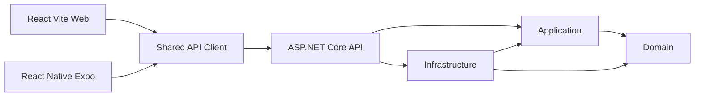

# Spa Như Nguyệt — Foundation

Monorepo nền tảng cho hệ thống quản lý spa: ASP.NET Core .NET 9, React + Vite và React Native + Expo. Phiên bản này chỉ triển khai cấu trúc, UI và API kiểm tra hệ thống. Các màn hình nghiệp vụ ghi rõ **Tính năng đang được phát triển**.

```text
SpaSystem/
├── backend/
│   ├── NhuNguyetSpa.sln
│   ├── src/         Domain, Application, Infrastructure, API
│   └── tests/       Domain.Tests, Application.Tests, IntegrationTests
├── apps/
│   ├── web/         React, Vite, TypeScript, CSS Modules
│   └── mobile/      React Native, Expo Router, TypeScript
├── packages/
│   ├── api-client/  Fetch client, SystemApi, query keys
│   ├── shared-types/ API và pagination contracts
│   └── shared-config/ TypeScript, ESLint, Prettier
└── docs/            Kiến trúc, phát triển, web, mobile
```

## Kiến trúc



Domain không có project/package reference. Application chỉ tham chiếu Domain, không tham chiếu ASP.NET Core, Infrastructure hoặc EF Core. Infrastructure thực thi abstraction của Application. API là composition root. Shared packages không phụ thuộc ứng dụng hoặc React. Component web và mobile được viết riêng.

## Yêu cầu môi trường

- .NET **9 SDK**; `global.json` chọn 9.0.200 và cho phép feature band mới trong .NET 9.
- Node.js **22.13 trở lên trong dòng 22**, **24.3 trở lên trong dòng 24**, hoặc **25 trở lên** (khuyến nghị Node 22 LTS), npm **10 trở lên**. Chỉ sử dụng npm và một `package-lock.json` ở root.
- Android Studio, Android SDK và emulator nếu chạy trên Android.
- Expo Go tương thích **SDK 57**. Có thể dùng bản Android phù hợp từ [Expo Go downloads](https://expo.dev/go). Không yêu cầu APK/AAB production.
- Docker Desktop với Linux containers nếu sử dụng Docker.

Expo SDK 57 được ghép với React Native 0.86.3 và React 19.2.3 theo [bảng tương thích Expo](https://docs.expo.dev/versions/v57.0.0/). Web cũng dùng React 19.2.3 để hạn chế bản React trùng trong workspaces. Metro sử dụng cấu hình mặc định của Expo, hỗ trợ monorepo và alias qua tsconfig.

## Chạy backend, web và app bằng một lệnh

Sau khi đã cài dependencies bằng `npm install`, chạy tại thư mục gốc:

```powershell
cd E:\UTE\HK126\Code\SpaSystem
npm run dev
```

Lệnh tự chọn IPv4 LAN (ưu tiên Wi-Fi), chạy backend ở port 5000, web ở 5173 và Expo Go ở 8081. API URL cho web/mobile và CORS được cấu hình theo IP này. Điện thoại cần cùng Wi-Fi với máy tính; mở Expo Go hỗ trợ SDK 57 và quét QR trong terminal. Nhấn **Ctrl+C** để dừng cả ba tiến trình.

Nếu máy có nhiều card mạng, chỉ định IP Wi-Fi:

```powershell
npm run dev -- --host 192.168.1.59
```

Dừng các server cũ trước khi chạy. Script báo lỗi khi port 5000, 5173 hoặc 8081 đã được sử dụng. Các lệnh chạy riêng bên dưới vẫn dùng được.

## Backend

Chạy các lệnh tại root:

```powershell
dotnet restore backend/NhuNguyetSpa.sln
dotnet build backend/NhuNguyetSpa.sln
dotnet test backend/NhuNguyetSpa.sln
dotnet dev-certs https --trust
dotnet run --project backend/src/API --launch-profile https
```

- Swagger: `https://localhost:7001/swagger`
- Ping: `https://localhost:7001/api/v1/system/ping`
- Liveness: `https://localhost:7001/health/live`
- Readiness: `https://localhost:7001/health/ready`
- HTTP profile: `dotnet run --project backend/src/API --launch-profile http` trên `http://localhost:5000`.

Swagger chỉ mở trong Development hoặc khi đặt `Swagger__Enabled=true`. `/health/live` chỉ kiểm tra tiến trình API; `/health/ready` kiểm tra thêm kết nối PostgreSQL và trả 503 `Unhealthy` khi không kết nối được. JSON health contract là `{ "status": "Healthy" }`. Ping và các lỗi API dùng envelope `success`, `message`, `data`, `errors`, `traceId`.

HTTPS redirection hoạt động khi profile khai báo HTTPS port/endpoint. HTTP profile cho emulator và container không chuyển hướng sang certificate localhost mà Android không tin cậy. Khi đưa vào môi trường khác, cấu hình HTTPS hoặc TLS tại reverse proxy.

AutoMapper **15.1.3** được chọn vì bản 14 bị [CVE-2026-32933](https://github.com/advisories/GHSA-rvv3-g6hj-g44x). Dòng 15 yêu cầu giấy phép; skeleton đăng ký mapper và kiểm tra configuration nhưng chưa có mapping nghiệp vụ. Không có license key trong repository. Khi cần dùng mapper, cấu hình giấy phép hợp lệ qua `AUTOMAPPER_LICENSE_KEY` theo [tài liệu AutoMapper](https://docs.automapper.io/en/stable/License-configuration.html). Không tắt log giấy phép.

## Npm workspaces và web

```powershell
npm install
Copy-Item apps/web/.env.example apps/web/.env
Copy-Item apps/mobile/.env.example apps/mobile/.env
npm run web
```

Website ở `http://localhost:5173`. Dùng API HTTPS profile và trust dev certificate ở bước backend. Nếu dùng HTTP profile, sửa `.env` của web thành `VITE_API_BASE_URL=http://localhost:5000`.

```powershell
npm run lint
npm run typecheck
npm run test
npm run web:test
npm run web:build
npm run format
npm run format:check
```

`web:build` xuất static assets vào `apps/web/dist`. Tests mock network, không cần backend chạy. TanStack Query giữ server state, Zustand chỉ giữ client state. Form minh họa React Hook Form + Zod chỉ kiểm tra định dạng email trên thiết bị; chưa đăng nhập/đăng ký và không gửi email lên API.

## Mobile và Android

Mở Android emulator trước, rồi chạy từ root:

```powershell
dotnet run --project backend/src/API --launch-profile http
# Trong terminal khác:
npm run mobile:android
```

Hoặc `npm run mobile` để mở Expo và chọn thiết bị. Mobile `.env.example` dùng `EXPO_PUBLIC_API_BASE_URL=http://10.0.2.2:5000`. **10.0.2.2** là địa chỉ Android emulator dùng để truy cập loopback máy host; `localhost` trong emulator là chính emulator.

Thiết bị thật cần API URL là IP LAN của máy backend, ví dụ `http://<IP-LAN>:5000`. Chạy backend trên interface phù hợp:

```powershell
$env:ASPNETCORE_ENVIRONMENT = 'Development'
dotnet run --project backend/src/API --no-launch-profile --urls http://0.0.0.0:5000
```

Điện thoại và máy backend cần cùng mạng, firewall cho phép port 5000. Địa chỉ Metro/Expo được cấu hình riêng với API URL. HTTP cục bộ dùng cho Expo Go trong phase này; ứng dụng native phân phối sau này cần chính sách HTTPS phù hợp. Không eject hoặc tạo native project trong repository.

Chạy Expo từ root trong terminal khác, thay IP ví dụ bằng IPv4 LAN của máy tính:

```powershell
cd E:\UTE\HK126\Code\SpaSystem
$env:EXPO_PUBLIC_API_BASE_URL = 'http://192.168.1.59:5000'
$env:REACT_NATIVE_PACKAGER_HOSTNAME = '192.168.1.59'
npm run start --workspace @spa/mobile -- --lan --go --clear
```

Mở Expo Go hỗ trợ SDK 57 trên Android và quét QR. Sau khi nâng SDK, dừng Metro cũ trước khi chạy lại với `--clear`.

Kiểm tra mobile mà không chờ development server:

```powershell
npm run mobile:check
npm run typecheck --workspace @spa/mobile
npm run test --workspace @spa/mobile
cd apps/mobile
npx expo install --check
cd ../..
npm run mobile:export
```

`mobile:export` tạo JavaScript bundle/assets Android vào `apps/mobile/dist` để kiểm tra Metro và workspace imports. Lệnh này không tạo APK/AAB và không publish.

## Environment

| Ứng dụng | Biến                       | Giá trị trong example    |
| -------- | -------------------------- | ------------------------ |
| Web      | `VITE_API_BASE_URL`        | `https://localhost:7001` |
| Mobile   | `EXPO_PUBLIC_API_BASE_URL` | `http://10.0.2.2:5000`   |

API URL phải là URL HTTP(S) tuyệt đối. Thiếu/sai cấu hình hiển thị **Configuration Error** và không gọi network; không fallback sang Production. `.env` thật bị gitignore. Biến `VITE_*` và `EXPO_PUBLIC_*` nằm trong bundle công khai, không chứa secret. Khởi động lại Vite/Expo sau khi sửa môi trường.

CORS đọc `Cors:AllowedOrigins` từ appsettings hoặc environment. Development cho phép `http://localhost:5173` và `http://localhost:8080`. Với trình duyệt Android hoặc web qua IP LAN, thêm **origin của web** vào CORS, ví dụ `Cors__AllowedOrigins__2=http://<IP-LAN>:5173`. React Native native fetch không chịu cơ chế CORS của trình duyệt. Không dùng wildcard origin hoặc credentials trong skeleton.

## Shared packages

- `@spa/shared-types`: API response/error, pagination, health và system status. Chưa có contract nghiệp vụ.
- `@spa/api-client`: `ApiClient`, `ApiClientError`, `SystemApi`, URL validation, system query keys/policy. Hỗ trợ GET/POST/PUT/PATCH/DELETE, JSON, query arrays, header callback và cancellation. Response rỗng trả `undefined`; dùng kiểu `void` cho endpoint 204.
- `@spa/shared-config`: TypeScript base strict, ESLint và Prettier.

Packages TypeScript export source để Vite, Metro và test runners tự transform, không cần chạy build package trước. Hai ứng dụng chỉ gọi `/api/v1/system/ping` và `/health/live`, không polling, `staleTime=60s`, tối đa một retry.

## Routing và foundation UI

Danh sách đầy đủ trong [docs/frontend.md](docs/frontend.md) và [docs/mobile.md](docs/mobile.md). Web có PublicLayout, CustomerLayout, StaffLayout, OwnerLayout; mobile có public Stack, customer Tabs và staff/owner Stack. Khu vực vai trò hiện là **preview công khai** chỉ chứa placeholder, chưa được bảo vệ. RouteGuard là abstraction dành cho phase authentication; không dùng guard này như biện pháp bảo mật cho dữ liệu thật.

Web có button/input/select/modal/spinner, empty/error/loading state, SystemStatus, header/sidebar/mobile navigation/footer; mobile có screen/text/button/input/card/loader, empty/error state và SystemStatus. Web hỗ trợ semantic HTML, focus, skip link, dialog native và responsive viewport. Mobile dùng SafeAreaView, keyboard handling, touch target tối thiểu 48 và accessibility labels. Theme dùng màu kem, hồng nhẹ và semantic colors tương ứng. `src/locales/vi` giữ chỗ cho i18n; chưa cài i18n runtime.

## Docker

```powershell
docker compose config --quiet
docker compose up --build
```

API: `http://localhost:5000`; web: `http://localhost:8080`. Compose chỉ có API và web. API chạy Production, không bật Swagger mặc định. Backend image multi-stage .NET 9 và user không phải root. Web image build Vite rồi phục vụ bằng Nginx với SPA fallback.

Web URL là **build-time**: đặt `VITE_API_BASE_URL` trước `docker compose build web` nếu truy cập từ máy khác. `localhost:5000` trong Compose là địa chỉ mà **trình duyệt** gọi, không phải hostname nội bộ container. Không chứa secret trong image. Nếu đổi web origin, đổi cấu hình CORS API tương ứng. Expo không containerize thành production service.

## Quy tắc thêm feature

1. Thiết kế contract và use case trước; entity/value object chỉ thêm vào Domain khi có nghiệp vụ xác định.
2. DTO, validator, use case và port/interface vào Application, không trả IActionResult và không import EF Core.
3. Implementation database/provider vào Infrastructure, đăng ký qua `AddInfrastructure`.
4. API controller chỉ chuyển request/result; lỗi qua middleware chung.
5. UI/hook/API theo `features/<feature>` trên từng nền tảng; chỉ thêm shared type khi backend có contract chính thức.
6. Server state dùng Query, client state dùng Zustand, state cục bộ dùng React. Thêm tests theo hành vi và kiểm tra root commands.

## Phạm vi chưa triển khai và giả định

Đã có nền persistence: 29 entity, 19 enum, `AppDbContext` (EF Core 9 + Npgsql, tên `snake_case`), cấu hình từng bảng, migration `InitialCreate` (gồm ràng buộc `EXCLUDE` chống trùng lịch), `IUnitOfWork`, `IRepository<T>`, interceptor ghi thời điểm tạo/sửa. Thiết kế chi tiết ở [docs/domain/data-model.md](docs/domain/data-model.md).

Chưa có: seed, service/use case nghiệp vụ, JWT, login, token storage/refresh, booking, payment, promotion, AI provider/chat, upload, notification hoặc background job. Không deploy/publish và không build APK/AAB production.

### CSDL cho phát triển

```powershell
Copy-Item backend/src/API/.env.example backend/src/API/.env   # một lần; .env không commit
npm run db:up        # PostgreSQL 17 trong Docker (cổng 5432)
npm run db:migrate   # áp migration
```

Cấu hình backend đọc từ `backend/src/API/.env` qua `API/Configuration/EnvLoader.cs` (cùng mẫu với FIN-Solution). Khóa viết `UPPER_SNAKE_CASE` và được ánh xạ sang cấu hình .NET: `CONNECTION_STRING` → `ConnectionStrings:Default`, `JWT_*` → `Jwt:*`, `MAIL_SETTINGS_*` → `MailSettings:*`, `SWAGGER_ENABLED` → `Swagger:Enabled`. Thứ tự ưu tiên: `appsettings*.json` < `.env` < biến môi trường thật cùng tên < biến dạng `Section__Key` và tham số dòng lệnh. Secret chỉ đặt trong `.env` hoặc biến môi trường, không đặt trong `appsettings*.json`. `dotnet ef` cũng đọc `CONNECTION_STRING` từ file này. Docker Compose truyền `CONNECTION_STRING` cho container; các biến của Compose (`POSTGRES_PASSWORD`, `VITE_API_BASE_URL`) có mẫu ở `.env.example` tại thư mục gốc.

Cần .NET 9 SDK (theo `global.json`) và Docker Desktop đang chạy. `dotnet-ef` là tool cục bộ của repo (`.config/dotnet-tools.json`).

Giả định: giờ lưu/trả về là UTC; timezone ứng dụng là `Asia/Ho_Chi_Minh`; pagination mặc định 1/10 và normalize PageSize 1–100; ID khởi tạo bằng Guid; audit creation time có mặc định UTC nhưng chưa có cơ chế audit tự động. Readiness tương đương liveness cho phase chưa có hạ tầng ngoài. Vai trò trong route chỉ thể hiện cấu trúc UI. Không chỉnh sửa dự án tham khảo FIXY.

Phase tiếp theo: thống nhất phạm vi/role matrix, thiết kế domain và database PostgreSQL, thêm EF Core trong Infrastructure cùng migration được review, sau đó triển khai authentication và use case dịch vụ/nhân viên trước khi xây booking. Xem [architecture.md](docs/architecture.md), [development.md](docs/development.md), [frontend.md](docs/frontend.md), [mobile.md](docs/mobile.md).
