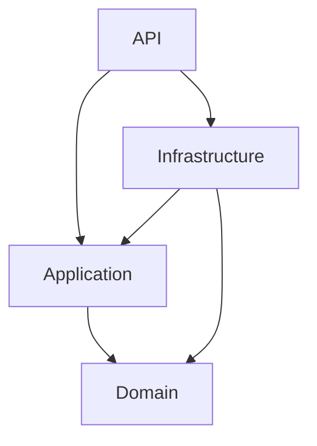
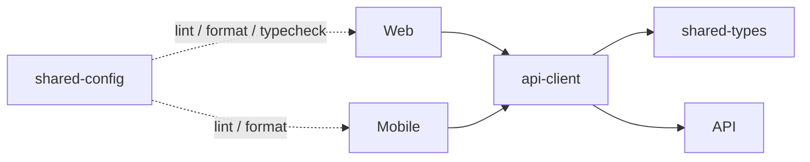

# Kiến trúc nền tảng

## Backend và dependency

| Project                        | Project references          |
| ------------------------------ | --------------------------- |
| NhuNguyetSpa.Domain            | Không có                    |
| NhuNguyetSpa.Application       | Domain                      |
| NhuNguyetSpa.Infrastructure    | Application, Domain         |
| NhuNguyetSpa.API               | Application, Infrastructure |
| NhuNguyetSpa.Domain.Tests      | Domain                      |
| NhuNguyetSpa.Application.Tests | Application                 |
| NhuNguyetSpa.IntegrationTests  | API                         |

Tất cả target net9.0, nullable và implicit usings bật. Domain không phụ thuộc package/framework. Application dùng FluentValidation, AutoMapper và DI/logging abstractions cần cho đăng ký mapper; không có FrameworkReference ASP.NET Core hoặc EF Core. API là composition root, gọi AddApplication, AddInfrastructure và AddApiFoundation.

BaseEntity chỉ có Guid identity. BaseAuditableEntity thêm UTC timestamps và Guid actor IDs. ISoftDelete là interface, chưa có query filter. OperationResult bất biến, giữ read-only error collection; HTTP envelope được tạo tại API. PagedQuery normalize giới hạn, PagedResult kiểm tra argument và tính metadata. DateTime provider nằm trong Infrastructure, interface nằm trong Application. HttpCurrentUserService nằm trong API, đọc claims thật, không tạo người dùng giả.

Exception middleware: Validation/BusinessRule 400, NotFound 404, Conflict 409, Unauthorized 401, unexpected 500. ILogger ghi log với trace ID; client không nhận exception stack hoặc nội dung exception bất ngờ. Thông báo Domain exception dành cho client; không đưa secret/nội dung hạ tầng vào Domain exception. Model binding và API 404 cũng dùng envelope thống nhất. Health checks có contract riêng `{status}` và chỉ kiểm tra tiến trình.

## Tham khảo FIXY

Đã đọc FIXY.sln, Program, controller base, middleware, API extensions, Application Common/DTO/interfaces/validators, Domain Common/entity/enum, Infrastructure DI/persistence/repository/service và CODING_GUIDE theo chế độ chỉ đọc. Giữ ý tưởng chia layer, DI extensions, nhóm module, PascalCase và controller helper. Không sao chép entity, migration hoặc nghiệp vụ.

Các điểm sửa so với reference: Application của FIXY chứa FrameworkReference ASP.NET Core và EF Core; DTO có IFormFile; middleware chưa thống nhất với OperationResult; Swagger/CORS cấu hình trực tiếp trong Program. Skeleton loại bỏ các phụ thuộc framework của Application, để HTTP contract/current-user adapter tại API, dùng configuration cho CORS, Swagger và Serilog, không kết nối database.

## Frontend

Source exports trong packages giúp Vite/Metro transform trực tiếp. React component không dùng chung giữa DOM và Native. TanStack Query sở hữu server state; Zustand chỉ giữ UI/session abstraction. Query keys và retry/stale policy nằm trong api-client để hai ứng dụng có cùng hành vi. Feature folder giữ chỗ cho use case tiếp theo, không có service/repository giả.

## Chặng tiếp theo

Xác định role matrix và vòng đời dịch vụ/lịch hẹn; thiết kế aggregate, ràng buộc lịch nhân viên và tính nhất quán thanh toán; review schema PostgreSQL trước khi thêm EF Core chỉ vào Infrastructure. Thêm authentication, authorization, tests policy, rồi đưa dữ liệu thật vào route guards. Migration, audit và soft-delete chỉ thêm khi có persistence thật.
