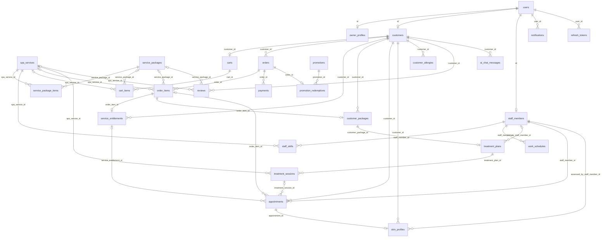

# Mô hình dữ liệu

> File sinh tự động từ `docs/spec-source/data_db.py` — sửa ở đó rồi chạy lại `build_markdown.py`, không sửa tay file này.

Tên bảng, cột, enum chuẩn hóa tiếng Anh theo [ADR-0001](../decisions/ADR-0001-english-code-identifiers.md); cột **DA** là tên trong báo cáo `126_DA_NTTT_NguyenXuanHoang_2214_v1.docx` để đối chiếu. Quy ước kiểu dữ liệu, ràng buộc, migration ở [conventions/database.md](../conventions/database.md).

- Bảng và cột `snake_case` (EF Core `UseSnakeCaseNamingConvention()`); thuộc tính C# là PascalCase tương ứng.
- `*_at_utc` là `timestamptz` UTC; `date`/`start_time`/`end_time` của `appointments`, `work_schedules` là giờ Việt Nam ([ADR-0003](../decisions/ADR-0003-appointment-time-and-overlap.md)).
- Enum lưu chuỗi `snake_case` + `CHECK`; tiền VND `numeric(12,0)`.
- Bảng đánh dấu **ĐX** không có trong báo cáo, được đề xuất bổ sung (sheet `26_Ra_soat_DA`, RS-17).
- `customers`, `staff_members`, `owner_profiles` dùng chung khóa chính với `users` (`id` = `users.id`).

## Sơ đồ quan hệ

## Danh sách bảng

| Nhóm                       | Bảng                                              | Entity                | DA                       | Mục đích                                                              | Nguồn |
| -------------------------- | ------------------------------------------------- | --------------------- | ------------------------ | --------------------------------------------------------------------- | ----- |
| Tài khoản                  | [`users`](#users)                                 | `User`                | NguoiDung                | Tài khoản dùng chung cho khách hàng, nhân viên, chủ spa               | DA    |
| Tài khoản                  | [`owner_profiles`](#owner_profiles)               | `OwnerProfile`        | ChuSpa                   | Thông tin riêng của chủ spa (1-1 với users, dùng chung khóa chính)    | DA    |
| Tài khoản                  | [`customers`](#customers)                         | `Customer`            | KhachHang                | Thông tin riêng của khách hàng (1-1 với users, dùng chung khóa chính) | DA    |
| Nhân viên                  | [`staff_members`](#staff_members)                 | `StaffMember`         | NhanVien                 | Thông tin riêng của nhân viên (1-1 với users, dùng chung khóa chính)  | DA    |
| Dịch vụ & gói              | [`spa_services`](#spa_services)                   | `SpaService`          | DichVu                   | Dịch vụ chăm sóc da lẻ                                                | DA    |
| Dịch vụ & gói              | [`service_packages`](#service_packages)           | `ServicePackage`      | GoiDichVu                | Gói dịch vụ nhiều buổi                                                | DA    |
| Dịch vụ & gói              | [`service_package_items`](#service_package_items) | `ServicePackageItem`  | GoiDichVuChiTiet         | Dịch vụ thành phần của gói: số buổi, thứ tự, khoảng cách              | DA    |
| Nhân viên                  | [`staff_skills`](#staff_skills)                   | `StaffSkill`          | NhanVien_DichVu          | Nhân viên thực hiện được dịch vụ nào (khóa chính ghép)                | DA    |
| Nhân viên                  | [`work_schedules`](#work_schedules)               | `WorkSchedule`        | LichLamViec              | Ca làm việc của nhân viên (giờ Việt Nam — ADR-0003)                   | DA    |
| Khuyến mãi                 | [`promotions`](#promotions)                       | `Promotion`           | KhuyenMai                | Chương trình khuyến mãi                                               | DA    |
| Giỏ, đơn, thanh toán       | [`carts`](#carts)                                 | `Cart`                | GioHang                  | Giỏ hàng (mỗi khách 1 giỏ)                                            | DA    |
| Giỏ, đơn, thanh toán       | [`cart_items`](#cart_items)                       | `CartItem`            | ChiTietGioHang           | Sản phẩm trong giỏ                                                    | DA    |
| Giỏ, đơn, thanh toán       | [`orders`](#orders)                               | `Order`               | DonHang                  | Đơn hàng                                                              | DA    |
| Giỏ, đơn, thanh toán       | [`order_items`](#order_items)                     | `OrderItem`           | ChiTietDonHang           | Sản phẩm trong đơn (lưu tên, giá lúc mua)                             | DA    |
| Giỏ, đơn, thanh toán       | [`payments`](#payments)                           | `Payment`             | ThanhToan                | Lần thanh toán qua cổng (một đơn có thể nhiều lần thử)                | DA    |
| Khuyến mãi                 | [`promotion_redemptions`](#promotion_redemptions) | `PromotionRedemption` | ApDungKhuyenMai          | Khuyến mãi áp dụng cho đơn (1 đơn tối đa 1 mã)                        | DA    |
| Quyền sử dụng & liệu trình | [`service_entitlements`](#service_entitlements)   | `ServiceEntitlement`  | DichVuKhachHang          | Quyền sử dụng một dịch vụ lẻ đã mua                                   | DA    |
| Quyền sử dụng & liệu trình | [`customer_packages`](#customer_packages)         | `CustomerPackage`     | GoiKhachHang             | Gói dịch vụ khách đã mua                                              | DA    |
| Quyền sử dụng & liệu trình | [`treatment_plans`](#treatment_plans)             | `TreatmentPlan`       | LieuTrinh                | Liệu trình gắn với gói đã mua (1-1)                                   | DA    |
| Quyền sử dụng & liệu trình | [`treatment_sessions`](#treatment_sessions)       | `TreatmentSession`    | BuoiChamSoc              | Các buổi trong liệu trình theo thứ tự                                 | DA    |
| Lịch hẹn                   | [`appointments`](#appointments)                   | `Appointment`         | LichHen                  | Lịch hẹn — bảng trung tâm của thuật toán chống trùng lịch (ADR-0003)  | DA    |
| Chăm sóc                   | [`skin_profiles`](#skin_profiles)                 | `SkinProfile`         | HoSoDa                   | Hồ sơ da lập theo từng lần chăm sóc                                   | DA    |
| Chăm sóc                   | [`customer_allergies`](#customer_allergies)       | `CustomerAllergy`     | DiUngKhachHang           | Thông tin dị ứng của khách                                            | DA    |
| Đánh giá                   | [`reviews`](#reviews)                             | `Review`              | DanhGia                  | Đánh giá dịch vụ hoặc gói                                             | DA    |
| Trợ lý AI                  | [`ai_chat_messages`](#ai_chat_messages)           | `AiChatMessage`       | LichSuTroChuyenAI        | Lịch sử hỏi – đáp với trợ lý AI                                       | DA    |
| Thông báo                  | [`notifications`](#notifications)                 | `Notification`        | ThongBao                 | Thông báo gửi đến người dùng                                          | DA    |
| Tài khoản                  | [`otp_codes`](#otp_codes)                         | `OtpCode`             | (MaOtp — đề xuất)        | OTP đăng ký / quên mật khẩu (UC-SPA-01, 03)                           | ĐX    |
| Tài khoản                  | [`refresh_tokens`](#refresh_tokens)               | `RefreshToken`        | (RefreshToken — đề xuất) | Phiên đăng nhập JWT, refresh token xoay vòng                          | ĐX    |
| Dịch vụ & gói              | [`spa_profiles`](#spa_profiles)                   | `SpaProfile`          | (ThongTinSpa — đề xuất)  | Thông tin giới thiệu, liên hệ, giờ mở cửa (UC-SPA-08)                 | ĐX    |

## Chi tiết bảng

### users

`User` · DA: NguoiDung · Sprint 1 · Tài khoản dùng chung cho khách hàng, nhân viên, chủ spa. UC: UC-SPA-01, UC-SPA-02, UC-SPA-03, UC-SPA-04, UC-SPA-05, UC-SPA-22, UC-SPA-25.

| Cột              | PostgreSQL   | C#                       | Null  | Ràng buộc             | Mô tả                                   | DA          |
| ---------------- | ------------ | ------------------------ | ----- | --------------------- | --------------------------------------- | ----------- |
| `id`             | uuid         | `Id`: Guid               | không | PK                    | Mã người dùng                           | MaNguoiDung |
| `full_name`      | varchar(100) | `FullName`: string       | không | —                     | Họ và tên                               | HoTen       |
| `email`          | citext       | `Email`: string          | không | UQ                    | Email đăng nhập                         | Email       |
| `phone_number`   | varchar(15)  | `PhoneNumber`: string    | không | UQ                    | Số điện thoại                           | SDT         |
| `password_hash`  | varchar(255) | `PasswordHash`: string   | không | —                     | Mật khẩu đã băm (ASP.NET Core Identity) | MatKhauHash |
| `role`           | varchar(30)  | `Role`: UserRole         | không | CHECK enum UserRole   | Vai trò                                 | VaiTro      |
| `avatar_url`     | varchar(500) | `AvatarUrl`: string      | có    | —                     | Ảnh đại diện                            | AnhDaiDien  |
| `status`         | varchar(30)  | `Status`: UserStatus     | không | CHECK enum UserStatus | Trạng thái tài khoản                    | TrangThai   |
| `date_of_birth`  | date         | `DateOfBirth`: DateOnly  | có    | —                     | Ngày sinh                               | NgaySinh    |
| `gender`         | varchar(30)  | `Gender`: Gender         | có    | CHECK enum Gender     | Giới tính                               | GioiTinh    |
| `created_at_utc` | timestamptz  | `CreatedAtUtc`: DateTime | không | —                     | Thời điểm tạo                           | NgayTao     |
| `updated_at_utc` | timestamptz  | `UpdatedAtUtc`: DateTime | có    | —                     | Thời điểm cập nhật gần nhất             | NgayCapNhat |
| `created_by`     | uuid         | `CreatedBy`: Guid        | có    | —                     | Người tạo (từ BaseAuditableEntity)      | —           |
| `updated_by`     | uuid         | `UpdatedBy`: Guid        | có    | —                     | Người cập nhật (từ BaseAuditableEntity) | —           |

### owner_profiles

`OwnerProfile` · DA: ChuSpa · Sprint 1 · Thông tin riêng của chủ spa (1-1 với users, dùng chung khóa chính). UC: UC-SPA-04.

| Cột    | PostgreSQL | C#             | Null  | Ràng buộc         | Mô tả                     | DA          |
| ------ | ---------- | -------------- | ----- | ----------------- | ------------------------- | ----------- |
| `id`   | uuid       | `Id`: Guid     | không | PK, FK → users.id | Bằng users.id của chủ spa | MaNguoiDung |
| `note` | text       | `Note`: string | có    | —                 | Ghi chú                   | GhiChu      |

### customers

`Customer` · DA: KhachHang · Sprint 1 · Thông tin riêng của khách hàng (1-1 với users, dùng chung khóa chính). UC: UC-SPA-01, UC-SPA-04, UC-SPA-05, UC-SPA-25, UC-SPA-26.

| Cột    | PostgreSQL | C#             | Null  | Ràng buộc         | Mô tả                        | DA          |
| ------ | ---------- | -------------- | ----- | ----------------- | ---------------------------- | ----------- |
| `id`   | uuid       | `Id`: Guid     | không | PK, FK → users.id | Bằng users.id của khách hàng | MaNguoiDung |
| `note` | text       | `Note`: string | có    | —                 | Ghi chú                      | GhiChu      |

### staff_members

`StaffMember` · DA: NhanVien · Sprint 1 · Thông tin riêng của nhân viên (1-1 với users, dùng chung khóa chính). UC: UC-SPA-04, UC-SPA-05, UC-SPA-17, UC-SPA-20, UC-SPA-22, UC-SPA-23.

| Cột                | PostgreSQL   | C#                          | Null  | Ràng buộc                           | Mô tả                       | DA           |
| ------------------ | ------------ | --------------------------- | ----- | ----------------------------------- | --------------------------- | ------------ |
| `id`               | uuid         | `Id`: Guid                  | không | PK, FK → users.id                   | Bằng users.id của nhân viên | MaNguoiDung  |
| `hire_date`        | date         | `HireDate`: DateOnly        | không | —                                   | Ngày bắt đầu làm việc       | NgayVaoLam   |
| `specialty`        | varchar(255) | `Specialty`: string         | có    | —                                   | Chuyên môn                  | ChuyenMon    |
| `resignation_date` | date         | `ResignationDate`: DateOnly | có    | CHECK resignation_date >= hire_date | Ngày nghỉ việc              | NgayNghiViec |

### spa_services

`SpaService` · DA: DichVu · Sprint 1 · Dịch vụ chăm sóc da lẻ. UC: UC-SPA-06, UC-SPA-07, UC-SPA-09, UC-SPA-10, UC-SPA-15, UC-SPA-20, UC-SPA-25, UC-SPA-29, UC-SPA-32.

| Cột                | PostgreSQL    | C#                       | Null  | Ràng buộc                | Mô tả                                     | DA            |
| ------------------ | ------------- | ------------------------ | ----- | ------------------------ | ----------------------------------------- | ------------- |
| `id`               | uuid          | `Id`: Guid               | không | PK                       | Mã dịch vụ                                | Id            |
| `name`             | varchar(150)  | `Name`: string           | không | —                        | Tên dịch vụ                               | TenDichVu     |
| `category`         | varchar(100)  | `Category`: string       | không | IDX                      | Nhóm phân loại (dùng làm bộ lọc danh mục) | LoaiDichVu    |
| `description`      | text          | `Description`: string    | có    | —                        | Mô tả                                     | MoTa          |
| `duration_minutes` | integer       | `DurationMinutes`: int   | không | CHECK > 0                | Thời lượng (phút)                         | ThoiLuongPhut |
| `price`            | numeric(12,0) | `Price`: decimal         | không | CHECK >= 0               | Giá bán (VND)                             | Gia           |
| `image_url`        | varchar(500)  | `ImageUrl`: string       | có    | —                        | Ảnh dịch vụ                               | HinhAnh       |
| `status`           | varchar(30)   | `Status`: CatalogStatus  | không | CHECK enum CatalogStatus | Trạng thái kinh doanh                     | TrangThai     |
| `created_at_utc`   | timestamptz   | `CreatedAtUtc`: DateTime | không | —                        | Thời điểm tạo                             | NgayTao       |
| `updated_at_utc`   | timestamptz   | `UpdatedAtUtc`: DateTime | có    | —                        | Thời điểm cập nhật gần nhất               | NgayCapNhat   |
| `created_by`       | uuid          | `CreatedBy`: Guid        | có    | —                        | Người tạo (từ BaseAuditableEntity)        | —             |
| `updated_by`       | uuid          | `UpdatedBy`: Guid        | có    | —                        | Người cập nhật (từ BaseAuditableEntity)   | —             |

### service_packages

`ServicePackage` · DA: GoiDichVu · Sprint 1 · Gói dịch vụ nhiều buổi. UC: UC-SPA-06, UC-SPA-07, UC-SPA-09, UC-SPA-10, UC-SPA-29, UC-SPA-32.

| Cột               | PostgreSQL    | C#                        | Null  | Ràng buộc                              | Mô tả                                   | DA             |
| ----------------- | ------------- | ------------------------- | ----- | -------------------------------------- | --------------------------------------- | -------------- |
| `id`              | uuid          | `Id`: Guid                | không | PK                                     | Mã gói                                  | Id             |
| `name`            | varchar(150)  | `Name`: string            | không | —                                      | Tên gói                                 | TenGoiDichVu   |
| `description`     | text          | `Description`: string     | có    | —                                      | Mô tả                                   | MoTa           |
| `price`           | numeric(12,0) | `Price`: decimal          | không | CHECK >= 0                             | Giá bán (VND)                           | Gia            |
| `validity_days`   | integer       | `ValidityDays`: int       | không | CHECK > 0                              | Thời hạn sử dụng (ngày)                 | ThoiHanNgay    |
| `status`          | varchar(30)   | `Status`: CatalogStatus   | không | CHECK enum CatalogStatus               | Trạng thái kinh doanh                   | TrangThai      |
| `sale_start_date` | date          | `SaleStartDate`: DateOnly | có    | —                                      | Ngày bắt đầu bán                        | NgayBatDauBan  |
| `sale_end_date`   | date          | `SaleEndDate`: DateOnly   | có    | CHECK sale_end_date >= sale_start_date | Ngày kết thúc bán                       | NgayKetThucBan |
| `created_at_utc`  | timestamptz   | `CreatedAtUtc`: DateTime  | không | —                                      | Thời điểm tạo                           | NgayTao        |
| `updated_at_utc`  | timestamptz   | `UpdatedAtUtc`: DateTime  | có    | —                                      | Thời điểm cập nhật gần nhất             | NgayCapNhat    |
| `created_by`      | uuid          | `CreatedBy`: Guid         | có    | —                                      | Người tạo (từ BaseAuditableEntity)      | —              |
| `updated_by`      | uuid          | `UpdatedBy`: Guid         | có    | —                                      | Người cập nhật (từ BaseAuditableEntity) | —              |

### service_package_items

`ServicePackageItem` · DA: GoiDichVuChiTiet · Sprint 1 · Dịch vụ thành phần của gói: số buổi, thứ tự, khoảng cách. UC: UC-SPA-06, UC-SPA-07, UC-SPA-09, UC-SPA-15.

| Cột                         | PostgreSQL | C#                            | Null  | Ràng buộc                | Mô tả                                      | DA                     |
| --------------------------- | ---------- | ----------------------------- | ----- | ------------------------ | ------------------------------------------ | ---------------------- |
| `id`                        | uuid       | `Id`: Guid                    | không | PK                       | Mã chi tiết gói                            | Id                     |
| `spa_service_id`            | uuid       | `SpaServiceId`: Guid          | không | FK → spa_services.id     | Dịch vụ thuộc gói                          | IdDichVu               |
| `service_package_id`        | uuid       | `ServicePackageId`: Guid      | không | FK → service_packages.id | Gói chứa chi tiết                          | IdGoiDichVu            |
| `session_count`             | integer    | `SessionCount`: int           | không | CHECK > 0                | Số buổi của dịch vụ trong gói              | SoBuoi                 |
| `min_days_between_sessions` | integer    | `MinDaysBetweenSessions`: int | không | CHECK >= 0               | Khoảng cách tối thiểu giữa các buổi (ngày) | KhoangCachNgayToiThieu |
| `sort_order`                | integer    | `SortOrder`: int              | không | CHECK > 0                | Thứ tự thực hiện trong gói                 | ThuTu                  |
| `note`                      | text       | `Note`: string                | có    | —                        | Ghi chú                                    | GhiChu                 |

### staff_skills

`StaffSkill` · DA: NhanVien_DichVu · Sprint 1 · Nhân viên thực hiện được dịch vụ nào (khóa chính ghép). UC: UC-SPA-15, UC-SPA-17, UC-SPA-22.

| Cột               | PostgreSQL | C#                    | Null  | Ràng buộc                 | Mô tả     | DA         |
| ----------------- | ---------- | --------------------- | ----- | ------------------------- | --------- | ---------- |
| `staff_member_id` | uuid       | `StaffMemberId`: Guid | không | PK, FK → staff_members.id | Nhân viên | IdNhanVien |
| `spa_service_id`  | uuid       | `SpaServiceId`: Guid  | không | PK, FK → spa_services.id  | Dịch vụ   | IdDichVu   |

### work_schedules

`WorkSchedule` · DA: LichLamViec · Sprint 1 · Ca làm việc của nhân viên (giờ Việt Nam — ADR-0003). UC: UC-SPA-15, UC-SPA-16, UC-SPA-17, UC-SPA-23, UC-SPA-24.

| Cột               | PostgreSQL  | C#                           | Null  | Ràng buộc                     | Mô tả                    | DA         |
| ----------------- | ----------- | ---------------------------- | ----- | ----------------------------- | ------------------------ | ---------- |
| `id`              | uuid        | `Id`: Guid                   | không | PK                            | Mã ca                    | Id         |
| `staff_member_id` | uuid        | `StaffMemberId`: Guid        | không | FK → staff_members.id         | Nhân viên được phân công | IdNhanVien |
| `date`            | date        | `Date`: DateOnly             | không | IDX (staff_member_id, date)   | Ngày làm việc            | Ngay       |
| `start_time`      | time        | `StartTime`: TimeOnly        | không | —                             | Giờ bắt đầu ca           | GioBatDau  |
| `end_time`        | time        | `EndTime`: TimeOnly          | không | CHECK end_time > start_time   | Giờ kết thúc ca          | GioKetThuc |
| `status`          | varchar(30) | `Status`: WorkScheduleStatus | không | CHECK enum WorkScheduleStatus | Trạng thái ca            | TrangThai  |

### promotions

`Promotion` · DA: KhuyenMai · Sprint 2 · Chương trình khuyến mãi. UC: UC-SPA-11, UC-SPA-14.

| Cột                   | PostgreSQL    | C#                           | Null  | Ràng buộc                         | Mô tả                   | DA                    |
| --------------------- | ------------- | ---------------------------- | ----- | --------------------------------- | ----------------------- | --------------------- |
| `id`                  | uuid          | `Id`: Guid                   | không | PK                                | Mã chương trình         | Id                    |
| `code`                | varchar(50)   | `Code`: string               | không | UQ                                | Mã khách nhập           | MaCode                |
| `description`         | text          | `Description`: string        | có    | —                                 | Mô tả                   | MoTa                  |
| `discount_type`       | varchar(30)   | `DiscountType`: DiscountType | không | CHECK enum DiscountType           | Hình thức giảm          | LoaiGiamGia           |
| `discount_value`      | numeric(12,2) | `DiscountValue`: decimal     | không | CHECK > 0; <= 100 khi percentage  | Giá trị giảm            | GiaTri                |
| `min_order_amount`    | numeric(12,0) | `MinOrderAmount`: decimal    | không | CHECK >= 0                        | Giá trị đơn tối thiểu   | GiaTriDonHangToiThieu |
| `max_discount_amount` | numeric(12,0) | `MaxDiscountAmount`: decimal | có    | CHECK > 0                         | Số tiền giảm tối đa     | GiaTriGiamToiDa       |
| `starts_at_utc`       | timestamptz   | `StartsAtUtc`: DateTime      | không | —                                 | Thời điểm bắt đầu       | NgayBatDau            |
| `ends_at_utc`         | timestamptz   | `EndsAtUtc`: DateTime        | không | CHECK ends_at_utc > starts_at_utc | Thời điểm kết thúc      | NgayKetThuc           |
| `per_customer_limit`  | integer       | `PerCustomerLimit`: int      | có    | CHECK > 0                         | Số lần tối đa mỗi khách | GioiHanMoiKhach       |
| `usage_limit`         | integer       | `UsageLimit`: int            | có    | CHECK > 0                         | Tổng số lượt tối đa     | SoLuong               |
| `status`              | varchar(30)   | `Status`: PromotionStatus    | không | CHECK enum PromotionStatus        | Trạng thái              | TrangThai             |

### carts

`Cart` · DA: GioHang · Sprint 2 · Giỏ hàng (mỗi khách 1 giỏ). UC: UC-SPA-10.

| Cột              | PostgreSQL  | C#                       | Null  | Ràng buộc             | Mô tả                                   | DA          |
| ---------------- | ----------- | ------------------------ | ----- | --------------------- | --------------------------------------- | ----------- |
| `id`             | uuid        | `Id`: Guid               | không | PK                    | Mã giỏ                                  | Id          |
| `customer_id`    | uuid        | `CustomerId`: Guid       | không | UQ, FK → customers.id | Khách sở hữu giỏ                        | IdKhachHang |
| `created_at_utc` | timestamptz | `CreatedAtUtc`: DateTime | không | —                     | Thời điểm tạo                           | NgayTao     |
| `updated_at_utc` | timestamptz | `UpdatedAtUtc`: DateTime | có    | —                     | Thời điểm cập nhật gần nhất             | NgayCapNhat |
| `created_by`     | uuid        | `CreatedBy`: Guid        | có    | —                     | Người tạo (từ BaseAuditableEntity)      | —           |
| `updated_by`     | uuid        | `UpdatedBy`: Guid        | có    | —                     | Người cập nhật (từ BaseAuditableEntity) | —           |

### cart_items

`CartItem` · DA: ChiTietGioHang · Sprint 2 · Sản phẩm trong giỏ. UC: UC-SPA-10, UC-SPA-11.

| Cột                  | PostgreSQL    | C#                       | Null  | Ràng buộc                                                                            | Mô tả                  | DA          |
| -------------------- | ------------- | ------------------------ | ----- | ------------------------------------------------------------------------------------ | ---------------------- | ----------- |
| `id`                 | uuid          | `Id`: Guid               | không | PK                                                                                   | Mã dòng giỏ            | Id          |
| `cart_id`            | uuid          | `CartId`: Guid           | không | FK → carts.id (CASCADE)                                                              | Giỏ chứa sản phẩm      | IdGioHang   |
| `spa_service_id`     | uuid          | `SpaServiceId`: Guid     | có    | FK → spa_services.id                                                                 | Dịch vụ được thêm      | IdDichVu    |
| `service_package_id` | uuid          | `ServicePackageId`: Guid | có    | FK → service_packages.id; CHECK num_nonnulls(spa_service_id, service_package_id) = 1 | Gói được thêm          | IdGoiDichVu |
| `unit_price`         | numeric(12,0) | `UnitPrice`: decimal     | không | CHECK >= 0                                                                           | Giá tham khảo lúc thêm | DonGia      |
| `added_at_utc`       | timestamptz   | `AddedAtUtc`: DateTime   | không | —                                                                                    | Thời điểm thêm         | NgayThem    |

### orders

`Order` · DA: DonHang · Sprint 2 · Đơn hàng. UC: UC-SPA-11, UC-SPA-12, UC-SPA-13, UC-SPA-15, UC-SPA-18, UC-SPA-33.

| Cột                  | PostgreSQL    | C#                          | Null  | Ràng buộc                                     | Mô tả                                   | DA                 |
| -------------------- | ------------- | --------------------------- | ----- | --------------------------------------------- | --------------------------------------- | ------------------ |
| `id`                 | uuid          | `Id`: Guid                  | không | PK                                            | Mã định danh đơn                        | Id                 |
| `code`               | varchar(50)   | `Code`: string              | không | UQ                                            | Mã đơn hiển thị                         | MaDonHang          |
| `customer_id`        | uuid          | `CustomerId`: Guid          | không | FK → customers.id                             | Khách tạo đơn                           | IdKhachHang        |
| `subtotal`           | numeric(12,0) | `Subtotal`: decimal         | không | CHECK >= 0                                    | Tổng tiền hàng trước giảm               | TongTienHang       |
| `discount_total`     | numeric(12,0) | `DiscountTotal`: decimal    | không | CHECK 0 <= discount_total <= subtotal         | Tổng giảm giá                           | TongGiamGia        |
| `grand_total`        | numeric(12,0) | `GrandTotal`: decimal       | không | CHECK grand_total = subtotal - discount_total | Tổng thanh toán                         | TongThanhToan      |
| `status`             | varchar(30)   | `Status`: OrderStatus       | không | CHECK enum OrderStatus                        | Trạng thái đơn                          | TrangThai          |
| `note`               | text          | `Note`: string              | có    | —                                             | Ghi chú                                 | GhiChu             |
| `payment_due_at_utc` | timestamptz   | `PaymentDueAtUtc`: DateTime | không | CHECK > created_at_utc                        | Hết hạn thanh toán                      | HetHanThanhToanLuc |
| `created_at_utc`     | timestamptz   | `CreatedAtUtc`: DateTime    | không | —                                             | Thời điểm tạo                           | NgayTao            |
| `updated_at_utc`     | timestamptz   | `UpdatedAtUtc`: DateTime    | có    | —                                             | Thời điểm cập nhật gần nhất             | NgayCapNhat        |
| `created_by`         | uuid          | `CreatedBy`: Guid           | có    | —                                             | Người tạo (từ BaseAuditableEntity)      | —                  |
| `updated_by`         | uuid          | `UpdatedBy`: Guid           | có    | —                                             | Người cập nhật (từ BaseAuditableEntity) | —                  |

### order_items

`OrderItem` · DA: ChiTietDonHang · Sprint 2 · Sản phẩm trong đơn (lưu tên, giá lúc mua). UC: UC-SPA-11, UC-SPA-12, UC-SPA-13, UC-SPA-15, UC-SPA-18, UC-SPA-33.

| Cột                  | PostgreSQL    | C#                        | Null  | Ràng buộc                                                                            | Mô tả                | DA          |
| -------------------- | ------------- | ------------------------- | ----- | ------------------------------------------------------------------------------------ | -------------------- | ----------- |
| `id`                 | uuid          | `Id`: Guid                | không | PK                                                                                   | Mã dòng đơn          | Id          |
| `order_id`           | uuid          | `OrderId`: Guid           | không | FK → orders.id                                                                       | Đơn chứa dòng        | IdDonHang   |
| `spa_service_id`     | uuid          | `SpaServiceId`: Guid      | có    | FK → spa_services.id                                                                 | Dịch vụ được mua     | IdDichVu    |
| `service_package_id` | uuid          | `ServicePackageId`: Guid  | có    | FK → service_packages.id; CHECK num_nonnulls(spa_service_id, service_package_id) = 1 | Gói được mua         | IdGoiDichVu |
| `product_name`       | varchar(150)  | `ProductName`: string     | không | —                                                                                    | Tên sản phẩm lúc mua | TenSanPham  |
| `unit_price`         | numeric(12,0) | `UnitPrice`: decimal      | không | CHECK >= 0                                                                           | Giá lúc mua          | DonGia      |
| `discount_amount`    | numeric(12,0) | `DiscountAmount`: decimal | không | CHECK 0 <= discount_amount <= unit_price                                             | Tiền giảm phân bổ    | TienGiam    |
| `line_total`         | numeric(12,0) | `LineTotal`: decimal      | không | CHECK line_total = unit_price - discount_amount                                      | Thành tiền           | ThanhTien   |
| `note`               | text          | `Note`: string            | có    | —                                                                                    | Ghi chú              | GhiChu      |

### payments

`Payment` · DA: ThanhToan · Sprint 2 · Lần thanh toán qua cổng (một đơn có thể nhiều lần thử). UC: UC-SPA-11, UC-SPA-12, UC-SPA-13, UC-SPA-33.

| Cột                       | PostgreSQL    | C#                              | Null  | Ràng buộc                | Mô tả                                      | DA                |
| ------------------------- | ------------- | ------------------------------- | ----- | ------------------------ | ------------------------------------------ | ----------------- |
| `id`                      | uuid          | `Id`: Guid                      | không | PK                       | Mã lần thanh toán                          | Id                |
| `order_id`                | uuid          | `OrderId`: Guid                 | không | FK → orders.id           | Đơn được thanh toán                        | IdDonHang         |
| `provider`                | varchar(50)   | `Provider`: string              | không | —                        | Nhà cung cấp cổng                          | NhaCungCap        |
| `amount`                  | numeric(12,0) | `Amount`: decimal               | không | CHECK >= 0               | Số tiền                                    | SoTien            |
| `status`                  | varchar(30)   | `Status`: PaymentStatus         | không | CHECK enum PaymentStatus | Trạng thái                                 | TrangThai         |
| `request_code`            | varchar(50)   | `RequestCode`: string           | không | UQ                       | Mã yêu cầu gửi cổng (dùng cho idempotency) | MaYeuCau          |
| `provider_transaction_id` | varchar(100)  | `ProviderTransactionId`: string | có    | —                        | Mã giao dịch do cổng cấp                   | MaGiaoDich        |
| `payment_url`             | varchar(1000) | `PaymentUrl`: string            | có    | —                        | Đường dẫn thanh toán                       | PaymentUrl        |
| `expires_at_utc`          | timestamptz   | `ExpiresAtUtc`: DateTime        | không | —                        | Hết hạn lần thanh toán                     | ThoiGianHetHan    |
| `paid_at_utc`             | timestamptz   | `PaidAtUtc`: DateTime           | có    | IDX                      | Thời điểm thanh toán thành công            | ThoiGianThanhToan |
| `created_at_utc`          | timestamptz   | `CreatedAtUtc`: DateTime        | không | —                        | Thời điểm tạo                              | NgayTao           |
| `updated_at_utc`          | timestamptz   | `UpdatedAtUtc`: DateTime        | có    | —                        | Thời điểm cập nhật gần nhất                | NgayCapNhat       |
| `created_by`              | uuid          | `CreatedBy`: Guid               | có    | —                        | Người tạo (từ BaseAuditableEntity)         | —                 |
| `updated_by`              | uuid          | `UpdatedBy`: Guid               | có    | —                        | Người cập nhật (từ BaseAuditableEntity)    | —                 |

### promotion_redemptions

`PromotionRedemption` · DA: ApDungKhuyenMai · Sprint 2 · Khuyến mãi áp dụng cho đơn (1 đơn tối đa 1 mã). UC: UC-SPA-11, UC-SPA-14.

| Cột               | PostgreSQL    | C#                        | Null  | Ràng buộc          | Mô tả                | DA          |
| ----------------- | ------------- | ------------------------- | ----- | ------------------ | -------------------- | ----------- |
| `id`              | uuid          | `Id`: Guid                | không | PK                 | Mã lần áp dụng       | Id          |
| `order_id`        | uuid          | `OrderId`: Guid           | không | UQ, FK → orders.id | Đơn được áp dụng     | IdDonHang   |
| `promotion_id`    | uuid          | `PromotionId`: Guid       | không | FK → promotions.id | Chương trình áp dụng | IdKhuyenMai |
| `promotion_code`  | varchar(50)   | `PromotionCode`: string   | không | —                  | Mã lưu lúc áp dụng   | MaKhuyenMai |
| `discount_amount` | numeric(12,0) | `DiscountAmount`: decimal | không | CHECK >= 0         | Số tiền giảm         | SoTienGiam  |
| `redeemed_at_utc` | timestamptz   | `RedeemedAtUtc`: DateTime | không | —                  | Thời điểm ghi nhận   | NgaySuDung  |

### service_entitlements

`ServiceEntitlement` · DA: DichVuKhachHang · Sprint 2 · Quyền sử dụng một dịch vụ lẻ đã mua. UC: UC-SPA-06, UC-SPA-11, UC-SPA-15, UC-SPA-16, UC-SPA-18, UC-SPA-28, UC-SPA-30.

| Cột              | PostgreSQL  | C#                          | Null  | Ràng buộc                    | Mô tả                                         | DA               |
| ---------------- | ----------- | --------------------------- | ----- | ---------------------------- | --------------------------------------------- | ---------------- |
| `id`             | uuid        | `Id`: Guid                  | không | PK                           | Mã quyền sử dụng                              | Id               |
| `customer_id`    | uuid        | `CustomerId`: Guid          | không | FK → customers.id            | Khách sở hữu                                  | IdKhachHang      |
| `order_item_id`  | uuid        | `OrderItemId`: Guid         | không | UQ, FK → order_items.id      | Dòng đơn phát sinh quyền                      | IdChiTietDonHang |
| `expires_at_utc` | timestamptz | `ExpiresAtUtc`: DateTime    | có    | —                            | Hết hạn sử dụng (null = không giới hạn, Q-06) | NgayHetHan       |
| `status`         | varchar(30) | `Status`: EntitlementStatus | không | CHECK enum EntitlementStatus | Trạng thái                                    | TrangThai        |

### customer_packages

`CustomerPackage` · DA: GoiKhachHang · Sprint 2 · Gói dịch vụ khách đã mua. UC: UC-SPA-06, UC-SPA-11, UC-SPA-15, UC-SPA-18, UC-SPA-19, UC-SPA-21, UC-SPA-28, UC-SPA-30, UC-SPA-32.

| Cột                | PostgreSQL   | C#                              | Null  | Ràng buộc                                  | Mô tả                      | DA               |
| ------------------ | ------------ | ------------------------------- | ----- | ------------------------------------------ | -------------------------- | ---------------- |
| `id`               | uuid         | `Id`: Guid                      | không | PK                                         | Mã gói đã mua              | Id               |
| `customer_id`      | uuid         | `CustomerId`: Guid              | không | FK → customers.id                          | Khách sở hữu               | IdKhachHang      |
| `order_item_id`    | uuid         | `OrderItemId`: Guid             | không | UQ, FK → order_items.id                    | Dòng đơn phát sinh gói     | IdChiTietDonHang |
| `package_name`     | varchar(150) | `PackageName`: string           | không | —                                          | Tên gói lúc mua            | TenGoi           |
| `purchased_at_utc` | timestamptz  | `PurchasedAtUtc`: DateTime      | không | —                                          | Thời điểm mua              | NgayMua          |
| `activated_at_utc` | timestamptz  | `ActivatedAtUtc`: DateTime      | có    | —                                          | Thời điểm kích hoạt (Q-10) | NgayKichHoat     |
| `expires_at_utc`   | timestamptz  | `ExpiresAtUtc`: DateTime        | có    | —                                          | Hết hạn sử dụng            | NgayHetHan       |
| `total_sessions`   | integer      | `TotalSessions`: int            | không | CHECK > 0                                  | Tổng số buổi               | TongSoBuoi       |
| `used_sessions`    | integer      | `UsedSessions`: int             | không | CHECK 0 <= used_sessions <= total_sessions | Số buổi đã hoàn thành      | SoBuoiDaDung     |
| `status`           | varchar(30)  | `Status`: CustomerPackageStatus | không | CHECK enum CustomerPackageStatus           | Trạng thái                 | TrangThai        |

### treatment_plans

`TreatmentPlan` · DA: LieuTrinh · Sprint 2 · Liệu trình gắn với gói đã mua (1-1). UC: UC-SPA-11, UC-SPA-19, UC-SPA-21, UC-SPA-28.

| Cột                       | PostgreSQL  | C#                            | Null  | Ràng buộc                      | Mô tả                 | DA                 |
| ------------------------- | ----------- | ----------------------------- | ----- | ------------------------------ | --------------------- | ------------------ |
| `id`                      | uuid        | `Id`: Guid                    | không | PK                             | Mã liệu trình         | Id                 |
| `customer_package_id`     | uuid        | `CustomerPackageId`: Guid     | không | UQ, FK → customer_packages.id  | Gói đã mua tương ứng  | IdGoiKhachHang     |
| `primary_staff_member_id` | uuid        | `PrimaryStaffMemberId`: Guid  | có    | FK → staff_members.id          | Nhân viên phụ trách   | IdNhanVienPhuTrach |
| `start_date`              | date        | `StartDate`: DateOnly         | có    | —                              | Ngày bắt đầu          | NgayBatDau         |
| `expected_end_date`       | date        | `ExpectedEndDate`: DateOnly   | có    | —                              | Ngày dự kiến kết thúc | NgayKetThucDuKien  |
| `actual_end_date`         | date        | `ActualEndDate`: DateOnly     | có    | —                              | Ngày kết thúc thực tế | NgayKetThucThucTe  |
| `goal`                    | text        | `Goal`: string                | có    | —                              | Mục tiêu chăm sóc     | MucTieu            |
| `status`                  | varchar(30) | `Status`: TreatmentPlanStatus | không | CHECK enum TreatmentPlanStatus | Trạng thái            | TrangThai          |
| `note`                    | text        | `Note`: string                | có    | —                              | Ghi chú               | GhiChu             |

### treatment_sessions

`TreatmentSession` · DA: BuoiChamSoc · Sprint 2 · Các buổi trong liệu trình theo thứ tự. UC: UC-SPA-11, UC-SPA-15, UC-SPA-16, UC-SPA-19, UC-SPA-20, UC-SPA-21, UC-SPA-28, UC-SPA-30.

| Cột                 | PostgreSQL   | C#                               | Null  | Ràng buộc                                          | Mô tả                       | DA            |
| ------------------- | ------------ | -------------------------------- | ----- | -------------------------------------------------- | --------------------------- | ------------- |
| `id`                | uuid         | `Id`: Guid                       | không | PK                                                 | Mã buổi                     | Id            |
| `treatment_plan_id` | uuid         | `TreatmentPlanId`: Guid          | không | FK → treatment_plans.id                            | Liệu trình chứa buổi        | IdLieuTrinh   |
| `spa_service_id`    | uuid         | `SpaServiceId`: Guid             | không | FK → spa_services.id                               | Dịch vụ thực hiện           | IdDichVu      |
| `sequence_number`   | integer      | `SequenceNumber`: int            | không | CHECK > 0; UQ (treatment_plan_id, sequence_number) | Thứ tự buổi                 | ThuTu         |
| `service_name`      | varchar(150) | `ServiceName`: string            | không | —                                                  | Tên dịch vụ lúc tạo buổi    | TenDichVu     |
| `duration_minutes`  | integer      | `DurationMinutes`: int           | không | CHECK > 0                                          | Thời lượng dự kiến (phút)   | ThoiLuongPhut |
| `status`            | varchar(30)  | `Status`: TreatmentSessionStatus | không | CHECK enum TreatmentSessionStatus                  | Trạng thái                  | TrangThai     |
| `note`              | text         | `Note`: string                   | có    | —                                                  | Ghi chú và kết quả chăm sóc | GhiChu        |
| `completed_at_utc`  | timestamptz  | `CompletedAtUtc`: DateTime       | có    | —                                                  | Thời điểm hoàn thành        | NgayHoanThanh |

### appointments

`Appointment` · DA: LichHen · Sprint 1 · Lịch hẹn — bảng trung tâm của thuật toán chống trùng lịch (ADR-0003). UC: UC-SPA-11, UC-SPA-12, UC-SPA-13, UC-SPA-15, UC-SPA-16, UC-SPA-17, UC-SPA-19, UC-SPA-20, UC-SPA-21, UC-SPA-22, UC-SPA-23, UC-SPA-25, UC-SPA-26, UC-SPA-27, UC-SPA-28, UC-SPA-32.

| Cột                      | PostgreSQL  | C#                           | Null  | Ràng buộc                                                  | Mô tả                                    | DA                |
| ------------------------ | ----------- | ---------------------------- | ----- | ---------------------------------------------------------- | ---------------------------------------- | ----------------- |
| `id`                     | uuid        | `Id`: Guid                   | không | PK                                                         | Mã lịch hẹn                              | Id                |
| `customer_id`            | uuid        | `CustomerId`: Guid           | không | FK → customers.id                                          | Khách đặt lịch                           | IdKhachHang       |
| `staff_member_id`        | uuid        | `StaffMemberId`: Guid        | không | FK → staff_members.id                                      | Nhân viên thực hiện                      | IdNhanVien        |
| `service_entitlement_id` | uuid        | `ServiceEntitlementId`: Guid | có    | FK → service_entitlements.id                               | Quyền dịch vụ lẻ dùng để đặt             | IdDichVuKhachHang |
| `treatment_session_id`   | uuid        | `TreatmentSessionId`: Guid   | có    | FK → treatment_sessions.id                                 | Buổi trong gói dùng để đặt               | IdBuoiChamSoc     |
| `order_item_id`          | uuid        | `OrderItemId`: Guid          | có    | FK → order_items.id                                        | Dòng đơn của lịch giữ chỗ chờ thanh toán | IdChiTietDonHang  |
| `hold_expires_at_utc`    | timestamptz | `HoldExpiresAtUtc`: DateTime | có    | —                                                          | Hết hạn giữ chỗ                          | GiuChoDen         |
| `date`                   | date        | `Date`: DateOnly             | không | IDX (staff_member_id, date)                                | Ngày hẹn (giờ VN)                        | NgayHen           |
| `start_time`             | time        | `StartTime`: TimeOnly        | không | —                                                          | Giờ bắt đầu (giờ VN)                     | GioBatDau         |
| `end_time`               | time        | `EndTime`: TimeOnly          | không | CHECK end_time > start_time; EXCLUDE chống trùng nhân viên | Giờ kết thúc (giờ VN)                    | GioKetThuc        |
| `status`                 | varchar(30) | `Status`: AppointmentStatus  | không | CHECK enum AppointmentStatus                               | Trạng thái                               | TrangThai         |
| `cancelled_at_utc`       | timestamptz | `CancelledAtUtc`: DateTime   | có    | —                                                          | Thời điểm hủy                            | HuyLuc            |
| `cancellation_reason`    | text        | `CancellationReason`: string | có    | —                                                          | Lý do hủy                                | LyDoHuy           |
| `note`                   | text        | `Note`: string               | có    | —                                                          | Ghi chú, kết quả buổi dịch vụ lẻ         | GhiChu            |
| `created_at_utc`         | timestamptz | `CreatedAtUtc`: DateTime     | không | —                                                          | Thời điểm tạo                            | NgayTao           |

### skin_profiles

`SkinProfile` · DA: HoSoDa · Sprint 2 · Hồ sơ da lập theo từng lần chăm sóc. UC: UC-SPA-21, UC-SPA-26, UC-SPA-27.

| Cột                           | PostgreSQL  | C#                              | Null  | Ràng buộc                | Mô tả                                   | DA                |
| ----------------------------- | ----------- | ------------------------------- | ----- | ------------------------ | --------------------------------------- | ----------------- |
| `id`                          | uuid        | `Id`: Guid                      | không | PK                       | Mã hồ sơ                                | Id                |
| `customer_id`                 | uuid        | `CustomerId`: Guid              | không | FK → customers.id        | Khách được đánh giá                     | IdKhachHang       |
| `assessed_by_staff_member_id` | uuid        | `AssessedByStaffMemberId`: Guid | không | FK → staff_members.id    | Nhân viên đánh giá                      | IdNhanVienDanhGia |
| `appointment_id`              | uuid        | `AppointmentId`: Guid           | không | UQ, FK → appointments.id | Lịch hẹn phát sinh hồ sơ                | IdLichHen         |
| `assessed_at_utc`             | timestamptz | `AssessedAtUtc`: DateTime       | không | —                        | Thời điểm đánh giá                      | NgayDanhGia       |
| `skin_type`                   | varchar(30) | `SkinType`: SkinType            | không | CHECK enum SkinType      | Loại da                                 | LoaiDa            |
| `main_concerns`               | text        | `MainConcerns`: string          | có    | —                        | Vấn đề da chính                         | VanDeChinh        |
| `current_products`            | text        | `CurrentProducts`: string       | có    | —                        | Sản phẩm đang dùng                      | SanPhamDangDung   |
| `care_goals`                  | text        | `CareGoals`: string             | có    | —                        | Mục tiêu chăm sóc                       | MucTieuChamSoc    |
| `recommended_treatment`       | text        | `RecommendedTreatment`: string  | có    | —                        | Đề xuất chăm sóc                        | DeXuatDieuTri     |
| `note`                        | text        | `Note`: string                  | có    | —                        | Ghi chú                                 | GhiChu            |
| `created_at_utc`              | timestamptz | `CreatedAtUtc`: DateTime        | không | —                        | Thời điểm tạo                           | NgayTao           |
| `updated_at_utc`              | timestamptz | `UpdatedAtUtc`: DateTime        | có    | —                        | Thời điểm cập nhật gần nhất             | NgayCapNhat       |
| `created_by`                  | uuid        | `CreatedBy`: Guid               | có    | —                        | Người tạo (từ BaseAuditableEntity)      | —                 |
| `updated_by`                  | uuid        | `UpdatedBy`: Guid               | có    | —                        | Người cập nhật (từ BaseAuditableEntity) | —                 |

### customer_allergies

`CustomerAllergy` · DA: DiUngKhachHang · Sprint 2 · Thông tin dị ứng của khách. UC: UC-SPA-25, UC-SPA-27.

| Cột               | PostgreSQL   | C#                          | Null  | Ràng buộc                  | Mô tả               | DA          |
| ----------------- | ------------ | --------------------------- | ----- | -------------------------- | ------------------- | ----------- |
| `id`              | uuid         | `Id`: Guid                  | không | PK                         | Mã thông tin dị ứng | Id          |
| `customer_id`     | uuid         | `CustomerId`: Guid          | không | FK → customers.id          | Khách               | IdKhachHang |
| `allergen`        | varchar(255) | `Allergen`: string          | không | —                          | Tác nhân gây dị ứng | TacNhan     |
| `severity`        | varchar(30)  | `Severity`: AllergySeverity | không | CHECK enum AllergySeverity | Mức độ              | MucDo       |
| `note`            | text         | `Note`: string              | có    | —                          | Biểu hiện           | GhiChu      |
| `recorded_at_utc` | timestamptz  | `RecordedAtUtc`: DateTime   | không | —                          | Thời điểm ghi nhận  | NgayGhiNhan |

### reviews

`Review` · DA: DanhGia · Sprint 2 · Đánh giá dịch vụ hoặc gói. UC: UC-SPA-07, UC-SPA-29, UC-SPA-30, UC-SPA-31.

| Cột                  | PostgreSQL   | C#                       | Null  | Ràng buộc                                                                            | Mô tả                                   | DA             |
| -------------------- | ------------ | ------------------------ | ----- | ------------------------------------------------------------------------------------ | --------------------------------------- | -------------- |
| `id`                 | uuid         | `Id`: Guid               | không | PK                                                                                   | Mã đánh giá                             | Id             |
| `customer_id`        | uuid         | `CustomerId`: Guid       | không | FK → customers.id                                                                    | Khách gửi                               | IdKhachHang    |
| `spa_service_id`     | uuid         | `SpaServiceId`: Guid     | có    | FK → spa_services.id                                                                 | Dịch vụ được đánh giá                   | IdDichVu       |
| `service_package_id` | uuid         | `ServicePackageId`: Guid | có    | FK → service_packages.id; CHECK num_nonnulls(spa_service_id, service_package_id) = 1 | Gói được đánh giá                       | IdGoiDichVu    |
| `comment`            | text         | `Comment`: string        | có    | —                                                                                    | Nội dung nhận xét                       | NoiDungDanhGia |
| `owner_reply`        | text         | `OwnerReply`: string     | có    | —                                                                                    | Phản hồi của spa                        | PhanHoiTuSpa   |
| `replied_at_utc`     | timestamptz  | `RepliedAtUtc`: DateTime | có    | —                                                                                    | Thời điểm phản hồi                      | PhanHoiLuc     |
| `rating`             | integer      | `Rating`: int            | không | CHECK rating BETWEEN 1 AND 5                                                         | Số sao                                  | SoSao          |
| `image_url`          | varchar(500) | `ImageUrl`: string       | có    | —                                                                                    | Ảnh đính kèm                            | HinhAnh        |
| `status`             | varchar(30)  | `Status`: ReviewStatus   | không | CHECK enum ReviewStatus                                                              | Trạng thái hiển thị                     | TrangThai      |
| `created_at_utc`     | timestamptz  | `CreatedAtUtc`: DateTime | không | —                                                                                    | Thời điểm tạo                           | NgayTao        |
| `updated_at_utc`     | timestamptz  | `UpdatedAtUtc`: DateTime | có    | —                                                                                    | Thời điểm cập nhật gần nhất             | NgayCapNhat    |
| `created_by`         | uuid         | `CreatedBy`: Guid        | có    | —                                                                                    | Người tạo (từ BaseAuditableEntity)      | —              |
| `updated_by`         | uuid         | `UpdatedBy`: Guid        | có    | —                                                                                    | Người cập nhật (từ BaseAuditableEntity) | —              |

### ai_chat_messages

`AiChatMessage` · DA: LichSuTroChuyenAI · Sprint 3 · Lịch sử hỏi – đáp với trợ lý AI. UC: UC-SPA-32.

| Cột              | PostgreSQL  | C#                       | Null  | Ràng buộc         | Mô tả              | DA          |
| ---------------- | ----------- | ------------------------ | ----- | ----------------- | ------------------ | ----------- |
| `id`             | uuid        | `Id`: Guid               | không | PK                | Mã lượt trao đổi   | Id          |
| `customer_id`    | uuid        | `CustomerId`: Guid       | không | FK → customers.id | Khách hàng (Q-01)  | IdKhachHang |
| `question`       | text        | `Question`: string       | không | —                 | Câu hỏi            | CauHoi      |
| `answer`         | text        | `Answer`: string         | không | —                 | Câu trả lời        | CauTraLoi   |
| `created_at_utc` | timestamptz | `CreatedAtUtc`: DateTime | không | —                 | Thời điểm ghi nhận | ThoiGian    |

### notifications

`Notification` · DA: ThongBao · Sprint 3 · Thông báo gửi đến người dùng. UC: UC-SPA-15, UC-SPA-28, UC-SPA-34.

| Cột              | PostgreSQL   | C#                       | Null  | Ràng buộc                   | Mô tả                           | DA          |
| ---------------- | ------------ | ------------------------ | ----- | --------------------------- | ------------------------------- | ----------- |
| `id`             | uuid         | `Id`: Guid               | không | PK                          | Mã thông báo                    | Id          |
| `user_id`        | uuid         | `UserId`: Guid           | không | FK → users.id               | Người nhận                      | IdNguoiDung |
| `title`          | varchar(200) | `Title`: string          | không | —                           | Tiêu đề                         | TieuDe      |
| `body`           | text         | `Body`: string           | không | —                           | Nội dung                        | NoiDung     |
| `type`           | varchar(30)  | `Type`: NotificationType | không | CHECK enum NotificationType | Nhóm thông báo                  | Loai        |
| `read_at_utc`    | timestamptz  | `ReadAtUtc`: DateTime    | có    | —                           | Thời điểm đọc (null = chưa đọc) | DocLuc      |
| `created_at_utc` | timestamptz  | `CreatedAtUtc`: DateTime | không | —                           | Thời điểm tạo                   | NgayTao     |

### otp_codes

`OtpCode` · DA: (MaOtp — đề xuất) · Sprint 1 · OTP đăng ký / quên mật khẩu (UC-SPA-01, 03). UC: UC-SPA-01, UC-SPA-03.

| Cột                    | PostgreSQL   | C#                                   | Null  | Ràng buộc             | Mô tả                                                         | DA  |
| ---------------------- | ------------ | ------------------------------------ | ----- | --------------------- | ------------------------------------------------------------- | --- |
| `id`                   | uuid         | `Id`: Guid                           | không | PK                    | Mã                                                            | —   |
| `email`                | citext       | `Email`: string                      | không | IDX                   | Email nhận OTP                                                | —   |
| `purpose`              | varchar(30)  | `Purpose`: OtpPurpose                | không | CHECK enum OtpPurpose | Mục đích                                                      | —   |
| `code_hash`            | varchar(255) | `CodeHash`: string                   | không | —                     | Hash của OTP (không lưu OTP thô)                              | —   |
| `pending_registration` | jsonb        | `PendingRegistration`: string (JSON) | có    | —                     | Thông tin đăng ký chờ xác thực (họ tên, SĐT, mật khẩu đã băm) | —   |
| `failed_attempts`      | integer      | `FailedAttempts`: int                | không | CHECK >= 0            | Số lần nhập sai (chặn sau 5)                                  | —   |
| `expires_at_utc`       | timestamptz  | `ExpiresAtUtc`: DateTime             | không | —                     | Hết hạn (5 phút)                                              | —   |
| `used_at_utc`          | timestamptz  | `UsedAtUtc`: DateTime                | có    | —                     | Thời điểm đã dùng                                             | —   |
| `created_at_utc`       | timestamptz  | `CreatedAtUtc`: DateTime             | không | —                     | Thời điểm tạo                                                 | —   |

### refresh_tokens

`RefreshToken` · DA: (RefreshToken — đề xuất) · Sprint 1 · Phiên đăng nhập JWT, refresh token xoay vòng. UC: UC-SPA-02, UC-SPA-03, UC-SPA-05.

| Cột              | PostgreSQL   | C#                       | Null  | Ràng buộc     | Mô tả                                        | DA  |
| ---------------- | ------------ | ------------------------ | ----- | ------------- | -------------------------------------------- | --- |
| `id`             | uuid         | `Id`: Guid               | không | PK            | Mã                                           | —   |
| `user_id`        | uuid         | `UserId`: Guid           | không | FK → users.id | Chủ phiên                                    | —   |
| `token_hash`     | varchar(255) | `TokenHash`: string      | không | UQ            | Hash của token                               | —   |
| `expires_at_utc` | timestamptz  | `ExpiresAtUtc`: DateTime | không | —             | Hết hạn                                      | —   |
| `revoked_at_utc` | timestamptz  | `RevokedAtUtc`: DateTime | có    | —             | Thu hồi khi đăng xuất, đổi mật khẩu, bị khóa | —   |
| `created_at_utc` | timestamptz  | `CreatedAtUtc`: DateTime | không | —             | Thời điểm tạo                                | —   |

### spa_profiles

`SpaProfile` · DA: (ThongTinSpa — đề xuất) · Sprint 1 · Thông tin giới thiệu, liên hệ, giờ mở cửa (UC-SPA-08). UC: UC-SPA-08.

| Cột             | PostgreSQL   | C#                            | Null  | Ràng buộc | Mô tả                          | DA  |
| --------------- | ------------ | ----------------------------- | ----- | --------- | ------------------------------ | --- |
| `id`            | uuid         | `Id`: Guid                    | không | PK        | Một dòng duy nhất              | —   |
| `name`          | varchar(150) | `Name`: string                | không | —         | Tên spa                        | —   |
| `introduction`  | text         | `Introduction`: string        | có    | —         | Giới thiệu                     | —   |
| `address`       | varchar(255) | `Address`: string             | có    | —         | Địa chỉ                        | —   |
| `phone_number`  | varchar(15)  | `PhoneNumber`: string         | có    | —         | Số điện thoại                  | —   |
| `opening_hours` | jsonb        | `OpeningHours`: string (JSON) | có    | —         | Giờ mở cửa theo thứ            | —   |
| `policies`      | jsonb        | `Policies`: string (JSON)     | có    | —         | Chính sách (giữ chỗ, đổi/hủy…) | —   |

## Enum

| Enum C#                  | Dùng ở                                | Thành viên C# → giá trị lưu (DA)                                                                                                                                                                                                                                                       | Ghi chú                                                           |
| ------------------------ | ------------------------------------- | -------------------------------------------------------------------------------------------------------------------------------------------------------------------------------------------------------------------------------------------------------------------------------------- | ----------------------------------------------------------------- |
| `UserRole`               | users.role                            | `Customer` → `customer` (KhachHang), `Staff` → `staff` (NhanVien), `Owner` → `owner` (ChuSpa)                                                                                                                                                                                          | —                                                                 |
| `UserStatus`             | users.status                          | `Active` → `active` (HoatDong), `Locked` → `locked` (BiKhoa), `Inactive` → `inactive` (NgungHoatDong)                                                                                                                                                                                  | Locked: chủ spa khóa (UC-SPA-05); Inactive: nhân viên nghỉ việc   |
| `Gender`                 | users.gender                          | `Male` → `male` (Nam), `Female` → `female` (Nu), `Other` → `other` (Khac)                                                                                                                                                                                                              | —                                                                 |
| `CatalogStatus`          | spa_services, service_packages.status | `OnSale` → `on_sale` (DangBan), `Discontinued` → `discontinued` (NgungBan)                                                                                                                                                                                                             | —                                                                 |
| `WorkScheduleStatus`     | work_schedules.status                 | `Active` → `active` (HoatDong), `Cancelled` → `cancelled` (DaHuy)                                                                                                                                                                                                                      | Ca cancelled không dùng để tính giờ trống                         |
| `DiscountType`           | promotions.discount_type              | `Percentage` → `percentage` (PhanTram), `FixedAmount` → `fixed_amount` (SoTien)                                                                                                                                                                                                        | —                                                                 |
| `PromotionStatus`        | promotions.status                     | `Active` → `active` (HoatDong), `Stopped` → `stopped` (NgungApDung)                                                                                                                                                                                                                    | —                                                                 |
| `OrderStatus`            | orders.status                         | `PendingPayment` → `pending_payment` (ChoThanhToan), `Paid` → `paid` (DaThanhToan), `Cancelled` → `cancelled` (DaHuy), `Expired` → `expired` (HetHan)                                                                                                                                  | —                                                                 |
| `PaymentStatus`          | payments.status                       | `Pending` → `pending` (DangCho), `Succeeded` → `succeeded` (ThanhCong), `Failed` → `failed` (ThatBai), `Expired` → `expired` (HetHan)                                                                                                                                                  | Một đơn có nhiều lần thử, tối đa 1 succeeded                      |
| `EntitlementStatus`      | service_entitlements.status           | `Available` → `available` (ChuaSuDung), `Booked` → `booked` (DaDatLich), `Used` → `used` (DaSuDung), `Expired` → `expired` (HetHan)                                                                                                                                                    | —                                                                 |
| `CustomerPackageStatus`  | customer_packages.status              | `Active` → `active` (DangSuDung), `Completed` → `completed` (HoanThanh), `Expired` → `expired` (HetHan), `Cancelled` → `cancelled` (DaHuy)                                                                                                                                             | —                                                                 |
| `TreatmentPlanStatus`    | treatment_plans.status                | `NotStarted` → `not_started` (ChuaBatDau), `InProgress` → `in_progress` (DangThucHien), `Completed` → `completed` (HoanThanh), `Paused` → `paused` (TamDung), `Cancelled` → `cancelled` (DaHuy)                                                                                        | —                                                                 |
| `TreatmentSessionStatus` | treatment_sessions.status             | `NotBooked` → `not_booked` (ChuaDat), `Booked` → `booked` (DaDatLich), `Completed` → `completed` (HoanThanh), `Skipped` → `skipped` (BoQua)                                                                                                                                            | —                                                                 |
| `AppointmentStatus`      | appointments.status                   | `Held` → `held` (GiuCho), `PendingConfirmation` → `pending_confirmation` (ChoXacNhan), `Confirmed` → `confirmed` (DaXacNhan), `Completed` → `completed` (HoanThanh), `Cancelled` → `cancelled` (DaHuy), `NoShow` → `no_show` (KhongDen), `HoldExpired` → `hold_expired` (HetHanGiuCho) | held/pending_confirmation/confirmed chiếm chỗ (ràng buộc EXCLUDE) |
| `SkinType`               | skin_profiles.skin_type               | `Normal` → `normal` (Thuong), `Dry` → `dry` (Kho), `Oily` → `oily` (Dau), `Combination` → `combination` (HonHop), `Sensitive` → `sensitive` (NhayCam)                                                                                                                                  | —                                                                 |
| `AllergySeverity`        | customer_allergies.severity           | `Mild` → `mild` (Nhe), `Moderate` → `moderate` (TrungBinh), `Severe` → `severe` (Nang)                                                                                                                                                                                                 | —                                                                 |
| `ReviewStatus`           | reviews.status                        | `Visible` → `visible` (HienThi), `Hidden` → `hidden` (An)                                                                                                                                                                                                                              | —                                                                 |
| `NotificationType`       | notifications.type                    | `Appointment` → `appointment` (LichHen), `Payment` → `payment` (ThanhToan), `Treatment` → `treatment` (LieuTrinh), `Promotion` → `promotion` (KhuyenMai), `System` → `system` (HeThong)                                                                                                | —                                                                 |
| `OtpPurpose`             | otp_codes.purpose                     | `Registration` → `registration`, `PasswordReset` → `password_reset`                                                                                                                                                                                                                    | —                                                                 |
