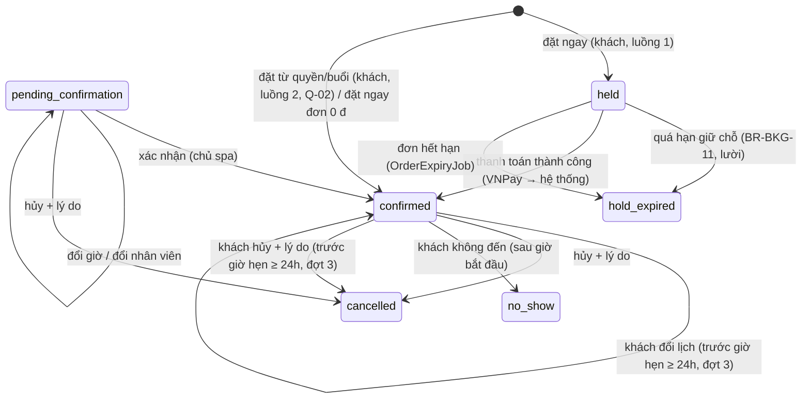

# Đặt lịch & lịch hẹn — đặc tả

- **Nhóm:** `Bookings` · **Sprint:** 1 · **Nguồn:** DA §2.2.3 (UC Quản lý lịch hẹn), sheet `09_Thuat_toan_lich` (A1–A12) / ĐX
- **Entity:** `Appointment` (bảng `appointments`), đọc thêm `WorkSchedule`, `StaffMember`, `StaffSkill`, `SpaService`, `ServiceEntitlement`, `TreatmentSession`, `OrderItem`, `CustomerAllergy`, `SkinProfile` — xem [glossary](../domain/glossary.md), [data-model](../domain/data-model.md)
- **Trạng thái triển khai:** đợt 1 (giờ trống + UC-SPA-17) xong phần backend ngày 28/10/2026, web hoàn thành ngày 10/11/2026 theo [plan](../superpowers/plans/2026-11-10-uc-spa-17-owner-appointments-web.md); đợt 2 (UC-SPA-15) duyệt và xong phần backend ngày 30/10/2026 theo [plan](../superpowers/plans/2026-10-30-uc-spa-15-18-bookings-purchases.md); đợt 3 (UC-SPA-16) duyệt và xong phần backend ngày 01/11/2026 theo [plan](../superpowers/plans/2026-11-01-uc-spa-16-my-appointments.md) — xem [progress.md](../progress.md)
- **Đã đặc tả:** đợt 1 = thuật toán tìm giờ trống (`GET /availability`) và UC-SPA-17 (chủ spa quản lý lịch hẹn), chỉ backend. Đợt 2 = UC-SPA-15 (hai luồng khách đặt lịch, "nhân viên bất kỳ" Q-26, lọc giờ trống theo quyền/buổi gói, giải phóng giữ chỗ trong `OrderExpiryJob`) và `GET /me/appointments/{id}` (phần xem chi tiết của UC-SPA-16), chỉ backend; làm cùng UC-SPA-18 ([purchases-treatments.md](purchases-treatments.md)). Đợt 3 (duyệt 01/11/2026, đổi lịch không giới hạn số lần) = phần còn lại của UC-SPA-16: danh sách, đổi lịch, hủy lịch của tôi và giờ trống để khách đổi lịch, chỉ backend.

## Use case

### Tìm giờ trống (thuật toán, dùng chung UC-SPA-15, 16, 17)

| Mục            | Nội dung                                                                                                        |
| -------------- | --------------------------------------------------------------------------------------------------------------- |
| Actor          | Mọi người (khách vãng lai, khách hàng, nhân viên, chủ spa)                                                      |
| Mô tả          | Trả các nhân viên làm được dịch vụ và các khung giờ còn trống của họ trong một ngày                             |
| Tiền điều kiện | Dịch vụ tồn tại; người không phải chủ spa chỉ dùng được dịch vụ đang bán (BR-CAT-01)                            |
| Input          | `spaServiceId`, `date`, `staffMemberId?`, `appointmentId?` (chỉ chủ spa: tính giờ trống để dời một lịch có sẵn) |
| Output         | `{ date, durationMinutes, staff: [{ id, fullName, slots: [{ startTime, endTime }] }] }`                         |

**Luồng chính** (A1–A8 của sheet `09`)

1. Client gọi `GET /availability?spaServiceId&date[&staffMemberId][&appointmentId]`.
2. Thời lượng `duration` = `spa_services.duration_minutes`; khi có `appointmentId` thì = `end_time − start_time` của lịch đó (giữ nguyên thời lượng khi dời lịch). Bước khung giờ `step` = `Booking:SlotStepMinutes` (mặc định 30, Q-11).
3. **Ứng viên** (A3): nhân viên có `staff_skills` cho dịch vụ, `users.status = active`, `hire_date ≤ date`, đang làm vào `date` (`resignation_date` null hoặc > `date`); có `staffMemberId` thì chỉ người đó.
4. **Khoảng làm việc** (A4): các ca `active` của nhân viên trong `date` → các đoạn `[start_time, end_time)`.
5. **Trừ lịch đã chiếm** (A5): bỏ khỏi các đoạn mọi lịch hẹn **chiếm chỗ** của nhân viên trong ngày (`AppointmentOccupancy`, BR-STF-07); khi có `appointmentId` thì không trừ chính lịch đó.
6. **Sinh khung** (A6): trong mỗi đoạn rảnh, `t` chạy từ đầu đoạn làm tròn **lên** bội số `step` tính từ 00:00; giữ `t` nếu `[t, t + duration)` nằm trọn trong đoạn rảnh.
7. **Lọc** (A7): bỏ `t` đã qua nếu `date` là hôm nay (giờ VN, `t ≤ giờ hiện tại`); nếu người gọi là **khách hàng** thì bỏ `t` giao với lịch chiếm chỗ khác của chính khách đó (BR-BKG-04); khi có `appointmentId` thì bỏ `t` giao với lịch chiếm chỗ khác của **khách của lịch đó**.
8. Trả nhân viên có ít nhất một khung, sắp theo `fullName`; khung sắp theo giờ.

**Ngoại lệ**

- E1. Thiếu/sai tham số, `date` ngoài `[hôm nay, hôm nay + Booking:MaxDaysAhead]` → `400 validation_error`.
- E2. Dịch vụ không tồn tại hoặc người gọi không được thấy → `404 service_not_found` (cùng thông điệp catalog).
- E3. `appointmentId` khi người gọi không phải chủ spa → bỏ qua tham số (như `status` của catalog); không tồn tại → `404 appointment_not_found`.
- E4. Không có khung nào → `200` với `staff` rỗng.

**Đợt 2 — lọc theo quyền đã mua** (A1, A7; chỉ khách hàng):

- Thêm tham số `serviceEntitlementId?` và `treatmentSessionId?`; gửi đúng **một** trong `spaServiceId`, `serviceEntitlementId`, `treatmentSessionId` (sai → `400 validation_error`). Hai tham số mới chỉ nhận khi Bearer là khách hàng và quyền/buổi thuộc khách đó; khác đi → `404 entitlement_not_found` / `404 treatment_session_not_found` (không lộ quyền của người khác).
- `serviceEntitlementId`: dịch vụ = dịch vụ của dòng đơn, thời lượng = `spa_services.duration_minutes` hiện tại; dịch vụ đã ngừng bán vẫn tính được (Q-29).
- `treatmentSessionId`: dịch vụ = `treatment_sessions.spa_service_id`, thời lượng = `treatment_sessions.duration_minutes` (bản chụp); `date` trước **ngày sớm nhất** của buổi (BR-BKG-05) hoặc sau hạn gói (Q-30) → `200` với `staff` rỗng.
- Quyền/buổi không còn đặt được (đã đặt, đã dùng, hết hạn…) không làm `GET /availability` lỗi; lỗi chỉ trả khi đặt (`POST /me/appointments`).

### UC-SPA-15 — Đặt lịch hẹn (đợt 2)

| Mục            | Nội dung                                                                                                                                                                                                    |
| -------------- | ----------------------------------------------------------------------------------------------------------------------------------------------------------------------------------------------------------- |
| Actor          | Khách hàng; cổng thanh toán VNPay (luồng 1)                                                                                                                                                                 |
| Mô tả          | Luồng 1 (`BookNow`): chọn dịch vụ và giờ, hệ thống giữ chỗ và tạo đơn, thanh toán thành công thì xác nhận lịch. Luồng 2 (`BookFromEntitlement`): dùng dịch vụ lẻ hoặc buổi trong gói đã mua để đặt          |
| Tiền điều kiện | Đã đăng nhập, `role = customer` (quyền `appointment.self`); luồng 2: có quyền `available` hoặc buổi `not_booked` đủ điều kiện                                                                               |
| Input          | Luồng 1: `spaServiceId`, `date`, `startTime`, `staffMemberId?`, `promotionCode?`, header `Idempotency-Key?`. Luồng 2: `serviceEntitlementId` \| `treatmentSessionId`, `date`, `startTime`, `staffMemberId?` |
| Output         | Luồng 1: lịch `held` + đơn `pending_payment` (rồi `confirmed` + đơn `paid`, hoặc `hold_expired` + đơn `expired`). Luồng 2: lịch `confirmed` (Q-02), quyền/buổi `booked`                                     |

**Luồng 1 — Đặt ngay (giữ chỗ + thanh toán)**

1. Khách mở dịch vụ, nhấn "Đặt ngay"; client gọi `GET /availability?spaServiceId&date` (Bearer khách hàng) và hiển thị nhân viên + giờ trống. Muốn biết giá sau khuyến mãi thì gọi `POST /me/orders/preview` với `{ source: "buy_now", spaServiceId, promotionCode? }` (đã có, UC-SPA-11).
2. Khách chọn giờ (và nhân viên, hoặc "nhân viên bất kỳ") rồi xác nhận; client gọi `POST /me/appointments/book-now`.
3. Hệ thống kiểm tra dữ liệu: dịch vụ đang bán (BR-CAT-01), `date` trong `[hôm nay, hôm nay + Booking:MaxDaysAhead]`, `startTime` đúng lưới `Booking:SlotStepMinutes`, giờ bắt đầu không sớm hơn hạn giữ chỗ (BR-BKG-15).
4. Trong **một giao dịch** (A9): khóa nhân viên (BR-BKG-14 khi tự phân công) → khóa khách → `ExpireHeldAsync` → kiểm tra lại A3–A7 cho khung đã chọn (kỹ năng BR-BKG-03, nằm trọn một ca BR-BKG-02, không trùng nhân viên BR-BKG-01, không trùng khách BR-BKG-04).
5. Tạo đơn như `POST /me/orders` với `source = buy_now` (một dòng dịch vụ, giá đọc lại, khuyến mãi, `Idempotency-Key`, BR-ORD-02, 03, 07–09) **và** lịch hẹn `held`: `order_item_id` = dòng đơn, `hold_expires_at_utc` = `payment_due_at_utc + OrderExpiry:GraceMinutes` (BR-BKG-06), `end_time = start_time + duration_minutes`.
6. Trả `201 { appointment, order }`. Client gọi tiếp `POST /me/orders/{id}/payments` (UC-SPA-11) và mở `paymentUrl`.
7. Kết quả thanh toán thành công hợp lệ (IPN hoặc return URL, BR-ORD-05) → trong giao dịch của `PaymentService`: đơn `paid`; dòng dịch vụ có lịch giữ chỗ → `service_entitlements` tạo với `booked` (WF-04), gán `appointments.service_entitlement_id`, lịch `held → confirmed` (BR-BKG-06).
8. Trang kết quả gọi `GET /me/orders/{id}` (có thêm `appointment`) hoặc `GET /me/appointments/{id}` để hiển thị lịch đã xác nhận. Thông báo trong ứng dụng làm ở UC-SPA-34 (BKG-LATER-03).

**Luồng 2 — Đặt từ dịch vụ và gói của tôi**

1. Khách mở "Dịch vụ và gói của tôi" (UC-SPA-18), chọn một dịch vụ lẻ `available` hoặc buổi kế tiếp của gói (`nextSession`), nhấn đặt lịch.
2. Client gọi `GET /availability?serviceEntitlementId=…` hoặc `?treatmentSessionId=…&date` và hiển thị nhân viên + giờ trống.
3. Khách chọn giờ, xác nhận; client gọi `POST /me/appointments` với `{ serviceEntitlementId | treatmentSessionId, date, startTime, staffMemberId? }`.
4. Hệ thống kiểm tra điều kiện quyền (BR-BKG-05, BR-TRT-01) và dữ liệu như bước 3 luồng 1 (trừ BR-BKG-15).
5. Trong một giao dịch: khóa nhân viên → khóa khách → **đọc lại** trạng thái quyền/buổi sau khi khóa (hai yêu cầu cùng một quyền chạy nối tiếp) → `ExpireHeldAsync` → kiểm tra lại A3–A7 → tạo lịch `confirmed` (Q-02) với `service_entitlement_id` hoặc `treatment_session_id`; quyền `available → booked` hoặc buổi `not_booked → booked` (BR-TRT-02, WF-07).
6. Trả `201` + `Location: /api/v1/me/appointments/{id}`, chi tiết lịch.

**Luồng rẽ nhánh**

- A1. **Nhân viên bất kỳ** (Q-26): bỏ `staffMemberId` → hệ thống chọn trong giao dịch người có kỹ năng, có ca phủ khung, rảnh ở khung đó, **ít lịch chiếm chỗ nhất trong ngày**, hòa thì theo `fullName` rồi `id` (BR-BKG-14).
- A2. **Đơn 0 đ** (khuyến mãi 100%): luồng 1 bước 5 tạo đơn `paid` ngay (BR-ORD-09), quyền `booked` và lịch `confirmed` trong cùng giao dịch; `201` trả lịch `confirmed`.
- A3. **Thanh toán thất bại / khách hủy trên VNPay:** lần thanh toán `failed`, đơn giữ `pending_payment`, lịch **vẫn giữ chỗ** tới hạn để khách thử lại (UC-SPA-11 A2, Q-28).
- A4. **Không thanh toán tới hạn:** `OrderExpiryJob` chuyển đơn `expired` và lịch `held` của đơn → `hold_expired` trong cùng giao dịch (BR-BKG-06, A10). Trước đó, ghi lịch vào khung vẫn chuyển lười `held` quá hạn → `hold_expired` (BR-BKG-11).
- A5. **Thành công đến muộn** (Q-20) khi lịch đã `hold_expired`: đơn vẫn `paid`, quyền tạo với `available` (khách đặt lại bằng luồng 2), lịch giữ `hold_expired`, ghi log cảnh báo (Q-27). Lịch còn `held` (chưa ai chuyển) → xác nhận như bước 7.
- A6. **Gửi lại `book-now` cùng `Idempotency-Key`:** trả đơn và lịch đã tạo (`200`), không giữ chỗ mới.
- A7. **Xem chi tiết lịch của tôi:** `GET /me/appointments/{id}` → lịch của chính khách, kèm `order?` khi lịch đến từ luồng 1.

**Ngoại lệ**

- E1. Dữ liệu sai: thiếu/thừa nguồn, `date` ngoài khoảng, `startTime` có giây hoặc không đúng lưới → `400 validation_error`; giờ bắt đầu đã qua → `400 appointment_in_past`; luồng 1 bắt đầu trước hạn giữ chỗ → `400 slot_too_soon` (BR-BKG-15).
- E2. **Giờ không còn trống** (luồng 1 E1, luồng 2 E2): trùng lịch nhân viên (kể cả do `EXCLUDE` khi đồng thời) → `409 slot_unavailable`; trùng lịch khác của khách → `409 customer_busy`; ngoài ca hoặc nhân viên nghỉ vào ngày đó → `409 outside_work_schedule`; nhân viên bất kỳ mà không ai rảnh → `409 slot_unavailable`. Client quay lại chọn giờ.
- E3. Nhân viên không có kỹ năng dịch vụ → `400 staff_not_qualified`; nhân viên không tồn tại hoặc tài khoản không `active` → `404 staff_not_found`.
- E4. Luồng 1: dịch vụ không tồn tại/ngừng bán → `404 service_not_found`; lỗi khuyến mãi và số tiền như UC-SPA-11 (`400 promotion_invalid`/`promotion_not_applicable`/`order_amount_too_small`).
- E5. **Luồng 2 — không đủ điều kiện** (luồng 2 E1): quyền/buổi không tồn tại hoặc của người khác → `404 entitlement_not_found` / `404 treatment_session_not_found`; quyền không `available`, hết hạn; buổi không `not_booked`, buổi trước chưa đặt, gói không `active` hoặc hết hạn, liệu trình `paused`/`cancelled` → `409 entitlement_not_eligible`, thông điệp nêu lý do; ngày hẹn sau hạn gói → `409 entitlement_not_eligible` (Q-30); chưa đủ khoảng cách với buổi trước → `400 session_too_early`, thông điệp nêu ngày sớm nhất (BR-BKG-05).
- E6. `GET /me/appointments/{id}` của người khác hoặc không tồn tại → `404 appointment_not_found`.
- E7. Chưa đăng nhập → `401`; không phải khách hàng → `403`.

**Quy tắc áp dụng:** BR-BKG-01–06, 11, 12, 14, 15, BR-TRT-01, 02, BR-ORD-02, 03, 05–09, BR-CAT-01, BR-SEC-01, RBAC `appointment.self`.

### UC-SPA-17 — Quản lý lịch hẹn

| Mục            | Nội dung                                                                                                   |
| -------------- | ---------------------------------------------------------------------------------------------------------- |
| Actor          | Chủ spa (xem chi tiết: cả nhân viên được phân công lịch đó)                                                |
| Mô tả          | Xem danh sách/chi tiết lịch hẹn; xác nhận; đổi giờ; đổi nhân viên; hủy kèm lý do; ghi nhận khách không đến |
| Tiền điều kiện | Đã đăng nhập, `role = owner` (quyền `appointment.manage`)                                                  |
| Input          | Lịch được chọn; ngày/giờ mới; nhân viên mới; lý do hủy; ghi chú khi khách không đến                        |
| Output         | Lịch hẹn được cập nhật                                                                                     |

**Luồng chính — đổi giờ**

1. Chủ spa mở danh sách `GET /appointments` (lọc ngày, nhân viên, trạng thái, tên/SĐT khách), chọn một lịch, xem `GET /appointments/{id}`.
2. Chủ spa lấy giờ trống `GET /availability?spaServiceId&date&staffMemberId&appointmentId` rồi gửi `POST /appointments/{id}/reschedule` với `{ date, startTime }`; `endTime` = `startTime` + thời lượng cũ.
3. Hệ thống kiểm tra trong **một giao dịch** (BR-BKG-09): trạng thái cho phép, lịch chưa bắt đầu, giờ mới chưa qua, nằm trọn trong một ca `active` của nhân viên (BR-BKG-02), nhân viên còn làm vào ngày mới, không trùng lịch khác của nhân viên (BR-BKG-01) và của khách (BR-BKG-04).
4. Lưu; ràng buộc `EXCLUDE` chặn tranh chấp đồng thời → `409 slot_unavailable`. Trả `200` chi tiết lịch.

**Luồng rẽ nhánh**

- A1. **Đổi nhân viên:** `POST /appointments/{id}/assign-staff` với `{ staffMemberId }` → nhân viên mới phải có kỹ năng dịch vụ (BR-BKG-03), đang làm, có ca phủ trọn khung giờ, không trùng lịch → `200`. Đổi sang chính nhân viên hiện tại → `200`, không đổi gì. Dùng để xử lý `appointmentsToReassign` khi nhân viên nghỉ việc (UC-SPA-22).
- A2. **Hủy:** `POST /appointments/{id}/cancel` với `{ reason }` → `cancelled`, `cancelled_at_utc = now`, `cancellation_reason`; trả quyền đã dùng để đặt (BR-BKG-10) → `200`.
- A3. **Khách không đến:** `POST /appointments/{id}/no-show` với `{ note? }` → chỉ khi `confirmed` và đã tới giờ bắt đầu (BR-BKG-08) → `no_show`, ghi `note`; trả quyền theo Q-07 (mặc định không trừ) → `200`.
- A4. **Xác nhận** (bổ sung theo rà soát RS-12): `POST /appointments/{id}/confirm` → `pending_confirmation` → `confirmed`. Theo Q-02 lịch luồng 2 tự xác nhận nên hiện chưa phát sinh lịch `pending_confirmation`; endpoint có sẵn cho khi đổi Q-02.
- A5. **Nhân viên xem chi tiết** lịch được phân công cho mình: `GET /appointments/{id}` (phần xem của UC-SPA-25); lịch của người khác → `403`.

**Ngoại lệ**

- E1. Giờ mới trùng lịch của nhân viên → `409 slot_unavailable`; trùng lịch khác của khách → `409 customer_busy`; ngoài ca → `409 outside_work_schedule`; nhân viên đã nghỉ vào ngày đó → `409 outside_work_schedule`.
- E2. Đổi nhân viên: không có kỹ năng → `400 staff_not_qualified`; không có ca phủ khung giờ hoặc đã nghỉ → `409 staff_not_on_shift`; trùng lịch → `409 staff_busy`; nhân viên không tồn tại → `404 staff_not_found`.
- E3. Hành động không hợp với trạng thái hiện tại (ví dụ hủy lịch đã hoàn thành, xác nhận lịch đã xác nhận) → `409 appointment_status_invalid`, thông điệp nêu trạng thái hiện tại.
- E4. Đổi giờ/đổi nhân viên lịch đã bắt đầu, hoặc dời tới giờ đã qua → `400 appointment_in_past`. Ghi nhận không đến trước giờ bắt đầu → `400 no_show_too_early`.
- E5. Dữ liệu sai (thiếu `reason`, `reason` > 500 ký tự, giờ có giây…) → `400`.
- E6. Lịch không tồn tại → `404 appointment_not_found`.
- E7. Chưa đăng nhập → `401`; không phải chủ spa → `403` (riêng `GET /appointments/{id}`: nhân viên không được phân công → `403 appointment_not_assigned`).
- E8. Không có endpoint xóa lịch hẹn.

**Quy tắc áp dụng:** BR-BKG-01, 02, 03, 04, 08, 09, 10, 11, 13, BR-STF-07, BR-SEC-01, RBAC `appointment.manage`.

### UC-SPA-16 — Xem và quản lý lịch hẹn (đợt 3)

| Mục            | Nội dung                                                                                                                                  |
| -------------- | ----------------------------------------------------------------------------------------------------------------------------------------- |
| Actor          | Khách hàng                                                                                                                                |
| Mô tả          | Khách xem danh sách và chi tiết lịch hẹn của mình; đổi sang thời gian (và nhân viên) khác; hủy kèm lý do, được trả lại quyền/buổi đã dùng |
| Tiền điều kiện | Đã đăng nhập, `role = customer` (quyền `appointment.self`, có sẵn từ đợt 2)                                                               |
| Input          | Bộ lọc danh sách; lịch được chọn; ngày, giờ, nhân viên mới (đổi lịch); lý do (hủy)                                                        |
| Output         | Danh sách/chi tiết lịch; lịch đã đổi giờ hoặc đã hủy                                                                                      |

**Luồng chính — xem** (bước 1–4 của DA)

1. Khách mở "Lịch hẹn của tôi"; client gọi `GET /me/appointments?scope=upcoming` (tab "Sắp tới"), `scope=past` ("Đã xong"), `scope=cancelled` ("Đã hủy").
2. Hệ thống trả các lịch của chính khách theo nhóm (BR-BKG-17), phân trang, kèm `canReschedule`/`canCancel` để giao diện bật tắt nút.
3. Khách chọn một lịch; client gọi `GET /me/appointments/{id}` (có sẵn, thêm `canReschedule`, `canCancel`, `changeDeadlineAtUtc`).

**Luồng rẽ nhánh**

- A1. **Đổi lịch:**
  1. Client gọi `GET /availability?appointmentId={id}&date[&staffMemberId]` bằng Bearer khách hàng (BR-BKG-18): giờ trống tính với dịch vụ và thời lượng của chính lịch đó, lịch đó không tự chặn mình, buổi gói chỉ có khung trong khoảng ngày được phép (BR-BKG-16).
  2. Khách chọn giờ (và nhân viên, hoặc "nhân viên bất kỳ"); client gọi `POST /me/appointments/{id}/reschedule` với `{ date, startTime, staffMemberId? }`.
  3. Hệ thống kiểm tra dữ liệu như đặt lịch (`date` trong `[hôm nay, hôm nay + Booking:MaxDaysAhead]`, `startTime` đúng lưới, giờ mới chưa qua).
  4. Trong **một giao dịch**: khóa lịch → kiểm tra trạng thái và hạn đổi (BR-BKG-07) → với buổi gói kiểm tra khoảng ngày (BR-BKG-16) → `BookingSlotReserver` kiểm tra lại A3–A7 cho khung mới với nhân viên đã chọn hoặc tự chọn (Q-26), **bỏ qua chính lịch này** khi tính trùng nhân viên và trùng khách (A12) → cập nhật `staff_member_id`, `date`, `start_time`, `end_time`; giữ thời lượng cũ và trạng thái.
  5. Trả `200` chi tiết lịch (`MyAppointmentDto`).
- A2. **Hủy:** client gọi `POST /me/appointments/{id}/cancel` với `{ reason }` → trong một giao dịch: khóa lịch → kiểm tra trạng thái và hạn hủy (BR-BKG-07) → `cancelled`, `cancelled_at_utc`, `cancellation_reason`; trả quyền/buổi (BR-BKG-10: quyền `booked → available`, buổi `booked → not_booked`; lịch đặt ngay đã thanh toán có quyền nên cũng trả quyền, **không hoàn tiền**) → `200` chi tiết lịch.
- A3. **Không có lịch** trong nhóm → `200` danh sách rỗng (client hiển thị trạng thái trống, liên kết đặt lịch).
- A4. **Đổi sang chính khung và nhân viên hiện tại** → `200`, không đổi gì.

**Ngoại lệ**

- E1. **Giờ mới không còn trống** (ĐX E1 của DA): trùng lịch nhân viên (kể cả do `EXCLUDE` khi đồng thời) → `409 slot_unavailable`; trùng lịch khác của khách → `409 customer_busy`; ngoài ca → `409 outside_work_schedule`; nhân viên bất kỳ mà không ai rảnh → `409 slot_unavailable`; nhân viên không có kỹ năng → `400 staff_not_qualified`; không tồn tại/không `active` → `404 staff_not_found`.
- E2. **Quá hạn đổi/hủy** (ĐX E2 của DA): còn ít hơn `Booking:CustomerChangeCutoffHours` (24, Q-04) giờ trước giờ hẹn hiện tại, hoặc lịch đã bắt đầu → `400 change_window_passed`, thông điệp nêu số giờ và gợi ý liên hệ spa.
- E3. Trạng thái không cho phép (`held`, `hold_expired`, `completed`, `cancelled`, `no_show`) → `409 appointment_status_invalid`, thông điệp nêu trạng thái hiện tại (lịch `held`: Q-41).
- E4. Buổi gói: giờ mới trước ngày sớm nhất (sau buổi liền trước) → `400 session_too_early`; sau ngày muộn nhất (trước buổi liền sau đã đặt) → `400 session_too_late` (Q-42); gói hết hạn hoặc giờ mới không trước hạn gói, liệu trình `paused`/`cancelled` → `409 entitlement_not_eligible`. Dịch vụ lẻ đã hết hạn (`expires_at_utc` ≤ bây giờ) → `409 entitlement_not_eligible`. Hủy không kiểm tra các điều kiện này.
- E5. Dữ liệu sai: thiếu `reason` hoặc > 500 ký tự, `date` ngoài khoảng, giờ lệch lưới/có giây, `fromDate > toDate`, `scope`/`status` không hợp lệ → `400 validation_error`; giờ mới đã qua → `400 appointment_in_past`.
- E6. Lịch của người khác hoặc không tồn tại (danh sách, chi tiết, đổi, hủy, `GET /availability?appointmentId`) → `404 appointment_not_found`.
- E7. Chưa đăng nhập → `401`; không phải khách hàng → `403`.

**Quy tắc áp dụng:** BR-BKG-01–05, 07, 10–14, 16–18, BR-SEC-01, RBAC `appointment.self`.

## Business rules

| Mã        | Quy tắc                                                                                                                                                                                                                                                                                                                                                                                                                                                                                                                                                                                                                                                 | Enforce ở đâu                                                                                         | Nguồn                            |
| --------- | ------------------------------------------------------------------------------------------------------------------------------------------------------------------------------------------------------------------------------------------------------------------------------------------------------------------------------------------------------------------------------------------------------------------------------------------------------------------------------------------------------------------------------------------------------------------------------------------------------------------------------------------------------- | ----------------------------------------------------------------------------------------------------- | -------------------------------- |
| BR-BKG-01 | Không trùng lịch nhân viên: hai lịch chiếm chỗ của cùng nhân viên không giao nhau `[start, end)`                                                                                                                                                                                                                                                                                                                                                                                                                                                                                                                                                        | Application (trong giao dịch) + CSDL `EXCLUDE` có sẵn                                                 | DA                               |
| BR-BKG-02 | Khung giờ nằm trọn trong **một** ca `active` của nhân viên trong ngày; nhân viên đang làm vào ngày đó                                                                                                                                                                                                                                                                                                                                                                                                                                                                                                                                                   | Application                                                                                           | DA                               |
| BR-BKG-03 | Nhân viên phải có `staff_skills` cho dịch vụ của lịch                                                                                                                                                                                                                                                                                                                                                                                                                                                                                                                                                                                                   | Application                                                                                           | DA                               |
| BR-BKG-04 | Một khách không có hai lịch chiếm chỗ giao nhau                                                                                                                                                                                                                                                                                                                                                                                                                                                                                                                                                                                                         | Application                                                                                           | DA                               |
| BR-BKG-05 | Đặt bằng quyền đã mua. **Dịch vụ lẻ:** của khách, `available`, `expires_at_utc` null hoặc > bây giờ. **Buổi gói:** gói của khách `active`, `expires_at_utc` > bây giờ và > giờ bắt đầu của lịch (Q-30); liệu trình không `paused`/`cancelled`; buổi `not_booked`; mọi buổi `sequence_number` nhỏ hơn đã `booked`/`completed`/`skipped`; **ngày sớm nhất** = ngày lịch gần nhất (chiếm chỗ, `completed` hoặc `no_show`) của buổi liền trước + `min_days_between_sessions` của dòng gói ứng với dịch vụ của buổi (đọc cấu hình gói hiện tại, như Q-23), và giờ bắt đầu sau giờ kết thúc lịch đó; buổi đầu không giới hạn. Kiểm tra lại sau khi khóa khách | Application                                                                                           | DA (luồng 2 bước 4) + ĐX         |
| BR-BKG-06 | Luồng 1: lịch `held`, `order_item_id` = dòng đơn, `hold_expires_at_utc` = `payment_due_at_utc + OrderExpiry:GraceMinutes` (15 + 5 phút, Q-03) để IPN đến trong ân hạn không mất chỗ. Thành công hợp lệ khi lịch còn `held` → quyền `booked` + gán vào lịch, lịch `confirmed`; khi lịch đã `hold_expired` → quyền `available` (Q-27). Thất bại không giải phóng (Q-28). Đơn `expired` (job) → lịch `held` của đơn `hold_expired` cùng giao dịch                                                                                                                                                                                                          | Application (`EntitlementIssuer`, `OrderExpiryService`)                                               | DA + ĐX                          |
| BR-BKG-14 | Nhân viên bất kỳ (Q-26): khóa **mọi** nhân viên ứng viên theo thứ tự `id` (cùng một câu `FOR UPDATE`, tránh deadlock giữa hai lần tự phân công), rồi chọn theo `Booking:AutoAssignStrategy` = `least_busy`: ít lịch chiếm chỗ nhất trong ngày → `fullName` → `id`. Chọn nhân viên cụ thể chỉ khóa người đó. Sau đó khóa khách                                                                                                                                                                                                                                                                                                                           | Application + Infrastructure                                                                          | ĐX (Q-26)                        |
| BR-BKG-15 | Luồng 1: giờ bắt đầu (giờ VN) ≥ `hold_expires_at_utc` đổi sang giờ VN, để lịch không bắt đầu khi còn đang chờ thanh toán (Q-31)                                                                                                                                                                                                                                                                                                                                                                                                                                                                                                                         | Application                                                                                           | ĐX                               |
| BR-BKG-08 | Ghi nhận không đến chỉ khi `confirmed` và `now (VN) ≥ date + start_time`; có trừ lượt hay không theo Q-07 (`Booking:NoShowConsumesEntitlement`, mặc định **không trừ**). Khi bật: quyền `booked → used`, buổi `booked → skipped`, không tăng tiến độ gói                                                                                                                                                                                                                                                                                                                                                                                                | Domain (`Appointment`) + Application                                                                  | DA + ĐX                          |
| BR-BKG-09 | Chủ spa đổi giờ/đổi nhân viên/hủy được lịch `pending_confirmation` hoặc `confirmed`; đổi giờ và đổi nhân viên chỉ khi lịch **chưa bắt đầu** và khung mới chưa qua. Lịch `held` (đang chờ thanh toán) không sửa/hủy ở UC-SPA-17                                                                                                                                                                                                                                                                                                                                                                                                                          | Application                                                                                           | WF-01 + ĐX (Q-24)                |
| BR-BKG-10 | Hủy hoặc ghi nhận không đến (khi Q-07 = không trừ) trả quyền: `service_entitlements` `booked → available`; `treatment_sessions` `booked → not_booked`; cùng giao dịch với đổi trạng thái lịch. Lịch chỉ có `order_item_id` (đặt ngay, UC-SPA-15) theo quy tắc của UC-SPA-15                                                                                                                                                                                                                                                                                                                                                                             | Domain (chuyển trạng thái) + Application                                                              | WF-04, WF-07                     |
| BR-BKG-11 | Lịch `held` đã quá `hold_expires_at_utc` được chuyển `hold_expired` **ngay trong giao dịch** trước khi đổi giờ/đổi nhân viên/ghi lịch vào khung của nhân viên đó, vì ràng buộc `EXCLUDE` vẫn tính `held` (không dùng được `now()`) và chưa có job nền (A10)                                                                                                                                                                                                                                                                                                                                                                                             | Application + Infrastructure                                                                          | A10 + ĐX                         |
| BR-BKG-12 | Thuật toán giờ trống A1–A8 như mục Use case; bước `Booking:SlotStepMinutes` (30); ngày trong `[hôm nay, hôm nay + Booking:MaxDaysAhead]` (60)                                                                                                                                                                                                                                                                                                                                                                                                                                                                                                           | Application (`AvailabilityService`, phần tính khung là hàm thuần dễ unit test)                        | Sheet `09` + Q-11                |
| BR-BKG-13 | Dịch vụ của lịch hẹn **suy ra**, không lưu trên lịch (Q-25): `treatment_sessions.spa_service_id` → `order_items.spa_service_id` của `service_entitlements` → `order_items.spa_service_id` của `order_item_id`; lấy nguồn đầu tiên khác null. Mỗi lịch có ít nhất một nguồn: `CHECK (num_nonnulls(service_entitlement_id, treatment_session_id, order_item_id) >= 1)`                                                                                                                                                                                                                                                                                    | Application (một biểu thức dùng chung) + CSDL `CHECK`                                                 | ĐX (Q-25)                        |
| BR-BKG-07 | **Đợt 3.** Khách đổi/hủy được lịch `pending_confirmation` hoặc `confirmed` khi `now (VN) ≤ date + start_time − Booking:CustomerChangeCutoffHours` (24, Q-04), tính theo giờ hẹn **hiện tại**; khung mới chỉ cần chưa qua (không áp hạn 24 giờ cho khung mới). Kiểm tra trạng thái trước (`409`), rồi hạn (`400 change_window_passed`). Hủy hợp lệ trả quyền theo BR-BKG-10, không hoàn tiền                                                                                                                                                                                                                                                             | Application (`AppointmentChangePolicy`, hàm thuần dùng cho cả lệnh và cờ `canReschedule`/`canCancel`) | DA ("khi được phép") + ĐX (Q-04) |
| BR-BKG-16 | **Đợt 3.** Đổi lịch của buổi gói giữ thứ tự gói: khung mới ≥ **ngày sớm nhất** (BR-BKG-05, tính từ buổi liền trước) và, nếu buổi liền sau đã có lịch chiếm chỗ, ≤ **ngày muộn nhất** = ngày lịch đó − `min_days_between_sessions` của dòng gói ứng với dịch vụ buổi sau, và kết thúc trước giờ bắt đầu lịch đó khi cùng ngày (Q-42). Gói phải còn `active`, giờ mới < hạn gói (Q-30), liệu trình không `paused`/`cancelled`. Dịch vụ lẻ: chưa hết hạn. Đọc lại sau khi khóa lịch                                                                                                                                                                        | Application (`EntitlementEligibility`)                                                                | ĐX                               |
| BR-BKG-17 | **Đợt 3.** Nhóm danh sách của khách: `upcoming` = `held`, `pending_confirmation`, `confirmed` (sắp **tăng** theo `date, start_time`); `past` = `completed`, `no_show`; `cancelled` = `cancelled`, `hold_expired` (hai nhóm sau sắp **giảm**). Không gửi `scope` = mọi trạng thái, sắp giảm. `status` (một giá trị) lọc thêm trong nhóm                                                                                                                                                                                                                                                                                                                  | Application + Infrastructure                                                                          | ĐX (màn SCR-W14, SCR-M11)        |
| BR-BKG-18 | **Đợt 3.** `GET /availability?appointmentId` với Bearer khách hàng: lịch phải của khách đó (khác → `404 appointment_not_found`), gửi **thay cho** `spaServiceId`/`serviceEntitlementId`/`treatmentSessionId`; dịch vụ suy ra (BR-BKG-13), thời lượng = `end_time − start_time`, lịch đó không chặn nhân viên lẫn khách, buổi gói áp khoảng ngày BR-BKG-16 (ngoài khoảng → `staff` rỗng). Chủ spa giữ cách dùng cũ (`spaServiceId` + `appointmentId`)                                                                                                                                                                                                    | Application (`AvailabilityService`)                                                                   | ĐX                               |

**Phân quyền** (sheet `21`): `appointment.manage` → `owner` (policy mới); đợt 2: `appointment.self` → `customer` (policy mới) cho `/me/appointments*` (đợt 3 dùng lại, không thêm quyền); khách chỉ thấy lịch của mình (BR-SEC-01, lịch người khác → `404`). `GET /availability` để `[AllowAnonymous]` (Bearer hợp lệ quyết định chế độ chủ spa/khách hàng như catalog). `GET /appointments/{id}`: owner hoặc staff, service kiểm tra nhân viên được phân công (BR-SEC-01).

## Trạng thái

Quyền và buổi đi kèm (WF-04, WF-07): luồng 2 `available → booked` / `not_booked → booked`; luồng 1 quyền sinh ra ở trạng thái `booked` khi lịch được xác nhận, `available` khi lịch đã `hold_expired` (Q-27). Hoàn thành (`confirmed → completed`) thuộc UC-SPA-28.

## Dữ liệu

| Bảng                                                                       | Cột dùng         | Thay đổi                                                                                                                                                   |
| -------------------------------------------------------------------------- | ---------------- | ---------------------------------------------------------------------------------------------------------------------------------------------------------- |
| `appointments`                                                             | toàn bộ          | Không thêm cột (dịch vụ suy ra, BR-BKG-13, Q-25); **thêm** `CHECK ck_appointments_source` (ít nhất một nguồn) và index `(customer_id, date)` cho BR-BKG-04 |
| `work_schedules`, `staff_members`, `staff_skills`, `users`, `spa_services` | đọc              | Không đổi                                                                                                                                                  |
| `service_entitlements`, `treatment_sessions`                               | `status`         | Không đổi schema; cập nhật trạng thái khi hủy/không đến                                                                                                    |
| `order_items`                                                              | `spa_service_id` | Đọc để suy ra dịch vụ của lịch                                                                                                                             |
| `customer_allergies`, `skin_profiles`                                      | đọc cho chi tiết | Không đổi                                                                                                                                                  |

Migration mới `AddAppointmentBookingConstraints` (CHECK + index, không đổi cột). Sửa `docs/spec-source/data_db.py` (ràng buộc của `customer_id` và `order_item_id`), sinh lại `data-model.md`, Excel, SQL tiếng Việt. ERD báo cáo giữ nguyên.

**Đợt 2:** **không đổi schema, không có migration.** Luồng 1 dùng `appointments.order_item_id` + `hold_expires_at_utc` có sẵn; chống đặt trùng `Idempotency-Key` dùng `orders.idempotency_key` có sẵn; luồng 2 không nhận `Idempotency-Key` (gửi lại bị chặn vì quyền/buổi đã `booked`). Ghi thêm: `service_entitlements` (tạo `booked`, `available → booked`), `treatment_sessions` (`not_booked → booked`), `orders`/`order_items`/`promotion_redemptions` (luồng 1). Đọc thêm `customer_packages`, `treatment_plans`, `service_package_items.min_days_between_sessions`.

**Đợt 3:** **không đổi schema, không có migration.** Đổi lịch ghi `appointments.staff_member_id/date/start_time/end_time`; hủy ghi `status`, `cancelled_at_utc`, `cancellation_reason` và trả `service_entitlements.status` / `treatment_sessions.status`. Danh sách dùng index `(customer_id, date)` có sẵn. Không có cột đếm số lần đổi (xem BKG-LATER-08).

## API

Tiền tố `/api/v1`, envelope chuẩn. Ngày `yyyy-MM-dd`, giờ `HH:mm` (giờ VN).

| Method | Đường dẫn                         | Vai trò                           | Request                                                                                                                                            | Response                                                                                                                                                                                                  | Lỗi                                                                                                                                                                          |
| ------ | --------------------------------- | --------------------------------- | -------------------------------------------------------------------------------------------------------------------------------------------------- | --------------------------------------------------------------------------------------------------------------------------------------------------------------------------------------------------------- | ---------------------------------------------------------------------------------------------------------------------------------------------------------------------------- |
| GET    | `/availability`                   | Mọi người                         | `?spaServiceId&date&staffMemberId&appointmentId` (`appointmentId` chỉ chủ spa)                                                                     | 200 `{ date, durationMinutes, staff: [{ id, fullName, slots: [{ startTime, endTime }] }] }`                                                                                                               | 400, 404 `service_not_found`/`appointment_not_found`                                                                                                                         |
| GET    | `/appointments`                   | Chủ spa                           | `?fromDate&toDate&staffMemberId&status&search&pageNumber&pageSize` (`fromDate`, `toDate` bắt buộc, ≤ 42 ngày; `search` = tên/SĐT khách, không dấu) | 200 `PagedResult<{ id, date, startTime, endTime, status, customer: { id, fullName, phoneNumber }, staff: { id, fullName }, service: { id, name } }>` sắp theo `date, startTime`                           | 400, 401, 403                                                                                                                                                                |
| GET    | `/appointments/{id}`              | Chủ spa, nhân viên được phân công | —                                                                                                                                                  | 200 `{ …dòng danh sách, holdExpiresAtUtc, cancelledAtUtc, cancellationReason, note, createdAtUtc, allergies: [{ allergen, severity, note }], treatmentSession?: { id, sequenceNumber }, hasSkinProfile }` | 401, 403, 404                                                                                                                                                                |
| POST   | `/appointments/{id}/confirm`      | Chủ spa                           | —                                                                                                                                                  | 200 chi tiết                                                                                                                                                                                              | 401, 403, 404, 409 `appointment_status_invalid`                                                                                                                              |
| POST   | `/appointments/{id}/reschedule`   | Chủ spa                           | `{ date, startTime }`                                                                                                                              | 200 chi tiết                                                                                                                                                                                              | 400 `appointment_in_past`, 401, 403, 404, 409 `slot_unavailable`/`customer_busy`/`outside_work_schedule`/`appointment_status_invalid`                                        |
| POST   | `/appointments/{id}/assign-staff` | Chủ spa                           | `{ staffMemberId }`                                                                                                                                | 200 chi tiết                                                                                                                                                                                              | 400 `staff_not_qualified`/`appointment_in_past`, 401, 403, 404 `appointment_not_found`/`staff_not_found`, 409 `staff_busy`/`staff_not_on_shift`/`appointment_status_invalid` |
| POST   | `/appointments/{id}/cancel`       | Chủ spa                           | `{ reason }` (1–500 ký tự)                                                                                                                         | 200 chi tiết                                                                                                                                                                                              | 400, 401, 403, 404, 409 `appointment_status_invalid`                                                                                                                         |
| POST   | `/appointments/{id}/no-show`      | Chủ spa                           | `{ note? }` (≤ 1000)                                                                                                                               | 200 chi tiết                                                                                                                                                                                              | 400 `no_show_too_early`, 401, 403, 404, 409 `appointment_status_invalid`                                                                                                     |

**Đợt 2** (khách hàng, policy `appointment.self`):

| Method | Đường dẫn                   | Vai trò    | Request                                                                                               | Response                                                                                                                                                                                                                                                                                                                                                          | Lỗi                                                                                                                                                                                                                                                                             |
| ------ | --------------------------- | ---------- | ----------------------------------------------------------------------------------------------------- | ----------------------------------------------------------------------------------------------------------------------------------------------------------------------------------------------------------------------------------------------------------------------------------------------------------------------------------------------------------------- | ------------------------------------------------------------------------------------------------------------------------------------------------------------------------------------------------------------------------------------------------------------------------------- |
| GET    | `/availability`             | Mọi người  | thêm `serviceEntitlementId` \| `treatmentSessionId` (chỉ khách hàng, thay cho `spaServiceId`)         | như đợt 1                                                                                                                                                                                                                                                                                                                                                         | thêm 404 `entitlement_not_found`/`treatment_session_not_found`                                                                                                                                                                                                                  |
| POST   | `/me/appointments/book-now` | Khách hàng | `{ spaServiceId, date, startTime, staffMemberId?, promotionCode? }`; header `Idempotency-Key?` (UUID) | 201 `{ appointment: MyAppointmentDto, order: OrderDetailDto }` (200 khi trùng khóa)                                                                                                                                                                                                                                                                               | 400 `validation_error`/`appointment_in_past`/`slot_too_soon`/`staff_not_qualified`/`promotion_invalid`/`promotion_not_applicable`/`order_amount_too_small`, 401, 403, 404 `service_not_found`/`staff_not_found`, 409 `slot_unavailable`/`customer_busy`/`outside_work_schedule` |
| POST   | `/me/appointments`          | Khách hàng | `{ serviceEntitlementId? \| treatmentSessionId?, date, startTime, staffMemberId? }`                   | 201 + `Location: /api/v1/me/appointments/{id}`, `MyAppointmentDto`                                                                                                                                                                                                                                                                                                | 400 `validation_error`/`appointment_in_past`/`staff_not_qualified`/`session_too_early`, 401, 403, 404 `entitlement_not_found`/`treatment_session_not_found`/`staff_not_found`, 409 `entitlement_not_eligible`/`slot_unavailable`/`customer_busy`/`outside_work_schedule`        |
| GET    | `/me/appointments/{id}`     | Khách hàng | —                                                                                                     | 200 `MyAppointmentDto { id, date, startTime, endTime, status, holdExpiresAtUtc, cancelledAtUtc, cancellationReason, createdAtUtc, service: { id, name }, staff: { id, fullName }, source: "entitlement"\|"session"\|"book_now", serviceEntitlementId?, treatmentSession?: { id, sequenceNumber, customerPackageId, packageName }, order?: { id, code, status } }` | 401, 403, 404 `appointment_not_found`                                                                                                                                                                                                                                           |

**Đợt 3** (khách hàng, policy `appointment.self`):

| Method | Đường dẫn                          | Vai trò    | Request                                                                                                                                                             | Response                                                                                                                                                                                                                                                            | Lỗi                                                                                                                                                                                                                                                                                                               |
| ------ | ---------------------------------- | ---------- | ------------------------------------------------------------------------------------------------------------------------------------------------------------------- | ------------------------------------------------------------------------------------------------------------------------------------------------------------------------------------------------------------------------------------------------------------------- | ----------------------------------------------------------------------------------------------------------------------------------------------------------------------------------------------------------------------------------------------------------------------------------------------------------------- |
| GET    | `/me/appointments`                 | Khách hàng | `?scope=upcoming\|past\|cancelled&status&fromDate&toDate&pageNumber&pageSize` (tất cả tùy chọn; `fromDate ≤ toDate`; không giới hạn độ dài khoảng vì có phân trang) | 200 `PagedResult<MyAppointmentListItemDto { id, date, startTime, endTime, status, holdExpiresAtUtc, service: { id, name }, staff: { id, fullName }, source, treatmentSession?: { id, sequenceNumber, customerPackageId, packageName }, canReschedule, canCancel }>` | 400 `validation_error`, 401, 403                                                                                                                                                                                                                                                                                  |
| GET    | `/me/appointments/{id}`            | Khách hàng | —                                                                                                                                                                   | như đợt 2, **thêm** `canReschedule`, `canCancel`, `changeDeadlineAtUtc` (= giờ hẹn − 24h đổi sang UTC; null khi trạng thái không cho đổi)                                                                                                                           | 401, 403, 404 `appointment_not_found`                                                                                                                                                                                                                                                                             |
| POST   | `/me/appointments/{id}/reschedule` | Khách hàng | `{ date, startTime, staffMemberId? }` (bỏ trống = nhân viên bất kỳ, Q-26)                                                                                           | 200 `MyAppointmentDto`                                                                                                                                                                                                                                              | 400 `validation_error`/`appointment_in_past`/`change_window_passed`/`staff_not_qualified`/`session_too_early`/`session_too_late`, 401, 403, 404 `appointment_not_found`/`staff_not_found`, 409 `appointment_status_invalid`/`slot_unavailable`/`customer_busy`/`outside_work_schedule`/`entitlement_not_eligible` |
| POST   | `/me/appointments/{id}/cancel`     | Khách hàng | `{ reason }` (1–500 ký tự, cắt khoảng trắng)                                                                                                                        | 200 `MyAppointmentDto`                                                                                                                                                                                                                                              | 400 `validation_error`/`change_window_passed`, 401, 403, 404 `appointment_not_found`, 409 `appointment_status_invalid`                                                                                                                                                                                            |
| GET    | `/availability`                    | Mọi người  | thêm: khách hàng gửi `appointmentId` **thay cho** nguồn dịch vụ (BR-BKG-18)                                                                                         | như đợt 1                                                                                                                                                                                                                                                           | thêm 404 `appointment_not_found` (lịch không phải của khách)                                                                                                                                                                                                                                                      |

- `canReschedule` = trạng thái cho phép + còn trong hạn (BR-BKG-07) + với buổi gói: liệu trình không `paused`/`cancelled` và gói còn hiệu lực; `canCancel` = trạng thái cho phép + còn trong hạn. Cờ chỉ để giao diện; lệnh vẫn kiểm tra lại.
- Sửa tại chỗ các dòng BKG 061 (khách gửi `idLichHen` thay nguồn), 064 (`scope`, tên tham số), 066 (`idNhanVien?`, mã lỗi đầy đủ, response `LichHenCuaToiDto`), 067 (`lyDo` 1–500, `400 CHANGE_WINDOW_PASSED`, `409`, response) trong `data_api.py`; không thêm dòng.
- `MyAppointmentDto` **không** có SĐT nhân viên, dị ứng, hồ sơ da (khác `AppointmentDetailDto` của chủ spa).
- `OrderDetailDto` của `GET /me/orders/{id}` thêm `appointment?: { id, date, startTime, endTime, status, staff: { id, fullName } }` (đơn đặt ngay) — thêm trường, không đổi trường cũ.
- Sửa tại chỗ các dòng BKG 061 (thêm `idDichVuKhachHang?`), 062, 063 (bỏ `Idempotency-Key` ở luồng 2, `idNhanVien?`, mã lỗi), 065 (ghi chú "làm cùng UC-SPA-15") trong `data_api.py`; không thêm dòng.
- Sửa tại chỗ các dòng BKG 061, 068–074 trong `data_api.py` cho khớp (bỏ `view=list|calendar`: lịch ngày/tuần do client dựng từ danh sách). `GET /appointments/{id}` nhận cả nhân viên được phân công (UC-SPA-25).

## Cấu hình

| Biến `.env` | Khóa                                  | Mặc định                                          |
| ----------- | ------------------------------------- | ------------------------------------------------- |
| —           | `Booking:SlotStepMinutes`             | `30` (Q-11; 5–60, chia hết 60)                    |
| —           | `Booking:MaxDaysAhead`                | `60`                                              |
| —           | `Booking:MaxQueryRangeDays`           | `42`                                              |
| —           | `Booking:NoShowConsumesEntitlement`   | `false` (Q-07)                                    |
| —           | `Booking:AutoAssignStrategy`          | `least_busy` (Q-26; giá trị khác → lỗi khởi động) |
| —           | `Booking:ReleaseHoldOnPaymentFailure` | `false` (Q-28)                                    |

Đợt 2 không có biến `.env` mới. Hạn giữ chỗ dùng `Order:PaymentTimeoutMinutes` + `OrderExpiry:GraceMinutes` có sẵn (Q-03).

Đợt 3 thêm một khóa `appsettings.json`, không có biến `.env` mới:

| Biến `.env` | Khóa                                | Mặc định                                               |
| ----------- | ----------------------------------- | ------------------------------------------------------ |
| —           | `Booking:CustomerChangeCutoffHours` | `24` (Q-04; 0–168, 0 = đổi/hủy tới ngay trước giờ hẹn) |

## Kiểm thử bắt buộc

Unit test thuật toán là hàm thuần (đầu vào: ca, lịch đã chiếm, thời lượng, bước, "bây giờ"); service dùng NSubstitute + đồng hồ giả; integration test `PostgresFixture`. Lịch hẹn chèn trực tiếp (chưa có API đặt lịch).

| Mã      | Tình huống                                                                                                                      | Kết quả mong đợi                                                                                                                       |
| ------- | ------------------------------------------------------------------------------------------------------------------------------- | -------------------------------------------------------------------------------------------------------------------------------------- |
| BKG-T01 | UAT-01: ca 08:00–12:00, lịch `confirmed` 09:00–10:00, dịch vụ 60', bước 30'                                                     | Khung 08:00; không có 08:30; 10:00, 10:30, 11:00                                                                                       |
| BKG-T02 | Khung sát giờ kết thúc ca (ca kết thúc 11:50, dịch vụ 60')                                                                      | Khung cuối 10:30 (10:30–11:30); không có 11:00                                                                                         |
| BKG-T03 | Hai ca tách rời 08:00–10:00 và 13:00–15:00; ca bắt đầu 08:10 (làm tròn lên 08:30)                                               | Khung trong cả hai ca, không bắc qua giờ nghỉ; ca 08:10 bắt đầu khung ở 08:30                                                          |
| BKG-T04 | Lịch `held` còn hạn / hết hạn / `cancelled`                                                                                     | Còn hạn chặn khung; hết hạn và đã hủy không chặn                                                                                       |
| BKG-T05 | Hôm nay lúc 09:20 (giờ VN)                                                                                                      | Không có khung ≤ 09:20; 09:30 có (bước 30')                                                                                            |
| BKG-T06 | Ứng viên: không có kỹ năng, tài khoản `locked`, nghỉ việc trước ngày, chưa tới ngày vào làm, ca `cancelled`                     | Không xuất hiện                                                                                                                        |
| BKG-T07 | Khách hàng gọi khi đã có lịch 14:00–15:00 với nhân viên khác                                                                    | Không có khung giao 14:00–15:00; khách vãng lai vẫn thấy                                                                               |
| BKG-T08 | Chủ spa gọi với `appointmentId` của lịch 09:00–10:00                                                                            | Khung 09:00 xuất hiện lại (không tự chặn mình); thời lượng = thời lượng lịch                                                           |
| BKG-T09 | Khách vãng lai hỏi dịch vụ ngừng bán / `date` hôm qua / ngày +61                                                                | `404 service_not_found` / `400` / `400`                                                                                                |
| BKG-T10 | Danh sách: lọc khoảng ngày, nhân viên, trạng thái, `search` không dấu theo tên và SĐT; khoảng 43 ngày                           | Đúng dòng, sắp theo ngày giờ; 43 ngày → `400`                                                                                          |
| BKG-T11 | Chi tiết: chủ spa; nhân viên được phân công; nhân viên khác; khách hàng                                                         | 200 có dị ứng; 200; 403; 403                                                                                                           |
| BKG-T12 | Đổi giờ hợp lệ trong ca; sang ngày khác có ca                                                                                   | 200, giữ thời lượng, trạng thái không đổi                                                                                              |
| BKG-T13 | Đổi giờ trùng lịch nhân viên / trùng lịch khác của khách / ngoài ca / bắc qua hai ca / giờ đã qua / lịch đã bắt đầu             | `409 slot_unavailable` / `409 customer_busy` / `409 outside_work_schedule` ×2 / `400 appointment_in_past` ×2                           |
| BKG-T14 | Đổi giờ sang khung giao với chính lịch cũ (09:00–10:00 → 09:30)                                                                 | 200 (A12)                                                                                                                              |
| BKG-T15 | Hai yêu cầu đổi giờ hai lịch khác nhau vào cùng khung của cùng nhân viên, đồng thời                                             | Một 200, một `409 slot_unavailable`; CSDL không chồng                                                                                  |
| BKG-T16 | Khung mới bị chặn bởi lịch `held` đã hết hạn                                                                                    | 200; lịch `held` đó thành `hold_expired` (BR-BKG-11)                                                                                   |
| BKG-T17 | UAT-10: đổi sang nhân viên không có kỹ năng; không có ca; bận; đã nghỉ; không tồn tại; chính người cũ                           | `400 staff_not_qualified`; `409 staff_not_on_shift`; `409 staff_busy`; `409 staff_not_on_shift`; `404 staff_not_found`; 200            |
| BKG-T18 | Hủy lịch `confirmed` có `service_entitlement_id` / có `treatment_session_id`; thiếu lý do; hủy lịch `completed`                 | 200, `cancelled_at_utc`, lý do; quyền `available` / buổi `not_booked`; `400`; `409 appointment_status_invalid`                         |
| BKG-T19 | Không đến: trước giờ bắt đầu; sau giờ bắt đầu; lịch `pending_confirmation`; bật `NoShowConsumesEntitlement`                     | `400 no_show_too_early`; 200 `no_show`, quyền được trả (Q-07); `409 appointment_status_invalid`; quyền `used` / buổi `skipped`         |
| BKG-T20 | Xác nhận `pending_confirmation`; xác nhận `confirmed`                                                                           | 200 `confirmed`; `409 appointment_status_invalid`                                                                                      |
| BKG-T21 | Sửa/hủy lịch `held`                                                                                                             | `409 appointment_status_invalid`                                                                                                       |
| BKG-T22 | Khách hàng, nhân viên gọi các endpoint quản lý; không Bearer                                                                    | `403`; `401`                                                                                                                           |
| BKG-T23 | Chèn lịch không có nguồn nào; dịch vụ suy ra đúng cho lịch từ quyền / buổi gói / dòng đơn; không có `DELETE /appointments/{id}` | `DbUpdateException` (`ck_appointments_source`); đúng dịch vụ ×3; DELETE → 405                                                          |
| BKG-T24 | Hồi quy                                                                                                                         | Toàn bộ test hiện có vẫn pass (helper `SeedAppointmentAsync` của test nhân viên tạo thêm nguồn cho lịch); `PersistenceModelTests` pass |

**Đợt 2 (UC-SPA-15).** Unit test (NSubstitute, đồng hồ giả) cho chọn nhân viên bất kỳ, điều kiện BR-BKG-05 (hàm thuần: buổi, buổi trước, khoảng cách, hạn gói), BR-BKG-15; integration test `PostgresFixture` + `FakePaymentGateway`, tắt `OrderExpiry:Enabled`, gọi service hết hạn trực tiếp.

| Mã      | Tình huống                                                                                                                                                                | Kết quả mong đợi                                                                                                                                              |
| ------- | ------------------------------------------------------------------------------------------------------------------------------------------------------------------------- | ------------------------------------------------------------------------------------------------------------------------------------------------------------- |
| BKG-T25 | Luồng 1 hợp lệ có `staffMemberId`                                                                                                                                         | 201; lịch `held`, `order_item_id` đúng, `hold_expires_at_utc` = hạn đơn + 5'; đơn `pending_payment` một dòng dịch vụ; khung biến mất khỏi `GET /availability` |
| BKG-T26 | Luồng 1 → `POST /me/orders/{id}/payments` → IPN thành công (fake)                                                                                                         | Đơn `paid`; quyền `booked`, lịch có `service_entitlement_id`, `confirmed`; `GET /me/orders/{id}` có `appointment`                                             |
| BKG-T27 | UAT-04: luồng 1 không thanh toán, chạy `ExpireOverdueAsync` sau hạn + ân hạn                                                                                              | Đơn `expired`, lịch `hold_expired`, khung trống lại                                                                                                           |
| BKG-T28 | Luồng 1: IPN thất bại; rồi thử lại thành công trong hạn                                                                                                                   | Lần đầu: lịch vẫn `held`; lần sau: `confirmed` (Q-28)                                                                                                         |
| BKG-T29 | Luồng 1: thành công đến muộn khi lịch đã `hold_expired` (khung đã có người đặt) / khi lịch còn `held`                                                                     | Đơn `paid`, quyền `available`, lịch giữ `hold_expired`, log cảnh báo / lịch `confirmed` (Q-27)                                                                |
| BKG-T30 | Luồng 1: mã giảm 100% (đơn 0 đ)                                                                                                                                           | 201; đơn `paid`, quyền `booked`, lịch `confirmed`, không có `payments`                                                                                        |
| BKG-T31 | Luồng 1: cùng `Idempotency-Key` hai lần                                                                                                                                   | Lần hai 200, cùng đơn và lịch; chỉ 1 lịch trong CSDL                                                                                                          |
| BKG-T32 | Luồng 1: dịch vụ ngừng bán; giờ bắt đầu trước hạn giữ chỗ (hôm nay, 10' nữa); `startTime` 09:15 (lệch lưới); `date` +61; mã khuyến mãi sai                                | `404 service_not_found`; `400 slot_too_soon`; `400` ×2; `400 promotion_invalid`, không tạo lịch                                                               |
| BKG-T33 | UAT-02: hai khách đặt ngay cùng nhân viên, cùng khung, đồng thời                                                                                                          | Đúng một 201, một `409 slot_unavailable`; CSDL 1 lịch, 1 đơn (đơn thua không được tạo)                                                                        |
| BKG-T34 | UAT-03: khách có lịch 14:00–15:00 với A, đặt 14:30 với B (luồng 1 và luồng 2)                                                                                             | `409 customer_busy`                                                                                                                                           |
| BKG-T35 | Luồng 2 dịch vụ lẻ hợp lệ; gửi lại cùng quyền                                                                                                                             | 201, lịch `confirmed`, quyền `booked`; lần hai `409 entitlement_not_eligible`                                                                                 |
| BKG-T36 | Luồng 2 quyền của khách khác / không tồn tại; quyền `used`; quyền hết hạn (`expires_at_utc` quá khứ)                                                                      | `404 entitlement_not_found` ×2; `409 entitlement_not_eligible` ×2                                                                                             |
| BKG-T37 | Luồng 2 buổi gói: buổi 1 hợp lệ; buổi 3 khi buổi 2 `not_booked`; buổi 2 trước ngày sớm nhất (`min_days_between_sessions` = 7); đúng ngày sớm nhất                         | 201 buổi `booked`; `409 entitlement_not_eligible`; `400 session_too_early` (thông điệp có ngày); 201                                                          |
| BKG-T38 | Luồng 2 buổi gói: gói `expired`/quá hạn; liệu trình `paused`; ngày hẹn sau hạn gói; buổi đã `booked`                                                                      | `409 entitlement_not_eligible` ×4                                                                                                                             |
| BKG-T39 | Luồng 2 dịch vụ của quyền đã ngừng bán (nhân viên vẫn có kỹ năng)                                                                                                         | 201 (Q-29); `GET /availability?serviceEntitlementId` có khung                                                                                                 |
| BKG-T40 | Hai yêu cầu luồng 2 cùng một quyền, hai khung khác nhau, đồng thời                                                                                                        | Một 201, một `409 entitlement_not_eligible`; quyền chỉ gắn 1 lịch                                                                                             |
| BKG-T41 | Nhân viên bất kỳ: A có 2 lịch, B có 0 lịch trong ngày, cả hai rảnh khung → chọn B; hòa → theo tên; không ai rảnh                                                          | Lịch của B; người tên đứng trước; `409 slot_unavailable`                                                                                                      |
| BKG-T42 | Hai yêu cầu "nhân viên bất kỳ" cùng khung, chỉ còn 2 nhân viên rảnh, đồng thời                                                                                            | Cả hai 201, hai nhân viên khác nhau; không deadlock                                                                                                           |
| BKG-T43 | Chọn nhân viên không có kỹ năng / không có ca / không tồn tại; khung bắc qua hai ca                                                                                       | `400 staff_not_qualified`; `409 outside_work_schedule`; `404 staff_not_found`; `409 outside_work_schedule`                                                    |
| BKG-T44 | `GET /availability?treatmentSessionId` trước ngày sớm nhất / đúng ngày; thời lượng = bản chụp của buổi; khách khác hỏi buổi đó; khách vãng lai gửi `serviceEntitlementId` | `staff` rỗng / có khung; `durationMinutes` đúng; `404` ×2                                                                                                     |
| BKG-T45 | Gửi cả `spaServiceId` và `treatmentSessionId`; không gửi nguồn nào (availability và `POST /me/appointments`)                                                              | `400 validation_error`                                                                                                                                        |
| BKG-T46 | `GET /me/appointments/{id}`: lịch của mình (luồng 1 có `order`, luồng 2 có `treatmentSession`); lịch người khác                                                           | 200 đúng `source`; `404 appointment_not_found`                                                                                                                |
| BKG-T47 | Chủ spa, nhân viên gọi `/me/appointments*`; không Bearer                                                                                                                  | `403`; `401`                                                                                                                                                  |
| BKG-T48 | Chủ spa hủy lịch luồng 1 đã `confirmed`                                                                                                                                   | Quyền `booked → available` (BR-BKG-10 áp dụng như lịch có quyền)                                                                                              |
| BKG-T49 | Hồi quy                                                                                                                                                                   | Toàn bộ test hiện có vẫn pass (UC-SPA-11, 17, job hết hạn đơn); `PersistenceModelTests` pass                                                                  |

**Đợt 3 (UC-SPA-16).** Unit test hàm thuần `AppointmentChangePolicy` (trạng thái × thời điểm, biên đúng 24 giờ, cutoff 0) và khoảng ngày buổi gói (ngày sớm nhất/muộn nhất, cùng ngày với buổi trước/sau); service dùng NSubstitute + đồng hồ giả; integration test `PostgresFixture`, đồng hồ giả cố định để kiểm tra hạn 24 giờ.

| Mã      | Tình huống                                                                                                                                                                                          | Kết quả mong đợi                                                                                                                                                      |
| ------- | --------------------------------------------------------------------------------------------------------------------------------------------------------------------------------------------------- | --------------------------------------------------------------------------------------------------------------------------------------------------------------------- |
| BKG-T50 | Danh sách: khách có lịch ở cả 7 trạng thái; `scope=upcoming` / `past` / `cancelled` / không `scope`; `status=confirmed`; khoảng ngày; phân trang                                                    | Đúng nhóm theo BR-BKG-17 và thứ tự sắp; chỉ lịch của khách đó (không thấy lịch khách khác); `totalCount` đúng                                                         |
| BKG-T51 | Danh sách: `scope=abc`; `status=abc`; `fromDate > toDate`                                                                                                                                           | `400 validation_error` ×3                                                                                                                                             |
| BKG-T52 | Cờ: lịch `confirmed` còn 25h / còn 23h / `held` / `completed`; buổi gói của liệu trình `paused`                                                                                                     | `canReschedule`, `canCancel` = true/true; false/false; false/false; false/false; `canReschedule` false, `canCancel` true                                              |
| BKG-T53 | Hủy lịch luồng 2 dịch vụ lẻ / buổi gói / lịch đặt ngay đã thanh toán, còn 25h                                                                                                                       | 200 `cancelled`, `cancelled_at_utc`, lý do; quyền `available` / buổi `not_booked` / quyền `available`; khung trống lại trên availability                              |
| BKG-T54 | Hủy còn 23h; hủy lịch đã bắt đầu; `CustomerChangeCutoffHours = 0` còn 10 phút                                                                                                                       | `400 change_window_passed` ×2; 200                                                                                                                                    |
| BKG-T55 | Hủy lịch `held`, `completed`, `cancelled`, `no_show`, `hold_expired`; thiếu lý do; lý do 501 ký tự                                                                                                  | `409 appointment_status_invalid` ×5; `400` ×2                                                                                                                         |
| BKG-T56 | Đổi lịch hợp lệ cùng nhân viên sang ngày khác; đổi sang nhân viên khác có kỹ năng; "nhân viên bất kỳ"                                                                                               | 200, giữ thời lượng và trạng thái `confirmed`; đúng nhân viên mới; nhân viên ít lịch nhất (Q-26)                                                                      |
| BKG-T57 | Đổi lịch sang khung giao với chính lịch cũ (09:00–10:00 → 09:30, cùng nhân viên); đổi sang đúng khung cũ                                                                                            | 200 (A12); 200 không đổi (A4)                                                                                                                                         |
| BKG-T58 | Đổi lịch: trùng lịch nhân viên / trùng lịch khác của khách / ngoài ca / nhân viên không kỹ năng / nhân viên không tồn tại / giờ mới đã qua / lệch lưới / `date` +61                                 | `409 slot_unavailable` / `409 customer_busy` / `409 outside_work_schedule` / `400 staff_not_qualified` / `404 staff_not_found` / `400 appointment_in_past` / `400` ×2 |
| BKG-T59 | Đổi lịch còn 23h; lịch `held`; lịch `completed`                                                                                                                                                     | `400 change_window_passed`; `409 appointment_status_invalid` ×2                                                                                                       |
| BKG-T60 | Buổi gói 2 (`min_days_between_sessions` = 7, buổi 1 ngày D, buổi 3 đã đặt ngày D+20 với khoảng 7): dời buổi 2 sang D+3 / D+7 / D+13 / D+14 / sau hạn gói                                            | `400 session_too_early` / 200 / 200 / `400 session_too_late` (thông điệp có ngày muộn nhất) / `409 entitlement_not_eligible`                                          |
| BKG-T61 | Dời buổi gói khi liệu trình `paused`; dịch vụ lẻ đã hết hạn; hủy buổi gói khi liệu trình `paused`                                                                                                   | `409 entitlement_not_eligible` ×2; 200 buổi `not_booked`                                                                                                              |
| BKG-T62 | Hai khách đổi lịch vào cùng khung của cùng nhân viên, đồng thời; khách đổi lịch trong khi chủ spa hủy chính lịch đó, đồng thời                                                                      | Một 200, một `409 slot_unavailable`; một thao tác thắng, thao tác sau `409 appointment_status_invalid` hoặc 200 theo thứ tự; không deadlock                           |
| BKG-T63 | Khung mới bị chặn bởi lịch `held` đã hết hạn                                                                                                                                                        | 200; lịch `held` đó thành `hold_expired` (BR-BKG-11)                                                                                                                  |
| BKG-T64 | `GET /availability?appointmentId` (khách): lịch 09:00–10:00 của mình → khung 09:00 có lại, `durationMinutes` = thời lượng lịch; buổi gói ngoài khoảng ngày; lịch người khác; gửi kèm `spaServiceId` | Có khung; `staff` rỗng; `404 appointment_not_found`; `400 validation_error`                                                                                           |
| BKG-T65 | Đổi/hủy/xem lịch của khách khác hoặc id không tồn tại                                                                                                                                               | `404 appointment_not_found`                                                                                                                                           |
| BKG-T66 | Chủ spa, nhân viên gọi `GET /me/appointments`, `reschedule`, `cancel`; không Bearer                                                                                                                 | `403`; `401`                                                                                                                                                          |
| BKG-T67 | Hồi quy                                                                                                                                                                                             | Toàn bộ test hiện có vẫn pass (UC-SPA-15, 17, `GET /availability` của chủ spa với `spaServiceId` + `appointmentId`); `PersistenceModelTests` pass                     |

## Câu hỏi còn mở

- Q-02 (có sẵn): lịch luồng 2 tự xác nhận → `confirm` hiện ít dùng. Đợt 2 giữ mặc định: luồng 2 tạo lịch `confirmed`.
- Q-03 (có sẵn, chốt nốt phần giữ chỗ): giữ chỗ = hạn thanh toán đơn **+ ân hạn** (`Order:PaymentTimeoutMinutes` 15 + `OrderExpiry:GraceMinutes` 5 = 20 phút), để lịch và đơn hết hạn cùng lúc và IPN đến trong ân hạn không mất chỗ. DA ghi `GiuChoDen = HetHanThanhToanLuc` (15 phút).
- Q-26 (có sẵn, đã chốt 30/10/2026): nhân viên bất kỳ → `least_busy` (`Booking:AutoAssignStrategy`).
- Q-27 (mới): Thanh toán thành công đến muộn khi lịch giữ chỗ đã `hold_expired` (khung có thể đã có người đặt)? Mặc định: **đơn `paid`, quyền dịch vụ tạo ở `available` để khách đặt lại bằng luồng 2; lịch giữ `hold_expired`; log cảnh báo.** Không cấu hình (chỉ một cách xử lý an toàn).
- Q-28 (mới): Thanh toán thất bại có giải phóng chỗ ngay không (DA luồng 1 E2 "thất bại … giải phóng chỗ")? Mặc định: **không**, giữ chỗ tới hạn để khách thử lại (UC-SPA-11 A2). Cấu hình `Booking:ReleaseHoldOnPaymentFailure` (mặc định `false`; `true` → lần thanh toán `failed` chuyển lịch `hold_expired` ngay, đơn vẫn thanh toán lại được nhưng không còn lịch).
- Q-29 (mới): Dịch vụ lẻ đã mua nhưng nay ngừng bán có đặt lịch được không? Mặc định: **được** (quyền đã trả tiền); vẫn cần nhân viên có kỹ năng và ca.
- Q-30 (mới): Buổi gói phải **diễn ra** trước hạn gói hay chỉ cần **đặt** trước hạn? Mặc định: **giờ bắt đầu lịch < `customer_packages.expires_at_utc`**.
- Q-31 (mới): Đặt ngay một khung bắt đầu trong vòng 20 phút tới (trước khi hết hạn giữ chỗ)? Mặc định: **không cho** (`400 slot_too_soon`); khách dùng khung muộn hơn.
- Q-07 (có sẵn): không đến có trừ lượt/buổi? Mặc định **không trừ** → trả quyền như hủy. Đọc từ `Booking:NoShowConsumesEntitlement` (mặc định `false`).
- Q-11 (có sẵn): bước khung giờ **30 phút** (đổi từ 15, duyệt 28/10/2026) → `Booking:SlotStepMinutes`.
- Q-24 (mới): Chủ spa có sửa/hủy lịch `held` (đang chờ thanh toán) không? Mặc định **không** (để luồng thanh toán/giữ chỗ tự xử lý); xem lại khi làm UC-SPA-13, 15.
- Q-04 (có sẵn, đợt 3 dùng): khách đổi/hủy trước giờ hẹn bao lâu? Mặc định **24 giờ**, áp cho cả đổi và hủy, tính theo giờ hẹn hiện tại → `Booking:CustomerChangeCutoffHours`.
- Q-41 (mới): Khách có tự hủy lịch `held` (đặt ngay, đang chờ thanh toán) không? Mặc định: **không** (`409 appointment_status_invalid`); chỗ giữ tự hết hạn cùng đơn (20 phút). Hủy đơn chờ thanh toán (và giải phóng chỗ) để làm cùng UC-SPA-12 (BKG-LATER-09). Không cấu hình.
- Q-42 (mới): Dời một buổi gói khi buổi sau đã có lịch? Mặc định: **được, nếu vẫn giữ thứ tự và khoảng cách** với buổi sau (ngày muộn nhất, `400 session_too_late`); không tự dời buổi sau. Không cấu hình (chặn hoàn toàn chỉ là trường hợp chặt hơn).
- Q-25 (mới): Lưu dịch vụ trực tiếp trên lịch hẹn (`appointments.spa_service_id`, lệch ERD báo cáo) hay suy ra qua quyền/buổi/dòng đơn? **Đã chốt 28/10/2026: suy ra**, giữ đúng ERD báo cáo (BR-BKG-13); thêm `CHECK` ít nhất một nguồn.

## Việc để sau

| Mã           | Việc                                                                                                                                                                                                                                                                                                                                                                 | Làm cùng                       |
| ------------ | -------------------------------------------------------------------------------------------------------------------------------------------------------------------------------------------------------------------------------------------------------------------------------------------------------------------------------------------------------------------- | ------------------------------ |
| BKG-LATER-06 | **(đợt 3 đã làm)** Phần còn lại của UC-SPA-16: `GET /me/appointments` (danh sách), đổi, hủy lịch của tôi (BR-BKG-07, Q-04)                                                                                                                                                                                                                                           | UC-SPA-16                      |
| BKG-LATER-08 | Giới hạn số lần khách đổi một lịch (cần cột đếm hoặc bảng lịch sử thay đổi lịch hẹn); hiện không giới hạn trong hạn 24 giờ                                                                                                                                                                                                                                           | Khi chủ spa yêu cầu            |
| BKG-LATER-09 | Khách hủy lịch `held` cùng đơn chờ thanh toán (Q-41)                                                                                                                                                                                                                                                                                                                 | UC-SPA-12                      |
| BKG-LATER-10 | Thông báo cho chủ spa/nhân viên khi khách đổi hoặc hủy lịch                                                                                                                                                                                                                                                                                                          | UC-SPA-34                      |
| BKG-LATER-07 | Khóa dòng ca khi khách đặt lịch song song với chủ spa sửa/hủy ca (như BKG-LATER-04)                                                                                                                                                                                                                                                                                  | STF-LATER-04                   |
| BKG-LATER-01 | **(đợt 2 làm)** Hai luồng khách đặt lịch (`book-now` giữ chỗ + đơn, đặt từ quyền/buổi) và lọc giờ trống theo buổi gói                                                                                                                                                                                                                                                | UC-SPA-15 đợt 2, UC-SPA-11, 18 |
| BKG-LATER-05 | **(đợt 2 làm)** Đặt lịch với "nhân viên bất kỳ": `staffMemberId` tùy chọn, server tự phân công trong giao dịch (cùng thứ tự khóa), mặc định người ít lịch nhất trong ngày (Q-26). Giao diện: chọn giờ trước, client gộp khung giờ của mọi nhân viên từ `GET /availability`                                                                                           | UC-SPA-15 đợt 2                |
| BKG-LATER-02 | **(đợt 2 làm: lịch `held` của đơn hết hạn)** Job nền chuyển `held` quá hạn → `hold_expired` (A10), mở rộng `OrderExpiryJob`; hiện xử lý lười (BR-BKG-11)                                                                                                                                                                                                             | UC-SPA-15 đợt 2 (ORD-LATER-03) |
| BKG-LATER-03 | Thông báo cho khách khi chủ spa đổi giờ, đổi nhân viên, hủy, xác nhận (BR-NTF-01)                                                                                                                                                                                                                                                                                    | UC-SPA-34                      |
| BKG-LATER-04 | **(đợt 2 làm phần thứ tự khóa; khóa ca → BKG-LATER-07)** Khóa dòng ca khi sửa/hủy ca song song với ghi lịch vào ca (STF-LATER-04). Đặt lịch của khách phải lấy cùng thứ tự khóa như UC-SPA-17: lịch hẹn → nhân viên `LockForBookingAsync` (tránh deadlock giữa hai lần kiểm tra `EXCLUDE`) → khách `LockCustomerForBookingAsync` (BR-BKG-04 không có ràng buộc CSDL) | UC-SPA-15 đợt 2                |

## Giao diện (web): UC-SPA-15, UC-SPA-16

Phạm vi: đặt lịch hẹn (SCR-W13), trang "Đặt lịch thành công", danh sách và chi tiết lịch hẹn của tôi (SCR-W14, SCR-W15), hộp thoại đổi lịch và hủy lịch. Chi tiết gói và nhật ký liệu trình (cửa vào luồng 2) nằm ở `docs/specs/purchases-treatments.md`, mục "Giao diện (web): UC-SPA-18". Không làm lần này: mobile (SCR-M11, M12, M18), lịch tháng đánh dấu ngày hẹn, đặt nhiều dịch vụ một lần, thông báo (UC-SPA-34).

Feature: `src/features/bookings/` (đã có `NextAvailableSlots`; thêm đặt lịch và lịch hẹn của tôi; tên bên trong dùng `appointments`, `appointmentId`). Trang ở `src/pages/customer/`. `/my-bookings`, `/my-bookings/:bookingId` nằm trong khung "Trang của tôi" (header + menu tài khoản). `/booking/new` và `/booking/success` là route mới dùng khung header như giỏ hàng (không có menu tài khoản).

### Mẫu Stitch đã chốt (project web `9696885610900739659`)

| Màn                                                           | Mẫu                                                                                 | Lấy gì                                                                                                                                                                                            |
| ------------------------------------------------------------- | ----------------------------------------------------------------------------------- | ------------------------------------------------------------------------------------------------------------------------------------------------------------------------------------------------- |
| SCR-W13 đặt lịch (luồng 2 theo mẫu, luồng 1 dùng cùng bố cục) | `…/2f970b9d473345e282cef00735ba2847` (Đặt Lịch Với Gói Đã Mua)                      | **Một trang duy nhất, không có thanh bước.** Tiêu đề, thẻ nguồn đặt lịch (gói, buổi, hạn dùng), mục đánh số "Chọn ngày…", cột phải dính "Chi tiết quyền sử dụng" với dòng giá, tổng, nút xác nhận |
| Đặt lịch thành công                                           | `…/c089c7855726408e871f2c563953b9ed` (Đặt Lịch Thành Công, Quyền Gói)               | Tiêu đề xác nhận, thẻ phiếu hẹn (dịch vụ, ngày, khung giờ, kỹ thuật viên, tiến độ gói), cột phải "Thao tác lịch hẹn"                                                                              |
| SCR-W14 lịch hẹn của tôi                                      | `…/9255c05b53f04099b0b682113e315ab0` (Khu Vực Khách Hàng, Menu Cột Trái Thanh Lịch) | Khung "Trang của tôi", tiêu đề kèm nút "Đặt lịch hẹn mới", tab gạch chân, thẻ lịch lớn (khối thời gian, nhãn liệu trình, tiêu đề, ô thông tin, nút)                                               |

**Nội dung Stitch tự thêm, hệ thống không có (bỏ khi code):** mục "Chọn chi nhánh và phòng" và mọi địa điểm, phòng, chi nhánh; mã phiếu "#LH-89240"; "Trải nghiệm giác quan đã chọn" (nước thảo mộc, hương phòng, cường độ ấn huyệt, nghi thức); "Tải hoặc in hẹn (PDF)"; "Thêm vào lịch" (Google, iCal, tệp `.ics`; bỏ khỏi lần này theo quyết định 09/11/2026); "Đổi sang gói khác", "Tài khoản khác có gói…"; phụ phí và khăn phòng riêng; "Đến trước 10 đến 15 phút", "Hội viên Sen Vàng"; ảnh minh họa liệu trình, thức uống đón tiếp, "Xem hướng dẫn trước khi đến", "Lời nhắn gửi ân cần", "Tiến trình nuôi dưỡng da" kèm "Độ ẩm tăng +28%".

**Hotline (quyết định 09/11/2026):** thêm dòng hỗ trợ cho sinh động ở thẻ "Cần tư vấn?" của menu tài khoản và thẻ "Lưu ý" của trang đặt lịch thành công, lấy từ một hằng `siteContact.hotline` (`features/services/catalogPolicies.ts` hoặc file cấu hình riêng). **Số "1900 6886" là số mẫu của Stitch, chưa phải số thật: thay trước khi đưa vào sử dụng.**

### Hợp đồng dùng chung

- `packages/shared-types/src/bookings.ts` (khớp DTO, camelCase, enum snake_case): `AppointmentStatus` (`held | pending_confirmation | confirmed | completed | cancelled | no_show | hold_expired`), `AppointmentBookingSource` (`entitlement | session | book_now`), `MyAppointmentScope` (`upcoming | past | cancelled`), `AppointmentService`, `AppointmentStaff`, `MyTreatmentSessionRef { id; sequenceNumber; customerPackageId; packageName }`, `MyAppointmentOrder { id; code; status }`, `MyAppointmentListItem`, `MyAppointment` (thêm `cancelledAtUtc`, `cancellationReason`, `createdAtUtc`, `serviceEntitlementId`, `order`, `changeDeadlineAtUtc`), `MyAppointmentListParams { scope?; status?; fromDate?; toDate?; pageNumber?; pageSize? }`, `BookNowRequest`, `BookNowResult { appointment; order; created }`, `BookAppointmentRequest`, `RescheduleAppointmentRequest`. Ngày `yyyy-MM-dd`, giờ `HH:mm` là giờ Việt Nam (ADR-0003). `OrderDetail` thêm `appointment: OrderAppointment | null` (không đổi backend, trường đã có trong DTO).
- `AvailabilityApi.forSource(source, date, staffMemberId?)` với `source` = `{ spaServiceId } | { serviceEntitlementId } | { treatmentSessionId } | { appointmentId }`; `get(spaServiceId, date)` hiện có giữ nguyên. `availabilityQueryKeys.source(source, date)`.
- `AppointmentsApi`: `list`, `get`, `bookNow(body, idempotencyKey)`, `book`, `reschedule`, `cancel`. `appointmentsQueryKeys`: `all`, `list(params)`, `detail(id)`. Hằng `appointmentErrorCodes`.
- Hooks: `useMyAppointments`, `useMyAppointment`, `useAvailability`, `useBookNow`, `useBookAppointment`, `useRescheduleAppointment`, `useCancelAppointment`.
- Nhãn trạng thái (`features/bookings/appointmentStatus.ts`): `held` "Giữ chỗ" (`warning`), `pending_confirmation` "Chờ xác nhận" (`info`), `confirmed` "Đã xác nhận" (`success`), `completed` "Hoàn thành" (`success`), `cancelled` "Đã hủy" (`neutral`), `no_show` "Không đến" (`danger`; đổi từ "Vắng mặt" ngày 10/11/2026), `hold_expired` "Hết hạn giữ chỗ" (`neutral`).
- Hằng chép từ `appsettings.json`, giữ đồng bộ, ở `features/services/catalogPolicies.ts`: `maxBookingDaysAhead` 60, `slotStepMinutes` 30 (đã có `customerChangeCutoffHours` 24, `paymentTimeoutMinutes` 15).

### SCR-W13 — Đặt lịch hẹn

- **Route:** `/booking/new` · khách hàng (khách vãng lai đi qua `/login?redirect=`) · khung header, không có menu tài khoản.
- **Query (đúng một nguồn):** `serviceId` (luồng 1, đặt ngay), `serviceEntitlementId` hoặc `treatmentSessionId` (luồng 2, dùng quyền đã mua; kèm `treatmentPlanId` khi có, để lấy thông tin buổi); tùy chọn điền sẵn `date`, `startTime`, `staffMemberId`. Thiếu, thừa nguồn hoặc không phải GUID → `EmptyState` "Liên kết đặt lịch không hợp lệ" + "Xem dịch vụ", không gọi API.
- **Mẫu bố cục:** trang một cột chính + cột phải dính (như thanh toán). **Không có thanh bước.**
  - Đầu trang: breadcrumb "Tài khoản / Gói của tôi / Đặt lịch" (luồng 2) hoặc "Dịch vụ / Đặt lịch" (luồng 1); tiêu đề "Đặt lịch hẹn"; luồng 2 có dòng phụ "Khấu trừ trực tiếp vào quyền bạn đã thanh toán, không phát sinh chi phí thêm".
  - **Thẻ nguồn:** luồng 1: ảnh, tên, thời lượng, giá dịch vụ (`GET /services/{id}`, `404` → `EmptyState` "Không tìm thấy dịch vụ"). Luồng 2: nhãn "Buổi {n}/{tổng}" (có `treatmentPlanId`) hoặc "Buổi {n}", tên gói, tên dịch vụ, thời lượng, dòng "Bạn còn {x} buổi sẵn sàng sử dụng, hạn đến {dd/MM/yyyy}". Nguồn luồng 2: `GET /me/treatments/{planId}` (tìm buổi theo `treatmentSessionId`, lấy `serviceName`, `durationMinutes`, `canBook`, `reason`, `earliestDate`), hoặc khi thiếu `treatmentPlanId` thì `GET /me/purchases` (`nextSession` trùng id); quyền lẻ: `GET /me/purchases` (`services[].id`). Không tìm thấy → `EmptyState` "Không tìm thấy quyền sử dụng" + link `/my-packages`. `canBook = false` → `Alert` nêu `reason` và vô hiệu việc chọn giờ.
  - **Mục "1. Chọn ngày, giờ và kỹ thuật viên":**
    - **Dải ngày:** 7 ngày mỗi trang, nút "Tuần trước/Tuần sau", từ `max(hôm nay theo giờ VN, earliestDate)` đến hôm nay + 60 ngày; mỗi ngày là nút `aria-pressed` hiện thứ và số ngày; mặc định `date` trên URL nếu hợp lệ, không thì ngày đầu tiên. Không đánh dấu ngày còn trống (API chỉ trả giờ từng ngày).
    - **Giờ trống:** `GET /availability` với Bearer khách (`availabilityQueryKeys.source`). Hàng đầu "Kỹ thuật viên bất kỳ" (nhãn "Linh hoạt nhất") gộp mọi giờ bắt đầu không trùng nhau; chọn ở đây thì không gửi `staffMemberId` (Q-26). Mỗi kỹ thuật viên một hàng (chữ cái đầu, tên, các giờ), hàng đang chọn có viền nổi và dấu ✓ ở giờ chọn. Hôm nay chỉ ẩn giờ đã qua theo giờ VN (chỉ hiển thị; backend vẫn kiểm tra `appointment_in_past`).
- **Thẻ phải dính** ("Chi tiết quyền sử dụng" ở luồng 2, "Thông tin lịch hẹn" ở luồng 1; dưới `lg` nằm dưới nội dung và nút nằm trong thanh dính ở đáy):
  - Dịch vụ, buổi (luồng 2), thời lượng, ngày, khung giờ (`startTime – startTime + thời lượng`), kỹ thuật viên hoặc "Hệ thống chọn giúp bạn".
  - **Luồng 2:** dòng "Giá niêm yết {giá}" (gạch ngang, `GET /services/{spaServiceId}`; lỗi thì ẩn dòng), "Khấu trừ từ gói −{giá}", "Tổng thanh toán hôm nay: 0 đ", nút "Xác nhận đặt lịch (khấu trừ 0 đ)".
  - **Luồng 1:** `POST /me/orders/preview` `{ source:'buy_now', spaServiceId, promotionCode? }` (`useOrderPreview`) cho tổng; ô mã khuyến mãi dùng lại `PromotionField` của `features/orders`; ghi "Chỗ được giữ 15 phút để bạn thanh toán"; nút "Xác nhận và thanh toán".
  - Dòng nhỏ "Đổi hoặc hủy lịch trước giờ hẹn {24} giờ". Nút bật khi đã chọn giờ.
- **Hành động và làm mới:**

| Hành động                             | Mutation → hiệu ứng                                                                                                                                                                                                                                                                                                          | Làm mới                                                                            |
| ------------------------------------- | ---------------------------------------------------------------------------------------------------------------------------------------------------------------------------------------------------------------------------------------------------------------------------------------------------------------------------- | ---------------------------------------------------------------------------------- |
| Xác nhận luồng 1                      | `POST /me/appointments/book-now` kèm `Idempotency-Key` (`newUuid`, một khóa cho mỗi nội dung `{ngày, giờ, nhân viên, mã}`, giữ trong `useRef`) → `order.status = 'paid'` (đơn 0 đ) thì sang `/booking/success?appointmentId=`; không thì `POST /me/orders/{order.id}/payments { client:'web' }` rồi `redirectTo(paymentUrl)` | `appointmentsQueryKeys.all`, `purchasesQueryKeys.all`, `availabilityQueryKeys.all` |
| Tạo thanh toán lỗi sau khi đã giữ chỗ | Giữ lịch `held`; chuyển `/checkout?orderId={order.id}` (`replace`) kèm toast; thử lại không tạo lịch hay đơn thứ hai                                                                                                                                                                                                         | như trên                                                                           |
| Xác nhận luồng 2                      | `POST /me/appointments` → sang `/booking/success?appointmentId=`                                                                                                                                                                                                                                                             | như trên, thêm `treatmentsQueryKeys.all`                                           |

- **Mã lỗi → xử lý:**

| Mã                                                                                             | Hành vi UI                                                                                                                                            |
| ---------------------------------------------------------------------------------------------- | ----------------------------------------------------------------------------------------------------------------------------------------------------- |
| `409 slot_unavailable`, `409 customer_busy`, `409 outside_work_schedule`                       | `Dialog` "Giờ vừa hết chỗ": "Giờ bạn chọn vừa có người đặt hoặc bạn đã có lịch khác lúc này", nút "Chọn giờ khác" → bỏ giờ đã chọn, tải lại giờ trống |
| `400 appointment_in_past`                                                                      | Toast "Giờ này đã qua", bỏ giờ đã chọn, tải lại                                                                                                       |
| `400 slot_too_soon` (luồng 1)                                                                  | Toast nêu thông điệp backend, tải lại                                                                                                                 |
| `400 staff_not_qualified`, `404 staff_not_found`                                               | Toast "Kỹ thuật viên này không còn nhận dịch vụ này", tải lại                                                                                         |
| `400 session_too_early`                                                                        | `Alert` với thông điệp backend (nêu ngày sớm nhất), vô hiệu các ngày trước đó                                                                         |
| `409 entitlement_not_eligible`, `404 entitlement_not_found`, `404 treatment_session_not_found` | `Alert` với thông điệp backend (nêu lý do), nút "Về Gói của tôi"                                                                                      |
| `404 service_not_found` (luồng 1)                                                              | `EmptyState` "Dịch vụ không còn bán" + "Xem dịch vụ"                                                                                                  |
| `400 promotion_invalid`, `promotion_not_applicable`                                            | Lỗi dưới ô mã (như trang thanh toán); `400 order_amount_too_small` → `Alert`                                                                          |
| `400 validation_error`                                                                         | Toast "Dữ liệu không hợp lệ", tải lại                                                                                                                 |
| `401`, `403`                                                                                   | Phiên hết hạn → đăng nhập (giữ `redirect`); `403` → `/forbidden`                                                                                      |
| `status = 0`, `5xx`                                                                            | Toast "Không kết nối được máy chủ"; bấm lại luồng 1 dùng cùng `Idempotency-Key`                                                                       |

- **Trạng thái:** tải nguồn và giờ bằng `Skeleton`; lỗi tải giờ (`ErrorState` + "Thử lại", chỉ vùng giờ); ngày không còn giờ nào: "Ngày này đã kín lịch" + gợi ý chọn ngày khác.
- **Responsive và a11y:** dải ngày cuộn ngang trong vùng của nó; 320px một cột, thẻ phải xuống dưới, thanh dính ở đáy có giờ đã chọn và nút; nút giờ có `aria-pressed`; `Dialog` "Giờ vừa hết chỗ" trả focus về hàng giờ.

### Đặt lịch thành công

- **Route:** `/booking/success?appointmentId=` · khách hàng · khung header · Mẫu: trang nội dung. Thiếu hoặc sai `appointmentId` → `EmptyState` "Không tìm thấy lịch hẹn" + "Về Lịch hẹn của tôi".
- **Dữ liệu:** `GET /me/appointments/{id}`. Lịch `held` (chưa thanh toán) thì `Navigate` (`replace`) tới `/my-bookings/{id}`; lịch `cancelled`, `hold_expired` cũng chuyển tới chi tiết.
- **Nội dung:** tiêu đề "Đặt lịch hẹn thành công", dòng "Lịch hẹn của bạn đã được ghi nhận"; thẻ phiếu hẹn: `StatusBadge`, nhãn nguồn (buổi {n} của gói, dịch vụ đã mua, hay đặt ngay), tên dịch vụ lớn, ba ô: Ngày hẹn, Khung giờ, Kỹ thuật viên; khi có `treatmentSession`: thanh "Tiến độ gói: {used}/{total} buổi" (`GET /me/purchases/packages/{customerPackageId}`; lỗi thì ẩn).
- **Cột phải "Thao tác lịch hẹn":** "Xem lịch hẹn của tôi" (→ `/my-bookings/{id}`), "Về Gói của tôi" hoặc "Về danh sách dịch vụ". Thẻ "Lưu ý": "Đổi hoặc hủy lịch trước giờ hẹn {24} giờ."
- **Trang kết quả thanh toán của đơn đặt ngay** (`PaymentResultView`): khi `OrderDetail.appointment` có giá trị hiện khối "Lịch hẹn" (ngày, giờ, kỹ thuật viên, trạng thái); đơn `paid` có nút "Xem lịch hẹn" → `/booking/success?appointmentId=`; lịch hết hạn giữ chỗ: dòng "Chỗ giữ đã hết hạn, hãy đặt lại".

### SCR-W14 — Lịch hẹn của tôi

- **Route:** `/my-bookings` · khách hàng · khung "Trang của tôi" · Mẫu: **danh sách thẻ** (không phải bảng dữ liệu: mỗi thẻ có khối thời gian và nút riêng, như giỏ hàng và đơn hàng).
- **Dữ liệu:** `GET /me/appointments` (`appointmentsQueryKeys.list`): `scope`, `pageNumber`, `pageSize = 10`. Tab không hiện số đếm.
- **Bố cục (theo Stitch):** `PageHeader` (dòng nhỏ "Tài khoản khách hàng", tiêu đề "Lịch hẹn của tôi", mô tả) với nút "Đặt lịch hẹn mới" (→ `/services`) bên phải; tab gạch chân **Sắp tới | Đã qua | Đã hủy** (nút `aria-pressed`, gửi `scope`, mặc định `upcoming`); `?scope=`, `?page=` trên URL, đổi tab thì về trang 1, giá trị lạ bị bỏ qua. Mẫu Stitch chỉ có hai tab; thêm "Đã hủy" vì API có nhóm này.
- **Thẻ lịch (nhóm Sắp tới):** ô biểu tượng lịch, nhãn nhỏ "THỜI GIAN BUỔI HẸN", dòng lớn "Thứ Bảy, 19/10/2024 · 14:30 – 16:00 (90 phút)" (thời lượng tính từ giờ bắt đầu và kết thúc), `StatusBadge` bên phải; đường kẻ; nhãn nhỏ "LIỆU TRÌNH {tên gói} · BUỔI {n}" (khi có `treatmentSession`) hoặc "DỊCH VỤ ĐÃ MUA" / "ĐẶT NGAY"; tên dịch vụ cỡ lớn (font tiêu đề); ô thông tin "Kỹ thuật viên"; chân thẻ: dòng "Có thể đổi hoặc hủy trước giờ hẹn {24} giờ" (chỉ khi còn đổi được) và nút "Chi tiết", "Đổi giờ hẹn" (khi `canReschedule`), "Hủy lịch" (khi `canCancel`). Lịch `held`: dòng "Giữ chỗ đến {HH:mm}" và `Alert` nhắc thanh toán kèm "Xem và thanh toán" (→ chi tiết). Nhóm Đã qua và Đã hủy dùng thẻ gọn hơn (không có ô thông tin và nút đổi/hủy).
- **Trạng thái:** tải (3 thẻ `Skeleton`); lỗi (`ErrorState` + "Thử lại"); rỗng theo nhóm: sắp tới "Bạn chưa có lịch hẹn nào sắp tới" + "Đặt lịch hẹn", đã qua "Chưa có lịch hẹn đã qua", đã hủy "Bạn chưa hủy lịch hẹn nào". Lọc theo khoảng ngày: chưa làm (API hỗ trợ `fromDate`, `toDate`; mẫu đã chốt không có).

### SCR-W15 — Chi tiết lịch hẹn

- **Route:** `/my-bookings/:bookingId` · khách hàng · khung "Trang của tôi" · Mẫu: trang nội dung. `GET /me/appointments/{id}`; `404 appointment_not_found` → `EmptyState` "Không tìm thấy lịch hẹn" + "Về Lịch hẹn của tôi".
- **Nội dung:** `StatusBadge`; dịch vụ; ngày và giờ; kỹ thuật viên; nguồn: "Dịch vụ đã mua", "Buổi {n} · {tên gói}" (link `/my-packages/{customerPackageId}`), "Đặt ngay" kèm mã đơn; dòng "Có thể đổi hoặc hủy đến {changeDeadlineAtUtc}" khi `canReschedule` hoặc `canCancel`; lịch còn hiệu lực mà hết đổi được: "Đã quá hạn đổi hoặc hủy ({24} giờ trước giờ hẹn). Vui lòng liên hệ spa."; lịch `cancelled` hiện thời điểm hủy và lý do.
- **Lịch `held`:** đếm ngược `holdExpiresAtUtc` (`useCountdown`); khi `order.status = 'pending_payment'` có nút "Thanh toán ngay (VNPay)" → `/checkout?orderId={order.id}`; `hold_expired`: "Chỗ giữ đã hết hạn" + "Đặt lại" (`/services`).
- **Hành động:** "Đổi giờ hẹn" (`canReschedule`), "Hủy lịch" (`canCancel`). Cờ lấy từ API, FE không tự suy ra.

### Hộp thoại đổi lịch (A1)

- `Dialog` rộng, mở từ thẻ hoặc trang chi tiết. Dùng lại dải ngày và danh sách giờ của SCR-W13 với `GET /availability?appointmentId={id}&date[&staffMemberId]` (nguồn `{ appointmentId }`); kỹ thuật viên hiện tại có nhãn "Đang là kỹ thuật viên của lịch này" nhưng vẫn chọn được "bất kỳ" hoặc người khác. Chọn giờ rồi "Xác nhận đổi lịch" → `POST /me/appointments/{id}/reschedule { date, startTime, staffMemberId? }`.
- Thành công: toast "Đã đổi lịch", đóng, làm mới `appointmentsQueryKeys.all`, `availabilityQueryKeys.all`.
- Mã lỗi: `409 slot_unavailable`/`customer_busy`/`outside_work_schedule` → như "Giờ vừa hết chỗ", tải lại giờ; `400 change_window_passed` → đóng, toast nêu thông điệp backend, làm mới (cờ đã cũ); `409 appointment_status_invalid` → đóng, toast, làm mới; `400 session_too_early`, `400 session_too_late`, `409 entitlement_not_eligible` → `Alert` trong hộp thoại với thông điệp backend (nêu ngày); `400 appointment_in_past`, `staff_not_qualified`, `staff_not_found` → như SCR-W13; `404 appointment_not_found` → đóng, về danh sách.

### Hộp thoại hủy lịch (A2)

- `Dialog` "Hủy lịch hẹn?" có ô "Lý do hủy" bắt buộc (cắt khoảng trắng, 1 đến 500 ký tự: "Vui lòng nhập lý do hủy.", "Lý do hủy tối đa 500 ký tự."), mô tả "Quyền sử dụng hoặc buổi liệu trình của bạn sẽ được trả lại, không hoàn tiền" (BR-BKG-10). Nút "Quay lại", "Xác nhận hủy" → `POST /me/appointments/{id}/cancel { reason }`.
- Thành công: toast "Đã hủy lịch hẹn", đóng, làm mới `appointmentsQueryKeys.all`, `purchasesQueryKeys.all`, `treatmentsQueryKeys.all`.
- Mã lỗi: `400 change_window_passed` → `Alert` trong hộp thoại với thông điệp backend, tải lại lịch; `409 appointment_status_invalid` → `Alert` "Lịch hẹn không còn ở trạng thái có thể hủy", tải lại; `400 validation_error` → lỗi dưới ô lý do.

### Nối các nút "Đặt lịch" đang để tạm

`ServiceDetailView` "Đặt lịch ngay" → `/booking/new?serviceId=`; `ServiceCard` "Đặt lịch" (đang dẫn sang trang chi tiết) → `/booking/new?serviceId=`; `NextAvailableSlots` mỗi giờ → `/booking/new?serviceId=&date=&startTime=`; khách vãng lai đi qua `/login?redirect=` giữ nguyên query (dùng `useCustomerAction`); `PaymentResultView` (đơn `paid` có gói hoặc dịch vụ lẻ): "Đặt lịch" → `/my-packages`, bỏ liên kết tạm sang `/my-bookings`.

### Thiếu từ backend (chỉ liệt kê, không sửa backend trong task này)

| Mục                                                                                | Ảnh hưởng                                                 | Tạm thời                                                                         |
| ---------------------------------------------------------------------------------- | --------------------------------------------------------- | -------------------------------------------------------------------------------- |
| `GET /availability` chỉ trả giờ trống của một ngày                                 | Không đánh dấu ngày còn chỗ                               | Dải ngày không đánh dấu; ngày kín hiện "Ngày này đã kín lịch"                    |
| Danh sách lịch không có `changeDeadlineAtUtc`, thời lượng, giá, địa điểm, mã phiếu | Thẻ chỉ ghi quy định chung 24 giờ; thời lượng tính từ giờ | Hạn cụ thể chỉ ở trang chi tiết                                                  |
| `MyTreatmentSessionRef` không có tổng số buổi                                      | Thẻ lịch không ghi "Buổi n/tổng"                          | Thẻ ghi "Buổi n · tên gói"; "n/tổng" chỉ ở trang đặt lịch (có `treatmentPlanId`) |
| Không có endpoint cấu hình (`Booking:MaxDaysAhead`, giờ đổi hủy, hạn giữ chỗ)      | Văn bản và giới hạn dải ngày                              | Hằng trong `catalogPolicies.ts`, giữ đồng bộ `appsettings.json`                  |

### Kiểm thử giao diện

Vitest + Testing Library, `fetch` giả theo `src/test/mockApi.tsx` (nhớ giả `GET /api/v1/me/cart` và các lời gọi phụ để không bị 401 làm kết thúc phiên). Test đặt cạnh file.

| Mã         | Kiểm tra                                                                                                                                                                                                                                                                       |
| ---------- | ------------------------------------------------------------------------------------------------------------------------------------------------------------------------------------------------------------------------------------------------------------------------------ |
| BKG-UI-T01 | `AppointmentsApi` và `AvailabilityApi.forSource`: đúng method, đường dẫn, query, body; `bookNow` gửi `Idempotency-Key`                                                                                                                                                         |
| BKG-UI-T02 | `/booking/new` với query sai (không nguồn, hai nguồn, không phải GUID) hiện "Liên kết đặt lịch không hợp lệ" và không gọi API                                                                                                                                                  |
| BKG-UI-T03 | Luồng 1: tải dịch vụ và giờ trống; hàng "bất kỳ" gộp giờ không trùng; chọn giờ ở hàng một người gửi `staffMemberId`, ở hàng bất kỳ thì không                                                                                                                                   |
| BKG-UI-T04 | Dải ngày: không cho chọn ngoài `[hôm nay, hôm nay + 60]`; luồng 2 bắt đầu từ `earliestDate`; hôm nay ẩn giờ đã qua                                                                                                                                                             |
| BKG-UI-T05 | Ngày không có giờ hiện "Ngày này đã kín lịch"; lỗi tải giờ có "Thử lại" riêng cho vùng giờ                                                                                                                                                                                     |
| BKG-UI-T06 | Luồng 1 xác nhận: `book-now` rồi tạo thanh toán rồi `redirectTo`; bấm đúp chỉ một lần; gửi lại sau lỗi mạng dùng cùng khóa; đổi mã thì khóa mới                                                                                                                                |
| BKG-UI-T07 | Luồng 1: tạo thanh toán lỗi `503` thì sang `/checkout?orderId=` và không tạo lịch thứ hai; đơn 0 đ (`paid`) đi thẳng `/booking/success`                                                                                                                                        |
| BKG-UI-T08 | Luồng 2: nguồn từ `/me/treatments/{planId}` (và dự phòng `/me/purchases`); `POST /me/appointments` rồi `/booking/success`; thẻ phải hiện khấu trừ 0 đ; `canBook = false` vô hiệu việc chọn giờ và hiện `reason`                                                                |
| BKG-UI-T09 | Mã lỗi đặt lịch: `slot_unavailable`/`customer_busy`/`outside_work_schedule` → hộp thoại "Giờ vừa hết chỗ" và tải lại giờ; `appointment_in_past`, `staff_not_qualified`, `session_too_early`, `entitlement_not_eligible`, `service_not_found`, `promotion_invalid` đúng hành vi |
| BKG-UI-T10 | Đặt lịch thành công: hiện thông tin phiếu hẹn và tiến độ gói; `held` chuyển sang chi tiết; `404` hiện "Không tìm thấy lịch hẹn"                                                                                                                                                |
| BKG-UI-T11 | Trang kết quả thanh toán: đơn đặt ngay có khối "Lịch hẹn" và nút "Xem lịch hẹn" khi `paid`                                                                                                                                                                                     |
| BKG-UI-T12 | Danh sách: đủ 4 trạng thái; mỗi nhóm có chữ rỗng riêng; tab gửi `scope`, giữ URL, về trang 1; giá trị lạ trên URL bị bỏ qua                                                                                                                                                    |
| BKG-UI-T13 | Thẻ: nút Đổi giờ hẹn/Hủy lịch theo `canReschedule`/`canCancel`; lịch `held` có giờ giữ chỗ; nhãn liệu trình khi có `treatmentSession`; phân trang gửi `pageNumber`                                                                                                             |
| BKG-UI-T14 | Chi tiết: hiện nguồn, mã đơn, hạn đổi; `held` có đếm ngược và nút thanh toán tới `/checkout?orderId=`; `cancelled` hiện lý do; `404` hiện "Không tìm thấy lịch hẹn"                                                                                                            |
| BKG-UI-T15 | Hủy: lý do bắt buộc và tối đa 500; gửi `{ reason }` đã cắt khoảng trắng; `change_window_passed` và `appointment_status_invalid` hiện thông báo và tải lại; thành công làm mới danh sách, `purchases`, `treatments`                                                             |
| BKG-UI-T16 | Đổi lịch: gọi `availability?appointmentId=`; gửi `{ date, startTime, staffMemberId? }`; `slot_unavailable` tải lại giờ; `change_window_passed` đóng hộp thoại và tải lại; `session_too_early` hiện thông điệp trong hộp thoại                                                  |
| BKG-UI-T17 | Route: `/booking/new`, `/booking/success`, `/my-bookings`, `/my-bookings/:bookingId` yêu cầu khách; `/booking/new` và `/booking/success` không có menu tài khoản; `/my-bookings` có menu và mục "Lịch hẹn của tôi" được đánh dấu                                               |
| BKG-UI-T18 | Nối các nút tạm: "Đặt lịch ngay" ở chi tiết dịch vụ, "Đặt lịch" trên thẻ dịch vụ và giờ trống gần nhất dẫn tới `/booking/new` đúng query; khách vãng lai đi qua đăng nhập và quay lại                                                                                          |

## Giao diện (web): UC-SPA-17

Phạm vi: màn quản lý lịch hẹn của chủ spa (SCR-W34) gồm danh sách, lịch ngày dạng lưới giờ theo nhân viên có kéo thả (đổi giờ, đổi nhân viên), chi tiết và năm thao tác (xác nhận, đổi giờ, đổi nhân viên, hủy, khách không đến). Duyệt 10/11/2026. Không làm lần này: mobile (SCR-M31), lịch tuần, kéo để đổi sang ngày khác, kéo mép thẻ để đổi thời lượng, chủ spa tạo lịch thay khách (không có API), màn của nhân viên (`/staff/bookings`, UC-SPA-25), hồ sơ da (UC-SPA-27).

Feature: `src/features/bookings/` (đã có phần của khách; phần chủ spa đặt trong `components/owner/` và `hooks/owner/`; tên bên trong dùng `appointments`, `appointmentId`). Trang `src/pages/owner/OwnerAppointmentsPage.tsx`. Route `/owner/bookings` đã có trong `routes.ts` và menu; đây là màn chủ spa đầu tiên thay `PlaceholderPage`, nên `app/router.tsx` thêm bảng `ownerPages` như `customerPages`.

### Hợp đồng dùng chung (thêm)

- `packages/shared-types/src/bookings.ts` (khớp DTO thật): `AppointmentCustomer { id; fullName; phoneNumber }`, `AllergySeverity` (`mild | moderate | severe`), `CustomerAllergy { id; allergen; severity; note; recordedAtUtc }`, `TreatmentSessionRef { id; sequenceNumber; totalSessions; customerPackageId; packageName }`, `AppointmentListItem { id; date; startTime; endTime; status; customer; staff; service }`, `AppointmentDetail` (thêm `holdExpiresAtUtc`, `cancelledAtUtc`, `cancellationReason`, `note`, `createdAtUtc`, `allergies[]`, `treatmentSession | null`, `hasSkinProfile`, `skinProfileId | null`), `AppointmentListParams { fromDate; toDate; staffMemberId?; status?; search?; pageNumber?; pageSize? }`, `OwnerRescheduleAppointmentRequest { date; startTime }`.
- `packages/api-client/src/appointments.ts`: lớp `OwnerAppointmentsApi` (gốc `/api/v1/appointments`): `list(params)`, `get(id)`, `confirm(id)`, `reschedule(id, body)`, `assignStaff(id, staffMemberId)`, `cancel(id, reason)`, `markNoShow(id, note?)`. `ownerAppointmentsQueryKeys`: `all` = `['owner-appointments']`, `list(params)`, `detail(id)`. `appointmentErrorCodes` thêm `staffNotOnShift`, `staffBusy`, `noShowTooEarly`, `appointmentNotAssigned`.
- `StaffApi.listPublic({ spaServiceId?, pageSize: 100 })` dùng lại cho ô lọc và hộp thoại đổi nhân viên (Bearer chủ spa trả thêm trường, kiểu `PublicStaffMember` vẫn khớp `id`, `fullName`, `specialty`, `avatarUrl`); thêm khóa `staffQueryKeys.working()` cho danh sách không lọc dịch vụ.
- `AvailabilityApi.forSource({ appointmentId }, date, staffMemberId?)` có sẵn: với Bearer chủ spa, backend tự suy ra dịch vụ của lịch, giữ thời lượng và không để lịch đó tự chặn mình.
- Nhãn trạng thái dùng lại `appointmentStatusBadge` (không thêm màu). **Đổi nhãn `no_show` từ "Vắng mặt" thành "Không đến"** cho khớp backend và nút "Khách không đến" (quyết định 10/11/2026), ở cả `features/bookings/appointmentStatus.ts` và `features/service-history` (`historyStatus.ts`, ô lọc của `ServiceHistoryFilterToolbar`), kèm test và spec liên quan (`purchases-treatments.md`). Nhãn mức dị ứng: `mild` "Nhẹ" (`neutral`), `moderate` "Vừa" (`warning`), `severe` "Nặng" (`danger`).
- Hooks (`hooks/owner/`): `useOwnerAppointments`, `useOwnerAppointment`, `useConfirmAppointment`, `useOwnerReschedule`, `useAssignAppointmentStaff`, `useOwnerCancelAppointment`, `useMarkNoShow`, `useWorkingStaff`. Mọi mutation thành công ghi kết quả (`AppointmentDetail`) vào `ownerAppointmentsQueryKeys.detail(id)` và làm mới `ownerAppointmentsQueryKeys.all`, `availabilityQueryKeys.all`.

### SCR-W34 — Quản lý lịch hẹn

- **Route:** `/owner/bookings` · chủ spa (`RouteGuard role="owner"`) · `OwnerLayout` (sidebar), sáng và tối.
- **Mẫu Stitch:** `9696885610900739659/d38a9eb8a0be4fb3912e99e3366d6761` ("Quản Trị Lịch Hẹn", chốt 10/11/2026). Chỉ lấy bố cục tab Lịch ngày: sidebar, lưới giờ với cột giờ và đầu cột nhân viên dính, thẻ lịch đặt theo giờ, bảng chi tiết bên phải có nút ở chân. **Bỏ khi code** (Stitch tự thêm): mọi nội dung y khoa ("Viện Da Liễu", "BS."/"KTV.", "Ghi chú lâm sàng & y lệnh", "Bác sĩ chỉ định"), chi nhánh và phòng, "Thêm lịch mới", mã phiếu, hạng hội viên, số lần đến, "Lịch sử dịch vụ", dòng chi phí, "Bắt đầu phục vụ", trạng thái "Đang phục vụ"/"Chờ phục vụ"/"Đang thực hiện", ô đếm theo trạng thái, mục "Đơn hàng"/"Tài khoản" trong sidebar. Tab Danh sách không có mẫu riêng (`DataTable` chuẩn).
- **Mẫu bố cục:** danh sách (`DataTable` + bộ lọc) với chi tiết trong `Sheet`; thêm chế độ xem thứ hai "Lịch ngày" (lưới giờ, mỗi nhân viên một cột, kéo thả). `PageHeader`: tiêu đề "Lịch hẹn", mô tả "Theo dõi, xác nhận và điều chỉnh lịch hẹn của khách." Dưới tiêu đề là `Tabs` **Danh sách | Lịch ngày** (`?view=list|day`, mặc định `list`).
- **Dữ liệu:** `GET /appointments` (`ownerAppointmentsQueryKeys.list(params)`), sắp theo `date, startTime` do server quyết định (không có `sortBy`, các cột không sắp xếp được).

**Bộ lọc (chung cho hai chế độ, giữ trên URL bằng `useTableSearchParams`, đổi bộ lọc thì về trang 1):**

| Bộ lọc      | Thành phần                                                                                       | URL → tham số API               | Ghi chú                                                                                                                                                                                                                                                     |
| ----------- | ------------------------------------------------------------------------------------------------ | ------------------------------- | ----------------------------------------------------------------------------------------------------------------------------------------------------------------------------------------------------------------------------------------------------------- |
| Khoảng ngày | Hai `Input type="date"` "Từ ngày", "Đến ngày" + nút nhanh "Hôm nay", "7 ngày tới", "30 ngày tới" | `fromDate`, `toDate` (bắt buộc) | Mặc định hôm nay (giờ VN) đến hôm nay + 6. Thiếu, sai định dạng, `fromDate > toDate` trên URL → dùng mặc định. Quá 42 ngày: không gửi request, hiện lỗi dưới ô "Chỉ xem tối đa 42 ngày một lần" (`maxAppointmentQueryRangeDays` trong `catalogPolicies.ts`) |
| Nhân viên   | `Select` "Tất cả nhân viên" + nhân viên đang làm (`GET /staff?status=working&pageSize=100`)      | `staffMemberId`                 | Tải danh sách nhân viên lỗi thì ô lọc bị vô hiệu, bảng vẫn chạy                                                                                                                                                                                             |
| Trạng thái  | `Select` "Tất cả trạng thái" + 7 trạng thái                                                      | `status`                        | Giá trị lạ trên URL bị bỏ qua                                                                                                                                                                                                                               |
| Khách       | `Input` tìm kiếm "Tìm theo tên hoặc số điện thoại khách", trễ 300 ms                             | `search`                        | Không dấu do backend xử lý                                                                                                                                                                                                                                  |
| Xóa lọc     | Nút "Xóa bộ lọc" khi có bộ lọc khác mặc định                                                     |                                 | Về khoảng ngày mặc định                                                                                                                                                                                                                                     |

**Chế độ Danh sách (`DataTable`):** `page`, `pageSize` (10/20/50) trên URL → `pageNumber`, `pageSize`.

| Cột        | Nội dung                                                     | Dưới breakpoint |
| ---------- | ------------------------------------------------------------ | --------------- |
| Thời gian  | `formatLocalDate(date)` đậm, dòng dưới `startTime – endTime` | luôn hiện       |
| Khách      | `customer.fullName`, dòng dưới `customer.phoneNumber`        | luôn hiện       |
| Dịch vụ    | `service.name`                                               | ẩn dưới `md`    |
| Nhân viên  | `staff.fullName`                                             | ẩn dưới `sm`    |
| Trạng thái | `StatusBadge`                                                | luôn hiện       |
| (thao tác) | `rowActions`, xem bảng Hành động                             | luôn hiện       |

`getRowId` = `id`; `onRowClick` mở `Sheet` chi tiết (`?appointmentId=` trên URL để chia sẻ link và giữ khi tải lại).

**Chế độ Lịch ngày:** một ngày duy nhất (`?date=`, mặc định hôm nay; thanh điều hướng "Hôm trước", "Hôm nay", "Hôm sau" và ô chọn ngày; ô khoảng ngày bị ẩn ở chế độ này). Gọi `GET /appointments?fromDate=date&toDate=date&pageSize=100` kèm bộ lọc nhân viên, trạng thái, khách. `totalCount > 100` → `Alert` "Ngày này có hơn 100 lịch, đang hiện 100 lịch đầu. Dùng tab Danh sách để xem đủ." Không phải bảng dữ liệu nên không dùng `DataTable`.

- **Lưới:** trục dọc là giờ, mỗi hàng 30 phút (`slotStepMinutes`), mặc định 08:00 đến 20:00 (hằng `dayGridStartTime`, `dayGridEndTime`), tự nới để chứa lịch nằm ngoài khoảng. Mỗi cột một nhân viên: mọi nhân viên đang làm (`useWorkingStaff`) cộng nhân viên có lịch trong ngày; đang lọc theo nhân viên thì chỉ còn cột đó. Đầu cột dính: tên, số lịch trong ngày. Hôm nay có vạch giờ hiện tại (giờ VN). Lưới không tô ca làm (xem "Thiếu từ backend").
- **Thẻ lịch:** đặt theo `startTime`, cao theo thời lượng; hiện `startTime – endTime`, tên khách, dịch vụ, `StatusBadge`. Bấm (hoặc Enter) mở cùng `Sheet` chi tiết. Lưới chỉ vẽ lịch `held`, `pending_confirmation`, `confirmed`, `completed`, `no_show`; lịch `cancelled`, `hold_expired` (có thể trùng giờ với lịch khác) nằm trong danh sách gọn "Lịch đã hủy trong ngày ({n})" dưới lưới, bấm cũng mở `Sheet`.
- **Kéo thả** (chỉ thẻ `pending_confirmation`, `confirmed`; thẻ khác không có tay nắm):
  - Kéo **dọc trong cột của mình** = đổi giờ: thẻ bám theo bước 30 phút, bóng thẻ hiện khung giờ mới. Thả → `AlertDialog` "Đổi giờ hẹn?" nêu "{khách} · {dịch vụ}: {giờ cũ} → {giờ mới}, nhân viên {tên}" → `POST /appointments/{id}/reschedule { date, startTime }` (ngày giữ nguyên là ngày đang xem).
  - Kéo **sang cột khác** = đổi nhân viên: thẻ tự khóa về đúng giờ cũ (không đổi giờ và người trong một lần thả, vì API không có lệnh gộp). Thả → `AlertDialog` "Đổi nhân viên?" nêu "{khách} · {dịch vụ} lúc {giờ}: {nhân viên cũ} → {nhân viên mới}" → `POST /appointments/{id}/assign-staff { staffMemberId }`.
  - Thả về chỗ cũ hoặc ra ngoài lưới, hoặc nhấn `Esc`: không làm gì. "Quay lại" trong hộp xác nhận: thẻ về chỗ cũ.
  - Không cập nhật lạc quan: trong lúc gửi, thẻ ở vị trí cũ với trạng thái đang xử lý và lưới khóa kéo; thành công thì toast ("Đã đổi giờ hẹn" / "Đã đổi nhân viên") và làm mới; lỗi thì thẻ ở nguyên chỗ cũ và **toast thông điệp backend** (bảng mã lỗi bên dưới). FE không tự kiểm tra trùng lịch, ca làm, kỹ năng hay giờ đã qua.
  - Thư viện: `@dnd-kit/core` (phụ thuộc mới của `@spa/web`; có cảm biến chuột, chạm và bàn phím). Phần quyết định "thả ở đâu thì gọi lệnh nào" là hàm thuần `resolveDrop(appointment, target)` → `{ kind: 'reschedule', startTime } | { kind: 'assign_staff', staffMemberId } | null` để test không cần kéo thật.
  - Dưới `md` tắt kéo thả (lưới cuộn ngang bằng chạm); đổi giờ và đổi nhân viên qua nút trong `Sheet`.

**Chi tiết (`Sheet` bên phải, `GET /appointments/{id}`, `ownerAppointmentsQueryKeys.detail(id)`):**

- Đầu: tên dịch vụ (tiêu đề), `StatusBadge`, dòng `Thứ …, dd/MM/yyyy · HH:mm – HH:mm (n phút)`.
- **Dị ứng** (khi `allergies` có phần tử): `Alert` nổi bật "Khách có ghi nhận dị ứng", mỗi dòng `allergen` + nhãn mức + `note`.
- Khối "Khách hàng": họ tên, số điện thoại (link `tel:`). Khối "Nhân viên thực hiện": `staff.fullName`.
- Khối "Nguồn": có `treatmentSession` → "Buổi {sequenceNumber}/{totalSessions} · {packageName}"; không có thì không hiện khối (API không trả nguồn dịch vụ lẻ hay đặt ngay).
- "Ghi chú": `note` (khi có). "Tạo lúc": `formatDateTimeUtc(createdAtUtc)`. Lịch `held`: "Giữ chỗ đến {giờ}" từ `holdExpiresAtUtc` và dòng "Đang chờ khách thanh toán, chưa thể điều chỉnh". Lịch `cancelled`: thời điểm hủy và lý do. "Hồ sơ da": "Đã lập" / "Chưa lập" theo `hasSkinProfile` (chỉ đọc, không có link).
- Chân `Sheet`: các nút thao tác theo bảng dưới.
- `404 appointment_not_found` → trong `Sheet` hiện `EmptyState` "Không tìm thấy lịch hẹn", nút "Đóng".

**Hành động** (có ở `rowActions` của bảng và chân `Sheet`; hiện theo **trạng thái** của lịch, điều kiện về thời gian do backend quyết định, xem "Thiếu từ backend"):

| Nút             | Hiện khi `status`                   | Giao diện                                                                                                                                                                                                                                                                                                                                                                                                                                           | Mutation                                                 | Thành công                          |
| --------------- | ----------------------------------- | --------------------------------------------------------------------------------------------------------------------------------------------------------------------------------------------------------------------------------------------------------------------------------------------------------------------------------------------------------------------------------------------------------------------------------------------------- | -------------------------------------------------------- | ----------------------------------- |
| Xác nhận        | `pending_confirmation`              | `AlertDialog` "Xác nhận lịch hẹn này?"                                                                                                                                                                                                                                                                                                                                                                                                              | `POST /appointments/{id}/confirm`                        | Toast "Đã xác nhận lịch hẹn"        |
| Đổi giờ         | `pending_confirmation`, `confirmed` | `Dialog` rộng "Đổi giờ hẹn": `DateStrip` (hôm nay đến hôm nay + 60), giờ trống của **nhân viên hiện tại** (`GET /availability?appointmentId&date&staffMemberId={staff.id}`, dùng lại `StaffSlotPicker` không có hàng "bất kỳ"). Dòng phụ "Lịch giữ nguyên nhân viên {tên} và thời lượng {n} phút. Muốn đổi người, dùng Đổi nhân viên." Nút "Xác nhận đổi giờ" bật khi đã chọn giờ                                                                   | `POST /appointments/{id}/reschedule { date, startTime }` | Toast "Đã đổi giờ hẹn", đóng        |
| Đổi nhân viên   | `pending_confirmation`, `confirmed` | `Dialog` "Đổi nhân viên": danh sách chọn một (radio) các nhân viên đang làm có kỹ năng dịch vụ (`GET /staff?spaServiceId={service.id}&status=working&pageSize=100`); nhân viên hiện tại có nhãn "Đang phụ trách" và không chọn được; nhân viên có khung trống đúng giờ của lịch theo `GET /availability?appointmentId&date={date}` có nhãn "Rảnh giờ này" và xếp lên đầu (chỉ là gợi ý, lỗi tải thì bỏ nhãn; ai cũng chọn được, backend quyết định) | `POST /appointments/{id}/assign-staff { staffMemberId }` | Toast "Đã đổi nhân viên", đóng      |
| Hủy lịch        | `pending_confirmation`, `confirmed` | `Dialog` "Hủy lịch hẹn?" với ô "Lý do hủy" bắt buộc (cắt khoảng trắng, 1 đến 500 ký tự: "Vui lòng nhập lý do hủy.", "Lý do hủy tối đa 500 ký tự."), mô tả "Quyền sử dụng hoặc buổi liệu trình sẽ được trả lại cho khách, không hoàn tiền." Nút "Quay lại", "Xác nhận hủy" (`destructive`)                                                                                                                                                           | `POST /appointments/{id}/cancel { reason }`              | Toast "Đã hủy lịch hẹn", đóng       |
| Khách không đến | `confirmed`                         | `Dialog` "Ghi nhận khách không đến?" với ô "Ghi chú" tùy chọn (tối đa 1000 ký tự), mô tả "Quyền sử dụng hoặc buổi liệu trình được trả lại cho khách." (theo `Booking:NoShowConsumesEntitlement` = false, hằng `noShowConsumesEntitlement` trong `catalogPolicies.ts`)                                                                                                                                                                               | `POST /appointments/{id}/no-show { note? }`              | Toast "Đã ghi nhận khách không đến" |

Lịch `held`, `hold_expired`, `completed`, `cancelled`, `no_show` không có nút thao tác (chỉ "Xem chi tiết"). Schema Zod ở `features/bookings/schemas.ts` (`ownerCancelSchema`, `noShowSchema`).

**Mã lỗi → xử lý** (theo `errors[].code`; thông điệp tiếng Việt của backend được hiện nguyên văn ở những chỗ ghi "thông điệp backend"):

| Mã                                                                       | Ở đâu                  | Hành vi UI                                                                                                                   |
| ------------------------------------------------------------------------ | ---------------------- | ---------------------------------------------------------------------------------------------------------------------------- |
| `409 slot_unavailable`, `409 customer_busy`, `409 outside_work_schedule` | Đổi giờ                | `Alert` trong hộp thoại với thông điệp backend, bỏ giờ đã chọn, tải lại giờ trống                                            |
| `400 appointment_in_past`                                                | Đổi giờ, đổi nhân viên | Toast thông điệp backend ("Lịch hẹn đã bắt đầu hoặc thời gian mới đã qua."); đổi giờ: bỏ giờ đã chọn, tải lại giờ trống      |
| `400 staff_not_qualified`                                                | Đổi nhân viên          | `Alert` trong hộp thoại "Nhân viên này không thực hiện được dịch vụ của lịch hẹn. Hãy chọn người khác.", tải lại danh sách   |
| `409 staff_busy`, `409 staff_not_on_shift`                               | Đổi nhân viên          | `Alert` trong hộp thoại với thông điệp backend + "Hãy chọn người khác.", giữ hộp thoại mở, tải lại gợi ý "Rảnh giờ này"      |
| `404 staff_not_found`                                                    | Đổi nhân viên          | `Alert` "Không tìm thấy nhân viên này", tải lại danh sách                                                                    |
| `400 no_show_too_early`                                                  | Khách không đến        | `Alert` trong hộp thoại với thông điệp backend ("Chỉ ghi nhận khách không đến sau giờ bắt đầu lịch hẹn.")                    |
| Mọi mã lỗi của `reschedule`, `assign-staff` (các dòng trên)              | Kéo thả ở Lịch ngày    | Đóng hộp xác nhận, thẻ về chỗ cũ, toast thông điệp backend, làm mới lịch ngày (không mở hộp thoại đổi giờ hay đổi nhân viên) |
| `409 appointment_status_invalid`                                         | Mọi thao tác           | Đóng hộp thoại, toast thông điệp backend (nêu trạng thái hiện tại), làm mới danh sách và chi tiết                            |
| `404 appointment_not_found`                                              | Mọi thao tác, chi tiết | Đóng hộp thoại, toast "Không tìm thấy lịch hẹn", làm mới danh sách                                                           |
| `400 validation_error`                                                   | Hủy, không đến         | Lỗi dưới ô lý do hoặc ghi chú (thông điệp backend)                                                                           |
| `400 validation_error`                                                   | Danh sách              | Trạng thái lỗi của `DataTable` với thông điệp backend (ví dụ quá 42 ngày) + "Thử lại"                                        |
| `401`                                                                    | Mọi nơi                | Client tự làm mới phiên; thất bại thì về `/login?redirect=` (có sẵn)                                                         |
| `403`                                                                    | Mọi nơi                | `/forbidden`                                                                                                                 |
| `status = 0`, `5xx`                                                      | Mọi thao tác           | Toast "Không kết nối được máy chủ", giữ hộp thoại và dữ liệu đã nhập                                                         |

**Trạng thái:**

- Danh sách: skeleton, lỗi + "Thử lại", rỗng của `DataTable`. Rỗng khi có bộ lọc: "Không có lịch hẹn nào khớp với bộ lọc." + nút "Xóa bộ lọc"; rỗng mặc định: "Chưa có lịch hẹn nào trong khoảng ngày này."
- Lịch ngày: tải (lưới `Skeleton`), lỗi (`ErrorState` + "Thử lại"), rỗng (vẫn vẽ lưới với các cột nhân viên, kèm dòng "Không có lịch hẹn nào trong ngày này"; không có cả nhân viên thì `EmptyState`), có dữ liệu.
- `Sheet` chi tiết: `Skeleton`, `ErrorState` + "Thử lại", không tìm thấy, có dữ liệu.
- Hộp thoại đổi giờ: tải giờ (`Skeleton`), lỗi tải giờ (`ErrorState` riêng vùng giờ), ngày không có giờ: "Nhân viên này không còn giờ trống trong ngày đã chọn."
- Hộp thoại đổi nhân viên: tải (`Skeleton`), lỗi + "Thử lại", rỗng "Không có nhân viên nào khác thực hiện được dịch vụ này."

**Responsive và a11y:**

- 320px: bảng còn Thời gian, Khách, Trạng thái, thao tác; bộ lọc xếp dọc một cột; `Sheet` rộng toàn màn hình; lưới Lịch ngày cuộn ngang và dọc **trong vùng của nó** (mỗi cột rộng tối thiểu cố định, cột giờ và đầu cột dính), trang không cuộn ngang; dưới `md` không kéo thả.
- Kéo thả bằng bàn phím (cảm biến bàn phím của `@dnd-kit`): focus tay nắm của thẻ, `Space` nhấc, mũi tên lên/xuống đổi giờ theo bước 30 phút, trái/phải đổi cột, `Space` thả, `Esc` hủy; có thông báo `aria-live` tiếng Việt ("Đã nhấc lịch của {khách}", "Đang ở {giờ}, cột {nhân viên}"). Tay nắm có `aria-label` "Kéo để đổi giờ hoặc nhân viên cho lịch của {khách}". Mọi thao tác kéo thả đều làm được bằng nút trong `Sheet`. Hiệu ứng kéo chỉ chạy với `motion-safe`.
- Nút menu thao tác của dòng có `aria-label` "Thao tác với lịch hẹn của {tên khách}"; nút giờ có `aria-pressed`; danh sách nhân viên là `radiogroup`; ô tìm kiếm và ô ngày có `label` qua `FormField`.
- Mở `Sheet`/`Dialog` giữ focus bên trong, `Esc` đóng, đóng xong trả focus về dòng hoặc nút đã mở (Radix). Hộp thoại mở từ `Sheet` thì đóng xong focus về nút trong `Sheet`.
- Kiểm tra cả chế độ sáng và tối (khu chủ spa có `ThemeToggle`).

### Thiếu từ backend (UC-SPA-17, chỉ liệt kê, không sửa backend trong task này)

| Mục                                                                                                                                       | Ảnh hưởng                                                                         | Tạm thời                                                                                                                                                                                |
| ----------------------------------------------------------------------------------------------------------------------------------------- | --------------------------------------------------------------------------------- | --------------------------------------------------------------------------------------------------------------------------------------------------------------------------------------- |
| `AppointmentListItemDto`/`AppointmentDetailDto` không có cờ `canConfirm`, `canReschedule`, `canAssignStaff`, `canCancel`, `canMarkNoShow` | FE không biết lịch đã bắt đầu hay chưa nếu không tự tính giờ                      | Nút hiện theo `status` (bảng chuyển trạng thái trong spec); điều kiện thời gian để backend trả `appointment_in_past`, `no_show_too_early`                                               |
| Danh sách không có `sortBy`                                                                                                               | Không sắp xếp theo cột                                                            | Giữ thứ tự `date, startTime` của server                                                                                                                                                 |
| Chi tiết không trả nguồn (dịch vụ lẻ, đặt ngay, mã đơn), email khách, số lịch theo trạng thái                                             | `Sheet` chỉ ghi nguồn khi là buổi gói; không có thẻ đếm "hôm nay: n chờ xác nhận" | Bỏ các mục này                                                                                                                                                                          |
| Không có endpoint lịch theo ngày kèm ca làm của nhân viên                                                                                 | Lưới không tô được ca làm, không báo trước chỗ thả không hợp lệ                   | Lưới từ `GET /appointments` (tối đa 100 lịch một ngày) + nhân viên đang làm; thả sai thì backend từ chối và FE hiện thông điệp; tô ca làm khi làm UC-SPA-23 web (`GET /work-schedules`) |
| Không có lệnh gộp đổi giờ và đổi nhân viên trong một giao dịch (`reschedule` của chủ spa không nhận `staffMemberId`)                      | Một lần thả không thể vừa đổi giờ vừa đổi người một cách an toàn                  | Kéo sang cột khác thì khóa giờ cũ; muốn đổi cả hai thì kéo hai lần                                                                                                                      |
| `GET /staff?status=working` không trả nhân viên đã nghỉ                                                                                   | Không lọc được lịch cũ theo nhân viên đã nghỉ                                     | Ô lọc chỉ có nhân viên đang làm                                                                                                                                                         |
| Không có endpoint cấu hình (`Booking:MaxQueryRangeDays`, `NoShowConsumesEntitlement`)                                                     | Giới hạn 42 ngày và câu mô tả "trả lại quyền"                                     | Hằng trong `catalogPolicies.ts`, giữ đồng bộ `appsettings.json`                                                                                                                         |

### Kiểm thử giao diện (UC-SPA-17)

| Mã         | Kiểm tra                                                                                                                                                                                                                                                                                                                                    |
| ---------- | ------------------------------------------------------------------------------------------------------------------------------------------------------------------------------------------------------------------------------------------------------------------------------------------------------------------------------------------- |
| BKG-UI-T19 | `OwnerAppointmentsApi`: đúng method, đường dẫn, query (`fromDate`, `toDate`, `staffMemberId`, `status`, `search`, `pageNumber`, `pageSize`) và body của 5 lệnh                                                                                                                                                                              |
| BKG-UI-T20 | Danh sách đủ 4 trạng thái; mặc định gửi hôm nay đến hôm nay + 6 (giờ VN); chữ rỗng khác nhau khi có và không có bộ lọc                                                                                                                                                                                                                      |
| BKG-UI-T21 | Bộ lọc: nhân viên, trạng thái, tìm khách (trễ 300 ms), khoảng ngày gửi đúng query, ghi lên URL và về trang 1; URL sai (ngày hỏng, trạng thái lạ) dùng mặc định; quá 42 ngày không gọi API và hiện lỗi                                                                                                                                       |
| BKG-UI-T22 | Phân trang gửi `pageNumber`, `pageSize`; tải danh sách nhân viên lỗi thì ô lọc vô hiệu nhưng bảng vẫn hiện                                                                                                                                                                                                                                  |
| BKG-UI-T23 | Thao tác theo trạng thái: `pending_confirmation` có Xác nhận, Đổi giờ, Đổi nhân viên, Hủy; `confirmed` có Đổi giờ, Đổi nhân viên, Hủy, Khách không đến; `held`, `completed`, `cancelled`, `no_show`, `hold_expired` chỉ xem chi tiết                                                                                                        |
| BKG-UI-T24 | `Sheet` chi tiết: mở từ dòng và từ `?appointmentId=`; hiện dị ứng nổi bật, "Buổi n/tổng · gói", lý do hủy, giờ giữ chỗ; `404` hiện "Không tìm thấy lịch hẹn"; lỗi có "Thử lại"                                                                                                                                                              |
| BKG-UI-T25 | Xác nhận: gọi `confirm`, toast, làm mới danh sách; `appointment_status_invalid` đóng hộp thoại và làm mới                                                                                                                                                                                                                                   |
| BKG-UI-T26 | Đổi giờ: gọi `availability?appointmentId=&staffMemberId=` của nhân viên hiện tại, không có hàng "bất kỳ"; gửi `{ date, startTime }`; `slot_unavailable`/`customer_busy`/`outside_work_schedule` hiện thông điệp và tải lại giờ; `appointment_in_past` toast                                                                                 |
| BKG-UI-T27 | Đổi nhân viên: danh sách theo `spaServiceId`, người hiện tại không chọn được, nhãn "Rảnh giờ này" theo giờ trống; gửi `{ staffMemberId }`; `staff_busy`, `staff_not_on_shift`, `staff_not_qualified` hiện `Alert` và giữ hộp thoại                                                                                                          |
| BKG-UI-T28 | Hủy: lý do bắt buộc, tối đa 500, gửi đã cắt khoảng trắng; thành công làm mới danh sách và chi tiết                                                                                                                                                                                                                                          |
| BKG-UI-T29 | Khách không đến: ghi chú tùy chọn, tối đa 1000; `no_show_too_early` hiện thông điệp trong hộp thoại                                                                                                                                                                                                                                         |
| BKG-UI-T30 | Lịch ngày: gửi `fromDate = toDate = date`, `pageSize = 100`; cột gồm nhân viên đang làm và nhân viên có lịch; thẻ đặt đúng giờ; lịch `cancelled`, `hold_expired` nằm ở danh sách dưới lưới; hôm trước/hôm sau đổi `?date=`; đủ 4 trạng thái; hơn 100 lịch hiện cảnh báo; bấm thẻ mở chi tiết                                                |
| BKG-UI-T32 | `resolveDrop`: cùng cột khác giờ → `reschedule` với giờ bám bước 30 phút; khác cột → `assign_staff` và giữ giờ cũ; về chỗ cũ hoặc ngoài lưới → `null`; chỉ thẻ `pending_confirmation`, `confirmed` có tay nắm kéo                                                                                                                           |
| BKG-UI-T33 | Kéo thả (bằng bàn phím trong test): thả mở hộp xác nhận nêu giờ/nhân viên cũ và mới; xác nhận gửi `reschedule { date, startTime }` hoặc `assign-staff { staffMemberId }`; "Quay lại" không gọi API; lỗi `slot_unavailable`, `staff_not_on_shift`, `appointment_in_past` hiện toast thông điệp backend, thẻ ở chỗ cũ, lịch ngày được tải lại |
| BKG-UI-T34 | Nhãn `no_show` hiện "Không đến" ở lịch hẹn của chủ spa, lịch hẹn của tôi và lịch sử sử dụng dịch vụ                                                                                                                                                                                                                                         |
| BKG-UI-T31 | Route `/owner/bookings` yêu cầu chủ spa (khách và nhân viên → `/forbidden`), không còn `PlaceholderPage`, mục "Lịch hẹn" trong sidebar được đánh dấu                                                                                                                                                                                        |

## Giao diện (mobile): UC-SPA-15, UC-SPA-16

### Ánh xạ màn hình & Route (Expo Router)

> **Quy tắc điều hướng Mobile:** Các màn hình luồng đặt lịch có thanh công cụ cố định ở đáy (`/booking/new`, `/booking/success`) được đặt làm **Standalone Stack Screen** ở Root Stack (`app/booking/new.tsx`, `app/booking/success.tsx`, đăng ký trong `app/_layout.tsx` với `headerShown: false`) tương tự `/cart` và `/checkout` để không bị đè bởi thanh Bottom Tab Bar của `(customer)`. Trong khi đó, danh sách và chi tiết lịch hẹn nằm trong tab **Lịch hẹn** (`app/(customer)/bookings/index.tsx` và `app/(customer)/bookings/[bookingId].tsx`).

| Mã màn hình | Route Expo Router | File route | UC | Vai trò |
| :--- | :--- | :--- | :--- | :--- |
| **SCR-M18** | `/booking/new` | `apps/mobile/app/booking/new.tsx` | UC-SPA-15 | `customer` |
| **SCR-M18b** | `/booking/success` | `apps/mobile/app/booking/success.tsx` | UC-SPA-15 | `customer` |
| **SCR-M11** | `/(customer)/bookings` | `apps/mobile/app/(customer)/bookings/index.tsx` | UC-SPA-16 | `customer` |
| **SCR-M12** | `/booking/[bookingId]` | `apps/mobile/app/booking/[bookingId].tsx` | UC-SPA-16 | `customer` |
| **SCR-M02 / M03** *(cập nhật)* | `/(public)/services`, `/(public)/services/[serviceId]` | `ServiceDetailScreen.tsx`, `ServicesListScreen.tsx` | UC-SPA-15 | `guest`, `customer` |
| **SCR-M19c** *(cập nhật)* | `/payment/result?orderId=` | `PaymentResultScreen.tsx` | UC-SPA-11, 15 | `customer` |

---

### SCR-M18 — Đặt lịch hẹn (`/booking/new`) — UC-SPA-15

- **Route & Tham số truy vấn (`useLocalSearchParams`):**
  - **Luồng 1 — Đặt ngay & Thanh toán (`book_now`):** `?serviceId=<guid>` (tùy chọn kèm `&date=yyyy-MM-dd&startTime=HH:mm&staffMemberId=<guid>`).
  - **Luồng 2a — Dùng quyền dịch vụ lẻ đã mua (`entitlement`):** `?serviceEntitlementId=<guid>`.
  - **Luồng 2b — Dùng buổi trong gói liệu trình (`session`):** `?treatmentSessionId=<guid>&treatmentPlanId=<guid>` (nếu thiếu `treatmentPlanId`, tự dò trong `GET /me/treatments`).
  - **Tham số không hợp lệ** (không có nguồn nào, có từ 2 nguồn trở lên, hoặc giá trị không phải GUID hợp lệ): hiển thị `AppNotice` lỗi `"Không xác định được dịch vụ hoặc quyền sử dụng cần đặt lịch."` kèm nút `"Khám phá dịch vụ"` (`/(public)/services`).
- **Bảo vệ route:**
  - Chưa đăng nhập (`status !== 'authenticated'`): chuyển hướng `/(public)/login?redirect=<encoded_current_url>`.
  - Đã đăng nhập nhưng `user.role !== 'customer'` (`staff` hoặc `owner`): chuyển hướng `/forbidden`.
- **Dữ liệu nguồn (`useBookingSource`):**
  - **Luồng 1 (`serviceId`):** `GET /api/v1/services/{serviceId}` (`CatalogApi.getService`). Nếu dịch vụ có `status === 'discontinued'`, hiển thị `AppNotice` cảnh báo `"Dịch vụ này hiện tạm ngừng nhận đặt lịch mới."` và khóa toàn bộ bước chọn giờ/xác nhận.
  - **Luồng 2a (`serviceEntitlementId`):** `GET /api/v1/me/purchases/services/{serviceEntitlementId}` (`PurchasesApi.getService`). Nếu `!canBook` (`status !== 'available'`), hiển thị `AppNotice` nêu rõ lý do (đã đặt lịch / đã sử dụng / đã hết hạn); nếu `appointment` khác `null`, hiện nút `"Xem lịch hẹn đã đặt"` → `/(customer)/bookings/${appointment.id}`.
  - **Luồng 2b (`treatmentSessionId`):** `GET /api/v1/me/treatments/{treatmentPlanId}` (hoặc tìm trong `GET /api/v1/me/treatments`) để lấy thông tin gói và buổi `MyTreatmentSession`. Nếu `!session.canBook`, hiển thị `AppNotice` với thông điệp từ `session.reason` (hoặc mô tả trạng thái buổi) và khóa nút đặt lịch; nếu `session.earliestDate` có giá trị, tự động khởi tạo ngày chọn đầu tiên là `max(todayVn, session.earliestDate)`.
- **Bố cục màn hình (Standalone Stack Screen, `AppScreen scroll={false}`):**
  1. **Header cố định trên cùng:** Nút quay lại (`ArrowLeft`, vùng chạm $\ge 48 \times 48\text{dp}$), tiêu đề `"Đặt lịch hẹn"`, phụ đề nhỏ phân biệt luồng (`"Đặt trực tiếp & thanh toán"` hoặc `"Sử dụng gói / dịch vụ đã mua"`).
  2. **Vùng cuộn (`ScrollView`) gồm các khối theo thứ tự:**
     - **Thẻ Nguồn đặt lịch (`BookingSourceCard`):**
       - Luồng 1: Ảnh thu nhỏ dịch vụ (hoặc icon `Sparkles`), tên dịch vụ, thời lượng (`formatDuration(durationMinutes)`), giá niêm yết (`formatCurrency(price)`).
       - Luồng 2a: Nhãn `"DỊCH VỤ ĐÃ MUA"`, tên dịch vụ, thời lượng, mã đơn gốc (`order.code`), hạn sử dụng (`expiresAtUtc ? formatLocalDate(...) : 'Không giới hạn'`), huy hiệu `"0 ₫ hôm nay"`.
       - Luồng 2b: Nhãn `"BUỔI LIỆU TRÌNH"`, tên gói (`packageName`), dòng `"Buổi {sequenceNumber}/{totalSessions}: {serviceName}"`, thời lượng, nhân viên phụ trách gợi ý (`primaryStaff?.fullName`), ghi chú khoảng cách ngày tối thiểu nếu có `earliestDate`, huy hiệu `"0 ₫ hôm nay"`.
     - **Bước 1 — Chọn ngày, giờ và kỹ thuật viên (`DateStripPicker` + `StaffSlotPicker`):**
       - **Chọn ngày (`DateStripPicker`):** Thanh cuộn ngang hiển thị dải ngày từ `minDate` (`todayVn` theo múi giờ `Asia/Ho_Chi_Minh`, hoặc `earliestDate` nếu lớn hơn `todayVn`) đến `todayVn + 60 ngày` (`BR-BKG-01`). Đổi ngày sẽ xóa khung giờ đã chọn và gọi lại `GET /api/v1/availability`.
       - **Chọn khung giờ chia Sáng / Chiều (`StaffSlotPicker` — đồng bộ logic với Web):**
         - Hợp nhất các mốc `startTime` (`anyStaffTimes`) và ẩn các giờ đã qua nếu là ngày hôm nay (`hideElapsedTimes`).
         - Chia khung giờ thành 2 buổi: **SÁNG** (`time < '12:00'`, kèm icon `Sunrise`) và **CHIỀU** (`time >= '12:00'`, kèm icon `Sunset`), hiển thị dạng lưới 4 cột.
         - Khi chưa chọn giờ: hiển thị hộp nhắc nét đứt `"Vui lòng chọn một khung giờ phía trên để xem các kỹ thuật viên sẵn sàng phục vụ."`
         - Khi đã chọn một khung giờ `chosen`: hiển thị khu vực **`"Kỹ thuật viên rảnh lúc {chosen}"`** (kèm icon `UserRound`) gồm:
           - Nút **`"Kỹ thuật viên bất kỳ"`** (kèm icon `Sparkles`, mặc định được chọn khi vừa bấm giờ — `staffMemberId = undefined`).
           - Danh sách các kỹ thuật viên thực sự rảnh tại khung giờ `chosen` (`member.slots.some(s => s.startTime === chosen)`), kèm nhãn `"Phụ trách"` nếu trùng `primaryStaffId` hoặc ghi chú `"Đang là kỹ thuật viên của lịch này"` khi đổi giờ hẹn.
     - **Bước 2 — Ghi chú cho kỹ thuật viên (`note`):**
       - Hàng chip gợi ý nhanh (`+ Da nhạy cảm, tránh lực mạnh`, `+ Tránh tinh dầu mùi nồng`, `+ Cần soi da trước buổi hẹn`, `+ Có thể đến trễ 5–10 phút`) + ô `TextInput` đa dòng tùy chọn (tối đa 500 ký tự, bộ đếm `{note.length}/500`).
       - *(Mã khuyến mãi không đặt ở trang chọn lịch mà đặt ở bước **Xác nhận & Thanh toán (`/checkout`)** để khách xem trực tiếp số tiền được giảm qua `useOrderPreview`).*
     - **Thẻ Tóm tắt lịch hẹn (`BookingSummaryCard`):**
       - Hiển thị: Dịch vụ/Buổi, Ngày hẹn (`formatLocalDate(date)`), Khung giờ (`HH:mm – HH:mm` hoặc `"Chưa chọn khung giờ"`), Kỹ thuật viên (`fullName` hoặc `"Kỹ thuật viên bất kỳ"`), Giá tạm tính (`formatCurrency(service.price)` ở Luồng 1; `"0 ₫ (Đã thanh toán)"` ở Luồng 2).
  3. **Thanh công cụ cố định ở đáy (`stickyBottomBar`):**
     - Bên trái: Tóm tắt giờ chọn (`{startTime} · {dd/MM}`) + số tiền (`formatCurrency(price)` hoặc `"0 ₫"`).
     - Bên phải: Nút chính (`AppButton`):
       - Luồng 1: **`"Tiếp tục thanh toán"`** → chuyển sang `/checkout?source=buy_now&spaServiceId=...&bookingDate=...&bookingStartTime=...&bookingStaffId=...&bookingNote=...` (tại `/checkout`, khách có thể áp mã giảm giá qua `PromotionInputCard`, xem tổng tiền sau giảm và bấm **"Thanh toán VNPay"** để gọi `POST /api/v1/me/appointments/book-now` kèm `Idempotency-Key`).
       - Luồng 2: **`"Xác nhận đặt lịch"`** → gọi `POST /api/v1/me/appointments` và chuyển tới `/booking/success?appointmentId=`.

- **Hành động & Luồng xử lý khi bấm xác nhận:**
  - **Luồng 1 (`POST /api/v1/me/appointments/book-now`):**
    - Quản lý `Idempotency-Key` (`BR-ORD-08`): sinh UUID v4 lưu trong `ref` cho tổ hợp `(spaServiceId, date, startTime, staffMemberId ?? '', promotionCode ?? '', note ?? '')`. Nếu thử lại khi lỗi mạng trên cùng tổ hợp thì giữ nguyên key; nếu khách đổi bất kỳ trường nào trong tổ hợp trên thì sinh key mới.
    - Gọi `AppointmentsApi.bookNow(body, idempotencyKey)`.
    - Khi thành công (`BookNowResult`):
      - Làm mới cache: `appointmentsQueryKeys.all`, `ordersQueryKeys.all`, `availabilityQueryKeys.all`.
      - Nếu `result.order.status === 'paid'` (đơn 0 ₫ sau khuyến mãi, lịch hẹn đã tự động `confirmed`): điều hướng `router.replace('/booking/success?appointmentId=' + result.appointment.id)`.
      - Nếu `result.order.status === 'pending_payment'`: gọi tiếp `OrdersApi.createPayment(result.order.id, { client: 'mobile' })`:
        - Mở `payment.paymentUrl` qua `Linking.openURL(payment.paymentUrl)` rồi điều hướng `router.replace('/payment/result?orderId=' + result.order.id)`.
        - Nếu `createPayment` hoặc `Linking.openURL` thất bại: hiển thị `Alert` thông báo lịch đã được giữ chỗ 15 phút và chuyển sang `router.replace('/checkout?orderId=' + result.order.id)` để khách thanh toán lại.
  - **Luồng 2 (`POST /api/v1/me/appointments`):**
    - Gọi `AppointmentsApi.book({ serviceEntitlementId, treatmentSessionId, date, startTime, staffMemberId, note })`.
    - Khi thành công (`MyAppointment` ở trạng thái `confirmed`):
      - Làm mới cache: `appointmentsQueryKeys.all`, `purchasesQueryKeys.all`, `treatmentsQueryKeys.all`, `availabilityQueryKeys.all`.
      - Điều hướng `router.replace('/booking/success?appointmentId=' + appointment.id)`.

---

### SCR-M18b — Đặt lịch thành công (`/booking/success`) & Cập nhật `PaymentResultScreen` (`SCR-M19c`)

- **Màn hình `/booking/success?appointmentId=<guid>` (`BookingSuccessScreen`):**
  - Tải chi tiết lịch hẹn qua `GET /api/v1/me/appointments/{appointmentId}` (`useMyAppointmentDetail`).
  - Nếu lịch hẹn thuộc buổi gói (`appointment.treatmentSession !== null`), gọi phụ `GET /api/v1/me/purchases/packages/{customerPackageId}` (nếu lỗi mạng thì ẩn khối tiến độ, không chặn màn hình) để hiển thị thanh tiến độ gói: `"Đã sử dụng / đặt lịch: {usedSessions + bookedSessions}/{totalSessions} buổi"`.
  - **Nội dung thẻ vé lịch hẹn (Ticket Card):**
    - Biểu tượng thành công (`CheckCircle2`), tiêu đề `"Đặt lịch hẹn thành công!"`, phụ đề `"Chúng tôi đã ghi nhận lịch hẹn của bạn tại Như Nguyệt Spa."`
    - Huy hiệu trạng thái (`AppointmentStatusBadge` — `"Đã xác nhận"`).
    - Dịch vụ (`service.name`), Buổi liệu trình nếu có (`"Buổi {sequenceNumber} · {packageName}"`).
    - Ngày & Giờ hẹn (`{formatLocalTime(startTime)} – {formatLocalTime(endTime)}, {formatLocalDate(date)}`).
    - Kỹ thuật viên phụ trách (`staff.fullName`).
    - Nguồn đặt & Mã đơn hàng (nếu `order !== null`: hiện `order.code`).
    - Hạn chót đổi/hủy miễn phí (`changeDeadlineAtUtc`: `"Đổi hoặc hủy trước {formatDateTimeUtc(changeDeadlineAtUtc)}"`).
  - **Các nút điều hướng:**
    - Nút chính (`primary`): **`"Xem chi tiết lịch hẹn"`** → `router.replace('/booking/' + appointment.id)`.
    - Nút phụ (`outline`): **`"Xem danh sách lịch hẹn"`** → `router.replace('/(customer)/bookings')`.
    - Nút phụ (`outline`): **`"Về trang chủ"`** → `router.replace('/(customer)/home')`.
- **Cập nhật `PaymentResultScreen` (`SCR-M19c` — `/payment/result?orderId=`):**
  - Khi `order.appointment !== null`:
    - Hiển thị thêm khối **"Thông tin lịch hẹn đi kèm"** ngay trong thẻ kết quả (Ngày `formatLocalDate(order.appointment.date)`, Giờ `formatLocalTime(startTime) – formatLocalTime(endTime)`, Kỹ thuật viên `order.appointment.staff.fullName`, Trạng thái lịch hẹn).
    - Khi `order.status === 'paid'`, nút hành động chính đổi thành **`"Xem lịch hẹn vừa đặt"`** → `router.replace('/booking/success?appointmentId=' + order.appointment.id)`.

---

### SCR-M11 — Lịch hẹn của tôi (`/(customer)/bookings`) — UC-SPA-16

- **Bảo vệ route:**
  - Nếu khách chưa đăng nhập (`status !== 'authenticated'`): hiển thị trạng thái yêu cầu đăng nhập gọn gàng ngay trong tab (`"Đăng nhập để xem và quản lý lịch hẹn của bạn"` + nút `"Đăng nhập"` → `/(public)/login?redirect=%2F(customer)%2Fbookings`).
- **Bố cục (`MyBookingsScreen`):**
  1. **Header:** Sử dụng trực tiếp header `"Lịch hẹn"` của `(customer)` Bottom Tabs (không render thêm tiêu đề trùng lặp bên dưới).
  2. **Thanh công cụ trên cùng (`tabsBar`):**
     - **3 Tab phạm vi (`MyAppointmentScope`):** **`Sắp tới`** (`scope = 'upcoming'`, mặc định), **`Đã qua`** (`scope = 'past'`), **`Đã hủy`** (`scope = 'cancelled'`).
     - Nút **`"+ Đặt lịch"`** (`router.push('/(public)/services')`).
  3. **Danh sách lịch hẹn (`FlatList`):**
     - Gọi `GET /api/v1/me/appointments?scope={scope}&pageNumber={page}&pageSize=10` (`useMyAppointments`).
     - Hỗ trợ kéo để làm mới (`RefreshControl`) và phân trang (`Xem thêm` / tải trang kế tiếp).
     - **Thẻ lịch hẹn (`AppointmentCard`):**
       - Hàng đầu: Ngày hẹn nổi bật (`formatLocalDate(item.date)`) + khung giờ (`{formatLocalTime(item.startTime)} – {formatLocalTime(item.endTime)}`) + `AppointmentStatusBadge` (`held`: `"Đang giữ chỗ"`, `pending_confirmation`: `"Chờ xác nhận"`, `confirmed`: `"Đã xác nhận"`, `completed`: `"Hoàn thành"`, `cancelled`: `"Đã hủy"`, `no_show`: `"Không đến"`, `hold_expired`: `"Hết hạn giữ chỗ"`).
       - Thân thẻ:
         - Tên dịch vụ (`item.service.name`).
         - Nhãn nguồn đặt:
           - `source === 'session'` & `treatmentSession`: `"Buổi {sequenceNumber} · {packageName}"`
           - `source === 'entitlement'`: `"Dịch vụ lẻ đã mua"`
           - `source === 'book_now'`: `"Đặt trực tiếp"`
         - Kỹ thuật viên: `"KTV: {item.staff.fullName}"`.
         - Nếu `item.status === 'held'` và `item.holdExpiresAtUtc`: hiện đồng hồ đếm ngược `"Giữ chỗ còn {mm:ss}"` (tự động làm mới danh sách khi đếm về 0).
       - Hàng nút thao tác ở chân thẻ:
         - Nút **`"Chi tiết"`** → `router.push('/booking/' + item.id)`.
         - Nếu `item.canReschedule === true`: hiện nút **`"Đổi giờ hẹn"`** (mở `RescheduleAppointmentModal` ngay cho lịch hẹn đó).
         - Nếu `item.canCancel === true`: hiện nút **`"Hủy lịch"`** (mở `CancelAppointmentModal` ngay cho lịch hẹn đó).
  4. **Trạng thái rỗng theo từng Tab:**
     - `upcoming`: `"Bạn chưa có lịch hẹn nào sắp tới."` + nút `"Đặt lịch hẹn ngay"` → `/(public)/services`.
     - `past`: `"Chưa có lịch hẹn nào đã hoàn thành hoặc đã qua."`
     - `cancelled`: `"Không có lịch hẹn nào đã hủy hoặc hết hạn giữ chỗ."`

---

### SCR-M12 — Chi tiết lịch hẹn (`/booking/[bookingId]`, Root Stack) — UC-SPA-16

- **Dữ liệu:** `GET /api/v1/me/appointments/{bookingId}` (`useMyAppointmentDetail`).
- **Bố cục (`BookingDetailScreen`, `AppScreen scroll={false}`):**
  1. **Header:** Nút quay lại (`ArrowLeft`), tiêu đề `"Chi tiết lịch hẹn"`.
  2. **Vùng cuộn (`ScrollView`) gồm:**
     - **Thẻ Trạng thái & Thời gian chính:**
       - `AppointmentStatusBadge` + ngày giờ lớn (`{formatLocalTime(startTime)} – {formatLocalTime(endTime)} · {formatLocalDate(date)}`).
       - **Khối cảnh báo giữ chỗ (`status === 'held'`):**
         - Hiển thị đồng hồ đếm ngược tới `holdExpiresAtUtc`.
         - Nếu `appointment.order?.status === 'pending_payment'`, hiển thị nút chính **`"Thanh toán ngay (VNPay)"`** (gọi `OrdersApi.createPayment(order.id, { client: 'mobile' })` → mở `paymentUrl` → chuyển sang `/payment/result?orderId=${order.id}`) và nút phụ **`"Xem đơn thanh toán"`** (`/checkout?orderId=${order.id}`).
       - **Khối thông tin hủy (`status === 'cancelled'`):**
         - Hiển thị thời điểm hủy (`cancelledAtUtc ? formatDateTimeUtc(cancelledAtUtc) : null`) và lý do hủy (`cancellationReason`).
     - **Thẻ Thông tin dịch vụ & Kỹ thuật viên:**
       - Dịch vụ: `service.name` + nút `"Xem dịch vụ"` (`/(public)/services/${service.id}`).
       - Kỹ thuật viên phụ trách: `staff.fullName`.
       - Nguồn đặt lịch:
         - `book_now`: `"Đặt trực tiếp"` + Mã đơn hàng (`order?.code`).
         - `entitlement`: `"Sử dụng quyền dịch vụ lẻ đã mua"`.
         - `session`: `"Buổi {treatmentSession.sequenceNumber} thuộc gói {treatmentSession.packageName}"`.
       - Ghi chú của khách (`note`): hiển thị nếu khác `null`/rỗng.
       - Thời điểm tạo lịch: `formatDateTimeUtc(createdAtUtc)`.
     - **Thẻ Quy định đổi / hủy lịch (`BR-BKG-15`):**
       - Dựa hoàn toàn vào cờ `canReschedule`, `canCancel` và mốc `changeDeadlineAtUtc` từ backend (client không tự tính quy tắc 24h):
       - Nếu `(canReschedule || canCancel)` và `changeDeadlineAtUtc`: hiển thị thông báo `"Bạn có thể đổi giờ hoặc hủy lịch hẹn trước {formatDateTimeUtc(changeDeadlineAtUtc)} (tối thiểu 24 giờ trước giờ hẹn)."`
       - Nếu trạng thái là `pending_confirmation` hoặc `confirmed` nhưng `!canReschedule && !canCancel`: hiển thị thông báo `"Đã quá thời hạn đổi/hủy trực tuyến (trước giờ hẹn 24 giờ). Nếu có việc đột xuất, vui lòng liên hệ trực tiếp quầy lễ tân spa."`
  3. **Thanh hành động cố định ở đáy (chỉ hiện khi `canReschedule || canCancel`):**
     - Nút **`"Đổi giờ hẹn"`** (`variant="primary"`, hiện khi `canReschedule === true`) → mở `RescheduleAppointmentModal`.
     - Nút **`"Hủy lịch hẹn"`** (`variant="outline"`, viền/chữ màu `colors.error`, hiện khi `canCancel === true`) → mở `CancelAppointmentModal`.

---

### Hộp thoại / Bottom Sheet Đổi giờ hẹn & Hủy lịch hẹn (UC-SPA-16)

1. **`RescheduleAppointmentModal` (Đổi lịch hẹn):**
   - Hiển thị thông tin lịch hiện tại: Dịch vụ (`service.name`), Giờ hiện tại (`{startTime} – {endTime}, {formatLocalDate(date)}`), Kỹ thuật viên hiện tại (`staff.fullName`).
   - Cho phép chọn **Ngày mới** (`DateStripPicker`, từ hôm nay đến +60 ngày) và **Kỹ thuật viên / Khung giờ mới** (`StaffSlotPicker`).
   - Gọi `GET /api/v1/availability?appointmentId={appointment.id}&date={newDate}` (`AvailabilityApi.forSource({ appointmentId: appointment.id }, newDate)` — backend tự loại trừ chính lịch hẹn đang đổi để không tự chặn giờ của mình).
   - Mặc định chọn chip nhân viên hiện tại (`appointment.staff.id`) nếu nhân viên đó có trong danh sách; khách vẫn có thể chuyển sang `"Kỹ thuật viên bất kỳ"` hoặc nhân viên khác.
   - Không cho phép bấm `"Xác nhận đổi lịch"` nếu khách chọn trùng ngày + giờ + nhân viên hiện tại.
   - Khi bấm **`"Xác nhận đổi lịch"`**:
     - Gọi `POST /api/v1/me/appointments/{id}/reschedule` với `{ date: newDate, startTime: newStartTime, staffMemberId }` (`staffMemberId` để `undefined` nếu chọn `"Kỹ thuật viên bất kỳ"`).
     - Thành công: đóng modal, làm mới `appointmentsQueryKeys.all`, `availabilityQueryKeys.all`, `treatmentsQueryKeys.all`, `purchasesQueryKeys.all`, hiển thị `Alert` `"Đã cập nhật lịch hẹn thành công."`
2. **`CancelAppointmentModal` (Hủy lịch hẹn):**
   - Hiển thị tóm tắt lịch hẹn sắp hủy (Dịch vụ, Ngày giờ, Kỹ thuật viên).
   - Hiển thị hộp lưu ý hoàn quyền (`BR-BKG-16`):
     - Nếu `source === 'entitlement'` hoặc `source === 'session'`: `"Sau khi hủy, quyền sử dụng dịch vụ / buổi liệu trình sẽ được hoàn lại để bạn đặt lịch vào thời gian khác."`
     - Nếu `source === 'book_now'`: `"Lịch hẹn sẽ chuyển sang trạng thái Đã hủy."`
   - Ô nhập **Lý do hủy (`reason`)**: bắt buộc, `trim().length` từ 1 đến 500 ký tự (kiểm tra bằng Zod schema `cancelAppointmentSchema`), có các chip gợi ý nhanh (`"Bận việc đột xuất"`, `"Muốn đổi sang ngày khác"`, `"Đặt nhầm dịch vụ"`) để khách chạm chọn nhanh trên điện thoại.
   - Nút **`"Quay lại"`** và **`"Xác nhận hủy lịch"`** (`POST /api/v1/me/appointments/{id}/cancel { reason }`).
   - Thành công: đóng modal, làm mới `appointmentsQueryKeys.all`, `ordersQueryKeys.all`, `purchasesQueryKeys.all`, `treatmentsQueryKeys.all`, `availabilityQueryKeys.all`, hiển thị `Alert` `"Đã hủy lịch hẹn."`

---

### Bảng xử lý mã lỗi API (UC-SPA-15 & UC-SPA-16 Mobile)

Mọi nhánh lỗi đều phân loại dựa trên `errorCodeOf(error)` (`ApiClientError.errors[0]?.code`) đối chiếu với `appointmentErrorCodes`, tuyệt đối không so khớp chuỗi `error.message`:

| Mã lỗi (`errors[].code`) | Ngữ cảnh | Hành vi giao diện Mobile |
| :--- | :--- | :--- |
| `slot_unavailable` (`409`) | Đặt lịch, Đổi lịch | Hiển thị `AppNotice` / `Alert` `"Khung giờ vừa được khách khác đặt hoặc không còn kỹ thuật viên trống. Vui lòng chọn khung giờ khác."`, xóa `startTime` đang chọn và gọi `refetch()` lại `availability`. |
| `customer_busy` (`409`) | Đặt lịch, Đổi lịch | Hiển thị thông điệp tiếng Việt của backend (khách đã có lịch khác trùng giờ), xóa `startTime` đang chọn và tải lại `availability`. |
| `outside_work_schedule` (`409`) | Đặt lịch, Đổi lịch | Hiển thị thông điệp backend (`"Khung giờ nằm ngoài ca làm việc của kỹ thuật viên."`), xóa `startTime` đang chọn và tải lại `availability`. |
| `slot_too_soon` (`400`), `appointment_in_past` (`400`) | Đặt lịch, Đổi lịch | Hiển thị thông điệp backend (`"Giờ bắt đầu phải cách thời điểm hiện tại tối thiểu 60 phút."`), xóa `startTime` đang chọn và tải lại `availability`. |
| `session_too_early` (`400`), `session_too_late` (`400`) | Đặt lịch buổi gói / Đổi lịch buổi gói | Hiển thị thông điệp backend nêu rõ ngày hợp lệ sớm nhất / muộn nhất theo thứ tự buổi trong gói, giữ màn hình/modal để khách chọn lại ngày. |
| `staff_not_qualified` (`400`), `staff_not_found` (`404`) | Đặt lịch, Đổi lịch | Hiển thị thông điệp backend, đặt lại bộ lọc nhân viên về `"Kỹ thuật viên bất kỳ"` và tải lại `availability`. |
| `entitlement_not_eligible` (`409`), `entitlement_not_found` (`404`), `treatment_session_not_found` (`404`) | Đặt lịch Luồng 2 | Hiển thị `Alert` với thông điệp backend và làm mới dữ liệu nguồn (`refetch` nguồn đặt lịch). |
| `service_not_found` (`404`) | Đặt lịch Luồng 1 | Hiển thị `AppNotice` lỗi dịch vụ không còn mở bán và vô hiệu hóa nút đặt. |
| `promotion_invalid` (`400`), `promotion_not_applicable` (`409`), `order_amount_too_small` (`409`) | Đặt lịch Luồng 1 | Hiển thị lỗi trực tiếp dưới ô mã khuyến mãi trên màn hình `/booking/new`, giữ nguyên ngày, giờ và nhân viên đã chọn. |
| `change_window_passed` (`409`) | Đổi lịch, Hủy lịch | Đóng modal, hiển thị `Alert` với thông điệp backend (đã quá hạn 24 giờ trước giờ hẹn), làm mới chi tiết và danh sách lịch hẹn. |
| `appointment_status_invalid` (`409`) | Đổi lịch, Hủy lịch | Đóng modal, hiển thị `Alert` thông điệp backend (trạng thái lịch hẹn đã thay đổi), làm mới chi tiết và danh sách lịch hẹn. |
| `appointment_not_found` (`404`) | Chi tiết, Đổi lịch, Hủy lịch | Đóng modal (nếu đang mở), hiển thị thông báo không tìm thấy lịch hẹn và quay về danh sách. |
| `validation_error` (`400`) | Mọi form | Hiển thị lỗi dưới trường tương ứng (ví dụ: lý do hủy hoặc ghi chú vượt quá 500 ký tự). |
| `status = 0`, `5xx` | Mọi thao tác | Hiển thị thông báo lỗi kết nối máy chủ, giữ nguyên dữ liệu khách đã chọn để thử lại (với cùng `Idempotency-Key` ở `bookNow`). |

---

### Bảng kiểm thử giao diện Mobile (`BKG-M-UI-T01…T16`)

| Mã test | Nội dung kiểm tra |
| :--- | :--- |
| **BKG-M-UI-T01** | `AppointmentsApi` & `AvailabilityApi` mobile wrapper (`apps/mobile/src/lib/api/appointments.ts`): gọi đúng đường dẫn, query, headers (`Idempotency-Key`) và bóc tách `response.data`. |
| **BKG-M-UI-T02** | `DateStripPicker` & helper lịch ngày VN: sinh đúng dải ngày từ `minDate` (`todayVn` hoặc `earliestDate`) đến `+60 ngày`, vô hiệu hóa các ngày trước `minDate`. |
| **BKG-M-UI-T03** | `StaffSlotPicker`: hợp nhất đúng danh sách khung giờ khi chọn `"Kỹ thuật viên bất kỳ"` (đếm đúng số KTV trống mỗi giờ) và lọc đúng khung giờ khi chọn từng kỹ thuật viên cụ thể. |
| **BKG-M-UI-T04** | `/booking/new` với tham số không hợp lệ (thiếu nguồn hoặc truyền cả `serviceId` lẫn `serviceEntitlementId`): hiển thị `AppNotice` lỗi và nút quay về danh sách dịch vụ. |
| **BKG-M-UI-T05** | `/booking/new` Luồng 1 (`?serviceId=`): hiển thị thông tin dịch vụ, chọn ngày + giờ + KTV bất kỳ + ghi chú → bấm `"Giữ chỗ & Thanh toán"` gọi `bookNow` kèm `Idempotency-Key` → gọi `createPayment({ client: 'mobile' })` → mở `Linking.openURL` và chuyển tới `/payment/result?orderId=`. |
| **BKG-M-UI-T06** | `/booking/new` Luồng 1 khi đơn 0 ₫ (`order.status === 'paid'`): chuyển thẳng tới `/booking/success?appointmentId=` mà không gọi `createPayment`. |
| **BKG-M-UI-T07** | `/booking/new` Luồng 2a (`?serviceEntitlementId=`) & Luồng 2b (`?treatmentSessionId=&treatmentPlanId=`): hiển thị `"0 ₫ hôm nay"`, tôn trọng `earliestDate` và `primaryStaff`, bấm `"Xác nhận đặt lịch"` gọi `AppointmentsApi.book` và chuyển tới `/booking/success?appointmentId=`. |
| **BKG-M-UI-T08** | `/booking/new` xử lý lỗi `slot_unavailable` / `customer_busy`: hiển thị thông báo lỗi tiếng Việt, xóa khung giờ đang chọn và tải lại `availability`; lỗi `promotion_invalid` hiển thị dưới ô mã khuyến mãi và giữ nguyên giờ đã chọn. |
| **BKG-M-UI-T09** | `/booking/success?appointmentId=`: hiển thị thông tin vé lịch hẹn, tiến độ gói (nếu là buổi liệu trình), hạn chót đổi/hủy 24h và các nút điều hướng. |
| **BKG-M-UI-T10** | `PaymentResultScreen` khi `order.appointment` tồn tại và `order.status === 'paid'`: hiển thị thông tin lịch hẹn đi kèm và nút `"Xem lịch hẹn vừa đặt"` điều hướng tới `/booking/success?appointmentId=`. |
| **BKG-M-UI-T11** | `MyBookingsScreen` (`/(customer)/bookings`): chuyển đổi 3 tab `Sắp tới`, `Đã qua`, `Đã hủy` gọi đúng `scope`; hiển thị thẻ lịch hẹn với huy hiệu trạng thái, nguồn đặt, đếm ngược giữ chỗ (`held`) và trạng thái rỗng theo từng tab. |
| **BKG-M-UI-T12** | `BookingDetailScreen` (`/(customer)/bookings/[bookingId]`): hiển thị đầy đủ chi tiết lịch hẹn, hạn chót `changeDeadlineAtUtc`, khối `"Thanh toán ngay (VNPay)"` khi `status === 'held'`, và ẩn/hiện nút `"Đổi giờ hẹn"` / `"Hủy lịch hẹn"` đúng theo cờ `canReschedule` / `canCancel` từ API. |
| **BKG-M-UI-T13** | `RescheduleAppointmentModal`: tải giờ trống với `appointmentId`, gửi `POST /me/appointments/{id}/reschedule`, xử lý lỗi `slot_unavailable` và `change_window_passed`. |
| **BKG-M-UI-T14** | `CancelAppointmentModal`: kiểm tra lý do bắt buộc (1–500 ký tự đã `trim`), chọn nhanh chip gợi ý lý do, gửi `POST /me/appointments/{id}/cancel` và làm mới danh sách/chi tiết. |
| **BKG-M-UI-T15** | Điểm vào từ Catalog: bấm `"Đặt lịch ngay"` trên `ServiceDetailScreen` (hoặc thẻ dịch vụ) chuyển tới `/booking/new?serviceId=` khi đã đăng nhập hoặc `/(public)/login?redirect=` khi chưa đăng nhập. |
| **BKG-M-UI-T16** | Không còn `PlaceholderScreen` tại `app/(customer)/bookings/index.tsx` và `app/(customer)/bookings/[bookingId].tsx`. |

