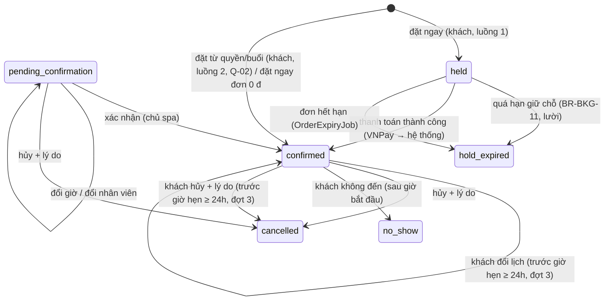

# Đặt lịch & lịch hẹn — đặc tả

- **Nhóm:** `Bookings` · **Sprint:** 1 · **Nguồn:** DA §2.2.3 (UC Quản lý lịch hẹn), sheet `09_Thuat_toan_lich` (A1–A12) / ĐX
- **Entity:** `Appointment` (bảng `appointments`), đọc thêm `WorkSchedule`, `StaffMember`, `StaffSkill`, `SpaService`, `ServiceEntitlement`, `TreatmentSession`, `OrderItem`, `CustomerAllergy`, `SkinProfile` — xem [glossary](../domain/glossary.md), [data-model](../domain/data-model.md)
- **Trạng thái triển khai:** đợt 1 (giờ trống + UC-SPA-17) xong phần backend ngày 28/10/2026; đợt 2 (UC-SPA-15) duyệt và xong phần backend ngày 30/10/2026 theo [plan](../superpowers/plans/2026-10-30-uc-spa-15-18-bookings-purchases.md); đợt 3 (UC-SPA-16) duyệt và xong phần backend ngày 01/11/2026 theo [plan](../superpowers/plans/2026-11-01-uc-spa-16-my-appointments.md) — xem [progress.md](../progress.md)
- **Đã đặc tả:** đợt 1 = thuật toán tìm giờ trống (`GET /availability`) và UC-SPA-17 (chủ spa quản lý lịch hẹn), chỉ backend. Đợt 2 = UC-SPA-15 (hai luồng khách đặt lịch, "nhân viên bất kỳ" Q-26, lọc giờ trống theo quyền/buổi gói, giải phóng giữ chỗ trong `OrderExpiryJob`) và `GET /me/appointments/{id}` (phần xem chi tiết của UC-SPA-16), chỉ backend; làm cùng UC-SPA-18 ([purchases-treatments.md](purchases-treatments.md)). Đợt 3 (duyệt 01/11/2026, đổi lịch không giới hạn số lần) = phần còn lại của UC-SPA-16: danh sách, đổi lịch, hủy lịch của tôi và giờ trống để khách đổi lịch, chỉ backend.

## Use case

### Tìm giờ trống (thuật toán, dùng chung UC-SPA-15, 16, 17)

| Mục            | Nội dung                                                                                                        |
| -------------- | --------------------------------------------------------------------------------------------------------------- |
| Actor          | Mọi người (khách vãng lai, khách hàng, nhân viên, chủ spa)                                                      |
| Mô tả          | Trả các nhân viên làm được dịch vụ và các khung giờ còn trống của họ trong một ngày                             |
| Tiền điều kiện | Dịch vụ tồn tại; người không phải chủ spa chỉ dùng được dịch vụ đang bán (BR-CAT-01)                            |
| Input          | `spaServiceId`, `date`, `staffMemberId?`, `appointmentId?` (chỉ chủ spa: tính giờ trống để dời một lịch có sẵn) |
| Output         | `{ date, durationMinutes, staff: [{ id, fullName, slots: [{ startTime, endTime }] }] }`                         |

**Luồng chính** (A1–A8 của sheet `09`)

1. Client gọi `GET /availability?spaServiceId&date[&staffMemberId][&appointmentId]`.
2. Thời lượng `duration` = `spa_services.duration_minutes`; khi có `appointmentId` thì = `end_time − start_time` của lịch đó (giữ nguyên thời lượng khi dời lịch). Bước khung giờ `step` = `Booking:SlotStepMinutes` (mặc định 30, Q-11).
3. **Ứng viên** (A3): nhân viên có `staff_skills` cho dịch vụ, `users.status = active`, `hire_date ≤ date`, đang làm vào `date` (`resignation_date` null hoặc > `date`); có `staffMemberId` thì chỉ người đó.
4. **Khoảng làm việc** (A4): các ca `active` của nhân viên trong `date` → các đoạn `[start_time, end_time)`.
5. **Trừ lịch đã chiếm** (A5): bỏ khỏi các đoạn mọi lịch hẹn **chiếm chỗ** của nhân viên trong ngày (`AppointmentOccupancy`, BR-STF-07); khi có `appointmentId` thì không trừ chính lịch đó.
6. **Sinh khung** (A6): trong mỗi đoạn rảnh, `t` chạy từ đầu đoạn làm tròn **lên** bội số `step` tính từ 00:00; giữ `t` nếu `[t, t + duration)` nằm trọn trong đoạn rảnh.
7. **Lọc** (A7): bỏ `t` đã qua nếu `date` là hôm nay (giờ VN, `t ≤ giờ hiện tại`); nếu người gọi là **khách hàng** thì bỏ `t` giao với lịch chiếm chỗ khác của chính khách đó (BR-BKG-04); khi có `appointmentId` thì bỏ `t` giao với lịch chiếm chỗ khác của **khách của lịch đó**.
8. Trả nhân viên có ít nhất một khung, sắp theo `fullName`; khung sắp theo giờ.

**Ngoại lệ**

- E1. Thiếu/sai tham số, `date` ngoài `[hôm nay, hôm nay + Booking:MaxDaysAhead]` → `400 validation_error`.
- E2. Dịch vụ không tồn tại hoặc người gọi không được thấy → `404 service_not_found` (cùng thông điệp catalog).
- E3. `appointmentId` khi người gọi không phải chủ spa → bỏ qua tham số (như `status` của catalog); không tồn tại → `404 appointment_not_found`.
- E4. Không có khung nào → `200` với `staff` rỗng.

**Đợt 2 — lọc theo quyền đã mua** (A1, A7; chỉ khách hàng):

- Thêm tham số `serviceEntitlementId?` và `treatmentSessionId?`; gửi đúng **một** trong `spaServiceId`, `serviceEntitlementId`, `treatmentSessionId` (sai → `400 validation_error`). Hai tham số mới chỉ nhận khi Bearer là khách hàng và quyền/buổi thuộc khách đó; khác đi → `404 entitlement_not_found` / `404 treatment_session_not_found` (không lộ quyền của người khác).
- `serviceEntitlementId`: dịch vụ = dịch vụ của dòng đơn, thời lượng = `spa_services.duration_minutes` hiện tại; dịch vụ đã ngừng bán vẫn tính được (Q-29).
- `treatmentSessionId`: dịch vụ = `treatment_sessions.spa_service_id`, thời lượng = `treatment_sessions.duration_minutes` (bản chụp); `date` trước **ngày sớm nhất** của buổi (BR-BKG-05) hoặc sau hạn gói (Q-30) → `200` với `staff` rỗng.
- Quyền/buổi không còn đặt được (đã đặt, đã dùng, hết hạn…) không làm `GET /availability` lỗi; lỗi chỉ trả khi đặt (`POST /me/appointments`).

### UC-SPA-15 — Đặt lịch hẹn (đợt 2)

| Mục            | Nội dung                                                                                                                                                                                                    |
| -------------- | ----------------------------------------------------------------------------------------------------------------------------------------------------------------------------------------------------------- |
| Actor          | Khách hàng; cổng thanh toán VNPay (luồng 1)                                                                                                                                                                 |
| Mô tả          | Luồng 1 (`BookNow`): chọn dịch vụ và giờ, hệ thống giữ chỗ và tạo đơn, thanh toán thành công thì xác nhận lịch. Luồng 2 (`BookFromEntitlement`): dùng dịch vụ lẻ hoặc buổi trong gói đã mua để đặt          |
| Tiền điều kiện | Đã đăng nhập, `role = customer` (quyền `appointment.self`); luồng 2: có quyền `available` hoặc buổi `not_booked` đủ điều kiện                                                                               |
| Input          | Luồng 1: `spaServiceId`, `date`, `startTime`, `staffMemberId?`, `promotionCode?`, header `Idempotency-Key?`. Luồng 2: `serviceEntitlementId` \| `treatmentSessionId`, `date`, `startTime`, `staffMemberId?` |
| Output         | Luồng 1: lịch `held` + đơn `pending_payment` (rồi `confirmed` + đơn `paid`, hoặc `hold_expired` + đơn `expired`). Luồng 2: lịch `confirmed` (Q-02), quyền/buổi `booked`                                     |

**Luồng 1 — Đặt ngay (giữ chỗ + thanh toán)**

1. Khách mở dịch vụ, nhấn "Đặt ngay"; client gọi `GET /availability?spaServiceId&date` (Bearer khách hàng) và hiển thị nhân viên + giờ trống. Muốn biết giá sau khuyến mãi thì gọi `POST /me/orders/preview` với `{ source: "buy_now", spaServiceId, promotionCode? }` (đã có, UC-SPA-11).
2. Khách chọn giờ (và nhân viên, hoặc "nhân viên bất kỳ") rồi xác nhận; client gọi `POST /me/appointments/book-now`.
3. Hệ thống kiểm tra dữ liệu: dịch vụ đang bán (BR-CAT-01), `date` trong `[hôm nay, hôm nay + Booking:MaxDaysAhead]`, `startTime` đúng lưới `Booking:SlotStepMinutes`, giờ bắt đầu không sớm hơn hạn giữ chỗ (BR-BKG-15).
4. Trong **một giao dịch** (A9): khóa nhân viên (BR-BKG-14 khi tự phân công) → khóa khách → `ExpireHeldAsync` → kiểm tra lại A3–A7 cho khung đã chọn (kỹ năng BR-BKG-03, nằm trọn một ca BR-BKG-02, không trùng nhân viên BR-BKG-01, không trùng khách BR-BKG-04).
5. Tạo đơn như `POST /me/orders` với `source = buy_now` (một dòng dịch vụ, giá đọc lại, khuyến mãi, `Idempotency-Key`, BR-ORD-02, 03, 07–09) **và** lịch hẹn `held`: `order_item_id` = dòng đơn, `hold_expires_at_utc` = `payment_due_at_utc + OrderExpiry:GraceMinutes` (BR-BKG-06), `end_time = start_time + duration_minutes`.
6. Trả `201 { appointment, order }`. Client gọi tiếp `POST /me/orders/{id}/payments` (UC-SPA-11) và mở `paymentUrl`.
7. Kết quả thanh toán thành công hợp lệ (IPN hoặc return URL, BR-ORD-05) → trong giao dịch của `PaymentService`: đơn `paid`; dòng dịch vụ có lịch giữ chỗ → `service_entitlements` tạo với `booked` (WF-04), gán `appointments.service_entitlement_id`, lịch `held → confirmed` (BR-BKG-06).
8. Trang kết quả gọi `GET /me/orders/{id}` (có thêm `appointment`) hoặc `GET /me/appointments/{id}` để hiển thị lịch đã xác nhận. Thông báo trong ứng dụng làm ở UC-SPA-34 (BKG-LATER-03).

**Luồng 2 — Đặt từ dịch vụ và gói của tôi**

1. Khách mở "Dịch vụ và gói của tôi" (UC-SPA-18), chọn một dịch vụ lẻ `available` hoặc buổi kế tiếp của gói (`nextSession`), nhấn đặt lịch.
2. Client gọi `GET /availability?serviceEntitlementId=…` hoặc `?treatmentSessionId=…&date` và hiển thị nhân viên + giờ trống.
3. Khách chọn giờ, xác nhận; client gọi `POST /me/appointments` với `{ serviceEntitlementId | treatmentSessionId, date, startTime, staffMemberId? }`.
4. Hệ thống kiểm tra điều kiện quyền (BR-BKG-05, BR-TRT-01) và dữ liệu như bước 3 luồng 1 (trừ BR-BKG-15).
5. Trong một giao dịch: khóa nhân viên → khóa khách → **đọc lại** trạng thái quyền/buổi sau khi khóa (hai yêu cầu cùng một quyền chạy nối tiếp) → `ExpireHeldAsync` → kiểm tra lại A3–A7 → tạo lịch `confirmed` (Q-02) với `service_entitlement_id` hoặc `treatment_session_id`; quyền `available → booked` hoặc buổi `not_booked → booked` (BR-TRT-02, WF-07).
6. Trả `201` + `Location: /api/v1/me/appointments/{id}`, chi tiết lịch.

**Luồng rẽ nhánh**

- A1. **Nhân viên bất kỳ** (Q-26): bỏ `staffMemberId` → hệ thống chọn trong giao dịch người có kỹ năng, có ca phủ khung, rảnh ở khung đó, **ít lịch chiếm chỗ nhất trong ngày**, hòa thì theo `fullName` rồi `id` (BR-BKG-14).
- A2. **Đơn 0 đ** (khuyến mãi 100%): luồng 1 bước 5 tạo đơn `paid` ngay (BR-ORD-09), quyền `booked` và lịch `confirmed` trong cùng giao dịch; `201` trả lịch `confirmed`.
- A3. **Thanh toán thất bại / khách hủy trên VNPay:** lần thanh toán `failed`, đơn giữ `pending_payment`, lịch **vẫn giữ chỗ** tới hạn để khách thử lại (UC-SPA-11 A2, Q-28).
- A4. **Không thanh toán tới hạn:** `OrderExpiryJob` chuyển đơn `expired` và lịch `held` của đơn → `hold_expired` trong cùng giao dịch (BR-BKG-06, A10). Trước đó, ghi lịch vào khung vẫn chuyển lười `held` quá hạn → `hold_expired` (BR-BKG-11).
- A5. **Thành công đến muộn** (Q-20) khi lịch đã `hold_expired`: đơn vẫn `paid`, quyền tạo với `available` (khách đặt lại bằng luồng 2), lịch giữ `hold_expired`, ghi log cảnh báo (Q-27). Lịch còn `held` (chưa ai chuyển) → xác nhận như bước 7.
- A6. **Gửi lại `book-now` cùng `Idempotency-Key`:** trả đơn và lịch đã tạo (`200`), không giữ chỗ mới.
- A7. **Xem chi tiết lịch của tôi:** `GET /me/appointments/{id}` → lịch của chính khách, kèm `order?` khi lịch đến từ luồng 1.

**Ngoại lệ**

- E1. Dữ liệu sai: thiếu/thừa nguồn, `date` ngoài khoảng, `startTime` có giây hoặc không đúng lưới → `400 validation_error`; giờ bắt đầu đã qua → `400 appointment_in_past`; luồng 1 bắt đầu trước hạn giữ chỗ → `400 slot_too_soon` (BR-BKG-15).
- E2. **Giờ không còn trống** (luồng 1 E1, luồng 2 E2): trùng lịch nhân viên (kể cả do `EXCLUDE` khi đồng thời) → `409 slot_unavailable`; trùng lịch khác của khách → `409 customer_busy`; ngoài ca hoặc nhân viên nghỉ vào ngày đó → `409 outside_work_schedule`; nhân viên bất kỳ mà không ai rảnh → `409 slot_unavailable`. Client quay lại chọn giờ.
- E3. Nhân viên không có kỹ năng dịch vụ → `400 staff_not_qualified`; nhân viên không tồn tại hoặc tài khoản không `active` → `404 staff_not_found`.
- E4. Luồng 1: dịch vụ không tồn tại/ngừng bán → `404 service_not_found`; lỗi khuyến mãi và số tiền như UC-SPA-11 (`400 promotion_invalid`/`promotion_not_applicable`/`order_amount_too_small`).
- E5. **Luồng 2 — không đủ điều kiện** (luồng 2 E1): quyền/buổi không tồn tại hoặc của người khác → `404 entitlement_not_found` / `404 treatment_session_not_found`; quyền không `available`, hết hạn; buổi không `not_booked`, buổi trước chưa đặt, gói không `active` hoặc hết hạn, liệu trình `paused`/`cancelled` → `409 entitlement_not_eligible`, thông điệp nêu lý do; ngày hẹn sau hạn gói → `409 entitlement_not_eligible` (Q-30); chưa đủ khoảng cách với buổi trước → `400 session_too_early`, thông điệp nêu ngày sớm nhất (BR-BKG-05).
- E6. `GET /me/appointments/{id}` của người khác hoặc không tồn tại → `404 appointment_not_found`.
- E7. Chưa đăng nhập → `401`; không phải khách hàng → `403`.

**Quy tắc áp dụng:** BR-BKG-01–06, 11, 12, 14, 15, BR-TRT-01, 02, BR-ORD-02, 03, 05–09, BR-CAT-01, BR-SEC-01, RBAC `appointment.self`.

### UC-SPA-17 — Quản lý lịch hẹn

| Mục            | Nội dung                                                                                                   |
| -------------- | ---------------------------------------------------------------------------------------------------------- |
| Actor          | Chủ spa (xem chi tiết: cả nhân viên được phân công lịch đó)                                                |
| Mô tả          | Xem danh sách/chi tiết lịch hẹn; xác nhận; đổi giờ; đổi nhân viên; hủy kèm lý do; ghi nhận khách không đến |
| Tiền điều kiện | Đã đăng nhập, `role = owner` (quyền `appointment.manage`)                                                  |
| Input          | Lịch được chọn; ngày/giờ mới; nhân viên mới; lý do hủy; ghi chú khi khách không đến                        |
| Output         | Lịch hẹn được cập nhật                                                                                     |

**Luồng chính — đổi giờ**

1. Chủ spa mở danh sách `GET /appointments` (lọc ngày, nhân viên, trạng thái, tên/SĐT khách), chọn một lịch, xem `GET /appointments/{id}`.
2. Chủ spa lấy giờ trống `GET /availability?spaServiceId&date&staffMemberId&appointmentId` rồi gửi `POST /appointments/{id}/reschedule` với `{ date, startTime }`; `endTime` = `startTime` + thời lượng cũ.
3. Hệ thống kiểm tra trong **một giao dịch** (BR-BKG-09): trạng thái cho phép, lịch chưa bắt đầu, giờ mới chưa qua, nằm trọn trong một ca `active` của nhân viên (BR-BKG-02), nhân viên còn làm vào ngày mới, không trùng lịch khác của nhân viên (BR-BKG-01) và của khách (BR-BKG-04).
4. Lưu; ràng buộc `EXCLUDE` chặn tranh chấp đồng thời → `409 slot_unavailable`. Trả `200` chi tiết lịch.

**Luồng rẽ nhánh**

- A1. **Đổi nhân viên:** `POST /appointments/{id}/assign-staff` với `{ staffMemberId }` → nhân viên mới phải có kỹ năng dịch vụ (BR-BKG-03), đang làm, có ca phủ trọn khung giờ, không trùng lịch → `200`. Đổi sang chính nhân viên hiện tại → `200`, không đổi gì. Dùng để xử lý `appointmentsToReassign` khi nhân viên nghỉ việc (UC-SPA-22).
- A2. **Hủy:** `POST /appointments/{id}/cancel` với `{ reason }` → `cancelled`, `cancelled_at_utc = now`, `cancellation_reason`; trả quyền đã dùng để đặt (BR-BKG-10) → `200`.
- A3. **Khách không đến:** `POST /appointments/{id}/no-show` với `{ note? }` → chỉ khi `confirmed` và đã tới giờ bắt đầu (BR-BKG-08) → `no_show`, ghi `note`; trả quyền theo Q-07 (mặc định không trừ) → `200`.
- A4. **Xác nhận** (bổ sung theo rà soát RS-12): `POST /appointments/{id}/confirm` → `pending_confirmation` → `confirmed`. Theo Q-02 lịch luồng 2 tự xác nhận nên hiện chưa phát sinh lịch `pending_confirmation`; endpoint có sẵn cho khi đổi Q-02.
- A5. **Nhân viên xem chi tiết** lịch được phân công cho mình: `GET /appointments/{id}` (phần xem của UC-SPA-25); lịch của người khác → `403`.

**Ngoại lệ**

- E1. Giờ mới trùng lịch của nhân viên → `409 slot_unavailable`; trùng lịch khác của khách → `409 customer_busy`; ngoài ca → `409 outside_work_schedule`; nhân viên đã nghỉ vào ngày đó → `409 outside_work_schedule`.
- E2. Đổi nhân viên: không có kỹ năng → `400 staff_not_qualified`; không có ca phủ khung giờ hoặc đã nghỉ → `409 staff_not_on_shift`; trùng lịch → `409 staff_busy`; nhân viên không tồn tại → `404 staff_not_found`.
- E3. Hành động không hợp với trạng thái hiện tại (ví dụ hủy lịch đã hoàn thành, xác nhận lịch đã xác nhận) → `409 appointment_status_invalid`, thông điệp nêu trạng thái hiện tại.
- E4. Đổi giờ/đổi nhân viên lịch đã bắt đầu, hoặc dời tới giờ đã qua → `400 appointment_in_past`. Ghi nhận không đến trước giờ bắt đầu → `400 no_show_too_early`.
- E5. Dữ liệu sai (thiếu `reason`, `reason` > 500 ký tự, giờ có giây…) → `400`.
- E6. Lịch không tồn tại → `404 appointment_not_found`.
- E7. Chưa đăng nhập → `401`; không phải chủ spa → `403` (riêng `GET /appointments/{id}`: nhân viên không được phân công → `403 appointment_not_assigned`).
- E8. Không có endpoint xóa lịch hẹn.

**Quy tắc áp dụng:** BR-BKG-01, 02, 03, 04, 08, 09, 10, 11, 13, BR-STF-07, BR-SEC-01, RBAC `appointment.manage`.

### UC-SPA-16 — Xem và quản lý lịch hẹn (đợt 3)

| Mục            | Nội dung                                                                                                                                  |
| -------------- | ----------------------------------------------------------------------------------------------------------------------------------------- |
| Actor          | Khách hàng                                                                                                                                |
| Mô tả          | Khách xem danh sách và chi tiết lịch hẹn của mình; đổi sang thời gian (và nhân viên) khác; hủy kèm lý do, được trả lại quyền/buổi đã dùng |
| Tiền điều kiện | Đã đăng nhập, `role = customer` (quyền `appointment.self`, có sẵn từ đợt 2)                                                               |
| Input          | Bộ lọc danh sách; lịch được chọn; ngày, giờ, nhân viên mới (đổi lịch); lý do (hủy)                                                        |
| Output         | Danh sách/chi tiết lịch; lịch đã đổi giờ hoặc đã hủy                                                                                      |

**Luồng chính — xem** (bước 1–4 của DA)

1. Khách mở "Lịch hẹn của tôi"; client gọi `GET /me/appointments?scope=upcoming` (tab "Sắp tới"), `scope=past` ("Đã xong"), `scope=cancelled` ("Đã hủy").
2. Hệ thống trả các lịch của chính khách theo nhóm (BR-BKG-17), phân trang, kèm `canReschedule`/`canCancel` để giao diện bật tắt nút.
3. Khách chọn một lịch; client gọi `GET /me/appointments/{id}` (có sẵn, thêm `canReschedule`, `canCancel`, `changeDeadlineAtUtc`).

**Luồng rẽ nhánh**

- A1. **Đổi lịch:**
  1. Client gọi `GET /availability?appointmentId={id}&date[&staffMemberId]` bằng Bearer khách hàng (BR-BKG-18): giờ trống tính với dịch vụ và thời lượng của chính lịch đó, lịch đó không tự chặn mình, buổi gói chỉ có khung trong khoảng ngày được phép (BR-BKG-16).
  2. Khách chọn giờ (và nhân viên, hoặc "nhân viên bất kỳ"); client gọi `POST /me/appointments/{id}/reschedule` với `{ date, startTime, staffMemberId? }`.
  3. Hệ thống kiểm tra dữ liệu như đặt lịch (`date` trong `[hôm nay, hôm nay + Booking:MaxDaysAhead]`, `startTime` đúng lưới, giờ mới chưa qua).
  4. Trong **một giao dịch**: khóa lịch → kiểm tra trạng thái và hạn đổi (BR-BKG-07) → với buổi gói kiểm tra khoảng ngày (BR-BKG-16) → `BookingSlotReserver` kiểm tra lại A3–A7 cho khung mới với nhân viên đã chọn hoặc tự chọn (Q-26), **bỏ qua chính lịch này** khi tính trùng nhân viên và trùng khách (A12) → cập nhật `staff_member_id`, `date`, `start_time`, `end_time`; giữ thời lượng cũ và trạng thái.
  5. Trả `200` chi tiết lịch (`MyAppointmentDto`).
- A2. **Hủy:** client gọi `POST /me/appointments/{id}/cancel` với `{ reason }` → trong một giao dịch: khóa lịch → kiểm tra trạng thái và hạn hủy (BR-BKG-07) → `cancelled`, `cancelled_at_utc`, `cancellation_reason`; trả quyền/buổi (BR-BKG-10: quyền `booked → available`, buổi `booked → not_booked`; lịch đặt ngay đã thanh toán có quyền nên cũng trả quyền, **không hoàn tiền**) → `200` chi tiết lịch.
- A3. **Không có lịch** trong nhóm → `200` danh sách rỗng (client hiển thị trạng thái trống, liên kết đặt lịch).
- A4. **Đổi sang chính khung và nhân viên hiện tại** → `200`, không đổi gì.

**Ngoại lệ**

- E1. **Giờ mới không còn trống** (ĐX E1 của DA): trùng lịch nhân viên (kể cả do `EXCLUDE` khi đồng thời) → `409 slot_unavailable`; trùng lịch khác của khách → `409 customer_busy`; ngoài ca → `409 outside_work_schedule`; nhân viên bất kỳ mà không ai rảnh → `409 slot_unavailable`; nhân viên không có kỹ năng → `400 staff_not_qualified`; không tồn tại/không `active` → `404 staff_not_found`.
- E2. **Quá hạn đổi/hủy** (ĐX E2 của DA): còn ít hơn `Booking:CustomerChangeCutoffHours` (24, Q-04) giờ trước giờ hẹn hiện tại, hoặc lịch đã bắt đầu → `400 change_window_passed`, thông điệp nêu số giờ và gợi ý liên hệ spa.
- E3. Trạng thái không cho phép (`held`, `hold_expired`, `completed`, `cancelled`, `no_show`) → `409 appointment_status_invalid`, thông điệp nêu trạng thái hiện tại (lịch `held`: Q-41).
- E4. Buổi gói: giờ mới trước ngày sớm nhất (sau buổi liền trước) → `400 session_too_early`; sau ngày muộn nhất (trước buổi liền sau đã đặt) → `400 session_too_late` (Q-42); gói hết hạn hoặc giờ mới không trước hạn gói, liệu trình `paused`/`cancelled` → `409 entitlement_not_eligible`. Dịch vụ lẻ đã hết hạn (`expires_at_utc` ≤ bây giờ) → `409 entitlement_not_eligible`. Hủy không kiểm tra các điều kiện này.
- E5. Dữ liệu sai: thiếu `reason` hoặc > 500 ký tự, `date` ngoài khoảng, giờ lệch lưới/có giây, `fromDate > toDate`, `scope`/`status` không hợp lệ → `400 validation_error`; giờ mới đã qua → `400 appointment_in_past`.
- E6. Lịch của người khác hoặc không tồn tại (danh sách, chi tiết, đổi, hủy, `GET /availability?appointmentId`) → `404 appointment_not_found`.
- E7. Chưa đăng nhập → `401`; không phải khách hàng → `403`.

**Quy tắc áp dụng:** BR-BKG-01–05, 07, 10–14, 16–18, BR-SEC-01, RBAC `appointment.self`.

## Business rules

| Mã        | Quy tắc                                                                                                                                                                                                                                                                                                                                                                                                                                                                                                                                                                                                                                                 | Enforce ở đâu                                                                                         | Nguồn                            |
| --------- | ------------------------------------------------------------------------------------------------------------------------------------------------------------------------------------------------------------------------------------------------------------------------------------------------------------------------------------------------------------------------------------------------------------------------------------------------------------------------------------------------------------------------------------------------------------------------------------------------------------------------------------------------------- | ----------------------------------------------------------------------------------------------------- | -------------------------------- |
| BR-BKG-01 | Không trùng lịch nhân viên: hai lịch chiếm chỗ của cùng nhân viên không giao nhau `[start, end)`                                                                                                                                                                                                                                                                                                                                                                                                                                                                                                                                                        | Application (trong giao dịch) + CSDL `EXCLUDE` có sẵn                                                 | DA                               |
| BR-BKG-02 | Khung giờ nằm trọn trong **một** ca `active` của nhân viên trong ngày; nhân viên đang làm vào ngày đó                                                                                                                                                                                                                                                                                                                                                                                                                                                                                                                                                   | Application                                                                                           | DA                               |
| BR-BKG-03 | Nhân viên phải có `staff_skills` cho dịch vụ của lịch                                                                                                                                                                                                                                                                                                                                                                                                                                                                                                                                                                                                   | Application                                                                                           | DA                               |
| BR-BKG-04 | Một khách không có hai lịch chiếm chỗ giao nhau                                                                                                                                                                                                                                                                                                                                                                                                                                                                                                                                                                                                         | Application                                                                                           | DA                               |
| BR-BKG-05 | Đặt bằng quyền đã mua. **Dịch vụ lẻ:** của khách, `available`, `expires_at_utc` null hoặc > bây giờ. **Buổi gói:** gói của khách `active`, `expires_at_utc` > bây giờ và > giờ bắt đầu của lịch (Q-30); liệu trình không `paused`/`cancelled`; buổi `not_booked`; mọi buổi `sequence_number` nhỏ hơn đã `booked`/`completed`/`skipped`; **ngày sớm nhất** = ngày lịch gần nhất (chiếm chỗ, `completed` hoặc `no_show`) của buổi liền trước + `min_days_between_sessions` của dòng gói ứng với dịch vụ của buổi (đọc cấu hình gói hiện tại, như Q-23), và giờ bắt đầu sau giờ kết thúc lịch đó; buổi đầu không giới hạn. Kiểm tra lại sau khi khóa khách | Application                                                                                           | DA (luồng 2 bước 4) + ĐX         |
| BR-BKG-06 | Luồng 1: lịch `held`, `order_item_id` = dòng đơn, `hold_expires_at_utc` = `payment_due_at_utc + OrderExpiry:GraceMinutes` (15 + 5 phút, Q-03) để IPN đến trong ân hạn không mất chỗ. Thành công hợp lệ khi lịch còn `held` → quyền `booked` + gán vào lịch, lịch `confirmed`; khi lịch đã `hold_expired` → quyền `available` (Q-27). Thất bại không giải phóng (Q-28). Đơn `expired` (job) → lịch `held` của đơn `hold_expired` cùng giao dịch                                                                                                                                                                                                          | Application (`EntitlementIssuer`, `OrderExpiryService`)                                               | DA + ĐX                          |
| BR-BKG-14 | Nhân viên bất kỳ (Q-26): khóa **mọi** nhân viên ứng viên theo thứ tự `id` (cùng một câu `FOR UPDATE`, tránh deadlock giữa hai lần tự phân công), rồi chọn theo `Booking:AutoAssignStrategy` = `least_busy`: ít lịch chiếm chỗ nhất trong ngày → `fullName` → `id`. Chọn nhân viên cụ thể chỉ khóa người đó. Sau đó khóa khách                                                                                                                                                                                                                                                                                                                           | Application + Infrastructure                                                                          | ĐX (Q-26)                        |
| BR-BKG-15 | Luồng 1: giờ bắt đầu (giờ VN) ≥ `hold_expires_at_utc` đổi sang giờ VN, để lịch không bắt đầu khi còn đang chờ thanh toán (Q-31)                                                                                                                                                                                                                                                                                                                                                                                                                                                                                                                         | Application                                                                                           | ĐX                               |
| BR-BKG-08 | Ghi nhận không đến chỉ khi `confirmed` và `now (VN) ≥ date + start_time`; có trừ lượt hay không theo Q-07 (`Booking:NoShowConsumesEntitlement`, mặc định **không trừ**). Khi bật: quyền `booked → used`, buổi `booked → skipped`, không tăng tiến độ gói                                                                                                                                                                                                                                                                                                                                                                                                | Domain (`Appointment`) + Application                                                                  | DA + ĐX                          |
| BR-BKG-09 | Chủ spa đổi giờ/đổi nhân viên/hủy được lịch `pending_confirmation` hoặc `confirmed`; đổi giờ và đổi nhân viên chỉ khi lịch **chưa bắt đầu** và khung mới chưa qua. Lịch `held` (đang chờ thanh toán) không sửa/hủy ở UC-SPA-17                                                                                                                                                                                                                                                                                                                                                                                                                          | Application                                                                                           | WF-01 + ĐX (Q-24)                |
| BR-BKG-10 | Hủy hoặc ghi nhận không đến (khi Q-07 = không trừ) trả quyền: `service_entitlements` `booked → available`; `treatment_sessions` `booked → not_booked`; cùng giao dịch với đổi trạng thái lịch. Lịch chỉ có `order_item_id` (đặt ngay, UC-SPA-15) theo quy tắc của UC-SPA-15                                                                                                                                                                                                                                                                                                                                                                             | Domain (chuyển trạng thái) + Application                                                              | WF-04, WF-07                     |
| BR-BKG-11 | Lịch `held` đã quá `hold_expires_at_utc` được chuyển `hold_expired` **ngay trong giao dịch** trước khi đổi giờ/đổi nhân viên/ghi lịch vào khung của nhân viên đó, vì ràng buộc `EXCLUDE` vẫn tính `held` (không dùng được `now()`) và chưa có job nền (A10)                                                                                                                                                                                                                                                                                                                                                                                             | Application + Infrastructure                                                                          | A10 + ĐX                         |
| BR-BKG-12 | Thuật toán giờ trống A1–A8 như mục Use case; bước `Booking:SlotStepMinutes` (30); ngày trong `[hôm nay, hôm nay + Booking:MaxDaysAhead]` (60)                                                                                                                                                                                                                                                                                                                                                                                                                                                                                                           | Application (`AvailabilityService`, phần tính khung là hàm thuần dễ unit test)                        | Sheet `09` + Q-11                |
| BR-BKG-13 | Dịch vụ của lịch hẹn **suy ra**, không lưu trên lịch (Q-25): `treatment_sessions.spa_service_id` → `order_items.spa_service_id` của `service_entitlements` → `order_items.spa_service_id` của `order_item_id`; lấy nguồn đầu tiên khác null. Mỗi lịch có ít nhất một nguồn: `CHECK (num_nonnulls(service_entitlement_id, treatment_session_id, order_item_id) >= 1)`                                                                                                                                                                                                                                                                                    | Application (một biểu thức dùng chung) + CSDL `CHECK`                                                 | ĐX (Q-25)                        |
| BR-BKG-07 | **Đợt 3.** Khách đổi/hủy được lịch `pending_confirmation` hoặc `confirmed` khi `now (VN) ≤ date + start_time − Booking:CustomerChangeCutoffHours` (24, Q-04), tính theo giờ hẹn **hiện tại**; khung mới chỉ cần chưa qua (không áp hạn 24 giờ cho khung mới). Kiểm tra trạng thái trước (`409`), rồi hạn (`400 change_window_passed`). Hủy hợp lệ trả quyền theo BR-BKG-10, không hoàn tiền                                                                                                                                                                                                                                                             | Application (`AppointmentChangePolicy`, hàm thuần dùng cho cả lệnh và cờ `canReschedule`/`canCancel`) | DA ("khi được phép") + ĐX (Q-04) |
| BR-BKG-16 | **Đợt 3.** Đổi lịch của buổi gói giữ thứ tự gói: khung mới ≥ **ngày sớm nhất** (BR-BKG-05, tính từ buổi liền trước) và, nếu buổi liền sau đã có lịch chiếm chỗ, ≤ **ngày muộn nhất** = ngày lịch đó − `min_days_between_sessions` của dòng gói ứng với dịch vụ buổi sau, và kết thúc trước giờ bắt đầu lịch đó khi cùng ngày (Q-42). Gói phải còn `active`, giờ mới < hạn gói (Q-30), liệu trình không `paused`/`cancelled`. Dịch vụ lẻ: chưa hết hạn. Đọc lại sau khi khóa lịch                                                                                                                                                                        | Application (`EntitlementEligibility`)                                                                | ĐX                               |
| BR-BKG-17 | **Đợt 3.** Nhóm danh sách của khách: `upcoming` = `held`, `pending_confirmation`, `confirmed` (sắp **tăng** theo `date, start_time`); `past` = `completed`, `no_show`; `cancelled` = `cancelled`, `hold_expired` (hai nhóm sau sắp **giảm**). Không gửi `scope` = mọi trạng thái, sắp giảm. `status` (một giá trị) lọc thêm trong nhóm                                                                                                                                                                                                                                                                                                                  | Application + Infrastructure                                                                          | ĐX (màn SCR-W14, SCR-M11)        |
| BR-BKG-18 | **Đợt 3.** `GET /availability?appointmentId` với Bearer khách hàng: lịch phải của khách đó (khác → `404 appointment_not_found`), gửi **thay cho** `spaServiceId`/`serviceEntitlementId`/`treatmentSessionId`; dịch vụ suy ra (BR-BKG-13), thời lượng = `end_time − start_time`, lịch đó không chặn nhân viên lẫn khách, buổi gói áp khoảng ngày BR-BKG-16 (ngoài khoảng → `staff` rỗng). Chủ spa giữ cách dùng cũ (`spaServiceId` + `appointmentId`)                                                                                                                                                                                                    | Application (`AvailabilityService`)                                                                   | ĐX                               |

**Phân quyền** (sheet `21`): `appointment.manage` → `owner` (policy mới); đợt 2: `appointment.self` → `customer` (policy mới) cho `/me/appointments*` (đợt 3 dùng lại, không thêm quyền); khách chỉ thấy lịch của mình (BR-SEC-01, lịch người khác → `404`). `GET /availability` để `[AllowAnonymous]` (Bearer hợp lệ quyết định chế độ chủ spa/khách hàng như catalog). `GET /appointments/{id}`: owner hoặc staff, service kiểm tra nhân viên được phân công (BR-SEC-01).

## Trạng thái

Quyền và buổi đi kèm (WF-04, WF-07): luồng 2 `available → booked` / `not_booked → booked`; luồng 1 quyền sinh ra ở trạng thái `booked` khi lịch được xác nhận, `available` khi lịch đã `hold_expired` (Q-27). Hoàn thành (`confirmed → completed`) thuộc UC-SPA-28.

## Dữ liệu

| Bảng                                                                       | Cột dùng         | Thay đổi                                                                                                                                                   |
| -------------------------------------------------------------------------- | ---------------- | ---------------------------------------------------------------------------------------------------------------------------------------------------------- |
| `appointments`                                                             | toàn bộ          | Không thêm cột (dịch vụ suy ra, BR-BKG-13, Q-25); **thêm** `CHECK ck_appointments_source` (ít nhất một nguồn) và index `(customer_id, date)` cho BR-BKG-04 |
| `work_schedules`, `staff_members`, `staff_skills`, `users`, `spa_services` | đọc              | Không đổi                                                                                                                                                  |
| `service_entitlements`, `treatment_sessions`                               | `status`         | Không đổi schema; cập nhật trạng thái khi hủy/không đến                                                                                                    |
| `order_items`                                                              | `spa_service_id` | Đọc để suy ra dịch vụ của lịch                                                                                                                             |
| `customer_allergies`, `skin_profiles`                                      | đọc cho chi tiết | Không đổi                                                                                                                                                  |

Migration mới `AddAppointmentBookingConstraints` (CHECK + index, không đổi cột). Sửa `docs/spec-source/data_db.py` (ràng buộc của `customer_id` và `order_item_id`), sinh lại `data-model.md`, Excel, SQL tiếng Việt. ERD báo cáo giữ nguyên.

**Đợt 2:** **không đổi schema, không có migration.** Luồng 1 dùng `appointments.order_item_id` + `hold_expires_at_utc` có sẵn; chống đặt trùng `Idempotency-Key` dùng `orders.idempotency_key` có sẵn; luồng 2 không nhận `Idempotency-Key` (gửi lại bị chặn vì quyền/buổi đã `booked`). Ghi thêm: `service_entitlements` (tạo `booked`, `available → booked`), `treatment_sessions` (`not_booked → booked`), `orders`/`order_items`/`promotion_redemptions` (luồng 1). Đọc thêm `customer_packages`, `treatment_plans`, `service_package_items.min_days_between_sessions`.

**Đợt 3:** **không đổi schema, không có migration.** Đổi lịch ghi `appointments.staff_member_id/date/start_time/end_time`; hủy ghi `status`, `cancelled_at_utc`, `cancellation_reason` và trả `service_entitlements.status` / `treatment_sessions.status`. Danh sách dùng index `(customer_id, date)` có sẵn. Không có cột đếm số lần đổi (xem BKG-LATER-08).

## API

Tiền tố `/api/v1`, envelope chuẩn. Ngày `yyyy-MM-dd`, giờ `HH:mm` (giờ VN).

| Method | Đường dẫn                         | Vai trò                           | Request                                                                                                                                            | Response                                                                                                                                                                                                  | Lỗi                                                                                                                                                                          |
| ------ | --------------------------------- | --------------------------------- | -------------------------------------------------------------------------------------------------------------------------------------------------- | --------------------------------------------------------------------------------------------------------------------------------------------------------------------------------------------------------- | ---------------------------------------------------------------------------------------------------------------------------------------------------------------------------- |
| GET    | `/availability`                   | Mọi người                         | `?spaServiceId&date&staffMemberId&appointmentId` (`appointmentId` chỉ chủ spa)                                                                     | 200 `{ date, durationMinutes, staff: [{ id, fullName, slots: [{ startTime, endTime }] }] }`                                                                                                               | 400, 404 `service_not_found`/`appointment_not_found`                                                                                                                         |
| GET    | `/appointments`                   | Chủ spa                           | `?fromDate&toDate&staffMemberId&status&search&pageNumber&pageSize` (`fromDate`, `toDate` bắt buộc, ≤ 42 ngày; `search` = tên/SĐT khách, không dấu) | 200 `PagedResult<{ id, date, startTime, endTime, status, customer: { id, fullName, phoneNumber }, staff: { id, fullName }, service: { id, name } }>` sắp theo `date, startTime`                           | 400, 401, 403                                                                                                                                                                |
| GET    | `/appointments/{id}`              | Chủ spa, nhân viên được phân công | —                                                                                                                                                  | 200 `{ …dòng danh sách, holdExpiresAtUtc, cancelledAtUtc, cancellationReason, note, createdAtUtc, allergies: [{ allergen, severity, note }], treatmentSession?: { id, sequenceNumber }, hasSkinProfile }` | 401, 403, 404                                                                                                                                                                |
| POST   | `/appointments/{id}/confirm`      | Chủ spa                           | —                                                                                                                                                  | 200 chi tiết                                                                                                                                                                                              | 401, 403, 404, 409 `appointment_status_invalid`                                                                                                                              |
| POST   | `/appointments/{id}/reschedule`   | Chủ spa                           | `{ date, startTime }`                                                                                                                              | 200 chi tiết                                                                                                                                                                                              | 400 `appointment_in_past`, 401, 403, 404, 409 `slot_unavailable`/`customer_busy`/`outside_work_schedule`/`appointment_status_invalid`                                        |
| POST   | `/appointments/{id}/assign-staff` | Chủ spa                           | `{ staffMemberId }`                                                                                                                                | 200 chi tiết                                                                                                                                                                                              | 400 `staff_not_qualified`/`appointment_in_past`, 401, 403, 404 `appointment_not_found`/`staff_not_found`, 409 `staff_busy`/`staff_not_on_shift`/`appointment_status_invalid` |
| POST   | `/appointments/{id}/cancel`       | Chủ spa                           | `{ reason }` (1–500 ký tự)                                                                                                                         | 200 chi tiết                                                                                                                                                                                              | 400, 401, 403, 404, 409 `appointment_status_invalid`                                                                                                                         |
| POST   | `/appointments/{id}/no-show`      | Chủ spa                           | `{ note? }` (≤ 1000)                                                                                                                               | 200 chi tiết                                                                                                                                                                                              | 400 `no_show_too_early`, 401, 403, 404, 409 `appointment_status_invalid`                                                                                                     |

**Đợt 2** (khách hàng, policy `appointment.self`):

| Method | Đường dẫn                   | Vai trò    | Request                                                                                               | Response                                                                                                                                                                                                                                                                                                                                                          | Lỗi                                                                                                                                                                                                                                                                             |
| ------ | --------------------------- | ---------- | ----------------------------------------------------------------------------------------------------- | ----------------------------------------------------------------------------------------------------------------------------------------------------------------------------------------------------------------------------------------------------------------------------------------------------------------------------------------------------------------- | ------------------------------------------------------------------------------------------------------------------------------------------------------------------------------------------------------------------------------------------------------------------------------- |
| GET    | `/availability`             | Mọi người  | thêm `serviceEntitlementId` \| `treatmentSessionId` (chỉ khách hàng, thay cho `spaServiceId`)         | như đợt 1                                                                                                                                                                                                                                                                                                                                                         | thêm 404 `entitlement_not_found`/`treatment_session_not_found`                                                                                                                                                                                                                  |
| POST   | `/me/appointments/book-now` | Khách hàng | `{ spaServiceId, date, startTime, staffMemberId?, promotionCode? }`; header `Idempotency-Key?` (UUID) | 201 `{ appointment: MyAppointmentDto, order: OrderDetailDto }` (200 khi trùng khóa)                                                                                                                                                                                                                                                                               | 400 `validation_error`/`appointment_in_past`/`slot_too_soon`/`staff_not_qualified`/`promotion_invalid`/`promotion_not_applicable`/`order_amount_too_small`, 401, 403, 404 `service_not_found`/`staff_not_found`, 409 `slot_unavailable`/`customer_busy`/`outside_work_schedule` |
| POST   | `/me/appointments`          | Khách hàng | `{ serviceEntitlementId? \| treatmentSessionId?, date, startTime, staffMemberId? }`                   | 201 + `Location: /api/v1/me/appointments/{id}`, `MyAppointmentDto`                                                                                                                                                                                                                                                                                                | 400 `validation_error`/`appointment_in_past`/`staff_not_qualified`/`session_too_early`, 401, 403, 404 `entitlement_not_found`/`treatment_session_not_found`/`staff_not_found`, 409 `entitlement_not_eligible`/`slot_unavailable`/`customer_busy`/`outside_work_schedule`        |
| GET    | `/me/appointments/{id}`     | Khách hàng | —                                                                                                     | 200 `MyAppointmentDto { id, date, startTime, endTime, status, holdExpiresAtUtc, cancelledAtUtc, cancellationReason, createdAtUtc, service: { id, name }, staff: { id, fullName }, source: "entitlement"\|"session"\|"book_now", serviceEntitlementId?, treatmentSession?: { id, sequenceNumber, customerPackageId, packageName }, order?: { id, code, status } }` | 401, 403, 404 `appointment_not_found`                                                                                                                                                                                                                                           |

**Đợt 3** (khách hàng, policy `appointment.self`):

| Method | Đường dẫn                          | Vai trò    | Request                                                                                                                                                             | Response                                                                                                                                                                                                                                                            | Lỗi                                                                                                                                                                                                                                                                                                               |
| ------ | ---------------------------------- | ---------- | ------------------------------------------------------------------------------------------------------------------------------------------------------------------- | ------------------------------------------------------------------------------------------------------------------------------------------------------------------------------------------------------------------------------------------------------------------- | ----------------------------------------------------------------------------------------------------------------------------------------------------------------------------------------------------------------------------------------------------------------------------------------------------------------- |
| GET    | `/me/appointments`                 | Khách hàng | `?scope=upcoming\|past\|cancelled&status&fromDate&toDate&pageNumber&pageSize` (tất cả tùy chọn; `fromDate ≤ toDate`; không giới hạn độ dài khoảng vì có phân trang) | 200 `PagedResult<MyAppointmentListItemDto { id, date, startTime, endTime, status, holdExpiresAtUtc, service: { id, name }, staff: { id, fullName }, source, treatmentSession?: { id, sequenceNumber, customerPackageId, packageName }, canReschedule, canCancel }>` | 400 `validation_error`, 401, 403                                                                                                                                                                                                                                                                                  |
| GET    | `/me/appointments/{id}`            | Khách hàng | —                                                                                                                                                                   | như đợt 2, **thêm** `canReschedule`, `canCancel`, `changeDeadlineAtUtc` (= giờ hẹn − 24h đổi sang UTC; null khi trạng thái không cho đổi)                                                                                                                           | 401, 403, 404 `appointment_not_found`                                                                                                                                                                                                                                                                             |
| POST   | `/me/appointments/{id}/reschedule` | Khách hàng | `{ date, startTime, staffMemberId? }` (bỏ trống = nhân viên bất kỳ, Q-26)                                                                                           | 200 `MyAppointmentDto`                                                                                                                                                                                                                                              | 400 `validation_error`/`appointment_in_past`/`change_window_passed`/`staff_not_qualified`/`session_too_early`/`session_too_late`, 401, 403, 404 `appointment_not_found`/`staff_not_found`, 409 `appointment_status_invalid`/`slot_unavailable`/`customer_busy`/`outside_work_schedule`/`entitlement_not_eligible` |
| POST   | `/me/appointments/{id}/cancel`     | Khách hàng | `{ reason }` (1–500 ký tự, cắt khoảng trắng)                                                                                                                        | 200 `MyAppointmentDto`                                                                                                                                                                                                                                              | 400 `validation_error`/`change_window_passed`, 401, 403, 404 `appointment_not_found`, 409 `appointment_status_invalid`                                                                                                                                                                                            |
| GET    | `/availability`                    | Mọi người  | thêm: khách hàng gửi `appointmentId` **thay cho** nguồn dịch vụ (BR-BKG-18)                                                                                         | như đợt 1                                                                                                                                                                                                                                                           | thêm 404 `appointment_not_found` (lịch không phải của khách)                                                                                                                                                                                                                                                      |

- `canReschedule` = trạng thái cho phép + còn trong hạn (BR-BKG-07) + với buổi gói: liệu trình không `paused`/`cancelled` và gói còn hiệu lực; `canCancel` = trạng thái cho phép + còn trong hạn. Cờ chỉ để giao diện; lệnh vẫn kiểm tra lại.
- Sửa tại chỗ các dòng BKG 061 (khách gửi `idLichHen` thay nguồn), 064 (`scope`, tên tham số), 066 (`idNhanVien?`, mã lỗi đầy đủ, response `LichHenCuaToiDto`), 067 (`lyDo` 1–500, `400 CHANGE_WINDOW_PASSED`, `409`, response) trong `data_api.py`; không thêm dòng.
- `MyAppointmentDto` **không** có SĐT nhân viên, dị ứng, hồ sơ da (khác `AppointmentDetailDto` của chủ spa).
- `OrderDetailDto` của `GET /me/orders/{id}` thêm `appointment?: { id, date, startTime, endTime, status, staff: { id, fullName } }` (đơn đặt ngay) — thêm trường, không đổi trường cũ.
- Sửa tại chỗ các dòng BKG 061 (thêm `idDichVuKhachHang?`), 062, 063 (bỏ `Idempotency-Key` ở luồng 2, `idNhanVien?`, mã lỗi), 065 (ghi chú "làm cùng UC-SPA-15") trong `data_api.py`; không thêm dòng.
- Sửa tại chỗ các dòng BKG 061, 068–074 trong `data_api.py` cho khớp (bỏ `view=list|calendar`: lịch ngày/tuần do client dựng từ danh sách). `GET /appointments/{id}` nhận cả nhân viên được phân công (UC-SPA-25).

## Cấu hình

| Biến `.env` | Khóa                                  | Mặc định                                          |
| ----------- | ------------------------------------- | ------------------------------------------------- |
| —           | `Booking:SlotStepMinutes`             | `30` (Q-11; 5–60, chia hết 60)                    |
| —           | `Booking:MaxDaysAhead`                | `60`                                              |
| —           | `Booking:MaxQueryRangeDays`           | `42`                                              |
| —           | `Booking:NoShowConsumesEntitlement`   | `false` (Q-07)                                    |
| —           | `Booking:AutoAssignStrategy`          | `least_busy` (Q-26; giá trị khác → lỗi khởi động) |
| —           | `Booking:ReleaseHoldOnPaymentFailure` | `false` (Q-28)                                    |

Đợt 2 không có biến `.env` mới. Hạn giữ chỗ dùng `Order:PaymentTimeoutMinutes` + `OrderExpiry:GraceMinutes` có sẵn (Q-03).

Đợt 3 thêm một khóa `appsettings.json`, không có biến `.env` mới:

| Biến `.env` | Khóa                                | Mặc định                                               |
| ----------- | ----------------------------------- | ------------------------------------------------------ |
| —           | `Booking:CustomerChangeCutoffHours` | `24` (Q-04; 0–168, 0 = đổi/hủy tới ngay trước giờ hẹn) |

## Kiểm thử bắt buộc

Unit test thuật toán là hàm thuần (đầu vào: ca, lịch đã chiếm, thời lượng, bước, "bây giờ"); service dùng NSubstitute + đồng hồ giả; integration test `PostgresFixture`. Lịch hẹn chèn trực tiếp (chưa có API đặt lịch).

| Mã      | Tình huống                                                                                                                      | Kết quả mong đợi                                                                                                                       |
| ------- | ------------------------------------------------------------------------------------------------------------------------------- | -------------------------------------------------------------------------------------------------------------------------------------- |
| BKG-T01 | UAT-01: ca 08:00–12:00, lịch `confirmed` 09:00–10:00, dịch vụ 60', bước 30'                                                     | Khung 08:00; không có 08:30; 10:00, 10:30, 11:00                                                                                       |
| BKG-T02 | Khung sát giờ kết thúc ca (ca kết thúc 11:50, dịch vụ 60')                                                                      | Khung cuối 10:30 (10:30–11:30); không có 11:00                                                                                         |
| BKG-T03 | Hai ca tách rời 08:00–10:00 và 13:00–15:00; ca bắt đầu 08:10 (làm tròn lên 08:30)                                               | Khung trong cả hai ca, không bắc qua giờ nghỉ; ca 08:10 bắt đầu khung ở 08:30                                                          |
| BKG-T04 | Lịch `held` còn hạn / hết hạn / `cancelled`                                                                                     | Còn hạn chặn khung; hết hạn và đã hủy không chặn                                                                                       |
| BKG-T05 | Hôm nay lúc 09:20 (giờ VN)                                                                                                      | Không có khung ≤ 09:20; 09:30 có (bước 30')                                                                                            |
| BKG-T06 | Ứng viên: không có kỹ năng, tài khoản `locked`, nghỉ việc trước ngày, chưa tới ngày vào làm, ca `cancelled`                     | Không xuất hiện                                                                                                                        |
| BKG-T07 | Khách hàng gọi khi đã có lịch 14:00–15:00 với nhân viên khác                                                                    | Không có khung giao 14:00–15:00; khách vãng lai vẫn thấy                                                                               |
| BKG-T08 | Chủ spa gọi với `appointmentId` của lịch 09:00–10:00                                                                            | Khung 09:00 xuất hiện lại (không tự chặn mình); thời lượng = thời lượng lịch                                                           |
| BKG-T09 | Khách vãng lai hỏi dịch vụ ngừng bán / `date` hôm qua / ngày +61                                                                | `404 service_not_found` / `400` / `400`                                                                                                |
| BKG-T10 | Danh sách: lọc khoảng ngày, nhân viên, trạng thái, `search` không dấu theo tên và SĐT; khoảng 43 ngày                           | Đúng dòng, sắp theo ngày giờ; 43 ngày → `400`                                                                                          |
| BKG-T11 | Chi tiết: chủ spa; nhân viên được phân công; nhân viên khác; khách hàng                                                         | 200 có dị ứng; 200; 403; 403                                                                                                           |
| BKG-T12 | Đổi giờ hợp lệ trong ca; sang ngày khác có ca                                                                                   | 200, giữ thời lượng, trạng thái không đổi                                                                                              |
| BKG-T13 | Đổi giờ trùng lịch nhân viên / trùng lịch khác của khách / ngoài ca / bắc qua hai ca / giờ đã qua / lịch đã bắt đầu             | `409 slot_unavailable` / `409 customer_busy` / `409 outside_work_schedule` ×2 / `400 appointment_in_past` ×2                           |
| BKG-T14 | Đổi giờ sang khung giao với chính lịch cũ (09:00–10:00 → 09:30)                                                                 | 200 (A12)                                                                                                                              |
| BKG-T15 | Hai yêu cầu đổi giờ hai lịch khác nhau vào cùng khung của cùng nhân viên, đồng thời                                             | Một 200, một `409 slot_unavailable`; CSDL không chồng                                                                                  |
| BKG-T16 | Khung mới bị chặn bởi lịch `held` đã hết hạn                                                                                    | 200; lịch `held` đó thành `hold_expired` (BR-BKG-11)                                                                                   |
| BKG-T17 | UAT-10: đổi sang nhân viên không có kỹ năng; không có ca; bận; đã nghỉ; không tồn tại; chính người cũ                           | `400 staff_not_qualified`; `409 staff_not_on_shift`; `409 staff_busy`; `409 staff_not_on_shift`; `404 staff_not_found`; 200            |
| BKG-T18 | Hủy lịch `confirmed` có `service_entitlement_id` / có `treatment_session_id`; thiếu lý do; hủy lịch `completed`                 | 200, `cancelled_at_utc`, lý do; quyền `available` / buổi `not_booked`; `400`; `409 appointment_status_invalid`                         |
| BKG-T19 | Không đến: trước giờ bắt đầu; sau giờ bắt đầu; lịch `pending_confirmation`; bật `NoShowConsumesEntitlement`                     | `400 no_show_too_early`; 200 `no_show`, quyền được trả (Q-07); `409 appointment_status_invalid`; quyền `used` / buổi `skipped`         |
| BKG-T20 | Xác nhận `pending_confirmation`; xác nhận `confirmed`                                                                           | 200 `confirmed`; `409 appointment_status_invalid`                                                                                      |
| BKG-T21 | Sửa/hủy lịch `held`                                                                                                             | `409 appointment_status_invalid`                                                                                                       |
| BKG-T22 | Khách hàng, nhân viên gọi các endpoint quản lý; không Bearer                                                                    | `403`; `401`                                                                                                                           |
| BKG-T23 | Chèn lịch không có nguồn nào; dịch vụ suy ra đúng cho lịch từ quyền / buổi gói / dòng đơn; không có `DELETE /appointments/{id}` | `DbUpdateException` (`ck_appointments_source`); đúng dịch vụ ×3; DELETE → 405                                                          |
| BKG-T24 | Hồi quy                                                                                                                         | Toàn bộ test hiện có vẫn pass (helper `SeedAppointmentAsync` của test nhân viên tạo thêm nguồn cho lịch); `PersistenceModelTests` pass |

**Đợt 2 (UC-SPA-15).** Unit test (NSubstitute, đồng hồ giả) cho chọn nhân viên bất kỳ, điều kiện BR-BKG-05 (hàm thuần: buổi, buổi trước, khoảng cách, hạn gói), BR-BKG-15; integration test `PostgresFixture` + `FakePaymentGateway`, tắt `OrderExpiry:Enabled`, gọi service hết hạn trực tiếp.

| Mã      | Tình huống                                                                                                                                                                | Kết quả mong đợi                                                                                                                                              |
| ------- | ------------------------------------------------------------------------------------------------------------------------------------------------------------------------- | ------------------------------------------------------------------------------------------------------------------------------------------------------------- |
| BKG-T25 | Luồng 1 hợp lệ có `staffMemberId`                                                                                                                                         | 201; lịch `held`, `order_item_id` đúng, `hold_expires_at_utc` = hạn đơn + 5'; đơn `pending_payment` một dòng dịch vụ; khung biến mất khỏi `GET /availability` |
| BKG-T26 | Luồng 1 → `POST /me/orders/{id}/payments` → IPN thành công (fake)                                                                                                         | Đơn `paid`; quyền `booked`, lịch có `service_entitlement_id`, `confirmed`; `GET /me/orders/{id}` có `appointment`                                             |
| BKG-T27 | UAT-04: luồng 1 không thanh toán, chạy `ExpireOverdueAsync` sau hạn + ân hạn                                                                                              | Đơn `expired`, lịch `hold_expired`, khung trống lại                                                                                                           |
| BKG-T28 | Luồng 1: IPN thất bại; rồi thử lại thành công trong hạn                                                                                                                   | Lần đầu: lịch vẫn `held`; lần sau: `confirmed` (Q-28)                                                                                                         |
| BKG-T29 | Luồng 1: thành công đến muộn khi lịch đã `hold_expired` (khung đã có người đặt) / khi lịch còn `held`                                                                     | Đơn `paid`, quyền `available`, lịch giữ `hold_expired`, log cảnh báo / lịch `confirmed` (Q-27)                                                                |
| BKG-T30 | Luồng 1: mã giảm 100% (đơn 0 đ)                                                                                                                                           | 201; đơn `paid`, quyền `booked`, lịch `confirmed`, không có `payments`                                                                                        |
| BKG-T31 | Luồng 1: cùng `Idempotency-Key` hai lần                                                                                                                                   | Lần hai 200, cùng đơn và lịch; chỉ 1 lịch trong CSDL                                                                                                          |
| BKG-T32 | Luồng 1: dịch vụ ngừng bán; giờ bắt đầu trước hạn giữ chỗ (hôm nay, 10' nữa); `startTime` 09:15 (lệch lưới); `date` +61; mã khuyến mãi sai                                | `404 service_not_found`; `400 slot_too_soon`; `400` ×2; `400 promotion_invalid`, không tạo lịch                                                               |
| BKG-T33 | UAT-02: hai khách đặt ngay cùng nhân viên, cùng khung, đồng thời                                                                                                          | Đúng một 201, một `409 slot_unavailable`; CSDL 1 lịch, 1 đơn (đơn thua không được tạo)                                                                        |
| BKG-T34 | UAT-03: khách có lịch 14:00–15:00 với A, đặt 14:30 với B (luồng 1 và luồng 2)                                                                                             | `409 customer_busy`                                                                                                                                           |
| BKG-T35 | Luồng 2 dịch vụ lẻ hợp lệ; gửi lại cùng quyền                                                                                                                             | 201, lịch `confirmed`, quyền `booked`; lần hai `409 entitlement_not_eligible`                                                                                 |
| BKG-T36 | Luồng 2 quyền của khách khác / không tồn tại; quyền `used`; quyền hết hạn (`expires_at_utc` quá khứ)                                                                      | `404 entitlement_not_found` ×2; `409 entitlement_not_eligible` ×2                                                                                             |
| BKG-T37 | Luồng 2 buổi gói: buổi 1 hợp lệ; buổi 3 khi buổi 2 `not_booked`; buổi 2 trước ngày sớm nhất (`min_days_between_sessions` = 7); đúng ngày sớm nhất                         | 201 buổi `booked`; `409 entitlement_not_eligible`; `400 session_too_early` (thông điệp có ngày); 201                                                          |
| BKG-T38 | Luồng 2 buổi gói: gói `expired`/quá hạn; liệu trình `paused`; ngày hẹn sau hạn gói; buổi đã `booked`                                                                      | `409 entitlement_not_eligible` ×4                                                                                                                             |
| BKG-T39 | Luồng 2 dịch vụ của quyền đã ngừng bán (nhân viên vẫn có kỹ năng)                                                                                                         | 201 (Q-29); `GET /availability?serviceEntitlementId` có khung                                                                                                 |
| BKG-T40 | Hai yêu cầu luồng 2 cùng một quyền, hai khung khác nhau, đồng thời                                                                                                        | Một 201, một `409 entitlement_not_eligible`; quyền chỉ gắn 1 lịch                                                                                             |
| BKG-T41 | Nhân viên bất kỳ: A có 2 lịch, B có 0 lịch trong ngày, cả hai rảnh khung → chọn B; hòa → theo tên; không ai rảnh                                                          | Lịch của B; người tên đứng trước; `409 slot_unavailable`                                                                                                      |
| BKG-T42 | Hai yêu cầu "nhân viên bất kỳ" cùng khung, chỉ còn 2 nhân viên rảnh, đồng thời                                                                                            | Cả hai 201, hai nhân viên khác nhau; không deadlock                                                                                                           |
| BKG-T43 | Chọn nhân viên không có kỹ năng / không có ca / không tồn tại; khung bắc qua hai ca                                                                                       | `400 staff_not_qualified`; `409 outside_work_schedule`; `404 staff_not_found`; `409 outside_work_schedule`                                                    |
| BKG-T44 | `GET /availability?treatmentSessionId` trước ngày sớm nhất / đúng ngày; thời lượng = bản chụp của buổi; khách khác hỏi buổi đó; khách vãng lai gửi `serviceEntitlementId` | `staff` rỗng / có khung; `durationMinutes` đúng; `404` ×2                                                                                                     |
| BKG-T45 | Gửi cả `spaServiceId` và `treatmentSessionId`; không gửi nguồn nào (availability và `POST /me/appointments`)                                                              | `400 validation_error`                                                                                                                                        |
| BKG-T46 | `GET /me/appointments/{id}`: lịch của mình (luồng 1 có `order`, luồng 2 có `treatmentSession`); lịch người khác                                                           | 200 đúng `source`; `404 appointment_not_found`                                                                                                                |
| BKG-T47 | Chủ spa, nhân viên gọi `/me/appointments*`; không Bearer                                                                                                                  | `403`; `401`                                                                                                                                                  |
| BKG-T48 | Chủ spa hủy lịch luồng 1 đã `confirmed`                                                                                                                                   | Quyền `booked → available` (BR-BKG-10 áp dụng như lịch có quyền)                                                                                              |
| BKG-T49 | Hồi quy                                                                                                                                                                   | Toàn bộ test hiện có vẫn pass (UC-SPA-11, 17, job hết hạn đơn); `PersistenceModelTests` pass                                                                  |

**Đợt 3 (UC-SPA-16).** Unit test hàm thuần `AppointmentChangePolicy` (trạng thái × thời điểm, biên đúng 24 giờ, cutoff 0) và khoảng ngày buổi gói (ngày sớm nhất/muộn nhất, cùng ngày với buổi trước/sau); service dùng NSubstitute + đồng hồ giả; integration test `PostgresFixture`, đồng hồ giả cố định để kiểm tra hạn 24 giờ.

| Mã      | Tình huống                                                                                                                                                                                          | Kết quả mong đợi                                                                                                                                                      |
| ------- | --------------------------------------------------------------------------------------------------------------------------------------------------------------------------------------------------- | --------------------------------------------------------------------------------------------------------------------------------------------------------------------- |
| BKG-T50 | Danh sách: khách có lịch ở cả 7 trạng thái; `scope=upcoming` / `past` / `cancelled` / không `scope`; `status=confirmed`; khoảng ngày; phân trang                                                    | Đúng nhóm theo BR-BKG-17 và thứ tự sắp; chỉ lịch của khách đó (không thấy lịch khách khác); `totalCount` đúng                                                         |
| BKG-T51 | Danh sách: `scope=abc`; `status=abc`; `fromDate > toDate`                                                                                                                                           | `400 validation_error` ×3                                                                                                                                             |
| BKG-T52 | Cờ: lịch `confirmed` còn 25h / còn 23h / `held` / `completed`; buổi gói của liệu trình `paused`                                                                                                     | `canReschedule`, `canCancel` = true/true; false/false; false/false; false/false; `canReschedule` false, `canCancel` true                                              |
| BKG-T53 | Hủy lịch luồng 2 dịch vụ lẻ / buổi gói / lịch đặt ngay đã thanh toán, còn 25h                                                                                                                       | 200 `cancelled`, `cancelled_at_utc`, lý do; quyền `available` / buổi `not_booked` / quyền `available`; khung trống lại trên availability                              |
| BKG-T54 | Hủy còn 23h; hủy lịch đã bắt đầu; `CustomerChangeCutoffHours = 0` còn 10 phút                                                                                                                       | `400 change_window_passed` ×2; 200                                                                                                                                    |
| BKG-T55 | Hủy lịch `held`, `completed`, `cancelled`, `no_show`, `hold_expired`; thiếu lý do; lý do 501 ký tự                                                                                                  | `409 appointment_status_invalid` ×5; `400` ×2                                                                                                                         |
| BKG-T56 | Đổi lịch hợp lệ cùng nhân viên sang ngày khác; đổi sang nhân viên khác có kỹ năng; "nhân viên bất kỳ"                                                                                               | 200, giữ thời lượng và trạng thái `confirmed`; đúng nhân viên mới; nhân viên ít lịch nhất (Q-26)                                                                      |
| BKG-T57 | Đổi lịch sang khung giao với chính lịch cũ (09:00–10:00 → 09:30, cùng nhân viên); đổi sang đúng khung cũ                                                                                            | 200 (A12); 200 không đổi (A4)                                                                                                                                         |
| BKG-T58 | Đổi lịch: trùng lịch nhân viên / trùng lịch khác của khách / ngoài ca / nhân viên không kỹ năng / nhân viên không tồn tại / giờ mới đã qua / lệch lưới / `date` +61                                 | `409 slot_unavailable` / `409 customer_busy` / `409 outside_work_schedule` / `400 staff_not_qualified` / `404 staff_not_found` / `400 appointment_in_past` / `400` ×2 |
| BKG-T59 | Đổi lịch còn 23h; lịch `held`; lịch `completed`                                                                                                                                                     | `400 change_window_passed`; `409 appointment_status_invalid` ×2                                                                                                       |
| BKG-T60 | Buổi gói 2 (`min_days_between_sessions` = 7, buổi 1 ngày D, buổi 3 đã đặt ngày D+20 với khoảng 7): dời buổi 2 sang D+3 / D+7 / D+13 / D+14 / sau hạn gói                                            | `400 session_too_early` / 200 / 200 / `400 session_too_late` (thông điệp có ngày muộn nhất) / `409 entitlement_not_eligible`                                          |
| BKG-T61 | Dời buổi gói khi liệu trình `paused`; dịch vụ lẻ đã hết hạn; hủy buổi gói khi liệu trình `paused`                                                                                                   | `409 entitlement_not_eligible` ×2; 200 buổi `not_booked`                                                                                                              |
| BKG-T62 | Hai khách đổi lịch vào cùng khung của cùng nhân viên, đồng thời; khách đổi lịch trong khi chủ spa hủy chính lịch đó, đồng thời                                                                      | Một 200, một `409 slot_unavailable`; một thao tác thắng, thao tác sau `409 appointment_status_invalid` hoặc 200 theo thứ tự; không deadlock                           |
| BKG-T63 | Khung mới bị chặn bởi lịch `held` đã hết hạn                                                                                                                                                        | 200; lịch `held` đó thành `hold_expired` (BR-BKG-11)                                                                                                                  |
| BKG-T64 | `GET /availability?appointmentId` (khách): lịch 09:00–10:00 của mình → khung 09:00 có lại, `durationMinutes` = thời lượng lịch; buổi gói ngoài khoảng ngày; lịch người khác; gửi kèm `spaServiceId` | Có khung; `staff` rỗng; `404 appointment_not_found`; `400 validation_error`                                                                                           |
| BKG-T65 | Đổi/hủy/xem lịch của khách khác hoặc id không tồn tại                                                                                                                                               | `404 appointment_not_found`                                                                                                                                           |
| BKG-T66 | Chủ spa, nhân viên gọi `GET /me/appointments`, `reschedule`, `cancel`; không Bearer                                                                                                                 | `403`; `401`                                                                                                                                                          |
| BKG-T67 | Hồi quy                                                                                                                                                                                             | Toàn bộ test hiện có vẫn pass (UC-SPA-15, 17, `GET /availability` của chủ spa với `spaServiceId` + `appointmentId`); `PersistenceModelTests` pass                     |

## Câu hỏi còn mở

- Q-02 (có sẵn): lịch luồng 2 tự xác nhận → `confirm` hiện ít dùng. Đợt 2 giữ mặc định: luồng 2 tạo lịch `confirmed`.
- Q-03 (có sẵn, chốt nốt phần giữ chỗ): giữ chỗ = hạn thanh toán đơn **+ ân hạn** (`Order:PaymentTimeoutMinutes` 15 + `OrderExpiry:GraceMinutes` 5 = 20 phút), để lịch và đơn hết hạn cùng lúc và IPN đến trong ân hạn không mất chỗ. DA ghi `GiuChoDen = HetHanThanhToanLuc` (15 phút).
- Q-26 (có sẵn, đã chốt 30/10/2026): nhân viên bất kỳ → `least_busy` (`Booking:AutoAssignStrategy`).
- Q-27 (mới): Thanh toán thành công đến muộn khi lịch giữ chỗ đã `hold_expired` (khung có thể đã có người đặt)? Mặc định: **đơn `paid`, quyền dịch vụ tạo ở `available` để khách đặt lại bằng luồng 2; lịch giữ `hold_expired`; log cảnh báo.** Không cấu hình (chỉ một cách xử lý an toàn).
- Q-28 (mới): Thanh toán thất bại có giải phóng chỗ ngay không (DA luồng 1 E2 "thất bại … giải phóng chỗ")? Mặc định: **không**, giữ chỗ tới hạn để khách thử lại (UC-SPA-11 A2). Cấu hình `Booking:ReleaseHoldOnPaymentFailure` (mặc định `false`; `true` → lần thanh toán `failed` chuyển lịch `hold_expired` ngay, đơn vẫn thanh toán lại được nhưng không còn lịch).
- Q-29 (mới): Dịch vụ lẻ đã mua nhưng nay ngừng bán có đặt lịch được không? Mặc định: **được** (quyền đã trả tiền); vẫn cần nhân viên có kỹ năng và ca.
- Q-30 (mới): Buổi gói phải **diễn ra** trước hạn gói hay chỉ cần **đặt** trước hạn? Mặc định: **giờ bắt đầu lịch < `customer_packages.expires_at_utc`**.
- Q-31 (mới): Đặt ngay một khung bắt đầu trong vòng 20 phút tới (trước khi hết hạn giữ chỗ)? Mặc định: **không cho** (`400 slot_too_soon`); khách dùng khung muộn hơn.
- Q-07 (có sẵn): không đến có trừ lượt/buổi? Mặc định **không trừ** → trả quyền như hủy. Đọc từ `Booking:NoShowConsumesEntitlement` (mặc định `false`).
- Q-11 (có sẵn): bước khung giờ **30 phút** (đổi từ 15, duyệt 28/10/2026) → `Booking:SlotStepMinutes`.
- Q-24 (mới): Chủ spa có sửa/hủy lịch `held` (đang chờ thanh toán) không? Mặc định **không** (để luồng thanh toán/giữ chỗ tự xử lý); xem lại khi làm UC-SPA-13, 15.
- Q-04 (có sẵn, đợt 3 dùng): khách đổi/hủy trước giờ hẹn bao lâu? Mặc định **24 giờ**, áp cho cả đổi và hủy, tính theo giờ hẹn hiện tại → `Booking:CustomerChangeCutoffHours`.
- Q-41 (mới): Khách có tự hủy lịch `held` (đặt ngay, đang chờ thanh toán) không? Mặc định: **không** (`409 appointment_status_invalid`); chỗ giữ tự hết hạn cùng đơn (20 phút). Hủy đơn chờ thanh toán (và giải phóng chỗ) để làm cùng UC-SPA-12 (BKG-LATER-09). Không cấu hình.
- Q-42 (mới): Dời một buổi gói khi buổi sau đã có lịch? Mặc định: **được, nếu vẫn giữ thứ tự và khoảng cách** với buổi sau (ngày muộn nhất, `400 session_too_late`); không tự dời buổi sau. Không cấu hình (chặn hoàn toàn chỉ là trường hợp chặt hơn).
- Q-25 (mới): Lưu dịch vụ trực tiếp trên lịch hẹn (`appointments.spa_service_id`, lệch ERD báo cáo) hay suy ra qua quyền/buổi/dòng đơn? **Đã chốt 28/10/2026: suy ra**, giữ đúng ERD báo cáo (BR-BKG-13); thêm `CHECK` ít nhất một nguồn.

## Việc để sau

| Mã           | Việc                                                                                                                                                                                                                                                                                                                                                                 | Làm cùng                       |
| ------------ | -------------------------------------------------------------------------------------------------------------------------------------------------------------------------------------------------------------------------------------------------------------------------------------------------------------------------------------------------------------------- | ------------------------------ |
| BKG-LATER-06 | **(đợt 3 đã làm)** Phần còn lại của UC-SPA-16: `GET /me/appointments` (danh sách), đổi, hủy lịch của tôi (BR-BKG-07, Q-04)                                                                                                                                                                                                                                           | UC-SPA-16                      |
| BKG-LATER-08 | Giới hạn số lần khách đổi một lịch (cần cột đếm hoặc bảng lịch sử thay đổi lịch hẹn); hiện không giới hạn trong hạn 24 giờ                                                                                                                                                                                                                                           | Khi chủ spa yêu cầu            |
| BKG-LATER-09 | Khách hủy lịch `held` cùng đơn chờ thanh toán (Q-41)                                                                                                                                                                                                                                                                                                                 | UC-SPA-12                      |
| BKG-LATER-10 | Thông báo cho chủ spa/nhân viên khi khách đổi hoặc hủy lịch                                                                                                                                                                                                                                                                                                          | UC-SPA-34                      |
| BKG-LATER-07 | Khóa dòng ca khi khách đặt lịch song song với chủ spa sửa/hủy ca (như BKG-LATER-04)                                                                                                                                                                                                                                                                                  | STF-LATER-04                   |
| BKG-LATER-01 | **(đợt 2 làm)** Hai luồng khách đặt lịch (`book-now` giữ chỗ + đơn, đặt từ quyền/buổi) và lọc giờ trống theo buổi gói                                                                                                                                                                                                                                                | UC-SPA-15 đợt 2, UC-SPA-11, 18 |
| BKG-LATER-05 | **(đợt 2 làm)** Đặt lịch với "nhân viên bất kỳ": `staffMemberId` tùy chọn, server tự phân công trong giao dịch (cùng thứ tự khóa), mặc định người ít lịch nhất trong ngày (Q-26). Giao diện: chọn giờ trước, client gộp khung giờ của mọi nhân viên từ `GET /availability`                                                                                           | UC-SPA-15 đợt 2                |
| BKG-LATER-02 | **(đợt 2 làm: lịch `held` của đơn hết hạn)** Job nền chuyển `held` quá hạn → `hold_expired` (A10), mở rộng `OrderExpiryJob`; hiện xử lý lười (BR-BKG-11)                                                                                                                                                                                                             | UC-SPA-15 đợt 2 (ORD-LATER-03) |
| BKG-LATER-03 | Thông báo cho khách khi chủ spa đổi giờ, đổi nhân viên, hủy, xác nhận (BR-NTF-01)                                                                                                                                                                                                                                                                                    | UC-SPA-34                      |
| BKG-LATER-04 | **(đợt 2 làm phần thứ tự khóa; khóa ca → BKG-LATER-07)** Khóa dòng ca khi sửa/hủy ca song song với ghi lịch vào ca (STF-LATER-04). Đặt lịch của khách phải lấy cùng thứ tự khóa như UC-SPA-17: lịch hẹn → nhân viên `LockForBookingAsync` (tránh deadlock giữa hai lần kiểm tra `EXCLUDE`) → khách `LockCustomerForBookingAsync` (BR-BKG-04 không có ràng buộc CSDL) | UC-SPA-15 đợt 2                |
