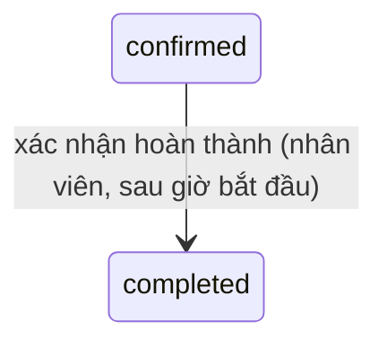

# Chăm sóc khách hàng — đặc tả

- **Nhóm:** `Care` · **Sprint:** 2 · **Nguồn:** DA §2.2.3 (UC Lập và cập nhật hồ sơ da khách hàng, UC Xác nhận hoàn thành buổi chăm sóc), luồng `FL-03` / ĐX
- **Entity:** `SkinProfile` (bảng `skin_profiles`), `CustomerAllergy` (bảng `customer_allergies`); ghi thêm `Appointment`, `ServiceEntitlement`, `TreatmentSession`, `TreatmentPlan`, `CustomerPackage` — xem [glossary](../domain/glossary.md), [data-model](../domain/data-model.md)
- **Trạng thái triển khai:** UC-SPA-27, 28 duyệt và xong phần backend ngày 31/10/2026 theo [plan](../superpowers/plans/2026-10-31-uc-spa-25-27-28-care.md) — xem [progress.md](../progress.md)
- **Giao diện web:** SCR-W26, SCR-W27 xong ngày 11/11/2026 theo [plan](../superpowers/plans/2026-11-11-uc-spa-25-27-28-staff-care-web.md) (mục "Giao diện (web)" bên dưới).
- **UC-SPA-26:** backend + web xong 11/11/2026 theo [plan](../superpowers/plans/2026-11-11-uc-spa-24-26-staff-schedule-care-history.md).
- **Đã đặc tả:** UC-SPA-27, 28, làm cùng UC-SPA-25 ([staff.md](staff.md)). **Chưa đặc tả:** UC-SPA-26 (lịch sử khách đã chăm sóc, `GET /me/care-history`) — CARE-LATER-01.

## Use case

### UC-SPA-27 — Lập và cập nhật hồ sơ da khách hàng

| Mục            | Nội dung                                                                                                                                           |
| -------------- | -------------------------------------------------------------------------------------------------------------------------------------------------- |
| Actor          | Nhân viên (xem hồ sơ: cả chủ spa)                                                                                                                  |
| Mô tả          | Nhân viên tạo hoặc sửa hồ sơ da của một lần chăm sóc (một lịch hẹn), xem và cập nhật dị ứng của khách                                              |
| Tiền điều kiện | Đã đăng nhập, `role = staff` (quyền `care.write`); là nhân viên được phân công lịch hẹn (BR-CARE-01)                                               |
| Input          | Lịch hẹn; `skinType`, `mainConcerns?`, `currentProducts?`, `careGoals?`, `recommendedTreatment?`, `note?`; dị ứng: `allergen`, `severity`, `note?` |
| Output         | Hồ sơ da gắn với lịch hẹn; dị ứng của khách được thêm/sửa/xóa                                                                                      |

**Luồng chính** (vào từ chi tiết lịch được phân công — UC-SPA-25 A1, ĐX; vào từ lịch sử khách đã chăm sóc làm cùng UC-SPA-26)

1. Nhân viên mở chi tiết lịch `GET /appointments/{id}` (có dị ứng nổi bật, `skinProfileId`).
2. Chưa có hồ sơ (`skinProfileId = null`) → nhân viên chọn tạo mới, nhập thông tin, client gọi `POST /appointments/{id}/skin-profile`.
3. Hệ thống kiểm tra: nhân viên được phân công (BR-CARE-01), trạng thái lịch và thời điểm cho phép (BR-CARE-04), dữ liệu hợp lệ (BR-CARE-05).
4. Lưu hồ sơ: `customer_id` = khách của lịch, `assessed_by_staff_member_id` = nhân viên hiện tại, `assessed_at_utc = now`. Trả `201` + `Location: /api/v1/appointments/{id}/skin-profile`.

**Luồng rẽ nhánh**

- A1. **Đã có hồ sơ** → `GET /appointments/{id}/skin-profile` xem, sửa và gửi `PUT /skin-profiles/{id}` (thay toàn bộ trường) → `200`. Không đổi `assessed_by_staff_member_id`, `assessed_at_utc`; `updated_at_utc`/`updated_by` do interceptor ghi.
- A2. **Dị ứng** (ĐX): `GET /customers/{customerId}/allergies` xem; `POST` thêm, `PUT /customers/{customerId}/allergies/{id}` sửa, `DELETE` xóa dị ứng ghi nhầm. Dị ứng gắn với khách, không theo lịch (BR-CARE-02).
- A3. **Chủ spa xem** hồ sơ của mọi lịch: `GET /appointments/{id}/skin-profile`, `GET /customers/{id}/allergies` (chỉ đọc).

**Ngoại lệ**

- E1. Dữ liệu không hợp lệ (thiếu/sai `skinType`, quá độ dài) → `400 validation_error`.
- E2. Lịch đã có hồ sơ khi tạo (kể cả hai yêu cầu đồng thời, chặn bằng `UQ appointment_id`) → `409 skin_profile_exists`.
- E3. Lịch không ở trạng thái cho phép (`held`, `pending_confirmation`, `cancelled`, `no_show`, `hold_expired`) → `409 appointment_status_invalid`; lịch `confirmed` nhưng chưa tới ngày hẹn → `400 skin_profile_too_early`; lịch `completed` quá `Care:SkinProfileEditWindowDays` ngày → `409 skin_profile_locked`.
- E4. Nhân viên không được phân công lịch → `403 appointment_not_assigned`; dị ứng của khách mình không chăm sóc → `403 customer_not_in_care`.
- E5. Lịch không tồn tại → `404 appointment_not_found`; chưa có hồ sơ (GET) hoặc id hồ sơ sai (PUT) → `404 skin_profile_not_found`; khách không tồn tại → `404 customer_not_found`; dị ứng không tồn tại hoặc không thuộc khách → `404 allergy_not_found`.
- E6. Thêm/sửa dị ứng trùng tác nhân đã có của khách (không phân biệt hoa thường, dấu) → `409 allergy_exists`.
- E7. Chưa đăng nhập → `401`; khách hàng (mọi endpoint), chủ spa (endpoint ghi) → `403`.

**Quy tắc áp dụng:** BR-CARE-01, 02, 04, 05, 06, BR-SEC-01, RBAC `care.write`.

### UC-SPA-28 — Xác nhận hoàn thành buổi chăm sóc

| Mục            | Nội dung                                                                                                             |
| -------------- | -------------------------------------------------------------------------------------------------------------------- |
| Actor          | Nhân viên                                                                                                            |
| Mô tả          | Nhân viên ghi nhận lịch đã hoàn thành kèm kết quả; hệ thống cập nhật quyền dịch vụ lẻ hoặc buổi và tiến độ gói       |
| Tiền điều kiện | Đã đăng nhập, `role = staff` (quyền `care.write`); là nhân viên được phân công; lịch `confirmed`; đã tới giờ bắt đầu |
| Input          | Lịch được phân công; `result?` (kết quả chăm sóc)                                                                    |
| Output         | Lịch `completed`; quyền `used` hoặc buổi `completed` + tiến độ gói                                                   |

**Luồng chính**

1. Nhân viên mở chi tiết lịch (UC-SPA-25), chọn "Xác nhận hoàn thành", nhập kết quả; client gọi `POST /appointments/{id}/complete` với `{ result? }`.
2. Trong **một giao dịch**: khóa dòng lịch hẹn (`FOR UPDATE`, như UC-SPA-17) → kiểm tra BR-CARE-03 (được phân công, `confirmed`, `now (VN) ≥ date + start_time`, quyền/buổi còn `booked`).
3. Lịch `confirmed → completed` (WF-01).
4. **Dịch vụ lẻ** (lịch có `service_entitlement_id`, gồm lịch đặt ngay đã thanh toán): quyền `booked → used` (BR-TRT-02, WF-04); `result` nối vào `appointments.note` (ĐX).
5. Trả `200 { appointment: <chi tiết lịch>, packageProgress: null }`.

**Luồng rẽ nhánh**

- A1. **Buổi trong gói** (lịch có `treatment_session_id`): khóa thêm dòng `customer_packages` (hai buổi cùng gói hoàn thành đồng thời không mất lượt) → buổi `booked → completed`, `completed_at_utc = now`, `note = result` (WF-07); `used_sessions + 1` (BR-TRT-03); liệu trình `not_started → in_progress` + `start_date` = ngày hẹn nếu là buổi hoàn thành đầu tiên (WF-06); `used_sessions = total_sessions` → gói `completed`, liệu trình `completed` + `actual_end_date` = ngày hẹn (WF-05, WF-06). Trả `packageProgress: { customerPackageId, packageName, usedSessions, totalSessions, status }`.
- A2. Thông báo mời đánh giá cho khách (ĐX) → làm ở UC-SPA-34 (CARE-LATER-02).

**Ngoại lệ** (E1 của DA tách theo lý do)

- E1. Nhân viên không được phân công → `403 appointment_not_assigned`.
- E2. Lịch không `confirmed` (đã hoàn thành, đã hủy, không đến, giữ chỗ…) → `409 appointment_status_invalid`, thông điệp nêu trạng thái hiện tại.
- E3. Trước giờ bắt đầu → `400 complete_too_early`.
- E4. Quyền không còn `booked` / buổi không `booked`, gói `cancelled` hoặc liệu trình `cancelled` → `409 entitlement_state_invalid`.
- E5. Bật `Care:RequireSkinProfileToComplete` mà lịch chưa có hồ sơ da → `409 skin_profile_required` (mặc định tắt, Q-35).
- E6. `result` > 2000 ký tự → `400 validation_error`; lịch không tồn tại → `404 appointment_not_found`; `401`; chủ spa, khách hàng → `403`.

**Quy tắc áp dụng:** BR-CARE-03, BR-TRT-02, 03, BR-SEC-01, RBAC `care.write`.

## Business rules

| Mã         | Quy tắc                                                                                                                                                                                                                                                                                                                                                                                               | Enforce ở đâu                                                                                                        | Nguồn            |
| ---------- | ----------------------------------------------------------------------------------------------------------------------------------------------------------------------------------------------------------------------------------------------------------------------------------------------------------------------------------------------------------------------------------------------------- | -------------------------------------------------------------------------------------------------------------------- | ---------------- |
| BR-CARE-01 | Mỗi lịch hẹn tối đa một hồ sơ da (`UQ skin_profiles.appointment_id` có sẵn; vi phạm `23505` → `409 skin_profile_exists`); `skin_type` bắt buộc; chỉ nhân viên **đang** được phân công lịch (`appointments.staff_member_id`) lập/sửa. Chủ spa chỉ đọc                                                                                                                                                  | CSDL UQ + Application                                                                                                | DA               |
| BR-CARE-02 | Dị ứng gắn với khách (không theo lịch); trả trong chi tiết lịch hẹn cho nhân viên và chủ spa, sắp `severe → moderate → mild`, rồi `allergen`. Không trùng `allergen` trong cùng khách (so sánh sau khi trim, không phân biệt hoa thường và dấu)                                                                                                                                                       | Application + Query                                                                                                  | DA + ĐX          |
| BR-CARE-03 | Hoàn thành: nhân viên được phân công; lịch `confirmed`; `now (VN) ≥ date + start_time`; quyền `booked` hoặc buổi `booked`, gói và liệu trình không `cancelled`; một giao dịch, khóa lịch rồi gói. Gói `expired`/quá hạn hay liệu trình `paused` **không** chặn (buổi đã được đặt hợp lệ trước đó, Q-30). Không giới hạn trễ: lịch còn `confirmed` thì hoàn thành được (chủ spa ghi không đến nếu cần) | Domain (`Appointment.Complete`, `TreatmentSession.Complete`, `CustomerPackage.RecordCompletedSession`) + Application | DA + ĐX          |
| BR-CARE-04 | Lập/sửa hồ sơ da khi lịch `confirmed` và `date ≤ hôm nay (VN)`, hoặc lịch `completed` và `hôm nay ≤ date + Care:SkinProfileEditWindowDays` (mặc định 7). Trạng thái khác không lập/sửa                                                                                                                                                                                                                | Application                                                                                                          | ĐX (Q-34)        |
| BR-CARE-05 | Hồ sơ da: `skinType` ∈ `normal\|dry\|oily\|combination\|sensitive`; các trường văn bản tùy chọn, trim, rỗng → null, mỗi trường ≤ 2000 ký tự. Dị ứng: `allergen` 1–255 ký tự, `severity` ∈ `mild\|moderate\|severe`, `note` ≤ 1000. Kết quả hoàn thành `result` ≤ 2000                                                                                                                                 | Validator                                                                                                            | ĐX (biên tự đặt) |
| BR-CARE-06 | Nhân viên đọc/ghi dị ứng của một khách khi có ít nhất một lịch với khách đó ở `pending_confirmation`, `confirmed` hoặc `completed` mà mình là nhân viên được phân công ("khách đã/đang chăm sóc", BR-SEC-01). Chủ spa đọc mọi khách, không ghi. `recorded_at_utc` = lúc thêm, cập nhật lại khi sửa                                                                                                    | Application                                                                                                          | ĐX (Q-36)        |
| BR-TRT-02  | Quyền dịch vụ lẻ `booked → used` khi lịch hoàn thành                                                                                                                                                                                                                                                                                                                                                  | Domain                                                                                                               | ĐX               |
| BR-TRT-03  | Buổi `completed` + `completed_at_utc`; `used_sessions + 1` (`CHECK 0 ≤ used_sessions ≤ total_sessions` có sẵn); đủ buổi → gói `completed`, liệu trình `completed` + `actual_end_date`; buổi hoàn thành đầu tiên → liệu trình `in_progress` + `start_date`                                                                                                                                             | Domain + CHECK                                                                                                       | DA               |

**Phân quyền** (sheet `21`): thêm `care.write` → `staff` vào `Permissions.cs` cho các endpoint ghi (`POST`/`PUT` hồ sơ da, `POST`/`PUT`/`DELETE` dị ứng, `complete`). Endpoint đọc `GET /appointments/{id}/skin-profile`, `GET /customers/{id}/allergies` dùng `[Authorize(Roles = "owner,staff")]` như `GET /appointments/{id}`, service kiểm tra phạm vi nhân viên (BR-SEC-01).

## Trạng thái

Đi kèm: quyền `booked → used` (WF-04); buổi `booked → completed` (WF-07); liệu trình `not_started → in_progress` (buổi đầu) và `in_progress → completed` (đủ buổi, WF-06); gói `active → completed` (đủ buổi, WF-05). `customer_packages.status` đọc từ CSDL (gói hết hạn theo Q-32 chỉ tính khi đọc, vẫn chuyển `completed` khi đủ buổi).

## Dữ liệu

| Bảng                   | Cột dùng                                                  | Thay đổi                                                        |
| ---------------------- | --------------------------------------------------------- | --------------------------------------------------------------- |
| `skin_profiles`        | toàn bộ                                                   | Không đổi schema (UQ `appointment_id` có sẵn)                   |
| `customer_allergies`   | toàn bộ                                                   | Không đổi schema; xóa cứng khi `DELETE` (bảng không có xóa mềm) |
| `appointments`         | `status`, `note`, `staff_member_id`, `date`, `start_time` | Không đổi schema                                                |
| `service_entitlements` | `status`                                                  | Không đổi schema                                                |
| `treatment_sessions`   | `status`, `note`, `completed_at_utc`                      | Không đổi schema                                                |
| `treatment_plans`      | `status`, `start_date`, `actual_end_date`                 | Không đổi schema                                                |
| `customer_packages`    | `used_sessions`, `status`                                 | Không đổi schema                                                |

**Không có migration.** Lịch hẹn không có cột thời điểm hoàn thành; thời điểm hoàn thành buổi gói lưu ở `treatment_sessions.completed_at_utc`.

## API

Tiền tố `/api/v1`, envelope chuẩn.

| Method | Đường dẫn                               | Vai trò                                        | Request                                                                                   | Response                                                                                                                                                                                                        | Lỗi                                                                                                                                                                         |
| ------ | --------------------------------------- | ---------------------------------------------- | ----------------------------------------------------------------------------------------- | --------------------------------------------------------------------------------------------------------------------------------------------------------------------------------------------------------------- | --------------------------------------------------------------------------------------------------------------------------------------------------------------------------- |
| GET    | `/appointments/{id}/skin-profile`       | Chủ spa, nhân viên được phân công              | —                                                                                         | 200 `SkinProfileDto { id, appointmentId, customerId, assessedBy: { id, fullName }, assessedAtUtc, skinType, mainConcerns, currentProducts, careGoals, recommendedTreatment, note, createdAtUtc, updatedAtUtc }` | 401, 403 `appointment_not_assigned`, 404 `appointment_not_found`/`skin_profile_not_found`                                                                                   |
| POST   | `/appointments/{id}/skin-profile`       | Nhân viên được phân công                       | `{ skinType, mainConcerns?, currentProducts?, careGoals?, recommendedTreatment?, note? }` | 201 + `Location`, `SkinProfileDto`                                                                                                                                                                              | 400 `validation_error`/`skin_profile_too_early`, 401, 403, 404 `appointment_not_found`, 409 `skin_profile_exists`/`appointment_status_invalid`/`skin_profile_locked`        |
| PUT    | `/skin-profiles/{id}`                   | Nhân viên được phân công lịch của hồ sơ        | như POST                                                                                  | 200 `SkinProfileDto`                                                                                                                                                                                            | 400, 401, 403, 404 `skin_profile_not_found`, 409 `appointment_status_invalid`/`skin_profile_locked`                                                                         |
| GET    | `/customers/{id}/allergies`             | Chủ spa, nhân viên chăm sóc khách (BR-CARE-06) | —                                                                                         | 200 `[CustomerAllergyDto { id, allergen, severity, note, recordedAtUtc }]` (thứ tự BR-CARE-02)                                                                                                                  | 401, 403 `customer_not_in_care`, 404 `customer_not_found`                                                                                                                   |
| POST   | `/customers/{id}/allergies`             | Nhân viên chăm sóc khách                       | `{ allergen, severity, note? }`                                                           | 201, `CustomerAllergyDto`                                                                                                                                                                                       | 400, 401, 403, 404 `customer_not_found`, 409 `allergy_exists`                                                                                                               |
| PUT    | `/customers/{id}/allergies/{allergyId}` | Nhân viên chăm sóc khách                       | như POST                                                                                  | 200 `CustomerAllergyDto`                                                                                                                                                                                        | 400, 401, 403, 404 `customer_not_found`/`allergy_not_found`, 409 `allergy_exists`                                                                                           |
| DELETE | `/customers/{id}/allergies/{allergyId}` | Nhân viên chăm sóc khách                       | —                                                                                         | 204                                                                                                                                                                                                             | 401, 403, 404                                                                                                                                                               |
| POST   | `/appointments/{id}/complete`           | Nhân viên được phân công                       | `{ result? }` (≤ 2000)                                                                    | 200 `{ appointment: AppointmentDetailDto, packageProgress?: { customerPackageId, packageName, usedSessions, totalSessions, status } }`                                                                          | 400 `validation_error`/`complete_too_early`, 401, 403 `appointment_not_assigned`, 404, 409 `appointment_status_invalid`/`entitlement_state_invalid`/`skin_profile_required` |

- `AppointmentDetailDto` (`GET /appointments/{id}`) **thêm trường** (không đổi trường cũ): `skinProfileId?` (bên cạnh `hasSkinProfile`), `allergies[]` thêm `id`, `recordedAtUtc`; `treatmentSession?` thêm `totalSessions`, `customerPackageId`, `packageName` (hiển thị "Buổi x/y").
- `data_api.py`: sửa tại chỗ dòng 092–097 (tên trường tiếng Anh, mã lỗi, `PUT /skin-profiles/{id}` chỉ nhân viên được phân công, `complete` trả `{ appointment, packageProgress? }`); **thêm cuối danh sách** SPA-API-121 `PUT /customers/{id}/allergies/{allergyId}` và SPA-API-122 `DELETE /customers/{id}/allergies/{allergyId}`. Dòng 091 (`/me/care-history`) giữ cho UC-SPA-26.

## Màn hình

Màn hình đích: SCR-W26 / SCR-M25 (lịch được phân công), SCR-W27 / SCR-M26 (chi tiết buổi chăm sóc: dị ứng nổi bật, form hồ sơ da, modal xác nhận hoàn thành). Web: xem mục "Giao diện (web)" bên dưới. Mobile làm sau.

## Giao diện (web): UC-SPA-25, 27, 28 — Lịch được phân công & buổi chăm sóc

Phạm vi: hai màn của nhân viên trong `StaffLayout` (sidebar workspace, theme sáng và tối). Không làm lần này: mobile (SCR-M25, M26), trang tổng quan `/staff` và lịch làm việc cá nhân `/staff/schedule` (UC-SPA-24), lịch sử khách đã chăm sóc `/staff/care-history` (UC-SPA-26), chủ spa xem hồ sơ da trong `OwnerAppointmentSheet`.

- Feature: `apps/web/src/features/care/` (tên theo glossary): `components/`, `hooks/`, `schemas.ts`, `careLabels.ts` (nhãn loại da), `errors.ts`, `index.ts`. Tái dùng `appointmentStatusBadge`, `allergySeverityBadge` của `features/bookings/appointmentStatus.ts` và các hàm ngày giờ của `lib/formatting` (`vietnamTime.ts`).
- Trang: `pages/staff/StaffAppointmentsPage.tsx`, `pages/staff/StaffAppointmentDetailPage.tsx`; đăng ký trong `staffPages` của `app/router.tsx` (hiện `pages: {}`).
- Gói chung: `packages/shared-types/src/care.ts` (`AssignedAppointment`, `AssignedAppointmentListParams`, `SkinProfile`, `SaveSkinProfileRequest`, `SaveAllergyRequest`, `CompleteAppointmentRequest`, `CompleteAppointmentResult`, `PackageProgress`); `packages/api-client/src/care.ts`: `CareApi` (`listAssigned`, `getAppointment` = `GET /appointments/{id}`, `getSkinProfile`, `createSkinProfile`, `updateSkinProfile`, `listAllergies`, `createAllergy`, `updateAllergy`, `deleteAllergy`, `complete`), `careQueryKeys`, `careErrorCodes`.
- **Sửa kèm (chỉ FE):** `SkinType` trong `shared-types/src/treatments.ts` đang là `'Normal' | 'Dry' | …` trong khi backend trả snake_case (`normal`, `dry`, `oily`, `combination`, `sensitive`), nên `skinTypeLabels` của trang liệu trình chủ spa không bao giờ khớp. Chuyển `SkinType` sang `care.ts` với giá trị chữ thường và sửa `skinTypeLabels`.

### Query key

| Key                                        | Endpoint                              | Làm mới khi                                                  |
| ------------------------------------------ | ------------------------------------- | ------------------------------------------------------------ |
| `careQueryKeys.assigned(params)`           | `GET /me/assigned-appointments`       | hoàn thành buổi; lập hồ sơ da (`hasSkinProfile`); đổi dị ứng |
| `careQueryKeys.appointment(id)`            | `GET /appointments/{id}`              | hoàn thành (ghi luôn `appointment` trả về); hồ sơ da; dị ứng |
| `careQueryKeys.skinProfile(appointmentId)` | `GET /appointments/{id}/skin-profile` | lập/sửa hồ sơ (ghi luôn DTO trả về)                          |
| `careQueryKeys.allergies(customerId)`      | `GET /customers/{id}/allergies`       | thêm/sửa/xóa dị ứng                                          |

Gốc `careQueryKeys.all = ['care']`; mutation dị ứng và hoàn thành làm mới `['care', 'assigned']` (cờ `hasAllergies`, trạng thái).

### SCR-W26 — Lịch hẹn được phân công (`/staff/bookings`)

- **Vai trò:** nhân viên (`RouteGuard role="staff"` có sẵn). **Mẫu bố cục:** danh sách = `PageHeader` + `Tabs` + thanh lọc + `DataTable` dùng chung. Không phân trang (API trả cả danh sách, BR-STF-10), không sắp xếp phía client (server sắp `date, startTime`).
- **PageHeader:** tiêu đề "Lịch hẹn được phân công", mô tả "Các buổi chăm sóc spa giao cho bạn. Chọn một lịch để xem khách, dị ứng và lập hồ sơ da."
- **Tab (preset khoảng ngày, theo giờ Việt Nam):**

| Tab                | `tab`      | `fromDate` → `toDate`        | `status` mặc định |
| ------------------ | ---------- | ---------------------------- | ----------------- |
| Hôm nay (mặc định) | `today`    | hôm nay → hôm nay            | tất cả            |
| Sắp tới            | `upcoming` | ngày mai → hôm nay + 14 ngày | tất cả            |
| Đã xong            | `done`     | hôm nay − 30 ngày → hôm nay  | `completed`       |

- **Bộ lọc (đồng bộ URL):** `tab`, `from`, `to`, `status`. Đổi tab thì đặt lại `from`/`to`/`status` theo preset. "Từ ngày", "Đến ngày" (`Input type="date"`) và "Trạng thái" (`Select`: Tất cả, Chờ xác nhận, Đã xác nhận, Hoàn thành, Đã hủy, Không đến) sửa được ở mọi tab. Zod kiểm tra trước khi gọi: đủ hai ngày, `to ≥ from`, khoảng ≤ 42 ngày; sai thì hiện lỗi dưới ô và không gọi API. Nút "Xóa bộ lọc" (ghost) chỉ hiện khi khác preset.
- **Cột `DataTable`** (`getRowId = id`, `caption` "Lịch hẹn được phân công"):

| Cột        | Nội dung                                                                                                   | Ẩn ở |
| ---------- | ---------------------------------------------------------------------------------------------------------- | ---- |
| Ngày       | `formatLocalDate(date)` + thứ                                                                              | —    |
| Giờ        | `startTime – endTime`                                                                                      | —    |
| Khách      | `customer.fullName`, dòng phụ `phoneNumber`                                                                | —    |
| Dịch vụ    | `service.name`; có `treatmentSession` thì dòng phụ "Buổi {sequenceNumber}/{totalSessions} · {packageName}" | `md` |
| Lưu ý      | `StatusBadge` "Có dị ứng" (`warning`) khi `hasAllergies`; "Đã có hồ sơ da" (`info`) khi `hasSkinProfile`   | `sm` |
| Trạng thái | `appointmentStatusBadge(status)`                                                                           | —    |

- **Hành động:** `onRowClick` → điều hướng `/staff/bookings/{id}` (SCR-W27 là trang đầy đủ, route có sẵn trong `routes.ts`). Không có `rowActions`.
- **Trạng thái:** đang tải → skeleton của `DataTable`; lỗi → trạng thái lỗi của `DataTable` + "Thử lại"; rỗng → "Chưa có lịch hẹn" + mô tả theo tab (Hôm nay: "Hôm nay bạn chưa được phân công buổi nào."; khác: "Không có lịch trong khoảng ngày đã chọn."); có dữ liệu.
- **Lỗi:** `validation_error` (ít gặp vì Zod chặn trước) → trạng thái lỗi của bảng kèm thông điệp server.
- **Responsive/a11y:** ở 320px chỉ còn Ngày, Giờ, Khách, Trạng thái; thanh lọc xếp dọc; `Tabs` cuộn ngang trong vùng riêng, không cuộn cả trang. Dòng bảng dùng được bằng bàn phím (Enter mở chi tiết, hành vi có sẵn của `DataTable`).

### SCR-W27 — Chi tiết buổi chăm sóc (`/staff/bookings/:appointmentId`)

- **Vai trò:** nhân viên được phân công. **Mẫu bố cục:** trang chi tiết (route có sẵn, đổi tên tham số `:bookingId` → `:appointmentId` theo glossary) gồm `PageHeader`, khối dị ứng nổi bật, `Tabs` 3 mục; tạo/sửa ngắn bằng `Dialog`, xóa bằng `AlertDialog`; form hồ sơ da nằm ngay trong tab (dài, 6 trường), không mở Dialog.
- **Dữ liệu:** `careQueryKeys.appointment(id)` → `AppointmentDetail` (có sẵn trong `shared-types`). Khi `skinProfileId ≠ null` mới gọi `careQueryKeys.skinProfile(id)` (tránh 404). Dị ứng: dùng `allergies` trong chi tiết lịch để hiển thị nổi bật; danh sách quản lý ở tab 1 đọc `careQueryKeys.allergies(customer.id)`.
- **PageHeader:** breadcrumb/nút quay lại "Lịch hẹn được phân công"; tiêu đề `service.name`; mô tả "{thứ, ngày} · {startTime – endTime}" + `appointmentStatusBadge`; action "Xác nhận hoàn thành" (chỉ khi `status = confirmed`).
- **Dị ứng nổi bật (luôn trên cùng, ngoài tab):** có dị ứng → `Alert` (biến thể `destructive` nếu có mức `severe`, ngược lại mặc định) tiêu đề "Khách có {n} dị ứng cần lưu ý", liệt kê `allergen` + `allergySeverityBadge`, sắp như server trả (BR-CARE-02). Không có → không hiện khối.
- **Tab 1 "Khách & dị ứng"** (`?tab=customer`, mặc định):
  - Thông tin (`InfoTile`): Khách (`fullName`), Số điện thoại (link `tel:`), Dịch vụ, Buổi gói "Buổi x/y · {packageName}" (nếu có), Ngày giờ, Ghi chú lịch hẹn (`note`, nếu có).
  - "Dị ứng của khách": danh sách thẻ (không phải bảng: ≤ vài mục, mỗi mục có ghi chú dài) gồm `allergen`, mức độ, `note`, "Ghi nhận {formatDateTimeUtc(recordedAtUtc)}"; nút "Thêm dị ứng"; mỗi thẻ có nút icon "Sửa" (`aria-label="Sửa dị ứng {allergen}"`) và "Xóa".
  - `AllergyDialog` (thêm/sửa): "Tác nhân" (`Input`, 1–255, bắt buộc), "Mức độ" (`RadioGroup` Nhẹ/Vừa/Nặng, bắt buộc), "Ghi chú" (`Textarea`, ≤ 1000). Nút "Lưu".
  - `DeleteAllergyDialog` (`AlertDialog`): "Xóa dị ứng {allergen}? Chỉ xóa khi ghi nhầm." Nút "Xóa" (destructive).
- **Tab 2 "Hồ sơ da"** (`?tab=skin-profile`):
  - Chưa có hồ sơ: `EmptyState` "Chưa có hồ sơ da cho buổi này" + CTA "Lập hồ sơ da" (CTA chỉ khi `status ∈ confirmed, completed`; trạng thái khác hiện "Lịch ở trạng thái {nhãn} nên không lập hồ sơ da được.").
  - Đã có: bảng định nghĩa (`dl`) Loại da, Vấn đề chính, Sản phẩm đang dùng, Mục tiêu chăm sóc, Liệu trình đề xuất, Ghi chú; dòng phụ "Đánh giá bởi {assessedBy.fullName} lúc {assessedAtUtc}", "Cập nhật lúc {updatedAtUtc}" (nếu có). Nút "Cập nhật hồ sơ" (cùng điều kiện trạng thái).
  - `SkinProfileForm` (chế độ tạo hoặc sửa, thay chỗ phần xem): "Loại da" (`Select` bắt buộc: Da thường, Da khô, Da dầu, Da hỗn hợp, Da nhạy cảm), "Vấn đề chính", "Sản phẩm đang dùng", "Mục tiêu chăm sóc", "Liệu trình đề xuất", "Ghi chú" (`Textarea`, mỗi trường ≤ 2000, có đếm ký tự). Nút "Lưu hồ sơ" / "Hủy". Tạo → `POST /appointments/{id}/skin-profile`; sửa → `PUT /skin-profiles/{skinProfileId}` (gửi đủ mọi trường, trường để trống gửi `null`).
  - Câu nhắc cố định dưới form: "Hồ sơ da ghi nhận tình trạng da để chăm sóc spa, không phải chẩn đoán y khoa."
- **Tab 3 "Kết quả buổi"** (`?tab=result`):
  - `confirmed`: "Buổi chưa hoàn thành." + nút "Xác nhận hoàn thành" (mở cùng Dialog với PageHeader).
  - `completed`: "Ghi chú và kết quả" = `note` (với dịch vụ lẻ, server nối kết quả vào `note`); với buổi gói hiện "Kết quả được lưu trong liệu trình của khách." (xem "Thiếu từ backend").
  - `cancelled`: "Đã hủy lúc {cancelledAtUtc}" + lý do. `no_show`, `pending_confirmation`: một dòng giải thích theo nhãn trạng thái.
- **`CompleteAppointmentDialog`:** tiêu đề "Xác nhận hoàn thành buổi chăm sóc"; mô tả "Sau khi xác nhận, buổi này được tính là đã sử dụng và không hoàn tác được."; nếu `hasSkinProfile = false` thêm dòng nhắc (không chặn, Q-35) "Buổi này chưa có hồ sơ da."; "Kết quả chăm sóc" (`Textarea`, tùy chọn, ≤ 2000). Nút "Xác nhận hoàn thành" (`loading`). Thành công: ghi `appointment` trả về vào cache chi tiết, toast "Đã ghi nhận buổi chăm sóc hoàn thành."; có `packageProgress` thì thêm "Gói {packageName}: đã dùng {usedSessions}/{totalSessions} buổi." và nếu `status = completed` thì "Gói đã hoàn thành.".
- **Trạng thái trang:** đang tải → `PageLoader`/skeleton; lỗi → `ErrorState` + "Thử lại" (404 `appointment_not_found` → "Không tìm thấy lịch hẹn" + nút về danh sách; 403 `appointment_not_assigned` → "Lịch này không được phân công cho bạn" + nút về danh sách); có dữ liệu. Tab hồ sơ da có trạng thái tải/lỗi riêng; danh sách dị ứng có tải/lỗi/rỗng ("Chưa ghi nhận dị ứng nào.").

### Mã lỗi → xử lý

| Mã                           | Ở đâu                   | Xử lý                                                                                              |
| ---------------------------- | ----------------------- | -------------------------------------------------------------------------------------------------- |
| `validation_error`           | mọi form                | gắn `errors[].field` vào `FormField` tương ứng; không có field → toast thông điệp                  |
| `appointment_not_found`      | trang chi tiết          | `ErrorState` "Không tìm thấy lịch hẹn" + về danh sách                                              |
| `appointment_not_assigned`   | trang chi tiết, mọi ghi | `ErrorState` "Lịch này không được phân công cho bạn" (khi tải); toast + làm mới chi tiết (khi ghi) |
| `skin_profile_too_early`     | lập/sửa hồ sơ           | toast "Chỉ lập hồ sơ da từ ngày hẹn." giữ form                                                     |
| `skin_profile_locked`        | lập/sửa hồ sơ           | toast "Đã quá thời hạn sửa hồ sơ da." đóng form, ẩn nút "Cập nhật hồ sơ" cho tới khi tải lại trang |
| `skin_profile_exists`        | lập hồ sơ               | toast "Buổi này đã có hồ sơ da." làm mới chi tiết + hồ sơ, chuyển sang chế độ xem                  |
| `skin_profile_not_found`     | sửa hồ sơ, xem hồ sơ    | làm mới chi tiết (hồ sơ có thể chưa tồn tại)                                                       |
| `appointment_status_invalid` | hồ sơ, hoàn thành       | toast thông điệp server (nêu trạng thái) + làm mới chi tiết và danh sách                           |
| `complete_too_early`         | hoàn thành              | toast "Chưa tới giờ bắt đầu, chưa xác nhận hoàn thành được." giữ Dialog mở                         |
| `entitlement_state_invalid`  | hoàn thành              | toast thông điệp server, đóng Dialog, làm mới chi tiết                                             |
| `skin_profile_required`      | hoàn thành              | toast "Cần lập hồ sơ da trước khi hoàn thành." đóng Dialog, chuyển sang tab "Hồ sơ da"             |
| `allergy_exists`             | thêm/sửa dị ứng         | lỗi dưới ô "Tác nhân": "Khách đã có dị ứng này."                                                   |
| `allergy_not_found`          | sửa/xóa dị ứng          | toast + làm mới danh sách dị ứng, đóng Dialog                                                      |
| `customer_not_in_care`       | dị ứng                  | toast "Bạn chưa chăm sóc khách này nên không xem/sửa được dị ứng."; ẩn nút ghi                     |
| `customer_not_found`         | dị ứng                  | toast + làm mới chi tiết                                                                           |
| `401`                        | mọi nơi                 | luồng làm mới phiên có sẵn của `ApiClient`/`authStore`                                             |

### Không suy luận lại rule

Backend không trả cờ cho các hành động này (xem "Thiếu từ backend"), nên FE chỉ dựa vào `status` do server trả: "Xác nhận hoàn thành" khi `confirmed`; "Lập/Cập nhật hồ sơ da" khi `confirmed` hoặc `completed`; nút ghi dị ứng luôn hiện cho nhân viên. Điều kiện thời gian (chưa tới giờ, quá hạn 7 ngày) và "khách đang chăm sóc" để server quyết định qua mã lỗi ở bảng trên. FE không tự so giờ hiện tại với giờ hẹn.

### Thiếu từ backend (không sửa trong task này)

| Thiếu                                                                                                | Ảnh hưởng FE                                                                                                                |
| ---------------------------------------------------------------------------------------------------- | --------------------------------------------------------------------------------------------------------------------------- |
| Cờ `canComplete`, `canEditSkinProfile` (+ `skinProfileEditableUntil`) trong `GET /appointments/{id}` | Nút hiện theo trạng thái, bấm sớm/muộn mới biết qua `complete_too_early` / `skin_profile_too_early` / `skin_profile_locked` |
| Kết quả buổi gói (`treatment_sessions.note`) không có trong `AppointmentDetailDto`                   | Tab "Kết quả buổi" của buổi gói đã hoàn thành không hiện được kết quả, chỉ hiện câu dẫn                                     |
| Cờ cho phép ghi dị ứng (`canEditAllergies`)                                                          | Nút ghi dị ứng luôn hiện; lịch `cancelled`/`no_show` có thể gặp `customer_not_in_care`                                      |

### Kiểm thử giao diện

Vitest + Testing Library, `fetch` giả, test đặt cạnh file.

| Mã          | Tình huống                                                                                                          | Kết quả mong đợi                                                                                                         |
| ----------- | ------------------------------------------------------------------------------------------------------------------- | ------------------------------------------------------------------------------------------------------------------------ |
| CARE-UI-T01 | `CareApi`: đường dẫn, query `fromDate/toDate/status`, body POST/PUT, DELETE 204, `complete` không body vẫn gửi `{}` | Đúng URL, method, body                                                                                                   |
| CARE-UI-T02 | SCR-W26 mở mặc định                                                                                                 | Gọi `fromDate = toDate = hôm nay (VN)`, không `status`; tab "Hôm nay" chọn                                               |
| CARE-UI-T03 | Chuyển tab "Sắp tới" / "Đã xong"                                                                                    | Query đúng preset; "Đã xong" gửi `status=completed`; URL cập nhật                                                        |
| CARE-UI-T04 | Nhập `to < from`; khoảng 43 ngày                                                                                    | Lỗi dưới ô, không gọi API                                                                                                |
| CARE-UI-T05 | SCR-W26 tải / lỗi (+ Thử lại gọi lại) / rỗng / có dữ liệu                                                           | Skeleton; thông báo lỗi; "Chưa có lịch hẹn"; dòng có "Buổi 2/5 · {gói}", badge "Có dị ứng", "Đã có hồ sơ da", trạng thái |
| CARE-UI-T06 | Bấm một dòng                                                                                                        | Điều hướng `/staff/bookings/{id}`                                                                                        |
| CARE-UI-T07 | SCR-W27 tải / 404 / 403 `appointment_not_assigned` / có dữ liệu                                                     | Loader; "Không tìm thấy lịch hẹn"; "Lịch này không được phân công cho bạn"; thông tin khách và dịch vụ                   |
| CARE-UI-T08 | Có dị ứng `severe`; không có dị ứng                                                                                 | `Alert` destructive "Khách có n dị ứng cần lưu ý"; không có khối                                                         |
| CARE-UI-T09 | Nút "Xác nhận hoàn thành" với `confirmed` / `completed` / `cancelled`                                               | Hiện / ẩn / ẩn                                                                                                           |
| CARE-UI-T10 | Hoàn thành thành công dịch vụ lẻ; buổi gói cuối (`packageProgress.status = completed`)                              | Body `{ result }`; toast; trạng thái "Hoàn thành"; toast có "đã dùng 3/3 buổi", "Gói đã hoàn thành"                      |
| CARE-UI-T11 | Hoàn thành gặp `complete_too_early`; `skin_profile_required`; `appointment_status_invalid`                          | Dialog còn mở + toast; chuyển tab "Hồ sơ da"; toast + gọi lại chi tiết                                                   |
| CARE-UI-T12 | Kết quả 2001 ký tự                                                                                                  | Lỗi dưới ô, không gọi API                                                                                                |
| CARE-UI-T13 | Hồ sơ da: `skinProfileId = null` → EmptyState + CTA; lịch `pending_confirmation` → không CTA                        | Không gọi `GET skin-profile`; đúng CTA                                                                                   |
| CARE-UI-T14 | Lập hồ sơ thiếu loại da; lập thành công; sửa thành công (gửi `null` cho trường trống)                               | Lỗi "Chọn loại da"; POST đúng body, hiện chế độ xem; PUT `/skin-profiles/{id}`                                           |
| CARE-UI-T15 | Lập/sửa gặp `skin_profile_too_early`, `skin_profile_locked`, `skin_profile_exists`                                  | Toast tương ứng; `locked` ẩn nút cập nhật; `exists` chuyển chế độ xem                                                    |
| CARE-UI-T16 | Dị ứng: thêm hợp lệ; thêm trùng (`allergy_exists`); sửa; xóa qua `AlertDialog`; `customer_not_in_care`              | POST/PUT/DELETE đúng; lỗi dưới "Tác nhân"; danh sách và chi tiết được làm mới; toast + ẩn nút ghi                        |
| CARE-UI-T17 | Nhãn loại da                                                                                                        | `normal → Da thường` … ; trang liệu trình chủ spa hiển thị đúng nhãn (hồi quy `SkinType`)                                |

## Cấu hình

| Biến `.env` | Khóa                                | Mặc định          |
| ----------- | ----------------------------------- | ----------------- |
| —           | `Care:SkinProfileEditWindowDays`    | `7` (0–365, Q-34) |
| —           | `Care:RequireSkinProfileToComplete` | `false` (Q-35)    |

Không có biến `.env`/secret mới.

## Kiểm thử bắt buộc

Unit test (NSubstitute, đồng hồ giả) cho chuyển trạng thái Domain (`Appointment.Complete`, `TreatmentSession.Complete`, `CustomerPackage.RecordCompletedSession`, `TreatmentPlan`), điều kiện BR-CARE-03/04 và validator; integration test `PostgresFixture` + `AuthApiFactory`, lịch hẹn/quyền/gói chèn trực tiếp (helper có sẵn của test đặt lịch).

| Mã       | Tình huống                                                                                                     | Kết quả mong đợi                                                                                                                                                 |
| -------- | -------------------------------------------------------------------------------------------------------------- | ---------------------------------------------------------------------------------------------------------------------------------------------------------------- |
| CARE-T01 | Nhân viên được phân công lập hồ sơ cho lịch `confirmed` hôm nay                                                | 201, `Location` đúng; `customer_id`, `assessed_by_staff_member_id`, `assessed_at_utc` đúng; `GET /appointments/{id}` có `hasSkinProfile = true`, `skinProfileId` |
| CARE-T02 | Lập lần hai; hai yêu cầu lập đồng thời                                                                         | `409 skin_profile_exists`; đúng một 201, CSDL 1 hồ sơ                                                                                                            |
| CARE-T03 | Lập cho lịch `confirmed` ngày mai / `cancelled` / `no_show` / `pending_confirmation` / `held`                  | `400 skin_profile_too_early` / `409 appointment_status_invalid` ×4                                                                                               |
| CARE-T04 | Lịch `completed` ngày hẹn cách hôm nay 7 ngày / 8 ngày: lập và sửa                                             | 201, 200 / `409 skin_profile_locked` ×2                                                                                                                          |
| CARE-T05 | Thiếu `skinType`; `skinType = "x"`; `mainConcerns` 2001 ký tự; chuỗi toàn khoảng trắng                         | `400 validation_error` ×3; khoảng trắng → lưu null                                                                                                               |
| CARE-T06 | Sửa hồ sơ (`PUT /skin-profiles/{id}`)                                                                          | 200; trường mới; `assessed_by`, `assessed_at_utc` giữ nguyên; `updated_at_utc`, `updated_by` được ghi                                                            |
| CARE-T07 | Nhân viên khác lập/sửa/xem hồ sơ; chủ spa xem / lập; khách hàng xem; không Bearer                              | `403 appointment_not_assigned` ×3; 200 / `403`; `403`; `401`                                                                                                     |
| CARE-T08 | Lịch được đổi sang nhân viên B sau khi A lập hồ sơ: A sửa, B sửa                                               | A `403`; B 200, `assessed_by` vẫn là A                                                                                                                           |
| CARE-T09 | `GET skin-profile` khi chưa có hồ sơ; `PUT` id không tồn tại; lịch không tồn tại                               | `404 skin_profile_not_found` ×2; `404 appointment_not_found`                                                                                                     |
| CARE-T10 | Dị ứng: thêm hợp lệ; thêm "Paraben" khi đã có "paraben" / "Parabén"; sửa trùng tác nhân khác; xóa              | 201; `409 allergy_exists` ×2; `409 allergy_exists`; 204, không còn trong danh sách                                                                               |
| CARE-T11 | Dị ứng: nhân viên có lịch `completed` với khách / chỉ có lịch `cancelled` / không có lịch; chủ spa GET / POST  | 200; `403 customer_not_in_care` ×2; 200 / `403`                                                                                                                  |
| CARE-T12 | Dị ứng: `allergyId` của khách khác; khách không tồn tại; `severity` sai; `allergen` rỗng hoặc 256 ký tự        | `404 allergy_not_found`; `404 customer_not_found`; `400` ×2                                                                                                      |
| CARE-T13 | Chi tiết lịch: dị ứng sắp `severe` trước; có `id`, `recordedAtUtc`; buổi gói có `totalSessions`, `packageName` | Đúng thứ tự và trường                                                                                                                                            |
| CARE-T14 | Hoàn thành lịch dịch vụ lẻ (`service_entitlement_id`) sau giờ bắt đầu, có `result`                             | 200; lịch `completed`, quyền `used`, `note` có kết quả; `packageProgress = null`                                                                                 |
| CARE-T15 | Hoàn thành lịch đặt ngay đã thanh toán (có `order_item_id` + `service_entitlement_id`)                         | 200; quyền `used`                                                                                                                                                |
| CARE-T16 | Hoàn thành buổi 1/3 của gói (liệu trình `not_started`)                                                         | Buổi `completed`, `completed_at_utc`, `note = result`; gói `used_sessions = 1`, `active`; liệu trình `in_progress`, `start_date` = ngày hẹn                      |
| CARE-T17 | Hoàn thành buổi cuối (3/3)                                                                                     | Gói `completed`, `used_sessions = 3`; liệu trình `completed`, `actual_end_date` = ngày hẹn; `packageProgress.status = completed`                                 |
| CARE-T18 | Hoàn thành trước giờ bắt đầu 1 phút; đúng giờ bắt đầu                                                          | `400 complete_too_early`; 200                                                                                                                                    |
| CARE-T19 | Hoàn thành lịch `completed` / `cancelled` / `no_show` / `held` / `pending_confirmation`                        | `409 appointment_status_invalid` ×5                                                                                                                              |
| CARE-T20 | Quyền đã `used` (dữ liệu lệch); gói `cancelled`; gói quá hạn (`expires_at_utc` qua) và liệu trình `paused`     | `409 entitlement_state_invalid` ×2; 200 (BR-CARE-03)                                                                                                             |
| CARE-T21 | Nhân viên khác / chủ spa / khách hàng hoàn thành; không Bearer                                                 | `403 appointment_not_assigned`; `403` ×2; `401`                                                                                                                  |
| CARE-T22 | Hai yêu cầu hoàn thành cùng một lịch đồng thời; hai buổi khác nhau của cùng gói hoàn thành đồng thời           | Một 200, một `409 appointment_status_invalid`; `used_sessions` tăng đúng 2                                                                                       |
| CARE-T23 | Bật `Care:RequireSkinProfileToComplete`: chưa có hồ sơ / đã có                                                 | `409 skin_profile_required`; 200                                                                                                                                 |
| CARE-T24 | `result` 2001 ký tự                                                                                            | `400 validation_error`, không đổi gì                                                                                                                             |
| CARE-T25 | `GET /me/purchases` sau khi hoàn thành (UC-SPA-18)                                                             | Quyền `used`, `canBook = false`; gói hiển thị tiến độ mới, `nextSession` là buổi kế                                                                              |
| CARE-T26 | Hồi quy                                                                                                        | Toàn bộ test hiện có vẫn pass (UC-SPA-11, 15, 17, 18); `PersistenceModelTests` pass                                                                              |

## Câu hỏi còn mở

- Q-34 (mới): Khi nào nhân viên được lập/sửa hồ sơ da? Mặc định: lịch `confirmed` từ ngày hẹn, hoặc lịch `completed` trong **7 ngày** sau ngày hẹn (`Care:SkinProfileEditWindowDays`); sau đó chỉ đọc.
- Q-35 (mới): Có bắt buộc lập hồ sơ da trước khi xác nhận hoàn thành? Mặc định: **không** (`Care:RequireSkinProfileToComplete` = `false`); DA không yêu cầu.
- Q-36 (mới): Ai được ghi dị ứng của khách? Mặc định: nhân viên có lịch `pending_confirmation`/`confirmed`/`completed` với khách đó; chủ spa chỉ đọc (theo `data_api`); xóa cứng dị ứng ghi nhầm. Không cấu hình.
- Q-07 (có sẵn): khi bật trừ lượt cho khách không đến, buổi `skipped` không bao giờ `completed` nên gói không tự `completed` theo BR-TRT-03 (`used = total`). Ghi nhận, xử lý ở UC-SPA-21 (CARE-LATER-03).

## Việc để sau

| Mã            | Việc                                                                                                                                     | Làm cùng                   |
| ------------- | ---------------------------------------------------------------------------------------------------------------------------------------- | -------------------------- |
| CARE-LATER-01 | UC-SPA-26: `GET /me/care-history` (lịch sử khách đã chăm sóc, tìm theo tên/SĐT, khoảng ngày) và các hồ sơ da trước của khách             | UC-SPA-26                  |
| CARE-LATER-02 | Thông báo cho khách khi buổi hoàn thành, mời đánh giá (BR-NTF-01)                                                                        | UC-SPA-34                  |
| CARE-LATER-03 | Gói có buổi `skipped` (Q-07 bật): quy tắc kết thúc gói, chủ spa đóng liệu trình                                                          | UC-SPA-21                  |
| CARE-LATER-04 | `GET /customers/{id}/care-history` (dòng 088 `data_api.py`): mọi lần chăm sóc của một khách cho chủ spa và nhân viên đang chăm sóc khách | Màn khách hàng của chủ spa |

## UC-SPA-26 — Xem lịch sử các khách hàng đã chăm sóc (backend + web)

Đặc tả và triển khai cùng UC-SPA-24 ([staff.md](staff.md)) ngày 11/11/2026; thay cho CARE-LATER-01. Không làm lần này: mobile (SCR-M27), CARE-LATER-04.

| Mục            | Nội dung                                                                                            |
| -------------- | --------------------------------------------------------------------------------------------------- |
| Actor          | Nhân viên                                                                                           |
| Mô tả          | Nhân viên xem các lần chăm sóc mình đã thực hiện, tìm theo khách và khoảng ngày, mở hồ sơ liên quan |
| Tiền điều kiện | Đã đăng nhập, `role = staff` (quyền `care.write`, theo RBAC sheet 21 dòng `care.write` UC-SPA-26)   |
| Input          | Tên/SĐT khách, khoảng ngày, khách được chọn; lần chăm sóc được chọn                                 |
| Output         | Danh sách lần chăm sóc (phân trang); chi tiết lần chăm sóc với hồ sơ da và các lần khác của khách   |

**Luồng chính**

1. Nhân viên mở "Lịch sử khách đã chăm sóc"; client gọi `GET /me/care-history` (trang 1, 10 dòng).
2. Nhân viên nhập tên/SĐT, khoảng ngày; hệ thống trả các lịch `completed` có `staff_member_id` = người gọi khớp điều kiện, mới nhất trước (BR-CARE-07).
3. Nhân viên chọn một lần; client dùng `GET /appointments/{id}` và `GET /appointments/{id}/skin-profile` (có sẵn) và `GET /me/care-history?customerId=` (các lần khác với khách đó).

**Luồng rẽ nhánh**

- A1. Không có kết quả → `200` trang rỗng, client hiện "Chưa có lần chăm sóc nào" (kèm "Xóa bộ lọc" khi đang lọc).
- A2. Lập/cập nhật hồ sơ da (UC-SPA-27): mở buổi chăm sóc `/staff/bookings/{id}?tab=skin-profile`, dùng lại form đã có; hạn sửa 7 ngày do server kiểm tra (BR-CARE-04).

**Ngoại lệ**

- E1. `search` > 200 ký tự (giới hạn chung của `PagedQuery`), `toDate < fromDate`, ngày sai định dạng, `customerId` không phải Guid → `400 validation_error`. `pageNumber`/`pageSize` ngoài biên được kẹp như mọi `PagedQuery` (1, 1–100).
- E2. Chưa đăng nhập → `401`; chủ spa, khách hàng → `403`.

**Business rules**

| Mã         | Quy tắc                                                                                                                                                                                                                                                                                                                                         | Enforce ở đâu       | Nguồn          |
| ---------- | ----------------------------------------------------------------------------------------------------------------------------------------------------------------------------------------------------------------------------------------------------------------------------------------------------------------------------------------------- | ------------------- | -------------- |
| BR-CARE-07 | "Lần chăm sóc của tôi" = lịch hẹn `completed` có `staff_member_id` = người gọi (Q-73: không gồm `no_show`, `cancelled`). `search` (trim, rỗng = không lọc) khớp một phần tên khách không phân biệt hoa thường và dấu (`f_unaccent`) hoặc một phần SĐT. `fromDate`/`toDate` tùy chọn, bao gồm hai đầu. Sắp `date` giảm dần, `startTime` giảm dần | Application + Query | DA + ĐX (Q-73) |

**API** (policy `care.write`, controller mới `MyCareHistoryController`)

| Method | Đường dẫn          | Request                                                                 | Response                                                                                                                                                                                           | Lỗi           |
| ------ | ------------------ | ----------------------------------------------------------------------- | -------------------------------------------------------------------------------------------------------------------------------------------------------------------------------------------------- | ------------- |
| GET    | `/me/care-history` | `?search&fromDate&toDate&customerId&pageNumber&pageSize` (đều tùy chọn) | 200 `PagedResult<CareHistoryItemDto { appointmentId, date, startTime, endTime, customer: { id, fullName, phoneNumber }, service: { id, name }, treatmentSession?, hasAllergies, skinProfileId? }>` | 400, 401, 403 |

- `treatmentSession` dùng lại `TreatmentSessionRefDto`. Tên DTO `CareHistoryItemDto` (thư mục `DTOs/Care`) khác `CareHistoryEntryDto` của liệu trình.
- Sửa tại chỗ dòng 104 trong `data_api.py`. Không migration.

**Kiểm thử bắt buộc**

| Mã       | Tình huống                                                                                                 | Kết quả mong đợi                                                          |
| -------- | ---------------------------------------------------------------------------------------------------------- | ------------------------------------------------------------------------- |
| CARE-T30 | Nhân viên A có lịch `completed` ×3 (2 khách), `confirmed`, `no_show`, `cancelled`; B có 1 lịch `completed` | 200 đúng 3 lịch của A, mới nhất trước, `totalCount = 3`                   |
| CARE-T31 | `search` "lan" khớp "Nguyễn Thị Lan" / "LÂN"; `search` theo 4 số cuối SĐT; `search` "%"                    | Khớp không dấu; khớp SĐT; "%" là ký tự thường (không khớp tất cả)         |
| CARE-T32 | `fromDate`/`toDate` bao gồm hai đầu; `customerId` chỉ lấy khách đó                                         | Đúng dòng                                                                 |
| CARE-T33 | Lịch có hồ sơ da, khách có dị ứng, buổi gói 2/5                                                            | `skinProfileId` đúng, `hasAllergies = true`, `treatmentSession` đủ trường |
| CARE-T34 | Phân trang `pageSize=2` trang 2                                                                            | 1 dòng, `totalCount = 3`, `totalPages = 2`                                |
| CARE-T35 | `search` 201 ký tự; `toDate < fromDate`                                                                    | `400 validation_error` ×2                                                 |
| CARE-T36 | Chủ spa / khách hàng / không Bearer                                                                        | `403` / `403` / `401`                                                     |
| CARE-T37 | Hồi quy                                                                                                    | Toàn bộ test hiện có vẫn pass                                             |

### Giao diện (web): SCR-W28 — Lịch sử khách đã chăm sóc (`/staff/care-history`)

- **Vai trò:** nhân viên, `StaffLayout`. **Mẫu bố cục:** danh sách = `PageHeader` + thanh lọc + `DataTable` phân trang server; chi tiết = `Sheet` (SCR-W28 "Drawer hồ sơ"). Thêm route `/staff/care-history` vào `routes.ts` (sidebar, icon `HistoryIcon`).
- **Code:** `features/care/components/history/`: `CareHistoryView`, `CareHistoryFilters`, `CareHistoryTable`, `CareVisitSheet`; dùng lại `SkinProfileView`, `AllergyHighlight`. `CareApi.listHistory(params)` + `careQueryKeys.history(params)`; kiểu `CareHistoryItem`, `CareHistoryParams` trong `shared-types/src/care.ts`.
- **PageHeader:** "Lịch sử khách đã chăm sóc", mô tả "Các buổi chăm sóc bạn đã hoàn thành. Chọn một buổi để xem hồ sơ da và các lần trước của khách."
- **Bộ lọc (URL qua `useTableSearchParams`):** "Tìm theo tên hoặc số điện thoại khách" (`search`, debounce 300 ms, tối đa 200 ký tự), "Từ ngày", "Đến ngày" (`fromDate`, `toDate`; `to < from` → lỗi dưới ô, không gọi API), "Xóa bộ lọc". Đổi bộ lọc về trang 1. Trang và cỡ trang trên URL.
- **Cột `DataTable`** (`getRowId = appointmentId`): Ngày (ngày + giờ), Khách (tên + SĐT), Dịch vụ (+ "Buổi x/y · gói", ẩn dưới `md`), Hồ sơ da (`StatusBadge` "Đã có" `success` / "Chưa có" `neutral`, ẩn dưới `sm`), Dị ứng ("Có dị ứng" `warning`, ẩn dưới `sm`). `onRowClick` → mở Sheet (giữ trong state của trang, không đưa lên URL để không tính là bộ lọc).
- **Sheet "Buổi chăm sóc":**
  - Đầu: tên dịch vụ, ngày giờ, khách (tên, `tel:`), buổi gói nếu có; `AllergyHighlight` từ `GET /appointments/{id}`.
  - "Hồ sơ da": có `skinProfileId` → `SkinProfileView`; không → "Buổi này chưa có hồ sơ da.".
  - Nút "Lập/cập nhật hồ sơ da" → `/staff/bookings/{id}?tab=skin-profile` (server quyết định còn sửa được không).
  - "Các lần khác với khách này": `GET /me/care-history?customerId=&pageSize=5`, bỏ chính buổi đang xem; mỗi dòng ngày + dịch vụ + "Đã có hồ sơ da", bấm để chuyển Sheet sang buổi đó. Rỗng: "Đây là lần đầu bạn chăm sóc khách này."
- **Trạng thái:** bảng: skeleton / lỗi + Thử lại / rỗng "Chưa có lần chăm sóc nào" (đang lọc: "Không có lần chăm sóc nào khớp bộ lọc" + "Xóa bộ lọc") / dữ liệu. Sheet: skeleton, `ErrorState` (`appointment_not_assigned` → "Lịch này không còn được phân công cho bạn"), dữ liệu.
- **Responsive:** 320px còn Ngày, Khách; thanh lọc xếp dọc.

| Mã          | Tình huống                                                                                      | Kết quả mong đợi                                                                       |
| ----------- | ----------------------------------------------------------------------------------------------- | -------------------------------------------------------------------------------------- |
| CARE-UI-T30 | `CareApi.listHistory`: query `search/fromDate/toDate/customerId/pageNumber/pageSize`            | Đúng URL                                                                               |
| CARE-UI-T31 | Mở trang: tải / lỗi + Thử lại / rỗng / có dữ liệu (badge hồ sơ da, dị ứng, buổi gói)            | Đúng 4 trạng thái                                                                      |
| CARE-UI-T32 | Gõ tìm kiếm (debounce) / đổi ngày / `to < from`                                                 | Gửi `search` và về `pageNumber=1`; gửi ngày; lỗi dưới ô, không gọi API                 |
| CARE-UI-T33 | Bấm dòng → Sheet: hồ sơ da, dị ứng, các lần khác (bỏ buổi đang xem), link lập/cập nhật hồ sơ da | Đúng nội dung; link `/staff/bookings/{id}?tab=skin-profile`                            |
| CARE-UI-T34 | Buổi chưa có hồ sơ; khách mới chăm sóc lần đầu; bấm một lần khác                                | "Buổi này chưa có hồ sơ da."; "Đây là lần đầu bạn chăm sóc khách này."; Sheet đổi buổi |
