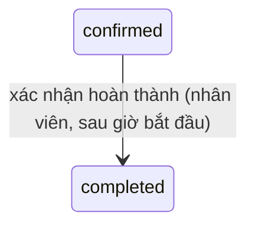

# Chăm sóc khách hàng — đặc tả

- **Nhóm:** `Care` · **Sprint:** 2 · **Nguồn:** DA §2.2.3 (UC Lập và cập nhật hồ sơ da khách hàng, UC Xác nhận hoàn thành buổi chăm sóc), luồng `FL-03` / ĐX
- **Entity:** `SkinProfile` (bảng `skin_profiles`), `CustomerAllergy` (bảng `customer_allergies`); ghi thêm `Appointment`, `ServiceEntitlement`, `TreatmentSession`, `TreatmentPlan`, `CustomerPackage` — xem [glossary](../domain/glossary.md), [data-model](../domain/data-model.md)
- **Trạng thái triển khai:** UC-SPA-27, 28 duyệt và xong phần backend ngày 31/10/2026 theo [plan](../superpowers/plans/2026-10-31-uc-spa-25-27-28-care.md) — xem [progress.md](../progress.md)
- **Đã đặc tả:** UC-SPA-27, 28 (chỉ backend), làm cùng UC-SPA-25 ([staff.md](staff.md)). **Chưa đặc tả:** UC-SPA-26 (lịch sử khách đã chăm sóc, `GET /me/care-history`) — CARE-LATER-01.

## Use case

### UC-SPA-27 — Lập và cập nhật hồ sơ da khách hàng

| Mục            | Nội dung                                                                                                                                           |
| -------------- | -------------------------------------------------------------------------------------------------------------------------------------------------- |
| Actor          | Nhân viên (xem hồ sơ: cả chủ spa)                                                                                                                  |
| Mô tả          | Nhân viên tạo hoặc sửa hồ sơ da của một lần chăm sóc (một lịch hẹn), xem và cập nhật dị ứng của khách                                              |
| Tiền điều kiện | Đã đăng nhập, `role = staff` (quyền `care.write`); là nhân viên được phân công lịch hẹn (BR-CARE-01)                                               |
| Input          | Lịch hẹn; `skinType`, `mainConcerns?`, `currentProducts?`, `careGoals?`, `recommendedTreatment?`, `note?`; dị ứng: `allergen`, `severity`, `note?` |
| Output         | Hồ sơ da gắn với lịch hẹn; dị ứng của khách được thêm/sửa/xóa                                                                                      |

**Luồng chính** (vào từ chi tiết lịch được phân công — UC-SPA-25 A1, ĐX; vào từ lịch sử khách đã chăm sóc làm cùng UC-SPA-26)

1. Nhân viên mở chi tiết lịch `GET /appointments/{id}` (có dị ứng nổi bật, `skinProfileId`).
2. Chưa có hồ sơ (`skinProfileId = null`) → nhân viên chọn tạo mới, nhập thông tin, client gọi `POST /appointments/{id}/skin-profile`.
3. Hệ thống kiểm tra: nhân viên được phân công (BR-CARE-01), trạng thái lịch và thời điểm cho phép (BR-CARE-04), dữ liệu hợp lệ (BR-CARE-05).
4. Lưu hồ sơ: `customer_id` = khách của lịch, `assessed_by_staff_member_id` = nhân viên hiện tại, `assessed_at_utc = now`. Trả `201` + `Location: /api/v1/appointments/{id}/skin-profile`.

**Luồng rẽ nhánh**

- A1. **Đã có hồ sơ** → `GET /appointments/{id}/skin-profile` xem, sửa và gửi `PUT /skin-profiles/{id}` (thay toàn bộ trường) → `200`. Không đổi `assessed_by_staff_member_id`, `assessed_at_utc`; `updated_at_utc`/`updated_by` do interceptor ghi.
- A2. **Dị ứng** (ĐX): `GET /customers/{customerId}/allergies` xem; `POST` thêm, `PUT /customers/{customerId}/allergies/{id}` sửa, `DELETE` xóa dị ứng ghi nhầm. Dị ứng gắn với khách, không theo lịch (BR-CARE-02).
- A3. **Chủ spa xem** hồ sơ của mọi lịch: `GET /appointments/{id}/skin-profile`, `GET /customers/{id}/allergies` (chỉ đọc).

**Ngoại lệ**

- E1. Dữ liệu không hợp lệ (thiếu/sai `skinType`, quá độ dài) → `400 validation_error`.
- E2. Lịch đã có hồ sơ khi tạo (kể cả hai yêu cầu đồng thời, chặn bằng `UQ appointment_id`) → `409 skin_profile_exists`.
- E3. Lịch không ở trạng thái cho phép (`held`, `pending_confirmation`, `cancelled`, `no_show`, `hold_expired`) → `409 appointment_status_invalid`; lịch `confirmed` nhưng chưa tới ngày hẹn → `400 skin_profile_too_early`; lịch `completed` quá `Care:SkinProfileEditWindowDays` ngày → `409 skin_profile_locked`.
- E4. Nhân viên không được phân công lịch → `403 appointment_not_assigned`; dị ứng của khách mình không chăm sóc → `403 customer_not_in_care`.
- E5. Lịch không tồn tại → `404 appointment_not_found`; chưa có hồ sơ (GET) hoặc id hồ sơ sai (PUT) → `404 skin_profile_not_found`; khách không tồn tại → `404 customer_not_found`; dị ứng không tồn tại hoặc không thuộc khách → `404 allergy_not_found`.
- E6. Thêm/sửa dị ứng trùng tác nhân đã có của khách (không phân biệt hoa thường, dấu) → `409 allergy_exists`.
- E7. Chưa đăng nhập → `401`; khách hàng (mọi endpoint), chủ spa (endpoint ghi) → `403`.

**Quy tắc áp dụng:** BR-CARE-01, 02, 04, 05, 06, BR-SEC-01, RBAC `care.write`.

### UC-SPA-28 — Xác nhận hoàn thành buổi chăm sóc

| Mục            | Nội dung                                                                                                             |
| -------------- | -------------------------------------------------------------------------------------------------------------------- |
| Actor          | Nhân viên                                                                                                            |
| Mô tả          | Nhân viên ghi nhận lịch đã hoàn thành kèm kết quả; hệ thống cập nhật quyền dịch vụ lẻ hoặc buổi và tiến độ gói       |
| Tiền điều kiện | Đã đăng nhập, `role = staff` (quyền `care.write`); là nhân viên được phân công; lịch `confirmed`; đã tới giờ bắt đầu |
| Input          | Lịch được phân công; `result?` (kết quả chăm sóc)                                                                    |
| Output         | Lịch `completed`; quyền `used` hoặc buổi `completed` + tiến độ gói                                                   |

**Luồng chính**

1. Nhân viên mở chi tiết lịch (UC-SPA-25), chọn "Xác nhận hoàn thành", nhập kết quả; client gọi `POST /appointments/{id}/complete` với `{ result? }`.
2. Trong **một giao dịch**: khóa dòng lịch hẹn (`FOR UPDATE`, như UC-SPA-17) → kiểm tra BR-CARE-03 (được phân công, `confirmed`, `now (VN) ≥ date + start_time`, quyền/buổi còn `booked`).
3. Lịch `confirmed → completed` (WF-01).
4. **Dịch vụ lẻ** (lịch có `service_entitlement_id`, gồm lịch đặt ngay đã thanh toán): quyền `booked → used` (BR-TRT-02, WF-04); `result` nối vào `appointments.note` (ĐX).
5. Trả `200 { appointment: <chi tiết lịch>, packageProgress: null }`.

**Luồng rẽ nhánh**

- A1. **Buổi trong gói** (lịch có `treatment_session_id`): khóa thêm dòng `customer_packages` (hai buổi cùng gói hoàn thành đồng thời không mất lượt) → buổi `booked → completed`, `completed_at_utc = now`, `note = result` (WF-07); `used_sessions + 1` (BR-TRT-03); liệu trình `not_started → in_progress` + `start_date` = ngày hẹn nếu là buổi hoàn thành đầu tiên (WF-06); `used_sessions = total_sessions` → gói `completed`, liệu trình `completed` + `actual_end_date` = ngày hẹn (WF-05, WF-06). Trả `packageProgress: { customerPackageId, packageName, usedSessions, totalSessions, status }`.
- A2. Thông báo mời đánh giá cho khách (ĐX) → làm ở UC-SPA-34 (CARE-LATER-02).

**Ngoại lệ** (E1 của DA tách theo lý do)

- E1. Nhân viên không được phân công → `403 appointment_not_assigned`.
- E2. Lịch không `confirmed` (đã hoàn thành, đã hủy, không đến, giữ chỗ…) → `409 appointment_status_invalid`, thông điệp nêu trạng thái hiện tại.
- E3. Trước giờ bắt đầu → `400 complete_too_early`.
- E4. Quyền không còn `booked` / buổi không `booked`, gói `cancelled` hoặc liệu trình `cancelled` → `409 entitlement_state_invalid`.
- E5. Bật `Care:RequireSkinProfileToComplete` mà lịch chưa có hồ sơ da → `409 skin_profile_required` (mặc định tắt, Q-35).
- E6. `result` > 2000 ký tự → `400 validation_error`; lịch không tồn tại → `404 appointment_not_found`; `401`; chủ spa, khách hàng → `403`.

**Quy tắc áp dụng:** BR-CARE-03, BR-TRT-02, 03, BR-SEC-01, RBAC `care.write`.

## Business rules

| Mã         | Quy tắc                                                                                                                                                                                                                                                                                                                                                                                               | Enforce ở đâu                                                                                                        | Nguồn            |
| ---------- | ----------------------------------------------------------------------------------------------------------------------------------------------------------------------------------------------------------------------------------------------------------------------------------------------------------------------------------------------------------------------------------------------------- | -------------------------------------------------------------------------------------------------------------------- | ---------------- |
| BR-CARE-01 | Mỗi lịch hẹn tối đa một hồ sơ da (`UQ skin_profiles.appointment_id` có sẵn; vi phạm `23505` → `409 skin_profile_exists`); `skin_type` bắt buộc; chỉ nhân viên **đang** được phân công lịch (`appointments.staff_member_id`) lập/sửa. Chủ spa chỉ đọc                                                                                                                                                  | CSDL UQ + Application                                                                                                | DA               |
| BR-CARE-02 | Dị ứng gắn với khách (không theo lịch); trả trong chi tiết lịch hẹn cho nhân viên và chủ spa, sắp `severe → moderate → mild`, rồi `allergen`. Không trùng `allergen` trong cùng khách (so sánh sau khi trim, không phân biệt hoa thường và dấu)                                                                                                                                                       | Application + Query                                                                                                  | DA + ĐX          |
| BR-CARE-03 | Hoàn thành: nhân viên được phân công; lịch `confirmed`; `now (VN) ≥ date + start_time`; quyền `booked` hoặc buổi `booked`, gói và liệu trình không `cancelled`; một giao dịch, khóa lịch rồi gói. Gói `expired`/quá hạn hay liệu trình `paused` **không** chặn (buổi đã được đặt hợp lệ trước đó, Q-30). Không giới hạn trễ: lịch còn `confirmed` thì hoàn thành được (chủ spa ghi không đến nếu cần) | Domain (`Appointment.Complete`, `TreatmentSession.Complete`, `CustomerPackage.RecordCompletedSession`) + Application | DA + ĐX          |
| BR-CARE-04 | Lập/sửa hồ sơ da khi lịch `confirmed` và `date ≤ hôm nay (VN)`, hoặc lịch `completed` và `hôm nay ≤ date + Care:SkinProfileEditWindowDays` (mặc định 7). Trạng thái khác không lập/sửa                                                                                                                                                                                                                | Application                                                                                                          | ĐX (Q-34)        |
| BR-CARE-05 | Hồ sơ da: `skinType` ∈ `normal\|dry\|oily\|combination\|sensitive`; các trường văn bản tùy chọn, trim, rỗng → null, mỗi trường ≤ 2000 ký tự. Dị ứng: `allergen` 1–255 ký tự, `severity` ∈ `mild\|moderate\|severe`, `note` ≤ 1000. Kết quả hoàn thành `result` ≤ 2000                                                                                                                                 | Validator                                                                                                            | ĐX (biên tự đặt) |
| BR-CARE-06 | Nhân viên đọc/ghi dị ứng của một khách khi có ít nhất một lịch với khách đó ở `pending_confirmation`, `confirmed` hoặc `completed` mà mình là nhân viên được phân công ("khách đã/đang chăm sóc", BR-SEC-01). Chủ spa đọc mọi khách, không ghi. `recorded_at_utc` = lúc thêm, cập nhật lại khi sửa                                                                                                    | Application                                                                                                          | ĐX (Q-36)        |
| BR-TRT-02  | Quyền dịch vụ lẻ `booked → used` khi lịch hoàn thành                                                                                                                                                                                                                                                                                                                                                  | Domain                                                                                                               | ĐX               |
| BR-TRT-03  | Buổi `completed` + `completed_at_utc`; `used_sessions + 1` (`CHECK 0 ≤ used_sessions ≤ total_sessions` có sẵn); đủ buổi → gói `completed`, liệu trình `completed` + `actual_end_date`; buổi hoàn thành đầu tiên → liệu trình `in_progress` + `start_date`                                                                                                                                             | Domain + CHECK                                                                                                       | DA               |

**Phân quyền** (sheet `21`): thêm `care.write` → `staff` vào `Permissions.cs` cho các endpoint ghi (`POST`/`PUT` hồ sơ da, `POST`/`PUT`/`DELETE` dị ứng, `complete`). Endpoint đọc `GET /appointments/{id}/skin-profile`, `GET /customers/{id}/allergies` dùng `[Authorize(Roles = "owner,staff")]` như `GET /appointments/{id}`, service kiểm tra phạm vi nhân viên (BR-SEC-01).

## Trạng thái

Đi kèm: quyền `booked → used` (WF-04); buổi `booked → completed` (WF-07); liệu trình `not_started → in_progress` (buổi đầu) và `in_progress → completed` (đủ buổi, WF-06); gói `active → completed` (đủ buổi, WF-05). `customer_packages.status` đọc từ CSDL (gói hết hạn theo Q-32 chỉ tính khi đọc, vẫn chuyển `completed` khi đủ buổi).

## Dữ liệu

| Bảng                   | Cột dùng                                                  | Thay đổi                                                        |
| ---------------------- | --------------------------------------------------------- | --------------------------------------------------------------- |
| `skin_profiles`        | toàn bộ                                                   | Không đổi schema (UQ `appointment_id` có sẵn)                   |
| `customer_allergies`   | toàn bộ                                                   | Không đổi schema; xóa cứng khi `DELETE` (bảng không có xóa mềm) |
| `appointments`         | `status`, `note`, `staff_member_id`, `date`, `start_time` | Không đổi schema                                                |
| `service_entitlements` | `status`                                                  | Không đổi schema                                                |
| `treatment_sessions`   | `status`, `note`, `completed_at_utc`                      | Không đổi schema                                                |
| `treatment_plans`      | `status`, `start_date`, `actual_end_date`                 | Không đổi schema                                                |
| `customer_packages`    | `used_sessions`, `status`                                 | Không đổi schema                                                |

**Không có migration.** Lịch hẹn không có cột thời điểm hoàn thành; thời điểm hoàn thành buổi gói lưu ở `treatment_sessions.completed_at_utc`.

## API

Tiền tố `/api/v1`, envelope chuẩn.

| Method | Đường dẫn                               | Vai trò                                        | Request                                                                                   | Response                                                                                                                                                                                                        | Lỗi                                                                                                                                                                         |
| ------ | --------------------------------------- | ---------------------------------------------- | ----------------------------------------------------------------------------------------- | --------------------------------------------------------------------------------------------------------------------------------------------------------------------------------------------------------------- | --------------------------------------------------------------------------------------------------------------------------------------------------------------------------- |
| GET    | `/appointments/{id}/skin-profile`       | Chủ spa, nhân viên được phân công              | —                                                                                         | 200 `SkinProfileDto { id, appointmentId, customerId, assessedBy: { id, fullName }, assessedAtUtc, skinType, mainConcerns, currentProducts, careGoals, recommendedTreatment, note, createdAtUtc, updatedAtUtc }` | 401, 403 `appointment_not_assigned`, 404 `appointment_not_found`/`skin_profile_not_found`                                                                                   |
| POST   | `/appointments/{id}/skin-profile`       | Nhân viên được phân công                       | `{ skinType, mainConcerns?, currentProducts?, careGoals?, recommendedTreatment?, note? }` | 201 + `Location`, `SkinProfileDto`                                                                                                                                                                              | 400 `validation_error`/`skin_profile_too_early`, 401, 403, 404 `appointment_not_found`, 409 `skin_profile_exists`/`appointment_status_invalid`/`skin_profile_locked`        |
| PUT    | `/skin-profiles/{id}`                   | Nhân viên được phân công lịch của hồ sơ        | như POST                                                                                  | 200 `SkinProfileDto`                                                                                                                                                                                            | 400, 401, 403, 404 `skin_profile_not_found`, 409 `appointment_status_invalid`/`skin_profile_locked`                                                                         |
| GET    | `/customers/{id}/allergies`             | Chủ spa, nhân viên chăm sóc khách (BR-CARE-06) | —                                                                                         | 200 `[CustomerAllergyDto { id, allergen, severity, note, recordedAtUtc }]` (thứ tự BR-CARE-02)                                                                                                                  | 401, 403 `customer_not_in_care`, 404 `customer_not_found`                                                                                                                   |
| POST   | `/customers/{id}/allergies`             | Nhân viên chăm sóc khách                       | `{ allergen, severity, note? }`                                                           | 201, `CustomerAllergyDto`                                                                                                                                                                                       | 400, 401, 403, 404 `customer_not_found`, 409 `allergy_exists`                                                                                                               |
| PUT    | `/customers/{id}/allergies/{allergyId}` | Nhân viên chăm sóc khách                       | như POST                                                                                  | 200 `CustomerAllergyDto`                                                                                                                                                                                        | 400, 401, 403, 404 `customer_not_found`/`allergy_not_found`, 409 `allergy_exists`                                                                                           |
| DELETE | `/customers/{id}/allergies/{allergyId}` | Nhân viên chăm sóc khách                       | —                                                                                         | 204                                                                                                                                                                                                             | 401, 403, 404                                                                                                                                                               |
| POST   | `/appointments/{id}/complete`           | Nhân viên được phân công                       | `{ result? }` (≤ 2000)                                                                    | 200 `{ appointment: AppointmentDetailDto, packageProgress?: { customerPackageId, packageName, usedSessions, totalSessions, status } }`                                                                          | 400 `validation_error`/`complete_too_early`, 401, 403 `appointment_not_assigned`, 404, 409 `appointment_status_invalid`/`entitlement_state_invalid`/`skin_profile_required` |

- `AppointmentDetailDto` (`GET /appointments/{id}`) **thêm trường** (không đổi trường cũ): `skinProfileId?` (bên cạnh `hasSkinProfile`), `allergies[]` thêm `id`, `recordedAtUtc`; `treatmentSession?` thêm `totalSessions`, `customerPackageId`, `packageName` (hiển thị "Buổi x/y").
- `data_api.py`: sửa tại chỗ dòng 092–097 (tên trường tiếng Anh, mã lỗi, `PUT /skin-profiles/{id}` chỉ nhân viên được phân công, `complete` trả `{ appointment, packageProgress? }`); **thêm cuối danh sách** SPA-API-121 `PUT /customers/{id}/allergies/{allergyId}` và SPA-API-122 `DELETE /customers/{id}/allergies/{allergyId}`. Dòng 091 (`/me/care-history`) giữ cho UC-SPA-26.

## Màn hình

Chỉ backend lần này. Màn hình đích: SCR-W27 / SCR-M26 (chi tiết buổi chăm sóc: dị ứng nổi bật, form hồ sơ da, modal xác nhận hoàn thành).

## Cấu hình

| Biến `.env` | Khóa                                | Mặc định          |
| ----------- | ----------------------------------- | ----------------- |
| —           | `Care:SkinProfileEditWindowDays`    | `7` (0–365, Q-34) |
| —           | `Care:RequireSkinProfileToComplete` | `false` (Q-35)    |

Không có biến `.env`/secret mới.

## Kiểm thử bắt buộc

Unit test (NSubstitute, đồng hồ giả) cho chuyển trạng thái Domain (`Appointment.Complete`, `TreatmentSession.Complete`, `CustomerPackage.RecordCompletedSession`, `TreatmentPlan`), điều kiện BR-CARE-03/04 và validator; integration test `PostgresFixture` + `AuthApiFactory`, lịch hẹn/quyền/gói chèn trực tiếp (helper có sẵn của test đặt lịch).

| Mã       | Tình huống                                                                                                     | Kết quả mong đợi                                                                                                                                                 |
| -------- | -------------------------------------------------------------------------------------------------------------- | ---------------------------------------------------------------------------------------------------------------------------------------------------------------- |
| CARE-T01 | Nhân viên được phân công lập hồ sơ cho lịch `confirmed` hôm nay                                                | 201, `Location` đúng; `customer_id`, `assessed_by_staff_member_id`, `assessed_at_utc` đúng; `GET /appointments/{id}` có `hasSkinProfile = true`, `skinProfileId` |
| CARE-T02 | Lập lần hai; hai yêu cầu lập đồng thời                                                                         | `409 skin_profile_exists`; đúng một 201, CSDL 1 hồ sơ                                                                                                            |
| CARE-T03 | Lập cho lịch `confirmed` ngày mai / `cancelled` / `no_show` / `pending_confirmation` / `held`                  | `400 skin_profile_too_early` / `409 appointment_status_invalid` ×4                                                                                               |
| CARE-T04 | Lịch `completed` ngày hẹn cách hôm nay 7 ngày / 8 ngày: lập và sửa                                             | 201, 200 / `409 skin_profile_locked` ×2                                                                                                                          |
| CARE-T05 | Thiếu `skinType`; `skinType = "x"`; `mainConcerns` 2001 ký tự; chuỗi toàn khoảng trắng                         | `400 validation_error` ×3; khoảng trắng → lưu null                                                                                                               |
| CARE-T06 | Sửa hồ sơ (`PUT /skin-profiles/{id}`)                                                                          | 200; trường mới; `assessed_by`, `assessed_at_utc` giữ nguyên; `updated_at_utc`, `updated_by` được ghi                                                            |
| CARE-T07 | Nhân viên khác lập/sửa/xem hồ sơ; chủ spa xem / lập; khách hàng xem; không Bearer                              | `403 appointment_not_assigned` ×3; 200 / `403`; `403`; `401`                                                                                                     |
| CARE-T08 | Lịch được đổi sang nhân viên B sau khi A lập hồ sơ: A sửa, B sửa                                               | A `403`; B 200, `assessed_by` vẫn là A                                                                                                                           |
| CARE-T09 | `GET skin-profile` khi chưa có hồ sơ; `PUT` id không tồn tại; lịch không tồn tại                               | `404 skin_profile_not_found` ×2; `404 appointment_not_found`                                                                                                     |
| CARE-T10 | Dị ứng: thêm hợp lệ; thêm "Paraben" khi đã có "paraben" / "Parabén"; sửa trùng tác nhân khác; xóa              | 201; `409 allergy_exists` ×2; `409 allergy_exists`; 204, không còn trong danh sách                                                                               |
| CARE-T11 | Dị ứng: nhân viên có lịch `completed` với khách / chỉ có lịch `cancelled` / không có lịch; chủ spa GET / POST  | 200; `403 customer_not_in_care` ×2; 200 / `403`                                                                                                                  |
| CARE-T12 | Dị ứng: `allergyId` của khách khác; khách không tồn tại; `severity` sai; `allergen` rỗng hoặc 256 ký tự        | `404 allergy_not_found`; `404 customer_not_found`; `400` ×2                                                                                                      |
| CARE-T13 | Chi tiết lịch: dị ứng sắp `severe` trước; có `id`, `recordedAtUtc`; buổi gói có `totalSessions`, `packageName` | Đúng thứ tự và trường                                                                                                                                            |
| CARE-T14 | Hoàn thành lịch dịch vụ lẻ (`service_entitlement_id`) sau giờ bắt đầu, có `result`                             | 200; lịch `completed`, quyền `used`, `note` có kết quả; `packageProgress = null`                                                                                 |
| CARE-T15 | Hoàn thành lịch đặt ngay đã thanh toán (có `order_item_id` + `service_entitlement_id`)                         | 200; quyền `used`                                                                                                                                                |
| CARE-T16 | Hoàn thành buổi 1/3 của gói (liệu trình `not_started`)                                                         | Buổi `completed`, `completed_at_utc`, `note = result`; gói `used_sessions = 1`, `active`; liệu trình `in_progress`, `start_date` = ngày hẹn                      |
| CARE-T17 | Hoàn thành buổi cuối (3/3)                                                                                     | Gói `completed`, `used_sessions = 3`; liệu trình `completed`, `actual_end_date` = ngày hẹn; `packageProgress.status = completed`                                 |
| CARE-T18 | Hoàn thành trước giờ bắt đầu 1 phút; đúng giờ bắt đầu                                                          | `400 complete_too_early`; 200                                                                                                                                    |
| CARE-T19 | Hoàn thành lịch `completed` / `cancelled` / `no_show` / `held` / `pending_confirmation`                        | `409 appointment_status_invalid` ×5                                                                                                                              |
| CARE-T20 | Quyền đã `used` (dữ liệu lệch); gói `cancelled`; gói quá hạn (`expires_at_utc` qua) và liệu trình `paused`     | `409 entitlement_state_invalid` ×2; 200 (BR-CARE-03)                                                                                                             |
| CARE-T21 | Nhân viên khác / chủ spa / khách hàng hoàn thành; không Bearer                                                 | `403 appointment_not_assigned`; `403` ×2; `401`                                                                                                                  |
| CARE-T22 | Hai yêu cầu hoàn thành cùng một lịch đồng thời; hai buổi khác nhau của cùng gói hoàn thành đồng thời           | Một 200, một `409 appointment_status_invalid`; `used_sessions` tăng đúng 2                                                                                       |
| CARE-T23 | Bật `Care:RequireSkinProfileToComplete`: chưa có hồ sơ / đã có                                                 | `409 skin_profile_required`; 200                                                                                                                                 |
| CARE-T24 | `result` 2001 ký tự                                                                                            | `400 validation_error`, không đổi gì                                                                                                                             |
| CARE-T25 | `GET /me/purchases` sau khi hoàn thành (UC-SPA-18)                                                             | Quyền `used`, `canBook = false`; gói hiển thị tiến độ mới, `nextSession` là buổi kế                                                                              |
| CARE-T26 | Hồi quy                                                                                                        | Toàn bộ test hiện có vẫn pass (UC-SPA-11, 15, 17, 18); `PersistenceModelTests` pass                                                                              |

## Câu hỏi còn mở

- Q-34 (mới): Khi nào nhân viên được lập/sửa hồ sơ da? Mặc định: lịch `confirmed` từ ngày hẹn, hoặc lịch `completed` trong **7 ngày** sau ngày hẹn (`Care:SkinProfileEditWindowDays`); sau đó chỉ đọc.
- Q-35 (mới): Có bắt buộc lập hồ sơ da trước khi xác nhận hoàn thành? Mặc định: **không** (`Care:RequireSkinProfileToComplete` = `false`); DA không yêu cầu.
- Q-36 (mới): Ai được ghi dị ứng của khách? Mặc định: nhân viên có lịch `pending_confirmation`/`confirmed`/`completed` với khách đó; chủ spa chỉ đọc (theo `data_api`); xóa cứng dị ứng ghi nhầm. Không cấu hình.
- Q-07 (có sẵn): khi bật trừ lượt cho khách không đến, buổi `skipped` không bao giờ `completed` nên gói không tự `completed` theo BR-TRT-03 (`used = total`). Ghi nhận, xử lý ở UC-SPA-21 (CARE-LATER-03).

## Việc để sau

| Mã            | Việc                                                                                                                         | Làm cùng  |
| ------------- | ---------------------------------------------------------------------------------------------------------------------------- | --------- |
| CARE-LATER-01 | UC-SPA-26: `GET /me/care-history` (lịch sử khách đã chăm sóc, tìm theo tên/SĐT, khoảng ngày) và các hồ sơ da trước của khách | UC-SPA-26 |
| CARE-LATER-02 | Thông báo cho khách khi buổi hoàn thành, mời đánh giá (BR-NTF-01)                                                            | UC-SPA-34 |
| CARE-LATER-03 | Gói có buổi `skipped` (Q-07 bật): quy tắc kết thúc gói, chủ spa đóng liệu trình                                              | UC-SPA-21 |
