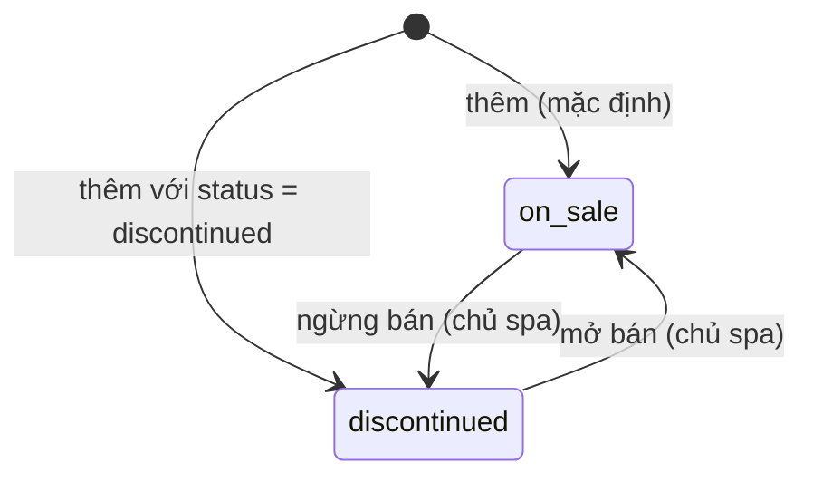

# Dịch vụ & gói dịch vụ — đặc tả

- **Nhóm:** `Services`, `ServicePackages` · **Sprint:** 1 · **Nguồn:** DA §2.2.3 (UC Tìm kiếm, UC Quản lý dịch vụ) / ĐX (UC-SPA-07 chưa có bảng kịch bản trong DA)
- **Entity:** `SpaService` (bảng `spa_services`), `ServicePackage` (bảng `service_packages`), `ServicePackageItem` (bảng `service_package_items`) — xem [glossary](../domain/glossary.md), [data-model](../domain/data-model.md)
- **Trạng thái triển khai:** xem [progress.md](../progress.md)
- **Đã đặc tả:** UC-SPA-06, 07, 09 (chỉ backend), kèm ảnh dịch vụ và gói trên Cloudinary. UC-SPA-08 (giới thiệu spa) viết sau.

## Use case

### UC-SPA-06 — Tìm kiếm dịch vụ và gói dịch vụ

| Mục            | Nội dung                                                                                                                   |
| -------------- | -------------------------------------------------------------------------------------------------------------------------- |
| Actor          | Khách vãng lai, Khách hàng (Nhân viên và Chủ spa cũng gọi được; chủ spa có thêm bộ lọc trạng thái, dùng cho SCR-W31/W32)   |
| Mô tả          | Tìm dịch vụ lẻ và gói đang bán theo từ khóa, loại dịch vụ, khoảng giá; kết quả phân trang                                  |
| Tiền điều kiện | Không                                                                                                                      |
| Input          | `search` (tùy chọn), `category` (chỉ dịch vụ), `minPrice`, `maxPrice`, `pageNumber`, `pageSize`, `sortBy`, `sortDirection` |
| Output         | `PagedResult` dòng dịch vụ hoặc dòng gói; danh sách loại dịch vụ; tối đa 8 gợi ý                                           |

**Luồng chính**

1. Actor mở trang dịch vụ hoặc gói; client gọi `GET /services` hoặc `GET /packages`, và `GET /service-categories` để dựng bộ lọc.
2. Hệ thống chỉ lấy mục khách được thấy (BR-CAT-01).
3. Có `search` → bỏ khoảng trắng hai đầu, so khớp **chứa chuỗi**, không phân biệt hoa thường và dấu (BR-CAT-05) với `name` (dịch vụ: thêm `category`; gói: chỉ `name`).
4. Có `category` → so khớp **bằng nhau**, không phân biệt hoa thường và dấu. Gói không có danh mục (RS-14), nên `/packages` không nhận `category`.
5. Có `minPrice`/`maxPrice` → lọc `minPrice ≤ price ≤ maxPrice`.
6. Sắp theo `sortBy` (`name` mặc định, hoặc `price`), `sortDirection` (`asc` mặc định); cùng giá trị thì sắp tiếp theo `name` rồi `id` để phân trang ổn định.
7. Trả trang kết quả.

**Luồng rẽ nhánh**

- A1. **Gợi ý khi nhập:** từ khóa ≥ 2 ký tự (sau khi bỏ khoảng trắng) → `GET /catalog/suggestions` trả tối đa 8 mục gồm cả dịch vụ và gói khách được thấy; mục có tên **bắt đầu bằng** từ khóa xếp trước, sau đó theo tên.
- A2. **Xóa bộ lọc:** xử lý ở client (gọi lại không tham số).
- A3. **Hỏi trợ lý AI:** thuộc UC-SPA-32, ngoài phạm vi.
- A4. **Chủ spa** gọi `GET /services`/`GET /packages` với `status=on_sale|discontinued` → lọc theo trạng thái; bỏ trống → mọi trạng thái; không áp điều kiện ngày bán. Người gọi không phải chủ spa: `status` bị bỏ qua (không báo lỗi).

**Ngoại lệ**

- E1. Không có kết quả → `200` với `items` rỗng, `totalCount = 0`.
- E2. `sortBy` khác `name`/`price`, `sortDirection` sai, giá âm, `minPrice > maxPrice`, `search` dài hơn 100 ký tự, `status` sai giá trị → `400 validation_error` theo trường.
- E3. Gợi ý với từ khóa dưới 2 ký tự → `400 validation_error` (trường `search`).
- E4. Lọc "chỉ dịch vụ đã từng sử dụng" (DA bước 3, 7) → **chưa làm**, cần đơn hàng (Sprint 2).

**Quy tắc áp dụng:** BR-CAT-01, BR-CAT-04, BR-CAT-05.

### UC-SPA-07 — Xem chi tiết dịch vụ, gói dịch vụ

| Mục            | Nội dung                                                                                               |
| -------------- | ------------------------------------------------------------------------------------------------------ |
| Actor          | Khách vãng lai, Khách hàng (Chủ spa xem được cả mục ngừng bán)                                         |
| Mô tả          | Xem mô tả, giá, thời lượng, ảnh; với gói: thời hạn, tổng số buổi và các dịch vụ thành phần theo thứ tự |
| Tiền điều kiện | Không                                                                                                  |
| Input          | `id` của dịch vụ hoặc gói                                                                              |
| Output         | Chi tiết dịch vụ, hoặc chi tiết gói kèm `items` sắp theo `sortOrder`                                   |

**Luồng chính**

1. Client gọi `GET /services/{id}` hoặc `GET /packages/{id}`.
2. Hệ thống kiểm tra mục tồn tại và khách được thấy (BR-CAT-01).
3. Dịch vụ: trả `id, name, category, description, price, durationMinutes, imageUrl, status`.
4. Gói: trả thông tin gói, `totalSessions` (tổng `session_count`), `imageUrl` (có ảnh dự phòng, BR-CAT-07) và `items[]` theo `sort_order`: `spaServiceId, serviceName, serviceImageUrl, serviceStatus, sessionCount, sortOrder, minDaysBetweenSessions, note`.

**Luồng rẽ nhánh**

- A1. Chưa đăng nhập mà chọn Thêm vào giỏ/Đặt ngay → xử lý ở client (UC-SPA-02 A1), ngoài phạm vi.
- A2. Gói đang bán có dịch vụ thành phần đã ngừng bán → gói vẫn hiển thị, dòng đó có `serviceStatus = "discontinued"` (Q-14).

**Ngoại lệ**

- E1. Không tồn tại, hoặc khách không được thấy (ngừng bán, gói ngoài thời gian bán) → `404 service_not_found` / `404 package_not_found`, cùng thông điệp cho cả hai trường hợp (không tiết lộ mục có tồn tại).
- E2. `id` không phải GUID → `404` (route constraint `{id:guid}`).

Điểm đánh giá trung bình (DA bước 4) để lại cho UC-SPA-29.

**Quy tắc áp dụng:** BR-CAT-01, BR-CAT-07.

### UC-SPA-09 — Quản lý dịch vụ và gói dịch vụ

| Mục            | Nội dung                                                                                                                     |
| -------------- | ---------------------------------------------------------------------------------------------------------------------------- |
| Actor          | Chủ spa                                                                                                                      |
| Mô tả          | Thêm, sửa, ngừng bán / mở bán dịch vụ và gói; tải, thay, xóa ảnh                                                             |
| Tiền điều kiện | Đã đăng nhập, `role = owner` (quyền `catalog.manage`)                                                                        |
| Input          | Thông tin dịch vụ hoặc gói; với gói: danh sách dịch vụ thành phần (dịch vụ, số buổi, thứ tự, khoảng cách tối thiểu, ghi chú) |
| Output         | Dịch vụ/gói được lưu; trạng thái được cập nhật; URL ảnh                                                                      |

**Luồng chính — thêm dịch vụ**

1. Chủ spa gửi `POST /services` với `name, category, description?, durationMinutes, price, status?` (`status` mặc định `on_sale`).
2. Hệ thống kiểm tra dữ liệu (BR-CAT-02), chuẩn hóa `category` (BR-CAT-04), lưu.
3. Trả `201` kèm header `Location` và chi tiết dịch vụ.

**Luồng chính — thêm gói**

1. Chủ spa gửi `POST /packages` với `name, description?, price, validityDays, saleStartDate?, saleEndDate?, status?` và `items[]` gồm `spaServiceId, sessionCount, sortOrder, minDaysBetweenSessions, note?`.
2. Hệ thống kiểm tra dữ liệu (BR-CAT-02); mọi `spaServiceId` phải tồn tại và đang bán (BR-CAT-06).
3. Lưu gói và các dòng thành phần trong một lần lưu (`IUnitOfWork`); trả `201` kèm `Location` và chi tiết gói.

**Luồng rẽ nhánh**

- A1. **Sửa dịch vụ:** `PUT /services/{id}` với `name, category, description?, durationMinutes, price` (không đổi trạng thái, không đổi ảnh) → `200` chi tiết mới.
- A2. **Sửa gói:** `PUT /packages/{id}` với đủ trường như khi thêm (trừ `status`), `items[]` **thay toàn bộ** danh sách cũ trong cùng giao dịch → `200` chi tiết mới. Dịch vụ đã nằm trong gói từ trước mà nay ngừng bán được giữ lại; chỉ dịch vụ **mới thêm** vào gói phải đang bán (BR-CAT-06).
- A3. **Ngừng bán / mở bán:** `PATCH /services/{id}/status` hoặc `/packages/{id}/status` với `{ status: "on_sale" | "discontinued" }` → `204`. Đặt lại trạng thái đang có cũng trả `204`. Ngừng bán dịch vụ đang nằm trong gói đang bán vẫn được (Q-14). Mở bán lại gói không kiểm tra lại dịch vụ thành phần.
- A4. **Tải hoặc thay ảnh:** `POST /services/{id}/image` hoặc `/packages/{id}/image`, `multipart/form-data`, field `file` → kiểm tra file (BR-CAT-08), upload lên Cloudinary, upload thành công mới lưu `image_url` → `200 { imageUrl }`. Được làm với cả mục đang ngừng bán.
- A5. **Xóa ảnh:** `DELETE /services/{id}/image` hoặc `/packages/{id}/image` → xóa ảnh trên Cloudinary rồi đặt `image_url = null` → `204`. Mục chưa có ảnh → `204`, không gọi Cloudinary.

**Ngoại lệ**

- E1. Dữ liệu không hợp lệ (BR-CAT-02), file ảnh sai (BR-CAT-08) → `400 validation_error` theo trường.
- E2. `spaServiceId` trong `items` không tồn tại → `400 package_service_not_found`; đang ngừng bán (và mới thêm vào gói) → `400 package_service_discontinued`. Thông điệp nêu tên/thứ tự dòng lỗi.
- E3. Sửa, đổi trạng thái, tải/xóa ảnh cho mục không tồn tại → `404 service_not_found` / `404 package_not_found`.
- E4. Chưa đăng nhập → `401 unauthorized`; đăng nhập nhưng không phải chủ spa → `403 forbidden`.
- E5. Thiếu cấu hình Cloudinary, Cloudinary lỗi hoặc quá thời gian chờ → `503 image_storage_unavailable`, thông điệp chung; chi tiết chỉ ghi log; `image_url` giữ nguyên.
- E6. Request vượt giới hạn cứng của endpoint ảnh (10 MB) → `413 request_too_large` dạng envelope, không đọc hết file vào bộ nhớ.
- E7. Không có endpoint xóa dịch vụ hoặc gói (BR-CAT-03).

**Quy tắc áp dụng:** BR-CAT-02, 03, 04, 06, 08, 09, BR-SEC-RBAC (`catalog.manage`).

## Business rules

| Mã        | Quy tắc                                                                                                                                                                                                                                                                                                                                                                                                                 | Enforce ở đâu                                                                          | Nguồn               |
| --------- | ----------------------------------------------------------------------------------------------------------------------------------------------------------------------------------------------------------------------------------------------------------------------------------------------------------------------------------------------------------------------------------------------------------------------- | -------------------------------------------------------------------------------------- | ------------------- |
| BR-CAT-01 | Người gọi không phải chủ spa (khách vãng lai, khách hàng, nhân viên) chỉ thấy mục `status = on_sale`; với gói thêm điều kiện "hôm nay" (giờ `Asia/Ho_Chi_Minh`, từ `IDateTimeProvider`) nằm trong `[sale_start_date, sale_end_date]`, đầu nào null thì không giới hạn đầu đó. Áp dụng cho danh sách, chi tiết, gợi ý, loại dịch vụ. Chủ spa thấy mọi mục                                                                | Application (truy vấn)                                                                 | DA                  |
| BR-CAT-02 | `duration_minutes` 1–1440; `price` số nguyên 0–999 999 999 999 (VND, không phần lẻ); `validity_days` 1–3650; `session_count` 1–100; `sort_order` 1–100; `min_days_between_sessions` 0–365; `sale_end_date ≥ sale_start_date` khi cả hai có. Tên 1–150 ký tự, `category` 1–100, `description` ≤ 4000, `note` ≤ 1000. Gói có 1–20 dòng thành phần; `sort_order` không trùng và `spa_service_id` không trùng trong một gói | Validator + CSDL (`CHECK` có sẵn; **thêm** 2 unique index cho `service_package_items`) | DA + ĐX (biên trên) |
| BR-CAT-03 | Không xóa dịch vụ/gói, chỉ đổi trạng thái. Sửa dịch vụ/gói không làm đổi `order_items`, `customer_packages`, `treatment_sessions` đã có (các bảng này lưu bản chụp tên, giá; FK `RESTRICT`)                                                                                                                                                                                                                             | API (không có DELETE) + CSDL                                                           | DA                  |
| BR-CAT-04 | **Đã thay bằng BR-CAT-10..14 (Q-13, bảng `service_categories`).** `category` khi lưu: bỏ khoảng trắng hai đầu, gộp chuỗi khoảng trắng thành một dấu cách; nếu đã có dịch vụ khác mang loại trùng (không phân biệt hoa thường và dấu) thì lưu đúng cách viết đã có. Toàn bộ logic nằm trong một thành phần riêng (`ServiceCategoryResolver`) để sau này chuyển sang bảng danh mục                                        | Application                                                                            | Quyết định của bạn  |
| BR-CAT-05 | Tìm kiếm và so khớp loại không phân biệt hoa thường và dấu ("cham soc da" khớp "Chăm sóc da") bằng extension `unaccent` của PostgreSQL qua hàm `IMMUTABLE` `f_unaccent`; ký tự `%`, `_`, `\` trong từ khóa được escape                                                                                                                                                                                                  | Infrastructure (repository, migration)                                                 | Quyết định của bạn  |
| BR-CAT-06 | Không thêm dịch vụ đang ngừng bán vào gói (khi tạo gói, hoặc dịch vụ mới thêm khi sửa gói)                                                                                                                                                                                                                                                                                                                              | Application                                                                            | Quyết định của bạn  |
| BR-CAT-07 | `imageUrl` của gói khi trả về: `service_packages.image_url` nếu có; không thì ảnh của dịch vụ thành phần đầu tiên theo `sort_order` có ảnh; không có thì `null`. Chỉ tính lúc đọc, không ghi vào CSDL                                                                                                                                                                                                                   | Application/Infrastructure (truy vấn)                                                  | Quyết định của bạn  |
| BR-CAT-08 | Ảnh: bắt buộc có file, kích thước 1 byte – `ImageUpload:MaxBytes` (mặc định 5 MB); chỉ JPEG (`FF D8 FF`), PNG (`89 50 4E 47 0D 0A 1A 0A`), WebP (`RIFF....WEBP`) xác định bằng magic bytes, không tin đuôi file hay `Content-Type`. Kiểm tra xong mới gửi Cloudinary                                                                                                                                                    | Application (một chỗ cho cả dịch vụ và gói)                                            | Quyết định của bạn  |
| BR-CAT-09 | Ảnh lưu với `public_id` cố định `{Cloudinary:Folder}/services/{id}` hoặc `{Cloudinary:Folder}/packages/{id}`, upload `overwrite = true`, `invalidate = true`; `image_url` lưu `secure_url` (có version). Upload lỗi → giữ ảnh cũ. Xóa: Cloudinary trả "not found" coi như đã xóa                                                                                                                                        | Infrastructure `CloudinaryFileStorage` + Application                                   | Quyết định của bạn  |

**Phân quyền** (theo bảng RBAC sheet `21`): `catalog.view` = mọi người kể cả chưa đăng nhập → các endpoint GET để `[AllowAnonymous]`; Bearer hợp lệ của chủ spa bật chế độ xem của chủ spa, Bearer sai hoặc hết hạn trên endpoint GET được coi như khách. `catalog.manage` = `owner` → policy tên `catalog.manage`. Tên quyền và vai trò gom vào một bảng trong code để các UC sau thêm quyền mới (`staff.manage`, `bookings.manage`…) theo cùng cách.

## Trạng thái

Áp dụng giống nhau cho dịch vụ và gói (WF-09). Enum `CatalogStatus`: `on_sale` (DangBan), `discontinued` (NgungBan).

## Dữ liệu

| Bảng                                                                                              | Cột dùng                                                                                         | Thay đổi                                                                                                                                                                       |
| ------------------------------------------------------------------------------------------------- | ------------------------------------------------------------------------------------------------ | ------------------------------------------------------------------------------------------------------------------------------------------------------------------------------ |
| `spa_services`                                                                                    | `id, name, category, description, duration_minutes, price, image_url, status`, audit             | Thêm index GIN trigram trên `f_unaccent(lower(name))`                                                                                                                          |
| `service_packages`                                                                                | `id, name, description, price, validity_days, status, sale_start_date, sale_end_date`, audit     | **Thêm cột `image_url varchar(500) NULL`** (DA `HinhAnh`, ERD `GoiDichVu.hinhAnh`); index GIN trigram trên `f_unaccent(lower(name))`                                           |
| `service_package_items`                                                                           | `spa_service_id, service_package_id, session_count, min_days_between_sessions, sort_order, note` | **Thêm** unique `(service_package_id, sort_order)` và unique `(service_package_id, spa_service_id)`. Sửa gói xóa cứng dòng cũ rồi tạo lại (không bảng nào tham chiếu bảng này) |
| `order_items`, `customer_packages`, `treatment_sessions`, `cart_items`, `staff_skills`, `reviews` | Chỉ đọc trong test BR-CAT-03; FK tới dịch vụ/gói giữ `RESTRICT`                                  | Không đổi                                                                                                                                                                      |

Migration mới (2 migration): (1) `AddServicePackageImageAndItemUniqueness`: cột ảnh gói + unique `ux_service_package_items_service_package_id_sort_order`, `ux_service_package_items_service_package_id_spa_service_id`; (2) `AddCatalogUnaccentSearch`: extension `unaccent`, `pg_trgm`, hàm `public.f_unaccent(text)` `IMMUTABLE` và index GIN trigram `ix_spa_services_name_unaccent_trgm`, `ix_service_packages_name_unaccent_trgm` (SQL thủ công qua `migrationBuilder.Sql`). Đổi schema đi kèm: sửa `docs/spec-source/data_db.py` (cột `image_url` tên DA `HinhAnh`, ràng buộc `UQ`), sinh lại `data-model.md` và file Excel, thêm `hinhAnh` vào `ERD["GoiDichVu"]` trong `build_vi_db.py`, sinh lại `docs/export/NhuNguyetSpa_CSDL_TiengViet.sql`.

## API

Tiền tố `/api/v1`, envelope `{ success, message, data, errors, traceId }`. Phân trang dùng `PagedQuery` có sẵn: `pageNumber` (≥ 1, mặc định 1), `pageSize` (1–100, mặc định 10, ngoài khoảng bị kẹp), `search`, `sortBy`, `sortDirection` (`asc`/`desc`). Giá là số nguyên VND; ngày `yyyy-MM-dd`.

| Method | Đường dẫn               | Vai trò   | Request                                                                                                                                                                 | Response                                                                                                                                                                                                                                                                     | Lỗi                                                                                             |
| ------ | ----------------------- | --------- | ----------------------------------------------------------------------------------------------------------------------------------------------------------------------- | ---------------------------------------------------------------------------------------------------------------------------------------------------------------------------------------------------------------------------------------------------------------------------- | ----------------------------------------------------------------------------------------------- |
| GET    | `/services`             | Mọi người | `?search&category&minPrice&maxPrice&pageNumber&pageSize&sortBy=name\|price&sortDirection&status` (`status` chỉ chủ spa)                                                 | 200 `PagedResult<{ id, name, category, price, durationMinutes, imageUrl, status }>`                                                                                                                                                                                          | 400 `validation_error`                                                                          |
| GET    | `/services/{id}`        | Mọi người | —                                                                                                                                                                       | 200 `{ id, name, category, description, price, durationMinutes, imageUrl, status, createdAtUtc, updatedAtUtc }`                                                                                                                                                              | 404 `service_not_found`                                                                         |
| GET    | `/service-categories`   | Mọi người | —                                                                                                                                                                       | 200 `string[]` không trùng, sắp theo tên (khách: chỉ loại có ≥ 1 dịch vụ `on_sale`; chủ spa: mọi loại)                                                                                                                                                                       | —                                                                                               |
| GET    | `/packages`             | Mọi người | `?search&minPrice&maxPrice&pageNumber&pageSize&sortBy=name\|price&sortDirection&status`                                                                                 | 200 `PagedResult<{ id, name, price, validityDays, totalSessions, imageUrl, status, saleStartDate, saleEndDate }>`                                                                                                                                                            | 400 `validation_error`                                                                          |
| GET    | `/packages/{id}`        | Mọi người | —                                                                                                                                                                       | 200 `{ id, name, description, price, validityDays, totalSessions, imageUrl, status, saleStartDate, saleEndDate, createdAtUtc, updatedAtUtc, items: [{ spaServiceId, serviceName, serviceImageUrl, serviceStatus, sessionCount, sortOrder, minDaysBetweenSessions, note }] }` | 404 `package_not_found`                                                                         |
| GET    | `/catalog/suggestions`  | Mọi người | `?search` (≥ 2 ký tự)                                                                                                                                                   | 200 `[{ type: "service" \| "package", id, name, imageUrl }]` (≤ 8, chỉ mục khách được thấy)                                                                                                                                                                                  | 400 `validation_error`                                                                          |
| POST   | `/services`             | Chủ spa   | `{ name, category, description?, durationMinutes, price, status? }`                                                                                                     | 201 + `Location`, chi tiết dịch vụ                                                                                                                                                                                                                                           | 400, 401, 403                                                                                   |
| PUT    | `/services/{id}`        | Chủ spa   | `{ name, category, description?, durationMinutes, price }`                                                                                                              | 200 chi tiết dịch vụ                                                                                                                                                                                                                                                         | 400, 401, 403, 404                                                                              |
| PATCH  | `/services/{id}/status` | Chủ spa   | `{ status: "on_sale" \| "discontinued" }`                                                                                                                               | 204                                                                                                                                                                                                                                                                          | 400, 401, 403, 404                                                                              |
| POST   | `/services/{id}/image`  | Chủ spa   | `multipart/form-data`, field `file`                                                                                                                                     | 200 `{ imageUrl }`                                                                                                                                                                                                                                                           | 400 `validation_error`, 401, 403, 404, 413 `request_too_large`, 503 `image_storage_unavailable` |
| DELETE | `/services/{id}/image`  | Chủ spa   | —                                                                                                                                                                       | 204                                                                                                                                                                                                                                                                          | 401, 403, 404, 503                                                                              |
| POST   | `/packages`             | Chủ spa   | `{ name, description?, price, validityDays, saleStartDate?, saleEndDate?, status?, items: [{ spaServiceId, sessionCount, sortOrder, minDaysBetweenSessions, note? }] }` | 201 + `Location`, chi tiết gói                                                                                                                                                                                                                                               | 400 `validation_error`/`package_service_not_found`/`package_service_discontinued`, 401, 403     |
| PUT    | `/packages/{id}`        | Chủ spa   | như POST, không có `status`; `items` thay toàn bộ                                                                                                                       | 200 chi tiết gói                                                                                                                                                                                                                                                             | như POST, thêm 404                                                                              |
| PATCH  | `/packages/{id}/status` | Chủ spa   | `{ status }`                                                                                                                                                            | 204                                                                                                                                                                                                                                                                          | 400, 401, 403, 404                                                                              |
| POST   | `/packages/{id}/image`  | Chủ spa   | `multipart/form-data`, field `file`                                                                                                                                     | 200 `{ imageUrl }`                                                                                                                                                                                                                                                           | như ảnh dịch vụ, 404 `package_not_found`                                                        |
| DELETE | `/packages/{id}/image`  | Chủ spa   | —                                                                                                                                                                       | 204                                                                                                                                                                                                                                                                          | 401, 403, 404, 503                                                                              |

- Lỗi kiểm tra file ảnh trả 400 `Validation failed.`, `errors[]` có `field = "file"` và mã `image_required`, `image_too_large`, `image_type_not_supported`.
- Lỗi tham số danh sách (`sortBy`, `sortDirection`, `search`, `status`) có `errors[].code = validation_error`. Lỗi theo trường của body (FluentValidation) giữ mã theo quy tắc như các API auth hiện có (ví dụ `InclusiveBetweenValidator`); FE xử lý theo HTTP 400 và `field`.
- `GET /service-categories` thay cho `/service-types` trong `data_api.py` (sửa dòng đó tại chỗ). Hai endpoint ảnh gói và hai endpoint xóa ảnh thêm **cuối** danh sách để giữ mã `SPA-API-xxx` cũ.
- `packages/shared-types` (`catalog.ts`) và `api-client` (`CatalogApi`, `catalogQueryKeys`) đã thêm ở task web 07/11/2026, xem mục "Giao diện (web)".

## Ảnh và Cloudinary

- Port `IFileStorage` ở Application (không phụ thuộc ASP.NET): `Task<string> UploadImageAsync(Stream content, string publicId, string contentType, CancellationToken)` trả URL; `Task DeleteAsync(string publicId, CancellationToken)`. `publicId` do Application truyền là đường dẫn tương đối (`services/{id}`); adapter ghép thư mục gốc `Cloudinary:Folder`. Controller chuyển `IFormFile` thành stream, không để `IFormFile` đi qua controller.
- `CloudinaryFileStorage` (Infrastructure, package `CloudinaryDotNet` bản ổn định phát hành ≥ 2 tuần, không có cảnh báo bảo mật) đọc cấu hình mỗi lần gọi; thiếu `CloudName`/`ApiKey`/`ApiSecret` → log lỗi cấu hình (không log giá trị) và ném `503 image_storage_unavailable`. Lỗi mạng, timeout, Cloudinary trả lỗi → log loại lỗi và thông điệp, ném 503.
- Endpoint ảnh có `[RequestSizeLimit(10 MB)]` và `[RequestFormLimits(MultipartBodyLengthLimit = 10 MB)]`; vượt → `413 request_too_large`. Giới hạn nghiệp vụ `ImageUpload:MaxBytes` (mặc định 5 MB) phải ≤ 10 MB.

## Cấu hình

| Biến `.env`             | Khóa cấu hình               | Mặc định (`appsettings.json`)                     |
| ----------------------- | --------------------------- | ------------------------------------------------- |
| `CLOUDINARY_CLOUD_NAME` | `Cloudinary:CloudName`      | — (bắt buộc cho endpoint ảnh)                     |
| `CLOUDINARY_API_KEY`    | `Cloudinary:ApiKey`         | — (bắt buộc cho endpoint ảnh)                     |
| `CLOUDINARY_API_SECRET` | `Cloudinary:ApiSecret`      | — (bắt buộc, chỉ ở `.env`, không bao giờ ghi log) |
| — (`appsettings.json`)  | `Cloudinary:Folder`         | `nhunguyetspa`                                    |
| — (`appsettings.json`)  | `Cloudinary:TimeoutSeconds` | `30`                                              |
| — (`appsettings.json`)  | `ImageUpload:MaxBytes`      | `5242880` (5 MB)                                  |

`.env.example` ghi cách lấy key: đăng nhập Cloudinary → Settings → API Keys (Cloud name ở Dashboard). Thiếu cấu hình Cloudinary không chặn API khởi động; chỉ 4 endpoint ảnh trả 503. Test factory luôn đặt 3 khóa Cloudinary thành rỗng và thay `IFileStorage` bằng `FakeFileStorage`.

## Kiểm thử bắt buộc

Unit test (Application) dùng NSubstitute và đồng hồ giả; integration test dùng `PostgresFixture` (Testcontainers) và factory có `FakeFileStorage`.

| Mã      | Tình huống                                                                                                                                                        | Kết quả mong đợi                                                                                                                                                     |
| ------- | ----------------------------------------------------------------------------------------------------------------------------------------------------------------- | -------------------------------------------------------------------------------------------------------------------------------------------------------------------- |
| CAT-T01 | Khách gọi `GET /services` khi có dịch vụ `on_sale` và `discontinued`                                                                                              | Chỉ có mục `on_sale`; tham số `status=discontinued` bị bỏ qua                                                                                                        |
| CAT-T02 | Chủ spa gọi `GET /services` không có / có `status=discontinued`                                                                                                   | Thấy mọi mục / chỉ mục ngừng bán                                                                                                                                     |
| CAT-T03 | Gói `on_sale` với `sale_start_date` = mai, `sale_end_date` = hôm qua, cả hai null, đúng hôm nay (đồng hồ giả lúc 23:30 UTC = 06:30 hôm sau giờ VN)                | Khách chỉ thấy gói trong khoảng theo **ngày VN**; chủ spa thấy tất cả                                                                                                |
| CAT-T04 | Tìm `search=cham soc da` và `search=CHĂM` khi có "Chăm sóc da mặt"                                                                                                | Cả hai tìm ra; `search=%` không khớp mọi dòng                                                                                                                        |
| CAT-T05 | Lọc `category=cham soc da`, `minPrice`, `maxPrice`; `minPrice > maxPrice`; giá âm                                                                                 | Lọc đúng; hai trường hợp sau `400 validation_error`                                                                                                                  |
| CAT-T06 | Sắp `sortBy=price&sortDirection=desc`; `sortBy=rating`                                                                                                            | Thứ tự đúng, phân trang ổn định; `400 validation_error`                                                                                                              |
| CAT-T07 | Phân trang `pageNumber=2&pageSize=2` trên 5 mục                                                                                                                   | `items` 2 mục, `totalCount = 5`, `totalPages = 3`                                                                                                                    |
| CAT-T08 | `GET /service-categories` khi có loại chỉ chứa dịch vụ ngừng bán                                                                                                  | Khách không thấy loại đó; chủ spa thấy; không trùng, sắp theo tên                                                                                                    |
| CAT-T09 | `GET /catalog/suggestions?search=ch` có 10 mục khớp gồm cả dịch vụ và gói; `search=c`                                                                             | Tối đa 8, có cả `service` và `package`, mục bắt đầu bằng từ khóa đứng trước, không có mục khách không được thấy; `search=c` → 400                                    |
| CAT-T10 | Khách xem chi tiết dịch vụ ngừng bán / gói ngoài thời gian bán / id không tồn tại                                                                                 | `404 service_not_found` / `404 package_not_found`, cùng thông điệp; chủ spa xem được mục ngừng bán (200)                                                             |
| CAT-T11 | Chi tiết gói có 3 dòng nhập theo thứ tự 3, 1, 2                                                                                                                   | `items` theo `sortOrder` 1, 2, 3; `totalSessions` = tổng `sessionCount`                                                                                              |
| CAT-T12 | Ảnh dự phòng của gói: gói có ảnh / gói không ảnh, dịch vụ thứ tự 1 không ảnh, thứ tự 2 có ảnh / không dịch vụ nào có ảnh                                          | Ảnh gói / ảnh dịch vụ thứ tự 2 / `null`, ở cả danh sách và chi tiết; `service_packages.image_url` vẫn null trong CSDL                                                |
| CAT-T13 | Chủ spa tạo dịch vụ hợp lệ                                                                                                                                        | 201, header `Location` trỏ `/api/v1/services/{id}`, `status = on_sale`; audit `created_by` = id chủ spa                                                              |
| CAT-T14 | Dữ liệu biên dịch vụ: `durationMinutes` 0, `price` -1, `price` 1.5, tên rỗng, tên 151 ký tự                                                                       | `400 validation_error` theo từng trường                                                                                                                              |
| CAT-T15 | Tạo dịch vụ với `category = "  cham   soc DA "` khi đã có "Chăm sóc da"; và `"Massage  body"` khi chưa có                                                         | Lưu "Chăm sóc da" / "Massage body"                                                                                                                                   |
| CAT-T16 | Khách hàng và nhân viên gọi POST/PUT/PATCH/ảnh; không có Bearer                                                                                                   | `403 forbidden` / `401 unauthorized`, dạng envelope                                                                                                                  |
| CAT-T17 | Tạo gói hợp lệ 2 dịch vụ                                                                                                                                          | 201, gói và 2 dòng thành phần được lưu cùng lúc                                                                                                                      |
| CAT-T18 | Gói không có dòng; `sortOrder` trùng; cùng dịch vụ 2 lần; `sessionCount` 0; `minDaysBetweenSessions` -1; `validityDays` 0; `saleEndDate < saleStartDate`; 21 dòng | `400 validation_error` theo trường; không lưu gì                                                                                                                     |
| CAT-T19 | Gói chứa `spaServiceId` không tồn tại / dịch vụ ngừng bán                                                                                                         | `400 package_service_not_found` / `400 package_service_discontinued`                                                                                                 |
| CAT-T20 | Sửa gói: thay danh sách 3 dòng bằng 2 dòng khác; giữ lại dịch vụ đã trong gói mà nay ngừng bán                                                                    | 200, CSDL chỉ còn 2 dòng mới; dịch vụ ngừng bán đã có được giữ, không lỗi                                                                                            |
| CAT-T21 | Ràng buộc CSDL: chèn trực tiếp 2 dòng cùng `(service_package_id, sort_order)` / cùng `(service_package_id, spa_service_id)`                                       | `DbUpdateException` do unique index                                                                                                                                  |
| CAT-T22 | Ngừng bán rồi mở bán dịch vụ và gói; đặt lại trạng thái đang có; `status` sai giá trị                                                                             | 204, khách lần lượt không thấy rồi thấy lại; 204; `400 validation_error`                                                                                             |
| CAT-T23 | BR-CAT-03: có `order_items` tham chiếu dịch vụ (tên, giá lúc mua); sửa tên và giá dịch vụ; gọi `DELETE /services/{id}`                                            | `order_items.product_name`, `unit_price` không đổi; DELETE → 405, dịch vụ vẫn còn                                                                                    |
| CAT-T24 | Tải ảnh JPEG, PNG, WebP hợp lệ cho dịch vụ và gói                                                                                                                 | 200 `{ imageUrl }`; `FakeFileStorage` nhận `publicId` `services/{id}` / `packages/{id}`, đúng content type; `image_url` được lưu                                     |
| CAT-T25 | File GIF đổi đuôi `.jpg` và `Content-Type: image/jpeg`; file văn bản; file rỗng; không có field `file`; file 5 MB + 1 byte                                        | `400 validation_error`, mã `image_type_not_supported` / `image_type_not_supported` / `image_required` / `image_required` / `image_too_large`; storage không được gọi |
| CAT-T26 | Storage ném lỗi khi thay ảnh đang có                                                                                                                              | `503 image_storage_unavailable`, thông điệp chung; `image_url` giữ URL cũ                                                                                            |
| CAT-T27 | Xóa ảnh khi có ảnh / khi chưa có ảnh                                                                                                                              | 204 và `image_url = null`, storage được gọi `DeleteAsync` / 204, storage không được gọi                                                                              |
| CAT-T28 | Thiếu cấu hình Cloudinary (dùng `CloudinaryFileStorage` thật, khóa rỗng)                                                                                          | API khởi động, `/health/live` 200, GET danh mục 200; upload `503 image_storage_unavailable`; log và phản hồi không chứa API secret                                   |
| CAT-T29 | Magic bytes (unit, `[Theory]`): đủ 3 định dạng, `RIFF` không có `WEBP`, PNG thiếu byte, file < 12 byte                                                            | Nhận đúng 3 định dạng hợp lệ, từ chối phần còn lại                                                                                                                   |
| CAT-T30 | `ServiceCategoryResolver` (unit): chuẩn hóa khoảng trắng, dùng lại cách viết có sẵn, không gọi CSDL khi chuỗi rỗng                                                | Đúng như BR-CAT-04                                                                                                                                                   |
| CAT-T31 | Cloudinary thật (thủ công, sau khi code xong): tải, thay, xóa ảnh cho 1 dịch vụ và 1 gói                                                                          | URL mới có version khác; ảnh cũ không còn sau khi thay (cùng `public_id`); sau xóa URL trả 404 trên Cloudinary; ghi kết quả                                          |
| CAT-T32 | Hồi quy UC-SPA-01/02/03                                                                                                                                           | Toàn bộ test hiện có vẫn pass                                                                                                                                        |

## Bảng danh mục dịch vụ (Q-13, đã làm 08/11/2026)

Chốt Q-13: bỏ cột text `spa_services.category`, thay bằng bảng `service_categories` và khóa ngoại `spa_services.category_id`. BR-CAT-04 (chuẩn hóa chuỗi khi lưu dịch vụ) và `ServiceCategoryResolver` bị thay bằng BR-CAT-10..14 dưới đây. Làm trên branch `feature/uc-spa-06-07-catalog-web`, gồm backend + shared-types/api-client + web.

### Business rules mới

| Mã        | Quy tắc                                                                                                                                                                                                               | Enforce ở đâu                                                  |
| --------- | --------------------------------------------------------------------------------------------------------------------------------------------------------------------------------------------------------------------- | -------------------------------------------------------------- |
| BR-CAT-10 | Danh mục có `name` 1–100 ký tự (bỏ khoảng trắng hai đầu, gộp khoảng trắng liên tiếp), `description` ≤ 500, `sort_order` 0–999 (mặc định 0), `is_active` (mặc định true). Tên không trùng khi bỏ qua hoa thường và dấu | Validator + CSDL (unique index trên `f_unaccent(lower(name))`) |
| BR-CAT-11 | Mỗi dịch vụ thuộc đúng một danh mục (`category_id` NOT NULL, FK `RESTRICT`). Tạo/sửa dịch vụ: danh mục phải tồn tại; danh mục đang ẩn chỉ được giữ cho dịch vụ đã thuộc nó, không chọn mới được                       | Application + CSDL                                             |
| BR-CAT-12 | Khách (không phải chủ spa) chỉ thấy danh mục `is_active = true` có ≥ 1 dịch vụ `on_sale`. Danh mục bị ẩn chỉ biến khỏi bộ lọc; dịch vụ trong đó vẫn hiển thị và tìm được bình thường                                  | Application (truy vấn)                                         |
| BR-CAT-13 | Chỉ xóa được danh mục chưa có dịch vụ nào (kể cả ngừng bán); còn dịch vụ → `409 service_category_in_use`, chủ spa ẩn danh mục thay vì xóa                                                                             | Application + FK `RESTRICT`                                    |
| BR-CAT-14 | Danh sách danh mục sắp theo `sort_order` tăng dần rồi theo tên                                                                                                                                                        | Application (truy vấn)                                         |

### Dữ liệu và migration

- Bảng mới `service_categories` (entity `ServiceCategory : BaseAuditableEntity`, tên DA `DanhMucDichVu`): `id uuid PK`, `name varchar(100) NOT NULL`, `description varchar(500) NULL`, `sort_order int NOT NULL DEFAULT 0`, `is_active boolean NOT NULL DEFAULT true`, audit; `ux_service_categories_name_unaccent` (unique trên `f_unaccent(lower(name))`, SQL thủ công), `ck_service_categories_sort_order` (0–999).
- `spa_services`: thêm `category_id uuid NOT NULL` FK → `service_categories.id` `RESTRICT`, index; **xóa** cột `category` và index của nó.
- Migration `AddServiceCategories` chuyển dữ liệu có sẵn: (1) tạo bảng; (2) chèn mỗi loại khác nhau (gom theo `f_unaccent(lower(category))`, lấy cách viết xuất hiện sớm nhất theo `created_at_utc`) thành một danh mục, `sort_order` theo thứ tự tên; (3) gán `category_id` cho từng dịch vụ; (4) đặt NOT NULL, thêm FK, xóa cột cũ. `Down` làm ngược lại (khôi phục cột text từ tên danh mục).
- Sửa `docs/spec-source/data_db.py` (bảng mới, cột `category_id`), sinh lại `data-model.md` và Excel; glossary thêm `ServiceCategory`; Q-13 chuyển "Đã chốt"; `DemoDataSeeder` tạo danh mục "Chăm sóc da" rồi gán cho dịch vụ mẫu.

### API thay đổi

| Method   | Đường dẫn                  | Vai trò                    | Request                                          | Response                                                                                                                                                                                     | Lỗi                                                                    |
| -------- | -------------------------- | -------------------------- | ------------------------------------------------ | -------------------------------------------------------------------------------------------------------------------------------------------------------------------------------------------- | ---------------------------------------------------------------------- |
| GET      | `/service-categories`      | Mọi người                  | —                                                | **Đổi** từ `string[]` sang `[{ id, name, description, sortOrder, isActive, serviceCount }]` (khách: BR-CAT-12, `serviceCount` = số dịch vụ đang bán; chủ spa: mọi danh mục, đếm mọi dịch vụ) | —                                                                      |
| POST     | `/service-categories`      | Chủ spa (`catalog.manage`) | `{ name, description?, sortOrder?, isActive? }`  | 201 + `Location`, danh mục                                                                                                                                                                   | 400 `validation_error`, 409 `service_category_exists`, 401, 403        |
| PUT      | `/service-categories/{id}` | Chủ spa                    | `{ name, description?, sortOrder, isActive }`    | 200 danh mục                                                                                                                                                                                 | 400, 404 `service_category_not_found`, 409 `service_category_exists`   |
| DELETE   | `/service-categories/{id}` | Chủ spa                    | —                                                | 204                                                                                                                                                                                          | 404, 409 `service_category_in_use`                                     |
| GET      | `/services`                | Mọi người                  | **Đổi** `category` (chuỗi) → `categoryId` (GUID) | dòng dịch vụ thêm `categoryId`; `category` giữ là **tên** danh mục                                                                                                                           | 400 `validation_error` (GUID sai)                                      |
| GET      | `/services/{id}`           | Mọi người                  | —                                                | thêm `categoryId`, `category` = tên                                                                                                                                                          | như cũ                                                                 |
| POST/PUT | `/services[/{id}]`         | Chủ spa                    | **Đổi** `category` → `categoryId`                | như cũ                                                                                                                                                                                       | thêm 400 `service_category_not_found`, 400 `service_category_inactive` |

- Tìm kiếm `search` vẫn khớp cả tên danh mục (join). Gợi ý `/catalog/suggestions` không đổi.
- Trợ lý AI (`search_catalog`) không có tham số danh mục: từ khóa vẫn khớp tên danh mục qua join; kết quả vẫn trả `category` là tên.
- Postman: sửa request "Loại dịch vụ", "Thêm/Sửa dịch vụ", thêm thư mục "Danh mục dịch vụ".

### Web

- `shared-types`: `ServiceCategory { id, name, description, sortOrder, isActive, serviceCount }`; `ServiceListItem`/`ServiceDetail` thêm `categoryId`; `ServiceSearchParams.category` → `categoryId`.
- `api-client`: `listServiceCategories` trả `ServiceCategory[]`. Chưa thêm hàm quản trị danh mục (màn quản trị UC-SPA-09 chưa làm).
- SCR-W02: URL dùng `categoryId=<guid>`; checkbox danh mục hiển thị **số dịch vụ thật** (`serviceCount`, thay cho chỗ trước đây bỏ trống); chip "bộ lọc đang bật" lấy tên từ danh sách danh mục. SCR-W03: link danh mục → `/services?categoryId=…`; "Dịch vụ cùng loại" lọc theo `categoryId`.

### Kiểm thử bắt buộc (bổ sung)

| Mã         | Tình huống                                                                                                                | Kết quả mong đợi                                                                                       |
| ---------- | ------------------------------------------------------------------------------------------------------------------------- | ------------------------------------------------------------------------------------------------------ |
| CAT-T33    | Migration trên dữ liệu có "Chăm sóc da", "cham soc DA", "Massage"                                                         | 2 danh mục; mọi dịch vụ có `category_id` đúng; cột `category` không còn                                |
| CAT-T34    | Tạo danh mục trùng tên khác hoa thường/dấu; tên rỗng; tên 101 ký tự; `sortOrder` 1000                                     | `409 service_category_exists`; `400 validation_error` theo trường                                      |
| CAT-T35    | Khách gọi `/service-categories` khi có danh mục ẩn, danh mục chỉ có dịch vụ ngừng bán; chủ spa gọi                        | Khách không thấy 2 danh mục đó, `serviceCount` đúng, sắp theo `sortOrder` rồi tên; chủ spa thấy tất cả |
| CAT-T36    | `GET /services?categoryId=…`; `categoryId=abc`                                                                            | Lọc đúng; `400 validation_error`                                                                       |
| CAT-T37    | Tạo/sửa dịch vụ với `categoryId` không tồn tại / danh mục ẩn; sửa dịch vụ giữ nguyên danh mục đang ẩn                     | `400 service_category_not_found` / `400 service_category_inactive`; 200                                |
| CAT-T38    | Xóa danh mục còn dịch vụ / danh mục trống / id không tồn tại                                                              | `409 service_category_in_use` / 204 / `404 service_category_not_found`                                 |
| CAT-T39    | Khách hàng, nhân viên gọi POST/PUT/DELETE danh mục; không Bearer                                                          | 403 / 401                                                                                              |
| CAT-T40    | Ẩn danh mục đang có dịch vụ đang bán                                                                                      | Khách không thấy danh mục trong bộ lọc nhưng vẫn thấy dịch vụ ở `/services` và chi tiết                |
| CAT-T41    | Hồi quy: AI `search_catalog` theo tên danh mục; tìm `search` theo tên danh mục; toàn bộ test hiện có                      | Vẫn đúng; mọi test pass                                                                                |
| CAT-UI-T17 | Web: chọn danh mục → URL `categoryId`, request `categoryId`; checkbox hiện `serviceCount`; link danh mục ở trang chi tiết | Đúng tham số; hiện số; `href` dùng `categoryId`                                                        |

## Mô tả ngắn và quy trình dịch vụ (Q-71, đã làm 08/11/2026)

Thêm `short_description` cho dịch vụ và gói, và bảng con `service_steps` (quy trình từng bước của dịch vụ), để thay nội dung tạm trên thẻ và trang chi tiết (`placeholderServiceSummary`, `placeholderCareSteps`). Không đổi các mục khác trong `catalogPlaceholders.ts` (★, "Bạn sẽ nhận được", "Không gian", đặc quyền gói, dải cam kết). Làm trên branch `feature/uc-spa-06-07-catalog-web`: backend + shared-types/api-client + web + seed catalog.

### Business rules mới

| Mã        | Quy tắc                                                                                                                                                                                                                                                                                                                  | Enforce ở đâu                                                   |
| --------- | ------------------------------------------------------------------------------------------------------------------------------------------------------------------------------------------------------------------------------------------------------------------------------------------------------------------------ | --------------------------------------------------------------- |
| BR-CAT-15 | `short_description` của dịch vụ và gói: tùy chọn, bỏ khoảng trắng hai đầu, chuỗi rỗng lưu `null`, tối đa 200 ký tự                                                                                                                                                                                                       | Validator + CSDL                                                |
| BR-CAT-16 | Quy trình dịch vụ: 0–12 bước; mỗi bước có `title` 1–100 ký tự (bắt buộc), `description` ≤ 500 (tùy chọn), `duration_minutes` 1–600 (tùy chọn). Thứ tự bước là thứ tự trong mảng gửi lên; server tự đánh `sort_order` 1..n. Tổng `duration_minutes` của các bước có giá trị không vượt quá `duration_minutes` của dịch vụ | Validator + CSDL (unique `(spa_service_id, sort_order)`, CHECK) |
| BR-CAT-17 | Sửa dịch vụ: `steps` bỏ trống (`null`) thì **giữ nguyên** quy trình cũ; gửi mảng (kể cả `[]`) thì **thay toàn bộ** trong cùng giao dịch                                                                                                                                                                                  | Application                                                     |
| BR-CAT-18 | Nội dung do chủ spa nhập, không dùng mô tả mang tính y khoa (chẩn đoán, điều trị bệnh); hệ thống không kiểm tra nội dung tự động                                                                                                                                                                                         | Quy ước nội dung                                                |

### Dữ liệu và migration

- `spa_services.short_description varchar(200) NULL`, `service_packages.short_description varchar(200) NULL` (tên DA `MoTaNgan`).
- Bảng mới `service_steps` (entity `ServiceStep : BaseEntity`, tên DA `BuocDichVu`): `id uuid PK`, `spa_service_id uuid NOT NULL` FK → `spa_services.id` `RESTRICT` (như mọi FK khác; dịch vụ không bao giờ bị xóa, BR-CAT-03; thay danh sách bằng xóa rồi thêm), `sort_order int NOT NULL` (CHECK 1–12), `title varchar(100) NOT NULL`, `description varchar(500) NULL`, `duration_minutes int NULL` (CHECK 1–600); unique `ux_service_steps_spa_service_id_sort_order`. Navigation `SpaService.Steps`.
- Migration `AddServiceShortDescriptionAndSteps`, không chuyển dữ liệu (cột mới để `null`, chưa có bước nào).
- Sửa `docs/spec-source/data_db.py` (2 cột, bảng mới), sinh lại `data-model.md` và Excel; glossary thêm `ServiceStep`; Q-71 trong `open-questions.md`. Bảng/cột mới không có trong ERD báo cáo nên `build_vi_db.py` tự bỏ khỏi bản nộp (ghi chú ĐX).

### API thay đổi

| Method   | Đường dẫn                     | Thay đổi                                                                                                                    |
| -------- | ----------------------------- | --------------------------------------------------------------------------------------------------------------------------- |
| GET      | `/services`                   | Mỗi dòng thêm `shortDescription`                                                                                            |
| GET      | `/services/{id}`              | Thêm `shortDescription`, `steps: [{ sortOrder, title, description, durationMinutes }]` (theo `sortOrder`, rỗng khi chưa có) |
| POST     | `/services`                   | Body thêm `shortDescription?`, `steps?: [{ title, description?, durationMinutes? }]` (bỏ trống = không có bước)             |
| PUT      | `/services/{id}`              | Body thêm `shortDescription?`, `steps?` (BR-CAT-17)                                                                         |
| GET      | `/packages`, `/packages/{id}` | Thêm `shortDescription`                                                                                                     |
| POST/PUT | `/packages[/{id}]`            | Body thêm `shortDescription?`                                                                                               |

- Lỗi: `400 validation_error` theo trường (`ShortDescription`, `Steps[i].Title`, `Steps[i].DurationMinutes`, `Steps`). Không thêm mã lỗi mới.
- Trợ lý AI: `search_catalog` và `get_product_detail` trả thêm `shortDescription` (không trả quy trình để giữ ngắn).

### Web

- `shared-types`: `ServiceListItem.shortDescription`, `ServiceDetail.steps: readonly ServiceStep[]`, `ServiceStep { sortOrder, title, description, durationMinutes }`, `PackageListItem.shortDescription`.
- Thẻ dịch vụ SCR-W02: dòng mô tả dùng `shortDescription`; `null` thì ẩn dòng đó (bỏ `placeholderServiceSummary`). Thẻ gói SCR-W04: thêm dòng `shortDescription` (2 dòng, cắt bớt) khi có.
- SCR-W03: dòng giới thiệu dưới tiêu đề là `shortDescription` (ẩn khi `null`); `description` chuyển xuống thẻ "Mô tả" riêng; mục "Quy trình chăm sóc" lấy từ `steps` (số thứ tự, tiêu đề, mô tả, "{n} phút" khi có), **ẩn cả mục** khi `steps` rỗng (bỏ `placeholderCareSteps`; "Bạn sẽ nhận được" vẫn là nội dung tạm).
- SCR-W05: dòng giới thiệu dưới tiêu đề là `shortDescription` (ẩn khi `null`).
- Seed `db:seed:catalog`: mọi dịch vụ và gói mẫu có `shortDescription`, trừ một dịch vụ và một gói để thử trường hợp trống; 18/22 dịch vụ có 3–5 bước, 4 dịch vụ không có bước.

### Kiểm thử bắt buộc (bổ sung)

| Mã         | Tình huống                                                                                                                             | Kết quả mong đợi                                                                                       |
| ---------- | -------------------------------------------------------------------------------------------------------------------------------------- | ------------------------------------------------------------------------------------------------------ |
| CAT-T42    | Tạo dịch vụ có `shortDescription` " " và 3 bước                                                                                        | 201; `shortDescription = null`; `steps` theo đúng thứ tự gửi, `sortOrder` 1..3                         |
| CAT-T43    | `shortDescription` 201 ký tự; 13 bước; bước thiếu `title`; `durationMinutes` 0 / 601; tổng phút bước > thời lượng dịch vụ              | `400 validation_error` đúng trường                                                                     |
| CAT-T44    | Sửa dịch vụ không gửi `steps` / gửi `[]` / gửi 2 bước mới                                                                              | Giữ nguyên / xóa hết / thay đúng 2 bước; CSDL không còn bước cũ                                        |
| CAT-T45    | `GET /services`, `/services/{id}`, `/packages`, `/packages/{id}` trả `shortDescription`; chi tiết dịch vụ trả `steps` theo `sortOrder` | Đúng trường, đúng thứ tự                                                                               |
| CAT-T46    | Ràng buộc CSDL: chèn 2 bước cùng `(spa_service_id, sort_order)`                                                                        | `DbUpdateException` do unique index                                                                    |
| CAT-UI-T18 | Web: thẻ dịch vụ/gói có và không có `shortDescription`; chi tiết dịch vụ có 3 bước / không có bước                                     | Hiện đúng mô tả ngắn hoặc ẩn dòng; quy trình hiện 3 bước kèm "n phút" / ẩn cả mục "Quy trình chăm sóc" |
| CAT-T47    | Hồi quy toàn bộ test hiện có                                                                                                           | Pass                                                                                                   |

## Làm giàu trang chi tiết (đã làm 08/11/2026)

Người dùng thấy SCR-W03/W05 còn trống và duyệt các mục sau. Chỉ dùng dữ liệu thật hoặc quy định thật của hệ thống; không thêm đánh giá, tên nhân viên hay lời hứa y khoa giả.

### API thay đổi (backend)

| Method | Đường dẫn        | Thay đổi                                                                                                                                                      |
| ------ | ---------------- | ------------------------------------------------------------------------------------------------------------------------------------------------------------- |
| GET    | `/packages`      | Query thêm `serviceId` (chỉ gói có dịch vụ này; không phải Guid → `400 validation_error`); mỗi dòng thêm `retailPrice` = Σ giá hiện tại của dịch vụ × số buổi |
| GET    | `/packages/{id}` | Thêm `retailPrice`; mỗi dòng `items` thêm `servicePrice` (giá hiện tại của dịch vụ)                                                                           |

- `retailPrice` tính lúc đọc từ giá đang bán của dịch vụ (kể cả dịch vụ đã ngừng bán, giữ giá cuối); không lưu, không ảnh hưởng đơn đã mua. Không migration.
- Kiểm thử: `PackageCatalogServiceTests.SearchPassesTheServiceFilter`, `CatalogReadEndpointsTests.PackagesCanBeFilteredByServiceAndCarryTheirRetailPrice`.

### Web

- **SCR-W03, "Giờ trống gần nhất"** (cột phải, dưới khung giá; `features/bookings`, `NextAvailableSlots`): `GET /availability?spaServiceId&date` cho hôm nay và ngày mai theo giờ Việt Nam; gộp giờ bắt đầu không trùng của mọi nhân viên, tăng dần, tối đa 6 mỗi ngày, hôm nay bỏ giờ đã qua; ngày không còn giờ → "Đã kín lịch"; lỗi → "Tải lại giờ trống". Bấm giờ tạm báo "Đặt lịch trực tuyến đang được phát triển" (UC-SPA-15 web). Dịch vụ ngừng bán không hiện mục này và không gọi API.
- **SCR-W03, "Kỹ thuật viên thực hiện"** (`features/staff`, `ServiceStaffList`): `GET /staff?spaServiceId&pageSize=6&status=working` (`status` để chủ spa đang đăng nhập không thấy người đã nghỉ; khách bỏ qua tham số này) (danh sách công khai, không liên hệ); ảnh hoặc chữ cái đầu, tên, chuyên môn. Ẩn khi đang tải, lỗi hoặc rỗng.
- **SCR-W03, "Gói liệu trình có dịch vụ này"** (`features/service-packages`, `PackagesWithService`): `GET /packages?serviceId&pageSize=3&sortBy=price&sortDirection=asc`; thẻ gói kèm "Tiết kiệm X% so với mua lẻ" khi `retailPrice > price`. Ẩn khi rỗng.
- **SCR-W05, khung giá:** giá mua lẻ gạch ngang + badge "Tiết kiệm X%" (chỉ khi rẻ hơn), giá gói, "~{giá/buổi}/buổi" (làm tròn nghìn đồng). Dưới thời hạn: "Hoàn thành sớm nhất sau ~N ngày/tuần" = tổng `minDaysBetweenSessions` của mọi buổi trừ buổi đầu (`coursePlan.minCourseDays`; dưới 14 ngày ghi ngày, còn lại tuần; 0 thì ẩn).
- **SCR-W05, "Cách sử dụng gói":** 3 bước cố định (thanh toán VNPay → đặt từng buổi theo trình tự → theo dõi tiến độ).
- **SCR-W03/W05, "Câu hỏi thường gặp"** (`CatalogFaq`, `
`): câu trả lời dựng từ `catalogPolicies.ts` (đổi/hủy trước 24 giờ = `Booking:CustomerChangeCutoffHours`; hạn thanh toán "Đặt ngay" 15 phút = `Order:PaymentTimeoutMinutes`; 5 phút `OrderExpiry:GraceMinutes` chỉ để nhận kết quả trễ nên không nhắc; VNPay; trợ lý không chẩn đoán). Chưa có API cấu hình công khai nên phải sửa hằng số này khi đổi appsettings.
- `ServiceDetailView` nhận `aside`/`sections` (render prop theo dịch vụ đã tải) để trang `ServiceDetailPage` ghép các feature `bookings`, `staff`, `service-packages` mà `features/services` không phụ thuộc ngược.

### Kiểm thử giao diện (bổ sung)

| Mã         | Tình huống                                                                                                     | Kết quả mong đợi                                                                                          |
| ---------- | -------------------------------------------------------------------------------------------------------------- | --------------------------------------------------------------------------------------------------------- |
| CAT-UI-T19 | W03 lúc 10:00 giờ VN: hôm nay nhân viên A 09:30/10:30/14:00, B 10:30/15:00; ngày mai không ai trống; bấm 14:00 | Hôm nay 10:30, 14:00, 15:00; ngày mai "Đã kín lịch"; gọi đúng 2 ngày; toast "đang được phát triển"        |
| CAT-UI-T20 | W03 dịch vụ ngừng bán                                                                                          | Không có "Giờ trống gần nhất", không gọi `/availability`                                                  |
| CAT-UI-T21 | W03 có nhân viên / có gói chứa dịch vụ (2.600.000 so với lẻ 3.250.000)                                         | Hiện tên + chuyên môn, request `spaServiceId`; thẻ gói "Tiết kiệm 20% so với mua lẻ", request `serviceId` |
| CAT-UI-T22 | W05 lẻ 4.700.000, gói 3.250.000, 5 buổi; khoảng cách 0,0,7,7,14; gói không rẻ hơn                              | Giá lẻ gạch ngang, "Tiết kiệm 31%", "~650.000 ₫/buổi", "~4 tuần"; không rẻ hơn thì không có "Tiết kiệm"   |
| CAT-UI-T23 | W03/W05 câu hỏi thường gặp; W05 cách sử dụng gói                                                               | Có 24 giờ, 15 phút, "không chẩn đoán"; gói có "kể từ ngày thanh toán"; 3 bước                             |

## Giao diện (web)

Phạm vi: UC-SPA-06 và UC-SPA-07 trên web (`apps/web`), bốn màn công khai SCR-W02..W05. Không làm lần này: trang chủ SCR-W01 (dịch vụ/gói nổi bật), mobile SCR-M02..M05, quản trị UC-SPA-09 (SCR-W31/W32), các nút mua/đặt (xem "Hành động mua hàng").

Feature theo glossary: `src/features/services/` (danh sách, chi tiết dịch vụ, loại dịch vụ, ô tìm kiếm có gợi ý) và `src/features/service-packages/` (danh sách, chi tiết gói). Thành phần không chứa nghiệp vụ mà cả hai dùng (ảnh có ảnh dự phòng, ô khoảng giá) đặt ở `src/components/shared/`. Ô tìm kiếm có gợi ý (`CatalogSearchBox`) nằm trong `features/services` và được `service-packages` import qua `index.ts`. Trang ở `src/pages/public/` chỉ ghép feature. Cả bốn màn dùng `PublicLayout` (luôn sáng, không `ThemeToggle`).

### Hợp đồng dùng chung

- `packages/shared-types/src/catalog.ts` (khớp DTO, camelCase): `CatalogStatus` (`'on_sale' | 'discontinued'`), `CatalogItemType` (`'service' | 'package'`), `CatalogSortField` (`'name' | 'price'`), `ServiceListItem`, `ServiceDetail`, `PackageListItem`, `PackageDetail`, `PackageItem`, `CatalogSuggestion`, `ServiceSearchParams` (`PaginationParams` + `category?`, `minPrice?`, `maxPrice?`), `PackageSearchParams` (`PaginationParams` + `minPrice?`, `maxPrice?`). Giá là `number` (VND nguyên), ngày `DateOnly` là chuỗi `yyyy-MM-dd`, mốc UTC là chuỗi ISO. Không thêm `status` vào tham số tìm kiếm lần này (chỉ màn quản trị dùng).
- `packages/api-client/src/catalog.ts`: `CatalogApi` gồm `searchServices`, `getService`, `listServiceCategories`, `searchPackages`, `getPackage`, `getSuggestions`; `catalogQueryKeys`:
  - `all: ['catalog']`
  - `services(params)`: `['catalog', 'services', 'list', params]`
  - `service(id)`: `['catalog', 'services', 'detail', id]`
  - `categories`: `['catalog', 'service-categories']`
  - `packages(params)`: `['catalog', 'packages', 'list', params]`
  - `package(id)`: `['catalog', 'packages', 'detail', id]`
  - `suggestions(search)`: `['catalog', 'suggestions', search]`
  - Hằng `catalogErrorCodes` (`serviceNotFound`, `packageNotFound`, `validationError`). Không có mutation trong phạm vi này.
- `src/lib/api/catalog.ts`: `getCatalogApi()` dựng `CatalogApi` từ `getApiClient()` dùng chung (cùng client với phiên: chủ spa đang đăng nhập gửi Bearer và thấy cả mục ngừng bán, BR-CAT-01).
- Hooks: `useServiceSearch`, `useService`, `useServiceCategories`, `useCatalogSuggestions` (trong `features/services/hooks`), `usePackageSearch`, `usePackage` (trong `features/service-packages/hooks`). Danh sách dùng `placeholderData: keepPreviousData` để lưới không nháy khi đổi trang hoặc bộ lọc. Chính sách mặc định `staleTime` 60 giây, tối đa 1 retry; riêng chi tiết gặp `404` thì không retry.
- Nhãn trạng thái: `features/services/catalogStatus.ts` map `on_sale` → `{ label: 'Đang bán', tone: 'success' }`, `discontinued` → `{ label: 'Ngừng bán', tone: 'neutral' }`. Khách chỉ nhận mục `on_sale`, nên **chỉ hiện badge khi `status = discontinued`** (chủ spa xem trang công khai, hoặc dịch vụ thành phần ngừng bán trong gói).
- Thời lượng: `formatDuration(minutes)` thêm vào `lib/formatting/formatters.ts`: `45` → "45 phút", `90` → "1 giờ 30 phút", `120` → "2 giờ".

### SCR-W02 — Tìm kiếm dịch vụ

- **Route:** `/services` · Vai trò: khách vãng lai, khách hàng (chủ spa/nhân viên cũng mở được) · Layout: Public · Mẫu: **lưới thẻ + bộ lọc** (trang công khai, không dùng `DataTable` vì không phải bảng dữ liệu).
- **Mẫu Stitch:** `9696885610900739659/144dd9c02e8144ab88be106d9b31162b` (chốt 07/11/2026, ít chữ, nhiều hình; là chuẩn phong cách cho cả SCR-W02..W05). Tên chip loại trong mẫu là dữ liệu giả; bỏ footer Stitch tự thêm.
- **Bố cục:**
  - **Dải đầu trang (`CatalogHero`, dùng chung cho W02 và W04):** nền `bg-accent`/`bg-muted` nhạt, bên trái eyebrow "DỊCH VỤ", tiêu đề `font-heading` "Dịch vụ _chăm sóc_" (cụm nghiêng màu `text-primary`), `CatalogSearchBox` bo tròn; bên phải (từ `md`) các hình khối phẳng trang trí `aria-hidden` (vòm, hình tròn `bg-secondary`, hình tròn `bg-chart-5/50`) như trang chủ. Không có đoạn mô tả.
  - **Hàng chip loại dịch vụ** ngay dưới dải đầu trang: "Tất cả" + từng loại từ `/service-categories`, chọn một (chip đang chọn `bg-primary text-primary-foreground`, còn lại viền `border`), cuộn ngang khi tràn (không cuộn cả trang), có icon `SparklesIcon` nhỏ; nhóm có `aria-label` "Loại dịch vụ", mỗi chip là nút `aria-pressed`.
  - Desktop (từ `lg`): cột bộ lọc bên trái gọn (~240px), chỉ có thẻ "Khoảng giá" + link "Xóa bộ lọc"; bên phải là thanh công cụ (số kết quả "12 dịch vụ", "Sắp xếp") và lưới thẻ 3 cột (`md` 2 cột, dưới `md` 1 cột).
  - Dưới `lg`: khoảng giá nằm trong `Popover` "Khoảng giá" trên thanh công cụ (cùng hàng với "Sắp xếp"); không cần `Sheet`.
- **Dữ liệu:** `GET /services` (`catalogQueryKeys.services(params)`), `GET /service-categories` (`catalogQueryKeys.categories`).
- **Thẻ dịch vụ** (`CatalogCard` dùng chung với thẻ gói; cả thẻ là một `Link` tới `/services/:serviceId`): ảnh tỉ lệ 4:3 bo góc, phóng nhẹ khi hover (`motion-safe:group-hover:scale-105`); `imageUrl` `null` → ảnh dự phòng là khối `bg-accent` có icon `SparklesIcon`. Trên ảnh, góc trên trái: nhãn loại dịch vụ (pill `bg-card/90`) và badge "Ngừng bán" khi có. Dưới ảnh: tên (`font-heading`, 1 dòng, `truncate`, `title` đầy đủ), rồi một hàng: thời lượng (`ClockIcon` + `formatDuration`) bên trái, giá (`formatCurrency`, đậm, `text-primary`) bên phải. Không có mô tả, không có nút. Ảnh có `alt` = tên dịch vụ, `loading="lazy"`.
- **Bộ lọc** (đều gửi lên server, giữ trên URL bằng `useTableSearchParams`; đổi bất kỳ bộ lọc nào thì về trang 1):

| Bộ lọc       | Điều khiển                                                                                      | Tham số URL → API                               |
| ------------ | ----------------------------------------------------------------------------------------------- | ----------------------------------------------- |
| Từ khóa      | `CatalogSearchBox` (gửi khi Enter hoặc chọn "Tìm …"; tối đa 100 ký tự, bỏ khoảng trắng hai đầu) | `search`                                        |
| Loại dịch vụ | Hàng chip chọn một: "Tất cả" + từng loại từ `/service-categories`                               | `category` (gửi nguyên chuỗi backend trả về)    |
| Khoảng giá   | Hai ô số "Từ" / "Đến" (đ), áp dụng khi rời ô hoặc Enter                                         | `minPrice`, `maxPrice`                          |
| Sắp xếp      | `Select`: "Tên A–Z" (mặc định), "Giá tăng dần", "Giá giảm dần"                                  | `sortBy=name\|price`, `sortDirection=asc\|desc` |
| Trang        | Phân trang dưới lưới ("Trang 1/3", trước/sau), 12 thẻ/trang, không chọn số dòng                 | `page` → `pageNumber`, `pageSize` cố định 12    |

- **Kiểm tra khoảng giá ở client** (khớp E2, để không gửi request chắc chắn lỗi): số nguyên ≥ 0; "Từ" > "Đến" thì hiện lỗi dưới ô "Đến" ("Giá đến phải lớn hơn hoặc bằng giá từ") và không cập nhật URL. Giá trị trên URL không hợp lệ (chữ, số âm) thì bỏ qua tham số đó.
- **"Xóa bộ lọc"** (A2): hiện khi `hasFilters`; gọi `resetFilters()` (về `/services` không tham số).
- **Không làm:** lọc "Chỉ dịch vụ đã từng sử dụng", nhãn "Đã sử dụng" (E4) và điểm ★ (UC-SPA-29): backend chưa có. Nút "Hỏi AI" chờ màn trợ lý AI web.

### `CatalogSearchBox` — ô tìm kiếm có gợi ý (UC-SPA-06 A1)

- Mẫu **combobox** (ARIA 1.2: `role="combobox"`, `aria-expanded`, `aria-controls`, `aria-activedescendant`; danh sách `role="listbox"`), hiển thị trong `Popover` dưới ô nhập. Dựng từ `Input` + `Popover` có sẵn (không thêm `cmdk`).
- Gõ từ 2 ký tự (sau khi bỏ khoảng trắng) → sau 300 ms gọi `GET /catalog/suggestions` (`catalogQueryKeys.suggestions(search)`, `staleTime` 60 giây). Dưới 2 ký tự thì không gọi và đóng danh sách (tránh E3).
- Mỗi gợi ý: ảnh nhỏ 32px (hoặc icon dự phòng), tên, nhãn loại "Dịch vụ" / "Gói". Chọn → điều hướng `/services/:id` hoặc `/packages/:id`.
- Dòng cuối luôn có "Tìm "{từ khóa}"" → áp từ khóa vào danh sách của trang hiện tại (`setSearch`). Enter khi chưa chọn gợi ý nào cũng làm việc này.
- Bàn phím: ↑/↓ chọn, Enter mở, Esc đóng danh sách (giữ chữ), Esc lần hai xóa chữ. Nút xóa (icon `XIcon`, `aria-label` "Xóa từ khóa") xuất hiện khi có chữ.
- Đang tải: một dòng "Đang tìm…"; lỗi: dòng "Không tải được gợi ý" (vẫn còn dòng "Tìm …"); không có gợi ý: chỉ dòng "Tìm …".
- Dùng ở SCR-W02 và SCR-W04 (cùng một component, prop `onSearch`).

### SCR-W03 — Chi tiết dịch vụ

- **Route:** `/services/:serviceId` · Vai trò: như SCR-W02 · Layout: Public · Mẫu: **trang chi tiết** (2 cột từ `lg`: ảnh lớn bên trái, thông tin bên phải; dưới `lg` xếp dọc).
- **Dữ liệu:** `GET /services/{id}` (`catalogQueryKeys.service(id)`).
- **Mẫu:** không có mẫu Stitch riêng; theo phong cách SCR-W02 (ít chữ, ảnh lớn, hình khối trang trí).
- **Nội dung:** `Breadcrumb` "Dịch vụ / {tên}"; cột trái là ảnh 4:3 bo góc lớn (dự phòng như thẻ) với hình khối phẳng trang trí `aria-hidden` lấp ló phía sau (hình tròn `bg-secondary` góc trên trái, vòm `bg-accent` góc dưới phải; ẩn dưới `md`). Cột phải: pill loại dịch vụ (link `/services?category={loại}`), tiêu đề `h1` tên, badge "Ngừng bán" khi có, rồi **hai ô thông tin có icon** cạnh nhau (`InfoTile` dùng chung với W05: icon trong bong bóng tròn màu nhạt, nhãn nhỏ, giá trị lớn): `ClockIcon` "Thời lượng" / `formatDuration`, `WalletIcon` "Giá" / `formatCurrency` (chữ `text-primary`). Dưới hai cột: `Card` "Mô tả" hiển thị `description` giữ xuống dòng (`whitespace-pre-line`), không có mô tả thì "Chưa có mô tả cho dịch vụ này."
- `document.title` = "{tên} · Như Nguyệt Spa".
- **Không làm:** điểm ★ trung bình, danh sách đánh giá và lọc theo sao (UC-SPA-29).

### SCR-W04 — Tìm kiếm gói dịch vụ

- **Route:** `/packages` · Vai trò, layout như SCR-W02 · Mẫu: **lưới thẻ + thanh lọc trên đầu** (chỉ có từ khóa và khoảng giá, không cần cột bộ lọc).
- **Bố cục:** theo phong cách mẫu SCR-W02 (không có mẫu Stitch riêng). `CatalogHero` với eyebrow "GÓI DỊCH VỤ", tiêu đề "Gói _liệu trình_" và `CatalogSearchBox`; một hàng công cụ: khoảng giá (dưới `lg` nằm trong `Popover` "Khoảng giá", từ `lg` hiện thẳng hai ô), sắp xếp, "Xóa bộ lọc"; dòng số kết quả; lưới 3/2/1 cột như SCR-W02, không có cột bộ lọc.
- **Dữ liệu:** `GET /packages` (`catalogQueryKeys.packages(params)`); tham số URL như SCR-W02, trừ `category` (gói không có loại, RS-14).
- **Thẻ gói** (`CatalogCard`, link `/packages/:packageId`): ảnh 4:3 như thẻ dịch vụ (`imageUrl` đã có ảnh dự phòng theo BR-CAT-07; vẫn `null` thì icon `PackageIcon`); trên ảnh là pill "{totalSessions} buổi" và badge "Ngừng bán" khi có. Dưới ảnh: tên (1 dòng), hàng "Dùng trong {validityDays} ngày" (`CalendarIcon`) bên trái và giá bên phải. `saleEndDate` có giá trị thì thêm dòng nhỏ "Mở bán đến {dd/MM/yyyy}".

### SCR-W05 — Chi tiết gói dịch vụ

- **Route:** `/packages/:packageId` · Layout: Public · Mẫu: **trang chi tiết + trình tự buổi**.
- **Dữ liệu:** `GET /packages/{id}` (`catalogQueryKeys.package(id)`).
- **Nội dung:**
  - Không có mẫu Stitch riêng; theo phong cách SCR-W02 và bố cục W03 (ảnh trái có hình khối trang trí, thông tin phải).
  - `Breadcrumb` "Gói dịch vụ / {tên}"; ảnh; tiêu đề; badge "Ngừng bán" khi có; giá lớn `text-primary`.
  - Ba `InfoTile` (icon trong bong bóng màu khác nhau: `bg-accent`, `bg-secondary`, `bg-status-warning`): `LayersIcon` "Tổng số buổi" (`totalSessions`), `CalendarIcon` "Thời hạn sử dụng" ("{validityDays} ngày"), `SparklesIcon` "Số dịch vụ" (`items.length`).
  - "Thời gian mở bán" chỉ hiện khi có `saleStartDate`/`saleEndDate`: "Từ dd/MM/yyyy", "Đến dd/MM/yyyy" hoặc "dd/MM/yyyy – dd/MM/yyyy".
  - Mục "Giới thiệu": `description` (`whitespace-pre-line`) hoặc "Chưa có mô tả cho gói này."
  - Mục "Trình tự liệu trình": **timeline dọc** là danh sách có thứ tự (`<ol>`) theo `items` (backend đã sắp theo `sortOrder`; FE không sắp lại); đường nối dọc `bg-primary/30` chạy qua các vòng tròn số thứ tự `bg-primary text-primary-foreground`. Mỗi bước gọn trên một hàng: số thứ tự, ảnh nhỏ 48px dịch vụ (`serviceImageUrl` hoặc dự phòng), tên dịch vụ (link `/services/:spaServiceId` **chỉ khi** `serviceStatus = on_sale`; ngừng bán thì chữ thường kèm badge "Ngừng bán", vì khách mở link sẽ gặp 404), pill "{sessionCount} buổi" (`bg-secondary`), "Cách buổi trước tối thiểu {minDaysBetweenSessions} ngày" (`HourglassIcon`, ẩn khi bằng 0), `note` (chữ nhỏ, `text-muted-foreground`) khi có.
- `document.title` = "{tên} · Như Nguyệt Spa".
- **Không làm:** đánh giá (UC-SPA-29).

### Chỉnh theo mẫu Stitch và nội dung tạm (07/11/2026)

Theo yêu cầu người dùng, giao diện dựng lại theo mẫu Stitch; phần API chưa có thì hardcode tạm. Mục này **thay thế** các mô tả bố cục ở trên khi có khác biệt.

- **Mẫu:** SCR-W02 `9696885610900739659/94728d1f645d45d4b49933da8cfafd3c`; SCR-W03 `…/df39af4d6fcf4f0687057917ea566036`; SCR-W04 `…/f9a496ae70774d5ca2ef64c20105f485`; SCR-W05 `…/3f4d958c206d4814928f66e61dabf46c`.
- **SCR-W02:** dải đầu trang (breadcrumb "Trang chủ / Dịch vụ", tiêu đề, mô tả, ô tìm kiếm); cột "Bộ lọc tìm kiếm" (dưới `lg` trong `Sheet` "Bộ lọc"): danh mục dịch vụ (checkbox chọn một), mức chi phí (radio: Tất cả mức giá / Dưới 500.000 đ / 500.000–1.000.000 đ / 1.000.000–2.000.000 đ / Trên 2.000.000 đ → `minPrice`/`maxPrice`), "Áp dụng bộ lọc" ghi lên URL, "Đặt lại mặc định"; thanh "Hiển thị **n** dịch vụ" + chip bộ lọc đang bật (bấm × bỏ từng bộ lọc) + sắp xếp; thẻ: ảnh 16:10 + nhãn loại, thời lượng + ★, tên, mô tả ngắn, "Chi phí" + giá, nút "Chi tiết" / "Đặt lịch"; phân trang có số; dải cam kết cuối trang. Khoảng giá nhập tay chỉ còn ở SCR-W04.
- **SCR-W04:** đầu trang không có dải nền (eyebrow, "Gói liệu trình", mô tả, ô tìm kiếm); thẻ: tên 2 dòng, "{n} buổi · Dùng trong {d} ngày", giá, "Mở bán đến …", badge "Ngừng bán" góc phải ảnh.
- **SCR-W03:** breadcrumb trong dải nền; tiêu đề màu mận; ô Thời lượng/Giá nền nhạt, icon trong ô vuông; thẻ "Mô tả" có icon.
- **SCR-W05:** ba ô số liệu nền màu (hồng, sage, xanh) xếp dọc; dòng "Mở bán đến/từ …"; "Giới thiệu" và "Trình tự liệu trình" là hai thẻ chiếm hết chiều ngang; timeline gọn trong thẻ.
- **SCR-W03 (bổ sung theo mẫu chi tiết cũ `d34f5c21…`):** mô tả ngay dưới tiêu đề, dòng ★, ô "Thời lượng" + "Không gian", khối giá "/ buổi" với nút "Đặt lịch ngay" / "Hỏi trợ lý tư vấn"; mục "Quy trình chăm sóc" (4 bước) + "Bạn sẽ nhận được"; "Dịch vụ cùng loại" (thật: `GET /services?category=…&pageSize=4`, bỏ dịch vụ đang xem, tối đa 3, ẩn khi không có); dải cam kết.
- **SCR-W05 (bổ sung theo mẫu chi tiết cũ `8a451cf0…`):** cột trái ảnh, tiêu đề, 3 ô số liệu, "Giới thiệu", "Trình tự liệu trình"; cột phải (dính khi cuộn từ `lg`) thẻ giá "Chi phí trọn gói n buổi", "Mở bán …", thời hạn sử dụng, "Đặc quyền kèm gói", nút "Mua ngay gói liệu trình" / "Thêm vào giỏ", dòng "Thanh toán trực tuyến qua VNPay"; "Gói liệu trình khác" (thật: `GET /packages?pageSize=4`, bỏ gói đang xem); dải cam kết.
- **Nút của tính năng chưa có trên web** (Đặt lịch ngay, Hỏi trợ lý tư vấn, Mua ngay, Thêm vào giỏ) dùng `ComingSoonButton`: bấm hiện toast "… đang được phát triển". Không hardcode lời khen của khách hay tên nhân viên.
- **Nội dung tạm (hardcode, `features/services/catalogPlaceholders.ts`):** điểm ★ (giả, cố định theo id; chờ UC-SPA-29), mô tả ngắn trên thẻ (API danh sách chưa trả `description`), bộ lọc "Thời lượng" và "Tình trạng da" (gắn nhãn "Sắp có", chưa gửi lên API), dải cam kết (không có nội dung y khoa), quy trình chăm sóc, "Bạn sẽ nhận được", "Không gian", "Đặc quyền kèm gói". Nút "Đặt lịch" tạm dẫn sang trang chi tiết dịch vụ đến khi có UC-SPA-15 trên web. Không chép "chuẩn y khoa", "bác sĩ" từ mẫu.

### Hành động mua hàng (Thêm vào giỏ, Đặt ngay, Mua ngay)

SCR-W02..W05 có các nút này, nhưng giao diện giỏ hàng, đơn hàng và đặt lịch (UC-SPA-10, 11, 15) chưa làm trên web. Lần này không có "Thêm vào giỏ"/"Mua ngay"; riêng "Đặt lịch" trên thẻ SCR-W02 có tạm (xem mục trên).

### Mã lỗi → hành vi UI

| Mã / tình huống                                                                | Màn        | Hành vi UI                                                                                                                                                                                              |
| ------------------------------------------------------------------------------ | ---------- | ------------------------------------------------------------------------------------------------------------------------------------------------------------------------------------------------------- |
| `404 service_not_found` / `package_not_found`, hoặc `404` không có mã (id sai) | W03, W05   | `EmptyState` "Không tìm thấy dịch vụ" / "Không tìm thấy gói dịch vụ", mô tả "Dịch vụ không tồn tại hoặc đã ngừng bán." (gói: "…ngừng bán hoặc ngoài thời gian mở bán.") + nút về danh sách; không retry |
| `400 validation_error` (URL bị sửa tay: `minPrice > maxPrice`, giá âm…)        | W02, W04   | `ErrorState` "Bộ lọc không hợp lệ" + nút "Xóa bộ lọc" (thay cho "Thử lại")                                                                                                                              |
| `400 validation_error` ở gợi ý                                                 | Search box | Không xảy ra (chỉ gọi từ 2 ký tự); nếu có thì như lỗi tải gợi ý                                                                                                                                         |
| `status = 0` (mất kết nối), `5xx`                                              | Mọi màn    | `ErrorState` "Không tải được dữ liệu" kèm câu "Không kết nối được máy chủ. Vui lòng kiểm tra mạng và thử lại." / "Đã có lỗi xảy ra, vui lòng thử lại." + "Thử lại" (`refetch`)                          |
| Thiếu `VITE_API_BASE_URL`                                                      | Mọi màn    | `ErrorState` "Lỗi cấu hình" với thông điệp cấu hình, không gọi mạng, không nút thử lại                                                                                                                  |
| `/service-categories` lỗi                                                      | W02        | Bộ lọc loại hiện dòng "Không tải được loại dịch vụ" + nút "Thử lại" nhỏ; lưới vẫn hoạt động                                                                                                             |

### Trạng thái

| Màn      | Đang tải                                                                    | Lỗi              | Rỗng                                                                                                                                                                                                        |
| -------- | --------------------------------------------------------------------------- | ---------------- | ----------------------------------------------------------------------------------------------------------------------------------------------------------------------------------------------------------- |
| W02, W04 | 6 thẻ `Skeleton` cùng khung lưới; đổi trang giữ lưới cũ mờ đi (`aria-busy`) | Theo bảng mã lỗi | Có bộ lọc: "Không tìm thấy dịch vụ phù hợp" / "Không tìm thấy gói phù hợp", mô tả "Thử từ khóa khác hoặc bỏ bớt bộ lọc." + "Xóa bộ lọc". Không bộ lọc: "Chưa có dịch vụ nào" / "Chưa có gói nào", không CTA |
| W03, W05 | `Skeleton` theo bố cục chi tiết (ảnh, tiêu đề, khối giá, đoạn mô tả)        | Theo bảng mã lỗi | Không áp dụng (404 xử lý như trên). Gói có `items` rỗng không xảy ra (BR-CAT-02)                                                                                                                            |

Trang vượt quá `totalPages` (URL sửa tay, hoặc dữ liệu vừa giảm): backend trả `items` rỗng với `totalCount > 0` → về trang cuối (`setPage(totalPages)`, `replace`).

### Responsive và a11y

- 320px: lưới 1 cột, hàng chip loại cuộn ngang trong vùng của nó, "Khoảng giá" (`Popover`) và "Sắp xếp" cùng hàng; hình khối trang trí ẩn; không cuộn ngang cả trang. `md`: 2 cột. `lg`: cột khoảng giá + 3 cột (W02), 3 cột (W04).
- Hiệu ứng phóng ảnh và chuyển động chỉ bật với `motion-safe`.
- Chi tiết: dưới `lg` ảnh lên trên, khối giá ngay dưới tiêu đề; trình tự buổi luôn một cột.
- Mỗi trang một `h1`; thẻ là `<article>` trong `<ul>`; link thẻ có tên truy cập là tên dịch vụ/gói. Số kết quả nằm trong vùng `aria-live="polite"` để trình đọc màn hình biết khi lọc xong.
- Đổi trang thì cuộn lên đầu danh sách và chuyển focus vào tiêu đề kết quả. `Popover` khoảng giá: Esc đóng, trả focus về nút "Khoảng giá".
- Ô giá có `inputMode="numeric"`, `label` qua `FormField`; Select sắp xếp có label "Sắp xếp".

### Thiếu từ backend (không chặn task này)

- Điểm ★ trung bình và số đánh giá trên danh sách/chi tiết: chờ UC-SPA-29.
- Lọc "đã từng sử dụng" và cờ "Đã sử dụng" cho khách đăng nhập: chờ (E4).
- Không có endpoint "dịch vụ/gói nổi bật" cho trang chủ SCR-W01: khi làm trang chủ có thể dùng tạm `GET /services?pageSize=…`; cần quyết định riêng.

### Kiểm thử giao diện

| Mã         | Tình huống                                                                                                              | Kết quả mong đợi                                                                                                                                      |
| ---------- | ----------------------------------------------------------------------------------------------------------------------- | ----------------------------------------------------------------------------------------------------------------------------------------------------- |
| CAT-UI-T01 | `CatalogApi` (api-client, `fetch` giả): từng hàm gọi đúng method, đường dẫn, query (bỏ tham số rỗng)                    | URL khớp bảng API; `getService` ném `ApiClientError` 404 với `errors[0].code = service_not_found`                                                     |
| CAT-UI-T02 | W02 tải lần đầu / lỗi mạng rồi "Thử lại" / không có dịch vụ / có dữ liệu                                                | Skeleton → `ErrorState` → gọi lại; `EmptyState` "Chưa có dịch vụ nào"; thẻ có tên, loại, thời lượng, giá `vi-VN`                                      |
| CAT-UI-T03 | W02 mở `/services?search=da&category=Chăm sóc da&minPrice=100000&sortBy=price&sortDirection=desc&page=2`                | Request `GET /services` mang đúng `search`, `category`, `minPrice`, `sortBy`, `sortDirection`, `pageNumber=2`, `pageSize=12`                          |
| CAT-UI-T04 | W02 đổi loại, đổi sắp xếp, nhập khoảng giá khi đang ở trang 3                                                           | URL cập nhật tham số, bỏ `page` (về trang 1); request mới đúng tham số                                                                                |
| CAT-UI-T05 | W02 nhập "Từ" 500000, "Đến" 100000; nhập số âm                                                                          | Lỗi dưới ô, URL không đổi, không gửi request mới                                                                                                      |
| CAT-UI-T06 | W02 có bộ lọc nhưng 0 kết quả → "Xóa bộ lọc"                                                                            | `EmptyState` "Không tìm thấy dịch vụ phù hợp"; bấm → URL `/services`, request không tham số lọc                                                       |
| CAT-UI-T07 | W02 server trả `400 validation_error`                                                                                   | `ErrorState` "Bộ lọc không hợp lệ" với nút "Xóa bộ lọc"                                                                                               |
| CAT-UI-T08 | `CatalogSearchBox`: gõ "c" / "ch" (chờ 300 ms) / ↓ + Enter / Enter không chọn / Esc                                     | Không gọi API / gọi `/catalog/suggestions?search=ch`, hiện nhãn "Dịch vụ"/"Gói" / điều hướng đúng chi tiết / áp `search` lên URL / đóng danh sách     |
| CAT-UI-T09 | W03 có dữ liệu / `404 service_not_found` / `404` không có mã / lỗi mạng                                                 | Hiện tên, loại (link lọc), giá, thời lượng "1 giờ 30 phút", mô tả; hai trường hợp 404 → "Không tìm thấy dịch vụ" không retry; lỗi mạng → `ErrorState` |
| CAT-UI-T10 | W03 dịch vụ không ảnh, không mô tả; chủ spa xem dịch vụ ngừng bán                                                       | Ảnh dự phòng, "Chưa có mô tả cho dịch vụ này."; badge "Ngừng bán"                                                                                     |
| CAT-UI-T11 | W04 đủ 4 trạng thái; query không có `category` dù URL có                                                                | Như T02; request `GET /packages` không có `category`                                                                                                  |
| CAT-UI-T12 | W05 gói 3 dòng, dòng 2 `serviceStatus = discontinued`, dòng 1 `minDaysBetweenSessions = 0`, có `note`, có `saleEndDate` | `<ol>` đúng thứ tự backend; dòng 2 không có link và có badge; dòng 1 không có câu "cách buổi trước"; note hiển thị; "Đến dd/MM/yyyy"                  |
| CAT-UI-T13 | W05 `404 package_not_found`                                                                                             | "Không tìm thấy gói dịch vụ" + nút về `/packages`                                                                                                     |
| CAT-UI-T14 | Không hiện nút mua                                                                                                      | W02..W05 không có "Thêm vào giỏ", "Đặt ngay", "Mua ngay"                                                                                              |
| CAT-UI-T15 | `formatDuration`                                                                                                        | 45 → "45 phút", 60 → "1 giờ", 90 → "1 giờ 30 phút"                                                                                                    |
| CAT-UI-T16 | Router                                                                                                                  | `/services`, `/services/:serviceId`, `/packages`, `/packages/:packageId` render trang thật, không còn placeholder                                     |

## Câu hỏi còn mở

- Q-13 (mới): Có tách bảng danh mục dịch vụ (`service_categories` + `category_id`) không? Mặc định: **text tự do, chuẩn hóa khi lưu** (BR-CAT-04).
- Q-14 (mới): Gói đang bán có dịch vụ thành phần bị ngừng bán thì sao? Mặc định: **gói vẫn hiển thị và bán được**, dòng thành phần có `serviceStatus = discontinued`; chủ spa tự ngừng bán gói nếu cần. Ảnh hưởng UC-SPA-06, 07, 11.
- Lọc "chỉ dịch vụ đã từng sử dụng" và điểm đánh giá trung bình: làm ở Sprint 2 / UC-SPA-29.
