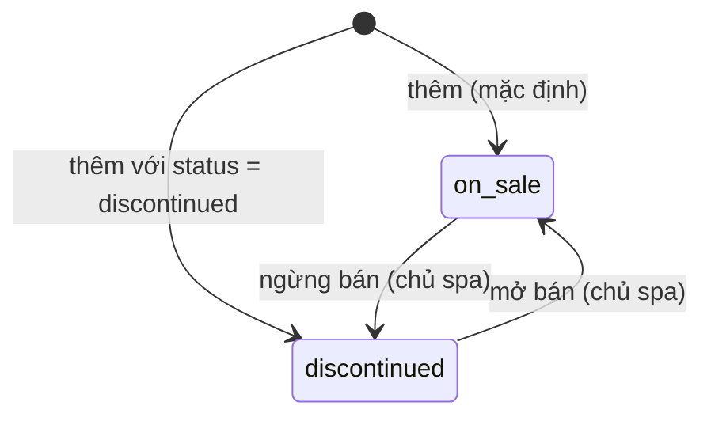

# Dịch vụ & gói dịch vụ — đặc tả

- **Nhóm:** `Services`, `ServicePackages` · **Sprint:** 1 · **Nguồn:** DA §2.2.3 (UC Tìm kiếm, UC Quản lý dịch vụ) / ĐX (UC-SPA-07 chưa có bảng kịch bản trong DA)
- **Entity:** `SpaService` (bảng `spa_services`), `ServicePackage` (bảng `service_packages`), `ServicePackageItem` (bảng `service_package_items`) — xem [glossary](../domain/glossary.md), [data-model](../domain/data-model.md)
- **Trạng thái triển khai:** xem [progress.md](../progress.md)
- **Đã đặc tả:** UC-SPA-06, 07, 09 (chỉ backend), kèm ảnh dịch vụ và gói trên Cloudinary. UC-SPA-08 (giới thiệu spa) viết sau.

## Use case

### UC-SPA-06 — Tìm kiếm dịch vụ và gói dịch vụ

| Mục            | Nội dung                                                                                                                   |
| -------------- | -------------------------------------------------------------------------------------------------------------------------- |
| Actor          | Khách vãng lai, Khách hàng (Nhân viên và Chủ spa cũng gọi được; chủ spa có thêm bộ lọc trạng thái, dùng cho SCR-W31/W32)   |
| Mô tả          | Tìm dịch vụ lẻ và gói đang bán theo từ khóa, loại dịch vụ, khoảng giá; kết quả phân trang                                  |
| Tiền điều kiện | Không                                                                                                                      |
| Input          | `search` (tùy chọn), `category` (chỉ dịch vụ), `minPrice`, `maxPrice`, `pageNumber`, `pageSize`, `sortBy`, `sortDirection` |
| Output         | `PagedResult` dòng dịch vụ hoặc dòng gói; danh sách loại dịch vụ; tối đa 8 gợi ý                                           |

**Luồng chính**

1. Actor mở trang dịch vụ hoặc gói; client gọi `GET /services` hoặc `GET /packages`, và `GET /service-categories` để dựng bộ lọc.
2. Hệ thống chỉ lấy mục khách được thấy (BR-CAT-01).
3. Có `search` → bỏ khoảng trắng hai đầu, so khớp **chứa chuỗi**, không phân biệt hoa thường và dấu (BR-CAT-05) với `name` (dịch vụ: thêm `category`; gói: chỉ `name`).
4. Có `category` → so khớp **bằng nhau**, không phân biệt hoa thường và dấu. Gói không có danh mục (RS-14), nên `/packages` không nhận `category`.
5. Có `minPrice`/`maxPrice` → lọc `minPrice ≤ price ≤ maxPrice`.
6. Sắp theo `sortBy` (`name` mặc định, hoặc `price`), `sortDirection` (`asc` mặc định); cùng giá trị thì sắp tiếp theo `name` rồi `id` để phân trang ổn định.
7. Trả trang kết quả.

**Luồng rẽ nhánh**

- A1. **Gợi ý khi nhập:** từ khóa ≥ 2 ký tự (sau khi bỏ khoảng trắng) → `GET /catalog/suggestions` trả tối đa 8 mục gồm cả dịch vụ và gói khách được thấy; mục có tên **bắt đầu bằng** từ khóa xếp trước, sau đó theo tên.
- A2. **Xóa bộ lọc:** xử lý ở client (gọi lại không tham số).
- A3. **Hỏi trợ lý AI:** thuộc UC-SPA-32, ngoài phạm vi.
- A4. **Chủ spa** gọi `GET /services`/`GET /packages` với `status=on_sale|discontinued` → lọc theo trạng thái; bỏ trống → mọi trạng thái; không áp điều kiện ngày bán. Người gọi không phải chủ spa: `status` bị bỏ qua (không báo lỗi).

**Ngoại lệ**

- E1. Không có kết quả → `200` với `items` rỗng, `totalCount = 0`.
- E2. `sortBy` khác `name`/`price`, `sortDirection` sai, giá âm, `minPrice > maxPrice`, `search` dài hơn 100 ký tự, `status` sai giá trị → `400 validation_error` theo trường.
- E3. Gợi ý với từ khóa dưới 2 ký tự → `400 validation_error` (trường `search`).
- E4. Lọc "chỉ dịch vụ đã từng sử dụng" (DA bước 3, 7) → **chưa làm**, cần đơn hàng (Sprint 2).

**Quy tắc áp dụng:** BR-CAT-01, BR-CAT-04, BR-CAT-05.

### UC-SPA-07 — Xem chi tiết dịch vụ, gói dịch vụ

| Mục            | Nội dung                                                                                               |
| -------------- | ------------------------------------------------------------------------------------------------------ |
| Actor          | Khách vãng lai, Khách hàng (Chủ spa xem được cả mục ngừng bán)                                         |
| Mô tả          | Xem mô tả, giá, thời lượng, ảnh; với gói: thời hạn, tổng số buổi và các dịch vụ thành phần theo thứ tự |
| Tiền điều kiện | Không                                                                                                  |
| Input          | `id` của dịch vụ hoặc gói                                                                              |
| Output         | Chi tiết dịch vụ, hoặc chi tiết gói kèm `items` sắp theo `sortOrder`                                   |

**Luồng chính**

1. Client gọi `GET /services/{id}` hoặc `GET /packages/{id}`.
2. Hệ thống kiểm tra mục tồn tại và khách được thấy (BR-CAT-01).
3. Dịch vụ: trả `id, name, category, description, price, durationMinutes, imageUrl, status`.
4. Gói: trả thông tin gói, `totalSessions` (tổng `session_count`), `imageUrl` (có ảnh dự phòng, BR-CAT-07) và `items[]` theo `sort_order`: `spaServiceId, serviceName, serviceImageUrl, serviceStatus, sessionCount, sortOrder, minDaysBetweenSessions, note`.

**Luồng rẽ nhánh**

- A1. Chưa đăng nhập mà chọn Thêm vào giỏ/Đặt ngay → xử lý ở client (UC-SPA-02 A1), ngoài phạm vi.
- A2. Gói đang bán có dịch vụ thành phần đã ngừng bán → gói vẫn hiển thị, dòng đó có `serviceStatus = "discontinued"` (Q-14).

**Ngoại lệ**

- E1. Không tồn tại, hoặc khách không được thấy (ngừng bán, gói ngoài thời gian bán) → `404 service_not_found` / `404 package_not_found`, cùng thông điệp cho cả hai trường hợp (không tiết lộ mục có tồn tại).
- E2. `id` không phải GUID → `404` (route constraint `{id:guid}`).

Điểm đánh giá trung bình (DA bước 4) để lại cho UC-SPA-29.

**Quy tắc áp dụng:** BR-CAT-01, BR-CAT-07.

### UC-SPA-09 — Quản lý dịch vụ và gói dịch vụ

| Mục            | Nội dung                                                                                                                     |
| -------------- | ---------------------------------------------------------------------------------------------------------------------------- |
| Actor          | Chủ spa                                                                                                                      |
| Mô tả          | Thêm, sửa, ngừng bán / mở bán dịch vụ và gói; tải, thay, xóa ảnh                                                             |
| Tiền điều kiện | Đã đăng nhập, `role = owner` (quyền `catalog.manage`)                                                                        |
| Input          | Thông tin dịch vụ hoặc gói; với gói: danh sách dịch vụ thành phần (dịch vụ, số buổi, thứ tự, khoảng cách tối thiểu, ghi chú) |
| Output         | Dịch vụ/gói được lưu; trạng thái được cập nhật; URL ảnh                                                                      |

**Luồng chính — thêm dịch vụ**

1. Chủ spa gửi `POST /services` với `name, category, description?, durationMinutes, price, status?` (`status` mặc định `on_sale`).
2. Hệ thống kiểm tra dữ liệu (BR-CAT-02), chuẩn hóa `category` (BR-CAT-04), lưu.
3. Trả `201` kèm header `Location` và chi tiết dịch vụ.

**Luồng chính — thêm gói**

1. Chủ spa gửi `POST /packages` với `name, description?, price, validityDays, saleStartDate?, saleEndDate?, status?` và `items[]` gồm `spaServiceId, sessionCount, sortOrder, minDaysBetweenSessions, note?`.
2. Hệ thống kiểm tra dữ liệu (BR-CAT-02); mọi `spaServiceId` phải tồn tại và đang bán (BR-CAT-06).
3. Lưu gói và các dòng thành phần trong một lần lưu (`IUnitOfWork`); trả `201` kèm `Location` và chi tiết gói.

**Luồng rẽ nhánh**

- A1. **Sửa dịch vụ:** `PUT /services/{id}` với `name, category, description?, durationMinutes, price` (không đổi trạng thái, không đổi ảnh) → `200` chi tiết mới.
- A2. **Sửa gói:** `PUT /packages/{id}` với đủ trường như khi thêm (trừ `status`), `items[]` **thay toàn bộ** danh sách cũ trong cùng giao dịch → `200` chi tiết mới. Dịch vụ đã nằm trong gói từ trước mà nay ngừng bán được giữ lại; chỉ dịch vụ **mới thêm** vào gói phải đang bán (BR-CAT-06).
- A3. **Ngừng bán / mở bán:** `PATCH /services/{id}/status` hoặc `/packages/{id}/status` với `{ status: "on_sale" | "discontinued" }` → `204`. Đặt lại trạng thái đang có cũng trả `204`. Ngừng bán dịch vụ đang nằm trong gói đang bán vẫn được (Q-14). Mở bán lại gói không kiểm tra lại dịch vụ thành phần.
- A4. **Tải hoặc thay ảnh:** `POST /services/{id}/image` hoặc `/packages/{id}/image`, `multipart/form-data`, field `file` → kiểm tra file (BR-CAT-08), upload lên Cloudinary, upload thành công mới lưu `image_url` → `200 { imageUrl }`. Được làm với cả mục đang ngừng bán.
- A5. **Xóa ảnh:** `DELETE /services/{id}/image` hoặc `/packages/{id}/image` → xóa ảnh trên Cloudinary rồi đặt `image_url = null` → `204`. Mục chưa có ảnh → `204`, không gọi Cloudinary.

**Ngoại lệ**

- E1. Dữ liệu không hợp lệ (BR-CAT-02), file ảnh sai (BR-CAT-08) → `400 validation_error` theo trường.
- E2. `spaServiceId` trong `items` không tồn tại → `400 package_service_not_found`; đang ngừng bán (và mới thêm vào gói) → `400 package_service_discontinued`. Thông điệp nêu tên/thứ tự dòng lỗi.
- E3. Sửa, đổi trạng thái, tải/xóa ảnh cho mục không tồn tại → `404 service_not_found` / `404 package_not_found`.
- E4. Chưa đăng nhập → `401 unauthorized`; đăng nhập nhưng không phải chủ spa → `403 forbidden`.
- E5. Thiếu cấu hình Cloudinary, Cloudinary lỗi hoặc quá thời gian chờ → `503 image_storage_unavailable`, thông điệp chung; chi tiết chỉ ghi log; `image_url` giữ nguyên.
- E6. Request vượt giới hạn cứng của endpoint ảnh (10 MB) → `413 request_too_large` dạng envelope, không đọc hết file vào bộ nhớ.
- E7. Không có endpoint xóa dịch vụ hoặc gói (BR-CAT-03).

**Quy tắc áp dụng:** BR-CAT-02, 03, 04, 06, 08, 09, BR-SEC-RBAC (`catalog.manage`).

## Business rules

| Mã        | Quy tắc                                                                                                                                                                                                                                                                                                                                                                                                                 | Enforce ở đâu                                                                          | Nguồn               |
| --------- | ----------------------------------------------------------------------------------------------------------------------------------------------------------------------------------------------------------------------------------------------------------------------------------------------------------------------------------------------------------------------------------------------------------------------- | -------------------------------------------------------------------------------------- | ------------------- |
| BR-CAT-01 | Người gọi không phải chủ spa (khách vãng lai, khách hàng, nhân viên) chỉ thấy mục `status = on_sale`; với gói thêm điều kiện "hôm nay" (giờ `Asia/Ho_Chi_Minh`, từ `IDateTimeProvider`) nằm trong `[sale_start_date, sale_end_date]`, đầu nào null thì không giới hạn đầu đó. Áp dụng cho danh sách, chi tiết, gợi ý, loại dịch vụ. Chủ spa thấy mọi mục                                                                | Application (truy vấn)                                                                 | DA                  |
| BR-CAT-02 | `duration_minutes` 1–1440; `price` số nguyên 0–999 999 999 999 (VND, không phần lẻ); `validity_days` 1–3650; `session_count` 1–100; `sort_order` 1–100; `min_days_between_sessions` 0–365; `sale_end_date ≥ sale_start_date` khi cả hai có. Tên 1–150 ký tự, `category` 1–100, `description` ≤ 4000, `note` ≤ 1000. Gói có 1–20 dòng thành phần; `sort_order` không trùng và `spa_service_id` không trùng trong một gói | Validator + CSDL (`CHECK` có sẵn; **thêm** 2 unique index cho `service_package_items`) | DA + ĐX (biên trên) |
| BR-CAT-03 | Không xóa dịch vụ/gói, chỉ đổi trạng thái. Sửa dịch vụ/gói không làm đổi `order_items`, `customer_packages`, `treatment_sessions` đã có (các bảng này lưu bản chụp tên, giá; FK `RESTRICT`)                                                                                                                                                                                                                             | API (không có DELETE) + CSDL                                                           | DA                  |
| BR-CAT-04 | `category` khi lưu: bỏ khoảng trắng hai đầu, gộp chuỗi khoảng trắng thành một dấu cách; nếu đã có dịch vụ khác mang loại trùng (không phân biệt hoa thường và dấu) thì lưu đúng cách viết đã có. Toàn bộ logic nằm trong một thành phần riêng (`ServiceCategoryResolver`) để sau này chuyển sang bảng danh mục                                                                                                          | Application                                                                            | Quyết định của bạn  |
| BR-CAT-05 | Tìm kiếm và so khớp loại không phân biệt hoa thường và dấu ("cham soc da" khớp "Chăm sóc da") bằng extension `unaccent` của PostgreSQL qua hàm `IMMUTABLE` `f_unaccent`; ký tự `%`, `_`, `\` trong từ khóa được escape                                                                                                                                                                                                  | Infrastructure (repository, migration)                                                 | Quyết định của bạn  |
| BR-CAT-06 | Không thêm dịch vụ đang ngừng bán vào gói (khi tạo gói, hoặc dịch vụ mới thêm khi sửa gói)                                                                                                                                                                                                                                                                                                                              | Application                                                                            | Quyết định của bạn  |
| BR-CAT-07 | `imageUrl` của gói khi trả về: `service_packages.image_url` nếu có; không thì ảnh của dịch vụ thành phần đầu tiên theo `sort_order` có ảnh; không có thì `null`. Chỉ tính lúc đọc, không ghi vào CSDL                                                                                                                                                                                                                   | Application/Infrastructure (truy vấn)                                                  | Quyết định của bạn  |
| BR-CAT-08 | Ảnh: bắt buộc có file, kích thước 1 byte – `ImageUpload:MaxBytes` (mặc định 5 MB); chỉ JPEG (`FF D8 FF`), PNG (`89 50 4E 47 0D 0A 1A 0A`), WebP (`RIFF....WEBP`) xác định bằng magic bytes, không tin đuôi file hay `Content-Type`. Kiểm tra xong mới gửi Cloudinary                                                                                                                                                    | Application (một chỗ cho cả dịch vụ và gói)                                            | Quyết định của bạn  |
| BR-CAT-09 | Ảnh lưu với `public_id` cố định `{Cloudinary:Folder}/services/{id}` hoặc `{Cloudinary:Folder}/packages/{id}`, upload `overwrite = true`, `invalidate = true`; `image_url` lưu `secure_url` (có version). Upload lỗi → giữ ảnh cũ. Xóa: Cloudinary trả "not found" coi như đã xóa                                                                                                                                        | Infrastructure `CloudinaryFileStorage` + Application                                   | Quyết định của bạn  |

**Phân quyền** (theo bảng RBAC sheet `21`): `catalog.view` = mọi người kể cả chưa đăng nhập → các endpoint GET để `[AllowAnonymous]`; Bearer hợp lệ của chủ spa bật chế độ xem của chủ spa, Bearer sai hoặc hết hạn trên endpoint GET được coi như khách. `catalog.manage` = `owner` → policy tên `catalog.manage`. Tên quyền và vai trò gom vào một bảng trong code để các UC sau thêm quyền mới (`staff.manage`, `bookings.manage`…) theo cùng cách.

## Trạng thái

Áp dụng giống nhau cho dịch vụ và gói (WF-09). Enum `CatalogStatus`: `on_sale` (DangBan), `discontinued` (NgungBan).

## Dữ liệu

| Bảng                                                                                              | Cột dùng                                                                                         | Thay đổi                                                                                                                                                                       |
| ------------------------------------------------------------------------------------------------- | ------------------------------------------------------------------------------------------------ | ------------------------------------------------------------------------------------------------------------------------------------------------------------------------------ |
| `spa_services`                                                                                    | `id, name, category, description, duration_minutes, price, image_url, status`, audit             | Thêm index GIN trigram trên `f_unaccent(lower(name))`                                                                                                                          |
| `service_packages`                                                                                | `id, name, description, price, validity_days, status, sale_start_date, sale_end_date`, audit     | **Thêm cột `image_url varchar(500) NULL`** (DA `HinhAnh`, ERD `GoiDichVu.hinhAnh`); index GIN trigram trên `f_unaccent(lower(name))`                                           |
| `service_package_items`                                                                           | `spa_service_id, service_package_id, session_count, min_days_between_sessions, sort_order, note` | **Thêm** unique `(service_package_id, sort_order)` và unique `(service_package_id, spa_service_id)`. Sửa gói xóa cứng dòng cũ rồi tạo lại (không bảng nào tham chiếu bảng này) |
| `order_items`, `customer_packages`, `treatment_sessions`, `cart_items`, `staff_skills`, `reviews` | Chỉ đọc trong test BR-CAT-03; FK tới dịch vụ/gói giữ `RESTRICT`                                  | Không đổi                                                                                                                                                                      |

Migration mới (2 migration): (1) `AddServicePackageImageAndItemUniqueness`: cột ảnh gói + unique `ux_service_package_items_service_package_id_sort_order`, `ux_service_package_items_service_package_id_spa_service_id`; (2) `AddCatalogUnaccentSearch`: extension `unaccent`, `pg_trgm`, hàm `public.f_unaccent(text)` `IMMUTABLE` và index GIN trigram `ix_spa_services_name_unaccent_trgm`, `ix_service_packages_name_unaccent_trgm` (SQL thủ công qua `migrationBuilder.Sql`). Đổi schema đi kèm: sửa `docs/spec-source/data_db.py` (cột `image_url` tên DA `HinhAnh`, ràng buộc `UQ`), sinh lại `data-model.md` và file Excel, thêm `hinhAnh` vào `ERD["GoiDichVu"]` trong `build_vi_db.py`, sinh lại `docs/export/NhuNguyetSpa_CSDL_TiengViet.sql`.

## API

Tiền tố `/api/v1`, envelope `{ success, message, data, errors, traceId }`. Phân trang dùng `PagedQuery` có sẵn: `pageNumber` (≥ 1, mặc định 1), `pageSize` (1–100, mặc định 10, ngoài khoảng bị kẹp), `search`, `sortBy`, `sortDirection` (`asc`/`desc`). Giá là số nguyên VND; ngày `yyyy-MM-dd`.

| Method | Đường dẫn               | Vai trò   | Request                                                                                                                                                                 | Response                                                                                                                                                                                                                                                                     | Lỗi                                                                                             |
| ------ | ----------------------- | --------- | ----------------------------------------------------------------------------------------------------------------------------------------------------------------------- | ---------------------------------------------------------------------------------------------------------------------------------------------------------------------------------------------------------------------------------------------------------------------------- | ----------------------------------------------------------------------------------------------- |
| GET    | `/services`             | Mọi người | `?search&category&minPrice&maxPrice&pageNumber&pageSize&sortBy=name\|price&sortDirection&status` (`status` chỉ chủ spa)                                                 | 200 `PagedResult<{ id, name, category, price, durationMinutes, imageUrl, status }>`                                                                                                                                                                                          | 400 `validation_error`                                                                          |
| GET    | `/services/{id}`        | Mọi người | —                                                                                                                                                                       | 200 `{ id, name, category, description, price, durationMinutes, imageUrl, status, createdAtUtc, updatedAtUtc }`                                                                                                                                                              | 404 `service_not_found`                                                                         |
| GET    | `/service-categories`   | Mọi người | —                                                                                                                                                                       | 200 `string[]` không trùng, sắp theo tên (khách: chỉ loại có ≥ 1 dịch vụ `on_sale`; chủ spa: mọi loại)                                                                                                                                                                       | —                                                                                               |
| GET    | `/packages`             | Mọi người | `?search&minPrice&maxPrice&pageNumber&pageSize&sortBy=name\|price&sortDirection&status`                                                                                 | 200 `PagedResult<{ id, name, price, validityDays, totalSessions, imageUrl, status, saleStartDate, saleEndDate }>`                                                                                                                                                            | 400 `validation_error`                                                                          |
| GET    | `/packages/{id}`        | Mọi người | —                                                                                                                                                                       | 200 `{ id, name, description, price, validityDays, totalSessions, imageUrl, status, saleStartDate, saleEndDate, createdAtUtc, updatedAtUtc, items: [{ spaServiceId, serviceName, serviceImageUrl, serviceStatus, sessionCount, sortOrder, minDaysBetweenSessions, note }] }` | 404 `package_not_found`                                                                         |
| GET    | `/catalog/suggestions`  | Mọi người | `?search` (≥ 2 ký tự)                                                                                                                                                   | 200 `[{ type: "service" \| "package", id, name, imageUrl }]` (≤ 8, chỉ mục khách được thấy)                                                                                                                                                                                  | 400 `validation_error`                                                                          |
| POST   | `/services`             | Chủ spa   | `{ name, category, description?, durationMinutes, price, status? }`                                                                                                     | 201 + `Location`, chi tiết dịch vụ                                                                                                                                                                                                                                           | 400, 401, 403                                                                                   |
| PUT    | `/services/{id}`        | Chủ spa   | `{ name, category, description?, durationMinutes, price }`                                                                                                              | 200 chi tiết dịch vụ                                                                                                                                                                                                                                                         | 400, 401, 403, 404                                                                              |
| PATCH  | `/services/{id}/status` | Chủ spa   | `{ status: "on_sale" \| "discontinued" }`                                                                                                                               | 204                                                                                                                                                                                                                                                                          | 400, 401, 403, 404                                                                              |
| POST   | `/services/{id}/image`  | Chủ spa   | `multipart/form-data`, field `file`                                                                                                                                     | 200 `{ imageUrl }`                                                                                                                                                                                                                                                           | 400 `validation_error`, 401, 403, 404, 413 `request_too_large`, 503 `image_storage_unavailable` |
| DELETE | `/services/{id}/image`  | Chủ spa   | —                                                                                                                                                                       | 204                                                                                                                                                                                                                                                                          | 401, 403, 404, 503                                                                              |
| POST   | `/packages`             | Chủ spa   | `{ name, description?, price, validityDays, saleStartDate?, saleEndDate?, status?, items: [{ spaServiceId, sessionCount, sortOrder, minDaysBetweenSessions, note? }] }` | 201 + `Location`, chi tiết gói                                                                                                                                                                                                                                               | 400 `validation_error`/`package_service_not_found`/`package_service_discontinued`, 401, 403     |
| PUT    | `/packages/{id}`        | Chủ spa   | như POST, không có `status`; `items` thay toàn bộ                                                                                                                       | 200 chi tiết gói                                                                                                                                                                                                                                                             | như POST, thêm 404                                                                              |
| PATCH  | `/packages/{id}/status` | Chủ spa   | `{ status }`                                                                                                                                                            | 204                                                                                                                                                                                                                                                                          | 400, 401, 403, 404                                                                              |
| POST   | `/packages/{id}/image`  | Chủ spa   | `multipart/form-data`, field `file`                                                                                                                                     | 200 `{ imageUrl }`                                                                                                                                                                                                                                                           | như ảnh dịch vụ, 404 `package_not_found`                                                        |
| DELETE | `/packages/{id}/image`  | Chủ spa   | —                                                                                                                                                                       | 204                                                                                                                                                                                                                                                                          | 401, 403, 404, 503                                                                              |

- Lỗi kiểm tra file ảnh trả 400 `Validation failed.`, `errors[]` có `field = "file"` và mã `image_required`, `image_too_large`, `image_type_not_supported`.
- Lỗi tham số danh sách (`sortBy`, `sortDirection`, `search`, `status`) có `errors[].code = validation_error`. Lỗi theo trường của body (FluentValidation) giữ mã theo quy tắc như các API auth hiện có (ví dụ `InclusiveBetweenValidator`); FE xử lý theo HTTP 400 và `field`.
- `GET /service-categories` thay cho `/service-types` trong `data_api.py` (sửa dòng đó tại chỗ). Hai endpoint ảnh gói và hai endpoint xóa ảnh thêm **cuối** danh sách để giữ mã `SPA-API-xxx` cũ.
- Thêm `packages/shared-types`, `api-client` **không** làm lần này (chỉ backend).

## Ảnh và Cloudinary

- Port `IFileStorage` ở Application (không phụ thuộc ASP.NET): `Task<string> UploadImageAsync(Stream content, string publicId, string contentType, CancellationToken)` trả URL; `Task DeleteAsync(string publicId, CancellationToken)`. `publicId` do Application truyền là đường dẫn tương đối (`services/{id}`); adapter ghép thư mục gốc `Cloudinary:Folder`. Controller chuyển `IFormFile` thành stream, không để `IFormFile` đi qua controller.
- `CloudinaryFileStorage` (Infrastructure, package `CloudinaryDotNet` bản ổn định phát hành ≥ 2 tuần, không có cảnh báo bảo mật) đọc cấu hình mỗi lần gọi; thiếu `CloudName`/`ApiKey`/`ApiSecret` → log lỗi cấu hình (không log giá trị) và ném `503 image_storage_unavailable`. Lỗi mạng, timeout, Cloudinary trả lỗi → log loại lỗi và thông điệp, ném 503.
- Endpoint ảnh có `[RequestSizeLimit(10 MB)]` và `[RequestFormLimits(MultipartBodyLengthLimit = 10 MB)]`; vượt → `413 request_too_large`. Giới hạn nghiệp vụ `ImageUpload:MaxBytes` (mặc định 5 MB) phải ≤ 10 MB.

## Cấu hình

| Biến `.env`             | Khóa cấu hình               | Mặc định (`appsettings.json`)                     |
| ----------------------- | --------------------------- | ------------------------------------------------- |
| `CLOUDINARY_CLOUD_NAME` | `Cloudinary:CloudName`      | — (bắt buộc cho endpoint ảnh)                     |
| `CLOUDINARY_API_KEY`    | `Cloudinary:ApiKey`         | — (bắt buộc cho endpoint ảnh)                     |
| `CLOUDINARY_API_SECRET` | `Cloudinary:ApiSecret`      | — (bắt buộc, chỉ ở `.env`, không bao giờ ghi log) |
| — (`appsettings.json`)  | `Cloudinary:Folder`         | `nhunguyetspa`                                    |
| — (`appsettings.json`)  | `Cloudinary:TimeoutSeconds` | `30`                                              |
| — (`appsettings.json`)  | `ImageUpload:MaxBytes`      | `5242880` (5 MB)                                  |

`.env.example` ghi cách lấy key: đăng nhập Cloudinary → Settings → API Keys (Cloud name ở Dashboard). Thiếu cấu hình Cloudinary không chặn API khởi động; chỉ 4 endpoint ảnh trả 503. Test factory luôn đặt 3 khóa Cloudinary thành rỗng và thay `IFileStorage` bằng `FakeFileStorage`.

## Kiểm thử bắt buộc

Unit test (Application) dùng NSubstitute và đồng hồ giả; integration test dùng `PostgresFixture` (Testcontainers) và factory có `FakeFileStorage`.

| Mã      | Tình huống                                                                                                                                                        | Kết quả mong đợi                                                                                                                                                     |
| ------- | ----------------------------------------------------------------------------------------------------------------------------------------------------------------- | -------------------------------------------------------------------------------------------------------------------------------------------------------------------- |
| CAT-T01 | Khách gọi `GET /services` khi có dịch vụ `on_sale` và `discontinued`                                                                                              | Chỉ có mục `on_sale`; tham số `status=discontinued` bị bỏ qua                                                                                                        |
| CAT-T02 | Chủ spa gọi `GET /services` không có / có `status=discontinued`                                                                                                   | Thấy mọi mục / chỉ mục ngừng bán                                                                                                                                     |
| CAT-T03 | Gói `on_sale` với `sale_start_date` = mai, `sale_end_date` = hôm qua, cả hai null, đúng hôm nay (đồng hồ giả lúc 23:30 UTC = 06:30 hôm sau giờ VN)                | Khách chỉ thấy gói trong khoảng theo **ngày VN**; chủ spa thấy tất cả                                                                                                |
| CAT-T04 | Tìm `search=cham soc da` và `search=CHĂM` khi có "Chăm sóc da mặt"                                                                                                | Cả hai tìm ra; `search=%` không khớp mọi dòng                                                                                                                        |
| CAT-T05 | Lọc `category=cham soc da`, `minPrice`, `maxPrice`; `minPrice > maxPrice`; giá âm                                                                                 | Lọc đúng; hai trường hợp sau `400 validation_error`                                                                                                                  |
| CAT-T06 | Sắp `sortBy=price&sortDirection=desc`; `sortBy=rating`                                                                                                            | Thứ tự đúng, phân trang ổn định; `400 validation_error`                                                                                                              |
| CAT-T07 | Phân trang `pageNumber=2&pageSize=2` trên 5 mục                                                                                                                   | `items` 2 mục, `totalCount = 5`, `totalPages = 3`                                                                                                                    |
| CAT-T08 | `GET /service-categories` khi có loại chỉ chứa dịch vụ ngừng bán                                                                                                  | Khách không thấy loại đó; chủ spa thấy; không trùng, sắp theo tên                                                                                                    |
| CAT-T09 | `GET /catalog/suggestions?search=ch` có 10 mục khớp gồm cả dịch vụ và gói; `search=c`                                                                             | Tối đa 8, có cả `service` và `package`, mục bắt đầu bằng từ khóa đứng trước, không có mục khách không được thấy; `search=c` → 400                                    |
| CAT-T10 | Khách xem chi tiết dịch vụ ngừng bán / gói ngoài thời gian bán / id không tồn tại                                                                                 | `404 service_not_found` / `404 package_not_found`, cùng thông điệp; chủ spa xem được mục ngừng bán (200)                                                             |
| CAT-T11 | Chi tiết gói có 3 dòng nhập theo thứ tự 3, 1, 2                                                                                                                   | `items` theo `sortOrder` 1, 2, 3; `totalSessions` = tổng `sessionCount`                                                                                              |
| CAT-T12 | Ảnh dự phòng của gói: gói có ảnh / gói không ảnh, dịch vụ thứ tự 1 không ảnh, thứ tự 2 có ảnh / không dịch vụ nào có ảnh                                          | Ảnh gói / ảnh dịch vụ thứ tự 2 / `null`, ở cả danh sách và chi tiết; `service_packages.image_url` vẫn null trong CSDL                                                |
| CAT-T13 | Chủ spa tạo dịch vụ hợp lệ                                                                                                                                        | 201, header `Location` trỏ `/api/v1/services/{id}`, `status = on_sale`; audit `created_by` = id chủ spa                                                              |
| CAT-T14 | Dữ liệu biên dịch vụ: `durationMinutes` 0, `price` -1, `price` 1.5, tên rỗng, tên 151 ký tự                                                                       | `400 validation_error` theo từng trường                                                                                                                              |
| CAT-T15 | Tạo dịch vụ với `category = "  cham   soc DA "` khi đã có "Chăm sóc da"; và `"Massage  body"` khi chưa có                                                         | Lưu "Chăm sóc da" / "Massage body"                                                                                                                                   |
| CAT-T16 | Khách hàng và nhân viên gọi POST/PUT/PATCH/ảnh; không có Bearer                                                                                                   | `403 forbidden` / `401 unauthorized`, dạng envelope                                                                                                                  |
| CAT-T17 | Tạo gói hợp lệ 2 dịch vụ                                                                                                                                          | 201, gói và 2 dòng thành phần được lưu cùng lúc                                                                                                                      |
| CAT-T18 | Gói không có dòng; `sortOrder` trùng; cùng dịch vụ 2 lần; `sessionCount` 0; `minDaysBetweenSessions` -1; `validityDays` 0; `saleEndDate < saleStartDate`; 21 dòng | `400 validation_error` theo trường; không lưu gì                                                                                                                     |
| CAT-T19 | Gói chứa `spaServiceId` không tồn tại / dịch vụ ngừng bán                                                                                                         | `400 package_service_not_found` / `400 package_service_discontinued`                                                                                                 |
| CAT-T20 | Sửa gói: thay danh sách 3 dòng bằng 2 dòng khác; giữ lại dịch vụ đã trong gói mà nay ngừng bán                                                                    | 200, CSDL chỉ còn 2 dòng mới; dịch vụ ngừng bán đã có được giữ, không lỗi                                                                                            |
| CAT-T21 | Ràng buộc CSDL: chèn trực tiếp 2 dòng cùng `(service_package_id, sort_order)` / cùng `(service_package_id, spa_service_id)`                                       | `DbUpdateException` do unique index                                                                                                                                  |
| CAT-T22 | Ngừng bán rồi mở bán dịch vụ và gói; đặt lại trạng thái đang có; `status` sai giá trị                                                                             | 204, khách lần lượt không thấy rồi thấy lại; 204; `400 validation_error`                                                                                             |
| CAT-T23 | BR-CAT-03: có `order_items` tham chiếu dịch vụ (tên, giá lúc mua); sửa tên và giá dịch vụ; gọi `DELETE /services/{id}`                                            | `order_items.product_name`, `unit_price` không đổi; DELETE → 405, dịch vụ vẫn còn                                                                                    |
| CAT-T24 | Tải ảnh JPEG, PNG, WebP hợp lệ cho dịch vụ và gói                                                                                                                 | 200 `{ imageUrl }`; `FakeFileStorage` nhận `publicId` `services/{id}` / `packages/{id}`, đúng content type; `image_url` được lưu                                     |
| CAT-T25 | File GIF đổi đuôi `.jpg` và `Content-Type: image/jpeg`; file văn bản; file rỗng; không có field `file`; file 5 MB + 1 byte                                        | `400 validation_error`, mã `image_type_not_supported` / `image_type_not_supported` / `image_required` / `image_required` / `image_too_large`; storage không được gọi |
| CAT-T26 | Storage ném lỗi khi thay ảnh đang có                                                                                                                              | `503 image_storage_unavailable`, thông điệp chung; `image_url` giữ URL cũ                                                                                            |
| CAT-T27 | Xóa ảnh khi có ảnh / khi chưa có ảnh                                                                                                                              | 204 và `image_url = null`, storage được gọi `DeleteAsync` / 204, storage không được gọi                                                                              |
| CAT-T28 | Thiếu cấu hình Cloudinary (dùng `CloudinaryFileStorage` thật, khóa rỗng)                                                                                          | API khởi động, `/health/live` 200, GET danh mục 200; upload `503 image_storage_unavailable`; log và phản hồi không chứa API secret                                   |
| CAT-T29 | Magic bytes (unit, `[Theory]`): đủ 3 định dạng, `RIFF` không có `WEBP`, PNG thiếu byte, file < 12 byte                                                            | Nhận đúng 3 định dạng hợp lệ, từ chối phần còn lại                                                                                                                   |
| CAT-T30 | `ServiceCategoryResolver` (unit): chuẩn hóa khoảng trắng, dùng lại cách viết có sẵn, không gọi CSDL khi chuỗi rỗng                                                | Đúng như BR-CAT-04                                                                                                                                                   |
| CAT-T31 | Cloudinary thật (thủ công, sau khi code xong): tải, thay, xóa ảnh cho 1 dịch vụ và 1 gói                                                                          | URL mới có version khác; ảnh cũ không còn sau khi thay (cùng `public_id`); sau xóa URL trả 404 trên Cloudinary; ghi kết quả                                          |
| CAT-T32 | Hồi quy UC-SPA-01/02/03                                                                                                                                           | Toàn bộ test hiện có vẫn pass                                                                                                                                        |

## Câu hỏi còn mở

- Q-13 (mới): Có tách bảng danh mục dịch vụ (`service_categories` + `category_id`) không? Mặc định: **text tự do, chuẩn hóa khi lưu** (BR-CAT-04).
- Q-14 (mới): Gói đang bán có dịch vụ thành phần bị ngừng bán thì sao? Mặc định: **gói vẫn hiển thị và bán được**, dòng thành phần có `serviceStatus = discontinued`; chủ spa tự ngừng bán gói nếu cần. Ảnh hưởng UC-SPA-06, 07, 11.
- Lọc "chỉ dịch vụ đã từng sử dụng" và điểm đánh giá trung bình: làm ở Sprint 2 / UC-SPA-29.
