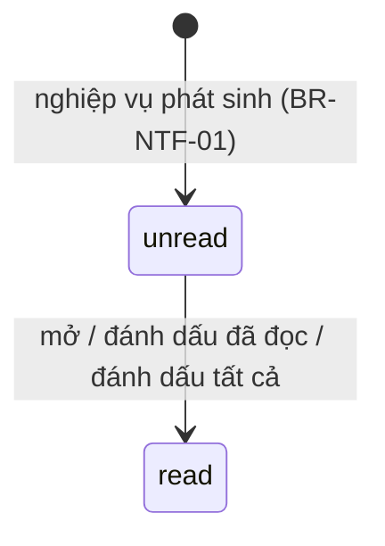

# Thông báo — đặc tả

- **Nhóm:** `Notifications` · **Sprint:** 3 · **Nguồn:** DA §2.2.3 (UC Xem thông báo), BR-NTF-01, RS-13 / ĐX
- **Entity:** `Notification` (bảng `notifications`); đọc thêm `Appointment`, `Order`, `TreatmentPlan`, `Review`, `WorkSchedule`, `User` — xem [glossary](../domain/glossary.md), [data-model](../domain/data-model.md)
- **Trạng thái triển khai:** spec duyệt và backend xong ngày 16/11/2026 theo [plan](../superpowers/plans/2026-11-16-uc-spa-34-notifications.md) — xem [progress.md](../progress.md)
- **Phạm vi lần này:** backend (API xem thông báo, phát sinh thông báo từ các nghiệp vụ đã có, job nhắc lịch, kênh realtime SignalR, test). Web (SCR-W23 + chuông ở header) và mobile (SCR-M22) làm sau theo spec này, cùng kết nối realtime qua `@microsoft/signalr`.

UC-SPA-34 chỉ là "xem", nhưng bảng `notifications` hiện chưa có dòng nào vì chưa nghiệp vụ nào ghi vào. Các mục "để sau" của nhóm khác đã hẹn làm ở đây: BKG-LATER-03, BKG-LATER-10, CARE-LATER-02, ORD-LATER-04, ORD-LATER-08, STF-LATER-02, REV-LATER-01, TRT-LATER-05 (phần thông báo). Spec này gom cả hai phần: **phát sinh** thông báo (BR-NTF-01) và **xem** thông báo (UC-SPA-34).

## Use case

### UC-SPA-34 — Xem thông báo

| Mục            | Nội dung                                                                                           |
| -------------- | -------------------------------------------------------------------------------------------------- |
| Actor          | Khách hàng, nhân viên; **thêm chủ spa** (RS-13, Q-79)                                              |
| Mô tả          | Người dùng xem các thông báo gửi đến chính mình, mở một thông báo và đánh dấu đã đọc               |
| Tiền điều kiện | Đã đăng nhập (quyền `notification.self`)                                                           |
| Input          | Bộ lọc `unreadOnly?`, `type?`, `page`, `pageSize`; thông báo được chọn                             |
| Output         | Danh sách thông báo (mới nhất trước), nội dung thông báo, trạng thái đã đọc, số thông báo chưa đọc |

**Luồng chính**

1. Người dùng mở mục thông báo (SCR-W23 / SCR-M22); client gọi `GET /me/notifications?page&pageSize`. Chuông ở header gọi `GET /me/notifications/unread-count` để hiện số chưa đọc.
2. Hệ thống lấy thông báo có `user_id` = người dùng của access token, mới nhất trước (`created_at_utc DESC, id DESC`), phân trang.
3. Hệ thống hiển thị danh sách: tiêu đề, nội dung, loại, thời gian, đã đọc/chưa đọc, đối tượng liên quan (`referenceType` + `referenceId`) để client mở đúng màn hình.
4. Người dùng chọn một thông báo; client gọi `GET /me/notifications/{id}` (hoặc `POST /me/notifications/{id}/read` khi chỉ cần đánh dấu rồi chuyển sang màn hình đích, Q-82).
5. Hệ thống trả nội dung và ghi `read_at_utc = now` nếu đang `null` (BR-NTF-04). Mở lại thông báo đã đọc không đổi `read_at_utc`.

**Luồng rẽ nhánh**

- A1. Không có thông báo (hoặc không có thông báo chưa đọc khi lọc `unreadOnly=true`) → `200` trang rỗng, `totalCount = 0`; client hiện trạng thái trống.
- A2. (ĐX) Đánh dấu tất cả đã đọc: `POST /me/notifications/read-all` → `204`; mọi thông báo chưa đọc **của chính người dùng** nhận `read_at_utc = now`. Không có gì để đánh dấu vẫn `204`.
- A3. (ĐX) Lọc theo loại: `type` = `appointment|payment|treatment|promotion|system`.

**Ngoại lệ**

- E1. `type` ngoài enum, `pageSize` ngoài phạm vi kẹp → kẹp theo `PagedQuery`; `type` sai → `400 validation_error`.
- E2. Thông báo không tồn tại **hoặc thuộc người khác** → `404 notification_not_found` (không lộ sự tồn tại).
- E3. Chưa đăng nhập → `401`. Mọi vai trò đều có `notification.self` nên không có `403` theo vai trò.

**Quy tắc áp dụng:** BR-NTF-01..08, RBAC `notification.self`.

### Phát sinh thông báo (BR-NTF-01)

Không phải use case riêng trong DA: các use case đã có ghi thêm dòng `notifications` **trong cùng lần lưu** với thay đổi nghiệp vụ (BR-NTF-02). Danh mục sự kiện:

| Mã      | Sự kiện (nơi phát sinh)                                                                                                                                                                                               | Người nhận                                                          | `type`                                      | Đối tượng (`reference_type`) | Tiêu đề (mẫu)                                                   | Đóng mục      |
| ------- | --------------------------------------------------------------------------------------------------------------------------------------------------------------------------------------------------------------------- | ------------------------------------------------------------------- | ------------------------------------------- | ---------------------------- | --------------------------------------------------------------- | ------------- |
| NTF-E01 | Đơn thanh toán thành công (`EntitlementIssuer`, khi đơn chuyển `paid` lần đầu)                                                                                                                                        | Khách                                                               | `payment`                                   | `order`                      | "Thanh toán thành công"                                         | ORD-LATER-04  |
| NTF-E02 | Chủ spa hủy đơn (`OrderManagementService` → `OrderCancellation`)                                                                                                                                                      | Khách                                                               | `payment`                                   | `order`                      | "Đơn hàng đã bị hủy"                                            | ORD-LATER-08  |
| NTF-E03 | Lịch hẹn được xác nhận: khách đặt từ quyền/buổi (`CustomerBookingService`), giữ chỗ "Đặt ngay" được xác nhận sau thanh toán (`EntitlementIssuer`), chủ spa xác nhận lịch chờ (`AppointmentManagementService.Confirm`) | Khách; nhân viên được phân công (NTF-E09)                           | `appointment` (`treatment` nếu là buổi gói) | `appointment`                | "Lịch hẹn đã được xác nhận"                                     | BKG-LATER-03  |
| NTF-E04 | Chủ spa đổi giờ (`Reschedule`)                                                                                                                                                                                        | Khách; nhân viên cũ và mới (nếu khác)                               | như NTF-E03                                 | `appointment`                | "Lịch hẹn đã được đổi giờ"                                      | BKG-LATER-03  |
| NTF-E05 | Chủ spa đổi nhân viên (`AssignStaff`)                                                                                                                                                                                 | Khách; nhân viên cũ (bỏ phân công); nhân viên mới                   | như NTF-E03                                 | `appointment`                | "Đổi nhân viên phục vụ"                                         | BKG-LATER-03  |
| NTF-E06 | Chủ spa hủy lịch (`Cancel`)                                                                                                                                                                                           | Khách; nhân viên được phân công                                     | như NTF-E03                                 | `appointment`                | "Lịch hẹn đã bị hủy"                                            | BKG-LATER-03  |
| NTF-E07 | Khách đổi giờ hoặc hủy lịch (`MyAppointmentService`)                                                                                                                                                                  | Mọi chủ spa đang hoạt động; nhân viên cũ và mới                     | như NTF-E03                                 | `appointment`                | "Khách đã đổi lịch hẹn" / "Khách đã hủy lịch hẹn"               | BKG-LATER-10  |
| NTF-E08 | Nhắc lịch trước giờ hẹn (job `AppointmentReminderJob`, BR-NTF-06)                                                                                                                                                     | Khách                                                               | như NTF-E03                                 | `appointment`                | "Nhắc lịch hẹn"                                                 | BR-NTF-01     |
| NTF-E09 | Nhân viên được phân công một lịch mới (đi kèm NTF-E03, khi tự chọn hoặc "bất kỳ nhân viên")                                                                                                                           | Nhân viên                                                           | `appointment`                               | `appointment`                | "Bạn có lịch hẹn mới"                                           | BR-NTF-01     |
| NTF-E10 | Buổi hoàn thành, mời đánh giá (`AppointmentCompletionService`)                                                                                                                                                        | Khách                                                               | như NTF-E03                                 | `appointment`                | "Buổi chăm sóc đã hoàn thành"                                   | CARE-LATER-02 |
| NTF-E11 | Spa phản hồi đánh giá (`ReviewManagementService.Reply`; gửi lại phản hồi cũng báo)                                                                                                                                    | Khách                                                               | `system`                                    | `review`                     | "Spa đã phản hồi đánh giá của bạn"                              | REV-LATER-01  |
| NTF-E12 | Chủ spa tạm dừng / tiếp tục / hủy / đóng liệu trình (`TreatmentManagementService`)                                                                                                                                    | Khách                                                               | `treatment`                                 | `treatment_plan`             | "Liệu trình đã tạm dừng" …                                      | TRT-LATER-05  |
| NTF-E13 | Chủ spa thêm / sửa / hủy một ca (`WorkScheduleService`)                                                                                                                                                               | Nhân viên của ca                                                    | `system`                                    | `work_schedule`              | "Bạn có ca làm mới" / "Ca làm đã thay đổi" / "Ca làm đã bị hủy" | STF-LATER-02  |
| NTF-E14 | Chủ spa thêm ca hàng loạt (`POST /work-schedules/batch`)                                                                                                                                                              | Mỗi nhân viên có ít nhất một ca được tạo: **một** thông báo tóm tắt | `system`                                    | — (null)                     | "Bạn có N ca làm mới"                                           | STF-LATER-02  |

**Không** phát sinh thông báo (Q-80): khách tự hủy đơn, đơn/giữ chỗ hết hạn, thanh toán thất bại (khách đang ở trang kết quả), đánh dấu không đến (`no_show`), khách tạo/sửa đánh giá, nhân viên lập hồ sơ da, khuyến mãi (loại `promotion` để dành, NTF-LATER-02), chủ spa nhận đơn mới (NTF-LATER-03). Người thực hiện không bao giờ nhận thông báo về hành động của chính mình (BR-NTF-03).

## Business rules

| Mã        | Quy tắc                                                                                                                                                                                                                                                                                                                                                                                                                                                                     | Enforce ở đâu                               | Nguồn          |
| --------- | --------------------------------------------------------------------------------------------------------------------------------------------------------------------------------------------------------------------------------------------------------------------------------------------------------------------------------------------------------------------------------------------------------------------------------------------------------------------------- | ------------------------------------------- | -------------- |
| BR-NTF-01 | Sự kiện tạo thông báo: danh mục NTF-E01..E14 ở trên. `read_at_utc` null = chưa đọc                                                                                                                                                                                                                                                                                                                                                                                          | Application (`NotificationPublisher`) + Job | DA + ĐX (Q-80) |
| BR-NTF-02 | Thông báo được thêm vào cùng `IUnitOfWork` và lưu **cùng một** `SaveChanges`/transaction với thay đổi nghiệp vụ: nghiệp vụ lỗi (409, 400, rollback) thì không có thông báo, và ngược lại. `NotificationPublisher` chỉ thêm entity, không tự lưu, không gọi dịch vụ ngoài                                                                                                                                                                                                    | Application                                 | ĐX             |
| BR-NTF-03 | Người nhận là `users.id` (khách: `customers.id`, nhân viên: `staff_members.id` — khóa chung với `users.id`; chủ spa: mọi user `role = owner`, `status = active`). Bỏ người thực hiện hành động; một sự kiện không tạo hai thông báo cho cùng một người (ví dụ nhân viên cũ = nhân viên mới)                                                                                                                                                                                 | Application                                 | ĐX (Q-79)      |
| BR-NTF-04 | Chỉ chủ thông báo đọc/đánh dấu được; thông báo của người khác trả `404`. Mở thông báo ghi `read_at_utc` **một lần** (`Notification.MarkRead`, không ghi đè)                                                                                                                                                                                                                                                                                                                 | Domain + Application                        | DA             |
| BR-NTF-05 | Tiêu đề ≤ 200 ký tự, nội dung là văn bản thuần tiếng Việt **chụp tại thời điểm tạo** (giờ hẹn, tên dịch vụ, tên nhân viên, mã đơn, số tiền); sau này dữ liệu gốc đổi thì thông báo cũ không đổi. Giờ hiển thị theo giờ Việt Nam `HH:mm dd/MM/yyyy`, tiền `1.250.000 đ`. Lý do hủy do chủ spa nhập được đưa vào nội dung (cắt còn 200 ký tự)                                                                                                                                 | Application (`NotificationTemplates`)       | ĐX             |
| BR-NTF-06 | Nhắc lịch: job quét mỗi `Notifications:ReminderJob:IntervalSeconds` các lịch `confirmed` có giờ bắt đầu (giờ VN) trong `(now, now + Notifications:AppointmentReminderHoursBefore]` và tạo một thông báo cho khách. Bỏ qua lịch được tạo khi đã ở trong khung nhắc (`created_at_utc > start − giờ nhắc`). Khóa chống trùng `appointment_reminder:{appointmentId}:{yyyyMMddHHmm}` → mỗi giờ hẹn nhắc đúng một lần; đổi giờ thì giờ mới được nhắc lại. `0` giờ = tắt nhắc lịch | Job + Application + CSDL UQ                 | DA + ĐX (Q-81) |
| BR-NTF-07 | Thông báo có thể trỏ tới một đối tượng (`reference_type` + `reference_id`, cùng có hoặc cùng null; không FK vì đa hình). Client tự chọn màn hình theo vai trò; đối tượng đã đổi trạng thái vẫn mở được qua API của nó                                                                                                                                                                                                                                                       | CSDL CHECK + Application                    | ĐX             |
| BR-NTF-08 | Thông báo không bị xóa và không có thời hạn lưu (NTF-LATER-04); chỉ đổi `read_at_utc`. Không gửi email cho các sự kiện này (Q-81)                                                                                                                                                                                                                                                                                                                                           | Application                                 | ĐX (Q-81)      |
| BR-NTF-09 | Realtime (Q-83): hub SignalR `/hubs/notifications`, chỉ server → client. Mỗi kết nối thuộc đúng người dùng của access token (`Clients.User(userId)`, `sub` của JWT); người dùng mở nhiều tab/thiết bị thì mọi kết nối đều nhận. Sự kiện: `notificationCreated` (`NotificationDto`) và `unreadCountChanged` (`{ count }`) sau khi tạo thông báo, đánh dấu một thông báo hoặc đánh dấu tất cả. Hub không có phương thức client gọi lên; đọc/đánh dấu vẫn qua REST             | API (hub) + Infrastructure                  | ĐX (Q-83)      |
| BR-NTF-10 | Chỉ đẩy **sau khi transaction commit** (interceptor EF: `SavedChanges` khi không có transaction ngoài, `TransactionCommitted` khi có); rollback thì không đẩy. Đẩy lỗi (mất kết nối, hub chưa sẵn sàng) chỉ ghi log, không làm hỏng nghiệp vụ; client khi kết nối lại gọi `GET /me/notifications/unread-count` và trang đầu để đồng bộ. Dữ liệu trong CSDL luôn là nguồn đúng                                                                                               | Infrastructure                              | ĐX             |
| BR-NTF-11 | Xác thực hub: JWT bearer như REST; trình duyệt WebSocket không gửi header nên token đi qua query `access_token`, **chỉ** chấp nhận cho đường dẫn `/hubs/notifications` và không ghi query đó vào log. Kết nối đóng khi access token hết hạn (`CloseOnAuthenticationExpiration`), client kết nối lại bằng token mới — nên tài khoản bị khóa mất realtime trong ≤ 15 phút. Hub dùng quyền `notification.self`                                                                 | API                                         | ĐX             |

**Phân quyền** (sheet `21`, sửa dòng `notification.self`: thêm cột Chủ spa ✓ theo RS-13): thêm vào `Permissions.cs` `notification.self` → `customer`, `staff`, `owner`. Mọi endpoint `/me/notifications*` dùng quyền này; luôn là người dùng của access token.

## Trạng thái

(Không lưu cột trạng thái: `read_at_utc IS NULL` là chưa đọc.)

## Dữ liệu

| Bảng            | Cột dùng                                                                           | Thay đổi                                                                                                                                                                                                                                                                                                                                                                                                                                                                                                                 |
| --------------- | ---------------------------------------------------------------------------------- | ------------------------------------------------------------------------------------------------------------------------------------------------------------------------------------------------------------------------------------------------------------------------------------------------------------------------------------------------------------------------------------------------------------------------------------------------------------------------------------------------------------------------ |
| `notifications` | toàn bộ                                                                            | **Thêm** `reference_type` varchar(30) null (CHECK enum `NotificationReferenceType`), `reference_id` uuid null, `dedup_key` varchar(150) null; CHECK `ck_notifications_reference` (cả hai null hoặc cả hai có); UQ một phần `ux_notifications_user_id_dedup_key (user_id, dedup_key) WHERE dedup_key IS NOT NULL`; index `ix_notifications_user_id_created_at_utc (user_id, created_at_utc DESC)` (thay index FK `user_id` hiện có); index một phần `ix_notifications_user_id_unread (user_id) WHERE read_at_utc IS NULL` |
| `appointments`  | `status`, `date`, `start_time`, `customer_id`, `staff_member_id`, `created_at_utc` | Không đổi cột; job nhắc lịch lọc theo `date` (2 ngày) + `status`: dùng truy vấn theo ngày, không thêm index (bảng nhỏ; index `(staff_member_id, date)`, `(customer_id, date)` sẵn có không giúp được, nếu chậm thêm `ix_appointments_date_status` sau)                                                                                                                                                                                                                                                                   |
| `users`         | `role`, `status`, `full_name`                                                      | Không đổi                                                                                                                                                                                                                                                                                                                                                                                                                                                                                                                |

- **Enum mới** `NotificationReferenceType`: `Appointment` → `appointment`, `Order` → `order`, `TreatmentPlan` → `treatment_plan`, `Review` → `review`, `WorkSchedule` → `work_schedule`. `NotificationType` giữ nguyên 5 giá trị.
- **Migration** `AddNotificationReferences`. Sửa `docs/spec-source/data_db.py` (3 cột, enum, ràng buộc, index) rồi sinh lại `data-model.md` để `PersistenceModelTests` khớp; thêm khái niệm vào glossary.
- `Notification` thêm `Notification.Create(userId, type, title, body, reference?, dedupKey?, nowUtc)` và `MarkRead(nowUtc)`; thu hẹp setter.

## API

Tiền tố `/api/v1`, envelope chuẩn. Sửa tại chỗ dòng SPA-API-110–113 trong `data_api.py` (tên trường tiếng Anh, thêm `OWN`, mã lỗi); **thêm cuối danh sách** SPA-API-152.

| Mã  | Method | Đường dẫn                        | Vai trò               | Request                          | Response                                   | Lỗi                               |
| --- | ------ | -------------------------------- | --------------------- | -------------------------------- | ------------------------------------------ | --------------------------------- |
| 110 | GET    | `/me/notifications`              | Khách, nhân viên, chủ | `?unreadOnly&type&page&pageSize` | 200 `PagedResult<NotificationDto>`         | 400 `validation_error`, 401       |
| 111 | GET    | `/me/notifications/{id}`         | như trên              | —                                | 200 `NotificationDto` (đã ghi `readAtUtc`) | 401, 404 `notification_not_found` |
| 112 | POST   | `/me/notifications/read-all`     | như trên              | —                                | 204                                        | 401                               |
| 113 | GET    | `/me/notifications/unread-count` | như trên              | —                                | 200 `{ count }`                            | 401                               |
| 152 | POST   | `/me/notifications/{id}/read`    | như trên              | —                                | 204                                        | 401, 404 `notification_not_found` |

**DTO**

- `NotificationDto { id, type, title, body, referenceType, referenceId, isRead, readAtUtc, createdAtUtc }` (`type`, `referenceType` dạng `snake_case` như enum khác).
- `UnreadNotificationCountDto { count }` — số thật, client tự hiện "99+".

**Realtime (SignalR)**

| Thành phần      | Giá trị                                                                                                                             |
| --------------- | ----------------------------------------------------------------------------------------------------------------------------------- |
| Endpoint        | `/hubs/notifications` (ngoài tiền tố `/api/v1`, không có envelope); transport WebSocket, dự phòng SSE/long polling                  |
| Xác thực        | `Authorization: Bearer` hoặc `?access_token=` (chỉ ở đường dẫn hub); quyền `notification.self`; thiếu/sai token → 401 khi negotiate |
| Server → client | `notificationCreated(NotificationDto)`, `unreadCountChanged({ count })` — JSON camelCase, enum `snake_case` như REST                |
| Client → server | Không có                                                                                                                            |
| CORS            | Dùng chung chính sách `Cors:AllowedOrigins` (đã có `AllowCredentials()`, không wildcard); không đổi                                 |

Một phiên bản API (chưa scale-out); nhiều phiên bản cần Redis backplane (NTF-LATER-01).

## Giao diện: UC-SPA-34 — Xem thông báo & Realtime

Phạm vi triển khai giao diện trên cả hai nền tảng Web (`apps/web`) và Mobile (`apps/mobile`), cùng kết nối realtime qua SignalR (`/hubs/notifications`).

### Kiến trúc & Gói dùng chung

- Gói `packages/shared-types`:
  - `NotificationType`: `'appointment' | 'payment' | 'treatment' | 'promotion' | 'system'`.
  - `NotificationReferenceType`: `'appointment' | 'order' | 'treatment_plan' | 'review' | 'work_schedule'`.
  - `NotificationDto`: `{ id: string; type: NotificationType; title: string; body: string; referenceType?: NotificationReferenceType | null; referenceId?: string | null; isRead: boolean; readAtUtc?: string | null; createdAtUtc: string }`.
  - `UnreadNotificationCountDto`: `{ count: number }`.
  - `NotificationListQuery`: `{ unreadOnly?: boolean; type?: NotificationType }`.
- Gói `packages/api-client`:
  - `NotificationsApi`:
    - `list(params?: NotificationListQuery & PagedQuery): Promise<PagedResult<NotificationDto>>`
    - `open(id: string): Promise<NotificationDto>`
    - `markRead(id: string): Promise<void>`
    - `markAllRead(): Promise<void>`
    - `getUnreadCount(): Promise<UnreadNotificationCountDto>`
  - `notificationQueryKeys`: `all`, `list(params)`, `unreadCount()`.
- Realtime SignalR (`@microsoft/signalr`):
  - Hook kết nối `/hubs/notifications?access_token={token}`, tự động kích hoạt khi user đăng nhập thành công.
  - Sự kiện `notificationCreated`: Hiện toast popup thông báo mới + làm mới query list và unread count.
  - Sự kiện `unreadCountChanged`: Cập nhật trực tiếp số đếm badge trong query cache `notificationQueryKeys.unreadCount()`.
  - Tự động kết nối lại (`withAutomaticReconnect`); khi reconnect thành công thì invalidate lại cả list và unread count.

---

### Thành phần dùng chung: Nút chuông thông báo (Notification Bell)

- **Vị trí hiển thị:**
  - **Web:**
    - Khách hàng (trong `Header.tsx`): Đặt cạnh giỏ hàng và menu tài khoản `AccountMenu`. Chỉ hiện khi đã đăng nhập (`status === 'authenticated'`).
    - Nhân viên & Chủ spa (trong `WorkspaceLayout.tsx`): Đặt trên thanh header của workspace, cạnh `ThemeToggle` và menu tài khoản `WorkspaceHeaderAccountMenu`.
  - **Mobile:**
    - Khách hàng: Icon chuông trên top bar trang chủ `app/(customer)/home.tsx` + dòng menu "Thông báo" trong `app/(customer)/profile.tsx`.
    - Nhân viên: Icon chuông trên top bar trang chủ `app/(staff)/dashboard.tsx` + dòng menu "Thông báo" trong `app/(staff)/profile.tsx`.
- **Badge số chưa đọc:**
  - Số đếm lấy từ query `notificationQueryKeys.unreadCount()`.
  - Nếu `count === 0`: Ẩn badge.
  - Nếu `1 <= count <= 99`: Hiện số chính xác.
  - Nếu `count > 99`: Hiện `99+`.
- **Tương tác khi bấm nút chuông:**
  - **Web:** Mở `Popover` / `DropdownMenu` xem nhanh:
    - Tiêu đề "Thông báo" + Nút "Đánh dấu tất cả đã đọc" (chỉ hiện khi có ít nhất 1 thông báo chưa đọc).
    - Danh sách 5 thông báo mới nhất (tiêu đề, tóm tắt nội dung, thời gian tương đối, chấm xanh chưa đọc). Bấm vào mục nào sẽ đánh dấu đã đọc + điều hướng màn hình đích.
    - Chân menu: Nút "Xem tất cả thông báo" dẫn tới `/notifications`.
  - **Mobile:** Chuyển màn hình trực tiếp tới danh sách thông báo `SCR-M22`.

---

### SCR-W23 — Trang Thông báo (Web)

- **Mã và route:** `SCR-W23`, `/notifications`.
- **Vai trò:** Khách hàng, Nhân viên, Chủ spa (mọi người dùng đã đăng nhập, quyền `notification.self`).
- **Layout:**
  - Khách hàng: `AccountLayout` (sidebar cá nhân: bổ sung menu mục "Thông báo" vào `AccountSideNav` và `routes.customer`).
  - Nhân viên & Chủ spa: `WorkspaceLayout` (hiển thị trang nội dung trong khung làm việc chuẩn của vai trò).
- **Mẫu bố cục:** Danh sách thẻ thông báo (`NotificationFeed`) phân trang, kết hợp thanh công cụ phía trên:
  - Header: Tiêu đề trang "Thông báo", mô tả ngắn, nút "Đánh dấu tất cả đã đọc" (hiện badge loading khi đang chạy, disabled nếu số chưa đọc = 0).
  - Thanh Tabs trạng thái:
    - Tab `Tất cả` (`unreadOnly=false`).
    - Tab `Chưa đọc` (`unreadOnly=true`) kèm badge đếm số lượng chưa đọc.
    - Đồng bộ tab qua URL query param `?unread=true` (hoặc `?tab=unread`).
  - Bộ lọc loại (`type`): Select dropdown cho phép lọc nhanh theo Loại: Tất cả, Lịch hẹn (`appointment`), Thanh toán (`payment`), Liệu trình (`treatment`), Khuyến mãi (`promotion`), Hệ thống (`system`).
- **Dữ liệu & Trường hiển thị từng thẻ thông báo:**
  - Icon phân loại:
    - `appointment`: `CalendarClock` (tông xanh dương - primary)
    - `payment`: `ReceiptText` (tông xanh lá - success)
    - `treatment`: `Sparkles` (tông tím - warning/accent)
    - `promotion`: `Tag` (tông cam - secondary)
    - `system`: `Info` / `Bell` (tông xám - neutral)
  - Tiêu đề thông báo: In đậm nếu chưa đọc, cỡ chữ tiêu chuẩn.
  - Nội dung thông báo: Văn bản tiếng Việt mô tả chi tiết sự kiện (BR-NTF-05).
  - Thời gian: Hiển thị thời gian tương đối (vd: `Vừa xong`, `10 phút trước`, `Hôm qua`), hover vào hiện tooltip ngày giờ chính xác `HH:mm dd/MM/yyyy`.
  - Trạng thái đã đọc: Chấm tròn xanh (Unread dot) ở góc đầu thẻ, nền thẻ nổi bật nhẹ cho thông báo chưa đọc (`bg-accent/40` hoặc viền sáng).
  - Hành động nhanh: Nút icon "Đánh dấu đã đọc" (Check icon) trên từng thẻ chưa đọc.
- **Quy tắc điều hướng khi bấm vào thẻ thông báo (Mapping Target Screen):**
  - Khi click vào bất kỳ vị trí nào trên thẻ: Gọi mutation đánh dấu đã đọc (`POST /me/notifications/{id}/read`), sau đó chuyển hướng theo `referenceType` và vai trò:
    - `appointment`:
      - Khách hàng: Chuyển tới `/my-bookings` (hoặc mở chi tiết nếu có modal/route chi tiết).
      - Nhân viên: Chuyển tới `/staff/bookings/{referenceId}`.
      - Chủ spa: Chuyển tới `/owner/bookings`.
    - `order`:
      - Khách hàng: Chuyển tới `/my-orders`.
      - Chủ spa: Chuyển tới `/owner/orders`.
    - `treatment_plan`:
      - Khách hàng: Chuyển tới `/my-treatment-plans/{referenceId}`.
      - Chủ spa: Chuyển tới `/owner/treatments`.
    - `review`:
      - Khách hàng: Chuyển tới `/my-reviews`.
      - Chủ spa: Chuyển tới `/owner/reviews`.
    - `work_schedule`:
      - Nhân viên: Chuyển tới `/staff/schedule`.
    - `referenceType` là `null`: Chỉ đánh dấu đã đọc tại chỗ, không chuyển trang.
- **Trạng thái giao diện:**
  - **Đang tải (Loading):** Skeleton danh sách 5 thẻ thông báo giả lập.
  - **Lỗi (Error):** Khối `ErrorState` kèm nút "Thử lại".
  - **Rỗng (Empty):** Khối `EmptyState` với icon `BellOff`, thông báo "Bạn không có thông báo nào" (hoặc "Không có thông báo chưa đọc" khi chọn tab Chưa đọc).
  - **Phân trang:** Component `PaginationControls` ở cuối danh sách (hỗ trợ phân trang 10/20 item mỗi trang).
- **Responsive & Accessibility:**
  - Mobile (320px–640px): Thẻ căn chỉnh dọc, nút thao tác chuyển thành icon nhỏ gọn, font size co giãn phù hợp.
  - Hỗ trợ bàn phím: Thẻ thông báo có `tabIndex={0}`, Enter/Space để mở thông báo. `aria-live="polite"` thông báo realtime khi có tin mới.

---

### SCR-M22 — Màn hình Thông báo (Mobile Expo)

- **Mã và route:** `SCR-M22`, route file:
  - `app/notifications.tsx` (Root Stack Screen dùng chung cho Khách hàng & Nhân viên, mở từ icon Chuông trên Header hoặc menu Profile).
  - Tái sử dụng component màn hình cốt lõi `NotificationsScreen` trong `apps/mobile/src/features/notifications/screens/NotificationsScreen.tsx`.
- **Vai trò:** Khách hàng, Nhân viên.
- **Mẫu bố cục:** `AppScreen` với danh sách cuộn mượt mà `FlatList`:
  - Header: Nút Back, Tiêu đề "Thông báo", nút chữ "Đọc tất cả" ở góc phải trên.
  - Bộ lọc Tabs phân đoạn: 2 tab "Tất cả" và "Chưa đọc" (kèm badge số lượng).
  - Tải lại & Tải trang: Kéo xuống để làm mới (`RefreshControl`), kéo chạm đáy để tải trang tiếp theo (`onEndReached`).
- **Thẻ thông báo trên Mobile (`NotificationCard`):**
  - Bố cục thẻ bo góc, padding 12–16dp, độ cao chạm tối thiểu 48dp.
  - Biểu tượng icon theo loại có màu nền tròn phân biệt.
  - Tiêu đề in đậm, tóm tắt nội dung 2 dòng (dùng `numberOfLines={2}` hoặc bung toàn bộ khi xem chi tiết).
  - Thời gian hiển thị tiếng Việt rõ ràng.
  - Chấm xanh đánh dấu chưa đọc; nền thẻ phân biệt giữa đã đọc và chưa đọc.
- **Điều hướng Mobile:**
  - Bấm vào thẻ $\rightarrow$ Đánh dấu đã đọc và dùng `router.push(...)` tới màn hình tương ứng:
    - `appointment`: Khách $\rightarrow$ `/(customer)/bookings`, Nhân viên $\rightarrow$ `/(staff)/bookings`.
    - `order`: Khách $\rightarrow$ `/my-orders`.
    - `treatment_plan`: Khách $\rightarrow$ `/(customer)/treatments`.
    - `review`: Khách $\rightarrow$ `/my-reviews`.
    - `work_schedule`: Nhân viên $\rightarrow$ `/(staff)/schedule`.
- **Trạng thái giao diện Mobile:**
  - Đang tải: `ActivityIndicator` hoặc Skeleton placeholder.
  - Rỗng: Biểu tượng chuông xám kèm dòng chữ hướng dẫn "Chưa có thông báo nào".
  - Lỗi: Thông báo lỗi mạng kèm nút "Thử lại".

---

### Bảng Kiểm thử Giao diện (Notification UI Tests)

| Mã | Màn hình | Tình huống | Kết quả mong đợi |
| --- | --- | --- | --- |
| NTF-UI-T01 | Web / Mobile | Người dùng mở trang thông báo lần đầu | Hiển thị skeleton loading rồi hiển thị danh sách thông báo mới nhất trước, phân trang đúng |
| NTF-UI-T02 | Web / Mobile | Chuyển sang tab "Chưa đọc" | Chỉ hiển thị các thông báo có `isRead = false`, badge số lượng khớp với unread count |
| NTF-UI-T03 | Web / Mobile | Danh sách không có thông báo nào | Hiển thị `EmptyState` thân thiện ("Bạn chưa có thông báo nào") kèm icon chuông rỗng |
| NTF-UI-T04 | Web / Mobile | Bấm nút "Đánh dấu tất cả đã đọc" | Mutation gọi `POST /me/notifications/read-all`, tất cả thẻ chuyển sang trạng thái đã đọc, badge chuông biến mất (hoặc về 0) |
| NTF-UI-T05 | Web / Mobile | Bấm vào một thông báo chưa đọc có `referenceType = appointment` | Gọi API đánh dấu đã đọc `POST /me/notifications/{id}/read`, số badge giảm 1, chuyển hướng tới màn hình lịch hẹn |
| NTF-UI-T06 | Web / Mobile | Bấm vào thông báo có `referenceType = null` (ví dụ tạo ca hàng loạt NTF-E14) | Đánh dấu đã đọc tại chỗ, thẻ chuyển sang trạng thái đã đọc, không bị lỗi redirect |
| NTF-UI-T07 | Web Header | Số thông báo chưa đọc = 0, = 5, = 120 | = 0: không hiện badge; = 5: hiện badge "5"; = 120: hiện badge "99+" |
| NTF-UI-T08 | Web Header | Bấm nút chuông trên Header | Mở popover xem nhanh 5 thông báo mới nhất, có nút "Đọc tất cả" và link "Xem tất cả" sang `/notifications` |
| NTF-UI-T09 | Web / Mobile | Đang mở app thì có sự kiện SignalR `notificationCreated` | Hiển thị Toast thông báo mới xuất hiện góc màn hình, tự động tăng badge unread count, danh sách tự cập nhật |
| NTF-UI-T10 | Web / Mobile | Đang mở 2 tab/thiết bị, đọc thông báo ở Tab 1 | Tab 2 nhận sự kiện SignalR `unreadCountChanged`, tự động cập nhật lại số đếm trên chuông mà không cần F5 |
| NTF-UI-T11 | Web / Mobile | Mất kết nối API (Network Error 500) | Hiển thị `ErrorState` kèm nút "Thử lại", không vỡ giao diện |
| NTF-UI-T12 | Web (SCR-W23) | Thu nhỏ màn hình xuống 320px | Bố cục co giãn mượt mà, không bị vỡ thanh công cụ hoặc tràn ngang, các nút thao tác vẫn bấm được |

## Cấu hình

| Biến `.env` | Khóa                                           | Mặc định                   |
| ----------- | ---------------------------------------------- | -------------------------- |
| —           | `Notifications:AppointmentReminderHoursBefore` | `24` (0–72; 0 = tắt, Q-81) |
| —           | `Notifications:ReminderJob:Enabled`            | `true` (test: `false`)     |
| —           | `Notifications:ReminderJob:IntervalSeconds`    | `300` (30–3600)            |
| —           | `Notifications:ReminderJob:BatchSize`          | `200` (1–1000)             |

Không có secret mới.

## Thiết kế backend (tóm tắt)

- `Application/UseCases/Notifications`: `MyNotificationService` (5 endpoint), `NotificationPublisher` (`INotificationPublisher`: các phương thức theo sự kiện, ví dụ `AppointmentRescheduledByOwner(appointment, previous, nowUtc)`, gom người nhận theo BR-NTF-03, chỉ `Add` vào repository), `NotificationTemplates` (chuỗi cố định), `NotificationRecipients` (lấy id chủ spa đang hoạt động), `AppointmentReminderService` + `NotificationErrors`, `NotificationOptions`.
- `INotificationRepository`: phân trang, đếm chưa đọc, `MarkAllReadAsync` (`ExecuteUpdateAsync`), lấy danh sách lịch cần nhắc và khóa chống trùng đã có. Vi phạm `ux_notifications_user_id_dedup_key` (hai phiên bản API chạy job cùng lúc) được bỏ qua, không lỗi job.
- `Infrastructure/BackgroundJobs/AppointmentReminderJob` theo mẫu `OrderExpiryJob`.
- `API/Controllers/MyNotificationsController` mỏng, quyền `notification.self`.
- Realtime: port `INotificationRealtime` (Application, `NotifyCreatedAsync(userId, dto)`, `NotifyUnreadCountAsync(userId, count)`). `NotificationPushInterceptor` (Infrastructure, `SaveChangesInterceptor` + `DbTransactionInterceptor`) gom các `Notification` vừa `Added` và các người dùng đổi số chưa đọc, đẩy sau commit. `MyNotificationService` gọi port sau khi đánh dấu đọc (kể cả `ExecuteUpdateAsync` của read-all, vốn không đi qua `SaveChanges`). Adapter `SignalRNotificationRealtime` + `NotificationHub` ở API (nơi có ASP.NET Core); test dùng `FakeNotificationRealtime` ở unit test và client SignalR thật (`Microsoft.AspNetCore.SignalR.Client`, transport long polling qua `TestServer`) ở integration test.
- `AuthenticationExtensions`: `JwtBearerEvents.OnMessageReceived` đọc `access_token` khi path bắt đầu bằng `/hubs/notifications`; log request không ghi query string của hub.
- Các service đã có nhận thêm `INotificationPublisher` qua constructor (`private readonly`) và gọi nó trước `SaveChangesAsync`; không đổi response hay mã lỗi của chúng.

## Kiểm thử bắt buộc

| Mã      | Tình huống                                                                                                                                                  | Kết quả mong đợi                                                                                                                    |
| ------- | ----------------------------------------------------------------------------------------------------------------------------------------------------------- | ----------------------------------------------------------------------------------------------------------------------------------- |
| NTF-T01 | Khách có 3 thông báo, người khác có 2; `GET /me/notifications`                                                                                              | 200, chỉ 3 của mình, mới nhất trước, `totalCount = 3`                                                                               |
| NTF-T02 | `unreadOnly=true` sau khi đọc 1 thông báo; `type=payment`                                                                                                   | Chỉ thông báo chưa đọc; chỉ loại `payment`                                                                                          |
| NTF-T03 | Không có thông báo (A1)                                                                                                                                     | 200, `items = []`, `totalCount = 0`                                                                                                 |
| NTF-T04 | `type=abc`                                                                                                                                                  | 400 `validation_error`                                                                                                              |
| NTF-T05 | `GET /me/notifications/{id}` thông báo chưa đọc, rồi mở lại                                                                                                 | Lần 1 `isRead = true`, `readAtUtc` = giờ giả; lần 2 `readAtUtc` không đổi                                                           |
| NTF-T06 | `GET` / `POST …/{id}/read` thông báo của người khác hoặc id không tồn tại                                                                                   | 404 `notification_not_found`; thông báo người khác vẫn chưa đọc                                                                     |
| NTF-T07 | `POST …/{id}/read`                                                                                                                                          | 204, thông báo đã đọc                                                                                                               |
| NTF-T08 | `POST /me/notifications/read-all`                                                                                                                           | 204; mọi thông báo của mình đã đọc, của người khác không đổi; gọi lại vẫn 204                                                       |
| NTF-T09 | `GET /me/notifications/unread-count` trước/sau khi đọc                                                                                                      | `{ count }` đúng                                                                                                                    |
| NTF-T10 | Không có token cho cả 5 endpoint                                                                                                                            | 401                                                                                                                                 |
| NTF-T11 | Khách, nhân viên, chủ spa gọi `GET /me/notifications`                                                                                                       | 200 cho cả ba                                                                                                                       |
| NTF-T12 | Đặt ngay → thanh toán thành công (`FakePaymentGateway`)                                                                                                     | Khách: NTF-E01 (`payment`, `order`) nêu mã đơn, số tiền và giờ hẹn đã xác nhận; nhân viên: NTF-E09; callback lặp lại không tạo thêm |
| NTF-T13 | Khách đặt lịch từ quyền dịch vụ / buổi gói                                                                                                                  | Khách: NTF-E03 (`appointment` / `treatment`); nhân viên được phân công: NTF-E09; khách không nhận NTF-E09                           |
| NTF-T14 | Chủ spa xác nhận, đổi giờ, đổi nhân viên, hủy lịch                                                                                                          | Khách nhận NTF-E03..E06; nhân viên cũ/mới nhận đúng như bảng; chủ spa không nhận                                                    |
| NTF-T15 | Đổi giờ trùng khung (`409 slot_unavailable`)                                                                                                                | Không có thông báo mới (BR-NTF-02)                                                                                                  |
| NTF-T16 | Khách đổi giờ / hủy lịch                                                                                                                                    | Mọi chủ spa đang hoạt động + nhân viên nhận NTF-E07; chủ spa bị khóa không nhận; khách không nhận                                   |
| NTF-T17 | Nhân viên xác nhận hoàn thành buổi                                                                                                                          | Khách nhận NTF-E10 trỏ tới lịch hẹn; nhân viên không nhận                                                                           |
| NTF-T18 | Chủ spa hủy đơn chờ thanh toán; khách tự hủy đơn                                                                                                            | Lần 1 khách nhận NTF-E02 kèm lý do; lần 2 không có thông báo                                                                        |
| NTF-T19 | Chủ spa phản hồi đánh giá; gửi lại phản hồi                                                                                                                 | Mỗi lần khách nhận một NTF-E11 (`system`, `review`)                                                                                 |
| NTF-T20 | Chủ spa tạm dừng / tiếp tục / hủy liệu trình                                                                                                                | Khách nhận NTF-E12 (`treatment`, `treatment_plan`)                                                                                  |
| NTF-T21 | Chủ spa thêm, sửa, hủy một ca; thêm hàng loạt 2 nhân viên × 3 ca (1 ca bị bỏ qua)                                                                           | NTF-E13 cho từng thao tác lẻ; mỗi nhân viên đúng **một** NTF-E14 với số ca thực tạo                                                 |
| NTF-T22 | Job nhắc lịch: lịch `confirmed` còn 20 giờ (tạo từ 3 ngày trước), chạy 2 lần                                                                                | Đúng một NTF-E08 cho khách                                                                                                          |
| NTF-T23 | Job nhắc lịch: lịch `cancelled`, `held`, lịch còn 30 giờ, lịch đặt khi đã còn < 24 giờ                                                                      | Không nhắc                                                                                                                          |
| NTF-T24 | Lịch đã được nhắc rồi bị chủ spa đổi sang giờ mới trong khung                                                                                               | Job tạo nhắc mới cho giờ mới (khóa chống trùng khác)                                                                                |
| NTF-T25 | `AppointmentReminderHoursBefore = 0`                                                                                                                        | Job không tạo gì                                                                                                                    |
| NTF-T28 | Hub: kết nối không token / token sai                                                                                                                        | Negotiate 401                                                                                                                       |
| NTF-T29 | Hub: khách A và B cùng kết nối; chủ spa hủy lịch của A                                                                                                      | A nhận `notificationCreated` + `unreadCountChanged`; B không nhận gì                                                                |
| NTF-T30 | Hub: A mở 2 kết nối, gọi `POST /me/notifications/read-all` qua REST                                                                                         | Cả 2 kết nối nhận `unreadCountChanged { count: 0 }`                                                                                 |
| NTF-T31 | Hub: thao tác lỗi `409 slot_unavailable` khi đang kết nối                                                                                                   | Không nhận sự kiện nào (BR-NTF-10)                                                                                                  |
| NTF-T32 | Đẩy realtime ném lỗi (`FakeNotificationRealtime` ném exception)                                                                                             | Nghiệp vụ vẫn 200, thông báo vẫn lưu                                                                                                |
| NTF-T33 | `?access_token=` gửi tới endpoint REST (không phải hub)                                                                                                     | Không được chấp nhận → 401                                                                                                          |
| NTF-T26 | Unit: `Notification.MarkRead` hai lần; `NotificationTemplates` (giờ VN, định dạng tiền, cắt lý do 200 ký tự); gom người nhận bỏ trùng và bỏ người thực hiện | Đúng như BR-NTF-03..05                                                                                                              |
| NTF-T27 | Hồi quy                                                                                                                                                     | Toàn bộ test hiện có vẫn pass (response các endpoint cũ không đổi); `PersistenceModelTests` pass                                    |

## Câu hỏi còn mở

Ghi vào [open-questions.md](../decisions/open-questions.md) khi spec được duyệt:

- **Q-79** Chủ spa có xem thông báo không? (RS-13) — Mặc định: có, `notification.self` gồm `owner`; chủ spa nhận NTF-E07 (khách đổi/hủy lịch). Không cấu hình.
- **Q-80** Những sự kiện nào tạo thông báo? — Mặc định: danh mục NTF-E01..E14; không báo cho khách tự hủy đơn, hết hạn, thanh toán thất bại, `no_show`, khuyến mãi, đơn mới cho chủ spa. Không cấu hình.
- **Q-81** Nhắc lịch trước bao lâu, có gửi email? — Mặc định: `Notifications:AppointmentReminderHoursBefore` = 24 (0 = tắt), chỉ thông báo trong ứng dụng, không email (mail hiện gửi đồng bộ).
- **Q-82** Mở thông báo bằng `GET` có ghi đã đọc? — Mặc định: giữ đúng DA (`GET /me/notifications/{id}` ghi `read_at_utc`, idempotent) và thêm `POST /me/notifications/{id}/read` cho client chỉ cần đánh dấu rồi chuyển màn hình.
- **Q-83** Có cập nhật thời gian thực? — **Đã chốt 16/11/2026:** có, SignalR (`/hubs/notifications`) cho web và mobile khi ứng dụng đang mở; không polling. Thông báo đẩy hệ điều hành khi app đóng (Expo push) để sau vì Expo Go trên Android không hỗ trợ push từ SDK 53 và dự án không tạo bản native (NTF-LATER-01).

## Việc để sau

| Mã           | Nội dung                                                                                                        | Khi nào                         |
| ------------ | --------------------------------------------------------------------------------------------------------------- | ------------------------------- |
| NTF-LATER-01 | Push hệ điều hành khi app đóng (Expo push, cần development build); Redis backplane khi chạy nhiều phiên bản API | Khi bỏ Expo Go / scale-out      |
| NTF-LATER-02 | Thông báo khuyến mãi gửi hàng loạt cho khách (loại `promotion`)                                                 | Khi có UC gửi khuyến mãi        |
| NTF-LATER-03 | Thông báo cho chủ spa khi có đơn mới / lịch chờ xác nhận                                                        | Nếu dùng `pending_confirmation` |
| NTF-LATER-04 | Dọn thông báo cũ (thời hạn lưu), xóa thông báo                                                                  | Khi bảng lớn                    |
| NTF-LATER-05 | Email nhắc lịch qua hàng đợi (mail bất đồng bộ)                                                                 | Khi có outbox/hàng đợi mail     |
| NTF-LATER-06 | Thông báo hết hạn quyền/gói, bằng cấp sắp hết hạn                                                               | Cùng TRT-LATER-01, Q-74         |
| NTF-LATER-07 | Thông báo cho khách khi nhân viên nghỉ việc làm lịch bị ảnh hưởng (WF nghỉ việc)                                | Cùng việc đổi lịch hàng loạt    |
