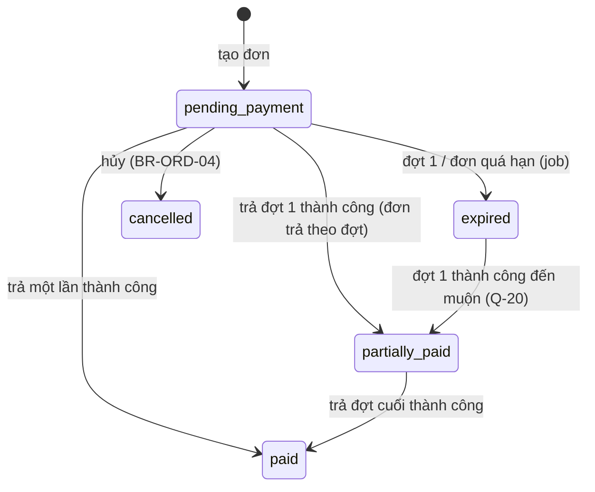
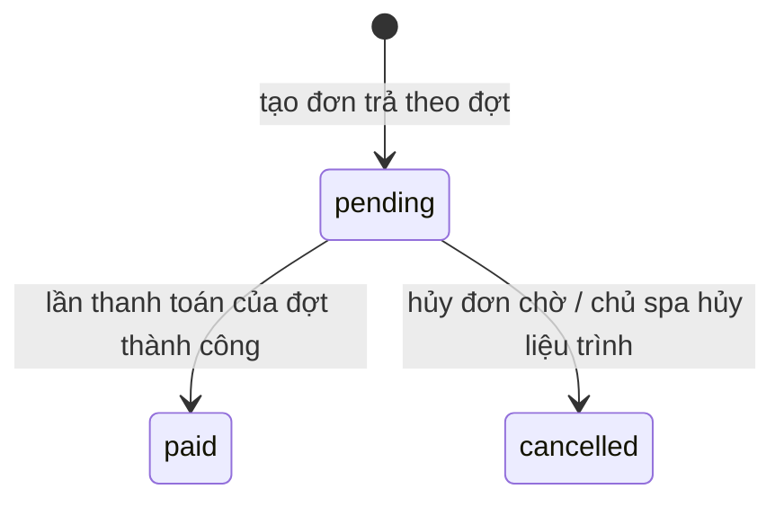

# Thanh toán gói theo đợt — đặc tả

- **Nhóm:** `Orders`, `Payments` (mở rộng), ảnh hưởng `Bookings`, `Purchases`, `Treatments`, `Reports`, `Notifications` · **Nguồn:** ĐX (mở rộng UC-SPA-11, 12, 13, 15, 18, 19, 33)
- **Entity:** `Order` (`orders`), `Payment` (`payments`), **mới** `OrderInstallment` (`order_installments`); đọc `CustomerPackage`, `TreatmentSession`, `ServicePackageItem`, `SpaService` — xem [glossary](../domain/glossary.md), [data-model](../domain/data-model.md)
- **Spec gốc:** [orders.md](orders.md) (đợt 1, 2). Spec này là **đợt 3**: chỉ ghi phần thay đổi; quy tắc nào không nhắc tới thì giữ nguyên như `orders.md`.
- **Trạng thái:** đặc tả 21/11/2026; **đã triển khai backend, web và mobile 22/11/2026** (nhánh `refactor/order-installment-payments`, migration `AddOrderInstallments`). Test: `InstallmentPlannerTests` (Domain), `InstallmentOrderTests` (tích hợp, INS-T03…T21), `CheckoutView.test.tsx` (web). Chưa có test riêng cho INS-T22 (đổi thành phần gói trước đợt 1).
- **Quyết định:** Q-85…Q-91 trong [open-questions.md](../decisions/open-questions.md).

## Mục tiêu

Khách mua **gói dịch vụ** được chọn **trả một lần** (như hiện nay) hoặc **trả theo 2–3 đợt**. Mỗi đợt mở khóa một nhóm buổi liên tiếp của liệu trình: **trả đến đâu, dùng đến đó**. Spa không bao giờ làm buổi chưa được trả tiền, nên không có công nợ, không có "quá hạn", không cần đòi nợ.

Không thay đổi: dịch vụ lẻ, đơn nhiều sản phẩm, đặt ngay có giữ chỗ (UC-SPA-15) luôn trả một lần; chỉ thanh toán online qua VNPay (Q-89).

## Ví dụ

Gói 10 buổi: 6 buổi Chăm sóc da (giá lẻ 500 000) + 4 buổi Massage (giá lẻ 300 000), giá gói 3 500 000, mã giảm 10% → `grandTotal` = **3 150 000**. Khách chọn 3 đợt.

| Đợt | Buổi                      | Giá lẻ các buổi | Tiền đợt (làm tròn xuống 1 000, đợt cuối nhận phần còn lại) |
| --- | ------------------------- | --------------- | ----------------------------------------------------------- |
| 1   | 1–4 (da × 4)              | 2 000 000       | 3 150 000 × 2 000 / 4 200 = **1 500 000**                   |
| 2   | 5–7 (da × 2, massage × 1) | 1 300 000       | 3 150 000 × 1 300 / 4 200 = 975 000 → **975 000**           |
| 3   | 8–10 (massage × 3)        | 900 000         | 3 150 000 − 1 500 000 − 975 000 = **675 000**               |

Trả đợt 1 → có gói và liệu trình, đặt được buổi 1–4. Buổi 5–10 hiện "Chưa thanh toán đợt 2". Trả đợt 2 → mở buổi 5–7. Trả đợt 3 → đơn `paid`.

## Use case (thay đổi)

### UC-SPA-11 — Thanh toán trực tuyến (thêm luồng trả theo đợt)

**Luồng chính — trả theo đợt**

1. Khách "Mua ngay" một gói, hoặc thanh toán giỏ chỉ có đúng một gói.
2. Client gọi `POST /me/orders/preview` như hiện nay. Hệ thống tính như cũ và **thêm** `installmentOptions`: với mỗi số đợt `n` hợp lệ (BR-INS-01), danh sách đợt (khoảng buổi, tiền) tính theo BR-INS-02, BR-INS-03. Không hợp lệ → `installmentOptions = []` và `installmentUnavailableReason`.
3. Khách chọn "Trả theo đợt" và số đợt; client gọi `POST /me/orders` với `installmentCount = n` (bỏ trống = trả một lần).
4. Hệ thống tính lại như bước 2 trong cùng giao dịch tạo đơn, kiểm tra lại BR-INS-01, tạo `orders` (`payment_plan = installment`, `pending_payment`, `payment_due_at_utc` như BR-ORD-03) và `order_installments` (đợt 1..n, `pending`).
5. Client gọi `POST /me/orders/{id}/payments` như hiện nay. Hệ thống tạo lần thanh toán cho **đợt kế tiếp chưa trả** (lúc này là đợt 1), `amount` = tiền đợt (BR-INS-05).
6. Kết quả VNPay đi qua bộ xử lý hiện có (BR-ORD-05). Thành công đợt 1 → trong một giao dịch: đợt 1 `paid`, đơn `partially_paid`, tạo `customer_packages` + `treatment_plans` + `treatment_sessions` (BR-ORD-06, một lần), xóa gói khỏi giỏ, thông báo NTF-E01.
7. Khách đặt lịch các buổi của đợt đã trả như bình thường (UC-SPA-15). Buổi thuộc đợt chưa trả: `canBook = false` (BR-INS-06).
8. Khi muốn dùng tiếp, khách mở chi tiết đơn (hoặc nút trên buổi bị khóa) → `POST /me/orders/{id}/payments` → đợt kế tiếp. Thành công → đợt `paid`, mở các buổi của đợt, NTF-E15. Đợt cuối thành công → đơn `paid`.

**Luồng rẽ nhánh**

- A1. **Trả một lần:** không gửi `installmentCount` → như `orders.md`, không có `order_installments`, `payment_plan = full`.
- A2. **Đợt 1 không trả kịp:** như hiện nay, job hết hạn chuyển đơn `expired` (BR-ORD-03). Đợt sau không có hạn riêng (BR-INS-07).
- A3. **Thất bại / hủy trên VNPay ở một đợt:** lần thanh toán `failed`, đợt vẫn `pending`; khách thử lại (tối đa `Payment:MaxAttemptsPerOrder` lần **mỗi đợt**).
- A4. **Khách dùng hết các buổi đã trả** (nhân viên hoàn thành buổi có số thứ tự = buổi cuối của đợt đã trả, còn đợt chưa trả) → NTF-E16 nhắc thanh toán đợt tiếp.
- A5. **Gói sắp hết hạn** mà còn đợt chưa trả → NTF-E17, `Installment:ExpiryReminderDays` ngày trước hạn (BR-INS-09).

**Ngoại lệ**

- E1. `installmentCount` gửi khi đơn không đủ điều kiện, hoặc `n` ngoài khoảng → `400 installment_not_available` (thông điệp nêu lý do). `installmentCount` không phải số nguyên → `400 validation_error`.
- E2. Trả đợt sau khi gói hết hạn hoặc bị hủy, liệu trình bị hủy → `409 order_not_payable`.
- E3. Hết lượt thử của đợt → `409 payment_attempts_exceeded`.
- E4. Đơn trả theo đợt không bao giờ dùng luồng 0 đ (BR-INS-01 yêu cầu tổng ≥ `Installment:MinOrderTotal`).

### UC-SPA-12 / UC-SPA-13 — Đơn hàng (thay đổi)

- Danh sách và chi tiết có thêm trạng thái `partially_paid`, `paymentPlan`, số đã trả, còn lại, các đợt.
- **Hủy:** vẫn chỉ đơn `pending_payment` (BR-ORD-04). Đơn `partially_paid` không hủy được (`409 order_not_cancellable`), giống đơn `paid`. Hủy đơn trả theo đợt khi đợt 1 chưa trả → các đợt `cancelled`.
- Chủ spa lọc được `status = partially_paid`.

### UC-SPA-15, 18, 19 — Đặt lịch, gói của tôi, liệu trình (thay đổi)

- Buổi có `sequence_number` > số buổi đã trả → không đặt được, lý do "Buổi này thuộc đợt thanh toán chưa trả." (BR-INS-06). Áp ở cả đặt lịch, đổi lịch, `/me/purchases`, `/me/treatments`, giờ trống theo buổi, và tool AI (dùng chung `EntitlementEligibility`).
- Gói hiển thị tiến độ thanh toán (`paidSessionCount`, đợt kế tiếp, tiền).

### UC-SPA-21 — Chủ spa quản lý liệu trình (thay đổi)

- Chủ spa **hủy** liệu trình (gói `cancelled`) → các đợt `pending` của đơn → `cancelled` trong cùng giao dịch. Đơn giữ `partially_paid`. Không hoàn tiền (Q-38).
- Tạm dừng / tiếp tục: không đổi đợt; khách vẫn trả được đợt khi liệu trình tạm dừng (trả tiền không đặt lịch).

### UC-SPA-33 — Báo cáo doanh thu (thay đổi)

- Doanh thu = mỗi **đợt** tính một lần, theo lần thanh toán thành công sớm nhất của đợt, ngày VN của `paid_at_utc` (BR-INS-10). Đơn trả một lần giữ nguyên Q-46.

## Business rules

| Mã        | Quy tắc                                                                                                                                                                                                                                                                                                                                                                                                                                                         | Enforce ở đâu                                                   | Nguồn      |
| --------- | --------------------------------------------------------------------------------------------------------------------------------------------------------------------------------------------------------------------------------------------------------------------------------------------------------------------------------------------------------------------------------------------------------------------------------------------------------------- | --------------------------------------------------------------- | ---------- |
| BR-INS-01 | Đơn được trả theo đợt khi: `Installment:Enabled`; đơn có **đúng một dòng** và là **gói** (`buy_now` gói, hoặc giỏ chỉ có một gói còn bán); gói có `N` ≥ 2 buổi (Σ `session_count` lúc tạo đơn); `grandTotal` ≥ `Installment:MinOrderTotal`; `n` ∈ [2, min(`Installment:MaxInstallments`, N)]; mọi đợt ≥ `Vnpay:MinAmount`. Đặt ngay có giữ chỗ (`/me/appointments/book-now`) không bao giờ trả theo đợt. Khách chọn `n` (Q-87)                                  | Application (`InstallmentPlanner`, `OrderPlacement`)            | Q-85, Q-87 |
| BR-INS-02 | Chia buổi: các buổi đánh số 1..N theo đúng thứ tự sẽ sinh `treatment_sessions` (thành phần theo `sort_order`, mỗi thành phần lặp `session_count`). Đợt k nhận `⌊N/n⌋` buổi, `N mod n` đợt đầu nhận thêm 1 buổi; các khoảng liên tiếp, không chồng, phủ 1..N. Ví dụ N = 10, n = 3 → 1–4, 5–7, 8–10                                                                                                                                                               | Domain (hàm thuần `InstallmentPlanner`)                         | Q-86       |
| BR-INS-03 | Tiền đợt: trọng số buổi = giá hiện tại của dịch vụ của buổi (`spa_services.price`) lúc tạo đơn; `W_k` = tổng trọng số các buổi của đợt k, `W` = Σ `W_k`. Đợt k < n: `floor(grandTotal × W_k / W / Installment:RoundingUnit) × RoundingUnit`; đợt n: `grandTotal − Σ` các đợt trước. `W = 0` (mọi dịch vụ giá 0) → trọng số mỗi buổi bằng 1. Tổng các đợt luôn bằng `grandTotal`. Khuyến mãi đã trừ vào `grandTotal` trước khi chia (Q-88)                       | Domain (`InstallmentPlanner`)                                   | Q-88       |
| BR-INS-04 | Số tiền và khoảng buổi của từng đợt lưu khi tạo đơn, không tính lại khi giá dịch vụ đổi sau đó. Nếu thành phần gói đổi giữa lúc tạo đơn và lúc trả đợt 1 (≤ 20 phút, Q-23) làm tổng buổi khác `N` đã lưu: chia lại **khoảng buổi** theo BR-INS-02 với số buổi mới, giữ nguyên số đợt và số tiền, ghi log cảnh báo (Q-90)                                                                                                                                        | Application (`EntitlementIssuer`)                               | Q-90       |
| BR-INS-05 | Lần thanh toán của đơn trả theo đợt luôn cho **đợt `pending` có số thứ tự nhỏ nhất** (trả đúng thứ tự, không trả gộp): `payments.installment_id` = đợt đó, `amount` = tiền đợt. Đợt 1: `expires_at_utc` = `payment_due_at_utc` của đơn (như BR-ORD-10). Đợt sau: `expires_at_utc` = bây giờ + `Order:PaymentTimeoutMinutes`. Mỗi đợt tối đa `Payment:MaxAttemptsPerOrder` lần thử; `request_code` vẫn đánh số liên tục theo đơn (BR-ORD-07)                     | Application (`PaymentService`)                                  | ĐX         |
| BR-INS-06 | Số buổi đã trả `paidSessionCount` = `last_session_number` lớn nhất trong các đợt `paid` (0 khi chưa trả). Buổi có `sequence_number` > `paidSessionCount` không đặt được (`canBook = false`, lý do BR-INS-06), không dời lịch vào đó được. Đơn trả một lần: không áp luật này                                                                                                                                                                                    | Application (`EntitlementEligibility`, `SessionBookingFacts`)   | Q-86       |
| BR-INS-07 | Đợt 2..n **không có hạn riêng**: trả lúc nào cũng được khi gói còn hiệu lực (`PurchaseStatus.Effective` = `active`) và liệu trình chưa bị hủy. Không có trạng thái quá hạn, không chặn gì ngoài BR-INS-06. Gói hết hạn → đợt chưa trả hiển thị `expired` (tính lúc đọc, không lưu, như Q-32) và không trả được nữa                                                                                                                                              | Application                                                     | Q-86       |
| BR-INS-08 | Kết quả thanh toán (mở rộng BR-ORD-05, dưới cùng khóa dòng đơn): thành công cho đợt `pending` → đợt `paid`, `paid_at_utc`. Đợt 1 → đơn `partially_paid` và tạo quyền sử dụng (BR-ORD-06) một lần; đợt cuối → đơn `paid`. Đợt đã `paid` bằng lần khác, hoặc `cancelled` → lần thanh toán vẫn `succeeded`, đợt giữ nguyên, log cảnh báo hoàn tiền thủ công (như Q-20). Thành công đến muộn cho đợt 1 khi đơn `expired`: như Q-20 (đơn sống lại, `partially_paid`) | Application (`PaymentService`, Domain `Order`)                  | ĐX         |
| BR-INS-09 | Nhắc trong app, không gửi mail: NTF-E16 khi hoàn thành buổi `sequence_number` = `paidSessionCount` mà còn đợt `pending`; NTF-E17 một lần cho mỗi đơn, `Installment:ExpiryReminderDays` ngày trước `customer_packages.expires_at_utc` nếu còn đợt `pending` (khóa chống trùng `installment-expiry:{orderId}`). `ExpiryReminderDays = 0` tắt NTF-E17                                                                                                              | Application (`AppointmentCompletionService`, job nhắc)          | ĐX         |
| BR-INS-10 | Doanh thu: mỗi đợt `paid` tính đúng một lần = `amount` của lần thanh toán thành công sớm nhất của đợt, theo ngày VN của `paid_at_utc`; quy về sản phẩm là gói của đơn. Lần thành công thừa (đợt đã trả, đợt hủy) vào `unrecognizedPayments`. Lượt khuyến mãi đang tính (BR-PRM-01) gồm cả đơn `partially_paid`                                                                                                                                                  | Infrastructure (`RevenueReportRepository`) + Application        | Q-91       |
| BR-INS-11 | Hủy: khách và chủ spa chỉ hủy đơn `pending_payment` (BR-ORD-04 giữ nguyên) → các đợt `cancelled`. Chủ spa hủy liệu trình (UC-SPA-21) → các đợt `pending` của đơn `cancelled`, khóa dòng đơn trước. Không hoàn tiền                                                                                                                                                                                                                                              | Application (`OrderCancellation`, `TreatmentManagementService`) | Q-38       |

## Trạng thái

`partially_paid` là trạng thái cuối nếu khách không trả tiếp (gói hết hạn hoặc bị hủy).

Trạng thái hiển thị thêm `expired` cho đợt `pending` khi gói hết hạn (tính lúc đọc, BR-INS-07).

## Dữ liệu

| Bảng                                                                              | Thay đổi                                                                                                                                                                                                                                                                                                                                                                                                                                                        |
| --------------------------------------------------------------------------------- | --------------------------------------------------------------------------------------------------------------------------------------------------------------------------------------------------------------------------------------------------------------------------------------------------------------------------------------------------------------------------------------------------------------------------------------------------------------- |
| **`order_installments`** (mới, `OrderInstallment`, DA "(DotThanhToan — đề xuất)") | `id uuid PK`; `order_id uuid FK → orders.id`; `sequence_number int` (1..n); `first_session_number int`; `last_session_number int`; `amount numeric(12,0)`; `status varchar(30)` CHECK enum `InstallmentStatus` (`pending`, `paid`, `cancelled`); `paid_at_utc timestamptz NULL`. Ràng buộc: UQ `(order_id, sequence_number)`; CHECK `amount > 0`; CHECK `1 ≤ first_session_number ≤ last_session_number`; CHECK `(status = 'paid') = (paid_at_utc IS NOT NULL)` |
| `orders`                                                                          | **Thêm** `payment_plan varchar(30) NOT NULL DEFAULT 'full'` CHECK enum `PaymentPlan` (`full`, `installment`). `status` **thêm** giá trị `partially_paid` (sửa `ck_orders_status`)                                                                                                                                                                                                                                                                               |
| `payments`                                                                        | **Thêm** `installment_id uuid NULL FK → order_installments.id`, index. CHECK: không đổi (đơn trả một lần để null)                                                                                                                                                                                                                                                                                                                                               |
| khác                                                                              | Không đổi. `paidSessionCount` tính từ đợt `paid`, không thêm cột cho `customer_packages` / `treatment_sessions`                                                                                                                                                                                                                                                                                                                                                 |

Migration `AddOrderInstallments`. Sửa `docs/spec-source/data_db.py` (bảng, 2 enum mới, giá trị `partially_paid`, 2 cột), glossary trước; sinh lại `data-model.md`, Excel; cập nhật `PersistenceModelTests`. Dữ liệu cũ: mọi đơn hiện có thành `payment_plan = full`.

## API

Chỉ ghi phần thêm/đổi; mọi trường cũ giữ nguyên.

| Method | Đường dẫn                                | Thay đổi                                                                                                                                                                                                                                                                                                                                                                                   |
| ------ | ---------------------------------------- | ------------------------------------------------------------------------------------------------------------------------------------------------------------------------------------------------------------------------------------------------------------------------------------------------------------------------------------------------------------------------------------------ |
| POST   | `/me/orders/preview`                     | Response **thêm** `installmentOptions: [{ installmentCount, installments: [{ sequenceNumber, firstSessionNumber, lastSessionNumber, amount, services: [{ name, sessionCount }] }] }]` (rỗng khi không đủ điều kiện), `installmentUnavailableReason?: { code, message }` (`installment_not_available`)                                                                                      |
| POST   | `/me/orders`                             | Body **thêm** `installmentCount?: int`. Lỗi **thêm** `400 installment_not_available`                                                                                                                                                                                                                                                                                                       |
| GET    | `/me/orders/{id}`, `/orders/{id}`        | **Thêm** `paymentPlan`, `paidAmount`, `remainingAmount`, `installments: [{ id, sequenceNumber, firstSessionNumber, lastSessionNumber, amount, status (pending\|paid\|cancelled\|expired), paidAtUtc }]` (rỗng khi trả một lần), `nextInstallment?: { id, sequenceNumber, amount }`. `payments[]` **thêm** `installmentSequenceNumber?`. `isPayable` = còn đợt/đơn trả được (BR-INS-05, 07) |
| GET    | `/me/orders`, `/orders`                  | Item **thêm** `paymentPlan`, `paidAmount`, `nextInstallmentAmount?`. `status` lọc được `partially_paid`                                                                                                                                                                                                                                                                                    |
| POST   | `/me/orders/{id}/payments`               | Body giữ nguyên `{ client }`. Response **thêm** `installmentSequenceNumber?`, `amount`. Đơn trả theo đợt: trả cho đợt kế tiếp (BR-INS-05). `409 order_not_payable` khi đơn `paid`/`cancelled`/`expired`, hoặc `partially_paid` mà gói không còn hiệu lực / liệu trình bị hủy                                                                                                               |
| GET    | `/me/purchases`, `/me/treatments[/{id}]` | Gói **thêm** `payment: { plan, paidSessionCount, totalSessions, nextInstallment?: { orderId, sequenceNumber, amount, firstSessionNumber, lastSessionNumber } }`. Buổi bị khóa: `canBook = false`, `reason` BR-INS-06                                                                                                                                                                       |
| GET    | `/treatments/{id}` (chủ spa, nhân viên)  | **Thêm** `payment` như trên để nhân viên biết buổi nào chưa trả                                                                                                                                                                                                                                                                                                                            |

Không có endpoint mới. Không có endpoint ghi nhận tiền mặt (Q-89).

**Mã lỗi mới:** `installment_not_available` (400) — `message` theo lý do: không phải đơn một gói, gói ít hơn 2 buổi, dưới mức tối thiểu, số đợt ngoài khoảng, đợt dưới `Vnpay:MinAmount`, tính năng tắt.

## Thông báo (mở rộng [notifications.md](notifications.md))

| Mã      | Sự kiện                                                                       | Người nhận | Loại      | Tham chiếu | Tiêu đề                                    |
| ------- | ----------------------------------------------------------------------------- | ---------- | --------- | ---------- | ------------------------------------------ |
| NTF-E01 | (đổi nội dung) đơn trả theo đợt: khi trả đợt 1                                | Khách      | `payment` | `order`    | "Đã thanh toán đợt 1/n"                    |
| NTF-E15 | Thanh toán đợt 2..n thành công                                                | Khách      | `payment` | `order`    | "Đã thanh toán đợt k/n"                    |
| NTF-E16 | Hoàn thành buổi cuối cùng đã trả, còn đợt chưa trả                            | Khách      | `payment` | `order`    | "Bạn đã dùng hết các buổi đã thanh toán"   |
| NTF-E17 | `Installment:ExpiryReminderDays` ngày trước khi gói hết hạn, còn đợt chưa trả | Khách      | `payment` | `order`    | "Gói sắp hết hạn, còn đợt chưa thanh toán" |

NTF-E17 do job nhắc hiện có (`AppointmentReminderJob` gọi thêm `IInstallmentReminderService`) hoặc job riêng cùng mẫu; khóa chống trùng `ux_notifications_user_id_dedup_key`.

## Cấu hình (`appsettings.json`, section `Installment`)

| Khóa                             | Mặc định  | Ghi chú                                     |
| -------------------------------- | --------- | ------------------------------------------- |
| `Installment:Enabled`            | `true`    | `false` → không đơn nào được trả theo đợt   |
| `Installment:MinOrderTotal`      | `1000000` | Tổng đơn tối thiểu (sau khuyến mãi)         |
| `Installment:MaxInstallments`    | `3`       | 2–6; khách chọn từ 2 đến giá trị này (Q-87) |
| `Installment:RoundingUnit`       | `1000`    | Làm tròn xuống tiền các đợt trước đợt cuối  |
| `Installment:ExpiryReminderDays` | `7`       | 0 = tắt NTF-E17                             |

Không có biến `.env` mới. Đợt sau dùng lại `Order:PaymentTimeoutMinutes` và `Payment:MaxAttemptsPerOrder`.

## Thiết kế code

| Lớp            | Thay đổi                                                                                                                                                                                                                                                                                                                                                                                                                                                                                                          |
| -------------- | ----------------------------------------------------------------------------------------------------------------------------------------------------------------------------------------------------------------------------------------------------------------------------------------------------------------------------------------------------------------------------------------------------------------------------------------------------------------------------------------------------------------- |
| Domain         | `OrderInstallment` (`MarkPaid`, `Cancel`), enum `InstallmentStatus`, `PaymentPlan`, `OrderStatus.PartiallyPaid`; `Order`: `PaymentPlan`, `Installments`, `NextPendingInstallment`, `PaidSessionCount`, `ApplyPayment(installment)` thay `MarkPaid` cho đơn trả theo đợt; `InstallmentPlanner` (hàm thuần BR-INS-02, 03), `Payment.InstallmentId`                                                                                                                                                                  |
| Application    | `InstallmentOptions` (config); `OrderPlacement` tính `installmentOptions`, nhận `installmentCount`; `PaymentService` chọn đợt, đối chiếu tiền theo đợt, áp BR-INS-08; `EntitlementIssuer` chạy ở đợt 1 + BR-INS-04; `SessionBookingFacts.PaidSessionCount` + `EntitlementEligibility` (BR-INS-06); `OrderActionPolicy` (`isPayable` mới); `OrderCancellation` hủy đợt; `TreatmentManagementService.Cancel` hủy đợt; `NotificationTemplates` E15–E17; `IInstallmentReminderService`; DTO đơn, mua hàng, liệu trình |
| Infrastructure | `OrderInstallmentConfiguration`, migration `AddOrderInstallments`; repository đơn nạp đợt; truy vấn `SessionBookingFacts` thêm số buổi đã trả; `RevenueReportRepository` (BR-INS-10); job nhắc                                                                                                                                                                                                                                                                                                                    |
| API            | Không controller mới; DTO thêm trường                                                                                                                                                                                                                                                                                                                                                                                                                                                                             |
| Shared         | `shared-types` (đơn, đợt, preview, mua hàng), `api-client` (body `installmentCount`)                                                                                                                                                                                                                                                                                                                                                                                                                              |
| Web            | SCR-W11 Thanh toán: khối "Hình thức thanh toán" (Trả một lần / Trả theo đợt + chọn 2/3 đợt + bảng đợt); SCR-W19 chi tiết đơn: tiến độ đợt, nút "Thanh toán đợt k"; Gói của tôi / Liệu trình: thanh tiến độ, buổi khóa kèm nút trả đợt; SCR-W37 chủ spa: cột và lọc `partially_paid`, bảng đợt trong Sheet; `StatusBadge` cho `partially_paid` và trạng thái đợt                                                                                                                                                   |
| Mobile         | SCR-M19b Thanh toán, SCR-M20b Chi tiết đơn, Gói của tôi, Liệu trình: như web                                                                                                                                                                                                                                                                                                                                                                                                                                      |

## Kiểm thử bắt buộc

| Mã      | Tình huống                                                                                                                     | Kết quả mong đợi                                                                                                                                       |
| ------- | ------------------------------------------------------------------------------------------------------------------------------ | ------------------------------------------------------------------------------------------------------------------------------------------------------ |
| INS-T01 | `InstallmentPlanner` (unit, `[Theory]`): ví dụ trên (10 buổi, 3 đợt, 3 150 000); N = 2, n = 2; N = 7, n = 3; mọi dịch vụ giá 0 | 1–4/5–7/8–10 và 1 500 000/975 000/675 000; 1/1; 3/2/2; chia theo số buổi; luôn Σ = `grandTotal`                                                        |
| INS-T02 | Planner: đợt dưới `Vnpay:MinAmount`; `n` > N; `n` > `MaxInstallments`                                                          | Phương án đó không có trong `installmentOptions`                                                                                                       |
| INS-T03 | Preview mua ngay gói đủ điều kiện, có mã giảm                                                                                  | `installmentOptions` cho n = 2, 3, tính trên `grandTotal` sau giảm; không ghi CSDL                                                                     |
| INS-T04 | Preview: dịch vụ lẻ; giỏ 2 sản phẩm; gói 1 buổi; tổng dưới 1 000 000; `Installment:Enabled = false`                            | `installmentOptions = []`, `installmentUnavailableReason.code = installment_not_available`, lý do đúng                                                 |
| INS-T05 | Tạo đơn `installmentCount = 3`; với `installmentCount` cho đơn không đủ điều kiện; `installmentCount = 4`                      | 201 `paymentPlan = installment`, 3 đợt `pending` đúng tiền và khoảng buổi; `400 installment_not_available` ×2                                          |
| INS-T06 | Tạo đơn không gửi `installmentCount`                                                                                           | Như hiện nay, `paymentPlan = full`, không có đợt                                                                                                       |
| INS-T07 | Tạo lần thanh toán cho đơn trả theo đợt mới tạo                                                                                | `amount` = tiền đợt 1, `installment_id` = đợt 1, `expires_at_utc = payment_due_at_utc`                                                                 |
| INS-T08 | IPN thành công đợt 1                                                                                                           | Đợt 1 `paid`; đơn `partially_paid`; có gói + liệu trình + 10 buổi; gói bị xóa khỏi giỏ; NTF-E01 "đợt 1/3"                                              |
| INS-T09 | Sau đợt 1: eligibility buổi 4 / buổi 5; đặt lịch buổi 5; `/me/purchases`, `/me/treatments/{id}`; đơn trả một lần cùng gói      | Buổi 4 đặt được, buổi 5 `canBook = false` lý do BR-INS-06; đặt buổi 5 → `400` lý do đó; `paidSessionCount = 4`; đơn trả một lần không bị khóa buổi nào |
| INS-T10 | Trả đợt 2: tạo lần thanh toán, IPN thành công                                                                                  | `amount` = tiền đợt 2, `expires_at_utc` = bây giờ + 15 phút; đợt 2 `paid`, buổi 5–7 mở, NTF-E15, đơn vẫn `partially_paid`                              |
| INS-T11 | Trả đợt cuối                                                                                                                   | Đơn `paid`, `remainingAmount = 0`, `nextInstallment = null`, `isPayable = false`                                                                       |
| INS-T12 | IPN đợt 2 gửi 2 lần; hai lần thanh toán `pending` của cùng đợt cùng thành công                                                 | Lần 2 `02`; lần sau `succeeded`, đợt không đổi, log cảnh báo; quyền sử dụng không nhân đôi                                                             |
| INS-T13 | IPN sai số tiền (tiền của cả đơn thay vì của đợt)                                                                              | `04`, không đổi gì                                                                                                                                     |
| INS-T14 | Đợt 1 hết hạn (job); IPN đợt 1 thành công đến muộn                                                                             | Đơn `expired`, các đợt vẫn `pending`; sau IPN: đơn `partially_paid`, có gói (Q-20)                                                                     |
| INS-T15 | Gói hết hạn (đồng hồ giả) khi còn đợt 3; tạo lần thanh toán                                                                    | Đợt 3 hiển thị `expired`; `409 order_not_payable`                                                                                                      |
| INS-T16 | Chủ spa hủy liệu trình khi còn đợt 2, 3                                                                                        | Đợt 2, 3 `cancelled`; đơn giữ `partially_paid`; tạo lần thanh toán `409 order_not_payable`                                                             |
| INS-T17 | Khách / chủ spa hủy đơn `partially_paid`; hủy đơn trả theo đợt chưa trả đợt 1                                                  | `409 order_not_cancellable` ×2; 200, các đợt `cancelled`                                                                                               |
| INS-T18 | Nhân viên hoàn thành buổi 4 (buổi cuối đã trả, còn đợt 2); hoàn thành buổi 3                                                   | NTF-E16 cho khách; buổi 3 không gửi                                                                                                                    |
| INS-T19 | Dịch vụ nhắc (đồng hồ giả) 7 ngày trước hạn gói còn đợt chưa trả; chạy lại; gói đã trả hết                                     | Một NTF-E17; không trùng; không gửi                                                                                                                    |
| INS-T20 | Báo cáo: đơn trả đợt 1 tháng 1, đợt 2 tháng 2 (năm 2040+)                                                                      | Tháng 1 = tiền đợt 1, tháng 2 = tiền đợt 2, cả hai quy về gói; lần thành công thừa vào `unrecognizedPayments`                                          |
| INS-T21 | Khuyến mãi `usage_limit = 1` dùng cho đơn `partially_paid`; khách khác dùng mã                                                 | `promotion_not_applicable` (lượt của đơn `partially_paid` vẫn tính)                                                                                    |
| INS-T22 | Thành phần gói đổi (thêm 1 buổi) giữa lúc tạo đơn và lúc trả đợt 1                                                             | Khoảng buổi chia lại theo 11 buổi, tiền giữ nguyên, có log cảnh báo                                                                                    |
| INS-T23 | `GET /me/orders`, `/orders` lọc `status = partially_paid`; chi tiết chủ spa                                                    | Đúng tập; `paidAmount`, `installments`, `payments[].installmentSequenceNumber` đúng                                                                    |
| INS-T24 | CSDL: đợt `paid` không có `paid_at_utc`; trùng `(order_id, sequence_number)`; `amount = 0`                                     | Vi phạm CHECK / UQ                                                                                                                                     |
| INS-T25 | Hồi quy: đơn trả một lần, đặt ngay có giữ chỗ, đặt lịch, báo cáo, `PersistenceModelTests`                                      | Toàn bộ test hiện có vẫn pass                                                                                                                          |

Giao diện: `INS-UI-T01…` viết khi làm màn hình (chọn hình thức, bảng đợt, nút trả đợt, buổi khóa, nhãn trạng thái, lỗi `installment_not_available`).

## Thứ tự triển khai

1. Glossary và Q-85…Q-91 (xong cùng spec này); `data_db.py` rồi sinh lại `data-model.md` (làm đầu tiên khi code).
2. Domain: enum, `OrderInstallment`, `Order`, `InstallmentPlanner` + unit test INS-T01, T02.
3. Infrastructure: configuration, migration `AddOrderInstallments`, repository.
4. Application: preview/tạo đơn → thanh toán và kết quả → cấp quyền → eligibility → hủy → thông báo, nhắc → báo cáo.
5. API + integration test INS-T03…T25.
6. `shared-types`, `api-client`.
7. Web (SCR-W11, W19, W37, gói, liệu trình), rồi mobile.
8. `progress.md`, `CLAUDE.md`, spec liên quan (`orders.md`, `bookings.md`, `purchases-treatments.md`, `reports.md`, `notifications.md`).

## Việc để sau

| Mã           | Việc                                                                                            |
| ------------ | ----------------------------------------------------------------------------------------------- |
| INS-LATER-01 | Trả gộp nhiều đợt còn lại trong một lần thanh toán                                              |
| INS-LATER-02 | Đợt 1 tối thiểu một tỷ lệ giá trị (`Installment:FirstInstallmentMinPercent`, Q-89 mặc định tắt) |
| INS-LATER-03 | Trả góp cho đơn nhiều sản phẩm                                                                  |
| INS-LATER-04 | Ghi nhận tiền mặt tại quầy cho đợt sau                                                          |
| INS-LATER-05 | Hoàn tiền phần đã trả khi hủy liệu trình (cùng ORD-LATER-07)                                    |
