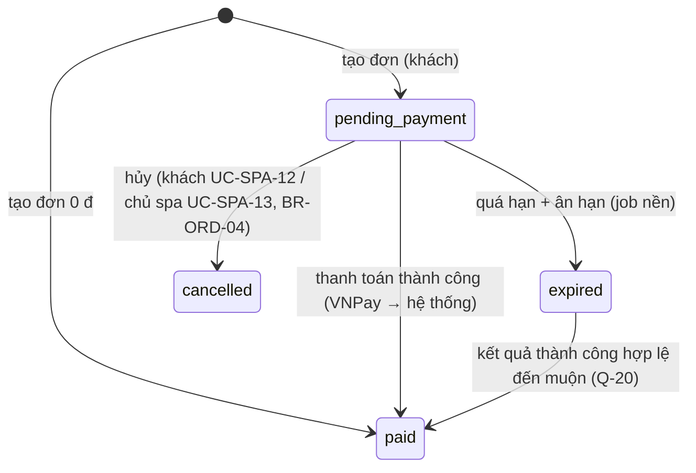
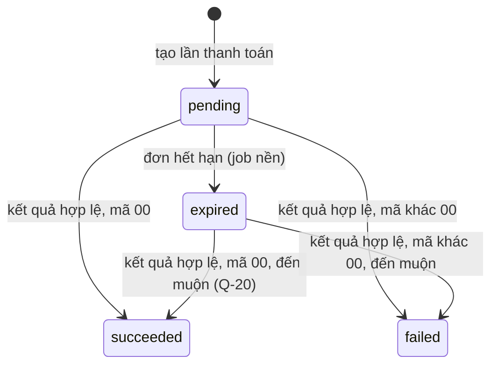

# Giỏ hàng, đơn hàng, thanh toán & khuyến mãi — đặc tả

- **Nhóm:** `Orders`, `Payments`, `Promotions` · **Sprint:** 2 · **Nguồn:** DA §2.2.3 (UC Quản lý giỏ hàng, UC Thanh toán trực tuyến, UC Quản lý chương trình khuyến mãi) / ĐX
- **Entity:** `Cart` (bảng `carts`), `CartItem` (`cart_items`), `Order` (`orders`), `OrderItem` (`order_items`), `Payment` (`payments`), `Promotion` (`promotions`), `PromotionRedemption` (`promotion_redemptions`); ghi thêm `ServiceEntitlement`, `CustomerPackage`, `TreatmentPlan`, `TreatmentSession` khi thanh toán thành công — xem [glossary](../domain/glossary.md), [data-model](../domain/data-model.md)
- **Trạng thái triển khai:** đợt 1 đã triển khai backend 27/10/2026 theo [plan](../superpowers/plans/2026-10-27-uc-spa-10-11-14-orders.md); đợt 2 (UC-SPA-12, 13) đã triển khai backend 01/11/2026 theo [plan](../superpowers/plans/2026-11-01-uc-spa-12-13-orders.md); thử VNPay sandbox thật (ORD-T26) còn chờ khóa sandbox — xem [progress.md](../progress.md)
- **Đã đặc tả (đợt 1, chỉ backend):** UC-SPA-14 (chủ spa quản lý khuyến mãi), UC-SPA-10 (giỏ hàng), UC-SPA-11 (thanh toán VNPay cho đơn từ giỏ hoặc mua ngay một sản phẩm), job nền hết hạn đơn. Đặt ngay có giữ chỗ đã làm cùng UC-SPA-15 (đợt 2 của [bookings.md](bookings.md), 30/10/2026).
- **Đợt 2 (chỉ backend, đặc tả và duyệt 01/11/2026):** UC-SPA-12 (danh sách đơn của tôi, hủy đơn chưa thanh toán; thanh toán lại dùng `POST /me/orders/{id}/payments` của UC-SPA-11), UC-SPA-13 (chủ spa tìm, xem, hủy đơn chưa thanh toán). Kèm BR-ORD-04, BR-ORD-11, BR-ORD-12, Q-43…Q-45, migration `AddOrderCancellation`.
- **Quyết định đã chốt 27/10/2026:** cổng thanh toán **VNPay** (sandbox, Q-08); Q-19…Q-23 theo mục [Câu hỏi còn mở](#câu-hỏi-còn-mở); đợt này chỉ mua từ giỏ hoặc mua ngay một sản phẩm, chưa giữ chỗ lịch hẹn; đơn quá hạn do **job nền** (hosted service) chuyển sang `expired`.

## Use case

Thứ tự triển khai: UC-SPA-14 → UC-SPA-10 → UC-SPA-11 (UC-SPA-11 dùng khuyến mãi và giỏ hàng).

### UC-SPA-14 — Quản lý chương trình khuyến mãi

| Mục            | Nội dung                                                                                                                                                        |
| -------------- | --------------------------------------------------------------------------------------------------------------------------------------------------------------- |
| Actor          | Chủ spa                                                                                                                                                         |
| Mô tả          | Xem danh sách, thêm, sửa, ngừng / mở lại chương trình khuyến mãi                                                                                                |
| Tiền điều kiện | Đã đăng nhập, `role = owner` (quyền `promotion.manage`)                                                                                                         |
| Input          | `code, description?, discountType, discountValue, minOrderAmount, maxDiscountAmount?, startsAtUtc, endsAtUtc, perCustomerLimit?, usageLimit?`; bộ lọc danh sách |
| Output         | Chương trình được lưu hoặc đổi trạng thái; danh sách phân trang kèm số lượt đã dùng                                                                             |

**Luồng chính — thêm khuyến mãi**

1. Chủ spa mở danh sách: `GET /promotions?search&status&fromDate&toDate&pageNumber&pageSize&sortBy&sortDirection`.
2. Hệ thống trả trang kết quả, mỗi dòng có `usedCount` (số đơn `paid` đã dùng mã).
3. Chủ spa gửi `POST /promotions` với dữ liệu chương trình.
4. Hệ thống chuẩn hóa `code` (BR-PRM-04), kiểm tra dữ liệu (BR-PRM-05), mã chưa tồn tại, lưu với `status = active`.
5. Trả `201` kèm header `Location` và chi tiết chương trình.

**Luồng rẽ nhánh**

- A1. **Sửa:** `PUT /promotions/{id}` với đủ trường như khi thêm → kiểm tra BR-PRM-05, BR-PRM-06 → `200` chi tiết mới. Sửa không đổi mức giảm của đơn đã tạo (đơn lưu bản chụp số tiền giảm).
- A2. **Ngừng / mở lại:** `PATCH /promotions/{id}/status` với `{ status: "active" | "stopped" }` → `204`. Đặt lại trạng thái đang có cũng `204`. Ngừng không ảnh hưởng đơn đang chờ thanh toán đã áp mã (Q-21).
- A3. **Xem chi tiết:** `GET /promotions/{id}` → `200`.
- A4. **Lọc theo khoảng ngày:** `fromDate`, `toDate` (ngày giờ VN) → chương trình có thời gian `[startsAtUtc, endsAtUtc)` giao với `[fromDate 00:00, toDate + 1 ngày 00:00)` giờ VN.

**Ngoại lệ**

- E1. Dữ liệu không hợp lệ (BR-PRM-04, 05), tham số danh sách sai → `400 validation_error` theo trường.
- E2. Mã đã tồn tại (không phân biệt hoa thường) → `409 promotion_code_exists`.
- E3. Sửa `code`, `discountType` hoặc `discountValue` khi đã có lượt dùng (BR-PRM-06) → `409 promotion_in_use`.
- E4. `usageLimit` nhỏ hơn số lượt đang tính (BR-PRM-01) → `400 promotion_usage_limit_below_used`.
- E5. Không tồn tại → `404 promotion_not_found`.
- E6. Chưa đăng nhập → `401 unauthorized`; không phải chủ spa → `403 forbidden`.
- E7. Không có endpoint xóa (ngừng thay vì xóa).

**Quy tắc áp dụng:** BR-PRM-01, 04, 05, 06, BR-SEC-RBAC (`promotion.manage`).

### UC-SPA-10 — Quản lý giỏ hàng

| Mục            | Nội dung                                                                                                            |
| -------------- | ------------------------------------------------------------------------------------------------------------------- |
| Actor          | Khách hàng                                                                                                          |
| Mô tả          | Thêm dịch vụ hoặc gói vào giỏ, xem giỏ (giá hiện tại, sản phẩm còn bán không), xóa sản phẩm, chuyển sang thanh toán |
| Tiền điều kiện | Đã đăng nhập, `role = customer` (quyền `cart.self`)                                                                 |
| Input          | `spaServiceId` hoặc `servicePackageId`; `itemId` khi xóa                                                            |
| Output         | Giỏ hàng: các dòng, tổng tiền theo giá hiện tại                                                                     |

**Luồng chính — thêm vào giỏ**

1. Khách nhấn "Thêm vào giỏ" ở dịch vụ hoặc gói; client gọi `POST /me/cart/items` với đúng một trong `spaServiceId`, `servicePackageId`.
2. Hệ thống kiểm tra sản phẩm tồn tại và khách được thấy (BR-CAT-01).
3. Hệ thống tạo giỏ nếu khách chưa có (BR-ORD-01).
4. Hệ thống kiểm tra sản phẩm chưa có trong giỏ và giỏ chưa đầy.
5. Tạo dòng giỏ với `unit_price` = giá hiện tại, `added_at_utc` = bây giờ.
6. Trả `201` và giỏ hàng.

**Luồng rẽ nhánh**

- A1. **Xem giỏ:** `GET /me/cart` → mỗi dòng có `unitPrice` (giá lúc thêm), `currentPrice`, `isAvailable` (BR-CAT-01 tại thời điểm xem), `priceChanged`; `totalAmount` = tổng `currentPrice` của dòng còn bán. Chưa có giỏ → giỏ rỗng (không tạo giỏ khi chỉ xem).
- A2. **Xóa sản phẩm:** `DELETE /me/cart/items/{itemId}` → xóa dòng → `200` giỏ mới. Xác nhận xóa ở client.
- A3. **Thanh toán:** client chuyển sang UC-SPA-11 với `source = "cart"`.

**Ngoại lệ**

- E1. Sản phẩm đã có trong giỏ → `409 cart_item_exists`, không thêm trùng (UAT-19).
- E2. Sản phẩm không tồn tại hoặc khách không được thấy → `404 service_not_found` / `404 package_not_found` (cùng mã với danh mục).
- E3. Giỏ đã có `Cart:MaxItems` dòng → `400 cart_full`.
- E4. Body có cả hai hoặc không có id nào → `400 validation_error`.
- E5. Xóa dòng không thuộc giỏ của khách → `404 cart_item_not_found`.
- E6. Chưa đăng nhập → `401`; không phải khách hàng → `403`.

**Quy tắc áp dụng:** BR-ORD-01, BR-CAT-01.

### UC-SPA-11 — Thanh toán trực tuyến

| Mục            | Nội dung                                                                                                                                             |
| -------------- | ---------------------------------------------------------------------------------------------------------------------------------------------------- |
| Actor          | Khách hàng; cổng thanh toán VNPay (PGW)                                                                                                              |
| Mô tả          | Khách xem trước đơn (có mã khuyến mãi), tạo đơn từ giỏ hoặc mua ngay một sản phẩm, thanh toán qua VNPay; thành công thì tạo quyền sử dụng            |
| Tiền điều kiện | Đã đăng nhập, `role = customer` (quyền `order.self`); callback từ VNPay không cần đăng nhập nhưng phải có chữ ký hợp lệ                              |
| Input          | `source` (`cart` \| `buy_now`), sản phẩm (khi mua ngay), `promotionCode?`; kết quả giao dịch từ VNPay                                                |
| Output         | Đơn `pending_payment` và URL thanh toán; khi thành công: đơn `paid`, `ServiceEntitlement` / `CustomerPackage` + `TreatmentPlan` + `TreatmentSession` |

**Luồng chính**

1. Khách chọn thanh toán từ giỏ, hoặc "Mua ngay" ở một dịch vụ/gói.
2. Client gọi `POST /me/orders/preview` với `{ source, spaServiceId?, servicePackageId?, promotionCode? }`. Hệ thống lấy lại giá hiện tại và kiểm tra sản phẩm còn bán (BR-ORD-02), tính khuyến mãi (BR-PRM-01, 02).
3. Hệ thống trả bản xem trước: các dòng, `subtotal`, `discountTotal`, `grandTotal`, dòng không còn bán, lỗi mã khuyến mãi nếu có. Không ghi gì vào CSDL.
4. Khách xác nhận; client gọi `POST /me/orders` (cùng body, header `Idempotency-Key` tùy chọn, BR-ORD-08).
5. Hệ thống tính lại như bước 2 trong một giao dịch, khóa dòng khuyến mãi nếu có, tạo `orders` (`pending_payment`, `payment_due_at_utc`, BR-ORD-03), `order_items` (bản chụp tên, giá, tiền giảm phân bổ), `promotion_redemptions` nếu có mã → `201` chi tiết đơn.
6. Client gọi `POST /me/orders/{id}/payments` với `{ client: "web" | "mobile" }`. Hệ thống tạo `payments` (`pending`, `request_code`, BR-ORD-10) và URL VNPay đã ký → `201 { paymentId, paymentUrl, expiresAtUtc }`.
7. Client mở `paymentUrl` (web: chuyển trang; mobile: trình duyệt hệ thống); khách thanh toán trên VNPay.
8. VNPay gọi IPN `GET /payments/vnpay/ipn` và chuyển trình duyệt về `GET /payments/vnpay/return/{client}`. Cả hai đi qua cùng một bộ xử lý (BR-ORD-05): xác thực chữ ký, tìm lần thanh toán theo `vnp_TxnRef`, đối chiếu số tiền, chỉ xử lý lần thanh toán còn `pending`.
9. Thành công → trong một giao dịch: `payments.status = succeeded`, `paid_at_utc`, `provider_transaction_id`; `orders.status = paid`; tạo quyền sử dụng (BR-ORD-06); xóa sản phẩm đã mua khỏi giỏ.
10. Return URL chuyển hướng `302` về trang kết quả của client `?orderId=`; trang kết quả gọi `GET /me/orders/{id}` để hiển thị trạng thái.

**Luồng rẽ nhánh**

- A1. **Mã khuyến mãi hợp lệ:** bước 2 và 5 tính `discountTotal`, `grandTotal` và phân bổ tiền giảm xuống từng dòng (BR-PRM-02).
- A2. **Thanh toán thất bại / khách hủy trên VNPay, muốn thử lại:** lần thanh toán thành `failed`, đơn giữ `pending_payment`; khách gọi lại `POST /me/orders/{id}/payments` → lần thanh toán mới, khi đơn còn hạn và chưa quá số lần thử (UAT-15).
- A3. **Khách không thử lại:** đơn hết hạn, job nền chuyển `expired` (BR-ORD-03).
- A4. **Đơn 0 đ** (giảm 100% hoặc sản phẩm giá 0): bước 5 tạo đơn `paid` ngay, không tạo `payments`, tạo quyền sử dụng trong cùng giao dịch (BR-ORD-09, Q-22).
- A5. **Gửi lại `POST /me/orders` cùng `Idempotency-Key`:** trả đơn đã tạo (`200`), không tạo đơn mới.
- A6. **Xem đơn:** `GET /me/orders/{id}` → chi tiết đơn, các lần thanh toán, mã đã áp, `isPayable`.
- A7. **Giá thay đổi trước khi thanh toán:** đơn dùng giá hiện tại; khách thấy giá mới ở bước xem trước (UAT-16).

**Ngoại lệ**

- E1. Mã khuyến mãi không tồn tại, đã ngừng, ngoài thời gian → xem trước: `promotionError.code = promotion_invalid`; tạo đơn: `400 promotion_invalid`. Không đạt đơn tối thiểu, hết lượt, khách hết lượt → `promotion_not_applicable` (UAT-18). Xem trước vẫn `200`, các con số tính như không có mã.
- E2. **Kết quả không thành công hoặc không hợp lệ:** chữ ký sai → không cập nhật gì (UAT-13), IPN trả `97`, return chuyển hướng với `error=invalid_payment_result`; sai số tiền → không cập nhật, IPN `04`; không tìm thấy lần thanh toán → IPN `01`; lần thanh toán đã xử lý → IPN `02`, không đổi gì (UAT-14).
- E3. Giỏ rỗng (`source = cart`) → `400 cart_empty`.
- E4. Có sản phẩm không còn bán → xem trước: liệt kê ở `unavailableItems`, tính trên phần còn bán; tạo đơn: `400 order_items_unavailable`, thông điệp nêu tên sản phẩm.
- E5. `0 < grandTotal < Vnpay:MinAmount` → `400 order_amount_too_small` (Q-22).
- E6. Đơn không tồn tại hoặc không phải của khách → `404 order_not_found`.
- E7. Tạo lần thanh toán khi đơn không còn `pending_payment` hoặc đã qua `payment_due_at_utc` → `409 order_not_payable`; quá `Payment:MaxAttemptsPerOrder` lần → `409 payment_attempts_exceeded`.
- E8. Thiếu cấu hình VNPay → `503 payment_gateway_unavailable`, thông điệp chung, chi tiết chỉ ghi log (không ghi giá trị khóa).
- E9. Body sai (`source` sai, `buy_now` thiếu/thừa id, `cart` có id, `promotionCode` quá 50 ký tự), `Idempotency-Key` không phải UUID → `400 validation_error`.
- E10. Chưa đăng nhập → `401`; không phải khách hàng → `403` (trừ hai endpoint callback VNPay).

**Quy tắc áp dụng:** BR-ORD-02, 03, 05–10, BR-PRM-01–03, BR-CAT-01.

### UC-SPA-12 — Quản lý đơn hàng đã mua (đợt 2)

| Mục            | Nội dung                                                                                                             |
| -------------- | -------------------------------------------------------------------------------------------------------------------- |
| Actor          | Khách hàng                                                                                                           |
| Mô tả          | Khách xem danh sách và chi tiết đơn của mình, thanh toán lại đơn còn hạn, hủy đơn chưa thanh toán (kèm lịch giữ chỗ) |
| Tiền điều kiện | Đã đăng nhập, `role = customer` (quyền `order.self`)                                                                 |
| Input          | Bộ lọc danh sách (`status`, `fromDate`, `toDate`, phân trang); id đơn; `reason` khi hủy                              |
| Output         | Trang danh sách đơn; chi tiết đơn có `isPayable`, `canCancel`; đơn đã hủy                                            |

**Luồng chính — xem đơn**

1. Khách mở "Đơn hàng của tôi"; client gọi `GET /me/orders?status&fromDate&toDate&pageNumber&pageSize`.
2. Hệ thống trả các đơn của chính khách (BR-ORD-11), mới nhất trước, mỗi dòng có mã, ngày tạo, tổng thanh toán, trạng thái, tên sản phẩm, `isPayable`, `canCancel`.
3. Khách chọn một đơn; client gọi `GET /me/orders/{id}` (đã có từ UC-SPA-11, thêm `canCancel`, `cancelledAtUtc`, `cancellationReason`).
4. Hệ thống hiển thị sản phẩm, các lần thanh toán, mã khuyến mãi, lịch giữ chỗ (nếu đặt ngay).

**Luồng rẽ nhánh**

- A1. **Thanh toán lại:** `isPayable = true` → client gọi `POST /me/orders/{id}/payments` (UC-SPA-11 A2), không có endpoint mới.
- A2. **Hủy đơn:** `canCancel = true` → client hỏi xác nhận rồi gọi `POST /me/orders/{id}/cancel` với `{ reason }` (bắt buộc) → hệ thống khóa dòng đơn, kiểm tra BR-ORD-04, chuyển đơn `cancelled`, lần thanh toán `pending` → `expired`, lịch `held` của đơn → `cancelled` (BR-ORD-12) → `200` chi tiết đơn mới.
- A3. **Lọc:** `status` (một trạng thái đơn), `fromDate`/`toDate` theo ngày tạo giờ VN, bao gồm hai đầu.

**Ngoại lệ**

- E1. Đơn không tồn tại hoặc của khách khác → `404 order_not_found`.
- E2. Đơn không còn `pending_payment` (đã thanh toán, đã hủy, hết hạn) → `409 order_not_cancellable`.
- E3. Vừa tạo lần thanh toán trong `Order:CancelBlockMinutesAfterPaymentStart` phút (mặc định 0 = không chặn, Q-44) → `409 order_payment_in_progress`.
- E4. Thiếu `reason`, toàn khoảng trắng hoặc quá 500 ký tự (Q-43); `status` sai; `toDate < fromDate` → `400 validation_error`.
- E5. Chưa đăng nhập → `401`; không phải khách hàng → `403`.
- E6. Kết quả VNPay thành công đến sau khi đơn đã hủy → lần thanh toán `succeeded`, đơn giữ `cancelled`, ghi log cảnh báo để hoàn tiền thủ công (BR-ORD-05, Q-20, đã có trong code).

**Quy tắc áp dụng:** BR-ORD-04, 11, 12, BR-ORD-05 (kết quả đến muộn), BR-PRM-03 (đơn hủy không còn tính lượt).

### UC-SPA-13 — Quản lý đơn hàng (đợt 2)

| Mục            | Nội dung                                                                                                     |
| -------------- | ------------------------------------------------------------------------------------------------------------ |
| Actor          | Chủ spa                                                                                                      |
| Mô tả          | Tìm đơn theo mã, khách, trạng thái, khoảng ngày; xem chi tiết; hủy đơn chưa thanh toán kèm lý do             |
| Tiền điều kiện | Đã đăng nhập, `role = owner` (quyền **mới** `order.manage`)                                                  |
| Input          | `search`, `status`, `fromDate`, `toDate`, `sortBy`, `sortDirection`, phân trang; id đơn; `reason` khi hủy    |
| Output         | Trang danh sách đơn kèm khách; chi tiết đơn kèm khách, lần thanh toán (mã yêu cầu, mã giao dịch); đơn đã hủy |

**Luồng chính — tìm và xem đơn**

1. Chủ spa mở "Quản lý đơn hàng"; client gọi `GET /orders?search&status&fromDate&toDate&pageNumber&pageSize&sortBy&sortDirection`.
2. Hệ thống trả trang đơn (mặc định `createdAtUtc desc`), mỗi dòng có mã, khách (tên, số điện thoại), tổng thanh toán, trạng thái, số lần thanh toán và trạng thái lần gần nhất, mã khuyến mãi.
3. Chủ spa tìm (`search`: mã đơn không phân biệt hoa thường, hoặc tên/số điện thoại/email khách không phân biệt dấu) và chọn một đơn.
4. Client gọi `GET /orders/{id}`; hệ thống trả chi tiết như của khách, thêm khách (tên, số điện thoại, email), `requestCode` và `providerTransactionId` của từng lần thanh toán, thông tin hủy.

**Luồng rẽ nhánh**

- A1. **Hủy đơn chưa thanh toán:** client hỏi xác nhận rồi gọi `POST /orders/{id}/cancel` với `{ reason }` (bắt buộc) → như UC-SPA-12 A2, không áp Q-44 (chủ spa hủy ngay) → `200` chi tiết đơn.

**Ngoại lệ**

- E1. Đơn không tồn tại → `404 order_not_found`.
- E2. Đơn không còn `pending_payment` → `409 order_not_cancellable`.
- E3. Thiếu `reason` hoặc quá 500 ký tự; `status`, `sortBy` sai; `toDate < fromDate` → `400 validation_error`.
- E4. Chưa đăng nhập → `401`; không phải chủ spa → `403`.

**Quy tắc áp dụng:** BR-ORD-04, 11, 12, BR-SEC-RBAC (`order.manage`).

### Job nền hết hạn đơn (BR-ORD-03)

1. `OrderExpiryJob` (hosted service) chạy mỗi `OrderExpiry:IntervalSeconds`.
2. Mỗi lượt lấy tối đa `OrderExpiry:BatchSize` đơn `pending_payment` có `payment_due_at_utc + OrderExpiry:GraceMinutes ≤ bây giờ`, khóa dòng (`FOR UPDATE SKIP LOCKED`).
3. Mỗi đơn: `status = expired`; các `payments` còn `pending` của đơn → `expired`. Một giao dịch mỗi lượt.
4. Lỗi một lượt → ghi log, lượt sau chạy lại; không làm dừng API. `OrderExpiry:Enabled = false` tắt job (test tích hợp tắt job, gọi trực tiếp service).
5. Khoảng ân hạn để IPN đến trễ thường được xử lý trước khi đơn hết hạn; VNPay tự từ chối thanh toán sau `vnp_ExpireDate` = `payment_due_at_utc`. Kết quả thành công đến sau cả ân hạn vẫn đưa đơn `expired` về `paid` (BR-ORD-05, Q-20). Từ UC-SPA-15 (30/10/2026) job này cũng chuyển lịch `held` của đơn hết hạn sang `hold_expired` (BR-BKG-06).

## Business rules

| Mã        | Quy tắc                                                                                                                                                                                                                                                                                                                                                                                                                                                                                                                                                                                                                                                                                                                                                                                                                                                                                                                             | Enforce ở đâu                                                                         | Nguồn                           |
| --------- | ----------------------------------------------------------------------------------------------------------------------------------------------------------------------------------------------------------------------------------------------------------------------------------------------------------------------------------------------------------------------------------------------------------------------------------------------------------------------------------------------------------------------------------------------------------------------------------------------------------------------------------------------------------------------------------------------------------------------------------------------------------------------------------------------------------------------------------------------------------------------------------------------------------------------------------- | ------------------------------------------------------------------------------------- | ------------------------------- |
| BR-ORD-01 | Mỗi khách tối đa 1 giỏ (tạo khi thêm sản phẩm đầu tiên); không thêm trùng sản phẩm; mỗi dòng đúng một trong `spa_service_id`, `service_package_id`; tối đa `Cart:MaxItems` (20) dòng; chỉ thêm sản phẩm khách được thấy (BR-CAT-01); `unit_price` = giá lúc thêm, chỉ để tham khảo                                                                                                                                                                                                                                                                                                                                                                                                                                                                                                                                                                                                                                                  | Application + CSDL (unique có sẵn; **thêm** 2 unique index một phần cho `cart_items`) | DA + ĐX (giới hạn)              |
| BR-ORD-02 | Xem trước và tạo đơn luôn lấy lại giá từ `spa_services.price` / `service_packages.price` và kiểm tra BR-CAT-01 lúc đó; không nhận giá hay số tiền từ client. `subtotal` = Σ `unit_price`; `grand_total = subtotal − discount_total`; `line_total = unit_price − discount_amount`. `source = cart` lấy toàn bộ giỏ; `buy_now` đúng 1 sản phẩm (không cần có trong giỏ)                                                                                                                                                                                                                                                                                                                                                                                                                                                                                                                                                               | Application + CSDL (`CHECK` có sẵn)                                                   | DA                              |
| BR-ORD-03 | `payment_due_at_utc = created_at_utc + Order:PaymentTimeoutMinutes` (15, Q-03). Job nền chuyển đơn `pending_payment` quá `payment_due_at_utc + OrderExpiry:GraceMinutes` (5) sang `expired`, lần thanh toán `pending` của đơn sang `expired`. Không tạo lần thanh toán mới khi bây giờ ≥ `payment_due_at_utc`                                                                                                                                                                                                                                                                                                                                                                                                                                                                                                                                                                                                                       | Infrastructure (hosted service) + Application                                         | DA (cột) + ĐX (thời lượng)      |
| BR-ORD-04 | (Đợt 2) Khách (đơn của mình) hoặc chủ spa chỉ hủy đơn `pending_payment`, kể cả khi đã qua `payment_due_at_utc` nhưng job chưa chạy; `paid`/`cancelled`/`expired` → `409 order_not_cancellable`. Hủy trong một giao dịch, khóa dòng đơn `FOR UPDATE` (cùng khóa với bộ xử lý kết quả và job hết hạn, nên kết quả thanh toán và hủy không chen nhau): `status = cancelled`, `cancelled_at_utc` = bây giờ, `cancellation_reason` = lý do đã bỏ khoảng trắng (bắt buộc với cả khách và chủ spa, 1–500 ký tự, Q-43), lần thanh toán `pending` → `expired` (vẫn nhận kết quả đến muộn theo BR-ORD-05). Khách bị chặn hủy trong `Order:CancelBlockMinutesAfterPaymentStart` phút sau lần thanh toán `pending` gần nhất (mặc định 0 = không chặn, Q-44). Không có hoàn tiền (RS-21)                                                                                                                                                         | Domain (`Order.Cancel`) + Application + CSDL (**thêm** cột, CHECK)                    | DA + ĐX (khóa, Q-43, Q-44)      |
| BR-ORD-05 | Kết quả chỉ tin khi chữ ký HMAC-SHA512 của VNPay đúng và `vnp_Amount / 100 = payments.amount`; xử lý idempotent theo `request_code` (= `vnp_TxnRef`): chỉ lần thanh toán `pending`, hoặc `expired` do job nền, mới đổi trạng thái; `succeeded`/`failed` thì bỏ qua. IPN luôn được xử lý; return URL chỉ được xử lý khi `Vnpay:ProcessReturnUrl = true` (bật ở Development, tắt ở Production, Q-19), khi tắt thì return chỉ để hiển thị. Thành công khi `vnp_ResponseCode = 00` và `vnp_TransactionStatus = 00`, còn lại là `failed`. Thành công đến muộn (Q-20): đơn `expired` và chưa có lần thanh toán nào `succeeded` → đơn chuyển `paid`, tạo quyền sử dụng như bình thường (VNPay chỉ nhận tiền trước `vnp_ExpireDate` = hạn đơn, nên khách đã trả đúng hạn); đơn đã `paid` bằng lần khác (hoặc `cancelled` khi có UC-SPA-12) → lần thanh toán vẫn `succeeded`, đơn giữ nguyên, ghi log cảnh báo để hoàn tiền thủ công (RS-21) | Application + Infrastructure `VnpayPaymentGateway`                                    | DA + ĐX                         |
| BR-ORD-06 | Đơn chuyển `paid` (một giao dịch, khóa dòng đơn `FOR UPDATE`): mỗi dòng dịch vụ → 1 `service_entitlements` (`available`, `expires_at_utc` null, Q-06); mỗi dòng gói → `customer_packages` (`package_name` bản chụp, `purchased_at_utc` = `activated_at_utc` = lúc thanh toán (Q-10), `expires_at_utc` = lúc thanh toán + `validity_days`, `total_sessions` = Σ `session_count`, `used_sessions` 0, `active`) + `treatment_plans` (`not_started`) + `treatment_sessions` sinh theo `sort_order`, mỗi dòng thành phần lặp `session_count` lần, `sequence_number` 1..N, bản chụp tên và thời lượng dịch vụ, `not_booked`. Thành phần và thời hạn gói đọc lúc thanh toán (Q-23). Mỗi dòng đơn tạo quyền đúng 1 lần (unique `order_item_id`). Xóa khỏi giỏ của khách các sản phẩm vừa mua                                                                                                                                                | Application (1 giao dịch) + CSDL (unique có sẵn)                                      | DA (bảng + unique) + ĐX         |
| BR-ORD-07 | `orders.code` = `DH` + `yyMMdd` (ngày VN) + 6 ký tự ngẫu nhiên từ `ABCDEFGHJKLMNPQRSTUVWXYZ23456789` (14 ký tự); trùng unique thì sinh lại, tối đa 3 lần. `payments.request_code` = mã đơn + số thứ tự lần thử 2 chữ số (`DH261027K7Q2MX01`)                                                                                                                                                                                                                                                                                                                                                                                                                                                                                                                                                                                                                                                                                        | Application + CSDL (unique có sẵn)                                                    | ĐX                              |
| BR-ORD-08 | `POST /me/orders` nhận header `Idempotency-Key` (UUID, tùy chọn). Cùng khách + cùng khóa → trả đơn đã có (`200`), không tính lại. Lưu ở cột mới `orders.idempotency_key`, unique `(customer_id, idempotency_key)`                                                                                                                                                                                                                                                                                                                                                                                                                                                                                                                                                                                                                                                                                                                   | Application + CSDL (**thêm** cột + unique index một phần)                             | [api.md](../conventions/api.md) |
| BR-ORD-09 | `grand_total = 0` → đơn `paid` ngay khi tạo, không có `payments`, tạo quyền sử dụng trong cùng giao dịch. `0 < grand_total < Vnpay:MinAmount` (5 000) → từ chối (Q-22)                                                                                                                                                                                                                                                                                                                                                                                                                                                                                                                                                                                                                                                                                                                                                              | Application                                                                           | ĐX                              |
| BR-ORD-10 | Lần thanh toán: `provider = vnpay`, `amount = orders.grand_total`, `expires_at_utc = orders.payment_due_at_utc`, tối đa `Payment:MaxAttemptsPerOrder` (5) lần mỗi đơn. Tạo lần mới không hủy lần cũ còn `pending` (lần cũ vẫn có thể thành công trên VNPay, xử lý theo BR-ORD-05)                                                                                                                                                                                                                                                                                                                                                                                                                                                                                                                                                                                                                                                   | Application                                                                           | DA + ĐX (giới hạn)              |
| BR-ORD-11 | (Đợt 2) Danh sách đơn: khách chỉ thấy đơn `customer_id` = mình; chủ spa thấy mọi đơn. Lọc `status` (một giá trị `OrderStatus`), `fromDate`/`toDate` theo **ngày giờ VN** của `created_at_utc`, bao gồm hai đầu (`[fromDate 00:00, toDate + 1 ngày 00:00)` giờ VN), không giới hạn độ dài khoảng (đã phân trang). Chủ spa thêm `search` (≤ 100 ký tự): mã đơn chứa chuỗi (không phân biệt hoa thường) **hoặc** tên/số điện thoại/email khách chứa chuỗi (không phân biệt dấu, `f_unaccent`). Khách: luôn `createdAtUtc desc`; chủ spa: `sortBy = createdAtUtc \| grandTotal`, mặc định `createdAtUtc desc`, cùng giá trị thì `code`                                                                                                                                                                                                                                                                                                  | Application + Infrastructure (truy vấn)                                               | DA (SCR-W19, W37) + ĐX          |
| BR-ORD-12 | (Đợt 2) Hủy đơn đặt ngay: lịch `held` của đơn → `cancelled`, `cancelled_at_utc` = bây giờ, `cancellation_reason` = "Hủy đơn hàng {mã đơn}" (+ ": {lý do}" khi có) — giải phóng chỗ ngay (lịch `held` hết chiếm chỗ). Lịch đã `hold_expired` giữ nguyên. Chưa có quyền sử dụng nên không có gì để trả lại. Q-41 được giải quyết theo cách này: khách không hủy lịch `held` ở `/me/appointments`, mà hủy đơn                                                                                                                                                                                                                                                                                                                                                                                                                                                                                                                          | Domain (`Appointment.CancelHold`) + Application                                       | DA (BR-ORD-04 gốc) + ĐX         |
| BR-PRM-01 | Mã áp được khi: `status = active`; `starts_at_utc ≤ bây giờ < ends_at_utc`; `subtotal ≥ min_order_amount`; số lượt đang tính < `usage_limit`; số lượt đang tính của khách < `per_customer_limit` (null = không giới hạn). **Lượt đang tính** = `promotion_redemptions` của đơn `paid` + đơn `pending_payment` còn hạn (Q-21). Kiểm tra lúc xem trước và lúc tạo đơn (khóa dòng `promotions` `FOR UPDATE` để hai đơn đồng thời không vượt giới hạn); không kiểm tra lại khi thanh toán                                                                                                                                                                                                                                                                                                                                                                                                                                               | Application                                                                           | DA + ĐX (giữ lượt)              |
| BR-PRM-02 | `percentage`: `floor(subtotal × discount_value / 100)`, chặn bởi `max_discount_amount` nếu có; `fixed_amount`: `min(discount_value, subtotal)`. Phân bổ xuống dòng theo tỉ lệ `unit_price / subtotal`, làm tròn xuống, phần dư chia lần lượt 1 đ cho các dòng có phần lẻ lớn nhất (cùng phần lẻ thì dòng giá cao trước); Σ `discount_amount` = `discount_total`, mỗi dòng ≤ `unit_price` (UAT-17)                                                                                                                                                                                                                                                                                                                                                                                                                                                                                                                                   | Domain (`DiscountCalculator`)                                                         | DA (cột) + ĐX (cách tính)       |
| BR-PRM-03 | Một mã mỗi đơn (`promotion_redemptions.order_id` unique). Dòng `promotion_redemptions` tạo cùng đơn, lưu `promotion_code` và `discount_amount` bản chụp; đơn hủy/hết hạn không còn được tính lượt                                                                                                                                                                                                                                                                                                                                                                                                                                                                                                                                                                                                                                                                                                                                   | CSDL (unique có sẵn) + truy vấn                                                       | DA + ĐX                         |
| BR-PRM-04 | `code`: bỏ khoảng trắng hai đầu, viết hoa; 3–50 ký tự `A–Z 0–9 _ -`. Mã khách nhập chuẩn hóa cùng cách. CSDL thêm `CHECK (code = upper(code))` để unique không phân biệt hoa thường                                                                                                                                                                                                                                                                                                                                                                                                                                                                                                                                                                                                                                                                                                                                                 | Validator + Application + CSDL (**thêm** CHECK)                                       | ĐX                              |
| BR-PRM-05 | `discount_value`: `percentage` 0,01–100 (tối đa 2 chữ số lẻ); `fixed_amount` số nguyên 1–999 999 999. `min_order_amount` số nguyên 0–999 999 999 999. `max_discount_amount` số nguyên ≥ 1, chỉ cho `percentage` (với `fixed_amount` phải null). `ends_at_utc > starts_at_utc`; khi thêm `ends_at_utc > bây giờ`. `per_customer_limit` 1–1 000, `usage_limit` 1–1 000 000 (null = không giới hạn). `description` ≤ 1 000 ký tự                                                                                                                                                                                                                                                                                                                                                                                                                                                                                                       | Validator + CSDL (`CHECK` có sẵn)                                                     | DA + ĐX (biên)                  |
| BR-PRM-06 | Khi chương trình đã có lượt đang tính (BR-PRM-01) hoặc lượt của đơn `paid`: không đổi `code`, `discount_type`, `discount_value`; `usage_limit` mới không được nhỏ hơn số lượt đang tính. Các trường khác sửa được                                                                                                                                                                                                                                                                                                                                                                                                                                                                                                                                                                                                                                                                                                                   | Application                                                                           | ĐX (DA ghi chú UC-SPA-14)       |

**Phân quyền** (theo bảng RBAC sheet `21`), thêm vào `Permissions.cs`: `cart.self` → `customer`, `order.self` → `customer`, `promotion.manage` → `owner`. Hai endpoint callback VNPay `[AllowAnonymous]`, bảo vệ bằng chữ ký. Đợt 2 thêm `order.manage` → `owner` (UC-SPA-13, đã có trong sheet `21`); `GET /me/orders` và `POST /me/orders/{id}/cancel` dùng lại `order.self`.

## Trạng thái

Kết quả thành công đến khi đơn `cancelled` không đổi đơn (không có mũi tên `cancelled → paid`): lần thanh toán `succeeded`, log cảnh báo hoàn tiền thủ công.

Khuyến mãi: `active` ⇄ `stopped` (chủ spa). "Chưa bắt đầu", "đã kết thúc", "hết lượt" không phải trạng thái lưu, mà là điều kiện của BR-PRM-01.

## Dữ liệu

| Bảng                                                                                 | Cột dùng                                        | Thay đổi                                                                                                                                                                                                                                                      |
| ------------------------------------------------------------------------------------ | ----------------------------------------------- | ------------------------------------------------------------------------------------------------------------------------------------------------------------------------------------------------------------------------------------------------------------- |
| `promotions`                                                                         | tất cả                                          | **Thêm** `CHECK ck_promotions_code_upper (code = upper(code))`                                                                                                                                                                                                |
| `promotion_redemptions`                                                              | tất cả                                          | Không đổi                                                                                                                                                                                                                                                     |
| `carts`, `cart_items`                                                                | tất cả                                          | **Thêm** unique một phần `ux_cart_items_cart_id_spa_service_id` (`WHERE spa_service_id IS NOT NULL`), `ux_cart_items_cart_id_service_package_id` (`WHERE service_package_id IS NOT NULL`)                                                                     |
| `orders`                                                                             | tất cả                                          | **Thêm cột** `idempotency_key uuid NULL` + unique một phần `ux_orders_customer_id_idempotency_key` (`WHERE idempotency_key IS NOT NULL`); index một phần `ix_orders_pending_payment_due` trên `payment_due_at_utc` `WHERE status = 'pending_payment'` cho job |
| `order_items`, `payments`                                                            | tất cả                                          | Không đổi                                                                                                                                                                                                                                                     |
| `service_entitlements`, `customer_packages`, `treatment_plans`, `treatment_sessions` | ghi khi thanh toán thành công                   | Không đổi                                                                                                                                                                                                                                                     |
| `spa_services`, `service_packages`, `service_package_items`                          | chỉ đọc (giá, trạng thái, thời hạn, thành phần) | Không đổi                                                                                                                                                                                                                                                     |

Migration mới `AddOrderingConstraints`. Đổi schema đi kèm: sửa `docs/spec-source/data_db.py` (cột `idempotency_key` — tên DA `—`, nguồn ĐX; các ràng buộc mới), sinh lại `data-model.md` và file Excel, cập nhật `build_vi_db.py` nếu cần và sinh lại `docs/export/NhuNguyetSpa_CSDL_TiengViet.sql`.

**Đợt 2 (UC-SPA-12, 13):**

| Bảng           | Cột dùng                                            | Thay đổi                                                                                                                                                                                                                                                                                                                                   |
| -------------- | --------------------------------------------------- | ------------------------------------------------------------------------------------------------------------------------------------------------------------------------------------------------------------------------------------------------------------------------------------------------------------------------------------------ |
| `orders`       | tất cả                                              | **Thêm cột** `cancelled_at_utc timestamptz NULL` (DA `HuyLuc`, ĐX), `cancellation_reason text NULL` (DA `LyDoHuy`, ĐX) — cùng tên với `appointments` theo glossary; **thêm** `CHECK ck_orders_cancellation ((status = 'cancelled') = (cancelled_at_utc IS NOT NULL))`; **thêm** index `ix_orders_created_at_utc` cho danh sách của chủ spa |
| `payments`     | `status`                                            | Không đổi (`pending` → `expired` khi hủy)                                                                                                                                                                                                                                                                                                  |
| `appointments` | `status`, `cancelled_at_utc`, `cancellation_reason` | Không đổi (`held` → `cancelled`)                                                                                                                                                                                                                                                                                                           |
| `users`        | `full_name`, `phone_number`, `email` (khách)        | Chỉ đọc để hiển thị và tìm kiếm                                                                                                                                                                                                                                                                                                            |

Migration `AddOrderCancellation`; sửa `docs/spec-source/data_db.py` (2 cột, CHECK, index), sinh lại `data-model.md`, Excel và SQL tiếng Việt. Index `(customer_id)` đã có (khóa ngoại) nên đủ cho danh sách của khách.

## API

Tiền tố `/api/v1`, envelope `{ success, message, data, errors, traceId }` (trừ IPN VNPay và return URL). Tiền là số nguyên VND; thời điểm ISO-8601 UTC; ngày `yyyy-MM-dd`.

| Method | Đường dẫn                         | Vai trò             | Request                                                                                                                                                                         | Response                                                                                                                                                                                                                                                                                                                   | Lỗi                                                                                                                                                  |
| ------ | --------------------------------- | ------------------- | ------------------------------------------------------------------------------------------------------------------------------------------------------------------------------- | -------------------------------------------------------------------------------------------------------------------------------------------------------------------------------------------------------------------------------------------------------------------------------------------------------------------------- | ---------------------------------------------------------------------------------------------------------------------------------------------------- |
| GET    | `/promotions`                     | Chủ spa             | `?search` (mã, mô tả) `&status=active\|stopped&fromDate&toDate&pageNumber&pageSize&sortBy=startsAtUtc\|code&sortDirection` (mặc định `startsAtUtc desc`)                        | 200 `PagedResult<PromotionDto>`                                                                                                                                                                                                                                                                                            | 400, 401, 403                                                                                                                                        |
| GET    | `/promotions/{id}`                | Chủ spa             | —                                                                                                                                                                               | 200 `PromotionDto { id, code, description, discountType, discountValue, minOrderAmount, maxDiscountAmount, startsAtUtc, endsAtUtc, perCustomerLimit, usageLimit, status, usedCount }`                                                                                                                                      | 401, 403, 404 `promotion_not_found`                                                                                                                  |
| POST   | `/promotions`                     | Chủ spa             | `{ code, description?, discountType: "percentage"\|"fixed_amount", discountValue, minOrderAmount, maxDiscountAmount?, startsAtUtc, endsAtUtc, perCustomerLimit?, usageLimit? }` | 201 + `Location`, `PromotionDto`                                                                                                                                                                                                                                                                                           | 400 `validation_error`, 401, 403, 409 `promotion_code_exists`                                                                                        |
| PUT    | `/promotions/{id}`                | Chủ spa             | như POST                                                                                                                                                                        | 200 `PromotionDto`                                                                                                                                                                                                                                                                                                         | 400 `validation_error`/`promotion_usage_limit_below_used`, 401, 403, 404, 409 `promotion_code_exists`/`promotion_in_use`                             |
| PATCH  | `/promotions/{id}/status`         | Chủ spa             | `{ status: "active" \| "stopped" }`                                                                                                                                             | 204                                                                                                                                                                                                                                                                                                                        | 400, 401, 403, 404                                                                                                                                   |
| GET    | `/me/cart`                        | Khách hàng          | —                                                                                                                                                                               | 200 `CartDto { items: [{ id, type: "service"\|"package", productId, name, imageUrl, unitPrice, currentPrice, priceChanged, isAvailable, addedAtUtc }], itemCount, totalAmount }`                                                                                                                                           | 401, 403                                                                                                                                             |
| POST   | `/me/cart/items`                  | Khách hàng          | `{ spaServiceId? \| servicePackageId? }`                                                                                                                                        | 201 + `Location: /api/v1/me/cart`, `CartDto`                                                                                                                                                                                                                                                                               | 400 `validation_error`/`cart_full`, 401, 403, 404 `service_not_found`/`package_not_found`, 409 `cart_item_exists`                                    |
| DELETE | `/me/cart/items/{itemId}`         | Khách hàng          | —                                                                                                                                                                               | 200 `CartDto`                                                                                                                                                                                                                                                                                                              | 401, 403, 404 `cart_item_not_found`                                                                                                                  |
| POST   | `/me/orders/preview`              | Khách hàng          | `{ source: "cart"\|"buy_now", spaServiceId?, servicePackageId?, promotionCode? }`                                                                                               | 200 `{ items: [{ type, productId, productName, unitPrice, discountAmount, lineTotal }], unavailableItems: [{ type, productId, name }], subtotal, discountTotal, grandTotal, promotion?: { code, discountAmount }, promotionError?: { code, message } }`                                                                    | 400 `validation_error`/`cart_empty`, 401, 403, 404 `service_not_found`/`package_not_found` (mua ngay)                                                |
| POST   | `/me/orders`                      | Khách hàng          | như preview; header `Idempotency-Key?`                                                                                                                                          | 201 + `Location: /api/v1/me/orders/{id}`, `OrderDetailDto` (200 khi trùng khóa)                                                                                                                                                                                                                                            | 400 `validation_error`/`cart_empty`/`order_items_unavailable`/`promotion_invalid`/`promotion_not_applicable`/`order_amount_too_small`, 401, 403, 404 |
| GET    | `/me/orders/{id}`                 | Khách hàng          | —                                                                                                                                                                               | 200 `OrderDetailDto { id, code, status, subtotal, discountTotal, grandTotal, paymentDueAtUtc, createdAtUtc, isPayable, items: [{ id, type, productId, productName, unitPrice, discountAmount, lineTotal }], payments: [{ id, provider, amount, status, createdAtUtc, paidAtUtc }], promotion?: { code, discountAmount } }` | 401, 403, 404 `order_not_found`                                                                                                                      |
| POST   | `/me/orders/{id}/payments`        | Khách hàng          | `{ client: "web"\|"mobile" }` (mặc định `web`)                                                                                                                                  | 201 `{ paymentId, paymentUrl, expiresAtUtc }`                                                                                                                                                                                                                                                                              | 401, 403, 404 `order_not_found`, 409 `order_not_payable`/`payment_attempts_exceeded`, 503 `payment_gateway_unavailable`                              |
| GET    | `/payments/vnpay/return/{client}` | VNPay (trình duyệt) | tham số `vnp_*` của VNPay                                                                                                                                                       | 302 → `Payment:ClientReturnUrls:{client}?orderId={id}` (hoặc `?error=invalid_payment_result`)                                                                                                                                                                                                                              | `client` sai hoặc chưa cấu hình trang kết quả → 404                                                                                                  |
| GET    | `/payments/vnpay/ipn`             | VNPay               | tham số `vnp_*` + `vnp_SecureHash`                                                                                                                                              | 200 `{ "RspCode": "00"\|"01"\|"02"\|"04"\|"97"\|"99", "Message": "…" }` theo chuẩn VNPay, không envelope                                                                                                                                                                                                                   | —                                                                                                                                                    |

**Đợt 2 (UC-SPA-12, 13).** `OrderDetailDto` (của khách) **thêm** `canCancel`, `cancelledAtUtc?`, `cancellationReason?` (thêm trường, không đổi trường cũ). `OrderStatus` gửi dạng snake_case.

| Method | Đường dẫn                | Vai trò    | Request                                                                                                                           | Response                                                                                                                                                                                                                                    | Lỗi                                                                                                              |
| ------ | ------------------------ | ---------- | --------------------------------------------------------------------------------------------------------------------------------- | ------------------------------------------------------------------------------------------------------------------------------------------------------------------------------------------------------------------------------------------- | ---------------------------------------------------------------------------------------------------------------- |
| GET    | `/me/orders`             | Khách hàng | `?status&fromDate&toDate&pageNumber&pageSize`                                                                                     | 200 `PagedResult<MyOrderListItemDto { id, code, status, createdAtUtc, paymentDueAtUtc, grandTotal, itemCount, productNames: string[], isPayable, canCancel }>`                                                                              | 400 `validation_error`, 401, 403                                                                                 |
| POST   | `/me/orders/{id}/cancel` | Khách hàng | `{ reason }` (bắt buộc, 1–500 ký tự sau khi bỏ khoảng trắng)                                                                      | 200 `OrderDetailDto` (`status = cancelled`)                                                                                                                                                                                                 | 400 `validation_error`, 401, 403, 404 `order_not_found`, 409 `order_not_cancellable`/`order_payment_in_progress` |
| GET    | `/orders`                | Chủ spa    | `?search&status&fromDate&toDate&pageNumber&pageSize&sortBy=createdAtUtc\|grandTotal&sortDirection` (mặc định `createdAtUtc desc`) | 200 `PagedResult<OrderListItemDto { id, code, status, createdAtUtc, paymentDueAtUtc, grandTotal, itemCount, customer: { id, fullName, phoneNumber }, paymentCount, latestPaymentStatus?, promotionCode? }>`                                 | 400 `validation_error`, 401, 403                                                                                 |
| GET    | `/orders/{id}`           | Chủ spa    | —                                                                                                                                 | 200 `OwnerOrderDetailDto` = các trường của `OrderDetailDto` (`canCancel` ở đây theo BR-ORD-04, không xét Q-44) + `customer: { id, fullName, phoneNumber, email }`, `payments[]` thêm `requestCode`, `providerTransactionId`, `expiresAtUtc` | 401, 403, 404 `order_not_found`                                                                                  |
| POST   | `/orders/{id}/cancel`    | Chủ spa    | `{ reason }` (bắt buộc, 1–500 ký tự sau khi bỏ khoảng trắng)                                                                      | 200 `OwnerOrderDetailDto`                                                                                                                                                                                                                   | 400 `validation_error`, 401, 403, 404 `order_not_found`, 409 `order_not_cancellable`                             |

Sửa tại chỗ các dòng `data_api.py` đã có (giữ mã `SPA-API-xxx`): "Đơn hàng của tôi" thêm `canCancel`, `isPayable` vào ghi chú; "Hủy đơn của tôi" request `{lyDo?}`, response `DonHangDetailDto`, ghi chú `409 ORDER_NOT_CANCELLABLE / ORDER_PAYMENT_IN_PROGRESS`; "Hủy đơn chưa thanh toán" response `DonHangDetailDto`. Không thêm dòng mới.

Ghi chú so với `data_api.py` (sửa dòng tại chỗ để giữ mã `SPA-API-xxx`):

- `POST /promotions/validate` (SPA-API-035) **không làm**: client không được gửi `tongTienHang`; kiểm tra mã nằm trong `POST /me/orders/preview` (`promotionError`). Ghi chú dòng đó "Gộp vào preview".
- Return URL và IPN (SPA-API-038, 039) đổi thành `GET /payments/vnpay/return/{client}` và `GET /payments/vnpay/ipn` (VNPay gọi IPN bằng GET); sửa luôn `expect` của SPA-API-039 trong `build_excel.py`.
- `POST /me/orders/{id}/payments` nhận `{ client }` thay cho `{ returnUrl }`: URL trang kết quả lấy từ cấu hình, tránh open redirect.
- `packages/shared-types`, `api-client`, web, mobile **không** làm lần này (chỉ backend).

## VNPay

- Port `IPaymentGateway` ở Application: tạo URL thanh toán đã ký từ `{ requestCode, amount, orderCode, createdAtUtc, expiresAtUtc, clientIp, returnUrl }`; đọc tham số callback thành `{ isSignatureValid, requestCode, amount, isSuccess, responseCode, providerTransactionId }`. Application không biết chi tiết VNPay.
- `VnpayPaymentGateway` (Infrastructure/Payments, tự viết, không thêm package): `vnp_Version 2.1.0`, `vnp_Command pay`, `vnp_CurrCode VND`, `vnp_Locale vn`, `vnp_OrderType other`, `vnp_Amount = amount × 100`, `vnp_TxnRef = request_code`, `vnp_OrderInfo` không dấu ("Thanh toan don hang DH…"), `vnp_CreateDate`/`vnp_ExpireDate` theo giờ VN `yyyyMMddHHmmss`, `vnp_IpAddr` từ request, `vnp_ReturnUrl = {Payment:PublicApiBaseUrl}/api/v1/payments/vnpay/return/{client}`. Chữ ký: sắp tham số `vnp_*` theo tên, URL-encode, nối `key=value&…`, HMAC-SHA512 với `Vnpay:HashSecret`; khi xác thực bỏ `vnp_SecureHash`, `vnp_SecureHashType`, so sánh thời gian hằng.
- Đọc cấu hình mỗi lần gọi; thiếu `TmnCode`/`HashSecret`/`PublicApiBaseUrl` → log lỗi cấu hình (không ghi giá trị) và `503 payment_gateway_unavailable`. Callback khi thiếu cấu hình → IPN `99`, return chuyển hướng `error`.
- IPN URL đăng ký trên cổng merchant VNPay sandbox: `{Payment:PublicApiBaseUrl}/api/v1/payments/vnpay/ipn` — chỉ gọi tới được khi API có địa chỉ công khai (tunnel). Ở Development, return URL đã xác thực chữ ký ghi nhận kết quả (`Vnpay:ProcessReturnUrl = true` trong `appsettings.Development.json`, Q-19), nên không cần tunnel để demo; Production chỉ tin IPN.
- Test tự động thay `IPaymentGateway` bằng `FakePaymentGateway`; `VnpayPaymentGateway` có unit test riêng cho chữ ký (vector cố định) và đọc tham số.

## Cấu hình

| Biến `.env`                   | Khóa cấu hình                     | Mặc định (`appsettings.json`)                                                                                                               |
| ----------------------------- | --------------------------------- | ------------------------------------------------------------------------------------------------------------------------------------------- |
| `VNPAY_TMN_CODE`              | `Vnpay:TmnCode`                   | — (bắt buộc cho thanh toán)                                                                                                                 |
| `VNPAY_HASH_SECRET`           | `Vnpay:HashSecret`                | — (bắt buộc, chỉ ở `.env`, không bao giờ ghi log)                                                                                           |
| — (`appsettings.json`)        | `Vnpay:PaymentUrl`                | `https://sandbox.vnpayment.vn/paymentv2/vpcpay.html`                                                                                        |
| — (`appsettings.json`)        | `Vnpay:MinAmount`                 | `5000`                                                                                                                                      |
| — (`appsettings.json`)        | `Vnpay:ProcessReturnUrl`          | `false`; `appsettings.Development.json`: `true` (Q-19)                                                                                      |
| `PAYMENT_PUBLIC_API_BASE_URL` | `Payment:PublicApiBaseUrl`        | — (dev: `https://localhost:7001`)                                                                                                           |
| `PAYMENT_WEB_RETURN_URL`      | `Payment:ClientReturnUrls:Web`    | — (dev: `http://localhost:5173/payment/result`)                                                                                             |
| `PAYMENT_MOBILE_RETURN_URL`   | `Payment:ClientReturnUrls:Mobile` | — (deep link màn kết quả: Expo Go `exp://<IP LAN>:8081/--/payment/result`, bản build `nhunguyetspa://payment/result`; `npm run dev` tự đặt) |
| — (`appsettings.json`)        | `Payment:MaxAttemptsPerOrder`     | `5`                                                                                                                                         |
| — (`appsettings.json`)        | `Order:PaymentTimeoutMinutes`     | `15` (Q-03)                                                                                                                                 |
| — (`appsettings.json`)        | `Cart:MaxItems`                   | `20`                                                                                                                                        |
| — (`appsettings.json`)        | `OrderExpiry:Enabled`             | `true` (test tích hợp: `false`)                                                                                                             |
| — (`appsettings.json`)        | `OrderExpiry:IntervalSeconds`     | `60`                                                                                                                                        |
| — (`appsettings.json`)        | `OrderExpiry:GraceMinutes`        | `5`                                                                                                                                         |
| — (`appsettings.json`)        | `OrderExpiry:BatchSize`           | `200`                                                                                                                                       |

Đợt 2 thêm (không có biến `.env` mới):

| Biến `.env`            | Khóa cấu hình                               | Mặc định (`appsettings.json`)                              |
| ---------------------- | ------------------------------------------- | ---------------------------------------------------------- |
| — (`appsettings.json`) | `Order:CancelBlockMinutesAfterPaymentStart` | `0` = không chặn; `0`–`Order:PaymentTimeoutMinutes` (Q-44) |

`.env.example` ghi cách lấy khóa sandbox: đăng ký tại `sandbox.vnpayment.vn/devreg` → mail gửi `vnp_TmnCode` và `vnp_HashSecret`; thẻ test NCB trong tài liệu VNPay. Thiếu cấu hình VNPay không chặn API khởi động; chỉ endpoint tạo lần thanh toán trả 503. Test factory đặt khóa VNPay rỗng và thay `IPaymentGateway` bằng `FakePaymentGateway`.

## Kiểm thử bắt buộc

Unit test (Application, Domain) dùng NSubstitute và đồng hồ giả; integration test dùng `PostgresFixture` (Testcontainers) và factory có `FakePaymentGateway`, `OrderExpiry:Enabled = false`.

| Mã      | Tình huống                                                                                                                                                                                                | Kết quả mong đợi                                                                                                                                                                                                                      |
| ------- | --------------------------------------------------------------------------------------------------------------------------------------------------------------------------------------------------------- | ------------------------------------------------------------------------------------------------------------------------------------------------------------------------------------------------------------------------------------- |
| PRM-T01 | Chủ spa thêm khuyến mãi hợp lệ với `code = " sale20 "`                                                                                                                                                    | 201, `Location` trỏ `/api/v1/promotions/{id}`, lưu `SALE20`, `status = active`                                                                                                                                                        |
| PRM-T02 | Thêm mã `sale20` khi đã có `SALE20`                                                                                                                                                                       | `409 promotion_code_exists`                                                                                                                                                                                                           |
| PRM-T03 | Dữ liệu biên: phần trăm 0 / 100,01 / 100; tiền cố định 1,5; `maxDiscountAmount` với `fixed_amount`; `endsAtUtc ≤ startsAtUtc`; `endsAtUtc` quá khứ khi thêm; mã 2 ký tự, có dấu cách, có chữ "Đ"          | `400 validation_error` theo từng trường; 100 hợp lệ                                                                                                                                                                                   |
| PRM-T04 | Danh sách: lọc `status`, `search`, `fromDate/toDate` giao khoảng; sắp mặc định; `usedCount` chỉ đếm đơn `paid`                                                                                            | Đúng tập kết quả và thứ tự; `usedCount` không đếm đơn `pending_payment`, `expired`                                                                                                                                                    |
| PRM-T05 | Sửa `discountValue` khi có đơn `paid` dùng mã / khi chỉ có đơn `expired` dùng mã                                                                                                                          | `409 promotion_in_use` / 200                                                                                                                                                                                                          |
| PRM-T06 | Sửa `endsAtUtc`, `minOrderAmount` khi đã có lượt dùng; `usageLimit` nhỏ hơn số lượt đang tính                                                                                                             | 200 / `400 promotion_usage_limit_below_used`                                                                                                                                                                                          |
| PRM-T07 | Ngừng rồi mở lại; đặt lại trạng thái đang có; `status` sai                                                                                                                                                | 204, xem trước với mã lần lượt `promotion_invalid` rồi hợp lệ; 204; 400                                                                                                                                                               |
| PRM-T08 | Khách hàng, nhân viên gọi các endpoint `/promotions`; không Bearer                                                                                                                                        | `403 forbidden` / `401 unauthorized`, dạng envelope                                                                                                                                                                                   |
| PRM-T09 | `DiscountCalculator` (unit, `[Theory]`): 20% tối đa 100 000 trên 800 000 (UAT-17); 10% trên 999; cố định 50 000 trên 30 000; phân bổ 100 000 cho 3 dòng 300 000 / 300 000 / 200 000; dòng giá 0           | 100 000 / 99 / 30 000; 37 500 / 37 500 / 25 000 → tổng đúng, mỗi dòng ≤ đơn giá; dòng giá 0 nhận 0                                                                                                                                    |
| PRM-T10 | BR-PRM-01 (unit): chưa bắt đầu, đúng `ends_at_utc` (đã hết), dưới đơn tối thiểu, `usage_limit` đã đủ (gồm đơn chờ còn hạn), đơn chờ đã quá hạn không tính, khách đạt `per_customer_limit`                 | `promotion_invalid` / `promotion_invalid` / `promotion_not_applicable` / `promotion_not_applicable` / hợp lệ / `promotion_not_applicable` (UAT-18)                                                                                    |
| PRM-T11 | Hai khách tạo đơn đồng thời với mã `usage_limit = 1`                                                                                                                                                      | Đúng một đơn có mã; đơn kia `400 promotion_not_applicable`                                                                                                                                                                            |
| ORD-T01 | Thêm dịch vụ rồi gói vào giỏ lần đầu                                                                                                                                                                      | 201, giỏ được tạo, 2 dòng, `unitPrice` = giá hiện tại                                                                                                                                                                                 |
| ORD-T02 | Thêm cùng dịch vụ 2 lần (UAT-19); chèn trực tiếp 2 dòng trùng vào CSDL                                                                                                                                    | `409 cart_item_exists`; `DbUpdateException` do unique index                                                                                                                                                                           |
| ORD-T03 | Thêm dịch vụ ngừng bán / gói ngoài thời gian bán / id không tồn tại; body có cả hai id / không id                                                                                                         | `404 service_not_found` / `404 package_not_found` / 404; `400 validation_error`                                                                                                                                                       |
| ORD-T04 | Thêm dòng thứ `Cart:MaxItems + 1`                                                                                                                                                                         | `400 cart_full`                                                                                                                                                                                                                       |
| ORD-T05 | Xem giỏ khi một dịch vụ đổi giá và một gói bị ngừng bán; khách chưa có giỏ                                                                                                                                | `priceChanged = true`, `currentPrice` mới; `isAvailable = false`, không cộng vào `totalAmount`; giỏ rỗng, không tạo dòng `carts`                                                                                                      |
| ORD-T06 | Xóa dòng của mình / dòng thuộc giỏ khách khác                                                                                                                                                             | 200 giỏ mới / `404 cart_item_not_found`                                                                                                                                                                                               |
| ORD-T07 | Nhân viên, chủ spa gọi `/me/cart`, `/me/orders`; không Bearer                                                                                                                                             | `403` / `401`                                                                                                                                                                                                                         |
| ORD-T08 | Xem trước từ giỏ có mã hợp lệ; với mã sai; giỏ có sản phẩm ngừng bán; giỏ rỗng                                                                                                                            | Số tiền đúng; `promotionError.code` đúng và số tiền như không mã; `unavailableItems` có sản phẩm đó; `400 cart_empty`. Không ghi CSDL                                                                                                 |
| ORD-T09 | Tạo đơn từ giỏ có mã; sản phẩm tăng giá sau khi thêm vào giỏ (UAT-16)                                                                                                                                     | 201, `order_items` dùng giá mới, tiền giảm phân bổ đúng, có `promotion_redemptions`, `payment_due_at_utc = created + 15 phút`, mã đơn đúng định dạng                                                                                  |
| ORD-T10 | Tạo đơn mua ngay một gói (không có trong giỏ); `buy_now` thiếu id; `cart` kèm id                                                                                                                          | 201 một dòng; `400 validation_error`; `400 validation_error`                                                                                                                                                                          |
| ORD-T11 | Tạo đơn khi giỏ có sản phẩm ngừng bán; với mã không áp được                                                                                                                                               | `400 order_items_unavailable` (thông điệp có tên); `400 promotion_not_applicable`; không tạo đơn                                                                                                                                      |
| ORD-T12 | Gửi `POST /me/orders` 2 lần cùng `Idempotency-Key`; khóa khác; khóa không phải UUID                                                                                                                       | Lần 2 `200` cùng `id`, chỉ 1 đơn; khóa khác tạo đơn mới; `400 validation_error`                                                                                                                                                       |
| ORD-T13 | Đơn 0 đ (mã giảm 100%); đơn 3 000 đ                                                                                                                                                                       | 201 `status = paid`, có quyền sử dụng, không có `payments`; `400 order_amount_too_small`                                                                                                                                              |
| ORD-T14 | Tạo lần thanh toán cho đơn hợp lệ                                                                                                                                                                         | 201, `payments` `pending`, `request_code = {code}01`, `amount = grand_total`, `expires_at_utc = payment_due_at_utc`; gateway giả nhận đúng tham số                                                                                    |
| ORD-T15 | Tạo lần thanh toán: đơn của khách khác; đơn `paid`; đơn quá `payment_due_at_utc` (đồng hồ giả); lần thứ 6                                                                                                 | `404 order_not_found`; `409 order_not_payable`; `409 order_not_payable`; `409 payment_attempts_exceeded`                                                                                                                              |
| ORD-T16 | IPN thành công cho đơn có 1 dịch vụ + 1 gói (2 thành phần × 3 và × 2 buổi)                                                                                                                                | IPN `00`; đơn `paid`; 1 `service_entitlements`; 1 `customer_packages` `total_sessions = 5`, hết hạn = lúc trả + `validity_days`; 1 `treatment_plans`; 5 `treatment_sessions` thứ tự 1–5 theo `sort_order`; 2 sản phẩm bị xóa khỏi giỏ |
| ORD-T17 | Gửi cùng IPN thành công 2 lần (UAT-14); gửi IPN rồi return URL của cùng giao dịch                                                                                                                         | Lần 2 `02`; chỉ 1 bộ quyền sử dụng mỗi dòng đơn; return chuyển hướng `?orderId=`, không tạo thêm                                                                                                                                      |
| ORD-T18 | IPN sai chữ ký (UAT-13); sai số tiền; `vnp_TxnRef` không tồn tại                                                                                                                                          | `97` / `04` / `01`; không đổi `payments`, `orders`                                                                                                                                                                                    |
| ORD-T19 | IPN thất bại (`vnp_ResponseCode = 24`) rồi khách thử lại và lần 2 thành công (UAT-15)                                                                                                                     | Lần 1 `failed`, đơn `pending_payment`, `isPayable = true`; lần 2 `request_code …02` `succeeded`, đơn `paid`                                                                                                                           |
| ORD-T20 | Lần 1 và lần 2 cùng `pending`, cả hai lần lượt báo thành công                                                                                                                                             | Lần đầu đến: đơn `paid`; lần sau: `succeeded`, đơn giữ nguyên, quyền sử dụng không nhân đôi, có log cảnh báo                                                                                                                          |
| ORD-T21 | Return URL `client = web` với chữ ký sai; `client = desktop`                                                                                                                                              | 302 `?error=invalid_payment_result`, không đổi CSDL; 404                                                                                                                                                                              |
| ORD-T22 | `Vnpay:ProcessReturnUrl = false`, return URL hợp lệ thành công                                                                                                                                            | 302 `?orderId=`, đơn vẫn `pending_payment` (chờ IPN)                                                                                                                                                                                  |
| ORD-T23 | Job hết hạn (gọi service trực tiếp, đồng hồ giả): đơn quá hạn chưa qua ân hạn / đã qua ân hạn / đơn `paid` quá hạn                                                                                        | Giữ `pending_payment` / `expired` + lần thanh toán `pending` → `expired` / không đổi; lượt khuyến mãi của đơn `expired` không còn được tính                                                                                           |
| ORD-T24 | `VnpayPaymentGateway` (unit): ký URL với vector cố định; xác thực tham số đúng, sửa 1 tham số, thiếu `vnp_SecureHash`; thiếu cấu hình                                                                     | Chữ ký khớp vector; hợp lệ / không hợp lệ / không hợp lệ; `503 payment_gateway_unavailable`, log không chứa `HashSecret`                                                                                                              |
| ORD-T25 | Thiếu cấu hình VNPay (gateway thật, khóa rỗng)                                                                                                                                                            | API khởi động, `/health/live` 200, giỏ và tạo đơn 200/201; tạo lần thanh toán `503`                                                                                                                                                   |
| ORD-T26 | VNPay sandbox thật (thủ công, sau khi code xong): thanh toán thẻ NCB thành công; hủy trên trang VNPay; thử lại                                                                                            | Đơn `paid` có quyền sử dụng; lần thanh toán `failed`; lần mới thành công. Ghi kết quả                                                                                                                                                 |
| ORD-T27 | Thành công hợp lệ đến sau khi job đã chuyển đơn `expired` (lần thanh toán `expired`), chưa có lần nào thành công                                                                                          | Đơn `paid`, lần thanh toán `succeeded`, có quyền sử dụng; IPN `00`                                                                                                                                                                    |
| ORD-T28 | Hồi quy UC-SPA-01/02/03, 06/07/09, 22/23                                                                                                                                                                  | Toàn bộ test hiện có vẫn pass; `PersistenceModelTests` pass                                                                                                                                                                           |
| ORD-T29 | (Đợt 2) `Order.Cancel` (unit): từ `pending_payment` / `paid` / `cancelled` / `expired`                                                                                                                    | Đổi `cancelled`, ghi thời điểm và lý do / 3 trường hợp `InvalidOperationException`                                                                                                                                                    |
| ORD-T30 | `GET /me/orders`: khách có đơn của mình ở 4 trạng thái và khách khác có đơn; lọc `status = paid`; lọc `fromDate/toDate` ở biên ngày VN (đơn tạo 23:59 và 00:00 giờ VN); `status` sai; `toDate < fromDate` | Chỉ đơn của mình, mới nhất trước, `productNames` đúng; chỉ `paid`; biên bao gồm đúng; `400 validation_error` ×2                                                                                                                       |
| ORD-T31 | Cờ trong danh sách và chi tiết: đơn chờ còn hạn / chờ đã quá hạn (job chưa chạy) / `paid`                                                                                                                 | `isPayable` true / false / false; `canCancel` true / true / false                                                                                                                                                                     |
| ORD-T32 | Khách hủy đơn chờ có 1 lần thanh toán `pending` và 1 `failed`, kèm `reason` có khoảng trắng hai đầu                                                                                                       | 200, `status = cancelled`, `cancelledAtUtc`, lý do đã trim; lần `pending` → `expired`, lần `failed` giữ nguyên; `isPayable = false`; tạo lần thanh toán sau đó → `409 order_not_payable`                                              |
| ORD-T33 | Khách hủy đơn đặt ngay (lịch `held`); sau đó `GET /availability` đúng ngày                                                                                                                                | Lịch → `cancelled`, `cancellationReason` bắt đầu "Hủy đơn hàng DH…"; giờ đó trống lại                                                                                                                                                 |
| ORD-T34 | Khách hủy đơn `paid` / `expired` / đã hủy; đơn của khách khác; không `reason` / `reason` toàn khoảng trắng / 501 ký tự                                                                                    | `409 order_not_cancellable` ×3; `404 order_not_found`; `400 validation_error` ×3                                                                                                                                                      |
| ORD-T35 | Đơn có mã khuyến mãi `usage_limit = 1` bị hủy, khách khác tạo đơn với mã đó                                                                                                                               | Đơn mới áp được mã (lượt của đơn hủy không còn tính, BR-PRM-03)                                                                                                                                                                       |
| ORD-T36 | IPN thành công đến sau khi đơn đã hủy (lần thanh toán `expired` do hủy)                                                                                                                                   | IPN `00`; lần thanh toán `succeeded`; đơn giữ `cancelled`; không tạo quyền sử dụng; có log cảnh báo                                                                                                                                   |
| ORD-T37 | Hủy và IPN thành công đồng thời cho cùng đơn                                                                                                                                                              | Đúng một trong hai: (đơn `paid` + hủy `409 order_not_cancellable`) hoặc (đơn `cancelled` + lần thanh toán `succeeded`, không quyền sử dụng); không deadlock                                                                           |
| ORD-T38 | Q-44 (cấu hình): `CancelBlockMinutesAfterPaymentStart = 5`, hủy 2 phút / 6 phút sau khi tạo lần thanh toán (đồng hồ giả); chủ spa hủy 2 phút sau                                                          | `409 order_payment_in_progress` / 200; chủ spa 200                                                                                                                                                                                    |
| ORD-T39 | `GET /orders` (chủ spa): `search` theo một phần mã đơn viết thường; theo tên khách không dấu ("nguyet" khớp "Nguyệt"); theo số điện thoại; `status`; khoảng ngày; `sortBy = grandTotal asc`; `sortBy` sai | Đúng tập kết quả; thứ tự đúng (cùng giá trị thì theo `code`); `paymentCount`, `latestPaymentStatus`, `promotionCode` đúng; `400 validation_error`                                                                                     |
| ORD-T40 | `GET /orders/{id}`: đơn có 2 lần thanh toán và lịch giữ chỗ; id không tồn tại                                                                                                                             | 200 có `customer.email`, `requestCode`, `providerTransactionId`, `appointment`; `404 order_not_found`                                                                                                                                 |
| ORD-T41 | Chủ spa hủy đơn chờ với lý do; không lý do / lý do toàn khoảng trắng; đơn `paid`                                                                                                                          | 200 `cancelled` + lý do; `400 validation_error` ×2; `409 order_not_cancellable`                                                                                                                                                       |
| ORD-T42 | Phân quyền: khách hàng, nhân viên gọi `/orders`, `/orders/{id}`, `/orders/{id}/cancel`; chủ spa, nhân viên gọi `GET /me/orders`, `POST /me/orders/{id}/cancel`; không Bearer                              | `403 forbidden`; `403 forbidden`; `401 unauthorized`, dạng envelope                                                                                                                                                                   |
| ORD-T43 | CSDL: cập nhật trực tiếp đơn sang `cancelled` mà không có `cancelled_at_utc`; đơn `paid` có `cancelled_at_utc`                                                                                            | Vi phạm `ck_orders_cancellation` ×2                                                                                                                                                                                                   |
| ORD-T44 | Hồi quy toàn bộ (gồm UC-SPA-10/11/14/15/16/17)                                                                                                                                                            | Toàn bộ test hiện có vẫn pass; `PersistenceModelTests` pass với migration `AddOrderCancellation`                                                                                                                                      |

## Câu hỏi còn mở

- Q-08: **chốt 27/10/2026 — VNPay (sandbox)**, qua port `IPaymentGateway`.
- Q-03: dùng mặc định 15 phút cho `Order:PaymentTimeoutMinutes`.
- Q-19 (mới, **đã chốt 27/10/2026**): Return URL (đã xác thực chữ ký) có được ghi nhận kết quả như IPN không? **Development: có** (IPN không gọi được tới máy dev); **Production: không**, chỉ tin IPN (BR-ORD-05 gốc). Cấu hình `Vnpay:ProcessReturnUrl`.
- Q-20 (mới, **đã chốt 27/10/2026**): Thanh toán thành công đến khi đơn không còn chờ thanh toán? **Đơn `expired` chưa có lần thành công → chuyển `paid`, tạo quyền sử dụng; đơn đã `paid` bằng lần khác (hoặc `cancelled`) → ghi `succeeded`, đơn giữ nguyên, ghi log cảnh báo để hoàn tiền thủ công**; chưa có hoàn tiền (RS-21).
- Q-21, Q-22, Q-23: **đã chốt 27/10/2026** theo mặc định bên dưới.
- Q-21 (mới): Lượt khuyến mãi tính những đơn nào? Mặc định: **đơn `paid` + đơn `pending_payment` còn hạn** (giữ lượt); ngừng khuyến mãi không đổi đơn đang chờ đã áp mã.
- Q-22 (mới): Đơn 0 đ và đơn dưới mức tối thiểu của cổng? Mặc định: **0 đ → `paid` ngay; 1–4 999 đ → từ chối** (`Vnpay:MinAmount`).
- Q-23 (mới): Gói đổi thành phần/thời hạn giữa lúc tạo đơn và lúc thanh toán? Mặc định: **dùng cấu hình gói tại lúc thanh toán thành công** (`order_items` không lưu bản chụp thành phần; khoảng cách chỉ ≤ 15 + 5 phút).
- Q-41 (**đã chốt 01/11/2026**): khách không tự hủy lịch `held` ở `/me/appointments`; đợt 2 giải quyết bằng hủy đơn — lịch `held` chuyển `cancelled` cùng đơn (BR-ORD-12).
- Q-43 (mới, **đã chốt 01/11/2026**): Khách hủy đơn có phải nhập lý do không? **Có — bắt buộc với cả khách và chủ spa** (1–500 ký tự sau khi bỏ khoảng trắng). Không có cấu hình.
- Q-44 (mới, **đã chốt 01/11/2026** theo mặc định): Khách hủy đơn khi đang thanh toán dở trên VNPay (lần thanh toán `pending` vừa tạo)? VNPay vẫn có thể nhận tiền đến `payment_due_at_utc`, khi đó đơn giữ `cancelled` và phải hoàn tiền thủ công (Q-20). Mặc định: **cho hủy ngay**, client cảnh báo trong modal xác nhận; cấu hình `Order:CancelBlockMinutesAfterPaymentStart` = `0` (đặt ví dụ `15` để chặn khách hủy trong 15 phút sau lần thanh toán gần nhất, `409 order_payment_in_progress`). Không áp cho chủ spa.
- Q-45 (mới, **đã chốt 01/11/2026** theo mặc định): Có lưu ai hủy đơn (khách hay chủ spa) không? Mặc định: **không thêm cột**; `updated_by` (audit) đã ghi người thực hiện, API chưa trả trường này. Cân nhắc lại khi làm báo cáo (UC-SPA-33).

## Việc để sau

Chưa triển khai lần này. Khi làm, mở rộng spec này và cập nhật [progress.md](../progress.md).

| Mã           | Việc                                                                                                                                            | Ghi chú                                                  | Làm cùng                    |
| ------------ | ----------------------------------------------------------------------------------------------------------------------------------------------- | -------------------------------------------------------- | --------------------------- |
| ORD-LATER-01 | **(đặc tả ở đợt 2, 01/11/2026)** Danh sách đơn của tôi, hủy đơn chưa thanh toán (`GET /me/orders`, `POST /me/orders/{id}/cancel`, BR-ORD-04)    | Hủy → `cancelled`, lần thanh toán `pending` → `expired`  | UC-SPA-12                   |
| ORD-LATER-02 | **(đặc tả ở đợt 2, 01/11/2026)** Chủ spa xem, tìm, hủy đơn (`/orders`, quyền `order.manage`)                                                    |                                                          | UC-SPA-13                   |
| ORD-LATER-07 | Hoàn tiền (khi kết quả thành công đến sau khi đơn đã hủy/đã trả bằng lần khác): trạng thái, API refund VNPay                                    | Hiện chỉ log cảnh báo (RS-21, Q-20)                      | —                           |
| ORD-LATER-08 | Thông báo cho khách khi chủ spa hủy đơn (BR-NTF)                                                                                                | Ghi `notifications`; chưa gửi mail                       | UC-SPA-34                   |
| ORD-LATER-03 | **(đã làm 30/10/2026, UC-SPA-15)** Đặt ngay có giữ chỗ: tạo `appointments` `held` cùng đơn, xác nhận khi thanh toán, job giải phóng khi hết hạn | Dùng lại tạo đơn, bộ xử lý kết quả và `OrderExpiryJob`   | UC-SPA-15 luồng 1           |
| ORD-LATER-04 | Thông báo khi thanh toán thành công / thất bại (BR-NTF-01)                                                                                      | Ghi `notifications` loại `payment`                       | UC-SPA-34                   |
| ORD-LATER-05 | Đối soát giao dịch VNPay (`querydr`) cho lần thanh toán `pending` khi không nhận được IPN                                                       | Thay cho Q-19 khi tắt xử lý return URL                   | —                           |
| ORD-LATER-06 | shared-types, api-client, màn hình giỏ, thanh toán, kết quả (SCR-W10/W11/W12, SCR-M19), khuyến mãi (SCR-W35)                                    | Trang kết quả poll `GET /me/orders/{id}` tối đa 10 × 2 s | Đợt FE (web làm 08/11/2026) |

## Giao diện (web) — UC-SPA-10, UC-SPA-11

Phạm vi: giỏ hàng, thanh toán và kết quả thanh toán trên web (`apps/web`), ba màn SCR-W10, SCR-W11, SCR-W12, cùng nút "Thêm vào giỏ" / "Mua ngay" ở SCR-W03, SCR-W05 và biểu tượng giỏ trên header. Không làm lần này: mobile (SCR-M19), danh sách và hủy đơn của khách (SCR-W19, UC-SPA-12), quản lý đơn của chủ spa (SCR-W37, UC-SPA-13), khuyến mãi của chủ spa (SCR-W35, UC-SPA-14), "Đặt lịch ngay" có giữ chỗ (UC-SPA-15).

Feature theo glossary: `src/features/orders/` (giỏ, xem trước và tạo đơn, kết quả đơn) và `src/features/payments/` (tạo lần thanh toán, chuyển sang VNPay; thư mục đã có `README.md`). Trang ở `src/pages/customer/` chỉ ghép feature. Cả ba màn dùng `CustomerLayout` (luôn sáng, `RouteGuard role="customer"`, cần đăng nhập).

### Phụ thuộc và lệch so với `data_screens.py`

- Auth thật, `RouteGuard`, trang chi tiết dịch vụ và gói đã có (UC-SPA-01..03, 06, 07) nên không bị chặn.
- `SCR-W11` ghi route `/checkout?orderId=`, nhưng đơn chỉ được tạo **sau khi** khách xác nhận (xem trước không ghi gì, BR-ORD-02). Màn có **hai chế độ** trên cùng một route:
  - **Chuẩn bị đơn:** `/checkout?source=cart` hoặc `/checkout?source=buy_now&serviceId=…|packageId=…` → `POST /me/orders/preview`, nhập mã khuyến mãi, "Xác nhận và thanh toán" tạo đơn rồi chuyển sang VNPay.
  - **Thanh toán lại đơn có sẵn:** `/checkout?orderId=…` → `GET /me/orders/{id}`; dùng khi quay lại từ trang kết quả ("Thử lại") hoặc khi tạo lần thanh toán lỗi. Không có ô mã khuyến mãi (mã đã chốt theo đơn).
- `routes.customer` chưa có `/cart`, `/checkout`, `/payment/result`: thêm cả ba (khớp `PAYMENT_WEB_RETURN_URL` = `http://localhost:5173/payment/result`).
- Trang kết quả nhận `?orderId=` hoặc `?error=invalid_payment_result` từ backend.

### Hợp đồng dùng chung

- `packages/shared-types/src/orders.ts` (khớp DTO, camelCase, enum snake_case): `OrderStatus` (`pending_payment | paid | expired | cancelled`), `PaymentStatus` (`pending | succeeded | failed | expired`), `OrderSource` (`cart | buy_now`), `PaymentClient`, `CartItem`, `Cart`, `OrderRequest`, `OrderPreview` (+ `OrderPreviewItem`, `UnavailableItem`, `AppliedPromotion`, `PromotionError`), `OrderDetail` (+ `OrderItem`, `OrderPayment`), `PaymentAttempt`. Giá là `number` (VND nguyên); `type` của dòng dùng `CatalogItemType` có sẵn. Chỉ thêm `canCancel`, `cancelledAtUtc`, `cancellationReason` vào `OrderDetail` để kiểu khớp DTO, chưa dùng.
- `packages/api-client/src/orders.ts`: `OrdersApi` gồm `getCart`, `addCartItem`, `removeCartItem`, `previewOrder`, `createOrder(request, idempotencyKey)` (gửi header `Idempotency-Key`, trả `ApiResponse<OrderDetail>`; `ApiClient` không lộ mã HTTP nên không có cờ `created`, giao diện không cần), `getOrder`, `createPayment(orderId, client)`. Hằng `orderErrorCodes`. `ordersQueryKeys`:
  - `cart`: `['orders', 'cart']`
  - `preview(request)`: `['orders', 'preview', request]`
  - `order(id)`: `['orders', 'detail', id]`
- `lib/api/orders.ts`: `callOrders` dựng `OrdersApi` từ client dùng chung qua `callApi`.
- Hooks (`features/orders/hooks`): `useCart`, `useAddToCart`, `useRemoveCartItem`, `useOrderPreview`, `useCreateOrder`, `useOrder` (có `refetchInterval` cho trang kết quả); `features/payments/hooks`: `useStartPayment`. Lỗi 4xx không retry; mutation không retry. Phiên kết thúc đã `queryClient.clear()` nên giỏ không rò sang người khác.
- Nhãn trạng thái: `features/orders/orderStatus.ts` map `OrderStatus` → `{ label, tone }`: `pending_payment` "Chờ thanh toán" (`warning`), `paid` "Đã thanh toán" (`success`), `expired` "Hết hạn" (`neutral`), `cancelled` "Đã hủy" (`neutral`); `features/payments/paymentStatus.ts`: `pending` "Đang xử lý" (`warning`), `succeeded` "Thành công" (`success`), `failed` "Thất bại" (`danger`), `expired` "Hết hạn" (`neutral`). Dùng `StatusBadge`, không thêm màu.
- Tiền `formatCurrency`; hạn thanh toán `formatDateTimeUtc`; đếm ngược dùng `useCountdown` của `features/auth` (chuyển lên `src/hooks/` vì hai feature cùng dùng, không import chéo feature).

### Nút "Thêm vào giỏ" / "Mua ngay" (SCR-W03, SCR-W05)

Thay `ComingSoonButton` tương ứng bằng hành động thật; "Đặt lịch ngay" và "Hỏi trợ lý tư vấn" giữ nguyên.

| Màn           | Nút                            | Hành vi                                                                                                                                                                      |
| ------------- | ------------------------------ | ---------------------------------------------------------------------------------------------------------------------------------------------------------------------------- |
| W05 (gói)     | "Mua ngay gói liệu trình"      | Chưa đăng nhập → `/login?redirect=/checkout?source=buy_now&packageId=…`. Đã đăng nhập → `/checkout?source=buy_now&packageId=…`                                               |
| W05 (gói)     | "Thêm vào giỏ"                 | Chưa đăng nhập → `/login?redirect=<trang hiện tại>`. Đã đăng nhập → `POST /me/cart/items { servicePackageId }`, toast "Đã thêm vào giỏ hàng" kèm hành động "Xem giỏ"         |
| W03 (dịch vụ) | "Thêm vào giỏ" (mới)           | Như trên với `spaServiceId`; thêm thành hàng thứ hai dưới "Đặt lịch ngay". **Không** thêm "Mua ngay" cho dịch vụ (đường mua trực tiếp dịch vụ là "Đặt lịch ngay", UC-SPA-15) |
| W03, W05      | Chủ spa/nhân viên đã đăng nhập | Ẩn hai nút (chỉ khách có `cart.self`/`order.self`); khách vãng lai vẫn thấy                                                                                                  |

`409 cart_item_exists` → nút đổi thành "Đã có trong giỏ · Xem giỏ" (link `/cart`). Không dò giỏ lúc mở trang, để khách vãng lai không gọi API.

### Biểu tượng giỏ trên header

- `Header` công khai và thanh trên của `CustomerLayout` có nút giỏ (`ShoppingCartIcon`, `aria-label` "Giỏ hàng, {n} sản phẩm", link `/cart`) với huy hiệu `itemCount` (ẩn khi 0). Chỉ hiện khi đang đăng nhập với `role = customer`.
- Số lấy từ `useCart` (`staleTime` 60 giây, không polling); làm mới sau mỗi mutation giỏ và sau khi đơn `paid`.

### SCR-W10 — Giỏ hàng

- **Route:** `/cart` · Vai trò: khách hàng · Layout: Customer · Mẫu: **danh sách thẻ dòng + khối tổng tiền** (hai cột từ `lg`: dòng bên trái, thẻ tổng tiền dính bên phải; dưới `lg` thẻ tổng nằm dưới danh sách). Không dùng `DataTable`: giỏ tối đa 20 dòng, không phân trang/sắp xếp/lọc, mỗi dòng có ảnh và nút xóa riêng.
- **Dữ liệu:** `GET /me/cart` (`ordersQueryKeys.cart`).
- **Mỗi dòng:** ảnh 64px (`ImageWithFallback`), tên (link `/services/:id` hoặc `/packages/:id` theo `type`; tắt link khi `isAvailable = false`), nhãn loại "Dịch vụ"/"Gói" (`Badge`), `currentPrice`. `priceChanged` → dòng nhỏ "Giá đã đổi, lúc thêm là {unitPrice}". `isAvailable = false` → dòng mờ, badge "Ngừng bán" và chữ "Sản phẩm này không còn bán, hãy xóa khỏi giỏ"; nút xóa luôn hiện. Nút "Xóa" có `aria-label` "Xóa {tên} khỏi giỏ".
- **Khối tổng tiền:** "Tạm tính ({số dòng còn bán} sản phẩm)" = `totalAmount` (backend chỉ cộng dòng còn bán); ghi chú "Mã khuyến mãi áp ở bước thanh toán"; nút "Thanh toán" → `/checkout?source=cart`. Vô hiệu khi mọi dòng đều hết bán; còn dòng hết bán mà vẫn có dòng bán được thì **vẫn cho thanh toán** (xem trước bỏ phần hết bán, E4) kèm cảnh báo phía trên danh sách.
- **Hành động:**

| Hành động                                                                | Mutation                         | Làm mới                                                         |
| ------------------------------------------------------------------------ | -------------------------------- | --------------------------------------------------------------- |
| Xóa dòng (`AlertDialog` "Xóa khỏi giỏ hàng?", nêu tên sản phẩm, SCR-W10) | `DELETE /me/cart/items/{itemId}` | `ordersQueryKeys.cart` đặt bằng dữ liệu trả về (`setQueryData`) |

- **Mã lỗi:** `404 cart_item_not_found` (dòng đã xóa ở tab khác) → toast "Sản phẩm không còn trong giỏ" và tải lại giỏ; `401` → phiên hết hạn, `SessionBootstrap` đưa về đăng nhập.
- **Trạng thái:** đang tải: 3 dòng `Skeleton` + khối tổng `Skeleton`; lỗi: `ErrorState` "Không tải được giỏ hàng" + "Thử lại"; rỗng: `EmptyState` "Giỏ hàng của bạn đang trống" + "Khám phá dịch vụ" (`/services`) và "Xem gói liệu trình" (`/packages`); có dữ liệu: như trên.

### SCR-W11 — Thanh toán

- **Route:** `/checkout` (hai chế độ) · Vai trò: khách hàng · Layout: Customer · Mẫu: **trang hai cột** (tóm tắt đơn + mã khuyến mãi bên trái; thẻ "Tổng thanh toán" và nút xác nhận bên phải; dưới `lg` xếp dọc).
- **Dữ liệu:** chế độ chuẩn bị: `POST /me/orders/preview` (`useOrderPreview`; gọi khi vào trang và mỗi khi áp/bỏ mã); chế độ có sẵn đơn: `GET /me/orders/{id}` (`ordersQueryKeys.order(id)`). Query URL sai (`source` lạ, `buy_now` thiếu hoặc thừa id, id không phải GUID, `source=cart` kèm id) → `EmptyState` "Liên kết thanh toán không hợp lệ" + "Về giỏ hàng", không gọi API.
- **Nội dung chuẩn bị đơn:**
  - Danh sách dòng (`items`): tên, nhãn loại, `unitPrice`, `discountAmount` (khi > 0, "−x đ"), `lineTotal`.
  - `unavailableItems` (khi có) → `Alert` "Các sản phẩm sau không còn bán và không được tính: {tên…}" kèm link về giỏ. Nếu `items` rỗng → `EmptyState` "Không còn sản phẩm để thanh toán" + "Về giỏ hàng", ẩn nút xác nhận.
  - **Ô mã khuyến mãi** (`FormField` + `Input`; React Hook Form + Zod: bỏ khoảng trắng hai đầu, viết hoa, tối đa 50 ký tự, không rỗng khi bấm "Áp dụng"). Áp dụng → gọi lại preview với `promotionCode`. `promotion` có giá trị → dòng "Mã {code}: −{discountAmount}" kèm "Bỏ mã"; `promotionError` → hiện `message` dưới ô, các con số tính như không có mã (E1). Phân biệt `promotion_invalid` / `promotion_not_applicable` chỉ bằng `code`.
  - Thẻ tổng: `subtotal`, `discountTotal`, `grandTotal` (lớn, `text-primary`).
  - Dòng thông tin "Thanh toán trực tuyến qua VNPay. Đơn được giữ 15 phút để bạn hoàn tất" (số phút trong `catalogPolicies.ts`, giữ đồng bộ `Order:PaymentTimeoutMinutes`).
- **Nội dung có sẵn đơn (`?orderId=`):** mã đơn, các dòng, mã đã áp, tổng; `StatusBadge`; hạn thanh toán và đếm ngược (`paymentDueAtUtc`); nút "Thanh toán lại" khi `isPayable`. Đơn không còn `pending_payment` → thay nút bằng thông báo theo trạng thái và link "Xem kết quả" tới `/payment/result?orderId=`.
- **Hành động:**

| Hành động                                      | Mutation → hiệu ứng                                                                                                                                                                                                                                                                                                         | Làm mới                                             |
| ---------------------------------------------- | --------------------------------------------------------------------------------------------------------------------------------------------------------------------------------------------------------------------------------------------------------------------------------------------------------------------------- | --------------------------------------------------- |
| "Xác nhận và thanh toán" (chuẩn bị đơn)        | `POST /me/orders` cùng body preview + `Idempotency-Key` (UUID tạo **một lần** cho mỗi nội dung đơn, giữ trong `useRef`; đổi mã hoặc sản phẩm thì tạo khóa mới; để bấm đúp hay gửi lại sau lỗi mạng không tạo hai đơn, BR-ORD-08) → `POST /me/orders/{id}/payments { client: "web" }` → `window.location.assign(paymentUrl)` | `ordersQueryKeys.cart`, `ordersQueryKeys.order(id)` |
| "Thanh toán lại" (có sẵn đơn)                  | `POST /me/orders/{id}/payments { client: "web" }` → chuyển sang `paymentUrl`                                                                                                                                                                                                                                                | `ordersQueryKeys.order(id)`                         |
| Tạo đơn xong nhưng tạo thanh toán lỗi          | Giữ `orderId`; đổi URL sang `/checkout?orderId=…` (`replace`) để "Thử lại" không tạo đơn thứ hai                                                                                                                                                                                                                            | —                                                   |
| Đơn 0 đ (`status = paid`, không có `payments`) | Bỏ bước tạo thanh toán → chuyển thẳng `/payment/result?orderId=…`                                                                                                                                                                                                                                                           | giỏ, `order(id)`                                    |

Nút `loading` suốt hai request liên tiếp và vô hiệu để chống bấm đúp.

- **Mã lỗi → xử lý:**

| Mã                                                                 | Hành vi UI                                                                                                                                                                      |
| ------------------------------------------------------------------ | ------------------------------------------------------------------------------------------------------------------------------------------------------------------------------- |
| `400 cart_empty`                                                   | `EmptyState` "Giỏ hàng trống" + "Về giỏ hàng"                                                                                                                                   |
| `400 order_items_unavailable`                                      | Toast với thông điệp backend (nêu tên sản phẩm); tải lại preview                                                                                                                |
| `400 promotion_invalid` / `promotion_not_applicable` (lúc tạo đơn) | Toast; tải lại preview để hiện `promotionError` dưới ô mã; không tạo đơn                                                                                                        |
| `400 order_amount_too_small`                                       | `Alert` "Giá trị thanh toán tối thiểu là 5.000 đ" (hằng cùng nguồn `Vnpay:MinAmount`); nút xác nhận vô hiệu khi `0 < grandTotal < 5000` (chỉ báo trước, backend vẫn quyết định) |
| `400 validation_error`                                             | Toast "Dữ liệu không hợp lệ"                                                                                                                                                    |
| `404 order_not_found`                                              | `EmptyState` "Không tìm thấy đơn hàng" + "Về giỏ hàng"                                                                                                                          |
| `404 service_not_found` / `package_not_found` (mua ngay)           | `EmptyState` "Sản phẩm không còn bán" + về danh mục                                                                                                                             |
| `409 order_not_payable`                                            | Toast "Đơn hàng đã hết hạn hoặc không còn chờ thanh toán"; tải lại đơn                                                                                                          |
| `409 payment_attempts_exceeded`                                    | `Alert` "Bạn đã thử thanh toán quá số lần cho phép với đơn này"; ẩn "Thanh toán lại"                                                                                            |
| `503 payment_gateway_unavailable`                                  | Toast "Cổng thanh toán tạm thời không khả dụng, vui lòng thử lại sau"; **giữ đơn** và hiện "Thử lại"                                                                            |
| `401`                                                              | Phiên hết hạn → đăng nhập lại (`redirect` giữ `/checkout?…`)                                                                                                                    |
| `403`                                                              | `/forbidden`                                                                                                                                                                    |
| `status = 0`, `5xx` khác                                           | Toast "Không kết nối được máy chủ"; bấm lại dùng **cùng** `Idempotency-Key`                                                                                                     |

- **Trạng thái:** đang tải: `Skeleton` dòng + thẻ tổng; lỗi: `ErrorState` + "Thử lại"; rỗng: như trên; có dữ liệu: như trên. Khi đổi mã, giữ dữ liệu cũ mờ (`placeholderData: keepPreviousData`, `aria-busy`).
- **Rời khỏi trang:** chưa có "Hủy đơn" (UC-SPA-12). Đơn đã tạo mà khách bỏ đi sẽ hết hạn nhờ job nền.

### SCR-W12 — Kết quả thanh toán

- **Route:** `/payment/result` · Vai trò: khách hàng · Layout: Customer · Mẫu: **trang nội dung một cột** (thẻ trạng thái lớn có icon).
- **Dữ liệu:** `GET /me/orders/{id}` theo `?orderId=` (`useOrder`). Thiếu `orderId` hoặc có `error=invalid_payment_result` → `EmptyState` "Không xác nhận được kết quả thanh toán" ("Nếu bạn đã bị trừ tiền, hãy liên hệ spa") + "Về trang chủ"; không gọi API khi thiếu `orderId`.
- **Chờ kết quả (BR-ORD-05, Q-19, ORD-LATER-06):** ở Production, return URL chỉ để hiển thị, trạng thái đến từ IPN. Khi đơn còn `pending_payment` và lần thanh toán mới nhất `pending`, trang **poll** `GET /me/orders/{id}` mỗi 2 giây, tối đa 10 lần, hiện "Đang xác nhận thanh toán…" (`aria-live="polite"`). Hết 10 lần vẫn chờ → "Chưa nhận được kết quả từ cổng thanh toán" + "Kiểm tra lại" (một lần `refetch`). Không poll khi đơn `paid`, `expired`, `cancelled` hoặc lần mới nhất `failed`.
- **Hiển thị (suy từ `status` của đơn và lần thanh toán mới nhất; FE không tự tính rule):**

| Điều kiện                                | Nội dung                                                                                                                     | Hành động                                                                                                                                                        |
| ---------------------------------------- | ---------------------------------------------------------------------------------------------------------------------------- | ---------------------------------------------------------------------------------------------------------------------------------------------------------------- |
| `paid`                                   | "Thanh toán thành công" (`CheckCircle2Icon`, `success`); mã đơn, tổng tiền, các dòng đã mua, `paidAtUtc` của lần `succeeded` | "Xem gói của tôi" → `/my-packages` (khi có dòng gói); "Đặt lịch" → `/my-bookings` (route placeholder đến khi UC-SPA-15 web có); "Tiếp tục mua sắm" → `/services` |
| `pending_payment`, lần mới nhất `failed` | "Thanh toán chưa thành công" (`XCircleIcon`, `danger`); "Đơn được giữ đến {hạn}"                                             | "Thử lại thanh toán" → `/checkout?orderId=` (khi `isPayable`); "Về giỏ hàng"                                                                                     |
| `pending_payment`, hết lượt poll         | "Chưa nhận được kết quả"                                                                                                     | "Kiểm tra lại", "Về trang chủ"                                                                                                                                   |
| `expired`                                | "Đơn hàng đã hết hạn"; "Nếu bạn đã thanh toán, hệ thống sẽ cập nhật khi nhận được kết quả"                                   | "Mua lại" → `/cart`                                                                                                                                              |
| `cancelled`                              | "Đơn hàng đã bị hủy"                                                                                                         | "Về trang chủ"                                                                                                                                                   |

- **Trạng thái dữ liệu:** đang tải `Skeleton` thẻ trạng thái; lỗi `ErrorState` "Không tải được kết quả" + "Thử lại"; `404 order_not_found` → `EmptyState` "Không tìm thấy đơn hàng".

### Responsive và a11y

- 320px: danh sách giỏ xếp dọc (ảnh nhỏ bên trái, tên và giá bên phải, nút xóa cùng hàng giá); thẻ tổng nằm dưới danh sách, nút "Thanh toán"/"Xác nhận" rộng hết hàng. `lg`: hai cột (dòng 2/3, tổng 1/3, dính khi cuộn). Không cuộn ngang cả trang.
- Focus: mở `AlertDialog` xóa → focus vào "Hủy", đóng → trả về nút "Xóa" (hoặc tiêu đề giỏ nếu dòng biến mất); sau khi áp mã, thông điệp có `role="status"`; trang kết quả chuyển focus vào tiêu đề trạng thái khi dữ liệu về. Số trên huy hiệu giỏ có trong `aria-label`.
- Chuyển động chỉ bật với `motion-safe`. Màu chỉ bằng token; trạng thái luôn có chữ.

### Thiếu từ backend (chỉ liệt kê, không sửa backend trong task này)

| Mục                                                                                  | Ảnh hưởng                           | Tạm thời                                                        |
| ------------------------------------------------------------------------------------ | ----------------------------------- | --------------------------------------------------------------- |
| `OrderDetailDto` không trả liên kết tới quyền sử dụng/lịch hẹn vừa tạo               | SCR-W12 "Quyền sử dụng/Lịch hẹn"    | Chỉ hiện các dòng đã mua và link tới danh sách                  |
| `CartItemDto` không có thời lượng hay số buổi                                        | Dòng giỏ chỉ có tên, loại, giá, ảnh | Không gọi thêm API chỉ để làm đẹp                               |
| Thời hạn giữ đơn (15 phút) và `Vnpay:MinAmount` (5.000 đ) không có endpoint cấu hình | Văn bản trên trang thanh toán       | Hằng trong `catalogPolicies.ts`, giữ đồng bộ `appsettings.json` |

### Giao diện web: Quản lý chương trình khuyến mãi (UC-SPA-14, SCR-W35, 11/11/2026)

Phạm vi: Quản lý chương trình khuyến mãi (`SCR-W35` — `/owner/promotions`) cho chủ spa trên nền tảng web (`apps/web`). Chạy trong `OwnerLayout` (có thanh bên sidebar, breadcrumb, hỗ trợ theme sáng/tối).

- **Route:** `/owner/promotions` · **Vai trò:** Chủ spa (`role = owner`, quyền `promotion.manage`) · **Layout:** `OwnerLayout` · **Mẫu bố cục:** Danh sách quản trị (`DataTable` + thanh công cụ bộ lọc + phân trang server).
- **Thanh tiêu đề (`PageHeader`):** Tiêu đề "Quản lý khuyến mãi", mô tả "Tạo mã giảm giá, thiết lập điều kiện áp dụng, giới hạn lượt dùng và theo dõi hiệu quả khuyến mãi." Nút chính: "Tạo khuyến mãi" (icon `PlusIcon`, variant `default`) $\rightarrow$ mở `PromotionFormDialog` chế độ tạo mới.
- **Thanh bộ lọc (`PromotionFilterToolbar`):**
  - Lọc theo trạng thái: Dropdown `Select` ("Tất cả trạng thái", "Đang áp dụng" — `active`, "Tạm dừng" — `stopped`).
  - Lọc theo khoảng ngày áp dụng: Hai ô chọn ngày "Từ ngày" (`fromDate`) và "Đến ngày` (`toDate`) định dạng `yyyy-MM-dd`. Ngày kết thúc trước ngày bắt đầu thì báo lỗi và không gửi request.
  - Nút "Đặt lại bộ lọc" (icon `XIcon`, variant `ghost`) xuất hiện khi có bất kỳ bộ lọc nào đang áp dụng. Đổi bộ lọc tự động quay về trang 1.
  - Đồng bộ URL: `?status=`, `?fromDate=`, `?toDate=`, `?page=`, `?pageSize=`.
- **Bảng danh sách (`DataTable<PromotionDto>`):**
  - Cột `code`: Mã khuyến mãi in hoa đậm kèm nhãn copy nhanh (`font-mono font-semibold text-primary`).
  - Cột `discount`: Mức giảm giá:
    - Nếu `percentage`: "{discountValue}%" (nếu có mức giảm tối đa: kèm dòng phụ `text-xs text-muted-foreground` "Tối đa {maxDiscountAmount} đ").
    - Nếu `fixed_amount`: "Giảm {formatCurrency(discountValue)}".
  - Cột `minOrderAmount`: Đơn tối thiểu (`formatCurrency(minOrderAmount)`, ví dụ "500.000 đ", ẩn dưới `sm`).
  - Cột `period`: Thời gian áp dụng (từ `formatLocalDate(startsAtUtc)` đến `formatLocalDate(endsAtUtc)`, ẩn dưới `md`). Nếu đã qua ngày kết thúc, hiển thị thêm badge nhỏ "Đã hết hạn".
  - Cột `usage`: Lượt sử dụng ("{usedCount} / {usageLimit ?? 'Không giới hạn'}", ẩn dưới `lg`).
  - Cột `perCustomerLimit`: Giới hạn/khách ("{perCustomerLimit ?? 'Không giới hạn'} lần", ẩn dưới `xl`).
  - Cột `status`: `StatusBadge` (Đang áp dụng: `tone="success"`, Tạm dừng: `tone="neutral"`).
  - Menu thao tác dòng (`DataTableRowActions`):
    - 👁️ "Xem chi tiết" (`EyeIcon`) $\rightarrow$ mở `PromotionDetailSheet`.
    - ✏️ "Sửa thông tin" (`PencilIcon`) $\rightarrow$ mở `PromotionFormDialog` chế độ sửa.
    - 🔄 "Tạm dừng" hoặc "Kích hoạt lại" (`PowerIcon`) $\rightarrow$ mở `TogglePromotionStatusDialog`.
- **Sheet chi tiết khuyến mãi (`PromotionDetailSheet`):**
  - Drawer bên phải (`sm:max-w-md`), hiển thị mã khuyến mãi lớn, mô tả chương trình, hình thức và giá trị giảm.
  - Bảng tổng kết điều kiện: Đơn hàng tối thiểu, Mức giảm tối đa (với % giảm), Số lượt đã dùng (`usedCount`), Tổng giới hạn lượt dùng (`usageLimit`), Giới hạn mỗi khách hàng (`perCustomerLimit`).
  - Khoảng thời gian hiệu lực: Ngày bắt đầu, Ngày kết thúc, Trạng thái (kèm cảnh báo nếu đã quá hạn áp dụng).
  - Footer: Nút "Sửa thông tin", Nút "Tạm dừng / Kích hoạt lại".
- **Modal tạo & sửa khuyến mãi (`PromotionFormDialog`):**
  - Dialog form responsive (`sm:max-w-xl`):
    - Mã khuyến mãi (`code`): Bắt buộc, 3–50 ký tự không dấu, tự động viết hoa khi nhập, regex `^[A-Z0-9_-]{3,50}$`. Khóa (disabled) khi sửa chương trình đã có lượt dùng (`usedCount > 0`, BR-PRM-06).
    - Mô tả chương trình (`description`): Tùy chọn, tối đa 1000 ký tự (`Textarea`).
    - Hình thức giảm (`discountType`): Radio / Select chọn "Theo phần trăm (%)" hoặc "Số tiền cố định (VNĐ)". Khóa khi `usedCount > 0`.
    - Giá trị giảm (`discountValue`):
      - Nếu theo %: Số thực từ 0.01 đến 100, tối đa 2 chữ số thập phân.
      - Nếu số tiền: Số nguyên từ 1 đến 999.999.999 đ.
      - Khóa khi `usedCount > 0`.
    - Mức giảm tối đa (`maxDiscountAmount`): Chỉ hiển thị và cho phép nhập khi hình thức giảm là "Theo phần trăm". Tùy chọn, số nguyên $\ge 1$ đ. Tự động xóa về `null` khi chuyển sang giảm số tiền cố định.
    - Đơn hàng tối thiểu (`minOrderAmount`): Bắt buộc, số nguyên từ 0 đến 999.999.999.999 đ (mặc định 0 đ).
    - Thời gian áp dụng: Ngày & giờ bắt đầu (`startsAtUtc`) và kết thúc (`endsAtUtc`), kiểm tra ngày kết thúc phải sau ngày bắt đầu.
    - Giới hạn mỗi khách (`perCustomerLimit`): Tùy chọn, số nguyên 1–1.000 lần (để trống là không giới hạn).
    - Tổng số lượt dùng tối đa (`usageLimit`): Tùy chọn, số nguyên 1–1.000.000 lượt (để trống là không giới hạn). Khi sửa, không được phép đặt nhỏ hơn số lượt đã dùng (`usedCount`, BR-PRM-06).
- **Hộp thoại chuyển đổi trạng thái (`TogglePromotionStatusDialog`):**
  - Xác nhận tạm dừng khuyến mãi (giải thích mã sẽ không còn áp dụng được cho các đơn hàng mới, các đơn đang chờ thanh toán đã áp mã vẫn được bảo lưu).
  - Xác nhận kích hoạt lại khuyến mãi (nếu khuyến mãi đã hết hạn thì cảnh báo cần gia hạn ngày kết thúc trước).

### Bảng mã lỗi và cách xử lý giao diện chủ spa (UC-SPA-14)

| Mã lỗi backend                           | Ngữ cảnh                                        | Cách xử lý trên giao diện                                                                                                  |
| ---------------------------------------- | ----------------------------------------------- | -------------------------------------------------------------------------------------------------------------------------- |
| `promotion_not_found` (404)              | Sửa, đổi trạng thái                             | Toast lỗi "Không tìm thấy chương trình khuyến mãi hoặc đã bị xóa.", đóng modal và tải lại bảng (`invalidateQueries`).      |
| `promotion_code_exists` (409)            | Tạo hoặc sửa mã trùng                           | Báo lỗi trực tiếp dưới ô nhập mã: "Mã khuyến mãi này đã tồn tại trong hệ thống."                                           |
| `promotion_in_use` (409)                 | Sửa mã/loại/giá trị khi đã có lượt dùng         | Toast lỗi: "Chương trình đã có lượt dùng, không thể đổi mã, hình thức hay giá trị giảm." Form tự động khóa các trường này. |
| `promotion_usage_limit_below_used` (400) | Giảm giới hạn nhỏ hơn lượt đã dùng              | Báo lỗi dưới ô tổng số lượt: "Tổng số lượt không được nhỏ hơn số lượt đã dùng ({usedCount})."                              |
| `validation_error` (400)                 | Form nhập sai quy tắc (giá trị âm, ngày sai...) | Gắn lỗi cụ thể vào từng `FormField` tương ứng thông qua React Hook Form + Zod.                                             |
| `unauthorized` (401) / `forbidden` (403) | Hết phiên hoặc không phải chủ spa               | Điều hướng về `/login` hoặc hiển thị trang báo quyền hạn.                                                                  |

### Kiểm thử giao diện quản trị khuyến mãi (`PRM-UI-T01...T12`)

| Mã         | Tình huống kiểm thử                                                                              | Kết quả mong đợi                                                                                                                                   |
| ---------- | ------------------------------------------------------------------------------------------------ | -------------------------------------------------------------------------------------------------------------------------------------------------- |
| PRM-UI-T01 | Mở `/owner/promotions` lần đầu                                                                   | Bảng hiển thị Skeleton khi đang tải, sau đó hiển thị danh sách khuyến mãi với mã, mức giảm, đơn tối thiểu, thời gian, lượt dùng, badge trạng thái. |
| PRM-UI-T02 | Lọc khuyến mãi theo trạng thái và khoảng ngày                                                    | Request `GET /promotions` mang đúng `status`, `fromDate`, `toDate`; URL đồng bộ tham số; đổi bộ lọc quay về trang 1.                               |
| PRM-UI-T03 | Bấm "Tạo khuyến mãi" và nhập form hợp lệ                                                         | Gọi `POST /promotions`, tự động viết hoa mã, đóng modal, toast thông báo thành công và bảng khuyến mãi tự động tải lại.                            |
| PRM-UI-T04 | Form tạo khuyến mãi validate lỗi (mã trống/sai regex, % giảm > 100, ngày kết thúc $\le$ bắt đầu) | Chặn gửi request, hiện thông báo lỗi tiếng Việt dưới từng ô nhập.                                                                                  |
| PRM-UI-T05 | Tạo khuyến mãi với mã đã tồn tại (409)                                                           | Nhận mã lỗi `promotion_code_exists`, báo lỗi đỏ trực tiếp dưới ô nhập mã.                                                                          |
| PRM-UI-T06 | Mở "Sửa thông tin" khuyến mãi chưa có lượt dùng (`usedCount = 0`)                                | Cho phép sửa toàn bộ các trường; gọi `PUT /promotions/{id}` thành công khi lưu.                                                                    |
| PRM-UI-T07 | Mở "Sửa thông tin" khuyến mãi đã có lượt dùng (`usedCount > 0`)                                  | Ô mã, hình thức giảm và giá trị giảm bị khóa (disabled) kèm ghi chú giải thích BR-PRM-06.                                                          |
| PRM-UI-T08 | Nhập tổng lượt dùng mới nhỏ hơn số lượt đã dùng                                                  | Báo lỗi `promotion_usage_limit_below_used` dưới ô nhập tổng số lượt.                                                                               |
| PRM-UI-T09 | Chuyển hình thức giảm từ % sang tiền mặt cố định                                                 | Ô mức giảm tối đa tự động ẩn và giá trị đặt về `null`.                                                                                             |
| PRM-UI-T10 | Bấm "Tạm dừng" / "Kích hoạt lại" khuyến mãi                                                      | Mở dialog xác nhận, gọi `PATCH /promotions/{id}/status`, `StatusBadge` đổi tương ứng (`active` $\leftrightarrow$ `stopped`).                       |
| PRM-UI-T11 | Mở xem chi tiết khuyến mãi (`PromotionDetailSheet`)                                              | Drawer hiển thị đầy đủ thông tin, điều kiện áp dụng, tỷ lệ đã dùng / tổng lượt, các nút hành động footer.                                          |
| PRM-UI-T12 | Router `/owner/promotions`                                                                       | Render trang thật, không còn hiển thị `PlaceholderPage`.                                                                                           |

| Mã         | Kiểm tra                                                                                                                                                                                                                                                                                              |
| ---------- | ----------------------------------------------------------------------------------------------------------------------------------------------------------------------------------------------------------------------------------------------------------------------------------------------------- |
| ORD-UI-T01 | `OrdersApi`: đúng method, đường dẫn, body; `createOrder` gửi header `Idempotency-Key`                                                                                                                                                                                                                 |
| ORD-UI-T02 | Giỏ: đủ 4 trạng thái (skeleton, `ErrorState` + "Thử lại" gọi lại, rỗng có CTA tới `/services` và `/packages`, có dữ liệu hiện tên, giá, tổng)                                                                                                                                                         |
| ORD-UI-T03 | Giỏ: `priceChanged` hiện giá lúc thêm; `isAvailable = false` mờ dòng, badge "Ngừng bán", tắt link; mọi dòng hết bán thì "Thanh toán" vô hiệu                                                                                                                                                          |
| ORD-UI-T04 | Giỏ: xóa mở hộp xác nhận; xác nhận gọi `DELETE` và cập nhật danh sách; hủy thì không gọi; `404 cart_item_not_found` toast và tải lại                                                                                                                                                                  |
| ORD-UI-T05 | "Thêm vào giỏ" ở gói và dịch vụ: khách vãng lai chuyển `/login?redirect=…`; khách gọi `POST /me/cart/items` đúng id và toast; `409 cart_item_exists` đổi nút "Đã có trong giỏ"; `400 cart_full` toast; chủ spa không thấy nút                                                                         |
| ORD-UI-T06 | Header: khách hiện huy hiệu `itemCount`, 0 thì ẩn; khách vãng lai và chủ spa không có biểu tượng giỏ                                                                                                                                                                                                  |
| ORD-UI-T07 | Checkout: query sai không gọi API và hiện "Liên kết không hợp lệ"; `source=cart` gọi preview với `{ source: 'cart' }`; `buy_now` gửi đúng id                                                                                                                                                          |
| ORD-UI-T08 | Checkout: `unavailableItems` hiện cảnh báo; `items` rỗng hiện "Không còn sản phẩm" và ẩn nút xác nhận                                                                                                                                                                                                 |
| ORD-UI-T09 | Mã khuyến mãi: tự viết hoa, bỏ khoảng trắng; ô rỗng không gọi; mã hợp lệ hiện dòng giảm và tổng mới; `promotionError.code` hiện thông điệp, tổng không đổi; "Bỏ mã" gọi lại không có mã; quá 50 ký tự báo lỗi                                                                                         |
| ORD-UI-T10 | Xác nhận: `POST /me/orders` (kèm `Idempotency-Key` UUID) rồi `POST …/payments { client: 'web' }` rồi chuyển tới `paymentUrl`; bấm đúp chỉ gọi một lần; gửi lại sau lỗi mạng cùng khóa; đổi mã thì khóa mới                                                                                            |
| ORD-UI-T11 | Tạo đơn xong, tạo thanh toán lỗi `503`: toast, URL đổi sang `?orderId=`, "Thử lại" chỉ gọi `POST …/payments`                                                                                                                                                                                          |
| ORD-UI-T12 | Đơn 0 đ (`status = paid`) không gọi tạo thanh toán, chuyển thẳng `/payment/result?orderId=`                                                                                                                                                                                                           |
| ORD-UI-T13 | Mã lỗi: `cart_empty`, `order_items_unavailable` (tải lại preview), `promotion_invalid`/`promotion_not_applicable` (lỗi ở ô mã), `order_amount_too_small`, `order_not_payable` (tải lại đơn), `payment_attempts_exceeded` (ẩn "Thanh toán lại"), `payment_gateway_unavailable` (giữ đơn, có "Thử lại") |
| ORD-UI-T14 | Checkout `?orderId=`: `isPayable` hiện "Thanh toán lại" và đếm ngược; `paid`/`expired`/`cancelled` không có nút mà có "Xem kết quả"; không có ô mã                                                                                                                                                    |
| ORD-UI-T15 | Kết quả `paid`: hiện thành công, mã đơn, tổng, các dòng, link tiếp tục; không poll                                                                                                                                                                                                                    |
| ORD-UI-T16 | Kết quả `pending_payment` + lần `pending`: poll 2 giây, tối đa 10 lần (fake timers), rồi "Chưa nhận được kết quả" và "Kiểm tra lại"; chuyển `paid` giữa chừng thì dừng                                                                                                                                |
| ORD-UI-T17 | Kết quả: lần mới nhất `failed` hiện "Thanh toán chưa thành công" và "Thử lại thanh toán" → `/checkout?orderId=`; `expired`, `cancelled` đúng nội dung                                                                                                                                                 |
| ORD-UI-T18 | Kết quả: thiếu `orderId` hoặc `error=invalid_payment_result` không gọi API; `404 order_not_found` đúng thông điệp                                                                                                                                                                                     |
| ORD-UI-T19 | Route: `/cart`, `/checkout`, `/payment/result` thuộc khu khách; chưa đăng nhập → `/login?redirect=…`; sai vai trò → `/forbidden`                                                                                                                                                                      |
| ORD-UI-T20 | Tiền `vi-VN` đ, nhãn trạng thái đúng bảng; không còn `ComingSoonButton` cho "Thêm vào giỏ"/"Mua ngay"                                                                                                                                                                                                 |

### Chỉnh theo mẫu Stitch (08/11/2026)

Mẫu tham chiếu bố cục (project web `9696885610900739659`): giỏ hàng `…/0873e375b49b40d49e89addd9cb9f793`, thanh toán `…/c399af7492b548b29332cb2faa360aed` (và `…/53d0fe7c91924d10a587b31b0bd33e9d` "Thanh Toán VNPay"), kết quả `…/90bc6198f0f6469a87dcfedcab1f813b`. Chỉ lấy bố cục; mục dưới **thay thế** mô tả bố cục ở trên khi có khác biệt.

- **Giỏ hàng:** mỗi dòng có ảnh lớn hơn (96px từ `sm`), nhãn loại phía trên, tên tiêu đề `font-heading`, giá bên dưới. Dưới danh sách có link "← Tiếp tục chọn thêm dịch vụ". Thẻ "Tóm tắt đơn hàng" (dính khi cuộn): tạm tính, "Tổng thanh toán" cỡ lớn `text-primary`, nút "Tiến hành thanh toán →", ghi chú dịch vụ được lưu vào tài khoản để đặt lịch, hai dòng chính sách (đổi/hủy lịch trước 24 giờ từ `catalogPolicies`, thanh toán qua VNPay).
- **Thanh toán:** tiêu đề "Xác nhận & thanh toán đơn hàng". Cột trái: thẻ "Dịch vụ & sản phẩm đã chọn" (huy hiệu "n mục", từng dòng có loại, giá, tiền giảm) và thẻ "Phương thức thanh toán" chỉ có VNPay. Cột phải (dính): hộp xanh giữ đơn ("Đơn được giữ 15 phút…", với đơn có sẵn là hạn và đếm ngược), "Tóm tắt đơn hàng", ô mã khuyến mãi, tổng, nút "Thanh toán VNPay (số tiền)" có icon khiên.
- **Kết quả:** vòng tròn icon trạng thái, ba ô thông tin "Mã đơn / Phương thức / Số tiền", danh sách dòng đã mua, rồi các nút.
- **Bỏ nội dung Stitch tự thêm:** quà tặng kèm và thanh tiến độ ưu đãi, "Chọn tất cả" và ô chọn từng dòng, ưu đãi đặt trước, form thông tin khách và ghi chú cho bác sĩ, "mã hồ sơ bệnh án", cam kết y khoa/Bộ Y Tế/dược phẩm chính hãng, thanh toán thẻ quốc tế và tại quầy, hotline. Hệ thống không có các tính năng này.
- Nút giỏ icon trên thẻ ở danh sách dịch vụ không có trong mẫu `Danh Sách Dịch Vụ`; do người dùng yêu cầu thêm.
- **Phương thức thanh toán (08/11/2026):** thẻ hiện 4 lựa chọn dạng `radiogroup`: VNPay (đã chọn, dùng được) và MoMo, ZaloPay, thẻ quốc tế (khóa, nhãn "Sắp có", `aria-disabled`). Backend chỉ có `VnpayPaymentGateway`; thêm cổng khác cần một `IPaymentGateway` mới và cho phép chọn cổng khi tạo lần thanh toán (hiện `POST /me/orders/{id}/payments` chỉ nhận `{ client }`). Biểu trưng là ô chữ cái (VN, MM, ZP, CC) thay cho logo chính thức, vì chưa có file logo hợp lệ của từng cổng.
- **Quay về từ VNPay bị đăng xuất (08/11/2026):** API chuyển trình duyệt về `Payment:ClientReturnUrls:Web`. Phiên của web nằm trong bộ nhớ và cookie refresh gắn với host đang mở, nên trang kết quả phải cùng origin với trang người dùng đang đăng nhập. `.env` mặc định `http://localhost:5173/...` trong khi `npm run dev` chạy web ở `http://<IP LAN>:5173`, nên bị đăng xuất. `scripts/dev.mjs` giờ đặt `Payment__ClientReturnUrls__Web` = `http://<IP LAN>:5173/payment/result`. Ở môi trường khác, đặt `PAYMENT_WEB_RETURN_URL` cùng origin với web.

### Giao diện web: Đơn hàng của tôi (UC-SPA-12, SCR-W19, 08/11/2026)

- **Route:** `/my-orders`, khu "Trang của tôi" (header + menu tài khoản bên trái). Mẫu Stitch `…/20f00f087ed24f55bebcba965a0c1002` (Đơn Hàng Của Tôi, Menu Cột Trái): thẻ đơn có dải mã/ngày/trạng thái, thân (sản phẩm, tổng tiền), chân (nút).
- **Dữ liệu:** `GET /me/orders` (`ordersQueryKeys.list`), `GET /me/orders/{id}` (chi tiết trong `Sheet`), `POST /me/orders/{id}/cancel`. `OrdersApi.listOrders`, `cancelOrder`; kiểu `MyOrderListItem`, `OrderListParams`.
- **Lọc và phân trang:** chip một trạng thái (Tất cả, Chờ thanh toán, Đã thanh toán, Hết hạn, Đã hủy) gửi `status` lên server; `?status=`, `?page=` trên URL; trạng thái lạ trên URL bị bỏ qua; đổi bộ lọc thì về trang 1; 10 đơn/trang (`SimplePager`).
- **Nút theo cờ API (không tự suy luận):** `isPayable` → "Thanh toán ngay (VNPay)" tới `/checkout?orderId=`; `canCancel` → "Hủy đơn"; "Xem chi tiết" luôn có.
- **Hủy đơn:** hộp thoại "Hủy đơn hàng {mã}?" (từ 11/11/2026, dùng chung với UC-SPA-13) có ô "Lý do hủy" bắt buộc (cắt khoảng trắng, 1–500 ký tự, Q-43). Lỗi `409 order_not_cancellable` → "Đơn hàng không còn có thể hủy."; `409 order_payment_in_progress` → "Đơn hàng đang được thanh toán, chưa thể hủy."; cả hai tải lại danh sách. `404 order_not_found` → toast "Không tìm thấy đơn hàng." và đóng hộp thoại. Thành công: toast "Đã hủy đơn {mã}", danh sách và chi tiết cập nhật.
- **Trạng thái:** đang tải (3 thẻ `Skeleton`), lỗi (`ErrorState` + "Thử lại"), rỗng không lọc ("Bạn chưa có đơn hàng nào" + "Khám phá dịch vụ"), rỗng có lọc ("Không có đơn hàng nào ở trạng thái này" + "Xem tất cả đơn"), có dữ liệu.
- **Lọc theo ngày tạo (đã làm):** hai ô "Từ ngày", "Đến ngày" (`?fromDate=`, `?toDate=`, `yyyy-MM-dd`); ngày kết thúc trước ngày bắt đầu thì báo "Ngày kết thúc phải sau hoặc bằng ngày bắt đầu." và không gửi.
- **Theo mẫu Stitch:** khối đầu trang gộp tiêu đề "Đơn hàng của bạn", chip trạng thái và lọc ngày trong một thẻ; dải đầu mỗi thẻ đơn "Mã … · Ngày đặt", đơn chờ thanh toán có viền nổi và nhãn đếm ngược "Tự hủy sau mm:ss" (hạn `paymentDueAtUtc`); chân thẻ có dòng nói trạng thái (chưa thanh toán, đã lưu dịch vụ vào tài khoản, hết hạn, đã hủy).
- **Chưa làm / thiếu từ backend:** số đơn theo từng trạng thái trên chip (API không trả), tên/ảnh sản phẩm đầy đủ (danh sách chỉ có `productNames` và `itemCount`), "Đặt lịch với quyền này" và "Xem hóa đơn" của mẫu (chưa có API/UC).
- **Kiểm thử:** ghi chú cũ nêu `MyOrdersView.test.tsx` và test `listOrders`/`cancelOrder` trong `api-client/orders.test.ts`, nhưng ngày 11/11/2026 repo không có hai test này. Hiện có `CancelOrderDialog.test.tsx` (hộp thoại hủy dùng chung với UC-SPA-13); test danh sách của khách còn thiếu.

### Giao diện web: Quản lý đơn hàng (UC-SPA-13, SCR-W37, 11/11/2026)

#### Phụ thuộc và lệch so với `data_screens.py`

- Backend xong (`/orders`, `/orders/{id}`, `/orders/{id}/cancel`, quyền `order.manage`). Auth thật, `OwnerLayout`, `DataTable`, `useTableSearchParams` đã có. Không cần màn khác làm trước.
- `SCR-W37` ghi route `/owner/orders (repo hiện là /owner/payments)`, đánh dấu đổi tên. Làm: **đổi** `/owner/payments` "Thanh toán" thành `/owner/orders` "Đơn hàng" trong `routes.ts`, `navigation.ts` (icon `ReceiptTextIcon`) và `docs/frontend.md`. Không giữ route cũ, không chuyển hướng (route cũ chỉ là placeholder).
- `SCR-W37` có hai bộ lọc "Mã đơn" và "Khách" riêng. API chỉ có một ô `search` (mã đơn, hoặc tên/SĐT/email khách), nên giao diện dùng **một ô tìm kiếm**.
- Danh sách (`OrderListItemDto`) **không có** `canCancel`, nên **chỉ hủy được trong Sheet chi tiết** (nút theo `canCancel` của `GET /orders/{id}`); dòng bảng không có thao tác hủy (đã duyệt 11/11/2026).

#### Hợp đồng dùng chung (thêm, không đổi cái cũ)

- `shared-types/orders.ts`: `OrderCustomerSummary { id, fullName, phoneNumber }`; `OrderListItem { id, code, status, createdAtUtc, paymentDueAtUtc, grandTotal, itemCount, customer: OrderCustomerSummary, paymentCount, latestPaymentStatus: PaymentStatus | null, promotionCode: string | null }`; `OrderCustomer` (thêm `email`); `OwnerOrderPayment { id, provider, amount, status, requestCode, providerTransactionId: string | null, createdAtUtc, expiresAtUtc, paidAtUtc: string | null }`; `OwnerOrderDetail` (các trường của `OrderDetail` trừ `payments`, thêm `customer: OrderCustomer`, `payments: OwnerOrderPayment[]`); `OrderSortBy = 'createdAtUtc' | 'grandTotal'`; `OrderSearchParams = OrderListParams & { search?, sortBy?, sortDirection?: 'asc' | 'desc' }`.
- `api-client/orders.ts`: lớp mới `OrderManagementApi` (`listOrders`, `getOrder`, `cancelOrder` trên `/api/v1/orders`); thêm vào `ordersQueryKeys`: `managedList(params)` = `['orders', 'manage', 'list', params]`, `managedOrder(id)` = `['orders', 'manage', 'detail', id]` (tách khỏi key của khách để hai loại chi tiết không ghi đè nhau). `lib/api/orders.ts` thêm `callOrderManagement`.

#### SCR-W37 — Quản lý đơn hàng

- **Route:** `/owner/orders` · **Vai trò:** chủ spa (`order.manage`) · **Layout:** `OwnerLayout` (sáng/tối) · **Mẫu bố cục:** danh sách quản trị (`DataTable` + thanh lọc, phân trang server) + chi tiết trong `Sheet` + hộp thoại hủy (`Dialog` có ô lý do).
- **Feature:** `features/orders/components/owner/` (`OwnerOrdersView`, `OrderFilterToolbar`, `OrderTable`, `OwnerOrderDetailSheet`); hooks `useManagedOrders`, `useManagedOrder`, `useCancelManagedOrder`. Trang `pages/owner/OwnerOrdersPage.tsx` chỉ ghép `OwnerOrdersView`.
- **Đầu trang (`PageHeader`):** tiêu đề "Quản lý đơn hàng", mô tả "Tìm đơn theo mã hoặc khách hàng, xem các lần thanh toán và hủy đơn chưa thanh toán." Không có nút tạo (chủ spa không tạo đơn). Breadcrumb "Trang chủ / Quản trị spa / Đơn hàng" như trang khuyến mãi.

**Dữ liệu:** `GET /orders` (`ordersQueryKeys.managedList(params)`), `GET /orders/{id}` (`managedOrder(id)`, chỉ gọi khi Sheet mở), `POST /orders/{id}/cancel`.

**Bộ lọc, sắp xếp, phân trang** (gửi lên server, giữ trên URL bằng `useTableSearchParams`; đổi bộ lọc hoặc sắp xếp thì về trang 1):

| Điều khiển                                     | Tham số API               | URL                       | Ghi chú                                                                                                                 |
| ---------------------------------------------- | ------------------------- | ------------------------- | ----------------------------------------------------------------------------------------------------------------------- |
| Ô tìm "Tìm mã đơn, tên, SĐT hoặc email khách…" | `search`                  | `?search=`                | Chờ 300 ms sau khi gõ; cắt khoảng trắng; tối đa 100 ký tự (`maxLength`)                                                 |
| `Select` trạng thái                            | `status`                  | `?status=`                | "Tất cả trạng thái", "Chờ thanh toán", "Đã thanh toán", "Hết hạn", "Đã hủy"; giá trị lạ trên URL bị bỏ qua              |
| "Từ ngày", "Đến ngày" (`input type=date`)      | `fromDate`, `toDate`      | `?fromDate=`, `?toDate=`  | Ngày tạo theo giờ VN, gồm hai đầu. Đến < Từ → "Ngày kết thúc phải sau hoặc bằng ngày bắt đầu." và không gửi khoảng ngày |
| Tiêu đề cột "Ngày tạo", "Tổng thanh toán"      | `sortBy`, `sortDirection` | `?sortBy=&sortDirection=` | Mặc định `createdAtUtc desc`                                                                                            |
| `DataTablePagination`                          | `pageNumber`, `pageSize`  | `?page=`, `?pageSize=`    | Mặc định 10/trang; trang vượt `totalPages` thì về trang cuối                                                            |
| "Đặt lại bộ lọc" (ghost, `XIcon`)              | —                         | xóa các tham số trên      | Chỉ hiện khi có bộ lọc                                                                                                  |

**Cột `DataTable<OrderListItem>`** (`getRowId = id`, caption "Danh sách đơn hàng", `onRowClick` mở Sheet):

| Cột             | Nội dung                                                                                      | Ẩn dưới |
| --------------- | --------------------------------------------------------------------------------------------- | ------- |
| Mã đơn          | `code` (`font-mono font-medium`), dòng phụ "{itemCount} sản phẩm"                             | —       |
| Khách hàng      | `customer.fullName`, dòng phụ `customer.phoneNumber`                                          | —       |
| Ngày tạo        | `formatDateTimeUtc(createdAtUtc)` (sắp xếp được)                                              | `md`    |
| Tổng thanh toán | `formatCurrency(grandTotal)`, căn phải (sắp xếp được); dòng phụ mã khuyến mãi nếu có          | —       |
| Thanh toán      | `StatusBadge` của `latestPaymentStatus` + "{paymentCount} lần"; `null` → "Chưa thanh toán" mờ | `lg`    |
| Trạng thái      | `StatusBadge` theo `orderStatusBadge` (đã có)                                                 | —       |

Nhãn trạng thái dùng lại `orderStatusBadge` (Chờ thanh toán `warning`, Đã thanh toán `success`, Hết hạn `neutral`, Đã hủy `neutral`) và `paymentStatusBadge` (Đang xử lý `warning`, Thành công `success`, Thất bại `danger`, Hết hạn `neutral`). Không thêm màu.

**Hành động dòng (`rowActions`):** chỉ "Xem chi tiết" (`EyeIcon`) → mở Sheet. Không có "Hủy đơn" trên dòng.

**Sheet chi tiết `OwnerOrderDetailSheet`** (bên phải, `sm:max-w-lg`, cuộn dọc):

> **Chỉnh theo yêu cầu (11/11/2026):** đầu Sheet có icon biên lai trong vòng tròn `bg-primary/10`. Thân Sheet chia 2 tab: **"Thông tin đơn"** (mặc định: khách hàng, hạn thanh toán/khuyến mãi, sản phẩm, lịch giữ chỗ; mỗi mục có icon) và **"Các lần thanh toán (n)"**. Sản phẩm là danh sách gọn (tên, nhãn loại, giá mỗi dòng; tạm tính, giảm giá, tổng cùng cỡ chữ thường, tổng màu `text-primary`), không dùng thẻ `OrderLines`/`OrderTotals` của trang thanh toán. Cảnh báo hoàn tiền và thông tin hủy nằm trên thanh tab.

- Tiêu đề "Đơn {code}" + `StatusBadge`; mô tả "Tạo lúc {ngày giờ}".
- **Khách hàng:** họ tên, số điện thoại (`tel:`), email (`mailto:`).
- **Thông tin đơn:** hạn thanh toán (`paymentDueAtUtc`, chỉ khi `pending_payment`), mã khuyến mãi và số tiền giảm.
- **Sản phẩm và tổng:** dùng lại `OrderLines`, `OrderTotals`.
- **Lịch giữ chỗ** (khi `appointment` khác null): ngày, giờ bắt đầu–kết thúc (giờ VN, `formatLocalDate`/`formatLocalTime`, không đổi múi giờ), nhân viên, trạng thái lịch.
- **Các lần thanh toán** (mới nhất trước, danh sách khối, không phải bảng): `StatusBadge`, số tiền, cổng (`provider`), tạo lúc, hết hạn lúc, thanh toán lúc; "Mã yêu cầu" `requestCode` và "Mã giao dịch" `providerTransactionId` (`font-mono`, "Chưa có" khi null). Không có lần nào → "Chưa có lần thanh toán nào."
- **Cảnh báo hoàn tiền thủ công:** đơn `cancelled` hoặc `expired` có lần thanh toán `succeeded` → `Alert` "Đơn đã hủy (hoặc hết hạn) nhưng có lần thanh toán thành công. Cần hoàn tiền thủ công cho khách." (Q-20; chỉ hiển thị dữ kiện, không có thao tác).
- **Thông tin hủy** (khi có `cancelledAtUtc`): "Hủy lúc …", "Lý do: …".
- **Chân Sheet:** "Hủy đơn" (`variant="destructive"`) khi `canCancel` → mở hộp thoại hủy.

**Hộp thoại hủy:** dùng lại `CancelOrderDialog` của UC-SPA-12, sửa để nhận mutation từ ngoài (khách hoặc chủ spa) thay vì gọi cứng `useCancelOrder`. Tiêu đề "Hủy đơn hàng {code}?", mô tả "Đơn sẽ chuyển sang Đã hủy, các lần thanh toán đang chờ hết hiệu lực và lịch giữ chỗ của đơn (nếu có) bị hủy. Thao tác không thể hoàn tác." Ô "Lý do hủy" bắt buộc (cắt khoảng trắng, 1–500 ký tự, `cancelOrderSchema` đã có), nút "Xác nhận hủy" có `loading`. Thành công: toast "Đã hủy đơn {code}", đóng hộp thoại, ghi dữ liệu trả về vào `managedOrder(id)`, làm mới `['orders', 'manage', 'list']`. Đóng hộp thoại thì focus về nút đã mở nó.

**Mã lỗi → cách xử lý:**

| Mã                            | Nơi              | Giao diện                                                                                              |
| ----------------------------- | ---------------- | ------------------------------------------------------------------------------------------------------ |
| `order_not_found` (404)       | Sheet chi tiết   | `EmptyState` "Không tìm thấy đơn hàng" trong Sheet                                                     |
| `order_not_found` (404)       | Hủy              | Toast "Không tìm thấy đơn hàng.", đóng hộp thoại, làm mới danh sách                                    |
| `order_not_cancellable` (409) | Hủy              | `Alert` trong hộp thoại "Đơn hàng không còn có thể hủy.", làm mới danh sách và chi tiết                |
| `validation_error` (400)      | Hủy              | Lỗi dưới ô lý do (khi `errors[].field = reason`), nếu không thì `Alert` thông điệp chung               |
| `validation_error` (400)      | Danh sách        | Trạng thái lỗi của `DataTable` "Bộ lọc không hợp lệ." + "Đặt lại bộ lọc" (hiếm, vì client đã chặn)     |
| 401 / 403                     | Mọi nơi          | Theo `RouteGuard` và `ApiClient` hiện có (`/login?redirect=` hoặc `/forbidden`)                        |
| Lỗi mạng / 5xx                | Danh sách, Sheet | `DataTable` lỗi "Không tải được danh sách đơn hàng." + "Thử lại"; Sheet `OrdersErrorState` + "Thử lại" |

**Trạng thái:** đang tải (skeleton dòng của `DataTable` lần đầu, chỉ báo `isFetching` khi đổi trang/lọc; Sheet dùng `Skeleton`); lỗi (như bảng trên, có "Thử lại"); rỗng không lọc ("Chưa có đơn hàng nào", "Đơn hàng khách tạo khi thanh toán sẽ hiện ở đây."); rỗng có lọc ("Không có đơn hàng phù hợp" + "Đặt lại bộ lọc"); có dữ liệu (bảng + phân trang).

**Responsive và a11y:** dưới `md` ẩn "Ngày tạo", dưới `lg` ẩn "Thanh toán"; ở 320px còn Mã đơn, Khách, Tổng, Trạng thái và menu thao tác, bảng cuộn ngang trong khung của nó, trang không cuộn ngang. Thanh lọc xuống dòng (`flex-wrap`), ô tìm full width trên mobile. Ô tìm và `Select` có `aria-label`; nút menu dòng có `aria-label` "Thao tác cho đơn {code}". Sheet và Dialog giữ focus khi mở, trả focus khi đóng. Kiểm tra cả theme sáng và tối.

**Thiếu từ backend (chỉ liệt kê, không sửa):**

- `canCancel` trong `OrderListItemDto` (hiện suy từ `status`, đúng với BR-ORD-04 của chủ spa; nếu sau này thêm điều kiện thì cần cờ này).
- Số đơn theo từng trạng thái, tổng tiền theo bộ lọc (không bắt buộc cho UC).
- Tìm theo mã giao dịch VNPay (`providerTransactionId`) ở danh sách.

#### Kiểm thử giao diện quản lý đơn hàng (`ORD-UI-T21…T34`)

| Mã         | Kiểm tra                                                                                                                                                                                                                           |
| ---------- | ---------------------------------------------------------------------------------------------------------------------------------------------------------------------------------------------------------------------------------- |
| ORD-UI-T21 | `OrderManagementApi`: `listOrders` gửi `GET /api/v1/orders` với `search`, `status`, `fromDate`, `toDate`, `sortBy`, `sortDirection`, `pageNumber`, `pageSize`; `getOrder`, `cancelOrder` đúng method, đường dẫn, body `{ reason }` |
| ORD-UI-T22 | Danh sách: skeleton khi tải; lỗi có "Thử lại" gọi lại; rỗng không lọc đúng nội dung; có dữ liệu hiện mã, khách + SĐT, tổng `vi-VN` đ, badge trạng thái, lần thanh toán                                                             |
| ORD-UI-T23 | Rỗng có lọc hiện "Không có đơn hàng phù hợp"; "Đặt lại bộ lọc" xóa tham số trên URL                                                                                                                                                |
| ORD-UI-T24 | Tìm kiếm: gõ xong 300 ms mới gửi `search`, URL có `?search=`, về trang 1                                                                                                                                                           |
| ORD-UI-T25 | Lọc trạng thái và khoảng ngày gửi đúng query, đồng bộ URL, về trang 1; `status` lạ trên URL bị bỏ qua                                                                                                                              |
| ORD-UI-T26 | Đến ngày < Từ ngày: hiện lỗi, request không có `fromDate`/`toDate`                                                                                                                                                                 |
| ORD-UI-T27 | Sắp xếp: mặc định `createdAtUtc desc`; bấm "Tổng thanh toán" gửi `sortBy=grandTotal`, URL đồng bộ                                                                                                                                  |
| ORD-UI-T28 | Phân trang: đổi trang gửi `pageNumber`; đổi cỡ trang gửi `pageSize` và về trang 1                                                                                                                                                  |
| ORD-UI-T29 | Menu dòng chỉ có "Xem chi tiết", không có "Hủy đơn" (kể cả đơn `pending_payment`)                                                                                                                                                  |
| ORD-UI-T30 | Sheet: khách (tên, SĐT, email), dòng hàng, tổng, lịch giữ chỗ, các lần thanh toán có mã yêu cầu/mã giao dịch; `order_not_found` hiện "Không tìm thấy đơn hàng"                                                                     |
| ORD-UI-T31 | Sheet: "Hủy đơn" theo `canCancel`; đơn `cancelled` có lý do và giờ hủy; đơn hủy/hết hạn có lần `succeeded` hiện cảnh báo hoàn tiền                                                                                                 |
| ORD-UI-T32 | Hủy: lý do rỗng hoặc > 500 ký tự báo lỗi, không gọi API; hợp lệ gọi `POST /orders/{id}/cancel` với lý do đã cắt khoảng trắng, toast, đóng, danh sách tải lại                                                                       |
| ORD-UI-T33 | Hủy lỗi `409 order_not_cancellable` hiện thông báo trong hộp thoại và làm mới danh sách; `404 order_not_found` toast và đóng                                                                                                       |
| ORD-UI-T34 | Route `/owner/orders` render trang thật trong `OwnerLayout`, menu "Đơn hàng"; `/owner/payments` không còn                                                                                                                          |

## Giao diện (mobile): Giỏ hàng & Thanh toán (UC-SPA-10, UC-SPA-11)

Phạm vi: Triển khai giao diện Giỏ hàng, Đặt mua & Thanh toán trực tuyến qua cổng VNPay trên nền tảng React Native / Expo (`apps/mobile`), phục vụ khách hàng (`role = customer`) và hỗ trợ chuyển đổi mượt mà từ khách vãng lai.

### SCR-M19a — Giỏ hàng (UC-SPA-10)

- **Mã và route:** `SCR-M19a` · **Route file:** `app/(customer)/cart.tsx` · **Vai trò:** Khách hàng (`role = customer`, quyền `cart.self`). Khách vãng lai truy cập tự động chuyển hướng sang `/(public)/login?redirect=/(customer)/cart`.
- **Layout:** Customer Stack (tiêu đề "Giỏ hàng", nút quay lại `ArrowLeft`).
- **Mẫu bố cục:** Danh sách sản phẩm cuộn dọc (`FlatList`) + Thẻ tóm tắt & nút thanh toán dính ở chân màn hình (`StickyBottomBar`).
- **Dữ liệu:**
  - `GET /api/v1/me/cart` (`ordersQueryKeys.cart`) qua `OrdersApi.getCart()`.
  - Hiển thị danh sách các dòng `CartItem`:
    - Ảnh sản phẩm (80×80dp, bo góc `radius.small`, fallback `Sparkles` icon trên nền `colors.secondary`).
    - Nhãn loại sản phẩm: Tag "Dịch vụ" (màu xô thơm hữu cơ `#e6ede8`, chữ xanh `#2e593f`) hoặc "Gói liệu trình" (màu mận nhạt, chữ mận).
    - Tên sản phẩm (`numberOfLines={2}`, font chữ đậm `colors.text`).
    - Mức giá hiện tại `currentPrice` (`formatCurrency`, 16px đậm `colors.text`).
    - Cảnh báo đổi giá: Nếu `priceChanged = true` $\rightarrow$ hiện nhãn nhỏ "Giá đã đổi (lúc thêm: {formatCurrency(unitPrice)})" màu cam đất.
    - Cảnh báo ngừng bán: Nếu `isAvailable = false` $\rightarrow$ làm mờ dòng (opacity 0.5), gắn badge "Ngừng bán", ghi chú "Sản phẩm không còn mở bán, hãy xóa khỏi giỏ".
    - Nút xóa sản phẩm: Icon `Trash2` (vùng chạm $\ge 48$dp, `accessibilityLabel="Xóa {name} khỏi giỏ hàng"`). Bấm nút mở hộp thoại xác nhận `Alert.alert` ("Xóa khỏi giỏ hàng?", "Bạn có chắc muốn bỏ {name} khỏi giỏ?").
- **Thanh tổng tiền dính chân màn hình (`StickyBottomBar`):**
  - Cột trái: Nhãn "Tạm tính ({số lượng còn bán} mục)", mức giá `totalAmount` (20px, font đậm `colors.primary`). Backend chỉ tính tổng tiền của các sản phẩm còn bán.
  - Cột phải: Nút "Thanh toán" (`AppButton`, variant `primary`, chiều rộng $\ge 140$dp).
  - Vô hiệu hóa nút khi: Giỏ hàng rỗng, hoặc tất cả sản phẩm đều ngừng bán (`isAvailable = false`). Nếu giỏ có sản phẩm ngừng bán nhưng vẫn còn sản phẩm hợp lệ, nút vẫn bật và có banner cảnh báo phía trên danh sách.
- **Biểu tượng Giỏ hàng trên Header (`CartBadgeButton`):**
  - Tích hợp trên thanh header của màn hình Dịch vụ (`SCR-M02`), Chi tiết dịch vụ (`SCR-M03`), Gói (`SCR-M04`), Chi tiết gói (`SCR-M05`).
  - Hiển thị icon `ShoppingCart` kèm badge số đỏ/mận nếu `itemCount > 0`. Bấm vào điều hướng tới `/(customer)/cart`. Khách chưa đăng nhập bấm vào chuyển tới `/(public)/login?redirect=/(customer)/cart`.
- **Nút "Thêm vào giỏ" trên màn hình chi tiết:**
  - Trên `ServiceDetailScreen` (`SCR-M03`) và `PackageDetailScreen` (`SCR-M05`): Nút phụ "Thêm vào giỏ" (icon `ShoppingCart` hoặc nút outline) bên cạnh nút "Đặt lịch ngay" / "Mua gói".
  - Thao tác: Gọi mutation `POST /me/cart/items`. Thành công hiển thị thông báo "Đã thêm vào giỏ hàng". Nếu sản phẩm đã có (`409 cart_item_exists`), hiển thị thông báo "Sản phẩm đã có trong giỏ hàng".
- **Hành động & Mutation:**

| Hành động              | Mutation API                                                   | Làm mới dữ liệu                                     |
| :--------------------- | :------------------------------------------------------------- | :-------------------------------------------------- |
| Thêm vào giỏ           | `POST /me/cart/items` `{ spaServiceId? \| servicePackageId? }` | `ordersQueryKeys.cart`                              |
| Xóa khỏi giỏ           | `DELETE /me/cart/items/{itemId}`                               | Cập nhật `ordersQueryKeys.cart` bằng dữ liệu trả về |
| Chuyển sang thanh toán | Điều hướng `router.push('/(customer)/checkout?source=cart')`   | —                                                   |

- **Mã lỗi & Cách xử lý:**
  - `404 cart_item_not_found`: Báo thông báo "Sản phẩm không còn trong giỏ", tự động tải lại giỏ hàng.
  - `400 cart_full`: Báo thông báo "Giỏ hàng đã đầy (tối đa 20 sản phẩm)".
  - `409 cart_item_exists`: Báo thông báo "Sản phẩm đã có sẵn trong giỏ hàng".
  - `401 unauthorized`: Hết phiên đăng nhập $\rightarrow$ chuyển hướng về đăng nhập kèm redirect.
- **Trạng thái giao diện:**
  - _Đang tải:_ Danh sách 3 thẻ skeleton mô phỏng đúng cấu trúc dòng giỏ hàng + skeleton khối thanh toán.
  - _Lỗi mạng/hệ thống:_ `AppNotice` tone error "Không thể tải giỏ hàng" kèm nút `AppTextButton` "Thử lại".
  - _Giỏ hàng rỗng:_ Icon `ShoppingCart` rỗng lớn mờ, tiêu đề "Giỏ hàng của bạn đang trống", mô tả "Hãy chọn dịch vụ hoặc gói chăm sóc phù hợp cho bản thân", 2 nút CTA `AppButton` "Khám phá dịch vụ" (`/(public)/services`) và "Xem gói liệu trình" (`/(public)/packages`).
  - _Có dữ liệu:_ Danh sách cuộn mượt mà với pull-to-refresh.

---

### SCR-M19b — Thanh toán trực tuyến (UC-SPA-11)

- **Mã và route:** `SCR-M19b` · **Route file:** `app/(customer)/checkout.tsx` · **Vai trò:** Khách hàng (`role = customer`, quyền `order.self`).
- **Layout:** Customer Stack (tiêu đề "Xác nhận & Thanh toán", nút quay lại).
- **Tham số nhận vào (Query Params):**
  - Chế độ 1 — Chuẩn bị đơn: `?source=cart` hoặc `?source=buy_now&spaServiceId=...` hoặc `?source=buy_now&servicePackageId=...`.
  - Chế độ 2 — Thanh toán đơn có sẵn: `?orderId=...`.
  - Tham số không hợp lệ $\rightarrow$ hiển thị thông báo lỗi "Liên kết thanh toán không hợp lệ" kèm nút "Về giỏ hàng".
- **Mẫu bố cục:** Trang cuộn nội dung (`ScrollView`) gồm các khối thông tin mạch lạc + Chân trang cố định chứa tổng tiền và nút bấm thanh toán.
- **Nội dung hiển thị:**
  1. _Khối thời hạn giữ đơn:_
     - Chế độ chuẩn bị: Hộp thông tin mềm mại (`backgroundColor: colors.surface`, viền mỏng): Icon `Clock` + "Đơn hàng sẽ được giữ chỗ 15 phút để bạn hoàn tất thanh toán."
     - Chế độ đơn có sẵn (`?orderId=`): Dòng đếm ngược thời gian thanh toán còn lại tính theo `paymentDueAtUtc`. Nếu đã hết hạn $\rightarrow$ báo "Đơn hàng đã hết hạn thanh toán".
  2. _Khối sản phẩm thanh toán:_
     - Danh sách tóm tắt các dòng sản phẩm (`OrderPreviewItem`): Tên sản phẩm, nhãn phân loại ("Dịch vụ" / "Gói"), đơn giá, số tiền giảm (nếu có, ví dụ `−50.000 đ`), thành tiền dòng.
     - Cảnh báo sản phẩm ngừng bán: Nếu `unavailableItems` có phần tử $\rightarrow$ hiển thị cảnh báo `AppNotice` "Các sản phẩm sau không còn mở bán và không được tính vào đơn hàng: {danh sách tên}". Nếu không còn sản phẩm nào khả dụng $\rightarrow$ ẩn nút xác nhận thanh toán, hiện nút "Về giỏ hàng".
  3. _Khối mã khuyến mãi (chỉ hiện ở chế độ chuẩn bị đơn):_
     - Ô nhập mã khuyến mãi (`AppInput` tự động in hoa ký tự, cắt khoảng trắng 2 đầu, giới hạn 50 ký tự) kèm nút "Áp dụng".
     - Khi áp mã thành công: Hiển thị dòng màu xanh lá dịu: "Mã {code}: −{formatCurrency(discountAmount)}" kèm nút text nhỏ "Bỏ mã".
     - Khi mã không hợp lệ (`promotionError` từ backend): Hiển thị thông báo lỗi trực tiếp màu đỏ dưới ô nhập, các số tiền giữ nguyên không chiết khấu.
  4. _Khối phương thức thanh toán:_
     - Thẻ lựa chọn phương thức:
       - **Cổng thanh toán VNPay (Sandbox)**: Tùy chọn mặc định được kích hoạt, biểu tượng chữ VN kèm huy hiệu "Khuyên dùng" và icon bảo mật `ShieldCheck`.
       - Các cổng MoMo, ZaloPay, Thẻ quốc tế: Hiển thị mờ (disabled) kèm tag "Sắp có".
  5. _Khối tổng kết tiền thanh toán:_
     - Tạm tính (`subtotal`): `formatCurrency(subtotal)`.
     - Giảm giá khuyến mãi (`discountTotal`): `−{formatCurrency(discountTotal)}` (màu xanh lá/mận nếu > 0).
     - Tổng thanh toán (`grandTotal`): Font chữ lớn 22px, in đậm `colors.primary`.
     - Lưu ý: Nếu `0 < grandTotal < 5.000 đ`, cảnh báo "Mức thanh toán tối thiểu qua VNPay là 5.000 đ" và vô hiệu hóa nút thanh toán.
- **Thanh chân trang dính (`StickyBottomBar`):**
  - Hiển thị mức giá tổng thanh toán `grandTotal`.
  - Nút chính: "Thanh toán VNPay" (`AppButton`, icon `ArrowRight`, `minHeight: 48`).
- **Luồng kích hoạt thanh toán & Điều hướng:**
  1. Client sinh mã `Idempotency-Key` (chuỗi UUID duy nhất cho phiên chuẩn bị đơn, lưu trong `useRef`; khi người dùng đổi mã khuyến mãi hoặc đổi sản phẩm thì sinh UUID mới).
  2. Bấm "Thanh toán VNPay":
     - Nếu ở chế độ chuẩn bị: Gọi `POST /api/v1/me/orders` kèm header `Idempotency-Key` $\rightarrow$ nhận `order.id`.
     - Sau khi có `orderId` (hoặc ở chế độ đơn có sẵn): Gọi `POST /api/v1/me/orders/{orderId}/payments` với `{ client: "mobile" }` $\rightarrow$ nhận `paymentUrl`.
  3. _Xử lý mở cổng VNPay trên Mobile:_
     - Sử dụng `WebBrowser.openAuthSessionAsync(paymentUrl, redirectUrl)` từ `expo-web-browser` (với `redirectUrl` là deep-link scheme của app: `nhunguyetspa://payment/result` hoặc return URL được cấu hình).
     - Khi khách hàng hoàn tất hoặc hủy thanh toán trên cổng VNPay: Trình duyệt in-app đóng lại $\rightarrow$ app nhận URL kết quả và điều hướng mượt mà sang màn hình Kết quả thanh toán: `/(customer)/payment/result?orderId={orderId}`.
     - _Ngoại lệ đơn 0 đ:_ Nếu áp mã giảm 100% dẫn đến `grandTotal = 0`, đơn được đánh dấu `paid` ngay tại backend mà không sinh lượt thanh toán cổng $\rightarrow$ chuyển thẳng sang `/(customer)/payment/result?orderId={orderId}`.
- **Mã lỗi & Cách xử lý:**
  - `400 cart_empty`: Báo lỗi giỏ trống, chuyển về `/(customer)/cart`.
  - `400 order_items_unavailable`: Báo tên sản phẩm không còn mở bán, tải lại preview.
  - `400 promotion_invalid` / `promotion_not_applicable`: Hiện thông báo lỗi trực tiếp dưới ô nhập mã.
  - `409 order_not_payable`: Báo "Đơn hàng đã hết hạn hoặc không còn chờ thanh toán", tải lại thông tin đơn.
  - `409 payment_attempts_exceeded`: Báo "Đã vượt quá số lần thử thanh toán cho phép đối với đơn này", vô hiệu hóa nút thanh toán lại.
  - `503 payment_gateway_unavailable`: Báo "Cổng thanh toán VNPay đang bảo trì hoặc chưa sẵn sàng. Vui lòng thử lại sau.", giữ nguyên đơn hàng và cho phép thử lại.

---

### SCR-M19c — Kết quả thanh toán (UC-SPA-11)

- **Mã và route:** `SCR-M19c` · **Route file:** `app/(customer)/payment/result.tsx` · **Vai trò:** Khách hàng (`role = customer`).
- **Layout:** Customer Stack (nút "Về trang chủ" hoặc icon đóng `X`).
- **Tham số nhận vào (Query Params):** `?orderId=...` (hoặc `?error=invalid_payment_result`). Thiếu `orderId` $\rightarrow$ báo lỗi "Không tìm thấy thông tin kết quả giao dịch" + nút "Về trang chủ".
- **Mẫu bố cục:** Trang nội dung tập trung một cột (Centered card layout) với huy hiệu trạng thái đồ họa lớn.
- **Cơ chế Polling cập nhật trạng thái (Polling Mechanism):**
  - Khi mở màn hình, nếu đơn có trạng thái `pending_payment` và lần thanh toán mới nhất đang `pending`: Tiến hành tự động gọi `GET /api/v1/me/orders/{id}` mỗi 2 giây, tối đa 10 lần (20 giây), hiển thị trạng thái "Đang xác nhận giao dịch từ ngân hàng...".
  - Khi đơn chuyển sang `paid` hoặc `failed`: Lập tức dừng polling và hiển thị giao diện kết quả chính thức.
  - Nếu hết 10 lần polling vẫn chưa nhận được kết quả cuối cùng: Dừng polling, hiển thị thông báo "Hệ thống đang xử lý giao dịch. Nếu tài khoản của bạn đã bị trừ tiền, dịch vụ sẽ được cập nhật tự động trong ít phút." kèm nút "Kiểm tra lại" (`refetch`) và nút "Về trang chủ".
- **Trường hợp hiển thị kết quả chi tiết:**

| Trạng thái đơn & lần thanh toán                         | Giao diện hiển thị                                                                                                                                                                                                           | Hành động khả dụng                                                                                                                                                                            |
| :------------------------------------------------------ | :--------------------------------------------------------------------------------------------------------------------------------------------------------------------------------------------------------------------------- | :-------------------------------------------------------------------------------------------------------------------------------------------------------------------------------------------- |
| **Đã thanh toán (`paid`)**                              | Icon tròn xanh lá `CheckCircle2`, tiêu đề "Thanh toán thành công!", mô tả "Dịch vụ đã được kích hoạt trong tài khoản của bạn.", thẻ tóm tắt (Mã đơn hàng, Tổng thanh toán, Thời gian thanh toán, Danh sách sản phẩm đã mua). | - "Đặt lịch ngay" $\rightarrow$ `/(customer)/bookings` - "Xem gói của tôi" (nếu có gói) $\rightarrow$ `/(customer)/packages` - "Tiếp tục khám phá" $\rightarrow$ `/(public)/services` |
| **Thất bại (`pending_payment`, lần mới nhất `failed`)** | Icon tròn cam/đỏ `XCircle`, tiêu đề "Giao dịch chưa hoàn tất", mô tả "Giao dịch qua VNPay không thành công hoặc bạn đã hủy giao dịch. Đơn hàng được giữ đến {paymentDueAtUtc}."                                              | - "Thanh toán lại" $\rightarrow$ mở lại `/(customer)/checkout?orderId={orderId}` (khi `isPayable = true`) - "Về giỏ hàng" $\rightarrow$ `/(customer)/cart`                                |
| **Đơn hết hạn (`expired`)**                             | Icon xám `AlertCircle`, tiêu đề "Đơn hàng đã hết hạn", mô tả "Đơn hàng đã quá thời hạn thanh toán 15 phút."                                                                                                                  | - "Đặt mua lại" $\rightarrow$ `/(customer)/cart` - "Về trang chủ" $\rightarrow$ `/(customer)/home`                                                                                        |
| **Đã hủy (`cancelled`)**                                | Icon xám `XCircle`, tiêu đề "Đơn hàng đã bị hủy", mô tả thời gian và lý do hủy nếu có.                                                                                                                                       | - "Về trang chủ" $\rightarrow$ `/(customer)/home`                                                                                                                                             |

- **Trạng thái dữ liệu:**
  - _Đang tải:_ Skeleton thẻ trạng thái và các dòng thông tin.
  - _Lỗi truy vấn:_ `AppNotice` lỗi + nút "Thử lại".
  - _Lỗi chữ ký/tham số (`error=invalid_payment_result`):_ Báo cảnh báo "Không thể xác thực tính toàn vẹn của kết quả giao dịch. Vui lòng kiểm tra lại trạng thái đơn hàng hoặc liên hệ spa hỗ trợ."

---

### Tiếp cận a11y & Touch Target trên Mobile

- Toàn bộ nút bấm, icon thao tác (xóa dòng, thêm giỏ, áp mã, thanh toán) đều có chiều cao/vùng chạm tối thiểu $48\times 48$dp (`hitSlop={8}`).
- Định dạng tiền tệ thống nhất theo chuẩn tiếng Việt `vi-VN` kèm ký hiệu đ (`formatCurrency`).
- Mọi trường nhập và nút bấm có thuộc tính `accessibilityLabel`, `accessibilityRole="button"`, trạng thái disabled được khai báo rõ ràng qua `accessibilityState={{ disabled: true }}`.

---

### Bảng kiểm thử giao diện mobile Giỏ hàng & Thanh toán (`ORD-M-UI-T01…T16`)

| Mã               | Tình huống kiểm thử                                            | Kết quả mong đợi                                                                                                                                                                                                        |
| :--------------- | :------------------------------------------------------------- | :---------------------------------------------------------------------------------------------------------------------------------------------------------------------------------------------------------------------- |
| **ORD-M-UI-T01** | Khách xem giỏ hàng rỗng (`/cart`)                              | Hiển thị màn hình rỗng với minh họa giỏ trống, lời nhắn thân thiện và 2 nút CTA "Khám phá dịch vụ", "Xem gói liệu trình".                                                                                               |
| **ORD-M-UI-T02** | Khách xem giỏ hàng có dữ liệu                                  | Hiển thị đúng danh sách sản phẩm với ảnh, tên, loại, đơn giá và tổng tiền tạm tính `totalAmount` ở thanh chân trang dính.                                                                                               |
| **ORD-M-UI-T03** | Giỏ hàng có sản phẩm đổi giá (`priceChanged = true`)           | Hiển thị dòng cảnh báo nhỏ kèm mức giá cũ lúc thêm vào giỏ; tổng tiền tính theo `currentPrice`.                                                                                                                         |
| **ORD-M-UI-T04** | Giỏ hàng có sản phẩm ngừng bán (`isAvailable = false`)         | Dòng sản phẩm bị làm mờ, gắn nhãn "Ngừng bán", không cộng vào tổng tạm tính. Nút xóa sản phẩm vẫn hoạt động bình thường.                                                                                                |
| **ORD-M-UI-T05** | Xóa sản phẩm khỏi giỏ hàng                                     | Bấm icon xóa mở hộp thoại xác nhận. Xác nhận xóa gọi `DELETE /me/cart/items/{id}` thành công, danh sách giỏ và tổng tiền tự động cập nhật.                                                                              |
| **ORD-M-UI-T06** | Thêm sản phẩm vào giỏ từ màn hình chi tiết dịch vụ/gói         | Bấm "Thêm vào giỏ" gọi `POST /me/cart/items`, hiện thông báo thành công và badge giỏ hàng trên Header tăng lên. Khách vãng lai bấm chuyển sang màn đăng nhập.                                                           |
| **ORD-M-UI-T07** | Mở trang Checkout với `source=cart`                            | Gọi `POST /me/orders/preview` với `{ source: "cart" }`, hiển thị danh sách dòng hàng, tạm tính và tổng thanh toán.                                                                                                      |
| **ORD-M-UI-T08** | Mở trang Checkout chế độ mua ngay (`source=buy_now`)           | Gọi preview với đúng `spaServiceId` hoặc `servicePackageId`, hiển thị đúng sản phẩm được chọn mua.                                                                                                                      |
| **ORD-M-UI-T09** | Áp dụng mã khuyến mãi hợp lệ trên Checkout                     | Nhập mã, bấm "Áp dụng": Gọi lại preview mang `promotionCode`, tự động viết hoa mã, hiển thị dòng giảm giá và cập nhật tổng thanh toán mới.                                                                              |
| **ORD-M-UI-T10** | Áp dụng mã khuyến mãi không hợp lệ hoặc không đủ điều kiện     | Hiển thị thông báo lỗi `promotionError.message` ngay dưới ô nhập mã; tổng tiền giữ nguyên như không áp mã.                                                                                                              |
| **ORD-M-UI-T11** | Bấm "Bỏ mã" khuyến mãi                                         | Gọi lại preview không có mã, mức giảm xóa về 0 đ và tổng thanh toán hoàn về giá gốc.                                                                                                                                    |
| **ORD-M-UI-T12** | Xác nhận thanh toán VNPay                                      | Gọi `POST /me/orders` kèm `Idempotency-Key` (UUID), sau đó gọi `POST /me/orders/{id}/payments` nhận `paymentUrl` và mở qua `WebBrowser.openAuthSessionAsync`. Nút thanh toán hiển thị trạng thái loading chống bấm đúp. |
| **ORD-M-UI-T13** | Đơn hàng 0 đ (áp mã giảm 100%)                                 | Đơn chuyển trạng thái `paid` ngay lập tức, không mở cổng VNPay mà điều hướng thẳng sang màn hình kết quả thành công `/(customer)/payment/result`.                                                                       |
| **ORD-M-UI-T14** | Màn hình kết quả khi thanh toán thành công (`status = 'paid'`) | Hiển thị icon thành công `CheckCircle2`, mã đơn hàng, số tiền, ngày giờ thanh toán và các nút điều hướng "Đặt lịch ngay", "Về trang chủ".                                                                               |
| **ORD-M-UI-T15** | Màn hình kết quả khi đơn đang xử lý (`pending_payment`)        | Kích hoạt polling 2s/lần (tối đa 10 lần). Đơn chuyển `paid` giữa chừng thì dừng polling và hiển thị giao diện thành công. Hết 10 lần vẫn pending thì hiện thông báo chờ xử lý và nút "Kiểm tra lại".                    |
| **ORD-M-UI-T16** | Màn hình kết quả khi thanh toán thất bại (`failed`)            | Hiển thị thông báo giao dịch thất bại, thời hạn giữ đơn và nút "Thanh toán lại" điều hướng về lại `/checkout?orderId=...`.                                                                                              |
