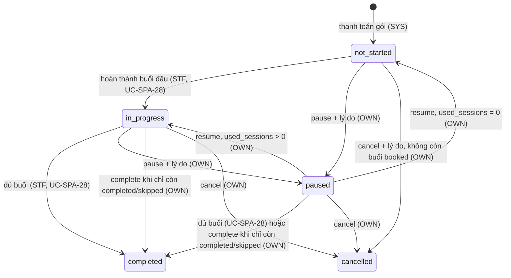

# Dịch vụ, gói đã mua & liệu trình — đặc tả

- **Nhóm:** `Purchases` (UC-SPA-18, 20), `Treatments` (UC-SPA-19, 21) · **Sprint:** 2 · **Nguồn:** DA §2.2.3 (UC Xem dịch vụ và gói đã mua, Theo dõi liệu trình, Xem lịch sử sử dụng) / ĐX (UC-SPA-21 chưa có bảng đặc tả trong DA)
- **Entity:** `ServiceEntitlement` (bảng `service_entitlements`), `CustomerPackage` (`customer_packages`), `TreatmentPlan` (`treatment_plans`), `TreatmentSession` (`treatment_sessions`); đọc thêm `OrderItem`, `Order`, `Payment`, `Appointment`, `SkinProfile`, `StaffMember`, `Customer`, `SpaService`, `ServicePackage`, `ServicePackageItem` — xem [glossary](../domain/glossary.md), [data-model](../domain/data-model.md)
- **Trạng thái triển khai:** UC-SPA-18 duyệt và xong phần backend ngày 30/10/2026 theo [plan](../superpowers/plans/2026-10-30-uc-spa-15-18-bookings-purchases.md); UC-SPA-19, 20, 21 duyệt và xong phần backend ngày 31/10/2026 (Q-37 → Q-40) theo [plan](../superpowers/plans/2026-10-31-uc-spa-19-20-21-treatments.md) — xem [progress.md](../progress.md)
- **Đã đặc tả:** đợt 1 = UC-SPA-18, chỉ backend, làm cùng UC-SPA-15 đợt 2 ([bookings.md](bookings.md)): danh sách là nơi khách bắt đầu luồng 2 đặt lịch. Đợt 2 = UC-SPA-19 (khách theo dõi liệu trình), UC-SPA-20 (lịch sử sử dụng dịch vụ), UC-SPA-21 (chủ spa/nhân viên quản lý liệu trình), chỉ backend. **Chưa làm:** job đánh dấu hết hạn (BR-TRT-01), lịch sử chăm sóc theo khách `/customers/{id}/care-history` (làm cùng UC-SPA-26), xem [Việc để sau](#việc-để-sau).

## Use case

### UC-SPA-18 — Xem dịch vụ và gói đã mua

| Mục            | Nội dung                                                                                                                             |
| -------------- | ------------------------------------------------------------------------------------------------------------------------------------ |
| Actor          | Khách hàng                                                                                                                           |
| Mô tả          | Khách xem dịch vụ lẻ và gói đã mua cùng hạn dùng, trạng thái, số buổi đã dùng/tổng, rồi chọn đặt lịch, xem liệu trình, xem đơn nguồn |
| Tiền điều kiện | Đã đăng nhập, `role = customer` (quyền `purchase.self`)                                                                              |
| Input          | Bộ lọc `type?`, `status?`; sản phẩm đã mua được chọn                                                                                 |
| Output         | Danh sách dịch vụ lẻ và gói cùng hạn dùng, trạng thái; chi tiết một sản phẩm                                                         |

**Luồng chính**

1. Khách mở "Dịch vụ và gói của tôi" (SCR-W16, SCR-M14); client gọi `GET /me/purchases`.
2. Hệ thống lấy `service_entitlements` và `customer_packages` của khách (BR-SEC-01), sắp mới mua trước.
3. Hệ thống trả hai danh sách với hạn dùng, **trạng thái hiệu lực** (BR-TRT-04), số buổi, `canBook` và buổi kế tiếp của gói.
4. Khách chọn một dịch vụ hoặc gói; client gọi `GET /me/purchases/services/{id}` hoặc `GET /me/purchases/packages/{id}`.

**Luồng rẽ nhánh**

- A1. **Đặt lịch** bằng quyền đã mua: dịch vụ lẻ `canBook = true` → client chuyển sang luồng 2 của UC-SPA-15 với `serviceEntitlementId`; gói có `nextSession.canBook = true` → với `treatmentSessionId = nextSession.id` (ngày tối thiểu `nextSession.earliestDate`).
- A2. **Xem liệu trình:** gói trả `treatmentPlan.id` để chuyển sang UC-SPA-19 (`/me/treatments/{id}`, chưa làm).
- A3. **Xem đơn nguồn:** mỗi sản phẩm trả `order: { id, code }`; client gọi `GET /me/orders/{id}` (đã có).
- A4. **Chưa có sản phẩm:** `200` với hai mảng rỗng; client hiển thị trạng thái trống và liên kết tới danh mục.
- A5. **Lọc:** `type = service | package` chỉ trả một mảng (mảng kia rỗng); `status` lọc theo trạng thái hiệu lực.

**Ngoại lệ**

- E1. `type`/`status` sai giá trị (ví dụ `status = booked` khi `type = package`) → `400 validation_error`.
- E2. Sản phẩm không tồn tại hoặc của khách khác → `404 entitlement_not_found` / `404 customer_package_not_found`.
- E3. Chưa đăng nhập → `401`; không phải khách hàng → `403`.

**Quy tắc áp dụng:** BR-TRT-01, 02, 04, 05, BR-BKG-05, BR-SEC-01, RBAC `purchase.self`.

### UC-SPA-19 — Theo dõi liệu trình chăm sóc da

| Mục            | Nội dung                                                                                                           |
| -------------- | ------------------------------------------------------------------------------------------------------------------ |
| Actor          | Khách hàng                                                                                                         |
| Mô tả          | Khách xem mục tiêu, tiến độ và trạng thái từng buổi của các liệu trình; buổi đủ điều kiện thì chuyển sang đặt lịch |
| Tiền điều kiện | Đã đăng nhập, `role = customer` (quyền `purchase.self`)                                                            |
| Input          | Bộ lọc `status?`; liệu trình và buổi được chọn                                                                     |
| Output         | Danh sách liệu trình; tiến độ và các buổi theo `sequence_number`; chi tiết một buổi                                |

**Luồng chính**

1. Khách mở "Liệu trình" (SCR-W17, SCR-M13), hoặc vào từ gói đã mua (UC-SPA-18 A2, `treatmentPlan.id`); client gọi `GET /me/treatments`.
2. Hệ thống trả các liệu trình của khách (BR-TRT-06), mới mua trước, kèm tiến độ `usedSessions/totalSessions` và buổi kế tiếp.
3. Khách chọn một liệu trình; client gọi `GET /me/treatments/{id}`.
4. Hệ thống trả mục tiêu, ngày bắt đầu/dự kiến/kết thúc, nhân viên phụ trách, tiến độ và **mọi buổi theo thứ tự**, mỗi buổi có trạng thái, lịch hẹn hiện tại (nếu có), `canBook`, `reason`, `earliestDate` (BR-TRT-10).
5. Khách chọn một buổi; client gọi `GET /me/treatments/{id}/sessions/{sessionId}`.
6. Hệ thống trả chi tiết buổi: dịch vụ, thời lượng, trạng thái, lịch hẹn (ngày giờ, nhân viên), kết quả chăm sóc khi đã hoàn thành.

**Luồng rẽ nhánh**

- A1. **Buổi đủ điều kiện** (`canBook = true`) → client chuyển sang luồng 2 của UC-SPA-15 với `treatmentSessionId` và ngày tối thiểu `earliestDate`.
- A2. **Buổi chưa đủ điều kiện** → chỉ hiển thị chi tiết, kèm `reason` (ví dụ "Cần đặt lịch các buổi trước theo thứ tự.", "Liệu trình đang tạm dừng hoặc đã hủy.").
- A3. **Chưa có liệu trình** → `200 []`; client hiển thị trạng thái trống và liên kết tới gói dịch vụ.
- A4. **Liệu trình tạm dừng/đã hủy** → trả kèm `statusReason` do chủ spa ghi (BR-TRT-08).

**Ngoại lệ**

- E1. `status` sai giá trị → `400 validation_error`.
- E2. Liệu trình không tồn tại hoặc của khách khác → `404 treatment_plan_not_found`; buổi không thuộc liệu trình → `404 treatment_session_not_found`.
- E3. Chưa đăng nhập → `401`; không phải khách hàng → `403`.

**Quy tắc áp dụng:** BR-TRT-03, 04, 05, 06, 10, BR-BKG-05, BR-SEC-01, RBAC `purchase.self`.

### UC-SPA-20 — Xem lịch sử sử dụng dịch vụ

| Mục            | Nội dung                                                                                                                |
| -------------- | ----------------------------------------------------------------------------------------------------------------------- |
| Actor          | Khách hàng                                                                                                              |
| Mô tả          | Khách xem các lần đã sử dụng dịch vụ (lịch hẹn `completed`, cả `no_show` — Q-40), lọc theo thời gian/dịch vụ/trạng thái |
| Tiền điều kiện | Đã đăng nhập, `role = customer` (quyền `purchase.self`)                                                                 |
| Input          | `fromDate?`, `toDate?`, `spaServiceId?`, `status?` (`completed\|no_show`), `page`, `pageSize`; lần sử dụng được chọn    |
| Output         | Danh sách phân trang các lần sử dụng; chi tiết một lần gồm nhân viên và kết quả buổi                                    |

**Luồng chính**

1. Khách mở "Lịch sử sử dụng" (SCR-W18, SCR-M21); client gọi `GET /me/service-history`.
2. Hệ thống trả các lịch hẹn `completed` và `no_show` của khách (BR-TRT-11), mới nhất trước, phân trang; mỗi dòng có `status`.
3. Khách chọn khoảng ngày, dịch vụ và/hoặc trạng thái; client gọi lại với `fromDate`, `toDate`, `spaServiceId`, `status`.
4. Hệ thống trả các lần phù hợp.
5. Khách chọn một lần; client gọi `GET /me/service-history/{appointmentId}`.
6. Hệ thống trả chi tiết: ngày giờ, dịch vụ, nhân viên, nguồn (dịch vụ lẻ hoặc buổi thứ mấy của gói nào), kết quả chăm sóc.

**Luồng rẽ nhánh**

- A1. **Không có kết quả** → `200` với `items` rỗng, `totalCount = 0`; client hiển thị "Chưa có lịch sử phù hợp".

**Ngoại lệ**

- E1. `fromDate > toDate`, `spaServiceId` không phải Guid, `status` khác `completed`/`no_show` → `400 validation_error`.
- E2. Lịch hẹn không tồn tại, của khách khác hoặc không ở `completed`/`no_show` → `404 appointment_not_found`.
- E3. Chưa đăng nhập → `401`; không phải khách hàng → `403`.

**Quy tắc áp dụng:** BR-TRT-11, BR-SEC-01, RBAC `purchase.self`.

### UC-SPA-21 — Quản lý liệu trình và lịch sử chăm sóc của khách hàng

Toàn bộ đặc tả là **ĐỀ XUẤT** (DA chưa có bảng kịch bản, ghi chú rà soát sheet `26`).

| Mục            | Nội dung                                                                                                                                                                       |
| -------------- | ------------------------------------------------------------------------------------------------------------------------------------------------------------------------------ |
| Actor          | Chủ spa; Nhân viên (liệu trình mình phụ trách)                                                                                                                                 |
| Mô tả          | Xem và cập nhật liệu trình (mục tiêu, ngày dự kiến kết thúc, ghi chú, ghi chú buổi), chủ spa đổi nhân viên phụ trách và chuyển trạng thái; xem lịch sử chăm sóc của liệu trình |
| Tiền điều kiện | Đã đăng nhập, `role = owner` hoặc `staff` (quyền `treatment.manage`)                                                                                                           |
| Input          | Bộ lọc `search?`, `customerId?`, `status?`, `primaryStaffMemberId?`, trang; liệu trình được chọn; thông tin cập nhật                                                           |
| Output         | Danh sách liệu trình phân trang; chi tiết gồm các buổi, hồ sơ da, lịch sử chăm sóc; liệu trình sau cập nhật                                                                    |

**Luồng chính**

1. Actor mở "Liệu trình" (chủ spa SCR-W36, nhân viên SCR-W29); client gọi `GET /treatments`.
2. Hệ thống trả liệu trình trong phạm vi (BR-TRT-06): chủ spa tất cả; nhân viên các liệu trình mình phụ trách (và liệu trình có buổi được phân công cho mình, Q-37).
3. Actor tìm theo tên/SĐT khách (không phân biệt dấu), trạng thái, nhân viên phụ trách và chọn một liệu trình; client gọi `GET /treatments/{id}`.
4. Hệ thống trả mục tiêu, tiến độ, các buổi (kèm lịch hẹn hiện tại), hồ sơ da lập trong các lần chăm sóc của liệu trình, lịch sử chăm sóc (các lần `completed`/`no_show`), cờ `canEdit`, `canManage`.
5. Actor sửa mục tiêu, ngày dự kiến kết thúc, ghi chú; client gọi `PUT /treatments/{id}`.
6. Hệ thống kiểm tra (BR-TRT-07) rồi lưu và trả chi tiết mới.

**Luồng rẽ nhánh**

- A1. **Chủ spa đổi nhân viên phụ trách** → `POST /treatments/{id}/assign-staff` `{ staffMemberId | null }`; nhân viên phải đang làm việc (BR-TRT-07). Không đổi nhân viên của các lịch hẹn đã đặt (đổi từng lịch qua UC-SPA-17).
- A2. **Chủ spa chuyển trạng thái** (BR-TRT-08): tạm dừng `POST …/pause { reason }`, tiếp tục `POST …/resume`, hủy `POST …/cancel { reason }`, đóng liệu trình `POST …/complete` (khi không còn buổi chưa đặt/đã đặt — gói có buổi `skipped`, CARE-LATER-03).
- A3. **Ghi chú buổi** → `PUT /treatments/{id}/sessions/{sessionId} { note }` (BR-TRT-09).
- A4. **Nhân viên chỉ được xem** (có buổi được phân công nhưng không phụ trách) → chi tiết có `canEdit = false`.

**Ngoại lệ**

- E1. Dữ liệu không hợp lệ (mục tiêu/ghi chú > 2000 ký tự, `expectedEndDate < startDate`, lý do rỗng hoặc > 500 ký tự) → `400 validation_error`.
- E2. Nhân viên sửa liệu trình mình không phụ trách → `403 treatment_not_in_charge`; nhân viên gọi thao tác của chủ spa (A1, A2) → `403`.
- E3. Liệu trình ngoài phạm vi hoặc không tồn tại → `404 treatment_plan_not_found`; buổi không thuộc liệu trình → `404 treatment_session_not_found`.
- E4. Sửa liệu trình đã `completed`/`cancelled`, chuyển trạng thái không hợp lệ → `409 treatment_status_invalid`.
- E5. Hủy liệu trình còn buổi `booked` → `409 treatment_has_booked_sessions`; đóng liệu trình còn buổi `not_booked`/`booked` → `409 treatment_sessions_remaining`.
- E6. Nhân viên sửa ghi chú buổi đã `completed`/`skipped` → `409 treatment_session_completed`.
- E7. Nhân viên phụ trách không tồn tại → `404 staff_not_found`; đã nghỉ việc → `400 staff_resigned`.
- E8. Chưa đăng nhập → `401`; khách hàng → `403`.

**Quy tắc áp dụng:** BR-TRT-03, 06, 07, 08, 09, BR-SEC-01, RBAC `treatment.manage`.

## Business rules

| Mã        | Quy tắc                                                                                                                                                                                                                                                                                                                                                                              | Enforce ở đâu                | Nguồn   |
| --------- | ------------------------------------------------------------------------------------------------------------------------------------------------------------------------------------------------------------------------------------------------------------------------------------------------------------------------------------------------------------------------------------ | ---------------------------- | ------- |
| BR-TRT-01 | Hạn dùng: gói `expires_at_utc` = lúc thanh toán + `validity_days` (Q-10, có sẵn từ UC-SPA-11); dịch vụ lẻ `expires_at_utc` null = không giới hạn (Q-06). Job đánh dấu `expired` **chưa làm** (TRT-LATER-01): thay bằng BR-TRT-04                                                                                                                                                     | Application                  | DA + ĐX |
| BR-TRT-02 | Trạng thái quyền: `available → booked` (đặt, UC-SPA-15) → `used` (hoàn thành, UC-SPA-28); hủy lịch → `available`                                                                                                                                                                                                                                                                     | Domain                       | ĐX      |
| BR-TRT-04 | **Trạng thái hiệu lực** khi đọc: quyền `available` có `expires_at_utc ≤ bây giờ` → trả `expired`; gói `active` có `expires_at_utc ≤ bây giờ` → trả `expired`. Không ghi lại CSDL (Q-32). Lọc `status` dùng trạng thái hiệu lực                                                                                                                                                       | Application (truy vấn đọc)   | ĐX      |
| BR-TRT-05 | `canBook`: dịch vụ lẻ khi trạng thái hiệu lực `available`. Gói: `nextSession` = buổi `not_booked` có `sequence_number` nhỏ nhất; `nextSession.canBook` khi gói hiệu lực `active`, liệu trình không `paused`/`cancelled`; `earliestDate` = max(hôm nay, ngày sớm nhất theo BR-BKG-05). Hết buổi `not_booked` → `nextSession` null. Cùng một hàm điều kiện với `POST /me/appointments` | Application (hàm dùng chung) | ĐX      |

**Đợt 2 (UC-SPA-19, 20, 21):**

| Mã        | Quy tắc                                                                                                                                                                                                                                                                                                                                                                                                                                                                                                                                                                                                                                                                                                                                                                                                                                                                                                  | Enforce ở đâu                                                                                    | Nguồn                                             |
| --------- | -------------------------------------------------------------------------------------------------------------------------------------------------------------------------------------------------------------------------------------------------------------------------------------------------------------------------------------------------------------------------------------------------------------------------------------------------------------------------------------------------------------------------------------------------------------------------------------------------------------------------------------------------------------------------------------------------------------------------------------------------------------------------------------------------------------------------------------------------------------------------------------------------------- | ------------------------------------------------------------------------------------------------ | ------------------------------------------------- |
| BR-TRT-03 | (có sẵn, UC-SPA-28) Hoàn thành buổi cập nhật `used_sessions`, gói/liệu trình `completed` khi đủ buổi; `start_date` = ngày lần hoàn thành đầu tiên. **`start_date` không sửa tay** (BR-TRT-07)                                                                                                                                                                                                                                                                                                                                                                                                                                                                                                                                                                                                                                                                                                            | Domain + CHECK                                                                                   | DA                                                |
| BR-TRT-06 | **Phạm vi** (BR-SEC-01): khách — liệu trình có `customer_packages.customer_id` = mình; chủ spa — tất cả; nhân viên — liệu trình có `primary_staff_member_id` = mình, **hoặc** (khi `Treatments:AssignedStaffCanView`, Q-37) có buổi gắn lịch hẹn `pending_confirmation`/`confirmed`/`completed`/`no_show` của mình. Ngoài phạm vi → `404 treatment_plan_not_found` (không lộ tồn tại). **Được sửa** (`canEdit`): chủ spa, hoặc nhân viên phụ trách; liệu trình không `completed`/`cancelled`                                                                                                                                                                                                                                                                                                                                                                                                             | Application (truy vấn + kiểm tra)                                                                | DA + ĐX                                           |
| BR-TRT-07 | `PUT /treatments/{id}`: `goal` ≤ 2000, `note` ≤ 2000 (chuỗi rỗng/khoảng trắng → null), `expectedEndDate` ≥ `startDate` khi cả hai có. Thay toàn bộ ba trường. `assign-staff` (chủ spa): `staffMemberId` null = bỏ phụ trách; nhân viên phải tồn tại và `IsWorkingOn(hôm nay)`; không kiểm tra kỹ năng (nhân viên từng buổi chọn lúc đặt lịch)                                                                                                                                                                                                                                                                                                                                                                                                                                                                                                                                                            | Domain (`TreatmentPlan.UpdateDetails`, `AssignPrimaryStaff`) + Application                       | ĐX                                                |
| BR-TRT-08 | **Trạng thái liệu trình** (chủ spa, WF-06): `pause` từ `not_started`/`in_progress`, lý do 1–500 ký tự; `resume` từ `paused` → `in_progress` nếu `used_sessions > 0`, ngược lại `not_started`, xóa lý do; `cancel` từ `not_started`/`in_progress`/`paused`, lý do bắt buộc, **không còn buổi `booked`**, gói → `cancelled` (không hoàn tiền — ngoài phạm vi); `complete` từ `in_progress`/`paused` khi **không còn buổi `not_booked`/`booked`** (chỉ còn `completed`/`skipped`), gói → `completed`, `actual_end_date` = ngày hoàn thành buổi gần nhất (không có thì hôm nay). Lý do lưu ở cột mới `status_reason`. Tạm dừng không đụng lịch đã đặt: buổi đã đặt vẫn hoàn thành được (BR-CARE-03), buổi chưa đặt bị chặn đặt mới (BR-TRT-05). Các thao tác khóa dòng khách rồi dòng gói (cùng thứ tự với đặt lịch: nhân viên → khách; hoàn thành: lịch → gói) để đặt buổi đồng thời không lọt qua `cancel` | Domain (`TreatmentPlan.Pause/Resume/Cancel/Close`, `CustomerPackage.Cancel/Close`) + Application | ĐX                                                |
| BR-TRT-09 | **Ghi chú buổi** `PUT /treatments/{id}/sessions/{sessionId}` (`note` ≤ 2000): nhân viên phụ trách chỉ buổi `not_booked`/`booked`; chủ spa mọi buổi (sửa kết quả đã ghi lúc hoàn thành). Liệu trình `cancelled` → `409 treatment_status_invalid` cho cả hai                                                                                                                                                                                                                                                                                                                                                                                                                                                                                                                                                                                                                                               | Domain + Application                                                                             | DA (rà soát: "không sửa buổi đã hoàn thành") + ĐX |
| BR-TRT-10 | **Buổi cho khách**: `canBook`, `reason`, `earliestDate` của **mỗi** buổi tính bằng `EntitlementEligibility.ForSession` (cùng hàm với `POST /me/appointments`, UC-SPA-18 `nextSession`); buổi không `not_booked` có `canBook = false`, `earliestDate` null. **Lịch hẹn hiện tại** của buổi = lịch mới nhất không `cancelled`/`hold_expired`. Khách thấy kết quả buổi (`treatment_sessions.note`), tên nhân viên, `goal`, `statusReason`; **không** thấy `treatment_plans.note` (ghi chú nội bộ) và hồ sơ da (Q-39)                                                                                                                                                                                                                                                                                                                                                                                        | Application                                                                                      | DA + ĐX                                           |
| BR-TRT-11 | **Lịch sử sử dụng**: lịch hẹn `completed` (DA) **và `no_show`** (Q-40, quyết định 31/10/2026) của khách; lọc `status`. Lần `no_show` có `result` null. Dịch vụ suy ra như Q-25 (buổi → quyền → dòng đơn, `AppointmentServiceSource`); lọc `spaServiceId` theo dịch vụ suy ra; `fromDate`/`toDate` theo `appointments.date` (bao gồm hai đầu), không giới hạn khoảng (đã phân trang). Sắp `date desc, start_time desc`. Kết quả buổi = `treatment_sessions.note` với lịch của gói, `appointments.note` với dịch vụ lẻ (UC-SPA-28)                                                                                                                                                                                                                                                                                                                                                                         | Application + Infrastructure (truy vấn)                                                          | DA + ĐX                                           |

**Phân quyền** (sheet `21`): `purchase.self` → `customer` (policy mới; đợt 2 dùng lại cho `/me/treatments*`, `/me/service-history*`); `treatment.manage` → `owner`, `staff` (policy mới; phạm vi nhân viên kiểm tra ở Application theo BR-TRT-06). Thao tác `assign-staff`, `pause`, `resume`, `cancel`, `complete` chỉ chủ spa: kiểm tra vai trò ở Application (`403 forbidden`), không thêm policy.

## Trạng thái

Không có chuyển trạng thái mới trong UC-SPA-18 (chỉ đọc). Xem WF-04, WF-05 ở [bookings.md](bookings.md) và [orders.md](orders.md).

**Đợt 2 — liệu trình (WF-06, UC-SPA-21):** chuyển `not_started → in_progress` và `→ completed` khi đủ buổi do UC-SPA-28 làm (có sẵn); các chuyển còn lại do chủ spa.

Gói đi theo: `cancel` → `customer_packages.status = cancelled`; `complete` → `completed`. Trạng thái buổi không đổi (buổi `not_booked` của liệu trình đã hủy/đóng không đặt được nữa vì BR-TRT-05).

## Dữ liệu

| Bảng                                        | Cột dùng                                                                                | Thay đổi  |
| ------------------------------------------- | --------------------------------------------------------------------------------------- | --------- |
| `service_entitlements`, `customer_packages` | tất cả                                                                                  | Không đổi |
| `order_items`, `orders`, `payments`         | `product_name`, `spa_service_id`, `service_package_id`, `code`, `paid_at_utc`           | Không đổi |
| `spa_services`, `service_packages`          | `image_url`, `duration_minutes` (ảnh và thời lượng hiện tại)                            | Không đổi |
| `treatment_plans`, `treatment_sessions`     | `id`, `status`, `sequence_number`, `spa_service_id`, `service_name`, `duration_minutes` | Không đổi |
| `appointments`                              | lịch chiếm chỗ của quyền/buổi (hiển thị lịch đã đặt)                                    | Không đổi |

**Không đổi schema, không có migration.** Thời điểm mua của dịch vụ lẻ (`purchasedAtUtc`) = `payments.paid_at_utc` của lần thanh toán `succeeded`; đơn 0 đ (không có `payments`) dùng `orders.created_at_utc`.

**Đợt 2:**

| Bảng                                  | Cột dùng                                                                                                | Thay đổi                                                                                              |
| ------------------------------------- | ------------------------------------------------------------------------------------------------------- | ----------------------------------------------------------------------------------------------------- |
| `treatment_plans`                     | tất cả; ghi `goal`, `expected_end_date`, `note`, `primary_staff_member_id`, `status`, `actual_end_date` | **Thêm cột** `status_reason` text null (DA: LyDoTrangThai — ĐX): lý do tạm dừng/hủy, xóa khi tiếp tục |
| `treatment_sessions`                  | tất cả; ghi `note`                                                                                      | Không đổi                                                                                             |
| `customer_packages`                   | tất cả; ghi `status` (`cancelled`, `completed`)                                                         | Không đổi                                                                                             |
| `appointments`                        | lịch của buổi; lịch `completed` của khách (lịch sử)                                                     | Không đổi; dùng index `(customer_id, date)` có sẵn                                                    |
| `skin_profiles`                       | hồ sơ của các lịch hẹn thuộc liệu trình                                                                 | Không đổi                                                                                             |
| `customers`, `users`, `staff_members` | tên, SĐT khách (tìm `f_unaccent`), tên nhân viên, `resignation_date`                                    | Không đổi                                                                                             |
| `order_items`, `service_entitlements` | suy ra dịch vụ của lịch dịch vụ lẻ (Q-25)                                                               | Không đổi                                                                                             |

Một migration `AddTreatmentPlanStatusReason`. Sửa `docs/spec-source/data_db.py` (bảng `treatment_plans`) rồi sinh lại `data-model.md` và Excel.

## API

Tiền tố `/api/v1`, envelope chuẩn, policy `purchase.self`. Thời điểm ISO-8601 UTC, ngày `yyyy-MM-dd`, giờ `HH:mm`.

| Method | Đường dẫn                     | Vai trò    | Request                                                                                                                                                               | Response                                                                                                                                                                                                                                                                                                                                                                                                                                                             | Lỗi                                        |
| ------ | ----------------------------- | ---------- | --------------------------------------------------------------------------------------------------------------------------------------------------------------------- | -------------------------------------------------------------------------------------------------------------------------------------------------------------------------------------------------------------------------------------------------------------------------------------------------------------------------------------------------------------------------------------------------------------------------------------------------------------------- | ------------------------------------------ |
| GET    | `/me/purchases`               | Khách hàng | `?type=service\|package&status=` (`service`: `available\|booked\|used\|expired`; `package`: `active\|completed\|expired\|cancelled`; có `status` thì bắt buộc `type`) | 200 `{ services: [PurchasedServiceDto], packages: [PurchasedPackageDto] }`, sắp `purchasedAtUtc desc`                                                                                                                                                                                                                                                                                                                                                                | 400, 401, 403                              |
| GET    | `/me/purchases/services/{id}` | Khách hàng | —                                                                                                                                                                     | 200 `PurchasedServiceDto { id, spaServiceId, serviceName, imageUrl, durationMinutes, status, expiresAtUtc, purchasedAtUtc, canBook, appointment?: { id, date, startTime, endTime, status }, order: { id, code } }`                                                                                                                                                                                                                                                   | 401, 403, 404 `entitlement_not_found`      |
| GET    | `/me/purchases/packages/{id}` | Khách hàng | —                                                                                                                                                                     | 200 `PurchasedPackageDto { id, servicePackageId, packageName, imageUrl, status, purchasedAtUtc, activatedAtUtc, expiresAtUtc, totalSessions, usedSessions, bookedSessions, treatmentPlan: { id, status }, nextSession?: { id, sequenceNumber, spaServiceId, serviceName, durationMinutes, canBook, earliestDate }, order: { id, code } }`; chi tiết thêm `items: [{ spaServiceId, serviceName, totalSessions, completedSessions, bookedSessions }]` theo thứ tự buổi | 401, 403, 404 `customer_package_not_found` |

- Danh sách không phân trang (một khách có ít sản phẩm); trần an toàn `Purchases:MaxListItems` (200) mỗi mảng.
- `serviceName`, `packageName` lấy bản chụp lúc mua (`order_items.product_name`, `customer_packages.package_name`); `imageUrl`, `durationMinutes` lấy từ catalog hiện tại (null nếu không có ảnh).
- `appointment` của dịch vụ lẻ: lịch chiếm chỗ hoặc `completed` gần nhất gắn quyền (nếu có).
- Sửa tại chỗ các dòng TRT 065–067 trong `data_api.py` cho khớp (tên trường, `loai` → `type`, `trangThai` → `status`, mã lỗi); không thêm dòng.

**Đợt 2 — khách hàng** (policy `purchase.self`):

| Method | Đường dẫn                                  | Vai trò    | Request                                                                                                                 | Response                                                                                                                                                                                                                                                                                                                                                                                                        | Lỗi                                                                      |
| ------ | ------------------------------------------ | ---------- | ----------------------------------------------------------------------------------------------------------------------- | --------------------------------------------------------------------------------------------------------------------------------------------------------------------------------------------------------------------------------------------------------------------------------------------------------------------------------------------------------------------------------------------------------------- | ------------------------------------------------------------------------ |
| GET    | `/me/treatments`                           | Khách hàng | `?status=not_started\|in_progress\|completed\|paused\|cancelled`                                                        | 200 `MyTreatmentPlanListItemDto[] { id, customerPackageId, packageName, imageUrl, status, packageStatus (hiệu lực), expiresAtUtc, totalSessions, usedSessions, bookedSessions, primaryStaff?: { id, fullName }, nextSession?: { id, sequenceNumber, serviceName, canBook, earliestDate } }`, sắp `purchasedAtUtc desc`, trần `Purchases:MaxListItems`                                                           | 400, 401, 403                                                            |
| GET    | `/me/treatments/{id}`                      | Khách hàng | —                                                                                                                       | 200 `MyTreatmentPlanDto { …list item, goal, statusReason, startDate, expectedEndDate, actualEndDate, purchasedAtUtc, order: { id, code }, sessions: [MyTreatmentSessionDto { id, sequenceNumber, spaServiceId, serviceName, durationMinutes, status, completedAtUtc, canBook, reason, earliestDate, appointment?: { id, date, startTime, endTime, status, staff: { id, fullName } } }] }` theo `sequenceNumber` | 401, 403, 404 `treatment_plan_not_found`                                 |
| GET    | `/me/treatments/{id}/sessions/{sessionId}` | Khách hàng | —                                                                                                                       | 200 `MyTreatmentSessionDto` + `result` (`note` khi `completed`, ngược lại null)                                                                                                                                                                                                                                                                                                                                 | 401, 403, 404 `treatment_plan_not_found` / `treatment_session_not_found` |
| GET    | `/me/service-history`                      | Khách hàng | `?fromDate&toDate&spaServiceId&status=completed\|no_show&pageNumber&pageSize` (`yyyy-MM-dd`; mặc định 1/10, tối đa 100) | 200 `PagedResult<ServiceHistoryItemDto { appointmentId, status, date, startTime, endTime, spaServiceId, serviceName, staff: { id, fullName }, source: "service"\|"package", treatmentPlanId?, packageName?, sequenceNumber? }>`                                                                                                                                                                                 | 400, 401, 403                                                            |
| GET    | `/me/service-history/{appointmentId}`      | Khách hàng | —                                                                                                                       | 200 `ServiceHistoryDetailDto { …item, durationMinutes, result, completedAtUtc?, serviceEntitlementId?, treatmentSessionId?, order?: { id, code } }`                                                                                                                                                                                                                                                             | 401, 403, 404 `appointment_not_found`                                    |

`serviceName` của lần sử dụng: tên chụp của buổi (`treatment_sessions.service_name`) hoặc dòng đơn (`order_items.product_name`). `imageUrl` từ gói trong catalog hiện tại.

**Đợt 2 — quản lý** (policy `treatment.manage`; chủ spa toàn bộ, nhân viên theo BR-TRT-06; thao tác chỉ chủ spa đánh dấu **OWN**):

| Method | Đường dẫn                               | Vai trò            | Request                                                                                                                                          | Response                                                                                                                                                                                                                                                                                                                                                                                                                                                                                                                                                                                                             | Lỗi                                                                                                                                        |
| ------ | --------------------------------------- | ------------------ | ------------------------------------------------------------------------------------------------------------------------------------------------ | -------------------------------------------------------------------------------------------------------------------------------------------------------------------------------------------------------------------------------------------------------------------------------------------------------------------------------------------------------------------------------------------------------------------------------------------------------------------------------------------------------------------------------------------------------------------------------------------------------------------- | ------------------------------------------------------------------------------------------------------------------------------------------ |
| GET    | `/treatments`                           | OWN, STF           | `?search&customerId&status&primaryStaffMemberId&pageNumber&pageSize` (`search` tên/SĐT khách, không phân biệt dấu, ≤ 200 ký tự như `PagedQuery`) | 200 `PagedResult<TreatmentPlanListItemDto { id, customer: { id, fullName, phoneNumber }, packageName, status, packageStatus (hiệu lực), expiresAtUtc, totalSessions, usedSessions, bookedSessions, primaryStaff?, nextSession?: { id, sequenceNumber, serviceName, status, appointment?: { id, date, startTime } }, purchasedAtUtc }>`, sắp `purchasedAtUtc desc`                                                                                                                                                                                                                                                    | 400, 401, 403                                                                                                                              |
| GET    | `/treatments/{id}`                      | OWN, STF           | —                                                                                                                                                | 200 `TreatmentPlanDto { …list item, customerPackageId, goal, note, statusReason, startDate, expectedEndDate, actualEndDate, canEdit, canManage, hasAllergies, sessions: [TreatmentSessionDto { id, sequenceNumber, spaServiceId, serviceName, durationMinutes, status, note, completedAtUtc, appointment? }], skinProfiles: [{ id, appointmentId, sequenceNumber, assessedAtUtc, skinType, mainConcerns, careGoals, recommendedTreatment, assessedBy: { id, fullName } }], careHistory: [{ appointmentId, sequenceNumber, date, startTime, endTime, status (completed\|no_show), staff, result, skinProfileId? }] }` | 401, 403, 404 `treatment_plan_not_found`                                                                                                   |
| PUT    | `/treatments/{id}`                      | OWN, STF phụ trách | `{ goal?, expectedEndDate?, note? }`                                                                                                             | 200 `TreatmentPlanDto`                                                                                                                                                                                                                                                                                                                                                                                                                                                                                                                                                                                               | 400, 401, 403 `treatment_not_in_charge`, 404, 409 `treatment_status_invalid`                                                               |
| PUT    | `/treatments/{id}/sessions/{sessionId}` | OWN, STF phụ trách | `{ note? }`                                                                                                                                      | 200 `TreatmentSessionDto`                                                                                                                                                                                                                                                                                                                                                                                                                                                                                                                                                                                            | 400, 401, 403 `treatment_not_in_charge`, 404 `treatment_session_not_found`, 409 `treatment_session_completed` / `treatment_status_invalid` |
| POST   | `/treatments/{id}/assign-staff`         | **OWN**            | `{ staffMemberId: Guid \| null }`                                                                                                                | 200 `TreatmentPlanDto`                                                                                                                                                                                                                                                                                                                                                                                                                                                                                                                                                                                               | 400 `staff_resigned`, 401, 403, 404 `staff_not_found`, 409 `treatment_status_invalid`                                                      |
| POST   | `/treatments/{id}/pause`                | **OWN**            | `{ reason }`                                                                                                                                     | 200 `TreatmentPlanDto`                                                                                                                                                                                                                                                                                                                                                                                                                                                                                                                                                                                               | 400, 401, 403, 404, 409 `treatment_status_invalid`                                                                                         |
| POST   | `/treatments/{id}/resume`               | **OWN**            | —                                                                                                                                                | 200 `TreatmentPlanDto`                                                                                                                                                                                                                                                                                                                                                                                                                                                                                                                                                                                               | 401, 403, 404, 409 `treatment_status_invalid`                                                                                              |
| POST   | `/treatments/{id}/cancel`               | **OWN**            | `{ reason }`                                                                                                                                     | 200 `TreatmentPlanDto`                                                                                                                                                                                                                                                                                                                                                                                                                                                                                                                                                                                               | 400, 401, 403, 404, 409 `treatment_status_invalid` / `treatment_has_booked_sessions`                                                       |
| POST   | `/treatments/{id}/complete`             | **OWN**            | —                                                                                                                                                | 200 `TreatmentPlanDto`                                                                                                                                                                                                                                                                                                                                                                                                                                                                                                                                                                                               | 401, 403, 404, 409 `treatment_status_invalid` / `treatment_sessions_remaining`                                                             |

- `hasAllergies`: khách có dòng `customer_allergies` (chi tiết đọc qua `/customers/{id}/allergies`, UC-SPA-27 — chủ spa đọc; nhân viên theo Q-36).
- `canManage` = người gọi là chủ spa. `skinProfiles`, `careHistory` sắp theo ngày lịch hẹn tăng dần.
- `data_api.py`: sửa tại chỗ dòng 079–087 (tên trường tiếng Anh, mã lỗi; dòng 086 `PUT /treatments/{id}` chỉ còn `goal`, `expectedEndDate`, `note` — bỏ `idNhanVienPhuTrach`, `ngayBatDau`, `trangThai`); **thêm cuối danh sách** SPA-API-123 `assign-staff`, 124 `pause`, 125 `resume`, 126 `cancel`, 127 `complete`. Dòng 088 (`/customers/{id}/care-history`) giữ cho UC-SPA-26 (CARE-LATER-01).

## Cấu hình

| Biến `.env` | Khóa                                    | Mặc định                                                                                                                        |
| ----------- | --------------------------------------- | ------------------------------------------------------------------------------------------------------------------------------- |
| —           | `Purchases:MaxListItems`                | `200`                                                                                                                           |
| —           | `Treatments:AssignedStaffCanView`       | `true` (Q-37)                                                                                                                   |
| —           | `Treatments:ShowSkinProfilesToCustomer` | `false` (Q-39; bật thì `MyTreatmentSessionDto` có thêm `skinProfile?` tóm tắt: `skinType`, `careGoals`, `recommendedTreatment`) |

Không có biến `.env` mới.

## Màn hình

| Mã      | Nền tảng | Route                               | Hành động chính                         |
| ------- | -------- | ----------------------------------- | --------------------------------------- |
| SCR-W16 | Web      | `/my-packages`                      | Đặt lịch; Xem liệu trình; Xem đơn nguồn |
| SCR-M14 | Android  | `app/(customer)/packages/index.tsx` | Đặt lịch; Xem liệu trình                |

| SCR-W17 | Web | `/my-treatment-plans`, `/my-treatment-plans/:id` | Đặt lịch buổi đủ điều kiện; drawer chi tiết buổi |
| SCR-M13 | Android | `app/(customer)/treatments/index.tsx` | Đặt lịch buổi |
| SCR-W18 | Web | `/my-history` | Lọc khoảng ngày, dịch vụ; xem chi tiết |
| SCR-M21 | Android | `app/(customer)/history.tsx` | Xem |
| SCR-W29 | Web | `/staff/treatments` | Cập nhật mục tiêu/ghi chú |
| SCR-W36 | Web | `/owner/treatments` | Cập nhật; đổi nhân viên phụ trách; tạm dừng/hủy/đóng |

Giao diện chưa làm lần này (chỉ backend).

## Kiểm thử bắt buộc

Unit test hàm trạng thái hiệu lực và `nextSession`/`canBook` (đồng hồ giả); integration test `PostgresFixture`, dữ liệu mua tạo qua `EntitlementIssuer` hoặc chèn trực tiếp.

| Mã      | Tình huống                                                                                                                                                               | Kết quả mong đợi                                                                                                                  |
| ------- | ------------------------------------------------------------------------------------------------------------------------------------------------------------------------ | --------------------------------------------------------------------------------------------------------------------------------- |
| TRT-T01 | Khách có 2 dịch vụ lẻ (`available`, `booked` có lịch) và 1 gói 10 buổi (2 `completed`, 1 `booked`)                                                                       | 200; đủ 2 + 1, sắp mới trước; dịch vụ `booked` có `appointment`; gói `usedSessions` 2, `bookedSessions` 1, `nextSession` = buổi 4 |
| TRT-T02 | Khách chưa mua gì (A4)                                                                                                                                                   | 200, hai mảng rỗng                                                                                                                |
| TRT-T03 | Không lộ dữ liệu người khác: khách B có sản phẩm; khách A gọi danh sách và chi tiết sản phẩm của B                                                                       | Danh sách của A không có; chi tiết → `404 entitlement_not_found` / `404 customer_package_not_found`                               |
| TRT-T04 | Quyền `available` có `expires_at_utc` quá khứ; gói `active` quá hạn                                                                                                      | Trả `status = expired`, `canBook = false`, `nextSession.canBook = false`; CSDL không đổi (BR-TRT-04)                              |
| TRT-T05 | Lọc `type=service&status=available`; `type=package&status=expired`; `status=used` không có `type`; `type=package&status=booked`                                          | Đúng dòng; đúng dòng; `400`; `400`                                                                                                |
| TRT-T06 | `nextSession.earliestDate`: buổi 1 đã `completed` hôm qua, `min_days_between_sessions` = 7                                                                               | `earliestDate` = hôm qua + 7; khớp với `POST /me/appointments` (đặt trước ngày đó → `400 session_too_early`)                      |
| TRT-T07 | Liệu trình `paused`; hết buổi `not_booked`                                                                                                                               | `nextSession.canBook = false`; `nextSession = null`                                                                               |
| TRT-T08 | Chi tiết gói: `items` gom theo dịch vụ đúng số buổi tổng/hoàn thành/đã đặt; `order` đúng mã; `purchasedAtUtc` của dịch vụ lẻ = `paid_at_utc`, đơn 0 đ = `created_at_utc` | Đúng                                                                                                                              |
| TRT-T09 | Sau luồng 1 thành công (UC-SPA-15), danh sách có quyền `booked` với `appointment` `confirmed`                                                                            | Đúng                                                                                                                              |
| TRT-T10 | Chủ spa, nhân viên gọi `/me/purchases*`; không Bearer                                                                                                                    | `403`; `401`                                                                                                                      |
| TRT-T11 | Hồi quy                                                                                                                                                                  | Toàn bộ test hiện có vẫn pass; `PersistenceModelTests` pass                                                                       |

**Đợt 2.** Unit test các phương thức trạng thái của `TreatmentPlan`/`CustomerPackage`/`TreatmentSession` (Domain.Tests), service với NSubstitute + đồng hồ giả (phạm vi, `canEdit`, lỗi); integration test `PostgresFixture` cho truy vấn, khóa và phân quyền.

| Mã      | Tình huống                                                                                                                                                                                                                                                                                        | Kết quả mong đợi                                                                                                                                                                                                                                                                                                     |
| ------- | ------------------------------------------------------------------------------------------------------------------------------------------------------------------------------------------------------------------------------------------------------------------------------------------------- | -------------------------------------------------------------------------------------------------------------------------------------------------------------------------------------------------------------------------------------------------------------------------------------------------------------------- |
| TRT-T12 | UC-19: khách có gói 4 buổi (1 `completed`, 1 `booked` có lịch `confirmed`, 2 `not_booked`), `min_days_between_sessions` = 7                                                                                                                                                                       | `GET /me/treatments` 1 dòng, `usedSessions` 1, `bookedSessions` 1, `nextSession` = buổi 3. Chi tiết: 4 buổi theo thứ tự; buổi 2 có `appointment` + nhân viên; buổi 3 `canBook = true`, `earliestDate` = max(hôm nay, ngày buổi 2 + 7); buổi 4 `canBook = false`, `reason` "Cần đặt lịch các buổi trước theo thứ tự." |
| TRT-T13 | UC-19: `canBook`/`earliestDate` của buổi khớp `POST /me/appointments` (đặt trước `earliestDate` → `400 session_too_early`; đặt buổi 4 → `409 entitlement_not_eligible`)                                                                                                                           | Đúng (cùng `EntitlementEligibility`)                                                                                                                                                                                                                                                                                 |
| TRT-T14 | UC-19: liệu trình `paused` có `statusReason`; gói quá hạn                                                                                                                                                                                                                                         | `canBook = false` với lý do tương ứng; `statusReason` trả về; `packageStatus = expired`                                                                                                                                                                                                                              |
| TRT-T15 | UC-19: chi tiết buổi `completed`                                                                                                                                                                                                                                                                  | `result` = ghi chú buổi; không có `note` của liệu trình; không có hồ sơ da (Q-39 mặc định)                                                                                                                                                                                                                           |
| TRT-T16 | UC-19: lọc `status=in_progress`; `status=abc`; khách chưa có gói                                                                                                                                                                                                                                  | Đúng dòng; `400`; `200 []`                                                                                                                                                                                                                                                                                           |
| TRT-T17 | UC-19 phạm vi: khách A gọi liệu trình/buổi của khách B; buổi của liệu trình khác                                                                                                                                                                                                                  | `404 treatment_plan_not_found`; `404 treatment_session_not_found`                                                                                                                                                                                                                                                    |
| TRT-T18 | UC-20: khách có 3 lịch `completed` (2 dịch vụ lẻ khác dịch vụ, 1 buổi gói), 1 `confirmed`, 1 `no_show`, 1 `cancelled`; lọc `status=no_show`; `status=cancelled`                                                                                                                                   | 4 lịch (3 `completed` + 1 `no_show`, `status` đúng), sắp mới trước; lọc `no_show` → 1 dòng; `cancelled` → `400`; dòng gói có `source = package`, `packageName`, `sequenceNumber`; dịch vụ lẻ `source = service`                                                                                                      |
| TRT-T19 | UC-20 lọc: `fromDate`/`toDate` bao hai đầu; `spaServiceId` khớp cả lịch gói và lịch lẻ của cùng dịch vụ; `fromDate > toDate`; phân trang `pageSize = 2`                                                                                                                                           | Đúng dòng; đúng; `400`; `totalCount` 3, 2 trang                                                                                                                                                                                                                                                                      |
| TRT-T20 | UC-20 chi tiết: lịch lẻ có `result` = `appointments.note`; lịch gói có `result` = `treatment_sessions.note`; lịch `no_show`; lịch `confirmed` của mình; lịch `completed` của khách khác                                                                                                           | Đúng; đúng; 200 `result` null; `404 appointment_not_found` ×2                                                                                                                                                                                                                                                        |
| TRT-T21 | UC-21 danh sách chủ spa: lọc `search` không dấu ("nguyen" khớp "Nguyễn"), theo SĐT, `status`, `primaryStaffMemberId`, `customerId`; phân trang                                                                                                                                                    | Đúng dòng, `totalCount` đúng                                                                                                                                                                                                                                                                                         |
| TRT-T22 | UC-21 phạm vi nhân viên: S1 phụ trách P1; S2 có lịch `confirmed` của một buổi P1; S3 không liên quan; S2 khi `Treatments:AssignedStaffCanView = false`                                                                                                                                            | S1 thấy P1 `canEdit = true`; S2 thấy P1 `canEdit = false`; S3 không thấy, chi tiết `404`; S2 (tắt) `404`                                                                                                                                                                                                             |
| TRT-T23 | UC-21 chi tiết: `sessions` kèm lịch hiện tại, `skinProfiles` của lịch thuộc liệu trình (không lẫn hồ sơ của lịch dịch vụ lẻ), `careHistory` gồm `completed` + `no_show`, `hasAllergies`                                                                                                           | Đúng                                                                                                                                                                                                                                                                                                                 |
| TRT-T24 | UC-21 `PUT`: chủ spa sửa ba trường; S1 sửa; S2 sửa; `goal` 2001 ký tự; `expectedEndDate < startDate`; liệu trình `completed`/`cancelled`                                                                                                                                                          | 200 ×2; `403 treatment_not_in_charge`; `400` ×2; `409 treatment_status_invalid`                                                                                                                                                                                                                                      |
| TRT-T25 | UC-21 ghi chú buổi: S1 sửa buổi `not_booked`; S1 sửa buổi `completed`; chủ spa sửa buổi `completed`; buổi của liệu trình khác; liệu trình `cancelled`                                                                                                                                             | 200; `409 treatment_session_completed`; 200; `404 treatment_session_not_found`; `409 treatment_status_invalid`                                                                                                                                                                                                       |
| TRT-T26 | UC-21 `assign-staff`: nhân viên đang làm; `null`; nhân viên đã nghỉ (hôm nay ≥ `resignation_date`); id lạ; nhân viên gọi                                                                                                                                                                          | 200, `primaryStaff` đổi, S mới thấy liệu trình `canEdit = true`; 200 bỏ phụ trách; `400 staff_resigned`; `404 staff_not_found`; `403`                                                                                                                                                                                |
| TRT-T27 | UC-21 `pause`/`resume`: pause `in_progress` + lý do → `paused`, `statusReason` lưu, khách không đặt được buổi kế tiếp (`409 entitlement_not_eligible`) nhưng buổi đã đặt vẫn hoàn thành được (UC-SPA-28); resume khi `used_sessions` = 0 / > 0; pause liệu trình `paused`/`completed`; lý do rỗng | Đúng trạng thái, lý do xóa khi resume; `not_started` / `in_progress`; `409` ×2; `400`                                                                                                                                                                                                                                |
| TRT-T28 | UC-21 `cancel`: còn buổi `booked` → `409 treatment_has_booked_sessions`; hủy lịch hẹn rồi cancel → liệu trình và gói `cancelled`, `GET /me/purchases` gói `cancelled`, `nextSession.canBook = false`; cancel lại                                                                                  | `409`; 200; `409 treatment_status_invalid`                                                                                                                                                                                                                                                                           |
| TRT-T29 | UC-21 `complete` (CARE-LATER-03): gói 3 buổi (2 `completed`, 1 `skipped`) → 200, liệu trình và gói `completed`, `actual_end_date` = ngày buổi hoàn thành gần nhất; còn buổi `not_booked` → `409 treatment_sessions_remaining`; liệu trình `not_started` → `409 treatment_status_invalid`          | Đúng                                                                                                                                                                                                                                                                                                                 |
| TRT-T30 | UC-21 đồng thời: khách đặt buổi kế tiếp cùng lúc chủ spa `cancel` (chạy song song nhiều lần)                                                                                                                                                                                                      | Đúng một kết quả hợp lệ: hoặc đặt thành công và cancel `409 treatment_has_booked_sessions`, hoặc cancel thành công và đặt `409 entitlement_not_eligible`; không deadlock, không có buổi `booked` trong liệu trình `cancelled`                                                                                        |
| TRT-T31 | Phân quyền: không Bearer gọi mọi route đợt 2; nhân viên/chủ spa gọi `/me/treatments*`, `/me/service-history*`; khách gọi `/treatments*`; nhân viên gọi `pause`/`resume`/`cancel`/`complete`/`assign-staff`                                                                                        | `401`; `403`; `403`; `403`                                                                                                                                                                                                                                                                                           |
| TRT-T32 | Hồi quy                                                                                                                                                                                                                                                                                           | Toàn bộ test hiện có vẫn pass (gồm UC-SPA-15/18/28); `PersistenceModelTests` pass với migration `AddTreatmentPlanStatusReason` và `data-model.md` sinh lại                                                                                                                                                           |

## Câu hỏi còn mở

- Q-06 (có sẵn): dịch vụ lẻ không có hạn dùng → `expires_at_utc` null, luôn hiển thị "Không giới hạn".
- Q-10 (có sẵn): gói kích hoạt khi thanh toán → `activatedAtUtc` = `purchasedAtUtc`.
- Q-32 (đã chốt): Chưa có job đánh dấu hết hạn (BR-TRT-01 "job đánh dấu HetHan") thì hiển thị thế nào? Mặc định: **tính trạng thái hiệu lực khi đọc, không ghi CSDL** (BR-TRT-04); job làm sau (TRT-LATER-01). Không cấu hình.
- Q-07 (có sẵn), CARE-LATER-03: gói có buổi `skipped` không tự `completed` → chủ spa đóng bằng `POST /treatments/{id}/complete` (BR-TRT-08).
- Q-37 (đã chốt 31/10/2026): Nhân viên thấy những liệu trình nào? `primary_staff_member_id` chưa bao giờ được gán tự động (thanh toán tạo liệu trình không có người phụ trách), nên chỉ dựa vào người phụ trách thì nhân viên thường thấy danh sách rỗng. Mặc định: **thấy liệu trình mình phụ trách (sửa được) và liệu trình có buổi gắn lịch `pending_confirmation`/`confirmed`/`completed`/`no_show` của mình (chỉ xem)**; `Treatments:AssignedStaffCanView` = `true`, tắt thì chỉ liệu trình phụ trách. Không tự gán người phụ trách.
- Q-38 (đã chốt 31/10/2026): Chủ spa chuyển trạng thái liệu trình thế nào, ảnh hưởng gói và lịch đã đặt ra sao? Mặc định: BR-TRT-08 — tạm dừng giữ lịch đã đặt, chặn đặt mới; hủy chỉ khi không còn buổi `booked` (chủ spa hủy lịch trước qua UC-SPA-17), gói `cancelled`, không hoàn tiền; đóng khi chỉ còn buổi `completed`/`skipped`. Lý do lưu cột mới `treatment_plans.status_reason`. Không cấu hình (quy tắc trạng thái).
- Q-39 (đã chốt 31/10/2026): Khách có xem hồ sơ da và ghi chú liệu trình không? Mặc định: **không** (ghi chú liệu trình và hồ sơ da là thông tin nội bộ; khách xem mục tiêu, kết quả từng buổi, lý do tạm dừng/hủy); `Treatments:ShowSkinProfilesToCustomer` = `false`.
- Q-40 (đã chốt 31/10/2026): Lịch sử sử dụng có gồm lần khách không đến? **Có** — `completed` và `no_show`, mỗi dòng có `status`, lọc được; lần `no_show` không có kết quả. Không cấu hình (DA chỉ ghi HoanThanh; người dùng chọn mở rộng).

## Việc để sau

| Mã           | Việc                                                                                                                                                                                 | Làm cùng                               |
| ------------ | ------------------------------------------------------------------------------------------------------------------------------------------------------------------------------------ | -------------------------------------- |
| TRT-LATER-01 | Job nền đánh dấu quyền/gói `expired` (WF-04, WF-05); khi có job, BR-TRT-04 vẫn giữ để không lệch giữa hai lần chạy. Đợt 2 vẫn chưa làm: trạng thái hiệu lực đủ dùng cho UC-SPA-19/21 | Khi cần báo cáo hoặc thông báo hết hạn |
| TRT-LATER-02 | ~~`GET /me/treatments`, `/me/treatments/{id}`~~ — làm trong đợt 2 (UC-SPA-19)                                                                                                        | ✔ đợt 2                                |
| TRT-LATER-03 | shared-types, api-client, màn hình SCR-W16, SCR-M14, SCR-M10, SCR-W17, SCR-M13, SCR-W18, SCR-M21, SCR-W29, SCR-W36                                                                   | Đợt FE                                 |
| TRT-LATER-04 | `GET /customers/{id}/care-history` (lịch sử chăm sóc mọi lần của một khách, kể cả dịch vụ lẻ) — SPA-API-088                                                                          | UC-SPA-26 (CARE-LATER-01)              |
| TRT-LATER-05 | Hoàn tiền/bù buổi khi hủy liệu trình; thông báo cho khách khi liệu trình tạm dừng/hủy (BR-NTF)                                                                                       | UC-SPA-13, 34                          |
| TRT-LATER-06 | Đánh giá từ lịch sử sử dụng (SCR-W18 "Đánh giá", `hasReview`)                                                                                                                        | UC-SPA-30                              |

## Giao diện (web): UC-SPA-18 (kèm chi tiết gói và nhật ký liệu trình)

Phạm vi: "Gói của tôi" (SCR-W16) và trang **chi tiết gói kèm nhật ký liệu trình** (`/my-packages/:packageId`, theo mẫu Stitch đã chốt; phần nhật ký dùng API UC-SPA-19 `GET /me/treatments/{id}`, chỉ đọc). Không làm lần này: mobile (SCR-M14), danh sách liệu trình `/my-treatment-plans` và lịch sử sử dụng (UC-SPA-20).

Feature mới `src/features/purchases/` (theo `Purchases` của backend). Trang `src/pages/customer/MyPackagesPage.tsx` thay trang giữ chỗ ở `/my-packages`, thêm `MyPackageDetailPage.tsx` cho `/my-packages/:packageId`; cả hai nằm trong khung "Trang của tôi". Dùng lại `OrderDetailSheet` của `features/orders` cho "Xem đơn" (`features/orders` không import ngược `purchases`).

### Mẫu Stitch đã chốt (project web `9696885610900739659`)

| Màn                     | Mẫu                                                                                             | Lấy gì                                                                                                                                                                          |
| ----------------------- | ----------------------------------------------------------------------------------------------- | ------------------------------------------------------------------------------------------------------------------------------------------------------------------------------- |
| SCR-W16 Gói của tôi     | `…/fa1058c280af4378b5c7570e588d866c` (Gói Dịch Vụ Của Tôi, Menu Cột Trái)                       | Tiêu đề, chip lọc có số đếm, ô tìm kiếm, sắp xếp; thẻ gói có hộp ba chỉ số (tiến độ, số buổi còn, hạn dùng), dòng buổi kế tiếp, liên kết "Xem chi tiết nhật ký" và nút đặt lịch |
| Chi tiết gói và nhật ký | `…/6bc21f64c17d4535997e2b0e69a0ee18` (Chi Tiết Gói Dịch Vụ & Nhật Ký Liệu Trình, Menu Cột Trái) | Breadcrumb, "Quay lại danh sách gói", thẻ đầu trang với ba chỉ số và nút đặt lịch buổi tiếp theo, danh sách các buổi theo thứ tự                                                |

**Nội dung Stitch tự thêm, hệ thống không có (bỏ khi code):** mã gói "NN-CAMO-10" (dùng mã đơn thay), nhãn danh mục "Liệu trình chuyên sâu", "bảo lưu 120 ngày" (chỉ ghi "Còn N ngày"), "Chưa kích hoạt" và "Kích hoạt và đặt lịch buổi 1" (gói được kích hoạt ngay khi mua, Q-10), "Tải hoặc in hồ sơ gói (PDF)", đánh giá sao và nhận xét từng buổi (UC-SPA-29), tên phòng từng buổi, "Hội viên Sen Vàng", mã hội viên (hotline xem ghi chú ở `docs/specs/bookings.md`).

### Hợp đồng dùng chung

- `packages/shared-types/src/purchases.ts`: `EntitlementStatus` (`available | booked | used | expired`), `CustomerPackageStatus` (`active | completed | expired | cancelled`), `TreatmentPlanStatus` (`not_started | in_progress | completed | paused | cancelled`), `PurchasedService`, `PurchasedPackage`, `NextSession`, `PackageItemProgress`, `PurchaseOrderRef`, `PurchaseAppointment`, `Purchases`.
- `packages/shared-types/src/treatments.ts` (chỉ phần chi tiết cho khách): `TreatmentSessionStatus` (`not_booked | booked | completed | skipped`), `StaffRef`, `SessionAppointment { id; date; startTime; endTime; status; staff }`, `MyTreatmentSession` (`id`, `sequenceNumber`, `spaServiceId`, `serviceName`, `durationMinutes`, `status`, `completedAtUtc`, `canBook`, `reason`, `earliestDate`, `appointment`, `result`), `MyTreatmentPlan` (`id`, `customerPackageId`, `packageName`, `status`, `packageStatus`, `expiresAtUtc`, `totalSessions`, `usedSessions`, `bookedSessions`, `primaryStaff`, `nextSession`, `goal`, `statusReason`, `startDate`, `expectedEndDate`, `actualEndDate`, `purchasedAtUtc`, `order`, `sessions`).
- `packages/api-client/src/purchases.ts`: `PurchasesApi.list()`, `getPackage(id)`, `getService(id)`; `purchasesQueryKeys.all/list/package(id)`; `purchaseErrorCodes` (`entitlement_not_found`, `customer_package_not_found`, `validation_error`). `packages/api-client/src/treatments.ts`: `TreatmentsApi.get(id)`, `getSession(id, sessionId)`; `treatmentsQueryKeys.all/detail(id)/session(id, sessionId)`; `treatmentErrorCodes` (`treatment_plan_not_found`, `treatment_session_not_found`).
- Hooks: `usePurchases`, `usePurchasedPackage`, `useTreatmentPlan`, `useTreatmentSession`.
- Nhãn (`features/purchases/purchaseStatus.ts`): quyền `available` "Còn hiệu lực" (`success`), `booked` "Đã đặt lịch" (`info`), `used` "Đã sử dụng" (`neutral`), `expired` "Hết hạn" (`neutral`); gói `active` "Đang dùng" (`success`), `completed` "Hoàn thành" (`info`), `expired` "Hết hạn" (`neutral`), `cancelled` "Đã hủy" (`danger`); buổi `not_booked` "Chưa đặt lịch" (`neutral`), `booked` "Đã đặt lịch" (`info`), `completed` "Đã hoàn thành" (`success`), `skipped` "Đã bỏ qua" (`neutral`). Trạng thái là **trạng thái hiệu lực** do API tính (BR-TRT-04), FE không tự đổi theo hạn.

### SCR-W16 — Gói của tôi

- **Route:** `/my-packages` · khách hàng · khung "Trang của tôi" · Mẫu: **danh sách thẻ hai nhóm** (gói liệu trình, rồi dịch vụ lẻ). Không dùng `DataTable` vì là thẻ có thanh tiến độ và nút riêng.
- **Dữ liệu:** một truy vấn `GET /me/purchases` không tham số (`purchasesQueryKeys.list()`; tối đa `Purchases:MaxListItems` = 200 mỗi nhóm). Lọc, tìm kiếm và sắp xếp chạy ở client trên danh sách đã tải (để có số đếm trên chip, như mẫu).
- **Bố cục (theo Stitch):** `PageHeader` (dòng nhỏ "Tài khoản khách hàng", tiêu đề "Gói của tôi", mô tả "Theo dõi gói liệu trình, dịch vụ đã mua và đặt lịch bằng quyền của bạn"); thẻ bộ lọc: chip **Tất cả (n) | Đang dùng (n) | Hoàn thành (n) | Hết hạn (n)** (thêm "Đã hủy (n)" khi có), ô "Tìm theo tên", chọn sắp xếp "Mới mua nhất" (mặc định) hoặc "Sắp hết hạn" (`expiresAtUtc` tăng dần, không hạn xếp cuối). "Đang dùng" gồm gói `active` và quyền `available` hoặc `booked`; "Hoàn thành" gồm gói `completed` và quyền `used`; "Hết hạn" gồm `expired`. Tìm kiếm không phân biệt hoa thường và dấu. `?filter=`, `?q=`, `?sort=` trên URL; giá trị lạ bị bỏ qua.
- **Thẻ gói:** hàng đầu: `StatusBadge` và "Đơn {order.code}" (mở `OrderDetailSheet`); tên gói (font tiêu đề); hộp ba chỉ số: (1) "Tiến độ liệu trình": "{used}/{total} buổi đã thực hiện" + thanh tiến độ (`role="progressbar"`), (2) "Số buổi còn lại": "Còn {total − used} buổi" và dòng phụ "đã đặt lịch {booked}" khi `bookedSessions > 0`, (3) "Thời hạn": "Hạn đến {dd/MM/yyyy}" và "Còn {n} ngày" (từ `expiresAtUtc`, giờ Việt Nam; hết hạn thì "Đã hết hạn"). Dòng buổi kế tiếp: "Buổi {sequenceNumber} kế tiếp: {serviceName}, sớm nhất từ {earliestDate}" khi `nextSession` có giá trị. Chân thẻ: liên kết "Xem chi tiết nhật ký liệu trình" → `/my-packages/{id}`; nút chính "Đặt lịch buổi tiếp theo" (khi `nextSession.canBook`) → `/booking/new?treatmentSessionId={nextSession.id}&treatmentPlanId={treatmentPlan.id}`. Khi không đặt được, ẩn nút và ghi lý do ngắn theo trạng thái ("Gói đã hết hạn", "Gói đã hoàn thành", "Gói đã hủy", "Liệu trình đang tạm dừng" khi gói còn `active` mà `canBook = false`).
- **Thẻ dịch vụ lẻ (nhóm "Dịch vụ đã mua"):** ảnh nhỏ, tên, thời lượng, `StatusBadge`, "Hạn đến {ngày}" hoặc "Không giới hạn" (khi `expiresAtUtc` null), "Mua ngày {ngày}", "Đơn {code}". Nút: "Đặt lịch" (khi `canBook`) → `/booking/new?serviceEntitlementId={id}`; quyền `booked` có dòng "Đã đặt: {ngày}, {giờ}" và liên kết "Xem lịch hẹn" → `/my-bookings/{appointment.id}`.
- **Trạng thái:** tải (3 thẻ `Skeleton`); lỗi (`ErrorState` + "Thử lại"); rỗng hẳn: "Bạn chưa mua dịch vụ hay gói nào" + "Khám phá dịch vụ" và "Xem gói liệu trình"; rỗng do lọc hoặc tìm: "Không có mục nào phù hợp" + "Xem tất cả"; có dữ liệu.
- **Mã lỗi:** `401`/`403` → đăng nhập hoặc `/forbidden`; mất kết nối và `5xx` → `ErrorState` kèm "Thử lại".
- **Responsive và a11y:** 320px: thẻ xếp dọc, hộp ba chỉ số thành một cột, nút rộng hết hàng; chip lọc cuộn ngang; `role="progressbar"` có `aria-valuenow`, `aria-valuemax`.

### Chi tiết gói và nhật ký liệu trình

- **Route:** `/my-packages/:packageId` (`packageId` là `customerPackageId`) · khách hàng · khung "Trang của tôi" · Mẫu: **trang chi tiết** (thẻ đầu trang, rồi danh sách các buổi).
- **Dữ liệu:** `GET /me/purchases/packages/{id}` (`purchasesQueryKeys.package(id)`) cho thông tin gói, đơn và `treatmentPlan.id`; sau đó `GET /me/treatments/{treatmentPlan.id}` (`treatmentsQueryKeys.detail`) cho các buổi. `404 customer_package_not_found` hoặc `404 treatment_plan_not_found` → `EmptyState` "Không tìm thấy gói" + "Về Gói của tôi".
- **Thẻ đầu trang (theo Stitch):** breadcrumb "Tài khoản / Gói của tôi / {tên}" và liên kết "Quay lại danh sách gói"; `StatusBadge` gói, "Đơn {code}", "Mua ngày {ngày}"; tên gói lớn; mục tiêu (`goal`) nếu có; ba chỉ số như thẻ danh sách ("Tiến trình thực hiện {used}/{total} buổi hoàn thành" kèm thanh và "% hoàn thành", "Số buổi còn lại", "Thời hạn"); kỹ thuật viên phụ trách (`primaryStaff`) nếu có; nút "Đặt lịch buổi tiếp theo (Buổi {n})" khi `nextSession.canBook`. Gói `paused` hoặc `cancelled` (liệu trình): `Alert` hiện `statusReason`.
- **Mục "Nhật ký liệu trình {total} buổi":** mỗi buổi một hàng theo `sequenceNumber`: biểu tượng (✓ khi hoàn thành, số thứ tự các trạng thái khác), "BUỔI {n}" và `StatusBadge`, tên dịch vụ, dòng chi tiết:
  - `completed`: "Thực hiện ngày {ngày}, Kỹ thuật viên {tên}, {thời lượng} phút" (từ `appointment` và `completedAtUtc`) và nút "Xem ghi chú trị liệu" mở `Dialog` (`GET /me/treatments/{id}/sessions/{sessionId}`, hiện `result`; không có kết quả thì "Chưa có ghi chú").
  - `booked`: "{Thứ}, {ngày} · {HH:mm – HH:mm} · {kỹ thuật viên}" và liên kết "Xem lịch hẹn" → `/my-bookings/{appointment.id}`.
  - `not_booked`: khi `canBook`, nút "Đặt lịch buổi này" → `/booking/new?treatmentSessionId={id}&treatmentPlanId={plan.id}` (ngày sớm nhất `earliestDate`); không thì hiện `reason` từ API (ví dụ "Cần đặt lịch các buổi trước theo thứ tự.").
  - `skipped`: "Buổi này đã được bỏ qua".
- **Trạng thái:** tải (`Skeleton` thẻ đầu trang và danh sách); lỗi (`ErrorState` + "Thử lại"); mất kết nối và `5xx` như các màn khác.

### Nối các nút tạm

Xem mục "Nối các nút Đặt lịch đang để tạm" trong `docs/specs/bookings.md` (cùng đợt).

### Thiếu từ backend (chỉ liệt kê)

| Mục                                                                             | Ảnh hưởng                            | Tạm thời                                                                   |
| ------------------------------------------------------------------------------- | ------------------------------------ | -------------------------------------------------------------------------- |
| `GET /me/purchases` không trả số đếm theo trạng thái, không hỗ trợ tìm theo tên | Chip có số đếm và ô tìm kiếm của mẫu | Tính số đếm, lọc, tìm kiếm ở client trên danh sách đã tải (≤ 200 mỗi nhóm) |
| Gói không trả mô tả ngắn; ảnh có thể null                                       | Thẻ gói thiếu mô tả                  | `ImageWithFallback`, không hiện mô tả                                      |
| Buổi liệu trình không có tên phòng, đánh giá, ảnh                               | Không dựng các dòng này của mẫu      | Bỏ                                                                         |
| Hai lời gọi nối tiếp cho trang chi tiết (gói rồi liệu trình)                    | Chậm hơn một nhịp                    | Chấp nhận; liệu trình truy vấn theo `treatmentPlan.id`                     |

### Kiểm thử giao diện

| Mã         | Kiểm tra                                                                                                                                                                                                              |
| ---------- | --------------------------------------------------------------------------------------------------------------------------------------------------------------------------------------------------------------------- |
| PUR-UI-T01 | `PurchasesApi` và `TreatmentsApi`: đúng method và đường dẫn; kiểu giải mã được DTO mẫu                                                                                                                                |
| PUR-UI-T02 | Đủ 4 trạng thái; rỗng hẳn có hai CTA; rỗng do lọc có "Xem tất cả"                                                                                                                                                     |
| PUR-UI-T03 | Thẻ gói: tên, nhãn trạng thái, thanh tiến độ đúng số, số buổi còn, hạn dùng và "Còn N ngày", dòng buổi kế tiếp với `earliestDate`, mã đơn                                                                             |
| PUR-UI-T04 | "Đặt lịch buổi tiếp theo" chỉ khi `nextSession.canBook`, link có `treatmentSessionId` và `treatmentPlanId`; ẩn kèm lý do khi gói hết hạn, hoàn thành, hủy hoặc tạm dừng                                               |
| PUR-UI-T05 | Thẻ dịch vụ lẻ: "Đặt lịch" theo `canBook`, link `serviceEntitlementId`; quyền `booked` hiện lịch và link tới lịch hẹn; hạn null hiện "Không giới hạn"                                                                 |
| PUR-UI-T06 | Chip lọc có số đếm đúng, lọc đúng nhóm; tìm kiếm không phân biệt dấu; sắp xếp "Sắp hết hạn" đưa không hạn xuống cuối; URL giữ giá trị, giá trị lạ bị bỏ qua                                                           |
| PUR-UI-T07 | "Đơn {code}" mở chi tiết đơn nguồn                                                                                                                                                                                    |
| PUR-UI-T08 | Chi tiết gói: gọi `/me/purchases/packages/{id}` rồi `/me/treatments/{planId}`; thẻ đầu trang đủ chỉ số và `statusReason` khi tạm dừng; `404` hiện "Không tìm thấy gói"                                                |
| PUR-UI-T09 | Nhật ký: mỗi trạng thái buổi hiện đúng dòng (hoàn thành có ghi chú, đã đặt có link lịch hẹn, chưa đặt có nút hoặc `reason`, bỏ qua); "Xem ghi chú trị liệu" gọi chi tiết buổi và hiện `result` hoặc "Chưa có ghi chú" |
| PUR-UI-T10 | `/my-packages` và `/my-packages/:packageId` thuộc khu khách (chưa đăng nhập thì sang đăng nhập) và mục "Gói của tôi" được đánh dấu trong menu                                                                         |

## Giao diện (web): UC-SPA-19 — Theo dõi liệu trình chăm sóc da

Phạm vi: Danh sách liệu trình của tôi (`/my-treatment-plans`, SCR-W17) và trang **chi tiết liệu trình chăm sóc da** (`/my-treatment-plans/:id`, SCR-W17). Nằm trong khung "Trang của tôi" (`AccountLayout`), vai trò khách hàng (`customer`).
Không có Stitch MCP: Dựng trực tiếp theo Design Brief (`docs/design/DESIGN.md`), shadcn/ui primitives và theme tokens có sẵn.

### Hợp đồng dùng chung bổ sung

- `packages/shared-types/src/treatments.ts`:
  - `MyTreatmentListItem`: `{ id, customerPackageId, packageName, imageUrl, status, packageStatus, expiresAtUtc, totalSessions, usedSessions, bookedSessions, primaryStaff?: StaffRef, nextSession?: MyTreatmentNextSession }`.
- `packages/api-client/src/treatments.ts`:
  - `TreatmentsApi.list(status?: TreatmentPlanStatus): Promise<readonly MyTreatmentListItem[]>`.
  - `treatmentsQueryKeys.list(status?: string) = ['treatments', 'me', 'list', { status }]`.
  - Error codes: `treatment_plan_not_found`, `treatment_session_not_found`, `validation_error`.
- Nhãn & tông màu trạng thái liệu trình (`TreatmentPlanStatus`):
  - `not_started`: "Chưa bắt đầu" (`neutral`)
  - `in_progress`: "Đang thực hiện" (`success`)
  - `completed`: "Đã hoàn thành" (`info`)
  - `paused`: "Tạm dừng" (`warning`)
  - `cancelled`: "Đã hủy" (`danger`)

### SCR-W17 — Danh sách liệu trình của tôi

- **Route:** `/my-treatment-plans` · vai trò `customer` · layout `AccountLayout`.
- **Mẫu bố cục:** Danh sách thẻ phác đồ điều trị (`TreatmentPlanCard`). Không dùng `DataTable` vì mỗi liệu trình là một phác đồ có thanh tiến độ tổng thể, thông tin buổi kế tiếp và CTA đặt lịch.
- **Dữ liệu:** `GET /me/treatments?status={status}` (`treatmentsQueryKeys.list(status)`). Mặc định tải tất cả, lọc phía server khi chọn chip.
- **Bố cục:**
  - `PageHeader`: Tiêu đề "Liệu trình của tôi", mô tả "Theo dõi tiến độ phác đồ chăm sóc da và đặt lịch cho các buổi tiếp theo".
  - Thanh công cụ bộ lọc: Chip lọc trạng thái: **Tất cả (n) | Đang thực hiện | Chưa bắt đầu | Hoàn thành | Tạm dừng | Đã hủy**. Ô tìm kiếm nhanh theo tên gói liệu trình (chạy client-side trên danh sách đã tải). Đồng bộ `?status=` và `?q=` lên URL.
  - Thẻ liệu trình (`TreatmentPlanCard`):
    - Hàng đầu: `StatusBadge` liệu trình (`status`), `StatusBadge` gói (`packageStatus`), chuyên viên phụ trách (`primaryStaff` nếu có).
    - Tên gói liệu trình (font tiêu đề), ảnh đại diện (hoặc fallback).
    - Hộp chỉ số tiến độ: `{usedSessions}/{totalSessions} buổi hoàn thành` kèm thanh tiến độ (`role="progressbar"`), số buổi đã đặt `{bookedSessions}`.
    - Hạn sử dụng gói (`expiresAtUtc` & "Hạn đến {dd/MM/yyyy} · Còn {n} ngày").
    - Buổi kế tiếp (`nextSession`): "Buổi {n}: {serviceName} (Sớm nhất từ {earliestDate})". Nút bấm "Đặt lịch buổi tiếp theo" khi `nextSession.canBook = true` dẫn đến `/booking/new?treatmentSessionId={nextSession.id}&treatmentPlanId={id}`. Nếu `canBook = false`, hiển thị nhãn lý do (ví dụ: gói hết hạn, liệu trình tạm dừng).
    - Nút phụ: "Xem chi tiết liệu trình" dẫn đến `/my-treatment-plans/{id}`.
- **Trạng thái:**
  - Đang tải: 3 thẻ `Skeleton`.
  - Lỗi: `ErrorState` + nút "Thử lại".
  - Rỗng hoàn toàn: `EmptyState` "Bạn chưa có liệu trình chăm sóc nào" + nút CTA "Khám phá gói dịch vụ" dẫn đến `/packages`.
  - Rỗng do lọc/tìm: `EmptyState` "Không tìm thấy liệu trình phù hợp" + nút "Xem tất cả".

### SCR-W17 — Chi tiết phác đồ liệu trình & timeline buổi

- **Route:** `/my-treatment-plans/:id` · vai trò `customer` · layout `AccountLayout`.
- **Dữ liệu:** `GET /me/treatments/{id}` (`treatmentsQueryKeys.detail(id)`).
- **Bố cục:**
  - Breadcrumb: `Tài khoản / Liệu trình / {packageName}` + nút "Quay lại danh sách liệu trình".
  - Thẻ tổng quan phác đồ (`TreatmentPlanOverviewCard`):
    - Tên gói liệu trình, `StatusBadge`, mã đơn nguồn `order.code` (mở `OrderDetailSheet`).
    - Mục tiêu phác đồ (`goal`): khối trích dẫn làm nổi bật mục tiêu chăm sóc da.
    - Thời gian: Ngày bắt đầu (`startDate`), ngày dự kiến kết thúc (`expectedEndDate`), ngày hoàn thành thực tế (`actualEndDate`).
    - Chuyên viên phụ trách (`primaryStaff.fullName` nếu được gán).
    - Cảnh báo trạng thái: `Alert` hiển thị `statusReason` khi liệu trình ở trạng thái `paused` (Tạm dừng) hoặc `cancelled` (Đã hủy).
    - Hộp ba chỉ số tiến độ: (1) Số buổi thực hiện `{usedSessions}/{totalSessions}` + progressbar, (2) Số buổi còn lại `{totalSessions - usedSessions}`, (3) Thời hạn gói còn lại.
    - Nút CTA chính trên đầu trang: "Đặt lịch buổi tiếp theo (Buổi {n})" khi `nextSession.canBook = true`.
  - Timeline nhật ký phác đồ (`TreatmentSessionTimeline`):
    - Danh sách các buổi theo thứ tự `sequenceNumber`:
      - `completed`: Biểu tượng tích xanh, "Buổi {n}: {serviceName}", thời lượng `{durationMinutes} phút`, "Đã thực hiện: {ngày} · Kỹ thuật viên: {tên}". Nút "Xem ghi chú trị liệu" mở Drawer/Dialog chi tiết buổi.
      - `booked`: Biểu tượng lịch hẹn (info), "Buổi {n}: {serviceName}", thông tin lịch hẹn `{thứ, ngày} lúc {HH:mm - HH:mm}`, kỹ thuật viên phụ trách, liên kết "Xem lịch hẹn" dẫn tới `/my-bookings/{appointment.id}`.
      - `not_booked`: Biểu tượng tròn số thứ tự. Khi `canBook = true`: nút "Đặt lịch buổi này" dẫn tới `/booking/new?treatmentSessionId={id}&treatmentPlanId={planId}` (giới hạn ngày tối thiểu `earliestDate`). Khi `canBook = false`: dòng ghi chú lý do (`reason`, ví dụ "Cần đặt lịch các buổi trước theo thứ tự.").
      - `skipped`: Biểu tượng xám, "Buổi {n} đã được bỏ qua".
  - Drawer/Dialog chi tiết buổi (`TreatmentSessionDetailSheet`):
    - Gọi `GET /me/treatments/{id}/sessions/{sessionId}`.
    - Hiển thị kết quả chăm sóc `result` (ghi chú của kỹ thuật viên ghi lúc hoàn thành).
    - Nếu có cấu hình `Treatments:ShowSkinProfilesToCustomer` và có hồ sơ da: hiển thị tóm tắt loại da (`skinType`), mục tiêu chăm sóc (`careGoals`), phác đồ khuyến nghị (`recommendedTreatment`).
- **Trạng thái:** Tải (`Skeleton`), Lỗi (`ErrorState` + "Thử lại"), Không tìm thấy (`404` -> `EmptyState` "Không tìm thấy liệu trình" + nút "Về danh sách liệu trình").

---

## Giao diện (web): UC-SPA-20 — Xem lịch sử sử dụng dịch vụ

Phạm vi: Màn hình "Lịch sử sử dụng dịch vụ" (`/my-history`, SCR-W18). Nằm trong khung "Trang của tôi" (`AccountLayout`), vai trò khách hàng (`customer`).
Không có Stitch MCP: Dựng trực tiếp bằng `DataTable` chuẩn của hệ thống kết hợp `Sheet` chi tiết theo Design Brief.

### Hợp đồng dùng chung bổ sung

- `packages/shared-types/src/purchases.ts`:
  - `ServiceHistorySource`: `'service' | 'package'`.
  - `ServiceHistoryQuery`: `{ fromDate?: string; toDate?: string; spaServiceId?: string; status?: AppointmentStatus }`.
  - `ServiceHistoryItem`: `{ appointmentId: string; status: AppointmentStatus; date: string; startTime: string; endTime: string; spaServiceId: string; serviceName: string; staff: StaffRef; source: ServiceHistorySource; treatmentPlanId?: string; packageName?: string; sequenceNumber?: number }`.
  - `ServiceHistoryDetail`: `ServiceHistoryItem & { durationMinutes: number; result: string | null; completedAtUtc?: string | null; serviceEntitlementId?: string | null; treatmentSessionId?: string | null; order?: PurchaseOrderRef | null }`.
- `packages/api-client/src/purchases.ts` (hoặc `packages/api-client/src/serviceHistory.ts`):
  - `ServiceHistoryApi.list(query: ServiceHistoryQuery, paging: PagedQuery): Promise<PagedResult<ServiceHistoryItem>>`.
  - `ServiceHistoryApi.get(appointmentId: string): Promise<ServiceHistoryDetail>`.
  - `serviceHistoryQueryKeys`: `all = ['service-history']`, `list: (params) => ['service-history', 'list', params]`, `detail: (id) => ['service-history', 'detail', id]`.
  - Error codes: `appointment_not_found`, `validation_error`.
- Nhãn & tông màu trạng thái lần sử dụng:
  - `completed`: "Đã hoàn thành" (`success`)
  - `no_show`: "Không đến" (`danger`)

### SCR-W18 — Lịch sử sử dụng dịch vụ

- **Route:** `/my-history` · vai trò `customer` · layout `AccountLayout`.
- **Mẫu bố cục:** Danh sách bảng dữ liệu chuẩn `DataTable` phân trang server-side kết hợp thanh bộ lọc `FilterToolbar` và Drawer `Sheet` chi tiết lần chăm sóc (`ServiceHistoryDetailSheet`).
- **Dữ liệu:** `GET /me/service-history?fromDate=&toDate=&spaServiceId=&status=&pageNumber=&pageSize=` (`serviceHistoryQueryKeys.list(...)`).
- **Thanh công cụ bộ lọc (FilterToolbar):**
  - Khoảng ngày (`fromDate`, `toDate`): 2 ô chọn ngày (input `date`), hỗ trợ lọc linh hoạt theo thời gian.
  - Dịch vụ (`spaServiceId`): Dropdown chọn dịch vụ từ danh mục dịch vụ hoạt động (`useServices`).
  - Trạng thái (`status`): Dropdown chọn `Tất cả` | `Đã hoàn thành` (`completed`) | `Không đến` (`no_show`).
  - Nút "Đặt lại bộ lọc" khi có bất kỳ bộ lọc nào được áp dụng.
  - Thay đổi bộ lọc tự động đưa `pageNumber` về 1 và đồng bộ query param lên URL (`?fromDate=&toDate=&serviceId=&status=&page=`).
- **Các cột `DataTable`:**
  1. **Thời gian**: Ngày thực hiện (`dd/MM/yyyy`) và khung giờ (`HH:mm – HH:mm`). Sắp xếp mặc định ngày giờ giảm dần từ backend.
  2. **Dịch vụ**: Tên dịch vụ (`serviceName`).
  3. **Nguồn sử dụng**:
     - `source = "service"`: `Badge` màu xám nhạt "Dịch vụ lẻ".
     - `source = "package"`: `Badge` thương hiệu "Gói: {packageName}" kèm dòng phụ "Buổi {sequenceNumber}".
  4. **Kỹ thuật viên**: Tên kỹ thuật viên phụ trách (`staff.fullName`).
  5. **Trạng thái**: `StatusBadge` (`completed`: "Đã hoàn thành", `no_show`: "Không đến").
  6. **Thao tác**: Nút "Xem chi tiết" (icon con mắt hoặc text button) mở Sheet chi tiết.
- **Drawer chi tiết lần chăm sóc (`ServiceHistoryDetailSheet`):**
  - Mở khi khách bấm xem một dòng trong bảng; gọi `GET /me/service-history/{appointmentId}`.
  - Đầu trang: Tiêu đề "Chi tiết lần sử dụng dịch vụ", mã lịch hẹn, trạng thái `StatusBadge`.
  - Khối dịch vụ: Tên dịch vụ, thời lượng `{durationMinutes} phút`, ngày giờ thực hiện, kỹ thuật viên thực hiện.
  - Khối nguồn gốc:
    - Nếu từ gói: Tên gói liệu trình, buổi thứ `{sequenceNumber}`, liên kết "Xem liệu trình" (`/my-treatment-plans/{treatmentPlanId}`).
    - Nếu từ dịch vụ lẻ: Mã đơn hàng `order.code` (kèm nút "Xem đơn hàng" mở `OrderDetailSheet`).
  - Khối kết quả chăm sóc da (`result`):
    - Trạng thái `completed`: Khối trích dẫn hiển thị ghi chú kết quả chăm sóc của kỹ thuật viên (hoặc thông báo "Kỹ thuật viên chưa ghi chú kết quả" nếu `result` null).
    - Trạng thái `no_show`: Cảnh báo màu vàng "Buổi hẹn được ghi nhận vắng mặt (khách hàng không đến)".
  - Chân Sheet: Đóng sheet. (Lưu ý: nút "Đánh giá dịch vụ" đánh dấu hoãn cho UC-SPA-30 / TRT-LATER-06).
- **Trạng thái:**
  - Tải: `DataTableSkeleton` (5 dòng placeholder).
  - Lỗi: `ErrorState` kèm thông báo và nút "Thử lại".
  - Rỗng: `DataTable` empty state: "Chưa có lịch sử sử dụng dịch vụ nào" (hoặc "Không có lần sử dụng nào phù hợp với bộ lọc" kèm nút "Đặt lại bộ lọc").
- **Responsive và a11y:**
  - Trên màn hình hẹp (< 768px): Ẩn cột nguồn và kỹ thuật viên, gom gọn hiển thị dạng thẻ card trên mobile; nút "Xem chi tiết" trải rộng hoặc dùng icon dễ chạm (min 44px).
  - Sheet chi tiết hỗ trợ vuốt/đóng bằng bàn phím (Escape), focus trap tự động của Radix Dialog/Sheet.

---

### Bảng kiểm thử giao diện bổ sung (UC-SPA-19 & UC-SPA-20)

| Mã         | Màn hình | Kiểm tra                                                                                                                                                                                               |
| ---------- | -------- | ------------------------------------------------------------------------------------------------------------------------------------------------------------------------------------------------------ |
| TRT-UI-T11 | SCR-W17  | `TreatmentsApi.list`: Gọi đúng `GET /api/v1/me/treatments?status=...`; giải mã đúng DTO; hiển thị đủ 4 trạng thái (loading skeleton, error + retry, empty có CTA, có dữ liệu).                         |
| TRT-UI-T12 | SCR-W17  | Thẻ liệu trình: Hiển thị đúng tên gói, `StatusBadge` liệu trình & gói, thanh tiến độ số buổi `{used}/{total}`, hạn dùng, kỹ thuật viên phụ trách.                                                      |
| TRT-UI-T13 | SCR-W17  | Nút "Đặt lịch buổi tiếp theo" chỉ hiển thị khi `nextSession.canBook = true`, đường dẫn `/booking/new?treatmentSessionId=...&treatmentPlanId=...`; hiển thị lý do phù hợp khi không thể đặt.            |
| TRT-UI-T14 | SCR-W17  | Chip lọc trạng thái trên `/my-treatment-plans`: Lọc đúng danh sách; ô tìm kiếm theo tên không phân biệt hoa thường và dấu tiếng Việt; đồng bộ URL query params.                                        |
| TRT-UI-T15 | SCR-W17  | Chi tiết `/my-treatment-plans/:id`: Hiển thị đầy đủ mục tiêu `goal`, ngày bắt đầu/kết thúc, cảnh báo `statusReason` khi tạm dừng hoặc đã hủy; `404` hiển thị `EmptyState` "Không tìm thấy".            |
| TRT-UI-T16 | SCR-W17  | Timeline buổi: Buổi `completed` có nút xem ghi chú; buổi `booked` có link sang `/my-bookings/:id`; buổi `not_booked` có nút đặt lịch khi `canBook` hoặc hiển thị `reason`; buổi `skipped` hiện bỏ qua. |
| TRT-UI-T17 | SCR-W17  | Xem ghi chú trị liệu: Mở Sheet/Dialog, gọi `GET /me/treatments/{id}/sessions/{sessionId}` và hiển thị đúng kết quả `result` hoặc thông báo chưa có ghi chú.                                            |
| HIS-UI-T01 | SCR-W18  | `ServiceHistoryApi.list`: Gọi đúng `GET /api/v1/me/service-history?fromDate=...&pageNumber=...`; giải mã đúng `PagedResult<ServiceHistoryItem>`.                                                       |
| HIS-UI-T02 | SCR-W18  | Đủ 4 trạng thái trên `/my-history`: Skeleton khi đang tải, `ErrorState` khi lỗi kết nối, Empty state khi không có dữ liệu (hoặc khi lọc không khớp), hiển thị dữ liệu dạng `DataTable`.                |
| HIS-UI-T03 | SCR-W18  | Bộ lọc lịch sử: Lọc theo khoảng ngày (`fromDate`, `toDate`), dịch vụ (`spaServiceId`), trạng thái (`completed`, `no_show`); đổi bộ lọc tự động quay về trang 1 và đồng bộ URL.                         |
| HIS-UI-T04 | SCR-W18  | Phân trang `DataTable`: Chuyển trang và kích thước trang gọi API với `pageNumber` và `pageSize` tương ứng.                                                                                             |
| HIS-UI-T05 | SCR-W18  | Phân loại nguồn sử dụng: Dòng dịch vụ lẻ hiển thị badge "Dịch vụ lẻ"; dòng buổi của gói hiển thị badge "Gói: {packageName}" kèm buổi thứ `{sequenceNumber}`.                                           |
| HIS-UI-T06 | SCR-W18  | Drawer chi tiết: Bấm "Xem chi tiết" mở `ServiceHistoryDetailSheet`, gọi `GET /me/service-history/{appointmentId}`, hiển thị đầy đủ thời lượng, kỹ thuật viên, nguồn và kết quả chăm sóc `result`.      |
| HIS-UI-T07 | SCR-W18  | Trạng thái `no_show`: Hiển thị badge màu đỏ "Không đến", trong sheet chi tiết thông báo khách không đến, không có kết quả chăm sóc.                                                                    |
| HIS-UI-T08 | SCR-W18  | Điều hướng bảo vệ: Truy cập `/my-treatment-plans` hoặc `/my-history` khi chưa đăng nhập chuyển hướng sang `/login?redirect=...`; menu bên trái active đúng mục.                                        |

---

## Giao diện (web): Quản lý liệu trình của khách hàng (UC-SPA-21, SCR-W36)

- **Mã và route:** `SCR-W36` (theo `data_screens.py`), đường dẫn `/owner/treatments`, chạy trong `OwnerLayout` (hỗ trợ theme sáng và tối).
- **Quyền truy cập:** `role = owner` (chủ spa) và `staff` (kỹ thuật viên, theo phạm vi BR-TRT-06). Khi truy cập chưa đăng nhập $\rightarrow$ `/login?redirect=/owner/treatments`; sai vai trò $\rightarrow$ `/forbidden`.
- **Mẫu bố cục:**
  - Danh sách `DataTable` kết hợp bộ lọc trên đầu (`TreatmentFilterToolbar`).
  - Drawer chi tiết liệu trình trượt từ bên phải (`TreatmentDetailSheet`).
  - Modal cập nhật mục tiêu & phác đồ điều trị (`UpdateTreatmentDialog`).
  - Modal phân công / đổi kỹ thuật viên phụ trách (`AssignTreatmentStaffDialog`).
  - Modal cập nhật trạng thái liệu trình (`ChangeTreatmentStatusDialog` hỗ trợ Tạm dừng, Tiếp tục, Hủy, Đóng/Hoàn tất).
  - Modal cập nhật ghi chú buổi chăm sóc (`UpdateSessionNoteDialog`).

### Dữ liệu & Ánh xạ trạng thái

- **Endpoint chính:**
  - Danh sách: `GET /api/v1/treatments?search=&status=&primaryStaffMemberId=&pageNumber=&pageSize=` (`treatmentManageQueryKeys.list(params)`), trả `PagedResult<TreatmentPlanListItemDto>`.
  - Chi tiết: `GET /api/v1/treatments/{id}` (`treatmentManageQueryKeys.detail(id)`), trả `TreatmentPlanDto`.
  - Cập nhật mục tiêu: `PUT /api/v1/treatments/{id}` body `{ goal, expectedEndDate, note }`.
  - Ghi chú buổi: `PUT /api/v1/treatments/{id}/sessions/{sessionId}` body `{ note }`.
  - Đổi nhân viên phụ trách: `POST /api/v1/treatments/{id}/assign-staff` body `{ staffMemberId }` (null = bỏ phụ trách).
  - Tạm dừng: `POST /api/v1/treatments/{id}/pause` body `{ reason }`.
  - Tiếp tục: `POST /api/v1/treatments/{id}/resume`.
  - Hủy liệu trình: `POST /api/v1/treatments/{id}/cancel` body `{ reason }`.
  - Đóng hoàn thành: `POST /api/v1/treatments/{id}/complete`.
- **Trạng thái liệu trình (`TreatmentPlanStatus`):**
  - `not_started`: "Chưa bắt đầu" (`tone="neutral"`).
  - `in_progress`: "Đang thực hiện" (`tone="success"`).
  - `completed`: "Đã hoàn thành" (`tone="info"`).
  - `paused`: "Tạm dừng" (`tone="warning"`).
  - `cancelled`: "Đã hủy" (`tone="danger"`).
- **Trạng thái buổi chăm sóc (`TreatmentSessionStatus`):**
  - `not_booked`: "Chưa đặt lịch" (`neutral`).
  - `booked`: "Đã đặt lịch" (`info`).
  - `completed`: "Đã hoàn thành" (`success`).
  - `skipped`: "Bỏ qua" (`muted`).
- **Phân loại da (`SkinType`):**
  - `Normal`: "Da thường", `Dry`: "Da khô", `Oily`: "Da dầu", `Combination`: "Da hỗn hợp", `Sensitive`: "Da nhạy cảm".

### Thành phần giao diện SCR-W36

1. **Thanh công cụ lọc (`TreatmentFilterToolbar`):**
   - Ô tìm kiếm (`Input` debounce 300ms): Tìm theo tên hoặc số điện thoại khách hàng không dấu (`search`).
   - Chọn trạng thái (`Select`): Tất cả trạng thái / Chưa bắt đầu / Đang thực hiện / Tạm dừng / Đã hoàn thành / Đã hủy.
   - Chọn nhân viên phụ trách (`Select`): Tất cả nhân viên / Lấy danh sách nhân viên đang làm từ `useWorkingStaff()`.
   - Nút "Đặt lại" (`RotateCcwIcon`): Đưa mọi bộ lọc về mặc định (chỉ hiện khi đang có bộ lọc).
   - Tự động đồng bộ các tham số lên URL (`useTableSearchParams`) và chuyển về trang 1 khi thay đổi bộ lọc.

2. **Bảng danh sách liệu trình (`TreatmentTable`):**
   - Bảng sử dụng component chuẩn `DataTable<TreatmentPlanListItemDto>`:
     - Cột `customer`: Họ tên và số điện thoại khách hàng (kèm avatar ký tự viết tắt).
     - Cột `package`: Tên gói dịch vụ nguồn, trạng thái gói `packageStatus`.
     - Cột `progress`: Tiến độ số buổi đã hoàn thành `{usedSessions} / {totalSessions}` (kèm thanh progress bar nhỏ và số buổi đã đặt `{bookedSessions}`).
     - Cột `nextSession`: Buổi tiếp theo cần thực hiện ("Buổi {seq}: {serviceName}", hoặc lịch hẹn cụ thể nếu đã đặt, ẩn dưới `md`).
     - Cột `primaryStaff`: Tên nhân viên phụ trách (hoặc "Chưa phân công", ẩn dưới `lg`).
     - Cột `expiresAt`: Hạn sử dụng gói (`formatLocalDate`, gắn nhãn cảnh báo nếu đã hết hạn, ẩn dưới `xl`).
     - Cột `status`: `StatusBadge` liệu trình.
     - Cột thao tác (`DataTableRowActions`):
       - 👁️ "Xem chi tiết" (`EyeIcon`) $\rightarrow$ mở `TreatmentDetailSheet`.
       - ✏️ "Cập nhật mục tiêu" (`PencilIcon`) $\rightarrow$ mở `UpdateTreatmentDialog` (khi `canEdit = true` và trạng thái khác `completed`/`cancelled`).
       - 👤 "Đổi nhân viên phụ trách" (`UserCheckIcon`) $\rightarrow$ mở `AssignTreatmentStaffDialog` (khi `canManage = true` và trạng thái khác `completed`/`cancelled`).
       - ⚡ "Chuyển trạng thái" (`PowerIcon` / `PauseIcon` / `CheckCircleIcon`) $\rightarrow$ mở `ChangeTreatmentStatusDialog` (khi `canManage = true`).

3. **Drawer chi tiết liệu trình (`TreatmentDetailSheet`):**
   - Trượt từ bên phải (`sm:max-w-xl`), hiển thị toàn diện hồ sơ điều trị:
     - Header: Tên gói, khách hàng, số điện thoại, ngày mua, `StatusBadge` trạng thái liệu trình.
     - Cảnh báo: Nếu có `statusReason` (khi tạm dừng hoặc hủy) hiển thị hộp cảnh báo màu vàng/đỏ nổi bật; nếu khách có dị ứng (`hasAllergies = true`), gắn badge đỏ cảnh báo dị ứng.
     - Khối thông tin phác đồ:
       - Mục tiêu điều trị (`goal`), Ghi chú nội bộ (`note`).
       - Ngày bắt đầu thực tế (`startDate`), Ngày dự kiến kết thúc (`expectedEndDate`), Ngày kết thúc thực tế (`actualEndDate`).
       - Kỹ thuật viên phụ trách hiện tại (`primaryStaff`).
     - Khối danh sách các buổi chăm sóc (Timeline Sessions):
       - Liệt kê theo thứ tự buổi 1, 2, ...
       - Hiển thị tên dịch vụ, thời lượng, trạng thái buổi (`TreatmentSessionStatus`).
       - Thông tin lịch hẹn gắn kèm nếu có (ngày, giờ, kỹ thuật viên làm buổi đó).
       - Nút ✏️ sửa ghi chú buổi trị liệu (`UpdateSessionNoteDialog`).
     - Khối hồ sơ da đã lập (`SkinProfiles`):
       - Hiển thị các lần lập hồ sơ da theo từng buổi hẹn: Ngày đánh giá, Kỹ thuật viên đánh giá, Loại da (`SkinType`), Vấn đề da chính (`mainConcerns`), Mục tiêu chăm sóc (`careGoals`), Liệu trình đề xuất (`recommendedTreatment`).
     - Khối lịch sử chăm sóc (`CareHistory`):
       - Danh sách các lần khách đến chăm sóc: Ngày giờ, Trạng thái (`completed` / `no_show`), Kỹ thuật viên thực hiện, Ghi chú kết quả chăm sóc.
     - Chân Sheet:
       - Nút "Sửa phác đồ" (khi `canEdit`).
       - Nút "Đổi nhân viên" (khi `canManage`).
       - Nút "Thao tác trạng thái" (Tạm dừng / Tiếp tục / Hủy / Đóng liệu trình).

4. **Modal cập nhật phác đồ (`UpdateTreatmentDialog`):**
   - Form cập nhật (`PUT /api/v1/treatments/{id}`):
     - Mục tiêu điều trị (`goal`, Textarea $\le$ 2000 ký tự).
     - Ngày dự kiến kết thúc (`expectedEndDate`, Date picker, phải $\ge$ ngày bắt đầu `startDate` nếu đã bắt đầu).
     - Ghi chú nội bộ (`note`, Textarea $\le$ 2000 ký tự).

5. **Modal phân công kỹ thuật viên (`AssignTreatmentStaffDialog`):**
   - Form chọn nhân viên (`POST /api/v1/treatments/{id}/assign-staff`):
     - Select chọn nhân viên từ danh sách nhân viên đang làm việc (`useWorkingStaff()`).
     - Tùy chọn "Bỏ người phụ trách (để trống)" gửi `{ staffMemberId: null }`.

6. **Modal chuyển đổi trạng thái (`ChangeTreatmentStatusDialog`):**
   - Hộp thoại đa năng xử lý các luồng chuyển trạng thái (BR-TRT-08):
     - **Tạm dừng (`pause`):** Yêu cầu nhập lý do bắt buộc (1–500 ký tự). Cảnh báo: Các buổi hẹn đã đặt trước vẫn diễn ra bình thường, nhưng khách hàng sẽ không thể đặt thêm buổi mới.
     - **Tiếp tục (`resume`):** Xác nhận mở lại liệu trình (chuyển sang `in_progress` nếu đã có buổi hoàn thành, ngược lại về `not_started`).
     - **Hủy liệu trình (`cancel`):** Yêu cầu nhập lý do bắt buộc (1–500 ký tự). Kiểm tra tiền điều kiện: Nếu còn buổi đang ở trạng thái `booked` (đã đặt lịch), hệ thống khóa nút xác nhận và hiển thị cảnh báo đỏ yêu cầu chủ spa hủy các lịch hẹn trước (E5).
     - **Đóng hoàn tất (`complete`):** Chỉ cho phép khi không còn buổi nào `not_booked` hoặc `booked` (toàn bộ các buổi trong liệu trình đã `completed` hoặc `skipped`).

7. **Modal cập nhật ghi chú buổi (`UpdateSessionNoteDialog`):**
   - Cập nhật ghi chú buổi (`PUT /api/v1/treatments/{id}/sessions/{sessionId}`):
     - Textarea ghi chú buổi / kết quả buổi chăm sóc ($\le$ 2000 ký tự).

### Bảng mã lỗi và cách xử lý giao diện chủ spa (UC-SPA-21)

| Mã lỗi backend | Ngữ cảnh | Cách xử lý trên giao diện |
| --- | --- | --- |
| `treatment_plan_not_found` (404) | Xem chi tiết, sửa, chuyển trạng thái | Toast lỗi "Không tìm thấy liệu trình hoặc liệu trình không thuộc phạm vi.", đóng modal/sheet và làm mới bảng. |
| `treatment_session_not_found` (404) | Cập nhật ghi chú buổi | Toast lỗi "Không tìm thấy buổi chăm sóc trong liệu trình.", đóng modal. |
| `treatment_not_in_charge` (403) | Nhân viên không phụ trách cố sửa | Toast lỗi: "Bạn không được phân công phụ trách liệu trình này." |
| `treatment_status_invalid` (409) | Sửa liệu trình đã đóng/hủy hoặc chuyển trạng thái sai | Toast lỗi: "Trạng thái liệu trình không hợp lệ để thực hiện thao tác này.", làm mới dữ liệu (`invalidateQueries`). |
| `treatment_has_booked_sessions` (409) | Hủy liệu trình còn buổi `booked` | Hiển thị cảnh báo trực tiếp trong dialog: "Không thể hủy liệu trình khi còn lịch hẹn đã đặt. Vui lòng hủy các lịch hẹn của liệu trình này trước." |
| `treatment_sessions_remaining` (409) | Đóng liệu trình còn buổi chưa xong | Hiển thị cảnh báo trực tiếp trong dialog: "Liệu trình vẫn còn buổi chưa thực hiện hoặc chưa đặt lịch. Chỉ có thể đóng khi tất cả các buổi đã hoàn thành hoặc bỏ qua." |
| `treatment_session_completed` (409) | Nhân viên sửa ghi chú buổi đã xong | Toast cảnh báo: "Chỉ chủ spa mới có quyền chỉnh sửa ghi chú của buổi đã hoàn thành." |
| `staff_not_found` (404) / `staff_resigned` (400) | Gán nhân viên đã nghỉ | Báo lỗi dưới ô chọn nhân viên: "Nhân viên không tồn tại hoặc đã nghỉ việc." |
| `validation_error` (400) | Dữ liệu form nhập sai | Gắn lỗi cụ thể vào từng `FormField` qua React Hook Form + Zod (mục tiêu quá dài, ngày kết thúc nhỏ hơn ngày bắt đầu...). |

---

### Bảng kiểm thử giao diện quản trị liệu trình (`TRT-MNG-UI-T01...T12`)

| Mã | Tình huống kiểm thử | Kết quả mong đợi |
| --- | --- | --- |
| TRT-MNG-UI-T01 | Mở `/owner/treatments` lần đầu | Bảng hiển thị Skeleton khi đang tải, sau đó hiển thị danh sách liệu trình gồm khách, gói, tiến độ, buổi tiếp theo, nhân viên phụ trách, hạn dùng, badge trạng thái. |
| TRT-MNG-UI-T02 | Lọc liệu trình theo trạng thái, nhân viên và từ khóa tìm kiếm | Request `GET /treatments` mang đúng `status`, `primaryStaffMemberId`, `search`; URL đồng bộ query params; đổi bộ lọc quay về trang 1. |
| TRT-MNG-UI-T03 | Mở xem chi tiết liệu trình (`TreatmentDetailSheet`) | Drawer hiển thị đầy đủ thông tin khách, cảnh báo dị ứng nếu có, mục tiêu điều trị, timeline các buổi kèm lịch hẹn, danh sách hồ sơ da và lịch sử các lần chăm sóc. |
| TRT-MNG-UI-T04 | Sửa mục tiêu và phác đồ điều trị (`UpdateTreatmentDialog`) | Form kiểm tra `expectedEndDate >= startDate`; gọi `PUT /treatments/{id}` thành công, toast thông báo và cập nhật dữ liệu. |
| TRT-MNG-UI-T05 | Đổi nhân viên phụ trách (`AssignTreatmentStaffDialog`) | Danh sách nhân viên lấy từ nhân viên đang làm việc; hỗ trợ chọn nhân viên mới hoặc bỏ phụ trách; gọi `POST /treatments/{id}/assign-staff` thành công. |
| TRT-MNG-UI-T06 | Tạm dừng liệu trình đang thực hiện | Mở dialog, bắt buộc nhập lý do (1–500 ký tự); gọi `POST /treatments/{id}/pause`; `StatusBadge` đổi sang "Tạm dừng" (`warning`), hiển thị hộp cảnh báo lý do. |
| TRT-MNG-UI-T07 | Tiếp tục liệu trình đang tạm dừng | Mở dialog xác nhận; gọi `POST /treatments/{id}/resume`; `StatusBadge` chuyển lại "Đang thực hiện" (hoặc "Chưa bắt đầu"), xóa cảnh báo lý do tạm dừng. |
| TRT-MNG-UI-T08 | Hủy liệu trình khi còn buổi đã đặt lịch (`bookedSessions > 0`) | Dialog hủy cảnh báo đỏ, khóa nút xác nhận; nếu gọi API trả lỗi `409 treatment_has_booked_sessions`, hiển thị thông báo yêu cầu hủy lịch hẹn trước. |
| TRT-MNG-UI-T09 | Hủy liệu trình hợp lệ khi không còn lịch hẹn đã đặt | Yêu cầu nhập lý do hủy; gọi `POST /treatments/{id}/cancel` thành công; `StatusBadge` chuyển sang "Đã hủy" (`danger`). |
| TRT-MNG-UI-T10 | Đóng hoàn tất liệu trình khi còn buổi chưa xong | Trả lỗi `409 treatment_sessions_remaining`, hiển thị thông báo giải thích chỉ được đóng khi tất cả các buổi đã hoàn thành hoặc bỏ qua. |
| TRT-MNG-UI-T11 | Cập nhật ghi chú buổi trị liệu (`UpdateSessionNoteDialog`) | Cho phép sửa ghi chú buổi; gọi `PUT /treatments/{id}/sessions/{sessionId}` thành công và cập nhật timeline buổi. |
| TRT-MNG-UI-T12 | Kiểm tra phân quyền và điều hướng bảo vệ | Khách vãng lai truy cập `/owner/treatments` chuyển hướng `/login`; khách hàng thông thường truy cập nhận `/forbidden`; menu sidebar "Liệu trình" active. |
