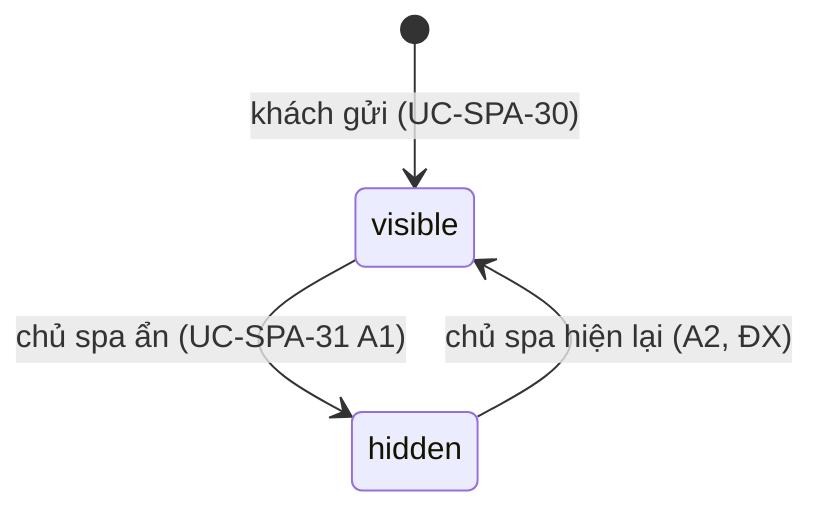

# Đánh giá dịch vụ — đặc tả

- **Nhóm:** `Reviews` · **Sprint:** 1 (UC-SPA-29), 2 (UC-SPA-30), 3 (UC-SPA-31) · **Nguồn:** DA §2.2.3 (UC Xem đánh giá dịch vụ, UC Đánh giá dịch vụ, UC Quản lý đánh giá dịch vụ), WF-11 / ĐX
- **Entity:** `Review` (bảng `reviews`); đọc thêm `ServiceEntitlement`, `OrderItem`, `CustomerPackage`, `TreatmentSession`, `SpaService`, `ServicePackage`, `Customer`/`User` — xem [glossary](../domain/glossary.md), [data-model](../domain/data-model.md)
- **Trạng thái triển khai:** spec duyệt và backend xong ngày 13/11/2026 theo [plan](../superpowers/plans/2026-11-13-uc-spa-29-30-31-reviews.md) — xem [progress.md](../progress.md)
- **Phạm vi lần này:** backend (API + test). Web (SCR-W03/W05 mục đánh giá, SCR-W20, SCR-W39) và mobile (SCR-M03/M05, SCR-M17) làm sau theo spec này.

## Use case

### UC-SPA-29 — Xem đánh giá dịch vụ

| Mục            | Nội dung                                                                                        |
| -------------- | ----------------------------------------------------------------------------------------------- |
| Actor          | Khách vãng lai, khách hàng (thực tế: mọi người, kể cả nhân viên, chủ spa)                       |
| Mô tả          | Xem điểm trung bình, số đánh giá, phân bố số sao và danh sách đánh giá của một dịch vụ hoặc gói |
| Tiền điều kiện | Dịch vụ/gói tồn tại và người xem được phép thấy nó (cùng quy tắc với chi tiết sản phẩm, BR-CAT) |
| Input          | Dịch vụ hoặc gói; `rating?` (lọc số sao), `page`, `pageSize`                                    |
| Output         | `summary { averageRating, reviewCount, ratingCounts }` + trang đánh giá `visible`               |

**Luồng chính**

1. Người dùng mở mục đánh giá của dịch vụ/gói; client gọi `GET /services/{id}/reviews` hoặc `GET /packages/{id}/reviews`.
2. Hệ thống kiểm tra sản phẩm tồn tại và hiển thị được cho người xem (dùng lại `CatalogViewer`, như `GET /services/{id}`).
3. Lấy các đánh giá `status = visible` của sản phẩm (BR-REV-02), mới nhất trước, phân trang (`PagedQuery`).
4. Trả `summary` (tính trên **mọi** đánh giá `visible`, không phụ thuộc bộ lọc sao) và `items` (mỗi mục: số sao, nội dung, ảnh, họ tên đầy đủ của người đánh giá, thời điểm, phản hồi của spa nếu có).

**Luồng rẽ nhánh**

- A1. Chưa có đánh giá → `200`, `summary { averageRating: null, reviewCount: 0, ratingCounts: {1..5: 0} }`, `items = []`; client hiển thị "Chưa có đánh giá".
- A2. Lọc `rating = 1..5` → chỉ đánh giá đúng số sao; `summary` giữ nguyên.
- A3. Không lọc → kết thúc sau khi xem.
- A4. (Liên kết UC-SPA-07, ĐX) `GET /services`, `/services/{id}`, `/packages`, `/packages/{id}` trả thêm `averageRating` (1 chữ số thập phân, `null` khi chưa có) và `reviewCount` (BR-REV-06).

**Ngoại lệ**

- E1. Sản phẩm không tồn tại hoặc người xem không được thấy → `404 service_not_found` / `package_not_found`.
- E2. `rating` ngoài 1–5, `pageSize` sai kiểu → `400 validation_error`.

**Quy tắc áp dụng:** BR-REV-02, 05, 06.

### UC-SPA-30 — Đánh giá dịch vụ

| Mục            | Nội dung                                                                                               |
| -------------- | ------------------------------------------------------------------------------------------------------ |
| Actor          | Khách hàng                                                                                             |
| Mô tả          | Khách đánh giá dịch vụ lẻ hoặc gói đã đủ điều kiện, kèm ảnh tùy chọn; xem và sửa đánh giá của mình     |
| Tiền điều kiện | Đã đăng nhập, `role = customer` (quyền `review.write`)                                                 |
| Input          | `spaServiceId` hoặc `servicePackageId` (đúng một); `rating` 1–5; `comment?`; ảnh (gửi riêng, tùy chọn) |
| Output         | Đánh giá được lưu (`visible`) hoặc thông báo chưa đủ điều kiện                                         |

**Luồng chính**

1. Khách mở "Đánh giá của tôi" (SCR-W20/SCR-M17); client gọi `GET /me/reviewable`: danh sách sản phẩm khách đã mua hoặc đã trải nghiệm, mỗi mục có `eligible`, `reason?`, `reviewId?` (BR-REV-01, 03).
2. Khách chọn một sản phẩm `eligible = true`, chọn số sao, nhập nội dung; client gọi `POST /me/reviews` `{ spaServiceId? | servicePackageId?, rating, comment? }`.
3. Hệ thống kiểm tra lại điều kiện (BR-REV-01) và chưa có đánh giá của khách cho sản phẩm (BR-REV-03), rồi lưu `status = visible` (đăng ngay, chủ spa ẩn sau nếu cần — Q-78).
4. Trả `201` + `Location: /api/v1/me/reviews/{id}`, `MyReviewDto`.
5. Khách bổ sung ảnh: `POST /me/reviews/{id}/image` (multipart `file`, một ảnh, như ảnh danh mục và ảnh đại diện) → `200 MyReviewDto` (BR-REV-07).

**Luồng rẽ nhánh**

- A1. Gửi đánh giá không kèm ảnh → bỏ qua bước 5.
- A2. (ĐX) Xem đánh giá của mình: `GET /me/reviews` (mọi trạng thái, có phản hồi của spa, mới nhất trước, phân trang).
- A3. (ĐX) Sửa đánh giá: `PUT /me/reviews/{id}` `{ rating, comment? }` khi còn trong `Reviews:CustomerEditWindowDays` ngày kể từ lúc tạo **và** spa chưa phản hồi (BR-REV-04, Q-76). Trạng thái `visible`/`hidden` giữ nguyên. Thay/xóa ảnh (`POST`/`DELETE /me/reviews/{id}/image`) theo cùng điều kiện.
- A4. Khách không xóa đánh giá (BR-REV-02: chỉ ẩn, không xóa).

**Ngoại lệ**

- E1. Chưa đủ điều kiện (chưa dùng dịch vụ; gói chưa đủ số buổi hoàn thành) → `400 review_not_eligible`, thông điệp nêu lý do.
- E2. Đã có đánh giá cho sản phẩm (kể cả hai yêu cầu đồng thời, chặn bằng UQ) → `409 review_exists`.
- E3. Sửa/đổi ảnh khi hết hạn sửa hoặc spa đã phản hồi → `409 review_locked`.
- E4. Dữ liệu sai (không đúng một id sản phẩm, `rating` ngoài 1–5, `comment` > 1000) → `400 validation_error`; ảnh sai định dạng/quá lớn → `400` như `ImageUploadReader` hiện có; chưa cấu hình Cloudinary → `503`.
- E5. Sản phẩm không tồn tại → `404 service_not_found` / `package_not_found`; đánh giá không tồn tại hoặc của khách khác → `404 review_not_found`.
- E6. Chưa đăng nhập → `401`; nhân viên, chủ spa → `403`.

**Quy tắc áp dụng:** BR-REV-01, 02, 03, 04, 05, 07, BR-SEC-01, RBAC `review.write`.

### UC-SPA-31 — Quản lý đánh giá dịch vụ

| Mục            | Nội dung                                                                               |
| -------------- | -------------------------------------------------------------------------------------- |
| Actor          | Chủ spa                                                                                |
| Mô tả          | Chủ spa xem mọi đánh giá, phản hồi, ẩn hoặc hiện lại đánh giá                          |
| Tiền điều kiện | Đã đăng nhập, `role = owner` (quyền `review.manage`)                                   |
| Input          | Bộ lọc danh sách; đánh giá được chọn; nội dung phản hồi; trạng thái `visible`/`hidden` |
| Output         | Phản hồi được lưu, hoặc đánh giá được ẩn/hiện                                          |

**Luồng chính**

1. Chủ spa mở `/owner/reviews` (SCR-W39); client gọi `GET /reviews` với bộ lọc `rating`, `productType` (`service`|`package`), `spaServiceId`, `servicePackageId`, `status`, `hasReply`, `search` (tên/SĐT/email khách hoặc tên sản phẩm, không phân biệt dấu), `fromDate`/`toDate` (ngày VN của lúc tạo); mới nhất trước, phân trang.
2. Chủ spa chọn một đánh giá; danh sách đã có đủ trường (khách đầy đủ tên, SĐT, email; sản phẩm; số sao; nội dung; ảnh; phản hồi; trạng thái), không cần endpoint chi tiết riêng.
3. Chủ spa nhập phản hồi, gửi `POST /reviews/{id}/reply` `{ reply }` → lưu `owner_reply`, `replied_at_utc = now` (gửi lại thì ghi đè, cập nhật thời điểm) → `200 OwnerReviewDto`.

**Luồng rẽ nhánh**

- A1. Ẩn: chủ spa xác nhận, client gọi `PATCH /reviews/{id}/visibility` `{ status: "hidden" }` → `204`. Không xóa đánh giá (BR-REV-02).
- A2. (ĐX) Hiện lại: `PATCH … { status: "visible" }` → `204`. Đặt trạng thái đang có là thao tác không đổi, vẫn `204`.
- A3. (ĐX) Gỡ phản hồi: `DELETE /reviews/{id}/reply` → `204`, `owner_reply` và `replied_at_utc` về `null` (khách lại sửa được nếu còn trong hạn, BR-REV-04).

**Ngoại lệ**

- E1. `reply` rỗng sau trim hoặc > 1000 ký tự; `status` ngoài `visible|hidden`; bộ lọc sai (`fromDate > toDate`, cả `spaServiceId` lẫn `servicePackageId`) → `400 validation_error`.
- E2. Đánh giá không tồn tại → `404 review_not_found`.
- E3. Chưa đăng nhập → `401`; khách hàng, nhân viên → `403`.

**Quy tắc áp dụng:** BR-REV-02, 08, RBAC `review.manage`.

## Business rules

| Mã        | Quy tắc                                                                                                                                                                                                                                                                                                                                                                                                                                                                                                                      | Enforce ở đâu                             | Nguồn                  |
| --------- | ---------------------------------------------------------------------------------------------------------------------------------------------------------------------------------------------------------------------------------------------------------------------------------------------------------------------------------------------------------------------------------------------------------------------------------------------------------------------------------------------------------------------------- | ----------------------------------------- | ---------------------- |
| BR-REV-01 | Điều kiện đánh giá. **Dịch vụ X:** khách có quyền dịch vụ lẻ `used` mà dòng đơn là X, **hoặc** một buổi gói `completed` có `spa_service_id = X` (trong gói của khách). **Gói P:** khách có một `customer_packages` của P với `used_sessions ≥ Reviews:MinCompletedPackageSessions` (mặc định 1, Q-05); trạng thái gói (`active`/`completed`/`expired`/`cancelled`) không chặn. Sản phẩm ngừng bán/ẩn vẫn đánh giá được nếu đủ điều kiện. Mỗi đánh giá có đúng một trong `spa_service_id`/`service_package_id` (CHECK có sẵn) | Application (`ReviewEligibility`) + CHECK | DA + ĐX (Q-05)         |
| BR-REV-02 | `rating` 1–5 (CHECK có sẵn). Chỉ `visible` được hiển thị công khai và tính điểm. Đánh giá không bao giờ bị xóa: chủ spa ẩn/hiện (`visible ↔ hidden`), khách không xóa                                                                                                                                                                                                                                                                                                                                                        | CSDL CHECK + Query + Domain               | DA                     |
| BR-REV-03 | Mỗi khách **một** đánh giá cho mỗi dịch vụ và mỗi gói: UQ một phần `(customer_id, spa_service_id) WHERE spa_service_id IS NOT NULL` và `(customer_id, service_package_id) WHERE service_package_id IS NOT NULL`; vi phạm `23505` → `409 review_exists`                                                                                                                                                                                                                                                                       | Application + CSDL UQ                     | ĐX (RS-15, Q-05)       |
| BR-REV-04 | Khách sửa (số sao, nội dung, ảnh) đánh giá của mình khi `now ≤ created_at_utc + Reviews:CustomerEditWindowDays` (mặc định 30; 0 = không cho sửa) **và** `owner_reply` là `null`; không đổi `status`, sản phẩm, khách                                                                                                                                                                                                                                                                                                         | Domain (`Review.Edit`) + Application      | ĐX (Q-76)              |
| BR-REV-05 | Nội dung: `comment` tùy chọn, trim, rỗng → `null`, ≤ 1000 ký tự. Tên người đánh giá công khai là họ tên đầy đủ (`users.full_name`), không che (Q-77). Không trả email, SĐT, id khách ra công khai                                                                                                                                                                                                                                                                                                                            | Validator + Application                   | ĐX (Q-77, biên tự đặt) |
| BR-REV-06 | `averageRating` = trung bình `rating` của các đánh giá `visible`, làm tròn 1 chữ số thập phân (`MidpointRounding.AwayFromZero`), `null` khi `reviewCount = 0`; `ratingCounts` đủ 5 khóa 1..5. Tính khi đọc bằng một truy vấn gom nhóm (không lưu cột tổng hợp)                                                                                                                                                                                                                                                               | Query                                     | ĐX                     |
| BR-REV-07 | Một ảnh mỗi đánh giá (`image_url`), lưu Cloudinary `reviews/{reviewId}` qua `IFileStorage`, đọc bằng `ImageUploadReader` (cùng định dạng/kích thước với ảnh danh mục). Thay ảnh ghi đè cùng public id; xóa ảnh xóa trên Cloudinary rồi đặt `null`                                                                                                                                                                                                                                                                            | Application                               | DA (HinhAnh) + ĐX      |
| BR-REV-08 | Phản hồi của spa: `reply` trim, 1–1000 ký tự; ghi đè phản hồi cũ và cập nhật `replied_at_utc`; gỡ phản hồi đặt cả hai cột `null`. Phản hồi được trên đánh giá `hidden`. Chỉ chủ spa                                                                                                                                                                                                                                                                                                                                          | Domain (`Review.Reply`) + Validator       | DA + ĐX                |

**Phân quyền** (sheet `21`, đã có dòng): thêm vào `Permissions.cs` `review.write` → `customer` (mọi endpoint `/me/reviews*`, `/me/reviewable`) và `review.manage` → `owner` (`/reviews*`). `GET /services/{id}/reviews`, `GET /packages/{id}/reviews` là `[AllowAnonymous]` (`catalog.view`).

## Trạng thái

## Dữ liệu

| Bảng                   | Cột dùng                                             | Thay đổi                                                                                                                                                                                          |
| ---------------------- | ---------------------------------------------------- | ------------------------------------------------------------------------------------------------------------------------------------------------------------------------------------------------- |
| `reviews`              | toàn bộ                                              | **Thêm** UQ một phần `ux_reviews_customer_service`, `ux_reviews_customer_package` (BR-REV-03); index `ix_reviews_spa_service_id`/`ix_reviews_service_package_id` có sẵn đủ cho truy vấn công khai |
| `service_entitlements` | `customer_id`, `order_item_id`, `status`             | Không đổi                                                                                                                                                                                         |
| `order_items`          | `spa_service_id`                                     | Không đổi                                                                                                                                                                                         |
| `customer_packages`    | `customer_id`, `service_package_id`, `used_sessions` | Không đổi                                                                                                                                                                                         |
| `treatment_sessions`   | `spa_service_id`, `status` (qua plan → gói)          | Không đổi                                                                                                                                                                                         |
| `users`                | `full_name`, `email`, `phone_number`                 | Không đổi                                                                                                                                                                                         |

- **Migration** `AddReviewUniquePerCustomer`: hai index unique có `filter`. Sửa `docs/spec-source/data_db.py` (ghi chú UQ ở cột `spa_service_id`, `service_package_id` của `reviews`) rồi sinh lại `data-model.md` để `PersistenceModelTests` khớp.
- `Review` thêm phương thức: `Review.Create(customerId, product, rating, comment, nowUtc)` (đặt `visible`), `Edit(rating, comment, nowUtc, editWindow)`, `SetImage`/`ClearImage`, `Reply(text, nowUtc)`, `RemoveReply()`, `Hide()`, `Show()`; thu hẹp setter tương ứng.

## API

Tiền tố `/api/v1`, envelope chuẩn. Sửa tại chỗ dòng SPA-API-098–104 trong `data_api.py` (tên trường tiếng Anh, mã lỗi; 101 đổi từ multipart sang JSON + endpoint ảnh riêng); **thêm cuối danh sách** SPA-API-146–151.

| Mã  | Method | Đường dẫn                  | Vai trò                   | Request                                                                                                  | Response                                                                                                                            | Lỗi                                                                                                                      |
| --- | ------ | -------------------------- | ------------------------- | -------------------------------------------------------------------------------------------------------- | ----------------------------------------------------------------------------------------------------------------------------------- | ------------------------------------------------------------------------------------------------------------------------ |
| 098 | GET    | `/services/{id}/reviews`   | Mọi người                 | `?rating&page&pageSize`                                                                                  | 200 `ProductReviewsDto { summary: { averageRating, reviewCount, ratingCounts: { "1".."5" } }, page: PagedResult<PublicReviewDto> }` | 400, 404 `service_not_found`                                                                                             |
| 099 | GET    | `/packages/{id}/reviews`   | Mọi người                 | như trên                                                                                                 | như trên                                                                                                                            | 400, 404 `package_not_found`                                                                                             |
| 100 | GET    | `/me/reviewable`           | Khách hàng                | —                                                                                                        | 200 `[ReviewableProductDto { productType, productId, name, imageUrl, eligible, reason?, reviewId? }]`                               | 401, 403                                                                                                                 |
| 101 | POST   | `/me/reviews`              | Khách hàng                | `{ spaServiceId? \| servicePackageId?, rating, comment? }`                                               | 201 + `Location`, `MyReviewDto`                                                                                                     | 400 `validation_error`/`review_not_eligible`, 401, 403, 404 `service_not_found`/`package_not_found`, 409 `review_exists` |
| 102 | GET    | `/reviews`                 | Chủ spa                   | `?rating&productType&spaServiceId&servicePackageId&status&hasReply&search&fromDate&toDate&page&pageSize` | 200 `PagedResult<OwnerReviewDto>`                                                                                                   | 400, 401, 403                                                                                                            |
| 103 | POST   | `/reviews/{id}/reply`      | Chủ spa                   | `{ reply }`                                                                                              | 200 `OwnerReviewDto`                                                                                                                | 400, 401, 403, 404 `review_not_found`                                                                                    |
| 104 | PATCH  | `/reviews/{id}/visibility` | Chủ spa                   | `{ status: "visible" \| "hidden" }`                                                                      | 204                                                                                                                                 | 400, 401, 403, 404                                                                                                       |
| 146 | GET    | `/me/reviews`              | Khách hàng                | `?page&pageSize`                                                                                         | 200 `PagedResult<MyReviewDto>`                                                                                                      | 401, 403                                                                                                                 |
| 147 | PUT    | `/me/reviews/{id}`         | Khách hàng (chủ đánh giá) | `{ rating, comment? }`                                                                                   | 200 `MyReviewDto`                                                                                                                   | 400, 401, 403, 404 `review_not_found`, 409 `review_locked`                                                               |
| 148 | POST   | `/me/reviews/{id}/image`   | Khách hàng (chủ đánh giá) | multipart `file`                                                                                         | 200 `MyReviewDto`                                                                                                                   | 400, 401, 403, 404, 409 `review_locked`, 503                                                                             |
| 149 | DELETE | `/me/reviews/{id}/image`   | Khách hàng (chủ đánh giá) | —                                                                                                        | 204                                                                                                                                 | 401, 403, 404, 409 `review_locked`, 503                                                                                  |
| 150 | DELETE | `/reviews/{id}/reply`      | Chủ spa                   | —                                                                                                        | 204                                                                                                                                 | 401, 403, 404                                                                                                            |
| 151 | GET    | `/me/reviews/{id}`         | Khách hàng (chủ đánh giá) | —                                                                                                        | 200 `MyReviewDto` (đích của `Location`)                                                                                             | 401, 403, 404 `review_not_found`                                                                                         |

**DTO**

- `PublicReviewDto { id, rating, comment, imageUrl, reviewerName, createdAtUtc, ownerReply, repliedAtUtc }` — không có id/liên hệ khách (BR-REV-05); không có `updatedAtUtc` vì cột audit đổi cả khi spa phản hồi hay ẩn/hiện. `updatedAtUtc` của `MyReviewDto`/`OwnerReviewDto` là lần thay đổi gần nhất bởi bất kỳ ai.
- `MyReviewDto { id, productType, productId, productName, productImageUrl, rating, comment, imageUrl, status, ownerReply, repliedAtUtc, createdAtUtc, updatedAtUtc, canEdit, editDeadlineAtUtc }` — `canEdit`/`editDeadlineAtUtc` từ cùng một quy tắc BR-REV-04 (`ReviewEditPolicy`).
- `OwnerReviewDto { id, productType, productId, productName, customer: { id, fullName, email, phoneNumber }, rating, comment, imageUrl, status, ownerReply, repliedAtUtc, createdAtUtc, updatedAtUtc }`.
- `ReviewableProductDto.reason`: `not_used_yet` (dịch vụ chưa dùng), `not_enough_sessions` (gói chưa đủ buổi), `already_reviewed` (có `reviewId`). Danh sách gồm: dịch vụ của mọi quyền dịch vụ lẻ của khách (trừ quyền `expired` chưa dùng), dịch vụ của các buổi gói đã `completed`, và các gói khách đã mua; không trùng sản phẩm; sắp: đủ điều kiện chưa đánh giá trước, rồi theo tên. Tối đa `Reviews:MaxReviewableItems` (200).
- Catalog (A4 UC-SPA-29): `ServiceListItemDto`, `ServiceDetailDto`, `PackageListItemDto`, `PackageDetailDto` **thêm** `averageRating` (`decimal?`), `reviewCount` (`int`); không đổi trường cũ.

## Màn hình

| Mã                | Nền tảng      | Route                                            | Hành động chính                                               |
| ----------------- | ------------- | ------------------------------------------------ | ------------------------------------------------------------- |
| SCR-W03 / W05     | Web           | `/services/:serviceId`, `/packages/:packageId`   | Mục đánh giá: ★ trung bình, phân bố, lọc sao, phản hồi spa    |
| SCR-M03 / M05     | Android       | `/services/[serviceId]`, `/packages/[packageId]` | Như trên                                                      |
| SCR-W20 / SCR-M17 | Web / Android | `/my-reviews`, `app/(customer)/reviews.tsx`      | Tab "Có thể đánh giá" / "Đã đánh giá"; modal đánh giá kèm ảnh |
| SCR-W39           | Web           | `/owner/reviews`                                 | DataTable, lọc; modal phản hồi; ẩn/hiện                       |

Giao diện làm sau (spec giao diện bổ sung vào file này khi làm).

## Cấu hình

| Biến `.env` | Khóa                                  | Mặc định           |
| ----------- | ------------------------------------- | ------------------ |
| —           | `Reviews:MinCompletedPackageSessions` | `1` (1–100, Q-05)  |
| —           | `Reviews:CustomerEditWindowDays`      | `30` (0–365, Q-76) |
| —           | `Reviews:MaxReviewableItems`          | `200`              |

Ảnh dùng `CLOUDINARY_*` có sẵn. Không có biến `.env`/secret mới.

## Kiểm thử bắt buộc

Unit (Application, NSubstitute, đồng hồ giả) và integration (`PostgresFixture`, Testcontainers; `FakeFileStorage`).

| Mã      | Tình huống                                                                                                   | Kết quả mong đợi                                                                            |
| ------- | ------------------------------------------------------------------------------------------------------------ | ------------------------------------------------------------------------------------------- |
| REV-T01 | Khách vãng lai xem đánh giá dịch vụ đang bán có 3 đánh giá `visible` + 1 `hidden`                            | 200; `reviewCount = 3`, trung bình đúng, `hidden` không xuất hiện                           |
| REV-T02 | Lọc `rating = 5`                                                                                             | Chỉ đánh giá 5 sao; `summary` không đổi                                                     |
| REV-T03 | Sản phẩm chưa có đánh giá                                                                                    | 200; `averageRating = null`, `reviewCount = 0`, `ratingCounts` đủ 1..5 = 0                  |
| REV-T04 | Khách vãng lai xem đánh giá dịch vụ ẩn/ngừng bán; id không tồn tại                                           | 404 `service_not_found`                                                                     |
| REV-T05 | Tên người đánh giá công khai                                                                                 | `reviewerName` là họ tên đầy đủ; không có email/SĐT/id khách                                |
| REV-T06 | `GET /services/{id}` và `GET /services` sau khi có đánh giá                                                  | Có `averageRating`, `reviewCount` đúng; trường cũ không đổi                                 |
| REV-T07 | Khách có quyền dịch vụ lẻ `used` gửi đánh giá                                                                | 201 + `Location`; `status = visible`                                                        |
| REV-T08 | Khách có buổi gói `completed` của dịch vụ X (không mua lẻ X) đánh giá X                                      | 201                                                                                         |
| REV-T09 | Khách chỉ có quyền `available`/`booked` của X                                                                | 400 `review_not_eligible`                                                                   |
| REV-T10 | Gói có `used_sessions = 0`; `= 1` (ngưỡng 1); ngưỡng cấu hình 2 với 1 buổi                                   | 400; 201; 400                                                                               |
| REV-T11 | Gửi lần hai cho cùng sản phẩm; hai yêu cầu đồng thời                                                         | 409 `review_exists`; đúng một bản ghi                                                       |
| REV-T12 | Gửi cả hai id / không id nào / `rating` 0 hoặc 6 / `comment` 1001 ký tự                                      | 400 `validation_error`                                                                      |
| REV-T13 | `GET /me/reviewable`                                                                                         | Đúng `eligible`/`reason`/`reviewId`; không trùng sản phẩm; không có sản phẩm của khách khác |
| REV-T14 | Sửa trong hạn, chưa phản hồi                                                                                 | 200; `updatedAtUtc` đổi, `status` giữ nguyên                                                |
| REV-T15 | Sửa sau hạn (đồng hồ giả); sửa khi spa đã phản hồi; `CustomerEditWindowDays = 0`                             | 409 `review_locked`                                                                         |
| REV-T16 | Sửa/đổi ảnh đánh giá của khách khác                                                                          | 404 `review_not_found`                                                                      |
| REV-T17 | Tải ảnh hợp lệ; thay ảnh; xóa ảnh; ảnh sai định dạng; thiếu Cloudinary                                       | 200 có `imageUrl` (`reviews/{id}`); ghi đè; 204 + `null`; 400; 503                          |
| REV-T18 | `GET /me/reviews` thấy cả đánh giá `hidden` kèm phản hồi                                                     | 200, `status = hidden`, `ownerReply` có                                                     |
| REV-T19 | Chủ spa lọc `GET /reviews` theo sao, loại, sản phẩm, trạng thái, `hasReply`, `search` không dấu, khoảng ngày | Đúng tập kết quả, mới nhất trước, phân trang                                                |
| REV-T20 | Phản hồi; phản hồi lại (ghi đè); `reply` rỗng hoặc > 1000; gỡ phản hồi                                       | 200 + `repliedAtUtc`; cập nhật; 400; 204 + `null`                                           |
| REV-T21 | Ẩn rồi hiện lại; đặt trạng thái đang có; `status` sai                                                        | 204, đánh giá biến mất/xuất hiện công khai và điểm tính lại; 204; 400                       |
| REV-T22 | Id đánh giá không tồn tại (reply, visibility)                                                                | 404 `review_not_found`                                                                      |
| REV-T23 | Phân quyền: không token với `/me/*`, `/reviews*`; nhân viên/chủ spa gửi đánh giá; khách/nhân viên quản lý    | 401; 403; 403                                                                               |
| REV-T24 | Unit: `ReviewEligibility`, `ReviewEditPolicy`, làm tròn điểm, phương thức `Review`                           | Đúng quy tắc BR-REV-01, 04, 05, 06, 08                                                      |
| REV-T25 | Hồi quy                                                                                                      | Toàn bộ test hiện có pass; `PersistenceModelTests` pass với migration mới                   |

## Câu hỏi còn mở

- Q-05 (đã có): ngưỡng buổi để đánh giá gói — mặc định `Reviews:MinCompletedPackageSessions` = 1; 1 đánh giá/sản phẩm/khách (BR-REV-03).
- Q-76 (mới): khách có sửa/xóa đánh giá không? — Mặc định: sửa trong 30 ngày (`Reviews:CustomerEditWindowDays`) khi spa chưa phản hồi; không xóa.
- Q-77 (mới, **đã chốt 13/11/2026**): tên người đánh giá công khai hiện họ tên đầy đủ, không che; không cấu hình.
- Q-78 (mới): đánh giá đăng ngay hay chờ chủ spa duyệt? — Mặc định đăng ngay (`visible`), chủ spa ẩn sau (khớp WF-11 `— → HienThi`); không thêm trạng thái chờ duyệt. Không cấu hình.

## Việc để sau

- REV-LATER-01: thông báo cho khách khi spa phản hồi, và mời đánh giá sau khi hoàn thành buổi (UC-SPA-34, CARE-LATER-02).
- REV-LATER-02: `reviewId`/`canReview` trong lịch sử sử dụng dịch vụ (`/me/service-history`, UC-SPA-20).
- REV-LATER-03: điểm đánh giá trong thẻ sản phẩm của trợ lý AI (`search_catalog`, `get_product_detail`).
- REV-LATER-04: giao diện web (SCR-W03/W05 mục đánh giá, SCR-W20, SCR-W39) và mobile (SCR-M03/M05, SCR-M17).
