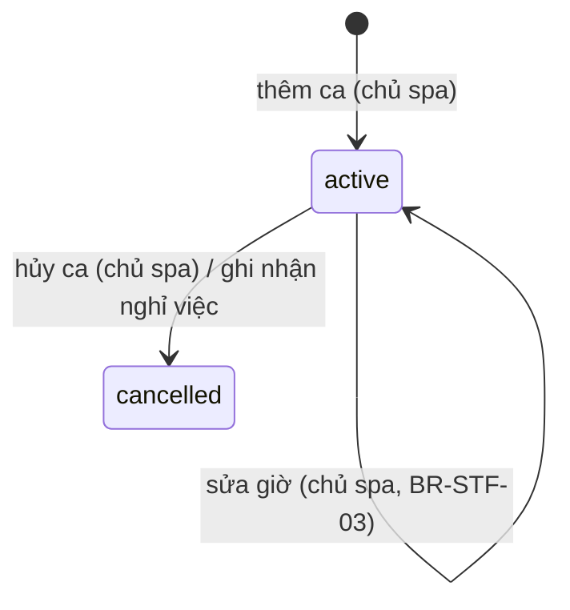

# Nhân viên & lịch làm việc — đặc tả

- **Nhóm:** `Staff` · **Sprint:** 1 · **Nguồn:** DA §2.2.3 (UC Quản lý nhân viên, UC Phân công lịch làm việc) / ĐX
- **Entity:** `StaffMember` (bảng `staff_members`), `StaffSkill` (bảng `staff_skills`), `WorkSchedule` (bảng `work_schedules`), cùng `User` (bảng `users`) — xem [glossary](../domain/glossary.md), [data-model](../domain/data-model.md)
- **Trạng thái triển khai:** xem [progress.md](../progress.md)
- **Đã đặc tả:** UC-SPA-22, 23 (backend triển khai 27/10/2026; web triển khai 10/11/2026 — kế hoạch: `docs/superpowers/plans/2026-11-10-uc-spa-22-23-staff-web.md`). UC-SPA-25 (nhân viên xem lịch hẹn được phân công, chỉ backend) đặc tả và **đã triển khai backend 31/10/2026** (kế hoạch: `docs/superpowers/plans/2026-10-31-uc-spa-25-27-28-care.md`), làm cùng UC-SPA-27, 28 ([care.md](care.md)); **giao diện web (SCR-W26, W27) đặc tả và triển khai 11/11/2026 ở [care.md](care.md), mục "Giao diện (web)"**. UC-SPA-24 (lịch làm việc cá nhân) đặc tả và triển khai backend + web 11/11/2026, mục "UC-SPA-24" cuối file (kế hoạch: `docs/superpowers/plans/2026-11-11-uc-spa-24-26-staff-schedule-care-history.md`).

## Use case

### UC-SPA-22 — Quản lý nhân viên

| Mục            | Nội dung                                                                                                                                                   |
| -------------- | ---------------------------------------------------------------------------------------------------------------------------------------------------------- |
| Actor          | Chủ spa. Danh sách rút gọn (`GET /staff`) mở cho mọi người để khách chọn nhân viên khi đặt lịch (UC-SPA-15)                                                |
| Mô tả          | Thêm nhân viên (kèm tài khoản đăng nhập), sửa thông tin, chọn các dịch vụ nhân viên làm được, ghi nhận nghỉ việc                                           |
| Tiền điều kiện | Đã đăng nhập, `role = owner` (quyền `staff.manage`)                                                                                                        |
| Input          | Họ tên, email, SĐT, ngày vào làm, chuyên môn, danh sách dịch vụ; với nghỉ việc: ngày nghỉ                                                                  |
| Output         | Hồ sơ nhân viên được tạo hoặc cập nhật; mail chứa mật khẩu tạm gửi tới nhân viên (khi thêm); danh sách lịch hẹn cần phân công lại (khi ghi nhận nghỉ việc) |

**Luồng chính — thêm nhân viên**

1. Chủ spa gửi `POST /staff` với `fullName, email, phoneNumber, hireDate, specialty?, spaServiceIds[]`.
2. Hệ thống kiểm tra dữ liệu (BR-STF-04), chuẩn hóa như đăng ký (bỏ khoảng trắng hai đầu, email so sánh không phân biệt hoa thường).
3. Hệ thống kiểm tra email và SĐT chưa thuộc tài khoản nào (E2), mọi `spaServiceIds` tồn tại và đang bán (E3).
4. Hệ thống sinh mật khẩu tạm (BR-STF-02), rồi trong **một giao dịch**: tạo `users` (`role = staff`, `status = active`, mật khẩu đã băm), `staff_members` (cùng id) và các dòng `staff_skills`, lưu, gửi mail thông tin đăng nhập tới email của nhân viên (BR-STF-08), gửi được mới commit.
5. Trả `201` kèm header `Location` (`/api/v1/staff/{id}`) và chi tiết nhân viên. Phản hồi **không** chứa mật khẩu; mật khẩu thô không lưu ở đâu ngoài nội dung mail.

**Luồng rẽ nhánh**

- A1. **Sửa nhân viên:** `PUT /staff/{id}` với `fullName, phoneNumber, hireDate, specialty?` → `200` chi tiết mới. Không đổi email (là tên đăng nhập). Đổi `hireDate` phải còn ≤ `resignationDate` (nếu có) và không muộn hơn ca làm đang hoạt động sớm nhất (E5).
- A2. **Cập nhật dịch vụ làm được:** `PUT /staff/{id}/services` với `spaServiceIds[]` → thay toàn bộ danh sách trong một giao dịch → `204`. Dịch vụ đã có từ trước mà nay ngừng bán được giữ lại; chỉ dịch vụ **mới thêm** phải đang bán (giống BR-CAT-06). Danh sách rỗng được phép.
- A3. **Ghi nhận nghỉ việc:** `POST /staff/{id}/resign` với `resignationDate` (BR-STF-01):
  1. Lưu `resignation_date`.
  2. Hủy (`status = cancelled`) mọi ca `active` có `date ≥ resignationDate`.
  3. Nếu `resignationDate ≤ hôm nay` (giờ VN): đặt `users.status = inactive` và thu hồi mọi refresh token còn hiệu lực. Nếu là ngày tương lai: tài khoản vẫn `active` tới ngày đó; từ ngày đó đăng nhập và làm mới phiên bị từ chối (BR-STF-05).
  4. Bước 1–3 nằm trong một giao dịch. Trả `200` chi tiết nhân viên kèm `appointmentsToReassign[]`: các lịch hẹn **chiếm chỗ** của nhân viên có `date ≥ resignationDate`, sắp theo ngày giờ. Hệ thống không tự đổi hay hủy các lịch này; chủ spa phân công lại ở UC-SPA-17 (chưa làm).
- A4. **Xem danh sách:** `GET /staff`.
  - Chủ spa: mọi nhân viên, lọc `search` (họ tên, email, SĐT; không phân biệt hoa thường và dấu), `status = working | resigned`, `spaServiceId`; đủ trường.
  - Người khác (khách vãng lai, khách hàng, nhân viên): chỉ nhân viên **đang làm** (`resignation_date` null hoặc > hôm nay) và `users.status = active`; chỉ trả `id, fullName, specialty, avatarUrl`; nhận `search` (họ tên) và `spaServiceId`, bỏ qua `status` (không báo lỗi).
- A5. **Xem chi tiết:** `GET /staff/{id}` (chỉ chủ spa) → hồ sơ, tài khoản và dịch vụ làm được.

**Ngoại lệ**

- E1. Dữ liệu không hợp lệ (BR-STF-04) → `400 validation_error` theo trường.
- E2. Email đã có tài khoản → `409 email_exists`; SĐT đã có (khi thêm, hoặc khi sửa sang SĐT của người khác) → `409 phone_exists`. Dùng lại mã của UC-SPA-01.
- E2b. Gửi mail thất bại (thiếu cấu hình mail, SMTP lỗi) → rollback, không tạo tài khoản nào → `503 email_send_failed` (dùng lại mã của UC-SPA-01), thông điệp chung; chi tiết chỉ ghi log. Chủ spa thử thêm lại.
- E3. `spaServiceIds` chứa id không tồn tại → `400 staff_service_not_found`; dịch vụ ngừng bán (và mới thêm) → `400 staff_service_discontinued`. Thông điệp nêu tên dịch vụ nếu có.
- E4. Nhân viên không tồn tại → `404 staff_not_found`.
- E5. `resignationDate < hireDate` → `400 resignation_before_hire_date`; sửa `hireDate` muộn hơn `resignationDate` → cũng `400 resignation_before_hire_date`; sửa `hireDate` muộn hơn ca đang hoạt động sớm nhất → `400 hire_date_after_shift`.
- E6. Nhân viên đã có `resignation_date` mà ghi nhận nghỉ việc lần nữa → `409 staff_already_resigned` (Q-16).
- E7. Chưa đăng nhập → `401 unauthorized`; không phải chủ spa → `403 forbidden` (mọi endpoint trừ `GET /staff`).
- E8. Không có endpoint xóa nhân viên (giữ lịch sử lịch hẹn, hồ sơ da; FK `RESTRICT`).

**Quy tắc áp dụng:** BR-STF-01, 02, 04, 05, 08, BR-SEC-01, RBAC `staff.manage`.

### UC-SPA-23 — Phân công lịch làm việc cho nhân viên

| Mục            | Nội dung                                                                     |
| -------------- | ---------------------------------------------------------------------------- |
| Actor          | Chủ spa                                                                      |
| Mô tả          | Xem lịch làm việc theo khoảng ngày, thêm ca, sửa giờ ca, hủy ca              |
| Tiền điều kiện | Đã đăng nhập, `role = owner` (quyền `schedule.manage`); nhân viên đã tồn tại |
| Input          | Nhân viên, ngày, giờ bắt đầu, giờ kết thúc                                   |
| Output         | Ca làm được lưu, sửa hoặc hủy                                                |

**Luồng chính — thêm ca**

1. Chủ spa xem lịch: `GET /work-schedules?fromDate&toDate&staffMemberId?&status?` (khoảng ≤ 42 ngày).
2. Chủ spa gửi `POST /work-schedules` với `staffMemberId, date, startTime, endTime` (giờ VN, `HH:mm`).
3. Hệ thống kiểm tra (BR-STF-03, BR-STF-06): giờ hợp lệ, ngày không ở quá khứ và không quá xa, nhân viên tồn tại, đã vào làm và chưa nghỉ việc vào ngày đó, không chồng với ca `active` khác của nhân viên trong ngày.
4. Lưu ca `status = active`; trả `201` kèm `Location` (`/api/v1/work-schedules/{id}`) và ca vừa tạo.

**Luồng rẽ nhánh**

- A1. **Sửa ca:** `PUT /work-schedules/{id}` với `date, startTime, endTime` → kiểm tra như thêm ca (bỏ qua chính ca này khi xét chồng ca), và mọi lịch hẹn chiếm chỗ đang nằm trong ca cũ phải nằm trọn trong ca mới (đổi sang ngày khác thì ca cũ phải không có lịch hẹn nào) → `200` ca mới.
- A2. **Hủy ca** (ĐX): `PATCH /work-schedules/{id}/status` với `{ status: "cancelled" }` → ca không còn lịch hẹn chiếm chỗ thì đặt `cancelled` → `204`. Hủy ca đã hủy → `204`. Ca đã hủy không mở lại được; chủ spa thêm ca mới.
- A3. **Sao chép lịch tuần** (ĐX trong DA): **chưa làm** lần này, ghi ở mục Việc để sau (Q-18).
- A4. **Thêm ca theo khoảng ngày** (ĐX, thêm 27/10/2026): `POST /work-schedules/batch` với `staffMemberIds[], fromDate, toDate, weekdays?, startTime, endTime` (BR-STF-09):
  1. Hệ thống dựng danh sách ca: mỗi ngày trong `[fromDate, toDate]` có thứ nằm trong `weekdays` (bỏ trống = mọi ngày) × mỗi nhân viên, cùng giờ.
  2. Từng ca được kiểm tra như thêm ca đơn lẻ (BR-STF-03, BR-STF-06) theo cùng thứ tự; ca không hợp lệ bị **bỏ qua** kèm lý do (mã lỗi tương ứng), không làm hỏng cả yêu cầu.
  3. Các ca hợp lệ được lưu trong **một giao dịch**; trả `200 { created: [ca], skipped: [{ staffMemberId, staffName, date, reason }] }`, cả hai sắp theo ngày, giờ, tên nhân viên. Không ca nào hợp lệ → vẫn `200` với `created` rỗng.
  4. Lỗi của cả yêu cầu (không bỏ qua từng ca): dữ liệu sai → `400`; `staffMemberIds` có id không tồn tại → `404 staff_not_found`; hai yêu cầu đồng thời tạo ca chồng nhau → yêu cầu sau `409 shift_conflict`, không lưu ca nào (ràng buộc `EXCLUDE`), chủ spa gửi lại.

**Ngoại lệ**

- E1. **Xung đột:** chồng với ca `active` khác cùng nhân viên → `409 shift_conflict` (cả kiểm tra trong Application lẫn ràng buộc `EXCLUDE` khi hai yêu cầu đồng thời); sửa/hủy làm lịch hẹn chiếm chỗ rơi ra ngoài ca → `409 shift_has_appointments`, thông điệp có số lịch hẹn bị ảnh hưởng.
- E2. `endTime ≤ startTime`, giờ có giây khác 0, khoảng ngày xem sai (thiếu, `toDate < fromDate`, > 42 ngày) → `400 validation_error`.
- E3. `date` trước hôm nay (giờ VN), hoặc sau hôm nay + `WorkSchedule:MaxDaysAhead` → `400 shift_date_out_of_range`. Sửa/hủy ca có `date` trước hôm nay → `400 shift_in_past`.
- E4. `date < hire_date` → `400 shift_before_hire_date`; `date ≥ resignation_date` → `400 staff_resigned`.
- E5. Nhân viên không tồn tại (khi thêm ca, hoặc lọc khi xem) → `404 staff_not_found`; ca không tồn tại → `404 work_schedule_not_found`.
- E6. Sửa ca đã hủy → `409 shift_cancelled`.
- E7. `401 unauthorized` / `403 forbidden` như UC-SPA-22.

**Quy tắc áp dụng:** BR-STF-01, 03, 06, BR-BKG-02 (lịch hẹn nằm trọn trong một ca), RBAC `schedule.manage`.

### UC-SPA-25 — Xem danh sách lịch hẹn được phân công

| Mục            | Nội dung                                                                                                        |
| -------------- | --------------------------------------------------------------------------------------------------------------- |
| Actor          | Nhân viên                                                                                                       |
| Mô tả          | Nhân viên xem các lịch được phân công cho mình, lọc theo ngày và trạng thái, mở chi tiết khách, dịch vụ, dị ứng |
| Tiền điều kiện | Đã đăng nhập, `role = staff` (quyền `schedule.self`)                                                            |
| Input          | Khoảng ngày, trạng thái; lịch được chọn                                                                         |
| Output         | Danh sách lịch của chính nhân viên; chi tiết lịch                                                               |

**Luồng chính**

1. Nhân viên mở "Lịch hẹn được phân công"; client gọi `GET /me/assigned-appointments?fromDate&toDate[&status]` (mặc định client gửi hôm nay → hôm nay; tab "Sắp tới", "Đã xong" đổi khoảng ngày và `status`).
2. Hệ thống trả các lịch có `staff_member_id` = người gọi trong khoảng ngày, bỏ `held` và `hold_expired` (BR-STF-10), sắp theo `date, startTime`.
3. Nhân viên chọn một lịch; client gọi `GET /appointments/{id}` (có sẵn, nhân viên được phân công xem được): thông tin khách, dịch vụ, buổi x/y của gói, dị ứng nổi bật (BR-CARE-02), hồ sơ da (`skinProfileId`).

**Luồng rẽ nhánh**

- A1. Chuyển sang lập/cập nhật hồ sơ da (UC-SPA-27, [care.md](care.md)).
- A2. Chuyển sang xác nhận hoàn thành (UC-SPA-28, [care.md](care.md)).
- A3. Không có lịch → `200` danh sách rỗng (client hiển thị "Chưa có lịch hẹn").

**Ngoại lệ**

- E1. Thiếu `fromDate`/`toDate`, `toDate < fromDate`, khoảng > `Booking:MaxQueryRangeDays` (42) ngày, `status` lạ hoặc là `held`/`hold_expired` → `400 validation_error`.
- E2. Lịch của nhân viên khác ở `GET /appointments/{id}` → `403 appointment_not_assigned` (có sẵn).
- E3. Chưa đăng nhập → `401`; chủ spa, khách hàng → `403` (chủ spa dùng `GET /appointments`).

**Quy tắc áp dụng:** BR-STF-10, BR-CARE-02, BR-SEC-01, RBAC `schedule.self`.

## Business rules

| Mã        | Quy tắc                                                                                                                                                                                                                                                                                                                                                                                                                                  | Enforce ở đâu                                                           | Nguồn                                     |
| --------- | ---------------------------------------------------------------------------------------------------------------------------------------------------------------------------------------------------------------------------------------------------------------------------------------------------------------------------------------------------------------------------------------------------------------------------------------- | ----------------------------------------------------------------------- | ----------------------------------------- |
| BR-STF-01 | `resignation_date ≥ hire_date`. Từ `resignation_date` nhân viên không có ca và không nhận lịch hẹn mới; ghi nhận nghỉ việc tự hủy các ca `active` từ ngày đó, trả danh sách lịch hẹn chiếm chỗ từ ngày đó để chủ spa phân công lại (không tự hủy lịch hẹn)                                                                                                                                                                               | Application + CHECK có sẵn                                              | DA + ĐX                                   |
| BR-STF-02 | Thêm nhân viên tạo `users` (`role = staff`) + `staff_members` (1-1, cùng id) + `staff_skills` trong một lần lưu. Mật khẩu tạm dài `Staff:TemporaryPasswordLength` (mặc định 12) ký tự, sinh bằng bộ sinh số ngẫu nhiên mật mã, luôn có ít nhất 1 chữ thường, 1 chữ hoa, 1 chữ số (đạt BR-AUTH-10), bỏ các ký tự dễ nhầm (`0 O o 1 l I`); chỉ nằm trong mail gửi nhân viên, không trả trong API, không ghi log                            | Application                                                             | DA (mô hình 1-1) + ĐX (Q-15)              |
| BR-STF-03 | Ca làm: `end_time > start_time` (không có ca qua đêm); giờ đúng tới phút; không chồng ca `active` cùng nhân viên cùng ngày — hai ca chạm nhau (`08:00–12:00` và `12:00–17:00`) **không** tính là chồng. Sửa/hủy ca không được làm lịch hẹn chiếm chỗ nằm trong ca cũ rơi ra ngoài ca                                                                                                                                                     | Application + CSDL (`CHECK` có sẵn, **thêm** `EXCLUDE` cho ca `active`) | DA                                        |
| BR-STF-04 | Họ tên, email, SĐT theo BR-AUTH-10. `specialty` ≤ 255 ký tự. `hireDate` từ 2000-01-01 tới hôm nay + 365 ngày. `resignationDate` tới hôm nay + 365 ngày. `spaServiceIds` không trùng, tối đa 100 phần tử                                                                                                                                                                                                                                  | Validator                                                               | ĐX (biên tự đặt)                          |
| BR-STF-05 | Nhân viên có `resignation_date ≤ hôm nay` (giờ VN) bị từ chối đăng nhập và làm mới phiên với `403 account_inactive`, kể cả khi `users.status` còn `active` (nghỉ việc ghi trước ngày); không có job nền đổi trạng thái                                                                                                                                                                                                                   | Application `AuthService` (thêm điều kiện)                              | WF-10 + ĐX (Q-16)                         |
| BR-STF-06 | Ngày ca nằm trong `[hôm nay, hôm nay + WorkSchedule:MaxDaysAhead]` (mặc định 60) khi thêm hoặc sửa; ca có `date` trước hôm nay chỉ đọc. `date ≥ hire_date` và `date < resignation_date` (nếu có)                                                                                                                                                                                                                                         | Application                                                             | ĐX (Q-17)                                 |
| BR-STF-07 | Lịch hẹn **chiếm chỗ**: `pending_confirmation`, `confirmed`, hoặc `held` có `hold_expires_at_utc > now`. Lịch hẹn "nằm trong ca" = cùng nhân viên, cùng ngày, khoảng giờ giao với khoảng giờ của ca                                                                                                                                                                                                                                      | Application (một chỗ dùng chung, sau này UC-SPA-15/17 dùng lại)         | BR-BKG-01, 02                             |
| BR-STF-08 | Mail thông tin đăng nhập bằng tiếng Việt, có bản HTML và text: tên spa, họ tên nhân viên, email đăng nhập, mật khẩu tạm, lời nhắc đổi mật khẩu sau lần đăng nhập đầu (qua Quên mật khẩu) và không chia sẻ mật khẩu. Tiêu đề: "Tài khoản nhân viên – Spa Như Nguyệt". Gửi qua `IEmailSender` có sẵn, bên trong giao dịch tạo tài khoản: gửi lỗi thì rollback. Log chỉ ghi địa chỉ đã che (BR-AUTH-13), không bao giờ ghi mật khẩu         | Application (nội dung, giao dịch), Infrastructure `SmtpEmailSender`     | Quyết định của bạn (Q-15)                 |
| BR-STF-09 | Thêm ca theo khoảng ngày: `staffMemberIds` 1–50 phần tử, không trùng; `toDate ≥ fromDate`, khoảng ≤ `WorkSchedule:MaxQueryRangeDays` (42) ngày; `weekdays` không trùng, bỏ trống = mọi ngày, có thì không rỗng; giờ theo BR-STF-03; tổng số ca dựng ra 1 – `WorkSchedule:MaxBatchShifts` (mặc định 500). Lý do bỏ qua một ca: `shift_date_out_of_range`, `shift_before_hire_date`, `staff_resigned`, `shift_conflict` (chồng ca đang có) | Validator + Application                                                 | ĐX (quyết định 27/10/2026: bỏ qua ca lỗi) |
| BR-STF-10 | Nhân viên chỉ thấy lịch có `staff_member_id` = mình (BR-SEC-01). Danh sách bỏ `held` và `hold_expired` (đang chờ thanh toán / đã hết giữ chỗ, chưa phải việc của nhân viên — Q-33); thấy `pending_confirmation`, `confirmed`, `completed`, `cancelled`, `no_show`. Khoảng ngày bắt buộc, ≤ `Booking:MaxQueryRangeDays`; không phân trang (một nhân viên ≤ vài chục lịch/khoảng)                                                          | Application + Query                                                     | DA + ĐX (Q-33)                            |

**Phân quyền** (theo bảng RBAC sheet `21`): thêm `staff.manage` → `owner` và `schedule.manage` → `owner` vào `API/Authorization/Permissions.cs`. `GET /staff` để `[AllowAnonymous]` giống danh mục: Bearer hợp lệ của chủ spa bật chế độ xem đầy đủ, còn lại là chế độ công khai. UC-SPA-25 thêm `schedule.self` → `staff` (sau này UC-SPA-24 dùng chung).

## Trạng thái

Ca làm (WF-12). Nhân viên không có cột trạng thái riêng: "đang làm" / "đã nghỉ" suy ra từ `resignation_date` so với hôm nay; tài khoản theo `users.status` (`active` → `inactive` khi nghỉ việc, WF-10).

## Dữ liệu

| Bảng             | Cột dùng                                                                                | Thay đổi                                                                                                                                                                                                           |
| ---------------- | --------------------------------------------------------------------------------------- | ------------------------------------------------------------------------------------------------------------------------------------------------------------------------------------------------------------------ |
| `users`          | `id, full_name, email, phone_number, password_hash, role, status, avatar_url`, audit    | Không đổi                                                                                                                                                                                                          |
| `staff_members`  | `id, hire_date, specialty, resignation_date`                                            | Không đổi                                                                                                                                                                                                          |
| `staff_skills`   | `staff_member_id, spa_service_id`                                                       | Không đổi; cập nhật dịch vụ xóa cứng dòng cũ rồi tạo lại                                                                                                                                                           |
| `work_schedules` | `id, staff_member_id, date, start_time, end_time, status`                               | **Thêm** `EXCLUDE USING gist (staff_member_id WITH =, tsrange(date + start_time, date + end_time) WITH &&) WHERE (status = 'active')`, tên `ex_work_schedules_no_overlap` (cùng cách với `appointments`, ADR-0003) |
| `appointments`   | `staff_member_id, date, start_time, end_time, status, hold_expires_at_utc, customer_id` | Chỉ đọc (kiểm tra BR-STF-03, danh sách cần phân công lại)                                                                                                                                                          |
| `refresh_tokens` | `user_id, revoked_at_utc`                                                               | Thu hồi khi nghỉ việc có hiệu lực                                                                                                                                                                                  |

Migration mới: `AddWorkScheduleOverlapConstraint` (SQL thủ công, đặt cạnh `AppointmentConstraints`). Đổi schema đi kèm: sửa ràng buộc cột `end_time` của `work_schedules` trong `docs/spec-source/data_db.py`, sinh lại `data-model.md`, file Excel và `docs/export/NhuNguyetSpa_CSDL_TiengViet.sql`. Lỗi vi phạm `EXCLUDE` (SQLSTATE `23P01`) được dịch thành `409 shift_conflict`.

## API

Tiền tố `/api/v1`, envelope `{ success, message, data, errors, traceId }`. Ngày `yyyy-MM-dd`, giờ `HH:mm` (giờ VN). Phân trang dùng `PagedQuery` có sẵn.

| Method | Đường dẫn                     | Vai trò   | Request                                                                                              | Response                                                                                                                                                                                                                                                  | Lỗi                                                                                                                                                 |
| ------ | ----------------------------- | --------- | ---------------------------------------------------------------------------------------------------- | --------------------------------------------------------------------------------------------------------------------------------------------------------------------------------------------------------------------------------------------------------- | --------------------------------------------------------------------------------------------------------------------------------------------------- |
| GET    | `/staff`                      | Mọi người | `?search&status=working\|resigned&spaServiceId&pageNumber&pageSize` (`status` chỉ chủ spa)           | 200 `PagedResult`. Chủ spa: `{ id, fullName, email, phoneNumber, avatarUrl, specialty, hireDate, resignationDate, accountStatus, services: [{ id, name, status }] }`; người khác: `{ id, fullName, specialty, avatarUrl }`. Sắp theo `fullName`, rồi `id` | 400 `validation_error`                                                                                                                              |
| GET    | `/staff/{id}`                 | Chủ spa   | —                                                                                                    | 200 `{ id, fullName, email, phoneNumber, avatarUrl, specialty, hireDate, resignationDate, accountStatus, services: [{ id, name, status }], createdAtUtc, updatedAtUtc }`                                                                                  | 401, 403, 404 `staff_not_found`                                                                                                                     |
| POST   | `/staff`                      | Chủ spa   | `{ fullName, email, phoneNumber, hireDate, specialty?, spaServiceIds: [] }`                          | 201 + `Location`, chi tiết nhân viên                                                                                                                                                                                                                      | 400 `validation_error`/`staff_service_not_found`/`staff_service_discontinued`, 401, 403, 409 `email_exists`/`phone_exists`, 503 `email_send_failed` |
| PUT    | `/staff/{id}`                 | Chủ spa   | `{ fullName, phoneNumber, hireDate, specialty? }`                                                    | 200 chi tiết                                                                                                                                                                                                                                              | 400 `validation_error`/`resignation_before_hire_date`/`hire_date_after_shift`, 401, 403, 404, 409 `phone_exists`                                    |
| PUT    | `/staff/{id}/services`        | Chủ spa   | `{ spaServiceIds: [] }`                                                                              | 204                                                                                                                                                                                                                                                       | 400 `validation_error`/`staff_service_not_found`/`staff_service_discontinued`, 401, 403, 404                                                        |
| POST   | `/staff/{id}/resign`          | Chủ spa   | `{ resignationDate }`                                                                                | 200 `{ staff: <chi tiết>, appointmentsToReassign: [{ id, date, startTime, endTime, status, customerId, customerName }] }`                                                                                                                                 | 400 `validation_error`/`resignation_before_hire_date`, 401, 403, 404, 409 `staff_already_resigned`                                                  |
| GET    | `/work-schedules`             | Chủ spa   | `?fromDate&toDate&staffMemberId&status=active\|cancelled` (`fromDate`, `toDate` bắt buộc, ≤ 42 ngày) | 200 `[{ id, staffMemberId, staffName, date, startTime, endTime, status }]` sắp theo `date, startTime, staffName` (không phân trang)                                                                                                                       | 400, 401, 403, 404 `staff_not_found`                                                                                                                |
| POST   | `/work-schedules`             | Chủ spa   | `{ staffMemberId, date, startTime, endTime }`                                                        | 201 + `Location`, ca                                                                                                                                                                                                                                      | 400 `validation_error`/`shift_date_out_of_range`/`shift_before_hire_date`/`staff_resigned`, 401, 403, 404 `staff_not_found`, 409 `shift_conflict`   |
| PUT    | `/work-schedules/{id}`        | Chủ spa   | `{ date, startTime, endTime }`                                                                       | 200 ca                                                                                                                                                                                                                                                    | như POST, thêm 400 `shift_in_past`, 404 `work_schedule_not_found`, 409 `shift_cancelled`/`shift_has_appointments`                                   |
| PATCH  | `/work-schedules/{id}/status` | Chủ spa   | `{ status: "cancelled" }`                                                                            | 204                                                                                                                                                                                                                                                       | 400 `validation_error`/`shift_in_past`, 401, 403, 404, 409 `shift_has_appointments`                                                                 |
| POST   | `/work-schedules/batch`       | Chủ spa   | `{ staffMemberIds: [], fromDate, toDate, weekdays?: ["monday" … "sunday"], startTime, endTime }`     | 200 `{ created: [ca], skipped: [{ staffMemberId, staffName, date, reason }] }`                                                                                                                                                                            | 400, 401, 403, 404 `staff_not_found`, 409 `shift_conflict` (chỉ khi tranh chấp đồng thời)                                                           |

**UC-SPA-25** (nhân viên, policy `schedule.self`):

| Method | Đường dẫn                   | Vai trò   | Request                                                                                                                                           | Response                                                                                                                                                                                                                                                            | Lỗi           |
| ------ | --------------------------- | --------- | ------------------------------------------------------------------------------------------------------------------------------------------------- | ------------------------------------------------------------------------------------------------------------------------------------------------------------------------------------------------------------------------------------------------------------------- | ------------- |
| GET    | `/me/assigned-appointments` | Nhân viên | `?fromDate&toDate&status` (`fromDate`, `toDate` bắt buộc, ≤ 42 ngày; `status` ∈ `pending_confirmation\|confirmed\|completed\|cancelled\|no_show`) | 200 `[{ id, date, startTime, endTime, status, customer: { id, fullName, phoneNumber }, service: { id, name }, treatmentSession?: { id, sequenceNumber, totalSessions, packageName }, hasAllergies, hasSkinProfile }]` sắp theo `date, startTime` (không phân trang) | 400, 401, 403 |

- Chi tiết dùng `GET /appointments/{id}` có sẵn (thêm trường ở [care.md](care.md#api)).
- Sửa tại chỗ dòng SPA-API-090 trong `data_api.py` (`?fromDate&toDate&status`, response).

- `accountStatus` = `users.status` (`active`/`locked`/`inactive`).
- Sửa tại chỗ các dòng STF trong `data_api.py` cho khớp bảng trên (thêm `hireDate` ở PUT, bỏ `matKhauTam` khỏi phản hồi thêm nhân viên, tên tham số); không thêm/xóa dòng nên mã `SPA-API-xxx` giữ nguyên. Hai endpoint `/me/work-schedules*` (UC-SPA-24) chưa làm.
- `packages/shared-types`, `api-client` **không** làm lần này (chỉ backend).

## Cấu hình

| Biến `.env` | Khóa cấu hình                    | Mặc định (`appsettings.json`)         |
| ----------- | -------------------------------- | ------------------------------------- |
| —           | `Staff:TemporaryPasswordLength`  | `12` (8–64)                           |
| —           | `WorkSchedule:MaxDaysAhead`      | `60`                                  |
| —           | `WorkSchedule:MaxQueryRangeDays` | `42` (6 tuần, đủ một lưới lịch tháng) |
| —           | `WorkSchedule:MaxBatchShifts`    | `500`                                 |

Không có secret mới, không đổi `EnvLoader`; mail dùng lại `MAIL_SETTINGS_*` có sẵn.

## Kiểm thử bắt buộc

Unit test (Application) dùng NSubstitute và đồng hồ giả; integration test dùng `PostgresFixture` (Testcontainers) và `AuthApiFactory`. Lịch hẹn trong test chèn trực tiếp vào CSDL (chưa có API đặt lịch).

| Mã       | Tình huống                                                                                                                                                  | Kết quả mong đợi                                                                                                                                                                                                                                             |
| -------- | ----------------------------------------------------------------------------------------------------------------------------------------------------------- | ------------------------------------------------------------------------------------------------------------------------------------------------------------------------------------------------------------------------------------------------------------ |
| STF-T01  | Chủ spa thêm nhân viên hợp lệ với 2 dịch vụ                                                                                                                 | 201, `Location` đúng; `users.role = staff`, `status = active`; `staff_members` cùng id; 2 dòng `staff_skills`; phản hồi không có mật khẩu; `FakeEmailSender` nhận đúng 1 mail tới email nhân viên, mật khẩu trong mail đăng nhập được qua `POST /auth/login` |
| STF-T02  | Mật khẩu tạm (unit, lặp 1000 lần)                                                                                                                           | Đúng độ dài cấu hình, đủ chữ thường/hoa/số, không có ký tự dễ nhầm; CSDL chỉ có hash                                                                                                                                                                         |
| STF-T02b | `FakeEmailSender` ném lỗi khi thêm nhân viên                                                                                                                | `503 email_send_failed`; không có dòng `users`, `staff_members`, `staff_skills` nào; thêm lại cùng email sau đó thành công                                                                                                                                   |
| STF-T02c | Nội dung mail (unit)                                                                                                                                        | Tiêu đề, HTML và text đúng BR-STF-08; có email đăng nhập và mật khẩu; log không chứa mật khẩu                                                                                                                                                                |
| STF-T03  | Thêm với email đã có (khác hoa thường) / SĐT đã có                                                                                                          | `409 email_exists` / `409 phone_exists`; không tạo dòng nào                                                                                                                                                                                                  |
| STF-T04  | Dữ liệu biên: họ tên rỗng, SĐT sai dạng, `hireDate` 1999-12-31 và hôm nay + 366, `specialty` 256 ký tự, `spaServiceIds` trùng, 101 phần tử                  | `400 validation_error` theo trường                                                                                                                                                                                                                           |
| STF-T05  | `spaServiceIds` có id không tồn tại / dịch vụ ngừng bán                                                                                                     | `400 staff_service_not_found` / `400 staff_service_discontinued`; không lưu gì                                                                                                                                                                               |
| STF-T06  | Sửa nhân viên: đổi SĐT sang SĐT của người khác; đổi `hireDate` sau `resignationDate`; đổi `hireDate` sau ca đang hoạt động sớm nhất; id không tồn tại       | `409 phone_exists` / `400 resignation_before_hire_date` / `400 hire_date_after_shift` / `404 staff_not_found`                                                                                                                                                |
| STF-T07  | Cập nhật dịch vụ: thay 2 dịch vụ bằng 1 dịch vụ khác; giữ dịch vụ đã có nay ngừng bán; danh sách rỗng                                                       | 204, CSDL đúng danh sách mới; không lỗi khi giữ dịch vụ ngừng bán; rỗng → 0 dòng                                                                                                                                                                             |
| STF-T08  | Nghỉ việc hôm nay, có 2 ca từ hôm nay trở đi, 1 ca hôm qua, 1 lịch hẹn `confirmed` ngày mai, 1 lịch `cancelled`, 1 lịch `held` hết hạn                      | 200; 2 ca thành `cancelled`, ca hôm qua giữ nguyên; `appointmentsToReassign` chỉ có lịch `confirmed`; `users.status = inactive`; refresh token bị thu hồi, `POST /auth/refresh` thất bại                                                                     |
| STF-T09  | Nghỉ việc ngày mai; đăng nhập hôm nay rồi lùi đồng hồ sang ngày mai đăng nhập lại                                                                           | Hôm nay đăng nhập 200, `status` vẫn `active`; ngày mai `403 account_inactive` (login và refresh)                                                                                                                                                             |
| STF-T10  | `resignationDate < hireDate`; nghỉ việc lần 2                                                                                                               | `400 resignation_before_hire_date`; `409 staff_already_resigned`                                                                                                                                                                                             |
| STF-T11  | `GET /staff` của chủ spa: `search` không dấu theo tên, email, SĐT; `status=resigned`; `spaServiceId`; phân trang                                            | Lọc đúng, sắp theo tên, đủ trường                                                                                                                                                                                                                            |
| STF-T12  | `GET /staff` khi không đăng nhập / là khách hàng: có nhân viên đã nghỉ, nghỉ ngày mai, tài khoản `locked`                                                   | Chỉ nhân viên đang làm và `active` (gồm người nghỉ ngày mai); chỉ 4 trường; `status=resigned` bị bỏ qua; không lộ email/SĐT                                                                                                                                  |
| STF-T13  | Khách hàng, nhân viên gọi POST/PUT `/staff`, `/work-schedules`, `GET /staff/{id}`; không có Bearer                                                          | `403 forbidden` / `401 unauthorized`, dạng envelope                                                                                                                                                                                                          |
| STF-T14  | Thêm ca hợp lệ; ca chạm ca khác (`12:00–17:00` sau `08:00–12:00`)                                                                                           | 201, `Location` đúng, `status = active`; ca chạm → 201                                                                                                                                                                                                       |
| STF-T15  | Thêm ca chồng ca `active` khác; chồng ca đã `cancelled`                                                                                                     | `409 shift_conflict`; ca đã hủy không tính → 201                                                                                                                                                                                                             |
| STF-T16  | Hai yêu cầu thêm ca chồng nhau gửi đồng thời                                                                                                                | Đúng 1 yêu cầu 201, yêu cầu còn lại `409 shift_conflict`; CSDL chỉ 1 ca                                                                                                                                                                                      |
| STF-T17  | Ràng buộc CSDL: chèn trực tiếp 2 ca `active` chồng nhau / 1 `active` + 1 `cancelled` chồng nhau                                                             | `DbUpdateException` (`23P01`) / chèn được                                                                                                                                                                                                                    |
| STF-T18  | `endTime = startTime`; `endTime < startTime`; giờ có giây; ngày hôm qua; ngày hôm nay + 61; trước `hireDate`; từ `resignationDate`                          | `400 validation_error` ×3 / `shift_date_out_of_range` ×2 / `shift_before_hire_date` / `staff_resigned`                                                                                                                                                       |
| STF-T19  | Sửa ca 08:00–12:00 có lịch `confirmed` 09:00–10:00: sang 08:30–11:00 / 09:30–12:00 / ngày khác                                                              | 200 / `409 shift_has_appointments` / `409 shift_has_appointments`                                                                                                                                                                                            |
| STF-T20  | Sửa ca chỉ có lịch `cancelled` hoặc `held` hết hạn trong ca                                                                                                 | 200 (không tính là chiếm chỗ)                                                                                                                                                                                                                                |
| STF-T21  | Hủy ca không có lịch; hủy ca có lịch `pending_confirmation`; hủy lại ca đã hủy; sửa ca đã hủy; sửa/hủy ca hôm qua                                           | 204 / `409 shift_has_appointments` / 204 / `409 shift_cancelled` / `400 shift_in_past`                                                                                                                                                                       |
| STF-T22  | `GET /work-schedules` thiếu `fromDate`; `toDate < fromDate`; khoảng 43 ngày; lọc theo nhân viên và `status`                                                 | `400 validation_error` ×3; trả đúng ca, sắp theo ngày, giờ, tên                                                                                                                                                                                              |
| STF-T23  | `PATCH status` với `active` hoặc giá trị lạ                                                                                                                 | `400 validation_error`                                                                                                                                                                                                                                       |
| STF-T24  | Không có `DELETE /staff/{id}`, `DELETE /work-schedules/{id}`                                                                                                | 405                                                                                                                                                                                                                                                          |
| STF-T25  | Hồi quy UC-SPA-01/02/03/06/07/09                                                                                                                            | Toàn bộ test hiện có vẫn pass; `PersistenceModelTests` pass                                                                                                                                                                                                  |
| STF-T26  | Thêm ca theo khoảng 2 tuần, `weekdays` thứ 2–6, 2 nhân viên; một nhân viên đã có ca chồng giờ vào một ngày, một nhân viên nghỉ việc giữa khoảng             | 200; `created` đúng số ca hợp lệ, chỉ các ngày thứ 2–6; `skipped` có `shift_conflict` cho ngày bị chồng và `staff_resigned` cho các ngày từ ngày nghỉ; CSDL đúng bằng `created`                                                                              |
| STF-T27  | Khoảng ngày bắt đầu từ hôm qua; `weekdays` bỏ trống                                                                                                         | Ngày hôm qua nằm trong `skipped` (`shift_date_out_of_range`); mọi ngày còn lại được tạo                                                                                                                                                                      |
| STF-T28  | Dữ liệu sai: `staffMemberIds` rỗng / trùng; `toDate < fromDate`; khoảng 43 ngày; `weekdays` rỗng hoặc trùng; `endTime ≤ startTime`; quá `MaxBatchShifts` ca | `400`, không lưu ca nào                                                                                                                                                                                                                                      |
| STF-T29  | `staffMemberIds` có id không tồn tại                                                                                                                        | `404 staff_not_found`, không lưu ca nào                                                                                                                                                                                                                      |
| STF-T30  | Khách hàng / nhân viên / không Bearer gọi batch                                                                                                             | `403` / `403` / `401`                                                                                                                                                                                                                                        |
| STF-T31  | UC-SPA-25: nhân viên A có lịch `confirmed`, `completed`, `cancelled`, `held`, `hold_expired` trong khoảng; B có 1 lịch cùng ngày                            | 200 chỉ lịch của A, không có `held`/`hold_expired`, sắp theo ngày giờ; dịch vụ suy ra đúng (BR-BKG-13)                                                                                                                                                       |
| STF-T32  | Lọc `status=completed`; lịch buổi gói có `treatmentSession` (`sequenceNumber`, `totalSessions`, `packageName`); khách có dị ứng; lịch đã có hồ sơ da        | Đúng dòng; `hasAllergies = true`, `hasSkinProfile = true`                                                                                                                                                                                                    |
| STF-T33  | Thiếu `fromDate`; `toDate < fromDate`; khoảng 43 ngày; `status=held`; `status=abc`; khoảng không có lịch                                                    | `400 validation_error` ×5; 200 `[]`                                                                                                                                                                                                                          |
| STF-T34  | Chủ spa / khách hàng / không Bearer gọi `/me/assigned-appointments`                                                                                         | `403` / `403` / `401`                                                                                                                                                                                                                                        |

## Câu hỏi còn mở

- Q-15 (**đã chốt** 27/10/2026): Hệ thống sinh mật khẩu tạm và **gửi mail cho nhân viên**; API không trả mật khẩu. Nhân viên đổi qua quên mật khẩu (UC-SPA-03) hoặc đổi mật khẩu (UC-SPA-04, `PUT /me/password`). Độ dài đọc từ `Staff:TemporaryPasswordLength`.
- Q-16 (mới; phần ngày tương lai **đã chốt** 27/10/2026): **Cho ghi ngày nghỉ việc ở tương lai**, từ ngày đó không đăng nhập được (BR-STF-05). Mặc định phần còn lại: **chỉ ghi một lần** (`409 staff_already_resigned`), chưa có thao tác hủy nghỉ việc hay nhận lại nhân viên.
- Q-17 (mới): Phân ca được trước bao xa, xem lịch bao nhiêu ngày một lần? Mặc định: **từ hôm nay tới hôm nay + 60 ngày** (`WorkSchedule:MaxDaysAhead`; spa thường xếp ca theo tuần hoặc tháng, 60 ngày đủ cho tháng này và tháng sau mà không tạo ca quá xa dễ phải sửa); ca quá khứ chỉ đọc. Xem tối đa **42 ngày** một lần (`WorkSchedule:MaxQueryRangeDays`; 6 tuần = một lưới lịch tháng đầy đủ của SCR-W33).
- Q-18 (mới): "Sao chép lịch tuần" (ĐX trong DA): **chưa làm lần này, sẽ làm sau** (STF-LATER-01). Thêm ca theo khoảng ngày (A4) đã làm 27/10/2026 và có thể dùng lại phần dựng + kiểm tra ca.
- Q-33 (mới, UC-SPA-25): Nhân viên có thấy lịch `held` (đang chờ khách thanh toán) và `hold_expired` không? Mặc định: **không** — chưa chắc thành lịch thật; khung đó vẫn bị chặn khi tìm giờ trống. Không cấu hình.

## Việc để sau

Đã chốt 27/10/2026: chưa triển khai lần này, ghi lại để làm ở lần sau. Khi làm, mở rộng spec này và cập nhật [progress.md](../progress.md).

| Mã           | Việc                                                                                                         | Ghi chú                                                                                                                        | Làm cùng            |
| ------------ | ------------------------------------------------------------------------------------------------------------ | ------------------------------------------------------------------------------------------------------------------------------ | ------------------- |
| STF-LATER-01 | Sao chép lịch tuần: `POST /work-schedules/copy-week` `{ staffMemberIds?, sourceWeekStart, targetWeekStart }` | Bỏ qua ca chồng ca có sẵn hoặc vi phạm BR-STF-06, trả danh sách ca bị bỏ qua; một giao dịch (Q-18)                             | UC-SPA-23 (bổ sung) |
| STF-LATER-02 | Thông báo cho nhân viên khi được phân ca, sửa hoặc hủy ca (BR-NTF-01)                                        | Ghi `notifications` loại `system`                                                                                              | UC-SPA-34           |
| STF-LATER-03 | Bỏ dịch vụ khỏi nhân viên khi còn lịch hẹn chiếm chỗ trong tương lai của dịch vụ đó                          | Chặn `409` hoặc trả danh sách cần phân công lại, giống nghỉ việc                                                               | UC-SPA-15, 17       |
| STF-LATER-04 | Khóa dòng ca (`SELECT … FOR UPDATE`) khi sửa/hủy ca và khi đặt lịch vào ca                                   | Hiện kiểm tra lịch hẹn rồi mới lưu ca, không khóa; khi có API đặt lịch, một lịch hẹn ghi vào giữa hai bước có thể nằm ngoài ca | UC-SPA-15, 17       |

## Giao diện (web): UC-SPA-22, UC-SPA-23 — Quản lý nhân viên & Lịch làm việc

Phạm vi: màn hình quản trị nhân viên và phân công lịch làm việc của chủ spa (`SCR-W33`, `/owner/staff`). Không làm lần này: mobile (SCR-M30 xem nhanh nhân viên trên Android để làm sau ở Sprint 3), sao chép lịch tuần (STF-LATER-01).

> **Lưu ý mẫu Stitch:** Không có công cụ Stitch MCP trong môi trường hiện tại; giao diện được thiết kế theo các quy chuẩn của hệ thống (`components/ui` shadcn + `components/shared` DataTable, PageHeader, StatusBadge + tokens theme).

Feature: `apps/web/src/features/staff/` (đã có `ServiceStaffList`, `useServiceStaff` cho trang chi tiết dịch vụ; mở rộng thêm các hooks và components quản trị của chủ spa). Trang ở `apps/web/src/pages/owner/OwnerStaffPage.tsx`. Route `/owner/staff` chạy trong `OwnerLayout` (sidebar workspace, hỗ trợ cả theme sáng và tối).

### Bố cục tổng thể (SCR-W33 — `/owner/staff`)

- **Khung bao ngoài:** Thẻ `<section className="space-y-6 rounded-2xl border bg-card p-5 shadow-xs sm:p-6 lg:p-8">` đồng bộ với các trang quản trị khác.
- **Breadcrumb:** `Trang chủ > Tài khoản > Nhân viên & lịch làm việc`.
- **PageHeader:**
  - Tiêu đề: "Nhân viên & Lịch làm việc"
  - Mô tả: "Quản lý hồ sơ nhân viên, chuyên môn, dịch vụ thực hiện và phân công lịch làm việc theo ca."
  - Actions trên Header: Các nút thao tác chính theo tab đang mở.
- **Thanh chuyển Tab (Tabs):**
  - Tab 1: **"Danh sách nhân viên"** (UC-SPA-22) — `?tab=staff` (mặc định)
  - Tab 2: **"Lịch làm việc"** (UC-SPA-23) — `?tab=schedule`

---

### Tab 1: Quản lý nhân viên (UC-SPA-22)

- **Mẫu bố cục:** `DataTable` dùng chung + thanh công cụ bộ lọc (`StaffFilterToolbar`) + Chi tiết trượt từ phải (`StaffDetailSheet`) + các hộp thoại nghiệp vụ (`CreateStaffDialog`, `EditStaffDialog`, `UpdateStaffServicesDialog`, `ResignStaffDialog`).
- **Thanh công cụ bộ lọc (`StaffFilterToolbar`):**
  - Ô tìm kiếm (`SearchInput`): Tìm theo họ tên, email, số điện thoại (debounce 300 ms).
  - Chọn trạng thái (`Select`): "Tất cả trạng thái", "Đang làm việc" (`working`), "Đã nghỉ việc" (`resigned`).
  - Chọn dịch vụ (`Select`): Lọc nhân viên có kỹ năng thực hiện dịch vụ cụ thể (lấy từ `servicesQueryKeys.all`).
  - Nút "Xóa bộ lọc" (`Button variant="ghost"`): Chỉ hiển thị khi có bộ lọc được áp dụng.
  - Nút hành động: "Thêm nhân viên" (`Button variant="default"` kèm icon `UserPlusIcon`).
- **Bảng dữ liệu (`StaffTable`):**
  - Cột 1 — **Nhân viên:** Avatar + Họ tên (font đậm, click để mở sheet chi tiết) + Email.
  - Cột 2 — **Số điện thoại:** Định dạng số điện thoại Việt Nam.
  - Cột 3 — **Chuyên môn:** Text chuyên môn hoặc "—".
  - Cột 4 — **Dịch vụ thực hiện:** Badge số lượng dịch vụ (ví dụ "5 dịch vụ"), hover hiện tooltip danh sách dịch vụ.
  - Cột 5 — **Ngày vào làm:** Định dạng `dd/MM/yyyy`.
  - Cột 6 — **Trạng thái làm việc:** `StatusBadge`:
    - `working`: "Đang làm việc" (`success` - xanh lá).
    - `resigned`: "Đã nghỉ việc" (`neutral` - xám), kèm dòng phụ ngày nghỉ (`Nghỉ dd/MM/yyyy`).
  - Cột 7 — **Trạng thái tài khoản:** `StatusBadge`:
    - `active`: "Hoạt động" (`success`).
    - `locked`: "Bị khóa" (`danger`).
    - `inactive`: "Ngừng hoạt động" (`neutral`).
  - Cột 8 — **Thao tác (`DropdownMenu`):**
    - "Xem chi tiết": Mở `StaffDetailSheet`.
    - "Sửa thông tin": Mở `EditStaffDialog`.
    - "Cập nhật dịch vụ": Mở `UpdateStaffServicesDialog`.
    - "Ghi nhận nghỉ việc": Mở `ResignStaffDialog` (chỉ hiển thị nếu nhân viên chưa có `resignationDate`).
- **Chi tiết nhân viên (`StaffDetailSheet`):**
  - Mở từ URL `?staffId=` hoặc khi bấm vào dòng / menu Xem chi tiết.
  - Hiển thị: Avatar lớn, họ tên, vai trò, trạng thái làm việc, trạng thái tài khoản.
  - Thông tin liên hệ: Email, số điện thoại.
  - Thông tin công việc: Ngày vào làm, ngày nghỉ việc (nếu có), chuyên môn.
  - Kỹ năng dịch vụ: Danh sách các dịch vụ nhân viên có thể thực hiện (tên dịch vụ, thời lượng, giá).
  - Chân sheet: Nút "Sửa thông tin", "Cập nhật dịch vụ", "Ghi nhận nghỉ việc".
- **Hộp thoại thêm nhân viên (`CreateStaffDialog`):**
  - Form validation qua Zod (`createStaffSchema`):
    - Họ và tên (`fullName`): Bắt buộc, 2–100 ký tự.
    - Email (`email`): Bắt buộc, đúng định dạng email, không đổi được sau khi tạo (tên đăng nhập).
    - Số điện thoại (`phoneNumber`): Bắt buộc, 10 số di động VN (`0[3|5|7|8|9]...`).
    - Ngày vào làm (`hireDate`): Datepicker, mặc định ngày hôm nay, từ 2000-01-01 đến hôm nay + 365 ngày.
    - Chuyên môn (`specialty`): Tùy chọn, tối đa 255 ký tự.
    - Dịch vụ thực hiện (`spaServiceIds`): Danh sách checkbox các dịch vụ đang kinh doanh.
  - Ghi chú: Thẻ thông báo nổi bật: _"Mật khẩu tạm thời sẽ được hệ sinh tự động và gửi qua email cho nhân viên. Nhân viên có thể đổi mật khẩu sau khi đăng nhập."_
- **Hộp thoại sửa nhân viên (`EditStaffDialog`):**
  - Sửa họ tên, số điện thoại, ngày vào làm, chuyên môn. Trường email bị disable (không được sửa theo BR-STF-04).
- **Hộp thoại cập nhật dịch vụ (`UpdateStaffServicesDialog`):**
  - Multi-select / checkbox chọn danh sách dịch vụ mới. Hỗ trợ tìm nhanh dịch vụ trong hộp thoại.
- **Hộp thoại ghi nhận nghỉ việc (`ResignStaffDialog`):**
  - Chọn ngày nghỉ việc (`resignationDate` $\ge$ `hireDate`).
  - Cảnh báo: _"Tất cả các ca làm việc từ ngày nghỉ việc trở đi sẽ tự động bị hủy. Nếu ngày nghỉ là hôm nay hoặc trong quá khứ, tài khoản nhân viên sẽ ngừng hoạt động ngay lập tức."_
  - Nếu API trả về `appointmentsToReassign` (các lịch hẹn chiếm chỗ cần đổi nhân viên): Hộp thoại hiển thị danh sách các lịch hẹn bị ảnh hưởng kèm nút chuyển sang `/owner/bookings` để chủ spa phân công lại cho nhân viên khác.

---

### Tab 2: Phân công lịch làm việc (UC-SPA-23)

- **Mẫu bố cục:** Thanh điều hướng tuần + Bộ lọc nhân viên/trạng thái + Lưới tuần (Weekly Schedule Grid) + Dialog thêm ca đơn (`CreateShiftDialog`) + Dialog thêm ca hàng loạt (`CreateBatchShiftsDialog`) + Dialog sửa ca (`EditShiftDialog`) + Dialog hủy ca (`CancelShiftDialog`).
- **Thanh điều hướng & Bộ lọc tuần:**
  - Nút "Tuần trước", "Tuần này", "Tuần sau".
  - Hiển thị khoảng ngày hiện tại: `dd/MM – dd/MM/yyyy` (luôn chuẩn hóa từ Thứ Hai đến Chủ Nhật).
  - Datepicker chọn ngày để nhảy nhanh đến tuần chứa ngày đó.
  - Lọc theo nhân viên (`Select`): "Tất cả nhân viên" hoặc chọn một nhân viên cụ thể (lấy từ `staffQueryKeys.working()`).
  - Lọc trạng thái (`Select`): "Tất cả", "Đang hoạt động" (`active`), "Đã hủy" (`cancelled`).
  - Nhóm nút hành động:
    - "Thêm ca làm việc": Mở `CreateShiftDialog`.
    - "Phân ca theo khoảng ngày": Mở `CreateBatchShiftsDialog`.
- **Lưới lịch tuần (`WeeklyScheduleGrid`):**
  - **Cấu trúc lưới:**
    - Cột 1 (bên trái): Danh sách nhân viên (Avatar + Tên + Tổng số ca trong tuần).
    - Cột 2–8: 7 ngày trong tuần (Thứ 2 $\rightarrow$ Chủ Nhật). Tiêu đề mỗi cột gồm Thứ và Ngày (`Thứ Hai, 10/11`), làm nổi bật cột ngày hôm nay.
  - **Ô ca làm việc trong lưới (`ShiftCell`):**
    - Chứa danh sách các ca làm việc của nhân viên trong ngày đó.
    - Thẻ ca làm việc (`ShiftBadge`):
      - Hiển thị khung giờ: `{startTime} – {endTime}` (ví dụ: `08:00 – 16:00`).
      - Màu sắc:
        - Ca `active`: Nền thẻ `bg-primary/10 text-primary border-primary/20 hover:bg-primary/20`.
        - Ca `cancelled`: Nền thẻ mờ `bg-muted text-muted-foreground line-through`.
      - Click vào ca mở menu thao tác:
        - "Sửa ca làm việc" (`EditShiftDialog`): Chỉ hiện với ca `active` và ngày ca $\ge$ hôm nay.
        - "Hủy ca làm việc" (`CancelShiftDialog`): Chỉ hiện với ca `active` và ngày ca $\ge$ hôm nay.
    - Nút "+" nhỏ ở mỗi ô: Cho phép chủ spa bấm trực tiếp vào ngày của nhân viên đó để mở nhanh `CreateShiftDialog` với `staffMemberId` và `date` được điền sẵn.
- **Hộp thoại thêm ca đơn lẻ (`CreateShiftDialog`):**
  - Nhân viên (`staffMemberId`): Select nhân viên (chỉ gồm nhân viên đang làm việc).
  - Ngày làm việc (`date`): Datepicker (từ hôm nay đến tối đa hôm nay + 60 ngày).
  - Khung giờ: Giờ bắt đầu (`startTime`) và Giờ kết thúc (`endTime`) — bước 30 phút (`08:00`, `08:30`...), bắt buộc `endTime > startTime`.
- **Hộp thoại phân ca hàng loạt (`CreateBatchShiftsDialog` — BR-STF-09):**
  - Chọn nhân viên: Danh sách checkbox / multi-select (cho phép chọn một, nhiều hoặc tất cả nhân viên đang làm).
  - Khoảng ngày: `fromDate` và `toDate` (khoảng cách $\le$ 42 ngày, không quá 60 ngày tới).
  - Các thứ trong tuần áp dụng: 7 nút bấm chọn thứ (T2, T3, T4, T5, T6, T7, CN). Mặc định chọn T2 đến T6.
  - Khung giờ áp dụng chung: `startTime` và `endTime`.
  - Xử lý kết quả trả về (`WorkScheduleBatchResultDto`):
    - Hiển thị thông báo thành công: `Đã tạo thành công {created.length} ca làm việc.`
    - Nếu có ca bị bỏ qua (`skipped.length > 0`): Mở bảng danh sách các ca bị bỏ qua kèm lý do tiếng Việt (ví dụ: "Trùng ca làm việc", "Nhân viên đã nghỉ việc", "Trước ngày vào làm") để chủ spa nắm rõ.
- **Hộp thoại sửa ca làm việc (`EditShiftDialog`):**
  - Cho phép điều chỉnh `date`, `startTime`, `endTime`.
  - Cảnh báo: Nếu ca có lịch hẹn của khách nằm ngoài khung giờ mới, backend sẽ trả về lỗi `shift_has_appointments` kèm số lịch hẹn bị ảnh hưởng.
- **Hộp thoại hủy ca (`CancelShiftDialog`):**
  - Xác nhận hủy ca làm việc.
  - Cảnh báo: Ca đã hủy không thể mở lại. Nếu có lịch hẹn của khách trong ca, việc hủy ca sẽ bị chặn cho đến khi dời lịch hẹn.

---

### Hợp đồng dữ liệu & Query Keys

- **Kiểu dữ liệu (`packages/shared-types/src/staff.ts` & `workSchedules.ts`):**
  - `StaffListItem`: `{ id, fullName, email, phoneNumber, avatarUrl, specialty, hireDate, resignationDate, accountStatus, services }`
  - `StaffDetail`: Mở rộng từ `StaffListItem` thêm `createdAtUtc`, `updatedAtUtc`
  - `StaffServiceItem`: `{ id, name }`
  - `CreateStaffRequest`: `{ fullName, email, phoneNumber, hireDate?, specialty?, spaServiceIds? }`
  - `UpdateStaffRequest`: `{ fullName, phoneNumber, hireDate, specialty? }`
  - `UpdateStaffServicesRequest`: `{ spaServiceIds }`
  - `ResignStaffRequest`: `{ resignationDate }`
  - `ResignationResult`: `{ staff: StaffDetail, appointmentsToReassign: AppointmentToReassign[] }`
  - `AppointmentToReassign`: `{ id, date, startTime, endTime, status, customerId, customerName }`
  - `StaffFilterParams`: `{ pageNumber?, pageSize?, search?, status?, spaServiceId? }`
  - `WorkScheduleItem`: `{ id, staffMemberId, staffName, date, startTime, endTime, status }`
  - `WorkScheduleQueryParams`: `{ fromDate, toDate, staffMemberId?, status? }`
  - `CreateWorkScheduleRequest`: `{ staffMemberId, date, startTime, endTime }`
  - `UpdateWorkScheduleRequest`: `{ date, startTime, endTime }`
  - `CreateWorkScheduleBatchRequest`: `{ staffMemberIds, fromDate, toDate, weekdays?, startTime, endTime }`
  - `WorkScheduleBatchResult`: `{ created: WorkScheduleItem[], skipped: SkippedShift[] }`
  - `SkippedShift`: `{ staffMemberId, staffName, date, reason }`
- **API Client (`packages/api-client/src/`):**
  - `StaffApi`: Bổ sung các phương thức quản trị: `list(params)`, `get(id)`, `create(body)`, `update(id, body)`, `updateServices(id, body)`, `resign(id, body)`.
  - `WorkSchedulesApi`: Class mới quản lý ca làm: `list(params)`, `create(body)`, `createBatch(body)`, `update(id, body)`, `cancel(id)`.
- **Query Keys:**
  - `staffQueryKeys.all`: `['staff']`
  - `staffQueryKeys.list(params)`: `['staff', 'list', params]`
  - `staffQueryKeys.detail(id)`: `['staff', 'detail', id]`
  - `staffQueryKeys.working()`: `['staff', 'working']`
  - `workSchedulesQueryKeys.all`: `['work-schedules']`
  - `workSchedulesQueryKeys.list(params)`: `['work-schedules', 'list', params]`
- **Invaliation Rules:**
  - Viết nhân viên (`create`, `update`, `updateServices`, `resign`): Invalidate `staffQueryKeys.all`.
  - Viết ca làm (`create`, `createBatch`, `update`, `cancel`): Invalidate `workSchedulesQueryKeys.all`, `availabilityQueryKeys.all`.
  - Ghi nhận nghỉ việc (`resign`): Invalidate cả `staffQueryKeys.all` và `workSchedulesQueryKeys.all`.

---

### Bảng xử lý mã lỗi (Error Handling)

| Mã lỗi (`code`)                                          | Trường / Ngữ cảnh      | Cách xử lý trên giao diện                                                                                                                                       |
| -------------------------------------------------------- | ---------------------- | --------------------------------------------------------------------------------------------------------------------------------------------------------------- |
| `validation_error`                                       | Form thêm/sửa          | Hiển thị thông điệp lỗi tương ứng dưới từng ô nhập liệu.                                                                                                        |
| `email_exists`                                           | Email (thêm nhân viên) | Hiển thị lỗi dưới ô Email: _"Email này đã được sử dụng cho một tài khoản khác."_                                                                                |
| `phone_exists`                                           | SĐT (thêm/sửa)         | Hiển thị lỗi dưới ô SĐT: _"Số điện thoại này đã được sử dụng."_                                                                                                 |
| `email_send_failed`                                      | Thêm nhân viên         | Alert trong dialog: _"Không thể gửi email chứa mật khẩu tạm. Vui lòng kiểm tra lại địa chỉ email hoặc thử lại sau."_                                            |
| `staff_service_not_found` / `staff_service_discontinued` | Chọn dịch vụ           | Alert/toast: _"Một số dịch vụ được chọn không tồn tại hoặc đã ngừng kinh doanh."_                                                                               |
| `staff_not_found`                                        | Thao tác nhân viên     | Toast lỗi: _"Không tìm thấy thông tin nhân viên."_ và làm mới danh sách.                                                                                        |
| `resignation_before_hire_date`                           | Ngày nghỉ việc         | Lỗi dưới ô Ngày nghỉ: _"Ngày nghỉ việc không được trước ngày vào làm."_                                                                                         |
| `hire_date_after_shift`                                  | Ngày vào làm (sửa)     | Lỗi dưới ô Ngày vào làm: _"Ngày vào làm không được sau ca làm việc sớm nhất của nhân viên."_                                                                    |
| `staff_already_resigned`                                 | Ghi nhận nghỉ việc     | Toast lỗi: _"Nhân viên này đã được ghi nhận nghỉ việc trước đó."_                                                                                               |
| `shift_conflict`                                         | Thêm/sửa ca            | Alert trong dialog: _"Ca làm việc bị trùng giờ với một ca đang hoạt động khác của nhân viên."_                                                                  |
| `shift_has_appointments`                                 | Sửa/hủy ca             | Alert trong dialog: _"Không thể thay đổi hoặc hủy ca vì đã có lịch hẹn của khách. Vui lòng chuyển lịch hẹn sang ca/nhân viên khác trước."_ (kèm số lượng lịch). |
| `shift_date_out_of_range`                                | Ngày ca                | Lỗi dưới trường ngày: _"Ngày làm việc phải từ hôm nay đến tối đa 60 ngày tới."_                                                                                 |
| `shift_in_past`                                          | Sửa/hủy ca             | Toast lỗi: _"Không thể chỉnh sửa hoặc hủy ca làm việc trong quá khứ."_                                                                                          |
| `shift_before_hire_date`                                 | Ngày ca                | Lỗi: _"Ngày làm việc không được trước ngày nhân viên vào làm."_                                                                                                 |
| `staff_resigned`                                         | Ngày ca                | Lỗi: _"Nhân viên đã nghỉ việc vào ngày này."_                                                                                                                   |
| `shift_cancelled`                                        | Sửa ca                 | Alert: _"Ca làm việc này đã bị hủy trước đó."_                                                                                                                  |
| `work_schedule_not_found`                                | Sửa/hủy ca             | Toast lỗi: _"Không tìm thấy ca làm việc."_ và tải lại lịch.                                                                                                     |

---

### Responsive và Tiếp cận (A11y)

- **320px – 768px (Mobile & Tablet):**
  - Tab Danh sách nhân viên: `DataTable` ẩn bớt các cột Chuyên môn, Dịch vụ, Ngày vào làm; chỉ giữ Cột Nhân viên (Avatar, Tên), Trạng thái và Thao tác `...`. Bấm vào dòng mở `StaffDetailSheet` xem đầy đủ.
  - Tab Lịch làm việc: Lưới 7 cột được bọc `overflow-x-auto` cuộn ngang êm ái, hoặc chuyển sang chế độ xem từng ngày với bộ chọn thứ 2–CN ở trên cùng.
- **Tiếp cận (A11y):**
  - Mọi nút biểu tượng đều có `aria-label`.
  - Lưới tuần có tiêu đề cột rõ ràng, các ô ca có `aria-label="Ca làm việc {startTime} đến {endTime} của {staffName}"`.
  - Phím Tab điều hướng tuần tự qua các thẻ ca và các nút hành động.

---

### Bảng kiểm thử giao diện (UI Tests)

| Mã         | Tình huống kiểm thử                                                      | Kết quả mong đợi                                                                                                                                                                  |
| ---------- | ------------------------------------------------------------------------ | --------------------------------------------------------------------------------------------------------------------------------------------------------------------------------- |
| STF-UI-T01 | Truy cập `/owner/staff` với quyền owner                                  | Hiển thị tiêu đề, breadcrumb, 2 tab "Nhân viên" và "Lịch làm việc", mặc định mở tab Nhân viên với danh sách tải từ `GET /staff`.                                                  |
| STF-UI-T02 | Truy cập `/owner/staff` khi chưa đăng nhập hoặc với quyền customer/staff | Chưa đăng nhập $\rightarrow$ chuyển hướng `/login?redirect=...`; vai trò khác $\rightarrow$ chuyển hướng `/forbidden`.                                                            |
| STF-UI-T03 | Đủ 4 trạng thái danh sách nhân viên                                      | Đang tải (skeleton rows); Rỗng không có bộ lọc (EmptyState + nút Thêm nhân viên); Rỗng có bộ lọc (EmptyState + nút Xóa bộ lọc); Có dữ liệu (hiển thị đủ cột).                     |
| STF-UI-T04 | Tìm kiếm và lọc nhân viên                                                | Nhập từ khóa debounce 300 ms gửi query `search`; chọn trạng thái gửi `status=working` hoặc `resigned`; đổi bộ lọc tự động về `page=1`.                                            |
| STF-UI-T05 | Mở sheet chi tiết nhân viên                                              | Click dòng hoặc menu "Xem chi tiết" mở `StaffDetailSheet`, đồng bộ `?staffId=` lên URL; đóng sheet xóa param URL.                                                                 |
| STF-UI-T06 | Thêm nhân viên thành công                                                | Mở dialog, nhập hợp lệ, chọn dịch vụ; submit gửi `POST /staff`, toast thông báo thành công và nhắc mật khẩu tạm đã gửi qua email, làm mới danh sách.                              |
| STF-UI-T07 | Thêm nhân viên lỗi `email_exists`, `phone_exists`, `email_send_failed`   | `email_exists` $\rightarrow$ lỗi dưới ô email; `phone_exists` $\rightarrow$ lỗi dưới ô SĐT; `email_send_failed` $\rightarrow$ Alert trong dialog, giữ nguyên dữ liệu đã nhập.     |
| STF-UI-T08 | Sửa nhân viên và cập nhật dịch vụ                                        | Sửa họ tên/SĐT gửi `PUT /staff/{id}`; Cập nhật dịch vụ gửi `PUT /staff/{id}/services`; toast thành công và làm mới chi tiết/danh sách.                                            |
| STF-UI-T09 | Ghi nhận nghỉ việc không có lịch hẹn bị kẹt                              | Nhập ngày nghỉ việc gửi `POST /staff/{id}/resign`; thành công cập nhật trạng thái nhân viên thành "Đã nghỉ việc".                                                                 |
| STF-UI-T10 | Ghi nhận nghỉ việc có `appointmentsToReassign`                           | API trả về danh sách lịch hẹn; dialog chuyển sang bước hiển thị danh sách các lịch hẹn bị ảnh hưởng kèm nút chuyển sang `/owner/bookings`.                                        |
| STF-UI-T11 | Điều hướng tuần trong tab Lịch làm việc                                  | Bấm "Tuần trước", "Tuần sau", "Tuần này" cập nhật khoảng `fromDate`–`toDate` (7 ngày T2–CN) và gửi đúng query `GET /work-schedules`.                                              |
| STF-UI-T12 | Đủ 4 trạng thái lưới lịch làm việc                                       | Đang tải (skeleton grid); Lỗi (ErrorState + nút Thử lại); Rỗng (hiển thị bảng tuần trống + nút Thêm ca); Có ca (hiển thị đúng ô ngày của nhân viên).                              |
| STF-UI-T13 | Thêm một ca làm việc thành công                                          | Mở `CreateShiftDialog`, chọn nhân viên, ngày, giờ bắt đầu, kết thúc; gửi `POST /work-schedules`; thành công toast và làm mới lưới tuần.                                           |
| STF-UI-T14 | Thêm ca trùng giờ (`shift_conflict`)                                     | Backend trả `409 shift_conflict`; hiển thị Alert lỗi trong dialog và giữ nguyên form.                                                                                             |
| STF-UI-T15 | Phân ca hàng loạt theo khoảng ngày (`POST /batch`)                       | Chọn nhiều nhân viên, chọn khoảng ngày, chọn các thứ trong tuần; gửi `POST /work-schedules/batch`; hiển thị dialog kết quả với số ca thành công và danh sách ca bị bỏ qua nếu có. |
| STF-UI-T16 | Sửa ca làm việc thành công                                               | Mở `EditShiftDialog`, đổi giờ/ngày; gửi `PUT /work-schedules/{id}`; thành công toast và cập nhật lưới.                                                                            |
| STF-UI-T17 | Sửa ca có lịch hẹn chiếm chỗ (`shift_has_appointments`)                  | Backend trả `409 shift_has_appointments`; hiển thị cảnh báo không thể sửa vì đã có lịch hẹn của khách.                                                                            |
| STF-UI-T18 | Hủy ca làm việc thành công                                               | Mở `CancelShiftDialog`, xác nhận; gửi `PATCH /work-schedules/{id}/status` với `status: "cancelled"`; thẻ ca chuyển sang hiển thị gạch ngang/mờ.                                   |
| STF-UI-T19 | Ca trong quá khứ hoặc đã hủy                                             | Không hiển thị các nút thao tác Sửa/Hủy ca.                                                                                                                                       |
| STF-UI-T20 | Validate form giờ ca làm                                                 | `endTime <= startTime` báo lỗi _"Giờ kết thúc phải sau giờ bắt đầu"_; ngày ở quá khứ báo lỗi _"Ngày làm việc không được ở quá khứ"_.                                              |

## UC-SPA-24 — Xem lịch làm việc cá nhân (backend + web)

Đặc tả và triển khai cùng UC-SPA-26 ([care.md](care.md)) ngày 11/11/2026. Không làm lần này: mobile (SCR-M23, SCR-M24), trang tổng quan `/staff`.

| Mục            | Nội dung                                                                  |
| -------------- | ------------------------------------------------------------------------- |
| Actor          | Nhân viên                                                                 |
| Mô tả          | Nhân viên xem các ca được phân công theo tuần hoặc tháng, mở chi tiết ca  |
| Tiền điều kiện | Đã đăng nhập, `role = staff` (quyền `schedule.self`, có sẵn từ UC-SPA-25) |
| Input          | Khoảng ngày, trạng thái ca; ca được chọn                                  |
| Output         | Danh sách ca của chính nhân viên; chi tiết ca kèm lịch hẹn trong ca       |

**Luồng chính**

1. Nhân viên mở "Lịch làm việc"; client gọi `GET /me/work-schedules?fromDate&toDate` (tuần đang xem, hoặc lưới tháng 6 tuần = 42 ngày).
2. Hệ thống trả ca có `staff_member_id` = người gọi trong khoảng, sắp theo `date, startTime`, mỗi ca kèm số lịch hẹn trong ca (BR-STF-11).
3. Nhân viên chọn một ca; client gọi `GET /me/work-schedules/{id}`: giờ ca, trạng thái và các lịch hẹn của nhân viên nằm trong ca.

**Luồng rẽ nhánh:** A1. Không có ca trong khoảng → `200 []`, client hiện "Bạn chưa có ca làm trong {tuần|tháng} này."

**Ngoại lệ**

- E1. Thiếu `fromDate`/`toDate`, `toDate < fromDate`, khoảng > `WorkSchedule:MaxQueryRangeDays` (42) ngày, `status` khác `active|cancelled` → `400 validation_error`.
- E2. Ca không tồn tại **hoặc là ca của nhân viên khác** → `404 work_schedule_not_found` (không lộ ca người khác, BR-SEC-01).
- E3. Chưa đăng nhập → `401`; chủ spa, khách hàng → `403` (chủ spa dùng `GET /work-schedules`).

**Business rules**

| Mã        | Quy tắc                                                                                                                                                                                                                                                                                                                                                  | Enforce ở đâu       | Nguồn          |
| --------- | -------------------------------------------------------------------------------------------------------------------------------------------------------------------------------------------------------------------------------------------------------------------------------------------------------------------------------------------------------- | ------------------- | -------------- |
| BR-STF-11 | Nhân viên chỉ thấy ca của mình, gồm cả ca `cancelled` (để biết ca bị hủy, Q-72). "Lịch hẹn trong ca" = lịch của chính nhân viên, cùng ngày, khoảng giờ giao `[start, end)` của ca, trạng thái `pending_confirmation`, `confirmed`, `completed` hoặc `no_show` (bỏ `held`, `hold_expired` theo Q-33, bỏ `cancelled`). `appointmentCount` đếm đúng tập này | Application + Query | DA + ĐX (Q-72) |

**API** (policy `schedule.self`, controller mới `MyWorkSchedulesController`)

| Method | Đường dẫn                 | Request                                                                     | Response                                                                                                                                                                                                                          | Lỗi                                     |
| ------ | ------------------------- | --------------------------------------------------------------------------- | --------------------------------------------------------------------------------------------------------------------------------------------------------------------------------------------------------------------------------- | --------------------------------------- |
| GET    | `/me/work-schedules`      | `?fromDate&toDate&status` (hai ngày bắt buộc, ≤ 42 ngày; `status` tùy chọn) | 200 `[MyWorkScheduleDto { id, date, startTime, endTime, status, appointmentCount }]` sắp theo `date, startTime`                                                                                                                   | 400, 401, 403                           |
| GET    | `/me/work-schedules/{id}` | —                                                                           | 200 `MyWorkScheduleDetailDto { id, date, startTime, endTime, status, appointments: [ShiftAppointmentDto { id, startTime, endTime, status, customer: { id, fullName, phoneNumber }, service: { id, name }, treatmentSession? }] }` | 401, 403, 404 `work_schedule_not_found` |

- `treatmentSession` dùng lại `TreatmentSessionRefDto` (`sequenceNumber`, `totalSessions`, `packageName`…). Lịch hẹn trong ca sắp theo `startTime`.
- Sửa tại chỗ dòng 100, 101 trong `data_api.py` (tên tham số tiếng Anh, response). Không migration, không cấu hình mới.

**Kiểm thử bắt buộc**

| Mã      | Tình huống                                                                                                                                          | Kết quả mong đợi                                                                           |
| ------- | --------------------------------------------------------------------------------------------------------------------------------------------------- | ------------------------------------------------------------------------------------------ |
| STF-T40 | Nhân viên A có 2 ca `active` + 1 ca `cancelled` trong khoảng, B có 1 ca cùng ngày                                                                   | 200 đúng 3 ca của A, sắp theo ngày giờ, có `status`                                        |
| STF-T41 | Ca 08:00–12:00 của A có lịch `confirmed` 09:00, `completed` 10:00, `held` 10:30, `cancelled` 11:00; lịch 13:00 ngoài ca; lịch của B 09:00 cùng ngày | `appointmentCount = 2`; chi tiết liệt kê đúng 2 lịch theo giờ, có khách, dịch vụ, buổi gói |
| STF-T42 | Lọc `status=cancelled`                                                                                                                              | Chỉ ca đã hủy                                                                              |
| STF-T43 | Thiếu `fromDate`; `toDate < fromDate`; khoảng 43 ngày; `status=abc`; khoảng không có ca                                                             | `400 validation_error` ×4; 200 `[]`                                                        |
| STF-T44 | `GET /me/work-schedules/{id}` ca của B; id không tồn tại                                                                                            | `404 work_schedule_not_found` ×2                                                           |
| STF-T45 | Chủ spa / khách hàng / không Bearer                                                                                                                 | `403` / `403` / `401`                                                                      |
| STF-T46 | Hồi quy                                                                                                                                             | Toàn bộ test hiện có vẫn pass                                                              |

### Giao diện (web): SCR-W25 — Lịch làm việc (`/staff/schedule`)

- **Vai trò:** nhân viên, `StaffLayout`, theme sáng và tối. **Mẫu bố cục:** trang lịch (lưới tuần / lưới tháng) + `Sheet` chi tiết ca. Không dùng `DataTable` vì đây là lịch theo ngày, giống lưới ca của chủ spa (`WeeklyScheduleGrid`).
- **Code:** `features/staff/components/my-schedule/` (glossary: `WorkSchedule` thuộc thư mục `staff`): `MyScheduleView`, `MyWeekGrid`, `MyMonthGrid`, `MyShiftCard`, `MyShiftSheet`, `useMyScheduleParams`. Trang `pages/staff/StaffSchedulePage.tsx`. Gói chung: `shared-types/src/workSchedules.ts` thêm `MyWorkSchedule`, `MyWorkScheduleDetail`, `ShiftAppointment`, `MyWorkScheduleParams`; `api-client/src/workSchedules.ts` thêm `MyWorkSchedulesApi` (`list`, `get`) + `myWorkSchedulesQueryKeys` (`all`, `list(params)`, `detail(id)`).
- **PageHeader:** "Lịch làm việc", mô tả "Các ca làm việc spa phân cho bạn. Chọn một ca để xem lịch hẹn trong ca."; actions: `Tabs` "Tuần" / "Tháng".
- **URL:** `view=week|month` (mặc định `week`), `date` = một ngày trong tuần/tháng đang xem (mặc định hôm nay theo giờ Việt Nam). Điều hướng: "Tuần trước" / "Hôm nay" / "Tuần sau" (tháng: "Tháng trước" / "Tháng này" / "Tháng sau") và nhãn khoảng đang xem.
- **Khoảng gửi lên:** tuần = Thứ Hai → Chủ nhật; tháng = lưới 6 tuần bắt đầu từ Thứ Hai trước hoặc bằng ngày 1 (đúng 42 ngày). Không gửi `status` (hiện cả ca đã hủy).
- **Lưới tuần:** 7 cột (≥ `lg`), tiêu đề thứ + ngày (hôm nay được nhấn mạnh), các thẻ ca: giờ `08:00 – 12:00`, "{n} lịch hẹn" hoặc "Chưa có lịch hẹn"; ca `cancelled` mờ, gạch ngang giờ, `StatusBadge` "Đã hủy". Dưới `lg` thành danh sách theo ngày, chỉ hiện ngày có ca.
- **Lưới tháng:** 7 cột × 6 hàng; ngày ngoài tháng mờ; mỗi ô hiện tối đa 3 khung giờ ca, còn lại "+n ca". Dưới `md` thành danh sách ngày có ca như lưới tuần.
- **Chi tiết ca (`MyShiftSheet`):** tiêu đề "Ca {thứ, ngày}", giờ ca, `workScheduleStatusBadge(status)` (có sẵn trong `staffStatus.ts`), danh sách lịch hẹn trong ca (giờ, khách, dịch vụ + "Buổi x/y · gói", `appointmentStatusBadge`), mỗi dòng là link tới `/staff/bookings/{id}`. Rỗng: "Chưa có lịch hẹn trong ca này."
- **Trạng thái:** đang tải → skeleton lưới; lỗi → `ErrorState` + "Thử lại"; rỗng → lưới vẫn hiện, kèm dòng "Bạn chưa có ca làm trong {tuần|tháng} này."; có dữ liệu.
- **Lỗi:** `work_schedule_not_found` trong Sheet → "Không tìm thấy ca làm" + làm mới danh sách; lỗi khác → `ErrorState` trong Sheet.
- **a11y:** thẻ ca là `button` có `aria-label` "Ca {ngày} {giờ}, {n} lịch hẹn"; Sheet trả focus về thẻ khi đóng.

| Mã         | Tình huống                                                                                                 | Kết quả mong đợi                                                                  |
| ---------- | ---------------------------------------------------------------------------------------------------------- | --------------------------------------------------------------------------------- |
| STF-UI-T30 | `MyWorkSchedulesApi`: query `fromDate/toDate`, đường dẫn chi tiết                                          | Đúng URL                                                                          |
| STF-UI-T31 | Mở mặc định (hôm nay Thứ Tư 11/11/2026)                                                                    | Gọi `fromDate=2026-11-09&toDate=2026-11-15`; tab "Tuần" chọn                      |
| STF-UI-T32 | "Tuần sau"; chuyển "Tháng"                                                                                 | `2026-11-16 → 2026-11-22`; tháng 11/2026: `2026-10-26 → 2026-12-06`; URL cập nhật |
| STF-UI-T33 | Tải / lỗi + Thử lại / rỗng / có dữ liệu (ca `cancelled` có "Đã hủy", "2 lịch hẹn")                         | Đúng 4 trạng thái                                                                 |
| STF-UI-T34 | Bấm thẻ ca → Sheet có lịch hẹn và link `/staff/bookings/{id}`; ca không có lịch; `work_schedule_not_found` | Đúng nội dung; "Chưa có lịch hẹn trong ca này."; "Không tìm thấy ca làm"          |
