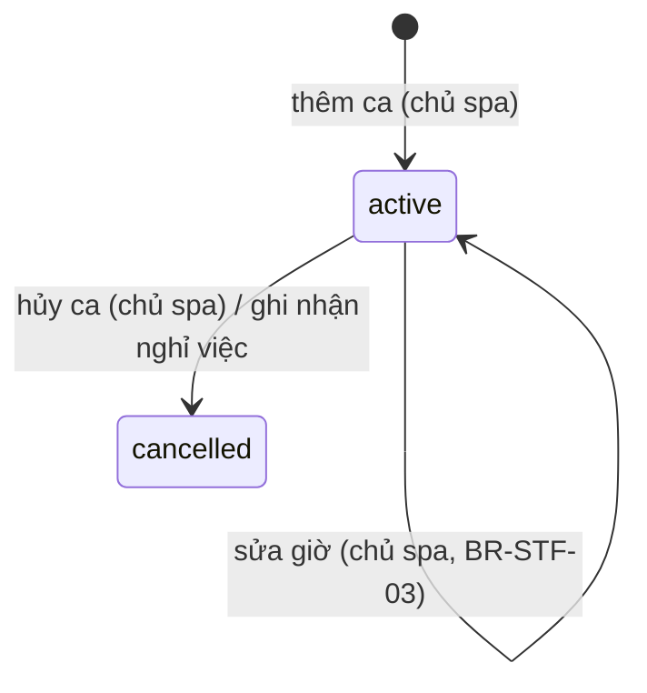

# Nhân viên & lịch làm việc — đặc tả

- **Nhóm:** `Staff` · **Sprint:** 1 · **Nguồn:** DA §2.2.3 (UC Quản lý nhân viên, UC Phân công lịch làm việc) / ĐX
- **Entity:** `StaffMember` (bảng `staff_members`), `StaffSkill` (bảng `staff_skills`), `WorkSchedule` (bảng `work_schedules`), cùng `User` (bảng `users`) — xem [glossary](../domain/glossary.md), [data-model](../domain/data-model.md)
- **Trạng thái triển khai:** xem [progress.md](../progress.md)
- **Đã đặc tả:** UC-SPA-22, 23 (chỉ backend) — **đã triển khai backend 27/10/2026** (kế hoạch: `docs/superpowers/plans/2026-10-27-uc-spa-22-23-staff.md`). UC-SPA-25 (nhân viên xem lịch hẹn được phân công, chỉ backend) đặc tả và **đã triển khai backend 31/10/2026** (kế hoạch: `docs/superpowers/plans/2026-10-31-uc-spa-25-27-28-care.md`), làm cùng UC-SPA-27, 28 ([care.md](care.md)). UC-SPA-24 (lịch làm việc cá nhân) viết sau.

## Use case

### UC-SPA-22 — Quản lý nhân viên

| Mục            | Nội dung                                                                                                                                                   |
| -------------- | ---------------------------------------------------------------------------------------------------------------------------------------------------------- |
| Actor          | Chủ spa. Danh sách rút gọn (`GET /staff`) mở cho mọi người để khách chọn nhân viên khi đặt lịch (UC-SPA-15)                                                |
| Mô tả          | Thêm nhân viên (kèm tài khoản đăng nhập), sửa thông tin, chọn các dịch vụ nhân viên làm được, ghi nhận nghỉ việc                                           |
| Tiền điều kiện | Đã đăng nhập, `role = owner` (quyền `staff.manage`)                                                                                                        |
| Input          | Họ tên, email, SĐT, ngày vào làm, chuyên môn, danh sách dịch vụ; với nghỉ việc: ngày nghỉ                                                                  |
| Output         | Hồ sơ nhân viên được tạo hoặc cập nhật; mail chứa mật khẩu tạm gửi tới nhân viên (khi thêm); danh sách lịch hẹn cần phân công lại (khi ghi nhận nghỉ việc) |

**Luồng chính — thêm nhân viên**

1. Chủ spa gửi `POST /staff` với `fullName, email, phoneNumber, hireDate, specialty?, spaServiceIds[]`.
2. Hệ thống kiểm tra dữ liệu (BR-STF-04), chuẩn hóa như đăng ký (bỏ khoảng trắng hai đầu, email so sánh không phân biệt hoa thường).
3. Hệ thống kiểm tra email và SĐT chưa thuộc tài khoản nào (E2), mọi `spaServiceIds` tồn tại và đang bán (E3).
4. Hệ thống sinh mật khẩu tạm (BR-STF-02), rồi trong **một giao dịch**: tạo `users` (`role = staff`, `status = active`, mật khẩu đã băm), `staff_members` (cùng id) và các dòng `staff_skills`, lưu, gửi mail thông tin đăng nhập tới email của nhân viên (BR-STF-08), gửi được mới commit.
5. Trả `201` kèm header `Location` (`/api/v1/staff/{id}`) và chi tiết nhân viên. Phản hồi **không** chứa mật khẩu; mật khẩu thô không lưu ở đâu ngoài nội dung mail.

**Luồng rẽ nhánh**

- A1. **Sửa nhân viên:** `PUT /staff/{id}` với `fullName, phoneNumber, hireDate, specialty?` → `200` chi tiết mới. Không đổi email (là tên đăng nhập). Đổi `hireDate` phải còn ≤ `resignationDate` (nếu có) và không muộn hơn ca làm đang hoạt động sớm nhất (E5).
- A2. **Cập nhật dịch vụ làm được:** `PUT /staff/{id}/services` với `spaServiceIds[]` → thay toàn bộ danh sách trong một giao dịch → `204`. Dịch vụ đã có từ trước mà nay ngừng bán được giữ lại; chỉ dịch vụ **mới thêm** phải đang bán (giống BR-CAT-06). Danh sách rỗng được phép.
- A3. **Ghi nhận nghỉ việc:** `POST /staff/{id}/resign` với `resignationDate` (BR-STF-01):
  1. Lưu `resignation_date`.
  2. Hủy (`status = cancelled`) mọi ca `active` có `date ≥ resignationDate`.
  3. Nếu `resignationDate ≤ hôm nay` (giờ VN): đặt `users.status = inactive` và thu hồi mọi refresh token còn hiệu lực. Nếu là ngày tương lai: tài khoản vẫn `active` tới ngày đó; từ ngày đó đăng nhập và làm mới phiên bị từ chối (BR-STF-05).
  4. Bước 1–3 nằm trong một giao dịch. Trả `200` chi tiết nhân viên kèm `appointmentsToReassign[]`: các lịch hẹn **chiếm chỗ** của nhân viên có `date ≥ resignationDate`, sắp theo ngày giờ. Hệ thống không tự đổi hay hủy các lịch này; chủ spa phân công lại ở UC-SPA-17 (chưa làm).
- A4. **Xem danh sách:** `GET /staff`.
  - Chủ spa: mọi nhân viên, lọc `search` (họ tên, email, SĐT; không phân biệt hoa thường và dấu), `status = working | resigned`, `spaServiceId`; đủ trường.
  - Người khác (khách vãng lai, khách hàng, nhân viên): chỉ nhân viên **đang làm** (`resignation_date` null hoặc > hôm nay) và `users.status = active`; chỉ trả `id, fullName, specialty, avatarUrl`; nhận `search` (họ tên) và `spaServiceId`, bỏ qua `status` (không báo lỗi).
- A5. **Xem chi tiết:** `GET /staff/{id}` (chỉ chủ spa) → hồ sơ, tài khoản và dịch vụ làm được.

**Ngoại lệ**

- E1. Dữ liệu không hợp lệ (BR-STF-04) → `400 validation_error` theo trường.
- E2. Email đã có tài khoản → `409 email_exists`; SĐT đã có (khi thêm, hoặc khi sửa sang SĐT của người khác) → `409 phone_exists`. Dùng lại mã của UC-SPA-01.
- E2b. Gửi mail thất bại (thiếu cấu hình mail, SMTP lỗi) → rollback, không tạo tài khoản nào → `503 email_send_failed` (dùng lại mã của UC-SPA-01), thông điệp chung; chi tiết chỉ ghi log. Chủ spa thử thêm lại.
- E3. `spaServiceIds` chứa id không tồn tại → `400 staff_service_not_found`; dịch vụ ngừng bán (và mới thêm) → `400 staff_service_discontinued`. Thông điệp nêu tên dịch vụ nếu có.
- E4. Nhân viên không tồn tại → `404 staff_not_found`.
- E5. `resignationDate < hireDate` → `400 resignation_before_hire_date`; sửa `hireDate` muộn hơn `resignationDate` → cũng `400 resignation_before_hire_date`; sửa `hireDate` muộn hơn ca đang hoạt động sớm nhất → `400 hire_date_after_shift`.
- E6. Nhân viên đã có `resignation_date` mà ghi nhận nghỉ việc lần nữa → `409 staff_already_resigned` (Q-16).
- E7. Chưa đăng nhập → `401 unauthorized`; không phải chủ spa → `403 forbidden` (mọi endpoint trừ `GET /staff`).
- E8. Không có endpoint xóa nhân viên (giữ lịch sử lịch hẹn, hồ sơ da; FK `RESTRICT`).

**Quy tắc áp dụng:** BR-STF-01, 02, 04, 05, 08, BR-SEC-01, RBAC `staff.manage`.

### UC-SPA-23 — Phân công lịch làm việc cho nhân viên

| Mục            | Nội dung                                                                     |
| -------------- | ---------------------------------------------------------------------------- |
| Actor          | Chủ spa                                                                      |
| Mô tả          | Xem lịch làm việc theo khoảng ngày, thêm ca, sửa giờ ca, hủy ca              |
| Tiền điều kiện | Đã đăng nhập, `role = owner` (quyền `schedule.manage`); nhân viên đã tồn tại |
| Input          | Nhân viên, ngày, giờ bắt đầu, giờ kết thúc                                   |
| Output         | Ca làm được lưu, sửa hoặc hủy                                                |

**Luồng chính — thêm ca**

1. Chủ spa xem lịch: `GET /work-schedules?fromDate&toDate&staffMemberId?&status?` (khoảng ≤ 42 ngày).
2. Chủ spa gửi `POST /work-schedules` với `staffMemberId, date, startTime, endTime` (giờ VN, `HH:mm`).
3. Hệ thống kiểm tra (BR-STF-03, BR-STF-06): giờ hợp lệ, ngày không ở quá khứ và không quá xa, nhân viên tồn tại, đã vào làm và chưa nghỉ việc vào ngày đó, không chồng với ca `active` khác của nhân viên trong ngày.
4. Lưu ca `status = active`; trả `201` kèm `Location` (`/api/v1/work-schedules/{id}`) và ca vừa tạo.

**Luồng rẽ nhánh**

- A1. **Sửa ca:** `PUT /work-schedules/{id}` với `date, startTime, endTime` → kiểm tra như thêm ca (bỏ qua chính ca này khi xét chồng ca), và mọi lịch hẹn chiếm chỗ đang nằm trong ca cũ phải nằm trọn trong ca mới (đổi sang ngày khác thì ca cũ phải không có lịch hẹn nào) → `200` ca mới.
- A2. **Hủy ca** (ĐX): `PATCH /work-schedules/{id}/status` với `{ status: "cancelled" }` → ca không còn lịch hẹn chiếm chỗ thì đặt `cancelled` → `204`. Hủy ca đã hủy → `204`. Ca đã hủy không mở lại được; chủ spa thêm ca mới.
- A3. **Sao chép lịch tuần** (ĐX trong DA): **chưa làm** lần này, ghi ở mục Việc để sau (Q-18).
- A4. **Thêm ca theo khoảng ngày** (ĐX, thêm 27/10/2026): `POST /work-schedules/batch` với `staffMemberIds[], fromDate, toDate, weekdays?, startTime, endTime` (BR-STF-09):
  1. Hệ thống dựng danh sách ca: mỗi ngày trong `[fromDate, toDate]` có thứ nằm trong `weekdays` (bỏ trống = mọi ngày) × mỗi nhân viên, cùng giờ.
  2. Từng ca được kiểm tra như thêm ca đơn lẻ (BR-STF-03, BR-STF-06) theo cùng thứ tự; ca không hợp lệ bị **bỏ qua** kèm lý do (mã lỗi tương ứng), không làm hỏng cả yêu cầu.
  3. Các ca hợp lệ được lưu trong **một giao dịch**; trả `200 { created: [ca], skipped: [{ staffMemberId, staffName, date, reason }] }`, cả hai sắp theo ngày, giờ, tên nhân viên. Không ca nào hợp lệ → vẫn `200` với `created` rỗng.
  4. Lỗi của cả yêu cầu (không bỏ qua từng ca): dữ liệu sai → `400`; `staffMemberIds` có id không tồn tại → `404 staff_not_found`; hai yêu cầu đồng thời tạo ca chồng nhau → yêu cầu sau `409 shift_conflict`, không lưu ca nào (ràng buộc `EXCLUDE`), chủ spa gửi lại.

**Ngoại lệ**

- E1. **Xung đột:** chồng với ca `active` khác cùng nhân viên → `409 shift_conflict` (cả kiểm tra trong Application lẫn ràng buộc `EXCLUDE` khi hai yêu cầu đồng thời); sửa/hủy làm lịch hẹn chiếm chỗ rơi ra ngoài ca → `409 shift_has_appointments`, thông điệp có số lịch hẹn bị ảnh hưởng.
- E2. `endTime ≤ startTime`, giờ có giây khác 0, khoảng ngày xem sai (thiếu, `toDate < fromDate`, > 42 ngày) → `400 validation_error`.
- E3. `date` trước hôm nay (giờ VN), hoặc sau hôm nay + `WorkSchedule:MaxDaysAhead` → `400 shift_date_out_of_range`. Sửa/hủy ca có `date` trước hôm nay → `400 shift_in_past`.
- E4. `date < hire_date` → `400 shift_before_hire_date`; `date ≥ resignation_date` → `400 staff_resigned`.
- E5. Nhân viên không tồn tại (khi thêm ca, hoặc lọc khi xem) → `404 staff_not_found`; ca không tồn tại → `404 work_schedule_not_found`.
- E6. Sửa ca đã hủy → `409 shift_cancelled`.
- E7. `401 unauthorized` / `403 forbidden` như UC-SPA-22.

**Quy tắc áp dụng:** BR-STF-01, 03, 06, BR-BKG-02 (lịch hẹn nằm trọn trong một ca), RBAC `schedule.manage`.

### UC-SPA-25 — Xem danh sách lịch hẹn được phân công

| Mục            | Nội dung                                                                                                        |
| -------------- | --------------------------------------------------------------------------------------------------------------- |
| Actor          | Nhân viên                                                                                                       |
| Mô tả          | Nhân viên xem các lịch được phân công cho mình, lọc theo ngày và trạng thái, mở chi tiết khách, dịch vụ, dị ứng |
| Tiền điều kiện | Đã đăng nhập, `role = staff` (quyền `schedule.self`)                                                            |
| Input          | Khoảng ngày, trạng thái; lịch được chọn                                                                         |
| Output         | Danh sách lịch của chính nhân viên; chi tiết lịch                                                               |

**Luồng chính**

1. Nhân viên mở "Lịch hẹn được phân công"; client gọi `GET /me/assigned-appointments?fromDate&toDate[&status]` (mặc định client gửi hôm nay → hôm nay; tab "Sắp tới", "Đã xong" đổi khoảng ngày và `status`).
2. Hệ thống trả các lịch có `staff_member_id` = người gọi trong khoảng ngày, bỏ `held` và `hold_expired` (BR-STF-10), sắp theo `date, startTime`.
3. Nhân viên chọn một lịch; client gọi `GET /appointments/{id}` (có sẵn, nhân viên được phân công xem được): thông tin khách, dịch vụ, buổi x/y của gói, dị ứng nổi bật (BR-CARE-02), hồ sơ da (`skinProfileId`).

**Luồng rẽ nhánh**

- A1. Chuyển sang lập/cập nhật hồ sơ da (UC-SPA-27, [care.md](care.md)).
- A2. Chuyển sang xác nhận hoàn thành (UC-SPA-28, [care.md](care.md)).
- A3. Không có lịch → `200` danh sách rỗng (client hiển thị "Chưa có lịch hẹn").

**Ngoại lệ**

- E1. Thiếu `fromDate`/`toDate`, `toDate < fromDate`, khoảng > `Booking:MaxQueryRangeDays` (42) ngày, `status` lạ hoặc là `held`/`hold_expired` → `400 validation_error`.
- E2. Lịch của nhân viên khác ở `GET /appointments/{id}` → `403 appointment_not_assigned` (có sẵn).
- E3. Chưa đăng nhập → `401`; chủ spa, khách hàng → `403` (chủ spa dùng `GET /appointments`).

**Quy tắc áp dụng:** BR-STF-10, BR-CARE-02, BR-SEC-01, RBAC `schedule.self`.

## Business rules

| Mã        | Quy tắc                                                                                                                                                                                                                                                                                                                                                                                                                                  | Enforce ở đâu                                                           | Nguồn                                     |
| --------- | ---------------------------------------------------------------------------------------------------------------------------------------------------------------------------------------------------------------------------------------------------------------------------------------------------------------------------------------------------------------------------------------------------------------------------------------- | ----------------------------------------------------------------------- | ----------------------------------------- |
| BR-STF-01 | `resignation_date ≥ hire_date`. Từ `resignation_date` nhân viên không có ca và không nhận lịch hẹn mới; ghi nhận nghỉ việc tự hủy các ca `active` từ ngày đó, trả danh sách lịch hẹn chiếm chỗ từ ngày đó để chủ spa phân công lại (không tự hủy lịch hẹn)                                                                                                                                                                               | Application + CHECK có sẵn                                              | DA + ĐX                                   |
| BR-STF-02 | Thêm nhân viên tạo `users` (`role = staff`) + `staff_members` (1-1, cùng id) + `staff_skills` trong một lần lưu. Mật khẩu tạm dài `Staff:TemporaryPasswordLength` (mặc định 12) ký tự, sinh bằng bộ sinh số ngẫu nhiên mật mã, luôn có ít nhất 1 chữ thường, 1 chữ hoa, 1 chữ số (đạt BR-AUTH-10), bỏ các ký tự dễ nhầm (`0 O o 1 l I`); chỉ nằm trong mail gửi nhân viên, không trả trong API, không ghi log                            | Application                                                             | DA (mô hình 1-1) + ĐX (Q-15)              |
| BR-STF-03 | Ca làm: `end_time > start_time` (không có ca qua đêm); giờ đúng tới phút; không chồng ca `active` cùng nhân viên cùng ngày — hai ca chạm nhau (`08:00–12:00` và `12:00–17:00`) **không** tính là chồng. Sửa/hủy ca không được làm lịch hẹn chiếm chỗ nằm trong ca cũ rơi ra ngoài ca                                                                                                                                                     | Application + CSDL (`CHECK` có sẵn, **thêm** `EXCLUDE` cho ca `active`) | DA                                        |
| BR-STF-04 | Họ tên, email, SĐT theo BR-AUTH-10. `specialty` ≤ 255 ký tự. `hireDate` từ 2000-01-01 tới hôm nay + 365 ngày. `resignationDate` tới hôm nay + 365 ngày. `spaServiceIds` không trùng, tối đa 100 phần tử                                                                                                                                                                                                                                  | Validator                                                               | ĐX (biên tự đặt)                          |
| BR-STF-05 | Nhân viên có `resignation_date ≤ hôm nay` (giờ VN) bị từ chối đăng nhập và làm mới phiên với `403 account_inactive`, kể cả khi `users.status` còn `active` (nghỉ việc ghi trước ngày); không có job nền đổi trạng thái                                                                                                                                                                                                                   | Application `AuthService` (thêm điều kiện)                              | WF-10 + ĐX (Q-16)                         |
| BR-STF-06 | Ngày ca nằm trong `[hôm nay, hôm nay + WorkSchedule:MaxDaysAhead]` (mặc định 60) khi thêm hoặc sửa; ca có `date` trước hôm nay chỉ đọc. `date ≥ hire_date` và `date < resignation_date` (nếu có)                                                                                                                                                                                                                                         | Application                                                             | ĐX (Q-17)                                 |
| BR-STF-07 | Lịch hẹn **chiếm chỗ**: `pending_confirmation`, `confirmed`, hoặc `held` có `hold_expires_at_utc > now`. Lịch hẹn "nằm trong ca" = cùng nhân viên, cùng ngày, khoảng giờ giao với khoảng giờ của ca                                                                                                                                                                                                                                      | Application (một chỗ dùng chung, sau này UC-SPA-15/17 dùng lại)         | BR-BKG-01, 02                             |
| BR-STF-08 | Mail thông tin đăng nhập bằng tiếng Việt, có bản HTML và text: tên spa, họ tên nhân viên, email đăng nhập, mật khẩu tạm, lời nhắc đổi mật khẩu sau lần đăng nhập đầu (qua Quên mật khẩu) và không chia sẻ mật khẩu. Tiêu đề: "Tài khoản nhân viên – Spa Như Nguyệt". Gửi qua `IEmailSender` có sẵn, bên trong giao dịch tạo tài khoản: gửi lỗi thì rollback. Log chỉ ghi địa chỉ đã che (BR-AUTH-13), không bao giờ ghi mật khẩu         | Application (nội dung, giao dịch), Infrastructure `SmtpEmailSender`     | Quyết định của bạn (Q-15)                 |
| BR-STF-09 | Thêm ca theo khoảng ngày: `staffMemberIds` 1–50 phần tử, không trùng; `toDate ≥ fromDate`, khoảng ≤ `WorkSchedule:MaxQueryRangeDays` (42) ngày; `weekdays` không trùng, bỏ trống = mọi ngày, có thì không rỗng; giờ theo BR-STF-03; tổng số ca dựng ra 1 – `WorkSchedule:MaxBatchShifts` (mặc định 500). Lý do bỏ qua một ca: `shift_date_out_of_range`, `shift_before_hire_date`, `staff_resigned`, `shift_conflict` (chồng ca đang có) | Validator + Application                                                 | ĐX (quyết định 27/10/2026: bỏ qua ca lỗi) |
| BR-STF-10 | Nhân viên chỉ thấy lịch có `staff_member_id` = mình (BR-SEC-01). Danh sách bỏ `held` và `hold_expired` (đang chờ thanh toán / đã hết giữ chỗ, chưa phải việc của nhân viên — Q-33); thấy `pending_confirmation`, `confirmed`, `completed`, `cancelled`, `no_show`. Khoảng ngày bắt buộc, ≤ `Booking:MaxQueryRangeDays`; không phân trang (một nhân viên ≤ vài chục lịch/khoảng)                                                          | Application + Query                                                     | DA + ĐX (Q-33)                            |

**Phân quyền** (theo bảng RBAC sheet `21`): thêm `staff.manage` → `owner` và `schedule.manage` → `owner` vào `API/Authorization/Permissions.cs`. `GET /staff` để `[AllowAnonymous]` giống danh mục: Bearer hợp lệ của chủ spa bật chế độ xem đầy đủ, còn lại là chế độ công khai. UC-SPA-25 thêm `schedule.self` → `staff` (sau này UC-SPA-24 dùng chung).

## Trạng thái

Ca làm (WF-12). Nhân viên không có cột trạng thái riêng: "đang làm" / "đã nghỉ" suy ra từ `resignation_date` so với hôm nay; tài khoản theo `users.status` (`active` → `inactive` khi nghỉ việc, WF-10).

## Dữ liệu

| Bảng             | Cột dùng                                                                                | Thay đổi                                                                                                                                                                                                           |
| ---------------- | --------------------------------------------------------------------------------------- | ------------------------------------------------------------------------------------------------------------------------------------------------------------------------------------------------------------------ |
| `users`          | `id, full_name, email, phone_number, password_hash, role, status, avatar_url`, audit    | Không đổi                                                                                                                                                                                                          |
| `staff_members`  | `id, hire_date, specialty, resignation_date`                                            | Không đổi                                                                                                                                                                                                          |
| `staff_skills`   | `staff_member_id, spa_service_id`                                                       | Không đổi; cập nhật dịch vụ xóa cứng dòng cũ rồi tạo lại                                                                                                                                                           |
| `work_schedules` | `id, staff_member_id, date, start_time, end_time, status`                               | **Thêm** `EXCLUDE USING gist (staff_member_id WITH =, tsrange(date + start_time, date + end_time) WITH &&) WHERE (status = 'active')`, tên `ex_work_schedules_no_overlap` (cùng cách với `appointments`, ADR-0003) |
| `appointments`   | `staff_member_id, date, start_time, end_time, status, hold_expires_at_utc, customer_id` | Chỉ đọc (kiểm tra BR-STF-03, danh sách cần phân công lại)                                                                                                                                                          |
| `refresh_tokens` | `user_id, revoked_at_utc`                                                               | Thu hồi khi nghỉ việc có hiệu lực                                                                                                                                                                                  |

Migration mới: `AddWorkScheduleOverlapConstraint` (SQL thủ công, đặt cạnh `AppointmentConstraints`). Đổi schema đi kèm: sửa ràng buộc cột `end_time` của `work_schedules` trong `docs/spec-source/data_db.py`, sinh lại `data-model.md`, file Excel và `docs/export/NhuNguyetSpa_CSDL_TiengViet.sql`. Lỗi vi phạm `EXCLUDE` (SQLSTATE `23P01`) được dịch thành `409 shift_conflict`.

## API

Tiền tố `/api/v1`, envelope `{ success, message, data, errors, traceId }`. Ngày `yyyy-MM-dd`, giờ `HH:mm` (giờ VN). Phân trang dùng `PagedQuery` có sẵn.

| Method | Đường dẫn                     | Vai trò   | Request                                                                                              | Response                                                                                                                                                                                                                                                  | Lỗi                                                                                                                                                 |
| ------ | ----------------------------- | --------- | ---------------------------------------------------------------------------------------------------- | --------------------------------------------------------------------------------------------------------------------------------------------------------------------------------------------------------------------------------------------------------- | --------------------------------------------------------------------------------------------------------------------------------------------------- |
| GET    | `/staff`                      | Mọi người | `?search&status=working\|resigned&spaServiceId&pageNumber&pageSize` (`status` chỉ chủ spa)           | 200 `PagedResult`. Chủ spa: `{ id, fullName, email, phoneNumber, avatarUrl, specialty, hireDate, resignationDate, accountStatus, services: [{ id, name, status }] }`; người khác: `{ id, fullName, specialty, avatarUrl }`. Sắp theo `fullName`, rồi `id` | 400 `validation_error`                                                                                                                              |
| GET    | `/staff/{id}`                 | Chủ spa   | —                                                                                                    | 200 `{ id, fullName, email, phoneNumber, avatarUrl, specialty, hireDate, resignationDate, accountStatus, services: [{ id, name, status }], createdAtUtc, updatedAtUtc }`                                                                                  | 401, 403, 404 `staff_not_found`                                                                                                                     |
| POST   | `/staff`                      | Chủ spa   | `{ fullName, email, phoneNumber, hireDate, specialty?, spaServiceIds: [] }`                          | 201 + `Location`, chi tiết nhân viên                                                                                                                                                                                                                      | 400 `validation_error`/`staff_service_not_found`/`staff_service_discontinued`, 401, 403, 409 `email_exists`/`phone_exists`, 503 `email_send_failed` |
| PUT    | `/staff/{id}`                 | Chủ spa   | `{ fullName, phoneNumber, hireDate, specialty? }`                                                    | 200 chi tiết                                                                                                                                                                                                                                              | 400 `validation_error`/`resignation_before_hire_date`/`hire_date_after_shift`, 401, 403, 404, 409 `phone_exists`                                    |
| PUT    | `/staff/{id}/services`        | Chủ spa   | `{ spaServiceIds: [] }`                                                                              | 204                                                                                                                                                                                                                                                       | 400 `validation_error`/`staff_service_not_found`/`staff_service_discontinued`, 401, 403, 404                                                        |
| POST   | `/staff/{id}/resign`          | Chủ spa   | `{ resignationDate }`                                                                                | 200 `{ staff: <chi tiết>, appointmentsToReassign: [{ id, date, startTime, endTime, status, customerId, customerName }] }`                                                                                                                                 | 400 `validation_error`/`resignation_before_hire_date`, 401, 403, 404, 409 `staff_already_resigned`                                                  |
| GET    | `/work-schedules`             | Chủ spa   | `?fromDate&toDate&staffMemberId&status=active\|cancelled` (`fromDate`, `toDate` bắt buộc, ≤ 42 ngày) | 200 `[{ id, staffMemberId, staffName, date, startTime, endTime, status }]` sắp theo `date, startTime, staffName` (không phân trang)                                                                                                                       | 400, 401, 403, 404 `staff_not_found`                                                                                                                |
| POST   | `/work-schedules`             | Chủ spa   | `{ staffMemberId, date, startTime, endTime }`                                                        | 201 + `Location`, ca                                                                                                                                                                                                                                      | 400 `validation_error`/`shift_date_out_of_range`/`shift_before_hire_date`/`staff_resigned`, 401, 403, 404 `staff_not_found`, 409 `shift_conflict`   |
| PUT    | `/work-schedules/{id}`        | Chủ spa   | `{ date, startTime, endTime }`                                                                       | 200 ca                                                                                                                                                                                                                                                    | như POST, thêm 400 `shift_in_past`, 404 `work_schedule_not_found`, 409 `shift_cancelled`/`shift_has_appointments`                                   |
| PATCH  | `/work-schedules/{id}/status` | Chủ spa   | `{ status: "cancelled" }`                                                                            | 204                                                                                                                                                                                                                                                       | 400 `validation_error`/`shift_in_past`, 401, 403, 404, 409 `shift_has_appointments`                                                                 |
| POST   | `/work-schedules/batch`       | Chủ spa   | `{ staffMemberIds: [], fromDate, toDate, weekdays?: ["monday" … "sunday"], startTime, endTime }`     | 200 `{ created: [ca], skipped: [{ staffMemberId, staffName, date, reason }] }`                                                                                                                                                                            | 400, 401, 403, 404 `staff_not_found`, 409 `shift_conflict` (chỉ khi tranh chấp đồng thời)                                                           |

**UC-SPA-25** (nhân viên, policy `schedule.self`):

| Method | Đường dẫn                   | Vai trò   | Request                                                                                                                                           | Response                                                                                                                                                                                                                                                            | Lỗi           |
| ------ | --------------------------- | --------- | ------------------------------------------------------------------------------------------------------------------------------------------------- | ------------------------------------------------------------------------------------------------------------------------------------------------------------------------------------------------------------------------------------------------------------------- | ------------- |
| GET    | `/me/assigned-appointments` | Nhân viên | `?fromDate&toDate&status` (`fromDate`, `toDate` bắt buộc, ≤ 42 ngày; `status` ∈ `pending_confirmation\|confirmed\|completed\|cancelled\|no_show`) | 200 `[{ id, date, startTime, endTime, status, customer: { id, fullName, phoneNumber }, service: { id, name }, treatmentSession?: { id, sequenceNumber, totalSessions, packageName }, hasAllergies, hasSkinProfile }]` sắp theo `date, startTime` (không phân trang) | 400, 401, 403 |

- Chi tiết dùng `GET /appointments/{id}` có sẵn (thêm trường ở [care.md](care.md#api)).
- Sửa tại chỗ dòng SPA-API-090 trong `data_api.py` (`?fromDate&toDate&status`, response).

- `accountStatus` = `users.status` (`active`/`locked`/`inactive`).
- Sửa tại chỗ các dòng STF trong `data_api.py` cho khớp bảng trên (thêm `hireDate` ở PUT, bỏ `matKhauTam` khỏi phản hồi thêm nhân viên, tên tham số); không thêm/xóa dòng nên mã `SPA-API-xxx` giữ nguyên. Hai endpoint `/me/work-schedules*` (UC-SPA-24) chưa làm.
- `packages/shared-types`, `api-client` **không** làm lần này (chỉ backend).

## Cấu hình

| Biến `.env` | Khóa cấu hình                    | Mặc định (`appsettings.json`)         |
| ----------- | -------------------------------- | ------------------------------------- |
| —           | `Staff:TemporaryPasswordLength`  | `12` (8–64)                           |
| —           | `WorkSchedule:MaxDaysAhead`      | `60`                                  |
| —           | `WorkSchedule:MaxQueryRangeDays` | `42` (6 tuần, đủ một lưới lịch tháng) |
| —           | `WorkSchedule:MaxBatchShifts`    | `500`                                 |

Không có secret mới, không đổi `EnvLoader`; mail dùng lại `MAIL_SETTINGS_*` có sẵn.

## Kiểm thử bắt buộc

Unit test (Application) dùng NSubstitute và đồng hồ giả; integration test dùng `PostgresFixture` (Testcontainers) và `AuthApiFactory`. Lịch hẹn trong test chèn trực tiếp vào CSDL (chưa có API đặt lịch).

| Mã       | Tình huống                                                                                                                                                  | Kết quả mong đợi                                                                                                                                                                                                                                             |
| -------- | ----------------------------------------------------------------------------------------------------------------------------------------------------------- | ------------------------------------------------------------------------------------------------------------------------------------------------------------------------------------------------------------------------------------------------------------ |
| STF-T01  | Chủ spa thêm nhân viên hợp lệ với 2 dịch vụ                                                                                                                 | 201, `Location` đúng; `users.role = staff`, `status = active`; `staff_members` cùng id; 2 dòng `staff_skills`; phản hồi không có mật khẩu; `FakeEmailSender` nhận đúng 1 mail tới email nhân viên, mật khẩu trong mail đăng nhập được qua `POST /auth/login` |
| STF-T02  | Mật khẩu tạm (unit, lặp 1000 lần)                                                                                                                           | Đúng độ dài cấu hình, đủ chữ thường/hoa/số, không có ký tự dễ nhầm; CSDL chỉ có hash                                                                                                                                                                         |
| STF-T02b | `FakeEmailSender` ném lỗi khi thêm nhân viên                                                                                                                | `503 email_send_failed`; không có dòng `users`, `staff_members`, `staff_skills` nào; thêm lại cùng email sau đó thành công                                                                                                                                   |
| STF-T02c | Nội dung mail (unit)                                                                                                                                        | Tiêu đề, HTML và text đúng BR-STF-08; có email đăng nhập và mật khẩu; log không chứa mật khẩu                                                                                                                                                                |
| STF-T03  | Thêm với email đã có (khác hoa thường) / SĐT đã có                                                                                                          | `409 email_exists` / `409 phone_exists`; không tạo dòng nào                                                                                                                                                                                                  |
| STF-T04  | Dữ liệu biên: họ tên rỗng, SĐT sai dạng, `hireDate` 1999-12-31 và hôm nay + 366, `specialty` 256 ký tự, `spaServiceIds` trùng, 101 phần tử                  | `400 validation_error` theo trường                                                                                                                                                                                                                           |
| STF-T05  | `spaServiceIds` có id không tồn tại / dịch vụ ngừng bán                                                                                                     | `400 staff_service_not_found` / `400 staff_service_discontinued`; không lưu gì                                                                                                                                                                               |
| STF-T06  | Sửa nhân viên: đổi SĐT sang SĐT của người khác; đổi `hireDate` sau `resignationDate`; đổi `hireDate` sau ca đang hoạt động sớm nhất; id không tồn tại       | `409 phone_exists` / `400 resignation_before_hire_date` / `400 hire_date_after_shift` / `404 staff_not_found`                                                                                                                                                |
| STF-T07  | Cập nhật dịch vụ: thay 2 dịch vụ bằng 1 dịch vụ khác; giữ dịch vụ đã có nay ngừng bán; danh sách rỗng                                                       | 204, CSDL đúng danh sách mới; không lỗi khi giữ dịch vụ ngừng bán; rỗng → 0 dòng                                                                                                                                                                             |
| STF-T08  | Nghỉ việc hôm nay, có 2 ca từ hôm nay trở đi, 1 ca hôm qua, 1 lịch hẹn `confirmed` ngày mai, 1 lịch `cancelled`, 1 lịch `held` hết hạn                      | 200; 2 ca thành `cancelled`, ca hôm qua giữ nguyên; `appointmentsToReassign` chỉ có lịch `confirmed`; `users.status = inactive`; refresh token bị thu hồi, `POST /auth/refresh` thất bại                                                                     |
| STF-T09  | Nghỉ việc ngày mai; đăng nhập hôm nay rồi lùi đồng hồ sang ngày mai đăng nhập lại                                                                           | Hôm nay đăng nhập 200, `status` vẫn `active`; ngày mai `403 account_inactive` (login và refresh)                                                                                                                                                             |
| STF-T10  | `resignationDate < hireDate`; nghỉ việc lần 2                                                                                                               | `400 resignation_before_hire_date`; `409 staff_already_resigned`                                                                                                                                                                                             |
| STF-T11  | `GET /staff` của chủ spa: `search` không dấu theo tên, email, SĐT; `status=resigned`; `spaServiceId`; phân trang                                            | Lọc đúng, sắp theo tên, đủ trường                                                                                                                                                                                                                            |
| STF-T12  | `GET /staff` khi không đăng nhập / là khách hàng: có nhân viên đã nghỉ, nghỉ ngày mai, tài khoản `locked`                                                   | Chỉ nhân viên đang làm và `active` (gồm người nghỉ ngày mai); chỉ 4 trường; `status=resigned` bị bỏ qua; không lộ email/SĐT                                                                                                                                  |
| STF-T13  | Khách hàng, nhân viên gọi POST/PUT `/staff`, `/work-schedules`, `GET /staff/{id}`; không có Bearer                                                          | `403 forbidden` / `401 unauthorized`, dạng envelope                                                                                                                                                                                                          |
| STF-T14  | Thêm ca hợp lệ; ca chạm ca khác (`12:00–17:00` sau `08:00–12:00`)                                                                                           | 201, `Location` đúng, `status = active`; ca chạm → 201                                                                                                                                                                                                       |
| STF-T15  | Thêm ca chồng ca `active` khác; chồng ca đã `cancelled`                                                                                                     | `409 shift_conflict`; ca đã hủy không tính → 201                                                                                                                                                                                                             |
| STF-T16  | Hai yêu cầu thêm ca chồng nhau gửi đồng thời                                                                                                                | Đúng 1 yêu cầu 201, yêu cầu còn lại `409 shift_conflict`; CSDL chỉ 1 ca                                                                                                                                                                                      |
| STF-T17  | Ràng buộc CSDL: chèn trực tiếp 2 ca `active` chồng nhau / 1 `active` + 1 `cancelled` chồng nhau                                                             | `DbUpdateException` (`23P01`) / chèn được                                                                                                                                                                                                                    |
| STF-T18  | `endTime = startTime`; `endTime < startTime`; giờ có giây; ngày hôm qua; ngày hôm nay + 61; trước `hireDate`; từ `resignationDate`                          | `400 validation_error` ×3 / `shift_date_out_of_range` ×2 / `shift_before_hire_date` / `staff_resigned`                                                                                                                                                       |
| STF-T19  | Sửa ca 08:00–12:00 có lịch `confirmed` 09:00–10:00: sang 08:30–11:00 / 09:30–12:00 / ngày khác                                                              | 200 / `409 shift_has_appointments` / `409 shift_has_appointments`                                                                                                                                                                                            |
| STF-T20  | Sửa ca chỉ có lịch `cancelled` hoặc `held` hết hạn trong ca                                                                                                 | 200 (không tính là chiếm chỗ)                                                                                                                                                                                                                                |
| STF-T21  | Hủy ca không có lịch; hủy ca có lịch `pending_confirmation`; hủy lại ca đã hủy; sửa ca đã hủy; sửa/hủy ca hôm qua                                           | 204 / `409 shift_has_appointments` / 204 / `409 shift_cancelled` / `400 shift_in_past`                                                                                                                                                                       |
| STF-T22  | `GET /work-schedules` thiếu `fromDate`; `toDate < fromDate`; khoảng 43 ngày; lọc theo nhân viên và `status`                                                 | `400 validation_error` ×3; trả đúng ca, sắp theo ngày, giờ, tên                                                                                                                                                                                              |
| STF-T23  | `PATCH status` với `active` hoặc giá trị lạ                                                                                                                 | `400 validation_error`                                                                                                                                                                                                                                       |
| STF-T24  | Không có `DELETE /staff/{id}`, `DELETE /work-schedules/{id}`                                                                                                | 405                                                                                                                                                                                                                                                          |
| STF-T25  | Hồi quy UC-SPA-01/02/03/06/07/09                                                                                                                            | Toàn bộ test hiện có vẫn pass; `PersistenceModelTests` pass                                                                                                                                                                                                  |
| STF-T26  | Thêm ca theo khoảng 2 tuần, `weekdays` thứ 2–6, 2 nhân viên; một nhân viên đã có ca chồng giờ vào một ngày, một nhân viên nghỉ việc giữa khoảng             | 200; `created` đúng số ca hợp lệ, chỉ các ngày thứ 2–6; `skipped` có `shift_conflict` cho ngày bị chồng và `staff_resigned` cho các ngày từ ngày nghỉ; CSDL đúng bằng `created`                                                                              |
| STF-T27  | Khoảng ngày bắt đầu từ hôm qua; `weekdays` bỏ trống                                                                                                         | Ngày hôm qua nằm trong `skipped` (`shift_date_out_of_range`); mọi ngày còn lại được tạo                                                                                                                                                                      |
| STF-T28  | Dữ liệu sai: `staffMemberIds` rỗng / trùng; `toDate < fromDate`; khoảng 43 ngày; `weekdays` rỗng hoặc trùng; `endTime ≤ startTime`; quá `MaxBatchShifts` ca | `400`, không lưu ca nào                                                                                                                                                                                                                                      |
| STF-T29  | `staffMemberIds` có id không tồn tại                                                                                                                        | `404 staff_not_found`, không lưu ca nào                                                                                                                                                                                                                      |
| STF-T30  | Khách hàng / nhân viên / không Bearer gọi batch                                                                                                             | `403` / `403` / `401`                                                                                                                                                                                                                                        |
| STF-T31  | UC-SPA-25: nhân viên A có lịch `confirmed`, `completed`, `cancelled`, `held`, `hold_expired` trong khoảng; B có 1 lịch cùng ngày                            | 200 chỉ lịch của A, không có `held`/`hold_expired`, sắp theo ngày giờ; dịch vụ suy ra đúng (BR-BKG-13)                                                                                                                                                       |
| STF-T32  | Lọc `status=completed`; lịch buổi gói có `treatmentSession` (`sequenceNumber`, `totalSessions`, `packageName`); khách có dị ứng; lịch đã có hồ sơ da        | Đúng dòng; `hasAllergies = true`, `hasSkinProfile = true`                                                                                                                                                                                                    |
| STF-T33  | Thiếu `fromDate`; `toDate < fromDate`; khoảng 43 ngày; `status=held`; `status=abc`; khoảng không có lịch                                                    | `400 validation_error` ×5; 200 `[]`                                                                                                                                                                                                                          |
| STF-T34  | Chủ spa / khách hàng / không Bearer gọi `/me/assigned-appointments`                                                                                         | `403` / `403` / `401`                                                                                                                                                                                                                                        |

## Câu hỏi còn mở

- Q-15 (**đã chốt** 27/10/2026): Hệ thống sinh mật khẩu tạm và **gửi mail cho nhân viên**; API không trả mật khẩu. Nhân viên đổi qua quên mật khẩu (UC-SPA-03) hoặc đổi mật khẩu (UC-SPA-04, `PUT /me/password`). Độ dài đọc từ `Staff:TemporaryPasswordLength`.
- Q-16 (mới; phần ngày tương lai **đã chốt** 27/10/2026): **Cho ghi ngày nghỉ việc ở tương lai**, từ ngày đó không đăng nhập được (BR-STF-05). Mặc định phần còn lại: **chỉ ghi một lần** (`409 staff_already_resigned`), chưa có thao tác hủy nghỉ việc hay nhận lại nhân viên.
- Q-17 (mới): Phân ca được trước bao xa, xem lịch bao nhiêu ngày một lần? Mặc định: **từ hôm nay tới hôm nay + 60 ngày** (`WorkSchedule:MaxDaysAhead`; spa thường xếp ca theo tuần hoặc tháng, 60 ngày đủ cho tháng này và tháng sau mà không tạo ca quá xa dễ phải sửa); ca quá khứ chỉ đọc. Xem tối đa **42 ngày** một lần (`WorkSchedule:MaxQueryRangeDays`; 6 tuần = một lưới lịch tháng đầy đủ của SCR-W33).
- Q-18 (mới): "Sao chép lịch tuần" (ĐX trong DA): **chưa làm lần này, sẽ làm sau** (STF-LATER-01). Thêm ca theo khoảng ngày (A4) đã làm 27/10/2026 và có thể dùng lại phần dựng + kiểm tra ca.
- Q-33 (mới, UC-SPA-25): Nhân viên có thấy lịch `held` (đang chờ khách thanh toán) và `hold_expired` không? Mặc định: **không** — chưa chắc thành lịch thật; khung đó vẫn bị chặn khi tìm giờ trống. Không cấu hình.

## Việc để sau

Đã chốt 27/10/2026: chưa triển khai lần này, ghi lại để làm ở lần sau. Khi làm, mở rộng spec này và cập nhật [progress.md](../progress.md).

| Mã           | Việc                                                                                                         | Ghi chú                                                                                                                        | Làm cùng            |
| ------------ | ------------------------------------------------------------------------------------------------------------ | ------------------------------------------------------------------------------------------------------------------------------ | ------------------- |
| STF-LATER-01 | Sao chép lịch tuần: `POST /work-schedules/copy-week` `{ staffMemberIds?, sourceWeekStart, targetWeekStart }` | Bỏ qua ca chồng ca có sẵn hoặc vi phạm BR-STF-06, trả danh sách ca bị bỏ qua; một giao dịch (Q-18)                             | UC-SPA-23 (bổ sung) |
| STF-LATER-02 | Thông báo cho nhân viên khi được phân ca, sửa hoặc hủy ca (BR-NTF-01)                                        | Ghi `notifications` loại `system`                                                                                              | UC-SPA-34           |
| STF-LATER-03 | Bỏ dịch vụ khỏi nhân viên khi còn lịch hẹn chiếm chỗ trong tương lai của dịch vụ đó                          | Chặn `409` hoặc trả danh sách cần phân công lại, giống nghỉ việc                                                               | UC-SPA-15, 17       |
| STF-LATER-04 | Khóa dòng ca (`SELECT … FOR UPDATE`) khi sửa/hủy ca và khi đặt lịch vào ca                                   | Hiện kiểm tra lịch hẹn rồi mới lưu ca, không khóa; khi có API đặt lịch, một lịch hẹn ghi vào giữa hai bước có thể nằm ngoài ca | UC-SPA-15, 17       |
