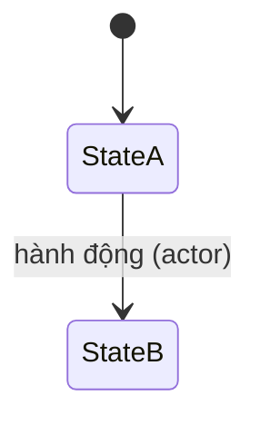

# <Nhóm nghiệp vụ> — đặc tả

> Mẫu cho `docs/specs/<feature>.md`. Mỗi file gom các use case của một nhóm (theo cột "Thư mục backend" của glossary). Xóa các dòng hướng dẫn `>` khi điền.

- **Nhóm:** `<Feature>` · **Sprint:** <1|2|3> · **Nguồn:** DA §2.2.3 / ĐX
- **Entity:** `<Entity>` (bảng `<table>`), … — xem [glossary](../domain/glossary.md)
- **Trạng thái triển khai:** xem [progress.md](../progress.md)

## Use case

### UC-SPA-NN — <Tên use case theo DA>

| Mục            | Nội dung |
| -------------- | -------- |
| Actor          |          |
| Mô tả          |          |
| Tiền điều kiện |          |
| Input          |          |
| Output         |          |

**Luồng chính**

1. …

**Luồng rẽ nhánh**

- A1. …

**Ngoại lệ** (mỗi ngoại lệ ghi mã lỗi API)

- E1. … → `400 <error_code>`

**Quy tắc áp dụng:** BR-xxx-NN, …

## Business rules

| Mã        | Quy tắc | Enforce ở đâu               | Nguồn   |
| --------- | ------- | --------------------------- | ------- |
| BR-XXX-01 |         | Domain / Application / CSDL | DA / ĐX |

## Trạng thái

## Dữ liệu

| Bảng | Cột chính | Ràng buộc đặc biệt |
| ---- | --------- | ------------------ |

## API

| Method | Đường dẫn | Vai trò | Request | Response | Lỗi |
| ------ | --------- | ------- | ------- | -------- | --- |

## Màn hình

| Mã  | Nền tảng | Route | Hành động chính |
| --- | -------- | ----- | --------------- |

## Kiểm thử bắt buộc

| Mã  | Tình huống | Kết quả mong đợi |
| --- | ---------- | ---------------- |

## Câu hỏi còn mở

- Q-xx (xem [open-questions.md](../decisions/open-questions.md))
